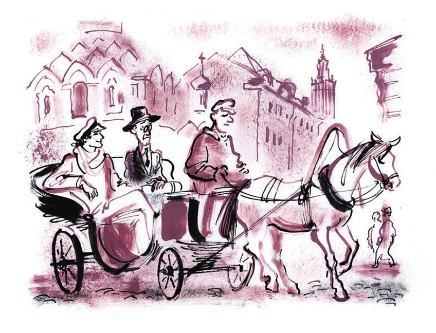

# Zweiter Teil: In Moskau

## Kapitel 15: Mitten im Ozean der Stühle

Die <abbr title="die Statistik, die Statistiken — статистика">Statistik</abbr> weiß alles. Man hat genau <abbr title="zählen — считать, учитывать">gezählt</abbr>, wie viel <abbr title="das Ackerland — пахотная земля">Ackerland</abbr> es in der UdSSR gibt: wie viel <abbr title="die Schwarzerde — чернозём">Schwarzerde</abbr>, wie viel <abbr title="der Lehm — суглинок, глина">Lehm</abbr> und wie viel <abbr title="der Löss — лёсс">Löss</abbr>. Alle Bürger, Männer und Frauen, stehen in ordentlichen, dicken Büchern. Ippolit Matwejewitsch Worobjaninow kennt diese Bücher sehr gut: Es sind die Bücher von den Standesämtern. Man weiß, wie viel von jedem <abbr title="das Lebensmittel, die Lebensmittel — продукт питания">Lebensmittel</abbr> der <abbr title="durchschnittlich — средний">durchschnittliche</abbr> Bürger der Republik in einem Jahr isst. Man weiß, wie viel Wodka dieser durchschnittliche Bürger <abbr title="im Durchschnitt — в среднем">im Durchschnitt</abbr> trinkt, und sogar ungefähr, was er dazu isst. Man weiß, wie viele Jäger es im Land gibt, wie viele <abbr title="die Ballerina, die Ballerinen — балерина">Ballerinen</abbr>, <abbr title="die Drehbank, die Drehbänke — токарный (револьверный) станок">Drehbänke</abbr>, Hunde von allen <abbr title="die Rasse, die Rassen — порода">Rassen</abbr>, Fahrräder, Denkmäler, Mädchen, <abbr title="der Leuchtturm, die Leuchttürme — маяк">Leuchttürme</abbr> und <abbr title="die Nähmaschine, die Nähmaschinen — швейная машинка">Nähmaschinen</abbr>.

Wie viel Leben voller <abbr title="das Feuer — пыл, огонь">Feuer</abbr>, Leidenschaft und Gedanken sieht uns aus den statistischen <abbr title="die Tabelle, die Tabellen — таблица">Tabellen</abbr> an!

Wer ist er, dieser <abbr title="der/die Einzelne — индивид">Einzelne</abbr> mit den rosa Wangen? Er sitzt an einem Tischchen, eine <abbr title="die Serviette, die Servietten — салфетка">Serviette</abbr> auf der Brust, und <abbr title="vertilgen — уничтожать, поглощать">vertilgt</abbr> mit großem Appetit <abbr title="dampfen — дымиться">dampfendes</abbr> Essen. Um ihn herum liegen ganze <abbr title="die Herde, die Herden — стадо">Herden</abbr> von kleinen <abbr title="der Stier, die Stiere — бык">Stieren</abbr>. Fette Schweine drängen sich in einer Ecke von der Tabelle. In einem besonderen statistischen <abbr title="das Becken, die Becken — бассейн">Becken</abbr> <abbr title="plätschern — плескаться">plätschern</abbr> unzählige <abbr title="der Stör, die Störe — осётр">Störe</abbr>, <abbr title="die Quappe, die Quappen — налим">Quappen</abbr> und andere Fische. Auf den Schultern, den Armen und dem Kopf von dem Einzelnen sitzen Hühner. In den <abbr title="die Federwolke, die Federwolken — перистое облако">Federwolken</abbr> fliegen Gänse, Enten und <abbr title="der Truthahn, die Truthähne — индюк">Truthähne</abbr>. Unter dem Tisch <abbr title="sich verstecken — прятаться">verstecken sich</abbr> zwei Kaninchen. Am <abbr title="der Horizont — горизонт">Horizont</abbr> stehen <abbr title="die Pyramide, die Pyramiden — пирамида">Pyramiden</abbr> und <abbr title="babylonisch — вавилонский">babylonische</abbr> Türme aus Brot. Eine kleine Festung aus <abbr title="die Marmelade, die Marmeladen — варенье">Marmelade</abbr> liegt an einem Fluss aus Milch. Eine Gurke, so groß wie der <abbr title="der Schiefe Turm von Pisa — Пизанская башня">Schiefe Turm von Pisa</abbr>, steht am Horizont. Hinter den <abbr title="die Festungsmauer, die Festungsmauern — крепостной вал">Festungsmauern</abbr> aus Salz und Pfeffer marschieren in <abbr title="die Halbkompanie, die Halbkompanien — полурота">Halbkompanien</abbr> die Weine, Wodkas und <abbr title="der Likör, die Liköre — наливка, ликёр">Liköre</abbr>. Ganz hinten, in der Nachhut, schleppt sich ein <abbr title="jämmerlich — жалкий">jämmerliches</abbr> Häufchen von <abbr title="alkoholfrei — безалкогольный">alkoholfreien</abbr> Getränken: <abbr title="dienstuntauglich — нестроевой">dienstuntaugliche</abbr> <abbr title="das Mineralwasser, die Mineralwässer — минеральная вода (нарзан)">Mineralwässer</abbr>, <abbr title="die Limonade, die Limonaden — лимонад">Limonaden</abbr> und <abbr title="der Siphon, die Siphons — сифон">Siphons</abbr> in Netzen aus Draht.

Wer ist denn dieser Einzelne mit den rosa Wangen – dieser <abbr title="der Vielfraß, die Vielfraße — обжора">Vielfraß</abbr>, <abbr title="der Säufer, die Säufer — пьяница">Säufer</abbr> und <abbr title="der Naschkater, die Naschkater — сладкоежка">Naschkater</abbr>?

Gargantua, der König der Dipsoden? Foss, der <abbr title="der Kraftmensch, die Kraftmenschen — силач">Kraftmensch</abbr>? Der legendäre Soldat Jaschka Rothemd? <abbr title="Lukullus — Лукулл">Lukullus</abbr>?

Es ist nicht Lukullus. Es ist Iwan Iwanowitsch Sidorow, oder Sidor Sidorowitsch Iwanow: der durchschnittliche Bürger. Im Durchschnitt isst er in seinem ganzen Leben alles, was auf der Tabelle zu sehen ist. Er ist ein normaler <abbr title="der Verbraucher, die Verbraucher — потребитель">Verbraucher</abbr> von <abbr title="die Kalorie, die Kalorien — калория">Kalorien</abbr> und <abbr title="das Vitamin, die Vitamine — витамин">Vitaminen</abbr>, ein stiller <abbr title="der Junggeselle, die Junggesellen — холостяк">Junggeselle</abbr> von vierzig Jahren. Er arbeitet in einem staatlichen Geschäft für <abbr title="die Kurzwaren (Pl.) — галантерея">Kurzwaren</abbr> und <abbr title="die Strickwaren (Pl.) — трикотаж">Strickwaren</abbr>.

Vor der Statistik kann man sich nirgends verstecken. Sie weiß genau, wie viele <abbr title="der Zahnarzt, die Zahnärzte — зубной врач">Zahnärzte</abbr> es gibt, wie viele <abbr title="die Wurstspritze, die Wurstspritzen — колбасный шприц">Wurstspritzen</abbr>, Hausmeister, <abbr title="der Filmregisseur, die Filmregisseure — кинорежиссёр">Filmregisseure</abbr>, <abbr title="die Prostituierte, die Prostituierten — проститутка">Prostituierte</abbr>, <abbr title="das Strohdach, die Strohdächer — соломенная крыша">Strohdächer</abbr>, Witwen, Kutscher und Glocken. Sie weiß sogar, wie viele <abbr title="der Statistiker, die Statistiker — статистик">Statistiker</abbr> es im Land gibt.

Nur eins weiß sie nicht.

Sie weiß nicht, wie viele Stühle es in der UdSSR gibt.

Es gibt sehr viele Stühle. Bei der letzten Volkszählung hatten die Sowjetrepubliken 143 Millionen <abbr title="der Einwohner, die Einwohner — житель">Einwohner</abbr>. Davon sind 90 Millionen Bauern. Sie sitzen lieber auf Bänken, auf dem warmen <abbr title="das Ofenbett, die Ofenbetten — полати">Ofenbett</abbr> oder auf der Erdbank vor dem Haus, und im Osten auf alten, abgewetzten Teppichen. Wenn man sie nicht mitzählt, bleiben trotzdem 53 Millionen Menschen. Für sie sind Stühle im Haushalt ein ganz notwendiger Gegenstand. Natürlich kann man sich beim Rechnen <abbr title="sich verrechnen — просчитаться">verrechnen</abbr>. Außerdem haben manche Bürger der Union die Gewohnheit, sich zwischen zwei Stühle zu setzen. Deshalb teilen wir die Zahl <abbr title="sicherheitshalber — на всякий случай">sicherheitshalber</abbr> durch zwei. Dann sind es immer noch mindestens 26 1/2 Millionen Stühle. Damit wir ganz sicher sind, <abbr title="verzichten auf + Akk. — отказываться от">verzichten</abbr> wir noch auf 6 1/2 Millionen. Die zwanzig Millionen, die übrig bleiben, sind die <abbr title="die Mindestzahl — минимальное число">Mindestzahl</abbr>.

In diesem Ozean von Stühlen gibt es Stühle aus Nussbaum, aus Eiche, aus <abbr title="die Esche — ясень">Esche</abbr>, aus <abbr title="der Palisander — палисандр">Palisander</abbr>, aus Mahagoni und aus karelischer <abbr title="die Birke, die Birken — берёза">Birke</abbr>. Es gibt Stühle aus <abbr title="die Fichte, die Fichten — ель">Fichte</abbr> und aus <abbr title="die Kiefer, die Kiefern — сосна">Kiefer</abbr>. Und mitten in diesem Ozean müssen die Helden von unserem Roman einen Gambs-Stuhl aus Nussbaum mit gebogenen Beinen finden. In seinem Bauch aus englischem Kattun <abbr title="verbergen (verbarg, hat verborgen) — скрывать, таить">verbirgt</abbr> er die Schätze von Madame Petuchowa.

Die Konzessionäre lagen nur in Socken auf den oberen <abbr title="die Liege, die Liegen — полка (в вагоне)">Liegen</abbr> im Zug und schliefen noch. Da fuhr der Zug vorsichtig über die Oka, wurde schneller und kam Moskau immer näher.

---

### Neue Wörter

- **die Statistik, die Statistiken** — статистика
- **zählen** — считать, учитывать
- **das Ackerland** — пахотная земля
- **die Schwarzerde** — чернозём
- **der Lehm** — суглинок, глина
- **der Löss** — лёсс
- **das Lebensmittel, die Lebensmittel** — продукт питания
- **durchschnittlich** — средний
- **im Durchschnitt** — в среднем
- **die Ballerina, die Ballerinen** — балерина
- **die Drehbank, die Drehbänke** — токарный (револьверный) станок
- **die Rasse, die Rassen** — порода
- **der Leuchtturm, die Leuchttürme** — маяк
- **die Nähmaschine, die Nähmaschinen** — швейная машинка
- **das Feuer** — пыл, огонь
- **die Tabelle, die Tabellen** — таблица
- **der/die Einzelne** — индивид
- **die Serviette, die Servietten** — салфетка
- **vertilgen** — уничтожать, поглощать
- **dampfen** — дымиться
- **die Herde, die Herden** — стадо
- **der Stier, die Stiere** — бык
- **das Becken, die Becken** — бассейн
- **plätschern** — плескаться
- **der Stör, die Störe** — осётр
- **die Quappe, die Quappen** — налим
- **die Federwolke, die Federwolken** — перистое облако
- **der Truthahn, die Truthähne** — индюк
- **sich verstecken** — прятаться
- **der Horizont** — горизонт
- **die Pyramide, die Pyramiden** — пирамида
- **babylonisch** — вавилонский
- **die Marmelade, die Marmeladen** — варенье
- **der Schiefe Turm von Pisa** — Пизанская башня
- **die Festungsmauer, die Festungsmauern** — крепостной вал
- **die Halbkompanie, die Halbkompanien** — полурота
- **der Likör, die Liköre** — наливка, ликёр
- **jämmerlich** — жалкий
- **alkoholfrei** — безалкогольный
- **dienstuntauglich** — нестроевой
- **das Mineralwasser, die Mineralwässer** — минеральная вода (нарзан)
- **die Limonade, die Limonaden** — лимонад
- **der Siphon, die Siphons** — сифон
- **der Vielfraß, die Vielfraße** — обжора
- **der Säufer, die Säufer** — пьяница
- **der Naschkater, die Naschkater** — сладкоежка
- **der Kraftmensch, die Kraftmenschen** — силач
- **Lukullus** — Лукулл
- **der Verbraucher, die Verbraucher** — потребитель
- **die Kalorie, die Kalorien** — калория
- **das Vitamin, die Vitamine** — витамин
- **der Junggeselle, die Junggesellen** — холостяк
- **die Kurzwaren (Pl.)** — галантерея
- **die Strickwaren (Pl.)** — трикотаж
- **der Zahnarzt, die Zahnärzte** — зубной врач
- **die Wurstspritze, die Wurstspritzen** — колбасный шприц
- **der Filmregisseur, die Filmregisseure** — кинорежиссёр
- **die Prostituierte, die Prostituierten** — проститутка
- **das Strohdach, die Strohdächer** — соломенная крыша
- **der Statistiker, die Statistiker** — статистик
- **der Einwohner, die Einwohner** — житель
- **das Ofenbett, die Ofenbetten** — полати
- **sich verrechnen** — просчитаться
- **sicherheitshalber** — на всякий случай
- **verzichten auf + Akk.** — отказываться от
- **die Mindestzahl** — минимальное число
- **die Esche** — ясень
- **der Palisander** — палисандр
- **die Birke, die Birken** — берёза
- **die Fichte, die Fichten** — ель
- **die Kiefer, die Kiefern** — сосна
- **verbergen (verbarg, hat verborgen)** — скрывать, таить
- **die Liege, die Liegen** — полка (в вагоне)

[← Kapitel 14](kapitel-14.md) · [Inhalt](README.md) · [Kapitel 16 →](kapitel-16.md)
