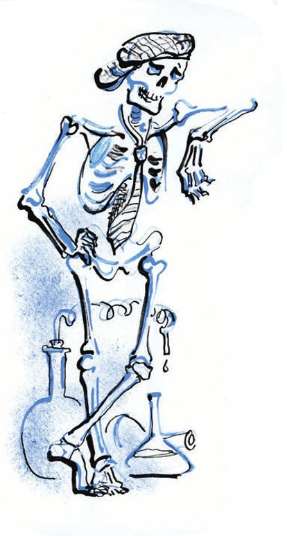
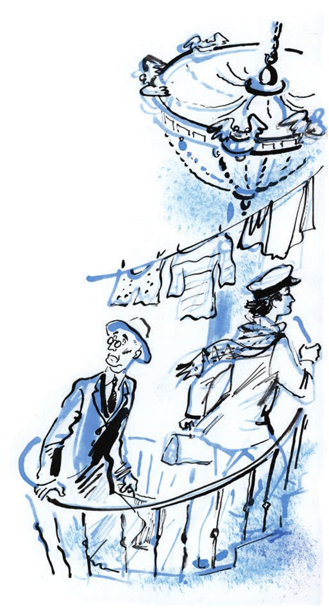

## Kapitel 16: Das Wohnheim «Mönch Berthold Schwarz»

Ippolit Matwejewitsch und Ostap standen am offenen Fenster von einem Wagen der dritten Klasse und drückten sich <abbr title="gegenseitig — друг друга">gegenseitig</abbr> zur Seite. Sie sahen aufmerksam hinaus: auf die Kühe, die langsam vom <abbr title="der Bahndamm, die Bahndämme — насыпь">Bahndamm</abbr> hinuntergingen, auf die <abbr title="der Nadelbaum, die Nadelbäume — хвойное дерево, хвоя">Nadelbäume</abbr> und auf die kleinen Bahnsteige aus <abbr title="das Brett, die Bretter — доска">Brettern</abbr> bei den <abbr title="die Datsche, die Datschen — дача">Datschen</abbr>.

Alle Witze für die Reise waren schon erzählt. Die «Stargoroder Prawda» vom Dienstag hatten sie bis zu den Anzeigen gelesen, und sie war voll von <abbr title="der Fettfleck, die Fettflecken — масляное пятно">Fettflecken</abbr>. Alle Hähnchen, Eier und Oliven waren aufgegessen.

Jetzt kam das <abbr title="quälend — томительный, мучительный">quälendste</abbr> Stück vom Weg: die letzte Stunde vor Moskau.

Aus kleinen, <abbr title="licht — редкий, светлый">lichten</abbr> Wäldern sprangen fröhliche kleine Datschen bis zum Bahndamm. Manche waren <abbr title="der Holzpalast, die Holzpaläste — деревянный дворец">Holzpaläste</abbr> mit glänzenden <abbr title="die Glasveranda, die Glasveranden — стеклянная веранда">Glasveranden</abbr> und frisch gestrichenen Eisendächern. Andere waren einfache <abbr title="die Blockhütte, die Blockhütten — сруб">Blockhütten</abbr> mit winzigen, <abbr title="quadratisch — квадратный">quadratischen</abbr> Fensterchen – richtige <abbr title="die Falle, die Fallen — капкан, ловушка">Fallen</abbr> für <abbr title="der Sommergast, die Sommergäste — дачник">Sommergäste</abbr>.

Die anderen Fahrgäste sahen wie Kenner auf den Horizont. Sie erzählten sich die <abbr title="die Vergangenheit — прошлое">Vergangenheit</abbr> und die <abbr title="die Gegenwart — настоящее">Gegenwart</abbr> von Moskau und <abbr title="verdrehen — перевирать">verdrehten</abbr> dabei alles, was sie noch von der Schlacht an der Kalka wussten. Währenddessen versuchte Ippolit Matwejewitsch <abbr title="hartnäckig — упорно">hartnäckig</abbr>, sich das Möbelmuseum vorzustellen. Er sah das Museum wie einen <abbr title="kilometerlang — многоверстный">kilometerlangen</abbr> Flur vor sich. An den Wänden standen die Stühle in langen Reihen, wie <abbr title="das Spalier, die Spaliere — шпалеры, строй">Spalier</abbr>. Worobjaninow sah sich selbst, wie er schnell zwischen ihnen hindurchlief.

— Wie es mit dem Möbelmuseum wird, weiß man noch nicht. Ob es klappt? — sagte er beunruhigt.

— Sie sollten sich schon mit <abbr title="die Elektrizität — электричество">Elektrizität</abbr> <abbr title="behandeln — лечить">behandeln</abbr> lassen, Adelsmarschall. Machen Sie keine <abbr title="vorzeitig — преждевременный">vorzeitige</abbr> <abbr title="die Hysterie — истерика">Hysterie</abbr>. Wenn Sie sich schon <abbr title="sich aufregen — волноваться, переживать">aufregen</abbr> müssen, dann regen Sie sich bitte leise auf.

Der Zug hüpfte über die Weichen. Die <abbr title="der Signalmast, die Signalmasten — семафор">Signalmasten</abbr> sahen ihn an und rissen den Mund auf. Es gab immer mehr Gleise. Man fühlte, dass ein riesiger <abbr title="der Eisenbahnknoten, die Eisenbahnknoten — железнодорожный узел">Eisenbahnknoten</abbr> näher kam. Das Gras verschwand, statt Gras gab es nur noch <abbr title="die Schlacke — шлак">Schlacke</abbr>. <abbr title="die Rangierlok, die Rangierloks — маневровый паровоз">Rangierloks</abbr> pfiffen. Die <abbr title="der Weichensteller, die Weichensteller — стрелочник">Weichensteller</abbr> <abbr title="blasen (blies, hat geblasen) — дуть, трубить">bliesen</abbr> in ihre Hörner. Plötzlich wurde der Lärm stärker. Der Zug rollte in einen Flur zwischen leeren <abbr title="der Güterzug, die Güterzüge — товарный состав">Güterzügen</abbr>. Er klickte wie ein <abbr title="das Drehkreuz, die Drehkreuze — турникет">Drehkreuz</abbr> und begann, die Wagen zu zählen.

Die Gleise <abbr title="sich verdoppeln — удваиваться">verdoppelten sich</abbr>.

Der Zug sprang aus dem Flur. Die Sonne schlug ihm ins Gesicht. Ganz unten, direkt über dem Boden, liefen die <abbr title="die Weichenlaterne, die Weichenlaternen — стрелочный фонарь">Weichenlaternen</abbr> <abbr title="auseinanderlaufen — разбегаться">auseinander</abbr>. Sie sahen aus wie kleine <abbr title="das Beil, die Beile — топорик">Beile</abbr>. Überall war Rauch. Die Lokomotive schnaufte und ließ einen schneeweißen Backenbart aus Dampf heraus. Auf der <abbr title="die Drehscheibe, die Drehscheiben — поворотный круг">Drehscheibe</abbr> schrie man. Die Arbeiter vom Depot trieben eine Lokomotive in ihren Stall.

Der Zug bremste <abbr title="scharf — резко">scharf</abbr>, und seine <abbr title="das Gelenk, die Gelenke — сустав">Gelenke</abbr> knackten. Alles quietschte. Ippolit Matwejewitsch dachte, er war im <abbr title="das Königreich, die Königreiche — царство">Königreich</abbr> von den Zahnschmerzen. Der Zug <abbr title="anlegen — причаливать">legte</abbr> am Bahnsteig aus Asphalt an wie ein Schiff.

Das war Moskau. Das war der Rjasaner Bahnhof – der frischeste und neueste von allen Moskauer Bahnhöfen.

Keiner von den acht anderen Bahnhöfen in Moskau hat so große und hohe <abbr title="der Raum, die Räume — помещение">Räume</abbr> wie der Rjasaner. Der ganze Jaroslawler Bahnhof mit seinen <abbr title="pseudorussisch — псевдорусский">pseudorussischen</abbr> Kämmen auf dem Dach und seinen <abbr title="heraldisch — геральдический">heraldischen</abbr> Hühnchen passt leicht in das große Bahnhofsrestaurant vom Rjasaner Bahnhof.

Die Moskauer Bahnhöfe sind die Tore von der Stadt. Jeden Tag lassen sie dreißigtausend Fahrgäste hinein und hinaus. Durch den Alexander-Bahnhof kommt der <abbr title="der Ausländer, die Ausländer — иностранец">Ausländer</abbr> nach Moskau. Er hat <abbr title="die Sohle, die Sohlen — подошва">Sohlen</abbr> aus <abbr title="der Kautschuk — каучук">Kautschuk</abbr> und trägt einen <abbr title="der Golfanzug, die Golfanzüge — костюм для гольфа">Golfanzug</abbr>: weite <abbr title="die Pumphose, die Pumphosen — шаровары">Pumphosen</abbr> und dicke Wollstrümpfe. Durch den Kursker Bahnhof kommt der Mann aus dem <abbr title="der Kaukasus — Кавказ">Kaukasus</abbr>. Er trägt eine braune Mütze aus Lammfell mit kleinen Löchern zum <abbr title="lüften — проветривать">Lüften</abbr>. Durch den Kursker Bahnhof kommt auch der große Mann von der Wolga mit seinem Bart wie aus <abbr title="der Hanf — пенька, конопля">Hanf</abbr>. Aus dem Oktober-Bahnhof springt ein halb <abbr title="verantwortlich — ответственный">verantwortlicher</abbr> <abbr title="der Funktionär, die Funktionäre — работник, функционер">Funktionär</abbr> mit einer <abbr title="die Aktentasche, die Aktentaschen — портфель">Aktentasche</abbr> aus herrlichem <abbr title="das Schweinsleder — свиная кожа">Schweinsleder</abbr>. Er ist aus Leningrad gekommen, in Sachen <abbr title="die Verknüpfung — увязка">Verknüpfung</abbr>, <abbr title="die Abstimmung — согласование">Abstimmung</abbr> und konkreter <abbr title="die Erfassung — охват">Erfassung</abbr>. Die Leute aus Kiew und Odessa kommen über den Brjansker Bahnhof in die Hauptstadt. Schon an der Station Tichonowa Pustyn fangen die Kiewer an, verächtlich zu lächeln. Sie wissen ganz genau: Der Kreschtschatik ist die beste Straße auf der Welt. Die Leute aus Odessa schleppen <abbr title="der Korb, die Körbe — корзина">Körbe</abbr> und flache Kisten mit <abbr title="geräuchert — копчёный">geräucherter</abbr> <abbr title="die Makrele, die Makrelen — скумбрия">Makrele</abbr>. Auch sie kennen die beste Straße auf der Welt. Aber das ist natürlich nicht der Kreschtschatik. Das ist die Lassalle-Straße, die frühere Deribassowskaja. Aus Saratow, Atkarsk, Tambow, Rtischtschewo und Koslow kommt man über den Pawelezker Bahnhof nach Moskau. Die wenigsten Menschen kommen über den Saweljowoer Bahnhof. Das sind <abbr title="der Schuhmacher, die Schuhmacher — башмачник, сапожник">Schuhmacher</abbr> aus Taldom, Bewohner von der Stadt Dmitrow, Arbeiter von der <abbr title="die Textilfabrik, die Textilfabriken — мануфактура, текстильная фабрика">Textilfabrik</abbr> in Jachroma oder ein <abbr title="trübsinnig — унылый">trübsinniger</abbr> Sommergast, der im Winter und im Sommer an der Station Chlebnikowo wohnt. Mit diesem Zug ist man nicht lange unterwegs: Die längste Strecke auf dieser Linie ist hundertdreißig Werst. Über den Jaroslawler Bahnhof kommen die Leute aus Wladiwostok, Chabarowsk und Tschita in die Hauptstadt, aus fernen und großen Städten.

Die seltsamsten Fahrgäste kommen aber doch am Rjasaner Bahnhof an. Das sind Usbeken mit weißen <abbr title="der Turban, die Turbane — чалма">Turbanen</abbr> aus Musselin und mit Mänteln voller Blumen. Das sind Tadschiken mit roten Bärten, Turkmenen, Leute aus Chiwa und aus Buchara. Über ihren Republiken <abbr title="scheinen (schien, hat geschienen) — светить, сиять">scheint</abbr> eine ewige Sonne.

Nur mit Mühe kamen die Konzessionäre zum Ausgang durch, und dann standen sie auf dem Kalantschow-Platz. Rechts von ihnen <abbr title="ragen — возвышаться">ragten</abbr> die heraldischen Hühnchen vom Jaroslawler Bahnhof <abbr title="emporragen — возвышаться">empor</abbr>. Direkt gegenüber glänzte matt der Oktober-Bahnhof. Er war mit <abbr title="die Ölfarbe, die Ölfarben — масляная краска">Ölfarbe</abbr> in zwei Farben gestrichen. Seine Uhr zeigte fünf nach zehn. Auf der Uhr vom Jaroslawler Bahnhof war es genau zehn. Dann sahen die Reisenden auf das dunkelblaue <abbr title="das Zifferblatt, die Zifferblätter — циферблат">Zifferblatt</abbr> vom Rjasaner Bahnhof, das mit den <abbr title="das Tierkreiszeichen, die Tierkreiszeichen — знак зодиака">Tierkreiszeichen</abbr> <abbr title="schmücken — украшать">geschmückt</abbr> war. Es zeigte fünf vor zehn.

— Sehr <abbr title="praktisch — удобный">praktisch</abbr> für ein <abbr title="das Rendezvous, die Rendezvous — свидание">Rendezvous</abbr>! — sagte Ostap. — Man hat immer zehn Minuten <abbr title="der Vorsprung — фора">Vorsprung</abbr>.

Der Kutscher machte mit den Lippen ein Geräusch wie einen Kuss. Sie fuhren unter einer Brücke durch, und vor den Reisenden öffnete sich das großartige <abbr title="das Panorama, die Panoramen — панорама">Panorama</abbr> von der Hauptstadt.

Die Hauptverwaltung für Wissenschaft hatte das Rote Tor mit viel <abbr title="die Sorgfalt — тщание, старание">Sorgfalt</abbr> <abbr title="restaurieren — реставрировать">restauriert</abbr>. Neben dem Tor standen Maler, die ganz voll mit <abbr title="der Kalk — известь">Kalk</abbr> waren und riesige <abbr title="der Pinsel, die Pinsel — кисть">Pinsel</abbr> hatten. Auch <abbr title="der Zimmermann, die Zimmerleute — плотник">Zimmerleute</abbr> mit Sägen, <abbr title="der Stuckateur, die Stuckateure — штукатур">Stuckateure</abbr> und <abbr title="der Maurer, die Maurer — каменщик">Maurer</abbr> standen da. Sie klebten dicht an der Ecke von der Sadowo-Spasskaja-Straße.

— Der <abbr title="der Reservepalast — Запасный дворец">Reservepalast</abbr>, — sagte Ippolit Matwejewitsch. Er sah auf das lange weiß-grüne Gebäude an der Neuen Basmannaja-Straße.

— In diesem Palast habe ich auch gearbeitet, — sagte Ostap. — Das ist übrigens kein Palast, sondern das Verkehrsministerium. Dort tragen die Angestellten wahrscheinlich immer noch die <abbr title="das Abzeichen, die Abzeichen — нагрудный знак, значок">Abzeichen</abbr> aus Emaille. Die habe ich erfunden und verkauft.

— Wohin fahren wir eigentlich? — fragte Ippolit Matwejewitsch.

— Zu guten Menschen, — antwortete Ostap. — In Moskau gibt es eine Menge davon. Und alle kenne ich.

— Und bei ihnen wohnen wir?

— Es ist ein <abbr title="das Wohnheim, die Wohnheime — общежитие">Wohnheim</abbr>. Wenn nicht bei dem einen, dann findet man bei einem anderen immer einen Platz.

Im kleinen Park gegenüber vom Bolschoi-Theater stand schon eine kleine <abbr title="die Palme, die Palmen — пальма">Palme</abbr>. Sie <abbr title="ankündigen — объявлять, анонсировать">kündigte an</abbr>: Der Sommer ist da. Wer frische Luft atmen will, muss sofort mindestens zweitausend Werst weit wegfahren.

In den <abbr title="akademisch — академический">akademischen</abbr> Theatern wütete noch der Winter. Die Wintersaison war in vollem <abbr title="der Gang — ход">Gang</abbr>. Die Plakate kündigten die <abbr title="die Premiere, die Premieren — премьера">Premiere</abbr> von der Oper «Die Liebe zu den drei <abbr title="die Orange, die Orangen — апельсин">Orangen</abbr>» an. Dazu das «Letzte Konzert vor der Reise ins Ausland von dem berühmten <abbr title="der Tenor, die Tenöre — тенор">Tenor</abbr> Dmitri Smirnow». Und im Ersten Staatszirkus der weltberühmte Kapitän mit seinen sechzig <abbr title="das Krokodil, die Krokodile — крокодил">Krokodilen</abbr>.

Im Ochotny Rjad war große Aufregung.

<abbr title="der Straßenhändler, die Straßenhändler — лоточник, уличный торговец">Straßenhändler</abbr> ohne <abbr title="die Lizenz, die Lizenzen — патент, лицензия">Lizenz</abbr> liefen in alle Richtungen davon. Ihre <abbr title="der Bauchladen, die Bauchläden — лоток">Bauchläden</abbr> trugen sie auf dem Kopf, und sie sahen aus wie Gänse.

Ein Milizionär <abbr title="traben — трусить, бежать трусцой">trabte</abbr> faul hinter ihnen her. Obdachlose Kinder saßen neben einem <abbr title="der Kessel, die Kessel — котёл, чан">Kessel</abbr> mit Asphalt. Sie <abbr title="einatmen — вдыхать">atmeten</abbr> mit großem <abbr title="der Genuss — наслаждение">Genuss</abbr> den Geruch von kochendem <abbr title="der Teer — смола, гудрон">Teer</abbr> ein.

Sie fuhren auf den Arbat-Platz, dann über den Pretschistenka-<abbr title="der Boulevard, die Boulevards — бульвар">Boulevard</abbr>. Dann bogen sie rechts ab und hielten in der Gasse Siwzew Wraschek.

— Was ist das für ein Haus? — fragte Ippolit Matwejewitsch.

Ostap sah auf das rosa Häuschen mit dem <abbr title="das Mansardenzimmer, die Mansardenzimmer — мезонин">Mansardenzimmer</abbr> und antwortete:

— Das Wohnheim für <abbr title="der Chemiestudent, die Chemiestudenten — студент-химик">Chemiestudenten</abbr> «Mönch Berthold Schwarz».

— Wirklich ein Mönch?

— Na, das war ein Witz, ein Witz. Es heißt «Genosse Semaschko».

Wie es sich für ein normales Moskauer Studentenwohnheim <abbr title="sich gehören — полагаться, подобать">gehört</abbr>, wohnten im Haus von den Chemiestudenten schon lange Leute, die mit Chemie nur sehr wenig zu tun hatten. Die Studenten waren in alle Richtungen verschwunden. Ein Teil hatte das <abbr title="das Studium — учёба, курс">Studium</abbr> abgeschlossen und war zur Arbeit in andere Städte gefahren. Ein anderer Teil war wegen schlechter <abbr title="die Leistung, die Leistungen — успеваемость, достижение">Leistungen</abbr> von der Universität <abbr title="fliegen (flog, ist geflogen) — вылететь (разг.: быть исключённым)">geflogen</abbr>. Gerade dieser Teil wurde jedes Jahr größer. Und er machte aus dem rosa Häuschen etwas zwischen einer Wohnungsgenossenschaft und einem <abbr title="feudal — феодальный">feudalen</abbr> Dorf. Immer wieder versuchten neue Studenten, in das Wohnheim einzudringen, aber <abbr title="vergeblich — тщетно, напрасно">vergeblich</abbr>. Die Ex-Chemiker waren <abbr title="ungeheuer — необыкновенно">ungeheuer</abbr> <abbr title="erfinderisch — изобретательный">erfinderisch</abbr> und <abbr title="zurückschlagen (schlug zurück, hat zurückgeschlagen) — отражать (атаку)">schlugen</abbr> alle Angriffe zurück. Am Ende gab man das Häuschen auf. Es galt jetzt als «wild» und verschwand von allen Plänen von der Moskauer Wohnungsverwaltung. Es war, als ob es das Haus gar nicht gab. Aber es gab das Haus doch, und es wohnten Menschen darin.

Die Konzessionäre stiegen die Treppe in den ersten Stock hinauf und bogen in einen ganz dunklen Flur ab.

— Licht und Luft, — sagte Ostap.

Plötzlich schnaufte im Dunkeln jemand laut, direkt neben dem Ellbogen von Ippolit Matwejewitsch.

— Keine Angst, — sagte Ostap. — Das ist nicht im Flur. Das ist hinter der Wand. <abbr title="das Sperrholz — фанера">Sperrholz</abbr> ist, wie man aus der <abbr title="die Physik — физика">Physik</abbr> weiß, der beste <abbr title="der Schallleiter, die Schallleiter — проводник звука">Schallleiter</abbr>. Vorsicht! Halten Sie sich an mir fest! Hier irgendwo muss ein <abbr title="feuerfest — несгораемый">feuerfester</abbr> Schrank stehen.

Sofort schrie Worobjaninow laut auf. Er war mit der Brust gegen eine scharfe Eisenecke gestoßen. Der Schrei zeigte: Der Schrank war wirklich irgendwo hier.

— Was, tut es weh? — fragte Ostap. — Das ist noch gar nichts. Das sind nur <abbr title="körperlich — физический">körperliche</abbr> Schmerzen. Aber wie viele <abbr title="seelisch — моральный, душевный">seelische</abbr> Qualen gab es hier! Es ist <abbr title="grauenhaft — жутко">grauenhaft</abbr>, daran zu denken. Hier gleich daneben stand das <abbr title="das Skelett, die Skelette — скелет">Skelett</abbr> von dem Studenten Iwanopulo. Er hatte es auf dem Suchariewka-Markt gekauft, aber er hatte Angst, es in seinem Zimmer zu haben. Deshalb stießen die Besucher zuerst gegen den <abbr title="der Geldschrank, die Geldschränke — несгораемая касса, сейф">Geldschrank</abbr>, und dann fiel das Skelett auf sie. Die <abbr title="schwanger — беременный">schwangeren</abbr> Frauen waren sehr unzufrieden.

Über eine <abbr title="die Wendeltreppe, die Wendeltreppen — винтовая лестница">Wendeltreppe</abbr> stiegen die Kompagnons hinauf in die Mansarde. Das große Zimmer oben war mit <abbr title="die Trennwand, die Trennwände — перегородка">Trennwänden</abbr> aus Sperrholz in lange <abbr title="die Scheibe, die Scheiben — ломоть, кусок">Scheiben</abbr> <abbr title="zerschneiden (zerschnitt, hat zerschnitten) — разрезать">zerschnitten</abbr>. Jede Scheibe war nur anderthalb Meter breit. Die Zimmer sahen aus wie <abbr title="das Federmäppchen, die Federmäppchen — пенал">Federmäppchen</abbr>. Es gab nur einen Unterschied: Hier lagen nicht nur Bleistifte und Füller, sondern auch Menschen und <abbr title="der Primuskocher, die Primuskocher — примус">Primuskocher</abbr>.

— Bist du zu Hause, Kolja? — fragte Ostap leise. Er war vor der mittleren Tür stehen geblieben.

Da wurde es in allen fünf Federmäppchen unruhig, und alle redeten durcheinander.

— Ja, — antwortete man hinter der Tür.

— Schon wieder Gäste bei diesem Dummkopf, so früh am Morgen! — flüsterte eine Frauenstimme aus dem Federmäppchen ganz links.

— Lasst doch den Menschen schlafen! — brummte Federmäppchen Nummer 2.

Im dritten Federmäppchen zischte man fröhlich:

— Zu Kolka kommt die Miliz. Wegen der Fensterscheibe von gestern.

Im fünften Federmäppchen war es still. Dort wieherte ein Primuskocher, und man küsste sich.

Ostap stieß mit dem Fuß die Tür auf. Der ganze Bau aus Sperrholz wackelte, und die Konzessionäre gingen in Kolkas Spalt. Was Ostap da sah, sah <abbr title="harmlos — невинный, безобидный">harmlos</abbr> aus. Aber es war schrecklich. An Möbeln gab es im Zimmer nur eine rot gestreifte Matratze auf vier Ziegeln. Aber das <abbr title="beunruhigen — беспокоить, тревожить">beunruhigte</abbr> Ostap nicht. Kolkas Möbel kannte er schon lange. Auch Kolka selbst <abbr title="überraschen — удивлять">überraschte</abbr> ihn nicht. Er saß mit den Füßen auf der Matratze. Aber neben ihm saß ein so <abbr title="himmlisch — небесный">himmlisches</abbr> <abbr title="das Geschöpf, die Geschöpfe — создание, существо">Geschöpf</abbr>, dass Ostaps Gesicht sofort dunkel wurde. Solche Mädchen sind nie nur <abbr title="die Geschäftsbekanntschaft, die Geschäftsbekanntschaften — деловое знакомство">Geschäftsbekanntschaften</abbr>. Dafür haben sie zu blaue Augen und einen zu sauberen Hals. Solche Mädchen sind Geliebte oder, noch schlimmer, Ehefrauen – und zwar geliebte Ehefrauen. Und wirklich: Kolja nannte das Geschöpf Lisa, sagte «du» zu ihr und machte ihr mit den Fingern <abbr title="das Hörnchen, die Hörnchen — рожки">Hörnchen</abbr>.

Ippolit Matwejewitsch nahm seinen <abbr title="der Kastorhut, die Kastorhüte — касторовая шляпа">Kastorhut</abbr> ab. Ostap rief Kolja in den Flur. Dort flüsterten sie lange.

— Ein herrlicher Morgen, gnädige Frau, — sagte Ippolit Matwejewitsch. Er fühlte sich sehr <abbr title="befangen — стеснённый, скованный">befangen</abbr>.

Die gnädige Frau mit den blauen Augen lachte. Dann sprach sie – ohne jeden <abbr title="der Zusammenhang, die Zusammenhänge — связь">Zusammenhang</abbr> mit dem, was Ippolit Matwejewitsch gesagt hatte – darüber, was für Dummköpfe im Federmäppchen nebenan wohnten.

— Sie machen extra den Primuskocher an, damit man nicht hört, wie sie sich küssen. Aber verstehen Sie, das ist doch dumm. Wir hören alles. Dafür hören sie wirklich nichts mehr, wegen ihrem Primuskocher. Soll ich es Ihnen zeigen? Hören Sie zu.

Und die Frau von Kolja, die alle Geheimnisse vom Primuskocher kannte, sagte laut:

— Die Swerews sind Dummköpfe!

Hinter der Wand hörte man den höllischen Gesang vom Primuskocher und das Geräusch von Küssen.

— Sehen Sie? Sie hören nichts. Die Swerews sind Dummköpfe, <abbr title="der Holzkopf, die Holzköpfe — болван">Holzköpfe</abbr> und <abbr title="der Psychopath, die Psychopathen — психопат">Psychopathen</abbr>. Sehen Sie?

— Ja, — sagte Ippolit Matwejewitsch.

— Und wir haben keinen Primuskocher. Wozu? Wir gehen zum Mittagessen in die <abbr title="vegetarisch — вегетарианский">vegetarische</abbr> Kantine, obwohl ich gegen die vegetarische Kantine bin. Aber als Kolja und ich geheiratet haben, hat er davon geträumt, wie wir zusammen in die vegetarische Kantine gehen. Na, und jetzt gehen wir eben. Ich esse sehr gern Fleisch. Aber dort gibt es Frikadellen aus Nudeln. Nur, bitte, sagen Sie Kolja nichts …

In diesem Moment kamen Kolja und Ostap zurück.

— Na gut, wenn man bei dir absolut nicht wohnen kann, dann gehen wir zu Pantelei.

— Richtig, Jungs, — rief Kolja. — Geht zu Iwanopulo. Der ist einer von uns.

— Besuchen Sie uns doch mal, — sagte Koljas Frau. — Mein Mann und ich würden uns sehr freuen.

— Schon wieder laden sie Gäste ein! — <abbr title="sich empören — возмущаться">empörte</abbr> man sich im Federmäppchen ganz links. — Haben sie noch nicht genug Gäste?

— Und Sie sind Dummköpfe, Holzköpfe und Psychopathen. Das geht Sie nichts an! — sagte Koljas Frau mit normaler Stimme.

— Hörst du, Iwan Andrejewitsch, — rief man aufgeregt im Federmäppchen ganz links, — deine Frau wird <abbr title="beleidigen — оскорблять">beleidigt</abbr>, und du sagst nichts!

Auch die <abbr title="unsichtbar — невидимый">unsichtbaren</abbr> <abbr title="der Kommentator, die Kommentatoren — комментатор">Kommentatoren</abbr> aus den anderen Federmäppchen meldeten sich zu Wort. Der <abbr title="der Wortwechsel, die Wortwechsel — перепалка">Wortwechsel</abbr> wurde immer größer. Die Kompagnons gingen nach unten, zu Iwanopulo.

Der Student war nicht zu Hause. Ippolit Matwejewitsch <abbr title="anzünden — зажигать">zündete</abbr> ein <abbr title="das Streichholz, die Streichhölzer — спичка">Streichholz</abbr> an. An der Tür hing ein Zettel: «Komme nicht vor 9 Uhr. Pantelei.»

— Macht nichts, — sagte Ostap. — Ich weiß, wo der Schlüssel ist.

Er tastete unter dem feuerfesten Geldschrank, holte den Schlüssel heraus und öffnete die Tür.

Das Zimmer von dem Studenten Iwanopulo war genauso groß wie das Zimmer von Kolja. Aber es war ein <abbr title="das Eckzimmer, die Eckzimmer — угловая комната">Eckzimmer</abbr>. Eine Wand war aus Stein, und darauf war der Student sehr stolz. Ippolit Matwejewitsch merkte <abbr title="betrübt — огорчённо">betrübt</abbr>, dass der Student nicht einmal eine Matratze hatte.

— Wir richten uns prima ein, — sagte Ostap. — Ein <abbr title="anständig — приличный">anständiges</abbr> <abbr title="das Raummaß — кубатура">Raummaß</abbr> für Moskau. Wenn wir uns alle drei auf den Boden legen, bleibt sogar noch ein bisschen Platz. Aber Pantelei ist ein Hundesohn! Wo hat er die Matratze <abbr title="hintun (tat hin, hat hingetan) — девать, деть">hingetan</abbr>, möchte ich wissen?

Das Fenster ging auf die Gasse. Dort ging ein Milizionär auf und ab. Gegenüber, in einem Häuschen wie ein <abbr title="gotisch — готический">gotischer</abbr> Turm, war die <abbr title="die Botschaft, die Botschaften — посольство">Botschaft</abbr> von einem winzigen Staat. Hinter einem <abbr title="das Eisengitter, die Eisengitter — железная решётка">Eisengitter</abbr> spielte man Tennis. Ein weißer Ball flog hin und her. Man hörte kurze Rufe.

— Aus, — sagte Ostap. — Kein hohes <abbr title="das Niveau — уровень, класс">Niveau</abbr>. Aber ruhen wir uns aus.

Die Konzessionäre <abbr title="ausbreiten — расстилать">breiteten</abbr> Zeitungen auf dem Boden aus. Ippolit Matwejewitsch holte sein kleines <abbr title="das Sofakissen, die Sofakissen — подушка-думка">Sofakissen</abbr> heraus, das er immer mitnahm.

Sie lagen noch nicht richtig auf den <abbr title="das Telegramm, die Telegramme — телеграмма">Telegrammen</abbr> und den Nachrichten aus dem Theaterleben, da hörten sie im Nachbarzimmer, wie jemand das Fenster öffnete. Der Nachbar von Pantelei rief den Tennisspielern <abbr title="herausfordernd — вызывающе">herausfordernd</abbr> zu:

— Es lebe die Sowjetrepublik! <abbr title="nieder mit + Dat. — долой">Nieder mit</abbr> den <abbr title="das Raubtier, die Raubtiere — хищник">Raub-tie-ren</abbr> des Im-pe-ri-a-lis-mus!

Diese Rufe <abbr title="sich wiederholen — повторяться">wiederholten sich</abbr> ungefähr zehn Minuten lang. Ostap wunderte sich und stand vom Boden auf.

— Was ist das für ein <abbr title="der Sammler, die Sammler — коллекционер">Sammler</abbr> von Raubtieren?

Er lehnte sich über das <abbr title="das Fensterbrett, die Fensterbretter — подоконник">Fensterbrett</abbr> und sah nach rechts. Am Nachbarfenster sah er zwei junge Männer. Ostap merkte sofort: Sie riefen nur dann etwas über Raubtiere, wenn der Milizionär von dem <abbr title="der Posten, die Posten — пост">Posten</abbr> vor der Botschaft an ihrem Fenster vorbeiging. Der Milizionär sah besorgt mal auf die jungen Männer, mal hinter das Gitter, wo man Tennis spielte. Seine Lage war schwer. Die Rufe über die Raubtiere hörten nicht auf, und er wusste nicht, was er tun sollte. Auf der einen Seite waren diese Rufe ganz natürlich, und es war nichts Unanständiges daran. Auf der anderen Seite: Die Raubtiere in weißen Hosen, die hinter dem Gitter Tennis spielten, könnten die Rufe auf sich <abbr title="beziehen auf + Akk. (bezog, hat bezogen) — принимать на свой счёт">beziehen</abbr> und beleidigt sein. Der Milizionär konnte diese <abbr title="die Konjunktur — конъюнктура, ситуация">Konjunktur</abbr> nicht <abbr title="durchschauen — разобраться в">durchschauen</abbr>. Er sah die jungen Männer flehend an. Am Ende stürzte er sich auf einen <abbr title="der Fuhrwagen, die Fuhrwagen — обоз, телега">Fuhrwagen</abbr> und befahl ihm, umzudrehen. Endlich war die <abbr title="diplomatisch — дипломатический">diplomatische</abbr> Schwierigkeit vorbei. Zu den jungen Männern kamen Gäste, und die Nachbarn lösten <abbr title="lautstark — громогласно">lautstark</abbr> eine <abbr title="die Schachaufgabe, die Schachaufgaben — шахматная задача">Schachaufgabe</abbr>.

Ostap legte sich wieder auf die Telegramme und schlief ein. Ippolit Matwejewitsch schlief schon lange.

---

### Neue Wörter

- **gegenseitig** — друг друга
- **der Bahndamm, die Bahndämme** — насыпь
- **der Nadelbaum, die Nadelbäume** — хвойное дерево, хвоя
- **das Brett, die Bretter** — доска
- **die Datsche, die Datschen** — дача
- **der Fettfleck, die Fettflecken** — масляное пятно
- **quälend** — томительный, мучительный
- **licht** — редкий, светлый
- **der Holzpalast, die Holzpaläste** — деревянный дворец
- **die Glasveranda, die Glasveranden** — стеклянная веранда
- **die Blockhütte, die Blockhütten** — сруб
- **quadratisch** — квадратный
- **die Falle, die Fallen** — капкан, ловушка
- **der Sommergast, die Sommergäste** — дачник
- **die Vergangenheit** — прошлое
- **die Gegenwart** — настоящее
- **verdrehen** — перевирать
- **hartnäckig** — упорно
- **kilometerlang** — многоверстный
- **das Spalier, die Spaliere** — шпалеры, строй
- **die Elektrizität** — электричество
- **behandeln** — лечить
- **vorzeitig** — преждевременный
- **die Hysterie** — истерика
- **sich aufregen** — волноваться, переживать
- **der Signalmast, die Signalmasten** — семафор
- **der Eisenbahnknoten, die Eisenbahnknoten** — железнодорожный узел
- **die Schlacke** — шлак
- **die Rangierlok, die Rangierloks** — маневровый паровоз
- **der Weichensteller, die Weichensteller** — стрелочник
- **blasen (blies, hat geblasen)** — дуть, трубить
- **der Güterzug, die Güterzüge** — товарный состав
- **das Drehkreuz, die Drehkreuze** — турникет
- **sich verdoppeln** — удваиваться
- **die Weichenlaterne, die Weichenlaternen** — стрелочный фонарь
- **auseinanderlaufen** — разбегаться
- **das Beil, die Beile** — топорик
- **die Drehscheibe, die Drehscheiben** — поворотный круг
- **scharf** — резко
- **das Gelenk, die Gelenke** — сустав
- **das Königreich, die Königreiche** — царство
- **anlegen** — причаливать
- **der Raum, die Räume** — помещение
- **pseudorussisch** — псевдорусский
- **heraldisch** — геральдический
- **der Ausländer, die Ausländer** — иностранец
- **die Sohle, die Sohlen** — подошва
- **der Kautschuk** — каучук
- **der Golfanzug, die Golfanzüge** — костюм для гольфа
- **die Pumphose, die Pumphosen** — шаровары
- **der Kaukasus** — Кавказ
- **lüften** — проветривать
- **der Hanf** — пенька, конопля
- **verantwortlich** — ответственный
- **der Funktionär, die Funktionäre** — работник, функционер
- **die Aktentasche, die Aktentaschen** — портфель
- **das Schweinsleder** — свиная кожа
- **die Verknüpfung** — увязка
- **die Abstimmung** — согласование
- **die Erfassung** — охват
- **der Korb, die Körbe** — корзина
- **geräuchert** — копчёный
- **die Makrele, die Makrelen** — скумбрия
- **der Schuhmacher, die Schuhmacher** — башмачник, сапожник
- **die Textilfabrik, die Textilfabriken** — мануфактура, текстильная фабрика
- **trübsinnig** — унылый
- **der Turban, die Turbane** — чалма
- **scheinen (schien, hat geschienen)** — светить, сиять
- **ragen** — возвышаться
- **emporragen** — возвышаться
- **die Ölfarbe, die Ölfarben** — масляная краска
- **das Zifferblatt, die Zifferblätter** — циферблат
- **das Tierkreiszeichen, die Tierkreiszeichen** — знак зодиака
- **schmücken** — украшать
- **praktisch** — удобный
- **das Rendezvous, die Rendezvous** — свидание
- **der Vorsprung** — фора
- **das Panorama, die Panoramen** — панорама
- **die Sorgfalt** — тщание, старание
- **restaurieren** — реставрировать
- **der Kalk** — известь
- **der Pinsel, die Pinsel** — кисть
- **der Zimmermann, die Zimmerleute** — плотник
- **der Stuckateur, die Stuckateure** — штукатур
- **der Maurer, die Maurer** — каменщик
- **der Reservepalast** — Запасный дворец
- **das Abzeichen, die Abzeichen** — нагрудный знак, значок
- **das Wohnheim, die Wohnheime** — общежитие
- **die Palme, die Palmen** — пальма
- **ankündigen** — объявлять, анонсировать
- **akademisch** — академический
- **der Gang** — ход
- **die Premiere, die Premieren** — премьера
- **die Orange, die Orangen** — апельсин
- **der Tenor, die Tenöre** — тенор
- **das Krokodil, die Krokodile** — крокодил
- **der Straßenhändler, die Straßenhändler** — лоточник, уличный торговец
- **die Lizenz, die Lizenzen** — патент, лицензия
- **der Bauchladen, die Bauchläden** — лоток
- **traben** — трусить, бежать трусцой
- **der Kessel, die Kessel** — котёл, чан
- **einatmen** — вдыхать
- **der Genuss** — наслаждение
- **der Teer** — смола, гудрон
- **der Boulevard, die Boulevards** — бульвар
- **das Mansardenzimmer, die Mansardenzimmer** — мезонин
- **der Chemiestudent, die Chemiestudenten** — студент-химик
- **sich gehören** — полагаться, подобать
- **das Studium** — учёба, курс
- **die Leistung, die Leistungen** — успеваемость, достижение
- **fliegen (flog, ist geflogen)** — вылететь (разг.: быть исключённым)
- **feudal** — феодальный
- **vergeblich** — тщетно, напрасно
- **ungeheuer** — необыкновенно
- **erfinderisch** — изобретательный
- **zurückschlagen (schlug zurück, hat zurückgeschlagen)** — отражать (атаку)
- **das Sperrholz** — фанера
- **die Physik** — физика
- **der Schallleiter, die Schallleiter** — проводник звука
- **feuerfest** — несгораемый
- **körperlich** — физический
- **seelisch** — моральный, душевный
- **grauenhaft** — жутко
- **das Skelett, die Skelette** — скелет
- **der Geldschrank, die Geldschränke** — несгораемая касса, сейф
- **schwanger** — беременный
- **die Wendeltreppe, die Wendeltreppen** — винтовая лестница
- **die Trennwand, die Trennwände** — перегородка
- **die Scheibe, die Scheiben** — ломоть, кусок
- **zerschneiden (zerschnitt, hat zerschnitten)** — разрезать
- **das Federmäppchen, die Federmäppchen** — пенал
- **der Primuskocher, die Primuskocher** — примус
- **harmlos** — невинный, безобидный
- **beunruhigen** — беспокоить, тревожить
- **überraschen** — удивлять
- **himmlisch** — небесный
- **das Geschöpf, die Geschöpfe** — создание, существо
- **die Geschäftsbekanntschaft, die Geschäftsbekanntschaften** — деловое знакомство
- **das Hörnchen, die Hörnchen** — рожки
- **der Kastorhut, die Kastorhüte** — касторовая шляпа
- **befangen** — стеснённый, скованный
- **der Zusammenhang, die Zusammenhänge** — связь
- **der Holzkopf, die Holzköpfe** — болван
- **der Psychopath, die Psychopathen** — психопат
- **vegetarisch** — вегетарианский
- **sich empören** — возмущаться
- **beleidigen** — оскорблять
- **unsichtbar** — невидимый
- **der Kommentator, die Kommentatoren** — комментатор
- **der Wortwechsel, die Wortwechsel** — перепалка
- **anzünden** — зажигать
- **das Streichholz, die Streichhölzer** — спичка
- **das Eckzimmer, die Eckzimmer** — угловая комната
- **betrübt** — огорчённо
- **anständig** — приличный
- **das Raummaß** — кубатура
- **hintun (tat hin, hat hingetan)** — девать, деть
- **gotisch** — готический
- **die Botschaft, die Botschaften** — посольство
- **das Eisengitter, die Eisengitter** — железная решётка
- **das Niveau** — уровень, класс
- **ausbreiten** — расстилать
- **das Sofakissen, die Sofakissen** — подушка-думка
- **das Telegramm, die Telegramme** — телеграмма
- **herausfordernd** — вызывающе
- **nieder mit + Dat.** — долой
- **das Raubtier, die Raubtiere** — хищник
- **sich wiederholen** — повторяться
- **der Sammler, die Sammler** — коллекционер
- **das Fensterbrett, die Fensterbretter** — подоконник
- **der Posten, die Posten** — пост
- **beziehen auf + Akk. (bezog, hat bezogen)** — принимать на свой счёт
- **die Konjunktur** — конъюнктура, ситуация
- **durchschauen** — разобраться в
- **der Fuhrwagen, die Fuhrwagen** — обоз, телега
- **diplomatisch** — дипломатический
- **lautstark** — громогласно
- **die Schachaufgabe, die Schachaufgaben** — шахматная задача

[← Kapitel 15](kapitel-15.md) · [Inhalt](README.md) · [Kapitel 17 →](kapitel-17.md)
