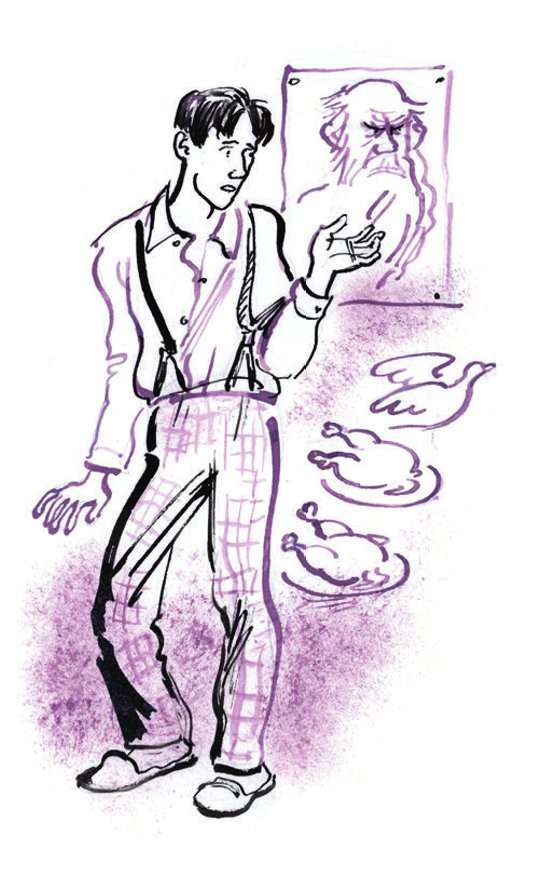
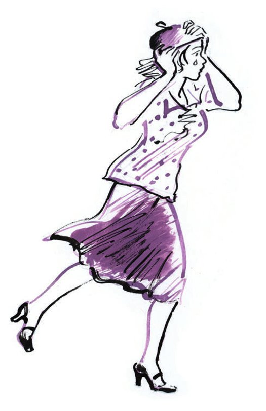
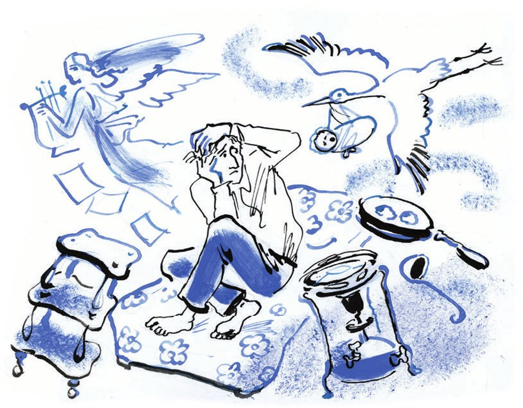

## Kapitel 17: Achtet die Matratzen, Bürger!

— Lisa, komm, wir gehen essen!

— Ich habe keine Lust. Ich habe gestern schon zu Mittag gegessen.

— Ich verstehe dich nicht.

— Ich gehe nicht mit und esse keinen <abbr title="der falsche Hase — «фальшивый заяц» (вегетарианское блюдо)">falschen Hasen</abbr>.

— Das ist aber dumm!

— Ich kann nicht immer nur vegetarische <abbr title="das Würstchen, die Würstchen — сосиска">Würstchen</abbr> essen.

— Heute gibt es <abbr title="die Apfelcharlotte, die Apfelcharlotten — шарлотка">Apfelcharlotte</abbr>.

— Ich habe irgendwie keine Lust.

— Sprich leiser. Man hört alles.

Und die jungen <abbr title="die Eheleute (Pl.) — супруги">Eheleute</abbr> gingen zu einem <abbr title="dramatisch — драматический">dramatischen</abbr> Flüstern über.

Zwei Minuten später verstand Kolja zum ersten Mal in drei Monaten Ehe: Die geliebte Frau mochte Würstchen aus <abbr title="die Karotte, die Karotten — морковь">Karotten</abbr>, Kartoffeln und <abbr title="die Erbse, die Erbsen — горох">Erbsen</abbr> viel weniger als er.

— Du willst also lieber <abbr title="das Hundefleisch — собачина">Hundefleisch</abbr> als <abbr title="die gesunde Kost — диетическое питание">gesunde Kost</abbr>? — schrie Kolja. In seiner Aufregung dachte er nicht an die Nachbarn, die <abbr title="lauschen — подслушивать, прислушиваться">lauschten</abbr>.

— Sprich doch leiser! — schrie Lisa laut. — Und überhaupt bist du gemein zu mir. Ja! Ich mag Fleisch! Manchmal. Was ist daran so schlimm?

Kolja schwieg verblüfft. Diese <abbr title="die Wendung, die Wendungen — поворот">Wendung</abbr> hatte er nicht erwartet. Fleisch hätte in Koljas <abbr title="das Budget, die Budgets — бюджет">Budget</abbr> ein riesiges Loch gemacht, ein Loch, das man nie wieder stopfen konnte. Lisa saß rot und <abbr title="sich zusammenrollen — свернуться клубочком">zusammengerollt</abbr> wie ein kleines Bündel auf der Matratze. Der junge Ehemann ging neben der Matratze hin und her und rechnete verzweifelt.

Kolja Kalatschow <abbr title="pausen — копировать на кальку">pauste</abbr> im <abbr title="das Zeichenbüro, die Zeichenbüros — чертёжное бюро">Zeichenbüro</abbr> «Technosila» Zeichnungen ab. Auch in den besten Monaten bekam er dafür nicht mehr als vierzig Rubel. Für die Wohnung zahlte Kolja nichts. In der wilden <abbr title="die Siedlung, die Siedlungen — посёлок">Siedlung</abbr> gab es keinen <abbr title="der Hausverwalter, die Hausverwalter — управдом">Hausverwalter</abbr>, und die <abbr title="die Miete, die Mieten — квартплата">Miete</abbr> war dort nur eine <abbr title="abstrakt — абстрактный">abstrakte</abbr> Idee. Zehn Rubel kostete Lisas <abbr title="der Nähkurs, die Nähkurse — курсы кройки и шитья">Nähkurs</abbr>. Der Kurs hatte sogar die Rechte von einer technischen Fachschule. Das Mittagessen für zwei Personen kostete dreizehn Rubel im Monat. Es gab eine <abbr title="die Suppe, die Suppen — суп">Suppe</abbr> – <abbr title="der Klosterborschtsch — борщ монастырский">Klosterborschtsch</abbr> – und ein Hauptgericht – falschen Hasen oder echte Nudeln. Die beiden aßen alles <abbr title="ehrlich — честно">ehrlich</abbr> halb und halb, im vegetarischen <abbr title="der Speisesaal, die Speisesäle — столовая">Speisesaal</abbr> «Du sollst nicht stehlen». Das übrige Geld verschwand irgendwohin. Das <abbr title="verwirren — смущать, сбивать с толку">verwirrte</abbr> Kolja am meisten. «Wohin geht das Geld?», dachte er oft, wenn er mit der <abbr title="die Reißfeder, die Reißfedern — рейсфедер">Reißfeder</abbr> eine lange, dünne Linie auf das himmelblaue <abbr title="das Pauspapier — калька">Pauspapier</abbr> zog. Unter diesen <abbr title="der Umstand, die Umstände — обстоятельство">Umständen</abbr> bedeutete Fleisch den <abbr title="der Untergang — гибель">Untergang</abbr>. Deshalb sprach Kolja jetzt mit viel Leidenschaft:

— Denk doch nur: die <abbr title="die Leiche, die Leichen — труп">Leichen</abbr> von getöteten Tieren verschlingen! Das ist <abbr title="die Menschenfresserei — людоедство">Menschenfresserei</abbr> mit der <abbr title="die Maske, die Masken — маска">Maske</abbr> der Kultur! Alle <abbr title="die Krankheit, die Krankheiten — болезнь">Krankheiten</abbr> kommen vom Fleisch.

— <abbr title="natürlich — конечно">Natürlich</abbr>, — sagte Lisa mit schüchterner Ironie. — Zum Beispiel die <abbr title="die Angina — ангина">Angina</abbr>.

— Ja, ja, auch die Angina! Was denkst du denn? Der <abbr title="der Organismus — организм">Organismus</abbr> ist <abbr title="schwächen — ослаблять">geschwächt</abbr>, weil er ewig Fleisch bekommt. Deshalb hat er keine Kraft mehr gegen die <abbr title="die Infektion, die Infektionen — инфекция">Infektion</abbr>.

— Wie dumm!

— Das ist nicht dumm. Dumm ist der, der nur seinen Magen <abbr title="vollstopfen — набивать">vollstopfen</abbr> will und nicht an die Vitamine denkt.

Plötzlich schwieg Kolja. Vor seinem <abbr title="das innere Auge — внутренний взор">inneren Auge</abbr> lagen <abbr title="fade — пресный">fade</abbr> <abbr title="der Nudelauflauf, die Nudelaufläufe — лапшевник">Nudelaufläufe</abbr>, Brei und anderer Kartoffel-Unsinn. Aber davor erschien jetzt, immer größer und größer, ein riesiges <abbr title="das Schweinekotelett, die Schweinekoteletts — свиная котлета">Schweinekotelett</abbr>. Es war offenbar gerade aus der <abbr title="die Pfanne, die Pfannen — сковорода">Pfanne</abbr> gesprungen. Es zischte noch, es <abbr title="blubbern — булькать">blubberte</abbr>, und es gab einen <abbr title="würzig — пряный">würzigen</abbr> Rauch von sich. Der <abbr title="der Knochen, die Knochen — кость">Knochen</abbr> <abbr title="herausragen — торчать">ragte</abbr> aus dem Kotelett heraus wie eine <abbr title="die Duellpistole, die Duellpistolen — дуэльный пистолет">Duellpistole</abbr>.

— Versteh doch! — schrie Kolja. — So ein Schweinekotelett nimmt dem Menschen eine Woche von seinem Leben weg!

— Soll es doch, — sagte Lisa. — Der falsche Hase nimmt ein halbes Jahr weg. Gestern, als wir den <abbr title="der Karottenbraten, die Karottenbraten — морковное жаркое">Karottenbraten</abbr> gegessen haben, habe ich gefühlt: Ich sterbe. Ich wollte es dir nur nicht sagen.

— Und warum wolltest du es mir nicht sagen?

— Ich hatte keine Kraft. Ich hatte Angst, dass ich weine.

— Und jetzt hast du keine Angst?

— Jetzt ist mir schon alles <abbr title="egal — всё равно">egal</abbr>.

Lisa weinte ein bisschen.

— Lew Tolstoi, — sagte Kolja mit zitternder Stimme, — hat auch kein Fleisch gegessen.

— Ja-a, — antwortete Lisa und schluchzte. — Der <abbr title="der Graf, die Grafen — граф">Graf</abbr> hat <abbr title="der Spargel — спаржа">Spargel</abbr> gegessen.

— Spargel ist kein Fleisch.

— Aber als er «Krieg und Frieden» geschrieben hat, da hat er Fleisch gegessen! Gegessen, gegessen, gegessen! Und als er «Anna Karenina» geschrieben hat, hat er <abbr title="futtern — лопать, уплетать">gefuttert</abbr>, gefuttert, gefuttert!

— Sei doch still!

— Gefuttert! Gefuttert! Gefuttert!

— Und als er die «Kreutzersonate» geschrieben hat – hat er da auch gefuttert? — fragte Kolja giftig.

— Die «Kreutzersonate» ist klein. Er hätte mal «Krieg und Frieden» mit vegetarischen Würstchen schreiben sollen!

— Was <abbr title="sich an jemanden hängen — приставать, цепляться к кому-то">hängst</abbr> du dich eigentlich mit deinem Tolstoi an mich?

— Ich hänge mich mit Tolstoi an dich? Ich? Ich hänge mich mit Tolstoi an Sie?

Jetzt sagte auch Kolja «Sie».

In den Federmäppchen jubelte man laut. Lisa zog sich schnell ihre blaue, <abbr title="stricken — вязать">gestrickte</abbr> Mütze vom <abbr title="der Hinterkopf — затылок">Hinterkopf</abbr> auf die Stirn.

— Wohin gehst du?

— Lass mich in Ruhe. Ich habe etwas zu <abbr title="erledigen — сделать, уладить">erledigen</abbr>.

Und Lisa lief weg.

«Wohin kann sie gegangen sein?», dachte Kolja. Er horchte.

— Unter der Sowjetmacht haben eure Frauen zu viel <abbr title="die Freiheit — свобода, воля">Freiheit</abbr>, — sagte man im Federmäppchen ganz links.

— Sie wird sich <abbr title="sich ertränken — утопиться">ertränken</abbr>! — beschloss man im dritten Federmäppchen.

Im fünften Federmäppchen machte man den Primuskocher an und küsste sich wie gewöhnlich.

Lisa lief aufgeregt durch die Straßen.

Es war die Stunde am Sonntag, in der die <abbr title="der/die Glückliche — счастливец">Glücklichen</abbr> Matratzen vom Smolensker Markt über den Arbat fahren.

Die <abbr title="die Jungvermählten (Pl.) — молодожёны">Jungvermählten</abbr> und die sowjetischen <abbr title="der Durchschnittsbürger, die Durchschnittsbürger — середняк, средний обыватель">Durchschnittsbürger</abbr> kaufen die meisten <abbr title="die Sprungfedermatratze, die Sprungfedermatratzen — пружинный матрац">Sprungfedermatratzen</abbr>. Sie fahren sie <abbr title="aufrecht — стоймя">aufrecht</abbr> und umarmen sie mit beiden Armen. Und wie sollen sie sie auch nicht umarmen? Die blaue Matratze mit den glänzenden, <abbr title="pausbäckig — мордастый, щекастый">pausbäckigen</abbr> Blümchen ist die Grundlage von ihrem Glück.

Bürger! Achtet die Sprungfedermatratze mit den blauen Blümchen! Sie ist der <abbr title="der häusliche Herd — семейный очаг">häusliche Herd</abbr>, das A und O der <abbr title="die Einrichtung — обстановка, меблировка">Einrichtung</abbr>, das Ganze und das Wichtigste der <abbr title="die Gemütlichkeit — уют">Gemütlichkeit</abbr>, die Basis der Liebe, der Vater vom Primuskocher! Wie süß schläft man beim <abbr title="demokratisch — демократический">demokratischen</abbr> <abbr title="klingen (klang, hat geklungen) — звенеть">Klingen</abbr> ihrer Federn! Was für wunderbare Träume hat der Mensch, der auf ihrem blauen Sackleinen einschläft! Wie sehr wird jeder Matratzenbesitzer <abbr title="achten — уважать">geachtet</abbr>!

Ein Mensch ohne Matratze ist <abbr title="erbärmlich — жалкий">erbärmlich</abbr>. Es gibt ihn eigentlich gar nicht. Er zahlt keine <abbr title="die Steuer, die Steuern — налог">Steuern</abbr>, er hat keine Frau, seine Bekannten leihen ihm kein Geld bis Mittwoch. Die Taxifahrer rufen ihm <abbr title="die Beleidigung, die Beleidigungen — оскорбление">Beleidigungen</abbr> hinterher, und die Mädchen lachen über ihn: Sie mögen keine Idealisten.

Ein Mensch ohne Matratze schreibt meistens Gedichte: «Beim sanften Ticken meiner Bure-Uhr / ruh ich im <abbr title="der Schaukelstuhl, die Schaukelstühle — кресло-качалка">Schaukelstuhl</abbr> so gern. / Die <abbr title="die Flocke, die Flocken — снежинка, хлопья">Flocken</abbr> tanzen draußen nur, / und Dohlen fliegen wie Träume fern.» Er dichtet am hohen <abbr title="das Stehpult, die Stehpulte — конторка">Stehpult</abbr> im <abbr title="das Telegrafenamt, die Telegrafenämter — телеграф">Telegrafenamt</abbr>. Dabei <abbr title="aufhalten (hielt auf, hat aufgehalten) — задерживать">hält</abbr> er die ernsten Matratzenbesitzer auf, die Telegramme schicken wollen.

Die Matratze zerbricht das Leben von einem Menschen. In ihrem Bezug und in ihren Federn steckt eine geheimnisvolle Kraft. Sie zieht alles an, und niemand hat sie bis heute <abbr title="erforschen — исследовать">erforscht</abbr>. Wenn ihre Federn lockend klingen, kommen Menschen und Dinge. Es kommen der <abbr title="der Steuerinspektor, die Steuerinspektoren — финагент, налоговый инспектор">Steuerinspektor</abbr> und die Mädchen. Sie wollen mit den Matratzenbesitzern <abbr title="befreundet sein — дружить">befreundet</abbr> sein. Der Steuerinspektor tut das aus <abbr title="fiskalisch — фискальный">fiskalischen</abbr> Gründen, zum <abbr title="der Nutzen — польза">Nutzen</abbr> vom Staat. Die Mädchen tun es <abbr title="selbstlos — бескорыстно">selbstlos</abbr>, nach den Gesetzen der Natur.

Jetzt beginnt die <abbr title="die Blütezeit — время цветения">Blütezeit</abbr> der Jugend. Der Steuerinspektor sammelt die Steuer wie eine <abbr title="die Biene, die Bienen — пчела">Biene</abbr> ihren Frühlingshonig. Dann fliegt er mit fröhlichem Summen in seinen <abbr title="der Bienenstock, die Bienenstöcke — улей">Bienenstock</abbr> im Bezirk zurück. Und die Mädchen gehen weg. An ihre Stelle kommen eine Ehefrau und ein Primuskocher «Juwel Nr. 1».

Die Matratze ist <abbr title="unersättlich — ненасытный">unersättlich</abbr>. Sie will Opfer. In der Nacht klingt sie wie ein Ball, der auf den Boden fällt. Sie braucht ein Regal. Sie braucht einen Tisch auf dummen, dicken Beinen. Mit klirrenden Federn verlangt sie <abbr title="die Gardine, die Gardinen — занавеска">Gardinen</abbr>, Vorhänge und Geschirr für die Küche. Sie <abbr title="schubsen — толкать">schubst</abbr> den Menschen und sagt zu ihm:

— Geh! Kauf ein <abbr title="das Mangelholz, die Mangelhölzer — рубель (для белья)">Mangelholz</abbr> und ein <abbr title="das Nudelholz, die Nudelhölzer — скалка">Nudelholz</abbr>!

— Ich schäme mich für dich, Mensch! Du hast immer noch keinen Teppich!

— Arbeite! Bald bringe ich dir Kinder! Du brauchst Geld für <abbr title="die Windel, die Windeln — пелёнка">Windeln</abbr> und einen Kinderwagen!

Die Matratze vergisst nichts und macht alles, wie sie will.

Sogar der Dichter kann diesem Schicksal nicht <abbr title="entkommen (entkam, ist entkommen) — избежать, ускользнуть">entkommen</abbr>. Da fährt er eine Matratze vom Sucharewka-Markt nach Hause. Voll <abbr title="das Entsetzen — ужас">Entsetzen</abbr> drückt er sich an ihren weichen Bauch.

— Ich <abbr title="brechen (brach, hat gebrochen) — сломить">breche</abbr> deinen <abbr title="der Widerstand — сопротивление, упорство">Widerstand</abbr>, Dichter! — sagt die Matratze. — Du musst nicht mehr ins Telegrafenamt laufen, um Gedichte zu schreiben. Und lohnt es sich überhaupt, Gedichte zu schreiben? Nimm eine feste Stelle! Dann ist dein Saldo immer im Plus. Denk an deine Frau und deine Kinder.

— Ich habe keine Frau, — schreit der Dichter und weicht vor seiner Lehrerin mit den Sprungfedern zurück.

— Du wirst eine haben. Und ich <abbr title="garantieren — ручаться">garantiere</abbr> nicht, dass sie das schönste Mädchen der Welt ist. Ich weiß nicht einmal, ob sie gutmütig ist. Mach dich auf alles <abbr title="sich gefasst machen auf + Akk. — приготовиться к">gefasst</abbr>. Du wirst Kinder bekommen.

— Ich mag keine Kinder!

— Du wirst sie lieben!

— Sie machen mir Angst, Bürgerin Matratze!

— Schweig, du Dummkopf! Du weißt noch nicht alles! Du wirst noch bei Mosdrew, dem Moskauer Holzhandel, einen Kredit für Möbel aufnehmen.

— Ich bringe dich um, Matratze!

— Du <abbr title="der Grünschnabel, die Grünschnäbel — щенок, молокосос">Grünschnabel</abbr>! Wenn du das wagst, zeigen dich die Nachbarn bei der <abbr title="die Hausverwaltung — домоуправление">Hausverwaltung</abbr> an.

So kreisen jeden Sonntag die Glücklichen durch Moskau, und die Matratzen klingen fröhlich dazu.

Aber natürlich ist der Moskauer Sonntag nicht nur dafür <abbr title="bemerkenswert — замечательный">bemerkenswert</abbr>.

Der Sonntag ist auch der Museumstag.

In Moskau gibt es eine besondere <abbr title="die Sorte, die Sorten — сорт, категория">Sorte</abbr> Menschen. Sie verstehen nichts von <abbr title="die Malerei — живопись">Malerei</abbr>, sie <abbr title="sich interessieren für + Akk. — интересоваться">interessieren sich</abbr> nicht für <abbr title="die Architektur — архитектура">Architektur</abbr>, und sie mögen keine alten Denkmäler. Diese Menschen gehen nur deshalb ins Museum, weil die Museen in schönen Gebäuden sind. Sie <abbr title="schlendern — бродить, прогуливаться">schlendern</abbr> durch strahlende Säle. Neidisch sehen sie sich die bemalten Decken an. Sie fassen alles an, was man nicht anfassen darf. Und sie murmeln <abbr title="ununterbrochen — беспрерывно">ununterbrochen</abbr>:

— Ach! Die haben gelebt!

Es ist ihnen egal, dass der Franzose Puvis de Chavannes die <abbr title="die Wand, die Wände — стена">Wände</abbr> bemalt hat. Sie wollen nur wissen: Wie viel hat das den früheren Besitzer von der Villa gekostet? Sie gehen die Treppe hinauf, an den <abbr title="die Marmorstatue, die Marmorstatuen — мраморное изваяние">Marmorstatuen</abbr> vorbei. Dabei stellen sie sich vor, wie viele <abbr title="der Lakai, die Lakaien — лакей">Lakaien</abbr> hier gestanden haben. Und wie viel <abbr title="der Lohn, die Löhne — жалованье">Lohn</abbr> und <abbr title="das Trinkgeld, die Trinkgelder — чаевые">Trinkgeld</abbr> jeder Lakai bekam. Auf dem Kamin steht <abbr title="das Porzellan — фарфор">Porzellan</abbr>. Aber sie sehen es nicht an. Sie denken nur: Ein Kamin ist nicht <abbr title="rentabel — выгодный">rentabel</abbr>, er braucht zu viel <abbr title="das Brennholz — дрова">Brennholz</abbr>. Im <abbr title="das Speisezimmer, die Speisezimmer — столовая (комната)">Speisezimmer</abbr> mit den Wänden aus Eichenholz sehen sie die wunderbaren <abbr title="die Schnitzerei, die Schnitzereien — резьба">Schnitzereien</abbr> nicht an. Ein einziger Gedanke quält sie: Was hat der frühere Hausherr, ein Kaufmann, hier gegessen? Und wie viel würde das bei den heutigen hohen Preisen kosten?

Solche Menschen findet man in jedem Museum. Die <abbr title="die Führung, die Führungen — экскурсия">Führungen</abbr> marschieren munter von einem Meisterwerk zum anderen. Aber so ein Mensch steht mitten im Saal, sieht nichts an und brummt <abbr title="sehnsüchtig — тоскливо">sehnsüchtig</abbr>:

— Ach! Die haben gelebt!

Lisa lief durch die Straße und <abbr title="schlucken — глотать">schluckte</abbr> ihre Tränen hinunter. Ihre Gedanken <abbr title="treiben (trieb, hat getrieben) — гнать, подгонять">trieben</abbr> sie <abbr title="vorantreiben — подгонять">voran</abbr>. Sie dachte an ihr glückliches und armes Leben: «Wenn wir noch einen Tisch und zwei Stühle hätten, wäre alles ganz gut. Und einen Primuskocher müssen wir <abbr title="schließlich — в конце концов">schließlich</abbr> auch kaufen. Wir müssen uns irgendwie <abbr title="sich einrichten — устраиваться, обзаводиться">einrichten</abbr>.»

Sie ging langsamer, denn plötzlich erinnerte sie sich an den Streit mit Kolja. Außerdem hatte sie großen <abbr title="der Hunger — голод">Hunger</abbr>. Auf einmal <abbr title="aufflammen — вспыхнуть, разгореться">flammte</abbr> in ihr der Hass auf ihren Mann auf.

— Das ist eine <abbr title="die Unverschämtheit — безобразие, наглость">Unverschämtheit</abbr>! — sagte sie laut.

Der Hunger wurde noch stärker.

— Na gut, na gut. Ich weiß selbst, was ich tun muss.

Und Lisa wurde rot und kaufte bei einer <abbr title="die Straßenhändlerin, die Straßenhändlerinnen — уличная торговка">Straßenhändlerin</abbr> ein <abbr title="das belegte Brot — бутерброд">belegtes Brot</abbr> mit <abbr title="die Brühwurst — варёная колбаса">Brühwurst</abbr>. <abbr title="obwohl — хотя">Obwohl</abbr> sie so hungrig war, fand sie es <abbr title="unpassend — неудобный, неприличный">unpassend</abbr>, auf der Straße zu essen. Sie war <abbr title="immerhin — как-никак, всё-таки">immerhin</abbr> eine Matratzenbesitzerin und kannte sich <abbr title="fein — тонко">fein</abbr> im Leben aus. Sie sah sich um und ging in den <abbr title="der Eingang, die Eingänge — подъезд, вход">Eingang</abbr> von einer Villa mit zwei Stockwerken. Dort begann sie mit großem Genuss ihr Brot zu essen. Das gekochte Hundefleisch war verführerisch. Eine große <abbr title="die Besuchergruppe, die Besuchergruppen — экскурсия, группа посетителей">Besuchergruppe</abbr> kam in den Eingang. Lisa stand an der Wand. Die Besucher gingen an ihr vorbei und sahen sie an.

«Sollen sie doch sehen!», dachte Lisa wütend.

---

### Neue Wörter

- **der falsche Hase** — «фальшивый заяц» (вегетарианское блюдо)
- **das Würstchen, die Würstchen** — сосиска
- **die Apfelcharlotte, die Apfelcharlotten** — шарлотка
- **die Eheleute (Pl.)** — супруги
- **dramatisch** — драматический
- **die Karotte, die Karotten** — морковь
- **die Erbse, die Erbsen** — горох
- **das Hundefleisch** — собачина
- **die gesunde Kost** — диетическое питание
- **lauschen** — подслушивать, прислушиваться
- **die Wendung, die Wendungen** — поворот
- **das Budget, die Budgets** — бюджет
- **sich zusammenrollen** — свернуться клубочком
- **pausen** — копировать на кальку
- **das Zeichenbüro, die Zeichenbüros** — чертёжное бюро
- **die Siedlung, die Siedlungen** — посёлок
- **der Hausverwalter, die Hausverwalter** — управдом
- **die Miete, die Mieten** — квартплата
- **abstrakt** — абстрактный
- **der Nähkurs, die Nähkurse** — курсы кройки и шитья
- **die Suppe, die Suppen** — суп
- **der Klosterborschtsch** — борщ монастырский
- **ehrlich** — честно
- **der Speisesaal, die Speisesäle** — столовая
- **verwirren** — смущать, сбивать с толку
- **die Reißfeder, die Reißfedern** — рейсфедер
- **das Pauspapier** — калька
- **der Umstand, die Umstände** — обстоятельство
- **der Untergang** — гибель
- **die Leiche, die Leichen** — труп
- **die Menschenfresserei** — людоедство
- **die Maske, die Masken** — маска
- **die Krankheit, die Krankheiten** — болезнь
- **natürlich** — конечно
- **die Angina** — ангина
- **der Organismus** — организм
- **schwächen** — ослаблять
- **die Infektion, die Infektionen** — инфекция
- **vollstopfen** — набивать
- **das innere Auge** — внутренний взор
- **fade** — пресный
- **der Nudelauflauf, die Nudelaufläufe** — лапшевник
- **das Schweinekotelett, die Schweinekoteletts** — свиная котлета
- **die Pfanne, die Pfannen** — сковорода
- **blubbern** — булькать
- **würzig** — пряный
- **der Knochen, die Knochen** — кость
- **herausragen** — торчать
- **die Duellpistole, die Duellpistolen** — дуэльный пистолет
- **der Karottenbraten, die Karottenbraten** — морковное жаркое
- **egal** — всё равно
- **der Graf, die Grafen** — граф
- **der Spargel** — спаржа
- **futtern** — лопать, уплетать
- **sich an jemanden hängen** — приставать, цепляться к кому-то
- **stricken** — вязать
- **der Hinterkopf** — затылок
- **erledigen** — сделать, уладить
- **die Freiheit** — свобода, воля
- **sich ertränken** — утопиться
- **der/die Glückliche** — счастливец
- **die Jungvermählten (Pl.)** — молодожёны
- **der Durchschnittsbürger, die Durchschnittsbürger** — середняк, средний обыватель
- **die Sprungfedermatratze, die Sprungfedermatratzen** — пружинный матрац
- **aufrecht** — стоймя
- **pausbäckig** — мордастый, щекастый
- **der häusliche Herd** — семейный очаг
- **die Einrichtung** — обстановка, меблировка
- **die Gemütlichkeit** — уют
- **demokratisch** — демократический
- **klingen (klang, hat geklungen)** — звенеть
- **achten** — уважать
- **erbärmlich** — жалкий
- **die Steuer, die Steuern** — налог
- **die Beleidigung, die Beleidigungen** — оскорбление
- **der Schaukelstuhl, die Schaukelstühle** — кресло-качалка
- **die Flocke, die Flocken** — снежинка, хлопья
- **das Stehpult, die Stehpulte** — конторка
- **das Telegrafenamt, die Telegrafenämter** — телеграф
- **aufhalten (hielt auf, hat aufgehalten)** — задерживать
- **erforschen** — исследовать
- **der Steuerinspektor, die Steuerinspektoren** — финагент, налоговый инспектор
- **befreundet sein** — дружить
- **fiskalisch** — фискальный
- **der Nutzen** — польза
- **selbstlos** — бескорыстно
- **die Blütezeit** — время цветения
- **die Biene, die Bienen** — пчела
- **der Bienenstock, die Bienenstöcke** — улей
- **unersättlich** — ненасытный
- **die Gardine, die Gardinen** — занавеска
- **schubsen** — толкать
- **das Mangelholz, die Mangelhölzer** — рубель (для белья)
- **das Nudelholz, die Nudelhölzer** — скалка
- **die Windel, die Windeln** — пелёнка
- **entkommen (entkam, ist entkommen)** — избежать, ускользнуть
- **das Entsetzen** — ужас
- **brechen (brach, hat gebrochen)** — сломить
- **der Widerstand** — сопротивление, упорство
- **garantieren** — ручаться
- **sich gefasst machen auf + Akk.** — приготовиться к
- **der Grünschnabel, die Grünschnäbel** — щенок, молокосос
- **die Hausverwaltung** — домоуправление
- **bemerkenswert** — замечательный
- **die Sorte, die Sorten** — сорт, категория
- **die Malerei** — живопись
- **sich interessieren für + Akk.** — интересоваться
- **die Architektur** — архитектура
- **schlendern** — бродить, прогуливаться
- **ununterbrochen** — беспрерывно
- **die Wand, die Wände** — стена
- **die Marmorstatue, die Marmorstatuen** — мраморное изваяние
- **der Lakai, die Lakaien** — лакей
- **der Lohn, die Löhne** — жалованье
- **das Trinkgeld, die Trinkgelder** — чаевые
- **das Porzellan** — фарфор
- **rentabel** — выгодный
- **das Brennholz** — дрова
- **das Speisezimmer, die Speisezimmer** — столовая (комната)
- **die Schnitzerei, die Schnitzereien** — резьба
- **die Führung, die Führungen** — экскурсия
- **sehnsüchtig** — тоскливо
- **schlucken** — глотать
- **treiben (trieb, hat getrieben)** — гнать, подгонять
- **vorantreiben** — подгонять
- **schließlich** — в конце концов
- **sich einrichten** — устраиваться, обзаводиться
- **der Hunger** — голод
- **aufflammen** — вспыхнуть, разгореться
- **die Unverschämtheit** — безобразие, наглость
- **die Straßenhändlerin, die Straßenhändlerinnen** — уличная торговка
- **das belegte Brot** — бутерброд
- **die Brühwurst** — варёная колбаса
- **obwohl** — хотя
- **unpassend** — неудобный, неприличный
- **immerhin** — как-никак, всё-таки
- **fein** — тонко
- **der Eingang, die Eingänge** — подъезд, вход
- **die Besuchergruppe, die Besuchergruppen** — экскурсия, группа посетителей

[← Kapitel 16](kapitel-16.md) · [Inhalt](README.md) · [Kapitel 18 →](kapitel-18.md)
