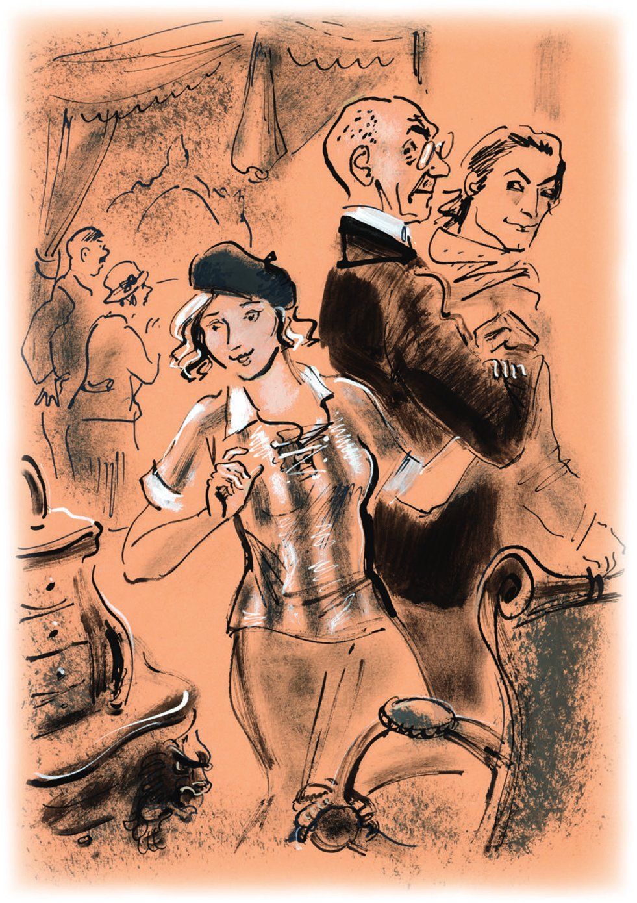
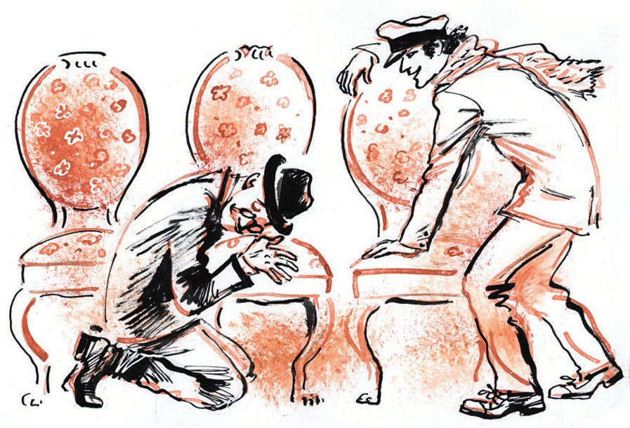

## Kapitel 18: Das Möbelmuseum

Lisa wischte sich mit dem <abbr title="das Taschentuch, die Taschentücher — носовой платок">Taschentuch</abbr> den Mund ab und <abbr title="fegen — смахивать, мести">fegte</abbr> die <abbr title="der Krümel, die Krümel — крошка">Krümel</abbr> von ihrer Bluse. Jetzt war sie fröhlicher. Sie stand vor einem Schild: «Museum für Möbelkunst». Nach Hause gehen war peinlich. Sonst konnte sie zu niemandem gehen. In ihrer kleinen <abbr title="die Tasche, die Taschen — карман">Tasche</abbr> hatte sie zwanzig Kopeken. Und Lisa beschloss, ihr <abbr title="selbstständig — самостоятельный">selbstständiges</abbr> Leben mit einem Museumsbesuch zu beginnen. Sie zählte noch einmal ihr Geld und ging in die Eingangshalle.

Dort stieß sie sofort auf einen Mann mit einem <abbr title="gebraucht — подержанный">gebrauchten</abbr> Bart. Der Mann starrte <abbr title="schwermütig — тягостно, тоскливо">schwermütig</abbr> auf eine <abbr title="die Säule, die Säulen — колонна">Säule</abbr> aus <abbr title="der Malachit — малахит">Malachit</abbr> und <abbr title="pressen — цедить, выдавливать">presste</abbr> durch seinen Schnurrbart:

— Reich haben die Leute gelebt!

Lisa sah die Säule mit Respekt an und ging nach oben.

Etwa zehn Minuten wanderte sie durch kleine, quadratische Zimmer. Die Decken waren so niedrig, dass jeder Besucher wie ein Riese aussah.

In diesen Zimmern standen Möbel im Empire-Stil aus der Zeit von Kaiser Paul, aus Mahagoni und aus karelischer Birke. Es waren strenge, wunderbare und <abbr title="kriegerisch — воинственный">kriegerische</abbr> Möbel. Zwei quadratische Schränke standen vor einem Schreibtisch. Auf ihren <abbr title="die Glastür, die Glastüren — стеклянная дверца">Glastüren</abbr> waren Speere <abbr title="über Kreuz — крест-накрест">über Kreuz</abbr>. Der Schreibtisch war <abbr title="grenzenlos — безбрежный">grenzenlos</abbr>. An diesem Tisch zu sitzen war so, wie am Theaterplatz zu sitzen. Dort steht das Bolschoi-Theater mit seinen Säulen und den vier <abbr title="das Bronzepferd, die Bronzepferde — бронзовый конь">Bronzepferden</abbr>, die den Gott Apollo zur Premiere vom Ballett «Roter Mohn» ziehen. Aber auf diesem Tisch hätte das ganze Theater nur wie ein Tintenfass ausgesehen. So kam es jedenfalls Lisa vor. Sie bekam ja nur Karotten zu essen, wie ein Kaninchen. In den Ecken standen Sessel mit hohen Lehnen. Oben waren die Lehnen gebogen wie die Hörner von einem <abbr title="der Widder, die Widder — баран">Widder</abbr>. Die Sonne lag auf dem <abbr title="pfirsichfarben — персиковый">pfirsichfarbenen</abbr> Bezug der Sessel. Man wollte sich sofort hineinsetzen. Aber das war verboten.

Lisa stellte sich vor: So ein unbezahlbarer Sessel neben ihrer Matratze mit den roten Streifen. Das sah gar nicht so schlecht aus. An der Wand las sie ein Schild mit einer <abbr title="wissenschaftlich — научный">wissenschaftlichen</abbr> und <abbr title="ideologisch — идеологический">ideologischen</abbr> <abbr title="die Begründung, die Begründungen — обоснование">Begründung</abbr> für das Empire von Kaiser Paul. Es tat ihr leid, dass sie und Kolja kein Zimmer in diesem Palast hatten. Dann ging sie in einen unerwarteten Flur.

Links, direkt über dem Boden, waren kleine, <abbr title="halbrund — полукруглый">halbrunde</abbr> Fenster. Durch diese Fenster sah Lisa unter ihren Füßen einen riesigen weißen Saal mit Säulen und zwei Reihen Fenstern. Auch im Saal standen Möbel, und Besucher <abbr title="umherirren — блуждать">irrten</abbr> umher. Lisa blieb stehen. Noch nie hatte sie einen Saal unter ihren Füßen gesehen. Sie staunte und <abbr title="dahinschmelzen (schmolz dahin, ist dahingeschmolzen) — млеть, таять">schmolz</abbr> fast dahin und sah lange nach unten. Plötzlich bemerkte sie dort unten ihre Bekannten von heute Morgen. Sie gingen gerade von den Sesseln zu einem Sekretär: Genosse Bender und sein <abbr title="der Begleiter, die Begleiter — спутник">Begleiter</abbr>, der stattliche alte Mann mit dem <abbr title="kahl rasiert — бритоголовый">kahl rasierten</abbr> Kopf.

— Wie schön! — sagte Lisa. — Dann ist es nicht so langweilig.

Sie freute sich sehr, lief nach unten und verirrte sich sofort. Sie kam in einen roten Salon, in dem ungefähr vierzig <abbr title="der Gegenstand, die Gegenstände — предмет">Gegenstände</abbr> standen. Es waren Möbel aus Nussbaum mit gebogenen Beinen. Aus dem Salon gab es keinen Ausgang. Sie musste zurücklaufen, durch ein rundes Zimmer mit Licht von oben. Dort gab es, so schien es, nur <abbr title="geblümt — в цветочек">geblümte</abbr> Kissen.

Sie lief an Sesseln aus <abbr title="der Brokat — парча">Brokat</abbr> aus der italienischen <abbr title="die Renaissance — Возрождение">Renaissance</abbr> vorbei, an holländischen Schränken, an einem großen gotischen Bett mit einem <abbr title="der Baldachin, die Baldachine — балдахин">Baldachin</abbr> auf schwarzen, <abbr title="gedreht — витой">gedrehten</abbr> Säulen. Ein Mensch in diesem Bett wäre nicht größer als eine <abbr title="die Nuss, die Nüsse — орех">Nuss</abbr> gewesen. Der Saal war irgendwo unter ihren Füßen, vielleicht rechts. Aber man konnte unmöglich hineinkommen.

Endlich hörte Lisa das Summen von einer Besuchergruppe. Die Leute hörten nicht genau zu. Der <abbr title="der Führer, die Führer — экскурсовод, руководитель">Führer</abbr> <abbr title="entlarven — обличать, разоблачать">entlarvte</abbr> gerade die imperialistischen <abbr title="der Plan, die Pläne — замысел, план">Pläne</abbr> von Katharina der Zweiten. Er erklärte sie mit der Liebe der verstorbenen <abbr title="die Kaiserin, die Kaiserinnen — императрица">Kaiserin</abbr> zu Möbeln im Stil Louis-seize.

Das war der große, helle Saal mit den Säulen. Lisa ging an sein anderes Ende. Dort sprach ihr Bekannter, Genosse Bender, eifrig mit seinem kahlköpfigen Begleiter.

Als Lisa näher kam, hörte sie eine <abbr title="klangvoll — звучный">klangvolle</abbr> Stimme:

— Möbel im Stil Schick-Modern. Aber das ist wohl nicht das, was wir brauchen.

— Ja, aber hier gibt es offensichtlich noch andere Säle. Wir müssen alles <abbr title="systematisch — систематически">systematisch</abbr> ansehen.

— Guten Tag, — sagte Lisa.

Die beiden drehten sich um und verzogen sofort das Gesicht.

— Guten Tag, Genosse Bender. Wie gut, dass ich Sie gefunden habe. Allein ist es so langweilig. Kommen Sie, wir sehen uns alles zusammen an.

Die Konzessionäre sahen sich an. Ippolit Matwejewitsch <abbr title="sich in Pose werfen — приосаниться, принять важный вид">warf sich in Pose</abbr>, obwohl es ihm unangenehm war: Lisa konnte sie bei der wichtigen Suche nach den Brillanten-Möbeln aufhalten.

— Wir sind typische <abbr title="der Provinzler, die Provinzler — провинциал">Provinzler</abbr>, — sagte Bender ungeduldig. — Aber wie kommen Sie hierher, als Moskauerin?

— Ganz <abbr title="zufällig — случайно">zufällig</abbr>. Ich habe mich mit Kolja gestritten.

— Ach so? — bemerkte Ippolit Matwejewitsch.

— Na, dann verlassen wir diesen Saal, — sagte Ostap.

— Aber ich habe ihn noch nicht angesehen. Er ist so hübsch.

— Jetzt geht es los! — flüsterte Ostap Ippolit Matwejewitsch ins Ohr. Und zu Lisa sagte er: — Hier gibt es gar nichts zu sehen. <abbr title="dekadent — упадочный">Dekadenter</abbr> Stil. Die Epoche von Kerenski.

— Man hat mir gesagt, irgendwo hier gibt es Möbel von Meister Gambs, — erzählte Ippolit Matwejewitsch. — Da gehen wir vielleicht hin.

Lisa war <abbr title="einverstanden sein — быть согласным">einverstanden</abbr>. Sie nahm Worobjaninow am Arm – er war für sie ein erstaunlich netter Vertreter der Wissenschaft – und ging zum Ausgang. Die Lage war sehr ernst, und bei der Suche nach dem Schatz war der <abbr title="entscheidend — решающий">entscheidende</abbr> Moment gekommen. <abbr title="trotzdem — тем не менее">Trotzdem</abbr> lachte Bender hinter dem Pärchen <abbr title="verspielt — игриво">verspielt</abbr>. Der Häuptling der Komantschen als <abbr title="der Kavalier, die Kavaliere — кавалер">Kavalier</abbr> – das fand er sehr komisch.

Lisa störte die Konzessionäre sehr. Die beiden sahen mit einem einzigen Blick: In diesem Zimmer gibt es die richtigen Möbel nicht. <abbr title="unwillkürlich — невольно">Unwillkürlich</abbr> zog es sie ins nächste Zimmer. <abbr title="während — в то время как">Während</abbr> sie weitergehen wollten, blieb Lisa in jeder Abteilung lange stehen. Sie las alle gedruckten <abbr title="die Kritik, die Kritiken — критика, рецензия">Kritiken</abbr> über die Möbel laut vor. Sie machte spitze Bemerkungen über die Besucher und stand vor jedem <abbr title="das Ausstellungsstück, die Ausstellungsstücke — экспонат">Ausstellungsstück</abbr> sehr lange. Ohne es zu merken, stellte sie jedes Möbelstück in Gedanken in ihr eigenes Zimmer. Das gotische Bett gefiel ihr gar nicht. Es war viel zu groß. <abbr title="selbst wenn — даже если">Selbst wenn</abbr> Kolja durch ein Wunder ein Zimmer von drei Quadrat-Saschen bekäme (das sind ungefähr vierzehn Quadratmeter), würde das <abbr title="mittelalterlich — средневековый">mittelalterliche</abbr> <abbr title="das Bett, die Betten — ложе, кровать">Bett</abbr> nicht hineinpassen. Trotzdem ging Lisa lange um das Bett herum und maß mit kleinen Schritten seine wirkliche <abbr title="die Fläche, die Flächen — площадь">Fläche</abbr>. Lisa war sehr fröhlich. Sie sah die <abbr title="sauer — кислый">sauren</abbr> Gesichter ihrer Begleiter nicht. Die beiden waren <abbr title="ritterlich — рыцарский">ritterlich</abbr>. Deshalb konnten sie nicht <abbr title="Hals über Kopf — сломя голову">Hals über Kopf</abbr> in das Zimmer von Meister Gambs laufen.

— <abbr title="die Geduld — терпение">Geduld</abbr>, — flüsterte Ostap. — Die Möbel laufen uns nicht weg. Und Sie, Adelsmarschall, drücken das Mädchen nicht so. Ich bin <abbr title="eifersüchtig — ревнивый">eifersüchtig</abbr>.

Worobjaninow lächelte <abbr title="selbstzufrieden — самодовольно">selbstzufrieden</abbr>.

Die Säle zogen sich langsam hin. Sie hatten kein Ende. Die Möbel aus der Zeit von Zar Alexander waren in vielen Garnituren <abbr title="ausstellen — выставлять">ausgestellt</abbr>. Diese Möbel waren nicht so groß, und deshalb war Lisa ganz begeistert.

— Sehen Sie, sehen Sie! — rief sie <abbr title="vertrauensvoll — доверчиво">vertrauensvoll</abbr> und packte Worobjaninow am Ärmel. — Sehen Sie diesen Sekretär? Der würde wunderbar in unser Zimmer passen. Nicht wahr?

— <abbr title="reizend — прелестный">Reizende</abbr> Möbel! — sagte Ostap <abbr title="zornig — гневно">zornig</abbr>. — Nur leider dekadent.

Auf Ippolit Matwejewitsch machten die Möbel nicht den richtigen Eindruck. Dabei waren sie wunderschön. Ihre <abbr title="vollkommen — совершенный">vollkommenen</abbr> Formen verblüfften das Auge.

Herden von Sofas, Sekretären, <abbr title="die Vitrine, die Vitrinen — горка, витрина">Vitrinen</abbr> und Schränken – alle Stile, alle Zeiten, alle Epochen – sahen sich die Konzessionäre an. Aber die Säle, große und kleine, nahmen immer noch kein Ende.

— Hier war ich schon, — sagte Lisa, als sie in den roten Salon kam. — Hier lohnt es sich nicht, stehen zu bleiben.

Aber zu ihrer <abbr title="die Überraschung, die Überraschungen — удивление">Überraschung</abbr> blieben ihre Begleiter, die sich für Möbel gar nicht interessierten, an der Tür stehen. Sie standen da <abbr title="erstarren (erstarrte, ist erstarrt) — замереть">wie erstarrt</abbr>, wie <abbr title="der Wachposten, die Wachposten — часовой">Wachposten</abbr>.

— Warum bleiben Sie denn stehen? Kommen Sie. Ich bin schon müde.

— Warten Sie, — sagte Ippolit Matwejewitsch und befreite seinen Arm. — Nur ein <abbr title="das Minütchen — минуточка">Minütchen</abbr>.

Das große Zimmer war <abbr title="vollgestopft — перегруженный, набитый">vollgestopft</abbr> mit Möbeln. Gambs-Stühle standen an der Wand und um den Tisch. Auch um das Sofa in der Ecke standen Stühle. Ihre gebogenen Beine und ihre <abbr title="bequem — удобный">bequemen</abbr> Lehnen kamen Ippolit Matwejewitsch <abbr title="atemberaubend — захватывающе">atemberaubend</abbr> bekannt vor. Ostap sah ihn <abbr title="prüfend — испытующе">prüfend</abbr> an. Ippolit Matwejewitsch wurde rot.

— Sie sind müde, <abbr title="das Fräulein — барышня">Fräulein</abbr>, — sagte er zu Lisa. — Setzen Sie sich hierher und ruhen Sie sich aus. Wir beide gehen noch ein bisschen herum. Das scheint ein interessanter Saal zu sein.

Lisa wurde auf einen Sessel gesetzt. Die Konzessionäre gingen zum Fenster.

— Sind sie das? — fragte Ostap.

— Es sieht so aus. Ich muss sie genauer untersuchen.

— Sind alle Stühle hier?

— Ich zähle sie gleich. Warten Sie, warten Sie …

Worobjaninows Blick ging von Stuhl zu Stuhl.

— Moment mal, — sagte er endlich. — Zwanzig Stühle. Das kann nicht sein. Es sind doch nur zehn.

— Sehen Sie genau hin. Vielleicht sind es nicht die richtigen Stühle.

Sie gingen zwischen den Stühlen hin und her.

— Na? — drängte Ostap.

— Die Lehne ist irgendwie anders als bei meinen.

— Also nicht die richtigen?

— Nicht die richtigen.

— <abbr title="der Quatsch — чепуха, мура">Quatsch</abbr>! Es war wohl ein Fehler, dass ich mich mit Ihnen <abbr title="sich einlassen mit + Dat. (ließ sich ein, hat sich eingelassen) — связываться с">eingelassen</abbr> habe.

Ippolit Matwejewitsch war ganz niedergeschlagen.

— Na gut, — sagte Ostap. — Die Sitzung geht weiter. Ein Stuhl ist keine <abbr title="die Stecknadel, die Stecknadeln — булавка, иголка">Stecknadel</abbr>. Den finden wir. Geben Sie mir die Anweisungen. Ich muss unangenehmen Kontakt mit der <abbr title="die Museumsverwaltung — администрация музея">Museumsverwaltung</abbr> aufnehmen. Setzen Sie sich neben das Mädchen und bleiben Sie sitzen. Ich komme gleich.

— Warum sind Sie denn so traurig? — fragte Lisa. — Sind Sie müde?

Ippolit Matwejewitsch antwortete nur mit Schweigen.

— Haben Sie Kopfschmerzen?

— Ja, ein bisschen. Sorgen, wissen Sie. Wenn die weibliche Zärtlichkeit fehlt, merkt man das im ganzen Leben.

Lisa war zuerst überrascht. Dann sah sie ihren kahlköpfigen <abbr title="der Gesprächspartner, die Gesprächspartner — собеседник">Gesprächspartner</abbr> an und hatte wirklich Mitleid mit ihm. Worobjaninow hatte <abbr title="leidend — страдальческий">leidende</abbr> Augen. Der Kneifer konnte die deutlichen <abbr title="der Tränensack, die Tränensäcke — мешки под глазами">Tränensäcke</abbr> nicht verbergen. Früher hatte er ein ruhiges Leben als <abbr title="der Sachbearbeiter, die Sachbearbeiter — делопроизводитель">Sachbearbeiter</abbr> beim Standesamt in der Kreisstadt. Jetzt war er ein Brillantenjäger und <abbr title="der Abenteurer, die Abenteurer — авантюрист">Abenteurer</abbr>, mit einem unbequemen, <abbr title="hektisch — хлопотливый, суетливый">hektischen</abbr> Leben. Dieser schnelle <abbr title="der Wechsel — перемена">Wechsel</abbr> war nicht <abbr title="spurlos — бесследно">spurlos</abbr> an ihm vorbeigegangen. Ippolit Matwejewitsch war viel dünner geworden, und seine Leber tat ihm manchmal weh.

Unter Benders strenger <abbr title="die Aufsicht — надзор">Aufsicht</abbr> verlor Ippolit Matwejewitsch sein eigenes Gesicht. Er <abbr title="sich auflösen — растворяться">löste sich</abbr> schnell im mächtigen <abbr title="der Intellekt — интеллект">Intellekt</abbr> vom Sohn eines türkischen Staatsbürgers auf. Jetzt war er für eine Minute mit der <abbr title="bezaubernd — очаровательный">bezaubernden</abbr> Bürgerin Kalatschowa allein. Er hätte ihr gern von all seinem Kummer und seinen Aufregungen erzählt. Aber er wagte es nicht.

— Ja, — sagte er und sah seine Gesprächspartnerin zärtlich an. — So ist das. Und wie geht es Ihnen, Jelisaweta …

— Petrowna. Und wie heißen Sie?

Sie sagten sich ihre Vor- und Vatersnamen.

«Ein Märchen der Liebe, so teuer …», dachte Ippolit Matwejewitsch und sah in Lisas <abbr title="schlicht — простенький, простой">schlichtes</abbr> Gesicht. Der alte Adelsmarschall <abbr title="sich sehnen nach + Dat. — тосковать, страстно желать">sehnte sich</abbr> so leidenschaftlich und so <abbr title="unvermeidlich — неотвратимо">unvermeidlich</abbr> nach weiblicher Zärtlichkeit – denn wenn sie fehlt, merkt man das im ganzen Leben. Deshalb nahm er sofort Lisas kleine Pfote in seine <abbr title="runzlig — морщинистый">runzligen</abbr> Hände und begann feurig von Paris zu erzählen. Er wollte reich, <abbr title="verschwenderisch — расточительный">verschwenderisch</abbr> und unwiderstehlich sein. Er wollte Frauen <abbr title="verführen — увлекать, соблазнять">verführen</abbr>. Er wollte in einem <abbr title="das Séparée, die Séparées — отдельный кабинет">Séparée</abbr> mit einer schönen Musikerin aus einem <abbr title="das Damenorchester, die Damenorchester — дамский оркестр">Damenorchester</abbr> <abbr title="der Roederer — редерер (шампанское)">Roederer</abbr>-Champagner trinken, und dazu sollte das Orchester spielen. Aber was sollte er mit diesem Mädchen sprechen? Sie wusste <abbr title="bestimmt — безусловно">bestimmt</abbr> nichts von Roederer und von Damenorchestern. Ihrer Natur nach konnte sie den ganzen <abbr title="der Reiz, die Reize — прелесть">Reiz</abbr> von diesem <abbr title="das Genre, die Genres — жанр">Genre</abbr> gar nicht begreifen. Aber er wollte doch so gern <abbr title="fesselnd — увлекательный">fesselnd</abbr> sein! Und so <abbr title="bezaubern — обольщать, очаровывать">bezauberte</abbr> Ippolit Matwejewitsch Lisa mit Geschichten von Paris.

— Arbeiten Sie in der Wissenschaft? — fragte Lisa.

— Ja, <abbr title="gewissermaßen — некоторым образом">gewissermaßen</abbr>, — antwortete Ippolit Matwejewitsch. Er fühlte: Seit er Bender kannte, hatte er wieder eine <abbr title="die Frechheit — нахальство, наглость">Frechheit</abbr>, die er in den letzten Jahren nicht mehr gehabt hatte.

— Und wie alt sind Sie, entschuldigen Sie die <abbr title="indiskret — нескромный">indiskrete</abbr> Frage?

— Das hat mit der Wissenschaft, die ich im <abbr title="der Augenblick, die Augenblicke — момент, миг">Augenblick</abbr> vertrete, nichts zu tun.

Diese schnelle und <abbr title="treffend — меткий">treffende</abbr> Antwort <abbr title="erobern — покорять, завоёвывать">eroberte</abbr> Lisa.

— Aber trotzdem? Dreißig? Vierzig?

— Fast. Achtunddreißig.

— Oho! Sie sehen viel jünger aus.

Ippolit Matwejewitsch fühlte sich glücklich.

— Wann schenken Sie mir das Glück, Sie wiederzusehen? — fragte Ippolit Matwejewitsch <abbr title="näseln — говорить в нос">näselnd</abbr>.

Lisa schämte sich sehr. Sie rutschte im Sessel hin und her und wurde ganz trübsinnig.

— Wo ist denn Genosse Bender geblieben? — sagte sie mit dünner Stimme.

— Also wann? — fragte Worobjaninow ungeduldig. — Wann und wo sehen wir uns?

— Ach, ich weiß nicht. Wann Sie wollen.

— Geht es heute?

— Heute?

— Ich flehe Sie an.

— Na gut. Dann eben heute. Besuchen Sie uns.

— Nein, treffen wir uns lieber an der frischen Luft. Wir haben jetzt so ein wunderbares Wetter. Kennen Sie das Gedicht: «Das ist der Mai, der <abbr title="der Schelm, die Schelme — баловник, шалун">Schelm</abbr>, das ist der Mai, der Zauberer, er weht mit seinem frischen <abbr title="der Fächer, die Fächer — веер, опахало">Fächer</abbr>»?

— Ist das ein Gedicht von Scharow?

— Hm … Ich glaube, ja. Also heute? Aber wo?

— Wie seltsam Sie sind! Wo Sie wollen. Vielleicht am <abbr title="der Panzerschrank, die Panzerschränke — несгораемый шкаф, сейф">Panzerschrank</abbr>? Kennen Sie den? Wenn es dunkel wird …

Ippolit Matwejewitsch küsste Lisa feierlich die Hand, <abbr title="in drei Tempi — в три приёма (по-военному)">in drei Tempi</abbr>, wie beim Militär. Kaum war er fertig, da kam Ostap zurück. Ostap war sehr geschäftig.

— <abbr title="die Verzeihung — простите, извините">Verzeihung</abbr>, Mademoiselle, — sagte er schnell. — Aber mein Freund und ich können Sie leider nicht begleiten. Wir haben eine kleine, aber sehr wichtige Angelegenheit. Wir müssen <abbr title="dringend — срочно">dringend</abbr> irgendwohin.

Ippolit Matwejewitsch <abbr title="jemandem stockt der Atem — у кого-то перехватывает дыхание">stockte der Atem</abbr>.

— Auf Wiedersehen, Jelisaweta Petrowna, — sagte er <abbr title="hastig — поспешно">hastig</abbr>. — Verzeihung, Verzeihung, Verzeihung, aber wir haben es schrecklich eilig.

Und die Kompagnons liefen weg. Die erstaunte Lisa blieb allein in dem Zimmer voller Gambs-Möbel.

— Ohne mich, — sagte Ostap, als sie die Treppe hinuntergingen, — wäre nichts <abbr title="aus etwas wird nichts — ничего не вышло бы">daraus geworden</abbr>, zum Teufel! Beten Sie für mich! Beten Sie, beten Sie, keine Angst, Ihr Kopf fällt schon nicht ab! Hören Sie zu! Ihre Möbel haben keinen <abbr title="der Museumswert — музейная ценность">Museumswert</abbr>. Sie gehören nicht ins Museum, sondern in die <abbr title="die Kaserne, die Kasernen — казарма">Kaserne</abbr> von einem <abbr title="das Strafbataillon, die Strafbataillone — штрафной батальон">Strafbataillon</abbr>. Sind Sie mit dieser <abbr title="die Situation, die Situationen — ситуация">Situation</abbr> zufrieden?

— Was für ein <abbr title="der Hohn — издевательство">Hohn</abbr>! — rief Worobjaninow. Er hatte gerade erst begonnen, sich vom <abbr title="das Joch — иго, ярмо">Joch</abbr> des mächtigen Intellekts zu befreien, des Intellekts vom Sohn eines türkischen Staatsbürgers.

— Ruhe, — sagte Ostap kalt. — Sie wissen nicht, was los ist. Wenn wir unsere Möbel jetzt nicht schnappen, dann ist es aus. Dann sehen wir sie nie wieder. Ich hatte gerade im Büro ein schweres <abbr title="das Gespräch, die Gespräche — разговор">Gespräch</abbr> mit dem Leiter von dieser historischen <abbr title="die Müllhalde, die Müllhalden — свалка">Müllhalde</abbr>.

— Na, und? — schrie Ippolit Matwejewitsch. — Was hat der Leiter gesagt?

— Er hat alles gesagt, was nötig ist. Regen Sie sich nicht auf. «Sagen Sie», habe ich ihn gefragt, «wie erklären Sie sich, dass die Möbel aus Stargorod nicht <abbr title="vorhanden sein — иметься в наличии">vorhanden</abbr> sind? Laut Anweisung hat man sie doch zu Ihnen geschickt.» Ich habe natürlich freundlich gefragt, <abbr title="kameradschaftlich — по-товарищески">kameradschaftlich</abbr>. «Was für Möbel?», fragt er. «In meinem Museum werden solche <abbr title="die Tatsache, die Tatsachen — факт">Tatsachen</abbr> nicht beobachtet.» Da habe ich ihm sofort die Anweisungen unter die Nase geschoben. Er hat in seinen Büchern <abbr title="nachsehen (sah nach, hat nachgesehen) — проверять, смотреть">nachgesehen</abbr>. Er hat eine halbe Stunde gesucht, und endlich kommt er zurück. Na, was meinen Sie? Wo sind die Möbel?

— <abbr title="verkaufen — продавать">Verkauft</abbr>? — piepste Worobjaninow.

— Stellen Sie sich vor: nein. Stellen Sie sich vor, sie sind in diesem Durcheinander heil geblieben. Wie ich schon sagte: Sie haben keinen Museumswert. Man hat sie in ein <abbr title="das Lager, die Lager — склад">Lager</abbr> geworfen. Und erst gestern, merken Sie sich das, gestern, nach sieben Jahren (sie lagen sieben Jahre im Lager!), hat man sie zur <abbr title="die Auktion, die Auktionen — аукцион">Auktion</abbr> geschickt, zum Verkauf. Zur Auktion von Glawnauka, der <abbr title="die Hauptverwaltung — главное управление">Hauptverwaltung</abbr> für Wissenschaft. Und wenn sie gestern oder heute Morgen niemand gekauft hat, dann gehören sie uns! Sind Sie zufrieden?

— Schnell! — schrie Ippolit Matwejewitsch.

— Kutscher! — brüllte Ostap.

Sie stiegen ein, ohne zu feilschen.

— Beten Sie mich an, beten Sie! Keine Angst, <abbr title="der Hofmarschall, die Hofmarschälle — гофмаршал">Hofmarschall</abbr>! Wein, Weib und <abbr title="die Karte, die Karten — карта">Karten</abbr> sind uns sicher. Dann rechnen wir auch für die blaue Weste ab.

Die Konzessionäre liefen in die <abbr title="die Passage, die Passagen — пассаж">Passage</abbr> in der Petrowka-Straße, wo der Auktionssaal ist. Sie waren munter wie junge <abbr title="der Hengst, die Hengste — жеребец">Hengste</abbr>.

Gleich im ersten Raum der Auktion sahen sie, was sie so lange gesucht hatten. Alle zehn Stühle von Ippolit Matwejewitsch standen an der Wand auf ihren gebogenen Beinen. Sogar der Bezug war nicht dunkel geworden, nicht <abbr title="verbleichen (verblich, ist verblichen) — выцветать">verblichen</abbr> und nicht <abbr title="kaputtgehen (ging kaputt, ist kaputtgegangen) — портиться, ломаться">kaputtgegangen</abbr>. Die Stühle waren frisch und sauber, als ob die <abbr title="sorgsam — рачительный, заботливый">sorgsame</abbr> Klawdija Iwanowna sie gerade erst gepflegt hätte.

— Sind sie das? — fragte Ostap.

— Mein Gott, mein Gott, — wiederholte Ippolit Matwejewitsch. — Das sind sie, das sind sie. Genau die. Diesmal gibt es keinen <abbr title="der Zweifel, die Zweifel — сомнение">Zweifel</abbr>.

— Wir prüfen es <abbr title="für alle Fälle — на всякий случай">für alle Fälle</abbr>, — sagte Ostap. Er bemühte sich, ruhig zu bleiben.

Er ging zum Verkäufer:

— Sagen Sie, diese Stühle sind doch aus dem Möbelmuseum?

— Diese? Diese ja.

— Und kann man sie kaufen?

— Ja.

— Wie viel kosten sie?

— Es gibt noch keinen Preis. Die gehen bei uns in die Auktion.

— Aha. Heute?

— Nein. Heute ist die <abbr title="die Versteigerung, die Versteigerungen — торги, аукцион">Versteigerung</abbr> schon vorbei. Morgen ab fünf Uhr.

— Und jetzt kann man sie nicht kaufen?

— Nein. Morgen ab fünf Uhr.

Sofort von den Stühlen wegzugehen war unmöglich.

— Erlauben Sie, — stammelte Ippolit Matwejewitsch, — dass wir sie ansehen? Darf man?

Die Konzessionäre sahen sich die Stühle lange an. Sie setzten sich darauf. <abbr title="anstandshalber — для приличия">Anstandshalber</abbr> sahen sie auch andere Sachen an. Worobjaninow schnaufte und stieß Ostap immer wieder mit dem Ellbogen an.

— Beten Sie mich an! — flüsterte Ostap. — Beten Sie, Adelsmarschall.

Ippolit Matwejewitsch war bereit, Ostap nicht nur anzubeten. Er hätte sogar die Sohlen von seinen himbeerroten Halbschuhen geküsst.

— Morgen, — sagte er, — morgen, morgen, morgen.

Er wollte singen.

---

### Neue Wörter

- **das Taschentuch, die Taschentücher** — носовой платок
- **fegen** — смахивать, мести
- **der Krümel, die Krümel** — крошка
- **die Tasche, die Taschen** — карман
- **selbstständig** — самостоятельный
- **gebraucht** — подержанный
- **schwermütig** — тягостно, тоскливо
- **die Säule, die Säulen** — колонна
- **der Malachit** — малахит
- **pressen** — цедить, выдавливать
- **kriegerisch** — воинственный
- **die Glastür, die Glastüren** — стеклянная дверца
- **über Kreuz** — крест-накрест
- **grenzenlos** — безбрежный
- **das Bronzepferd, die Bronzepferde** — бронзовый конь
- **der Widder, die Widder** — баран
- **pfirsichfarben** — персиковый
- **wissenschaftlich** — научный
- **ideologisch** — идеологический
- **die Begründung, die Begründungen** — обоснование
- **halbrund** — полукруглый
- **umherirren** — блуждать
- **dahinschmelzen (schmolz dahin, ist dahingeschmolzen)** — млеть, таять
- **der Begleiter, die Begleiter** — спутник
- **kahl rasiert** — бритоголовый
- **der Gegenstand, die Gegenstände** — предмет
- **geblümt** — в цветочек
- **der Brokat** — парча
- **die Renaissance** — Возрождение
- **der Baldachin, die Baldachine** — балдахин
- **gedreht** — витой
- **die Nuss, die Nüsse** — орех
- **der Führer, die Führer** — экскурсовод, руководитель
- **entlarven** — обличать, разоблачать
- **der Plan, die Pläne** — замысел, план
- **die Kaiserin, die Kaiserinnen** — императрица
- **klangvoll** — звучный
- **systematisch** — систематически
- **sich in Pose werfen** — приосаниться, принять важный вид
- **der Provinzler, die Provinzler** — провинциал
- **zufällig** — случайно
- **dekadent** — упадочный
- **einverstanden sein** — быть согласным
- **entscheidend** — решающий
- **trotzdem** — тем не менее
- **verspielt** — игриво
- **der Kavalier, die Kavaliere** — кавалер
- **unwillkürlich** — невольно
- **während** — в то время как
- **die Kritik, die Kritiken** — критика, рецензия
- **das Ausstellungsstück, die Ausstellungsstücke** — экспонат
- **selbst wenn** — даже если
- **mittelalterlich** — средневековый
- **das Bett, die Betten** — ложе, кровать
- **die Fläche, die Flächen** — площадь
- **sauer** — кислый
- **ritterlich** — рыцарский
- **Hals über Kopf** — сломя голову
- **die Geduld** — терпение
- **eifersüchtig** — ревнивый
- **selbstzufrieden** — самодовольно
- **ausstellen** — выставлять
- **vertrauensvoll** — доверчиво
- **reizend** — прелестный
- **zornig** — гневно
- **vollkommen** — совершенный
- **die Vitrine, die Vitrinen** — горка, витрина
- **die Überraschung, die Überraschungen** — удивление
- **erstarren (erstarrte, ist erstarrt)** — замереть
- **der Wachposten, die Wachposten** — часовой
- **das Minütchen** — минуточка
- **vollgestopft** — перегруженный, набитый
- **bequem** — удобный
- **atemberaubend** — захватывающе
- **prüfend** — испытующе
- **das Fräulein** — барышня
- **der Quatsch** — чепуха, мура
- **sich einlassen mit + Dat. (ließ sich ein, hat sich eingelassen)** — связываться с
- **die Stecknadel, die Stecknadeln** — булавка, иголка
- **die Museumsverwaltung** — администрация музея
- **der Gesprächspartner, die Gesprächspartner** — собеседник
- **leidend** — страдальческий
- **der Tränensack, die Tränensäcke** — мешки под глазами
- **der Sachbearbeiter, die Sachbearbeiter** — делопроизводитель
- **der Abenteurer, die Abenteurer** — авантюрист
- **hektisch** — хлопотливый, суетливый
- **der Wechsel** — перемена
- **spurlos** — бесследно
- **die Aufsicht** — надзор
- **sich auflösen** — растворяться
- **der Intellekt** — интеллект
- **bezaubernd** — очаровательный
- **schlicht** — простенький, простой
- **sich sehnen nach + Dat.** — тосковать, страстно желать
- **unvermeidlich** — неотвратимо
- **runzlig** — морщинистый
- **verschwenderisch** — расточительный
- **verführen** — увлекать, соблазнять
- **das Séparée, die Séparées** — отдельный кабинет
- **das Damenorchester, die Damenorchester** — дамский оркестр
- **der Roederer** — редерер (шампанское)
- **bestimmt** — безусловно
- **der Reiz, die Reize** — прелесть
- **das Genre, die Genres** — жанр
- **fesselnd** — увлекательный
- **bezaubern** — обольщать, очаровывать
- **gewissermaßen** — некоторым образом
- **die Frechheit** — нахальство, наглость
- **indiskret** — нескромный
- **der Augenblick, die Augenblicke** — момент, миг
- **treffend** — меткий
- **erobern** — покорять, завоёвывать
- **näseln** — говорить в нос
- **der Schelm, die Schelme** — баловник, шалун
- **der Fächer, die Fächer** — веер, опахало
- **der Panzerschrank, die Panzerschränke** — несгораемый шкаф, сейф
- **in drei Tempi** — в три приёма (по-военному)
- **die Verzeihung** — простите, извините
- **dringend** — срочно
- **jemandem stockt der Atem** — у кого-то перехватывает дыхание
- **hastig** — поспешно
- **aus etwas wird nichts** — ничего не вышло бы
- **der Museumswert** — музейная ценность
- **die Kaserne, die Kasernen** — казарма
- **das Strafbataillon, die Strafbataillone** — штрафной батальон
- **die Situation, die Situationen** — ситуация
- **der Hohn** — издевательство
- **das Joch** — иго, ярмо
- **das Gespräch, die Gespräche** — разговор
- **die Müllhalde, die Müllhalden** — свалка
- **vorhanden sein** — иметься в наличии
- **kameradschaftlich** — по-товарищески
- **die Tatsache, die Tatsachen** — факт
- **nachsehen (sah nach, hat nachgesehen)** — проверять, смотреть
- **verkaufen** — продавать
- **das Lager, die Lager** — склад
- **die Auktion, die Auktionen** — аукцион
- **die Hauptverwaltung** — главное управление
- **der Hofmarschall, die Hofmarschälle** — гофмаршал
- **die Karte, die Karten** — карта
- **die Passage, die Passagen** — пассаж
- **der Hengst, die Hengste** — жеребец
- **verbleichen (verblich, ist verblichen)** — выцветать
- **kaputtgehen (ging kaputt, ist kaputtgegangen)** — портиться, ломаться
- **sorgsam** — рачительный, заботливый
- **der Zweifel, die Zweifel** — сомнение
- **für alle Fälle** — на всякий случай
- **die Versteigerung, die Versteigerungen** — торги, аукцион
- **anstandshalber** — для приличия

[← Kapitel 17](kapitel-17.md) · [Inhalt](README.md) · [Kapitel 19 →](kapitel-19.md)
