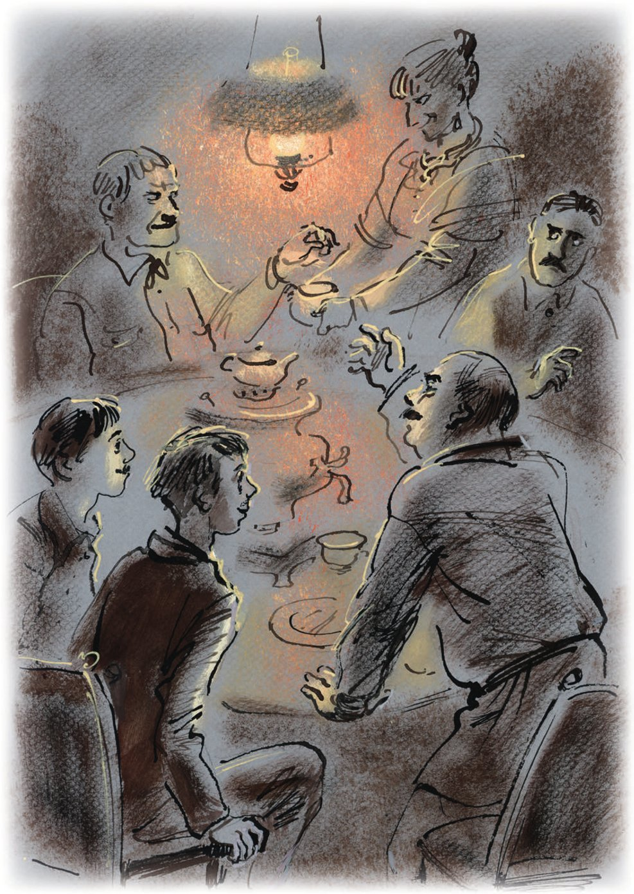

## Kapitel 19: Abstimmung auf europäische Art

Die Freunde führten ein <abbr title="kultiviert — культурный">kultiviertes</abbr> und lehrreiches Leben. Sie besuchten Museen und machten jungen Damen, die <abbr title="die Sehnsucht — тоска">Sehnsucht</abbr> nach Fleisch hatten, <abbr title="die Avancen (Pl.) — авансы, ухаживания">Avancen</abbr>. Während sie das taten, saß in Stargorod, in der Plechanow-Straße, die <abbr title="doppelt — двойной">doppelte</abbr> Witwe Grizazujewa, eine dicke und schwache Frau, mit ihren Nachbarinnen zusammen. Sie <abbr title="sich beraten (beriet, hat beraten) — совещаться">berieten sich</abbr> und <abbr title="sich verschwören (verschwor, hat verschworen) — составлять заговор, конспирировать">verschworen sich</abbr>. Alle zusammen studierten den <abbr title="der Zettel, die Zettel — записка">Zettel</abbr>, den Bender hinterlassen hatte. Sie hielten ihn sogar gegen das Licht. Aber es gab kein <abbr title="das Wasserzeichen, die Wasserzeichen — водяной знак">Wasserzeichen</abbr> darauf. Und auch mit einem Wasserzeichen wäre das geheimnisvolle <abbr title="das Gekritzel — каракули">Gekritzel</abbr> vom prächtigen Ostap nicht klarer geworden.

Drei Tage vergingen. Der Horizont blieb leer. Weder Bender noch das Teesieb, weder das hohle Armband noch der Stuhl kamen zurück. Alle diese <abbr title="belebt — одушевлённый">belebten</abbr> und <abbr title="unbelebt — неодушевлённый">unbelebten</abbr> Gegenstände waren auf rätselhafte Weise verschwunden.

Da <abbr title="greifen (griff, hat gegriffen) — хватать; принимать меры">griff</abbr> die Witwe zu <abbr title="radikal — радикальный">radikalen</abbr> <abbr title="die Maßnahme, die Maßnahmen — мера">Maßnahmen</abbr>. Sie ging ins Büro der Zeitung «Stargoroder Prawda». Dort <abbr title="basteln — мастерить, стряпать">bastelte</abbr> man ihr schnell eine Anzeige:

ICH FLEHE alle Personen an, die den <abbr title="der Aufenthaltsort — местопребывание">Aufenthaltsort</abbr> kennen.

Gen. Bender hat das Haus verlassen, ca. 25–30 J.

Trägt grünen Anzug, gelbe Schuhe und blaue Weste. <abbr title="brünett — брюнет">Brünett</abbr>.

Finder werden geb., gegen <abbr title="angemessen — приличный, соответствующий">angem.</abbr> <abbr title="die Belohnung, die Belohnungen — вознаграждение">Belohn.</abbr> zu melden. Plechanow-Str. 15, Grizazujewa.

— Ist das Ihr Sohn? — fragte man im Büro mitfühlend.

— Mein Mann ist er! — antwortete die <abbr title="der/die Leidende — страдалец, страдалица">Leidende</abbr> und bedeckte ihr Gesicht mit dem Taschentuch.

— Ach, Ihr Mann!

— Mein <abbr title="rechtmäßig — законный">rechtmäßiger</abbr>. Was denn?

— Nichts, nichts. Aber Sie sollten trotzdem zur <abbr title="die Miliz — милиция">Miliz</abbr> gehen.

Die Witwe erschrak. Vor der Miliz hatte sie große Angst. Alle sahen ihr <abbr title="merkwürdig — странно">merkwürdig</abbr> nach, als sie hinausging.

Dreimal <abbr title="erklingen (erklang, ist erklungen) — звучать, раздаваться">erklang</abbr> der <abbr title="der Aufruf, die Aufrufe — призыв">Aufruf</abbr> auf den Seiten der «Stargoroder Prawda». Aber das große Land schwieg. Es fand sich niemand, der den Aufenthaltsort des Brünetten mit den gelben Schuhen kannte. Niemand kam, um die angemessene Belohnung zu holen. Die Nachbarinnen <abbr title="tratschen — судачить, сплетничать">tratschten</abbr>.

Die Stirn der Witwe wurde jeden Tag finsterer. Und das war seltsam: Der Mann war wie eine <abbr title="die Rakete, die Raketen — ракета">Rakete</abbr> aufgeblitzt. Er hatte einen guten Stuhl und das Teesieb der Familie mit sich in den schwarzen Himmel genommen. Und trotzdem liebte ihn die Witwe immer noch. Wer kann das Herz einer Frau verstehen, besonders das Herz einer Witwe?

An die Straßenbahn hatte man sich in Stargorod schon gewöhnt. Man stieg <abbr title="furchtlos — безбоязненно">furchtlos</abbr> ein. Die Schaffner riefen mit frischen Stimmen «Alles voll, keine Plätzer!». Alles war so, als ob die Straßenbahn schon unter Fürst Wladimir, der «Roten Sonne», in die Stadt gekommen wäre. Invaliden aller Gruppen, Frauen mit Kindern und Viktor Michailowitsch Polessow stiegen vorne in die Wagen ein. Wenn der Schaffner rief: «Fahrkarten, bitte!», sagte Polessow <abbr title="wichtigtuerisch — важно, с важным видом">wichtigtuerisch</abbr>: «Jahreskarte!» Dann blieb er neben dem Fahrer stehen. Eine Jahreskarte hatte er nicht, und er konnte auch keine haben.

Der Besuch von Worobjaninow und dem großen Kombinator hatte in der Stadt eine tiefe Spur hinterlassen.

Die Verschwörer <abbr title="hüten — хранить, беречь">hüteten</abbr> sorgfältig das <abbr title="das Geheimnis, die Geheimnisse — тайна">Geheimnis</abbr>, das man ihnen <abbr title="anvertrauen — доверять">anvertraut</abbr> hatte. Sogar Viktor Michailowitsch schwieg, obwohl es ihn sehr <abbr title="jucken — чесаться; здесь: подмывать">juckte</abbr>, seine aufregenden Geheimnisse dem ersten Passanten zu erzählen. Aber dann dachte Polessow an Ostaps Blick, der hart wie <abbr title="das Zinn — олово">Zinn</abbr> war, und an seine mächtigen Schultern. Und er <abbr title="sich beherrschen — сдерживаться, крепиться">beherrschte sich</abbr>. Sein Herz <abbr title="sein Herz ausschütten — изливать душу">schüttete</abbr> er nur bei der Wahrsagerin aus.

— Was meinen Sie, Jelena Stanislawowna, — sagte er, — warum sind unsere <abbr title="der Anführer, die Anführer — руководитель, вождь">Anführer</abbr> nicht mehr da?

Das <abbr title="interessieren — интересовать">interessierte</abbr> Jelena Stanislawowna auch sehr. Aber sie hatte keine <abbr title="die Nachricht, die Nachrichten — сведения, известие">Nachrichten</abbr>.

— Und meinen Sie nicht, Jelena Stanislawowna, — sprach der unermüdliche Schlosser weiter, — dass sie gerade einen <abbr title="der Sonderauftrag, die Sonderaufträge — особое задание">Sonderauftrag</abbr> <abbr title="ausführen — выполнять">ausführen</abbr>?

Die Wahrsagerin war <abbr title="überzeugt — убеждённый">überzeugt</abbr>, dass es genau so war. Der Papagei in den roten Unterhosen war offenbar derselben Meinung. Er sah Polessow mit seinem runden, <abbr title="klug — разумный, умный">klugen</abbr> Auge an. Es war, als ob er sagen wollte: «Gib mir Sonnenblumenkerne, und ich erzähle dir gleich alles. Viktor, du wirst <abbr title="der Gouverneur, die Gouverneure — губернатор">Gouverneur</abbr>. Alle Schlosser werden dir <abbr title="unterstellt sein + Dat. — быть подчинённым">unterstellt</abbr> sein. Und der Hausmeister von Haus Nr. 5 bleibt Hausmeister, ein eingebildeter Flegel.»

— Und meinen Sie nicht, Jelena Stanislawowna, dass wir mit der Arbeit weitermachen müssen? Wir können doch nicht <abbr title="die Hände in den Schoß legen — сидеть сложа руки">die Hände in den Schoß legen</abbr>?

Die Wahrsagerin war einverstanden und bemerkte:

— Ippolit Matwejewitsch ist doch ein Held!

— Ein Held, Jelena Stanislawowna! Ganz klar. Und dieser <abbr title="der Frontoffizier, die Frontoffiziere — боевой офицер">Frontoffizier</abbr> bei ihm? Ein Mann der Tat! Sagen Sie, was Sie wollen, Jelena Stanislawowna, aber so kann die Sache nicht bleiben. Auf keinen Fall.

Und Polessow begann zu handeln. Er besuchte regelmäßig alle Mitglieder vom <abbr title="der Geheimbund, die Geheimbünde — тайное общество">Geheimbund</abbr> «Schwert und Pflug». Besonders <abbr title="plagen — донимать, мучить">plagte</abbr> er den <abbr title="vorsichtig — осторожный">vorsichtigen</abbr> Bürger Kisljarski. Kisljarski war der Besitzer einer Genossenschaft aus Odessa, die Kringel backte. Sie hieß «Moskauer Brezeln». Wenn Kisljarski Polessow sah, wurde er ganz schwarz im Gesicht. Und wenn er hörte, dass man jetzt handeln musste, <abbr title="geraten (geriet, ist geraten) — приходить (в какое-то состояние)">geriet</abbr> der ängstliche Kringelbäcker <abbr title="außer sich geraten — приходить в исступление">außer sich</abbr>.

Am Ende der Woche trafen sich alle bei Jelena Stanislawowna, im Zimmer mit dem Papagei. Polessow kochte.

— <abbr title="quasseln — болтать, болбочать">Quassel</abbr> nicht so, Viktor, — sagte der <abbr title="vernünftig — рассудительный, разумный">vernünftige</abbr> Djadjew zu ihm. — Warum rennst du den ganzen Tag durch die Stadt?

— Man muss handeln! — schrie Polessow.

— Handeln muss man, aber schreien muss man gar nicht. Meine Herren, ich stelle mir die Sache so vor. Wenn Ippolit Matwejewitsch es gesagt hat, dann ist es eine <abbr title="heilig — святой">heilige</abbr> Sache. Und wir müssen <abbr title="vermutlich — вероятно">vermutlich</abbr> nicht mehr lange warten. Wie das alles <abbr title="ablaufen (lief ab, ist abgelaufen) — происходить, протекать">ablaufen</abbr> wird, müssen wir gar nicht wissen. Dafür gibt es die Militärs. Wir sind der <abbr title="zivil — гражданский, штатский">zivile</abbr> Teil – die Vertreter der städtischen <abbr title="die Intelligenz — интеллигенция">Intelligenz</abbr> und der Kaufmannschaft.

Was ist für uns wichtig? <abbr title="bereit — готовый">Bereit</abbr> sein. Haben wir etwas? Haben wir ein <abbr title="das Zentrum, die Zentren — центр">Zentrum</abbr>? Nein. Wer wird an der Spitze der Stadt stehen? Niemand. Und das, meine Herren, ist das Wichtigste. Die Engländer, meine Herren, werden mit den Bolschewiken wohl nicht mehr lange <abbr title="Umstände machen — церемониться">Umstände machen</abbr>. Das ist für uns das erste <abbr title="das Zeichen, die Zeichen — признак, знак">Zeichen</abbr>. Alles wird sich ändern, meine Herren, und zwar sehr schnell. Das versichere ich Ihnen.

— Na, daran <abbr title="zweifeln an + Dat. — сомневаться в">zweifeln</abbr> wir auch nicht, — sagte Tscharuschnikow und <abbr title="sich aufblasen (blies sich auf, hat sich aufgeblasen) — надуваться, важничать">blies sich auf</abbr>.

— Und es ist sehr gut, dass Sie nicht zweifeln. Was meinen Sie, Herr Kisljarski? Und Sie, junge Leute?

Nikescha und Wladja zeigten mit ihrem ganzen <abbr title="das Aussehen — вид, внешность">Aussehen</abbr>, dass sie an eine schnelle <abbr title="die Veränderung, die Veränderungen — перемена">Veränderung</abbr> glaubten. Kisljarski hatte aus den Worten vom Chef der <abbr title="die Handelsfirma, die Handelsfirmen — торговая фирма">Handelsfirma</abbr> «Schnellpack» verstanden: Er musste an den <abbr title="bewaffnet — вооружённый">bewaffneten</abbr> Kämpfen nicht <abbr title="persönlich — лично, непосредственно">persönlich</abbr> <abbr title="teilnehmen (nahm teil, hat teilgenommen) — участвовать">teilnehmen</abbr>. Deshalb stimmte er erleichtert zu.

— Was sollen wir denn jetzt tun? — fragte Viktor Michailowitsch ungeduldig.

— Warten Sie, — sagte Djadjew. — Nehmen Sie sich ein <abbr title="ein Beispiel nehmen an + Dat. — брать пример с">Beispiel</abbr> an dem Begleiter von Herrn Worobjaninow. Wie geschickt! Wie vorsichtig! Haben Sie gesehen, wie schnell er die Sache auf die Hilfe für die Straßenkinder gebracht hat? So müssen auch wir handeln. Wir helfen nur den Kindern. Also, meine Herren, stellen wir die <abbr title="der Kandidat, die Kandidaten — кандидат">Kandidaten</abbr> auf.

— Ippolit Matwejewitsch Worobjaninow schlagen wir als Adelsmarschall vor! — riefen die jungen Leute Nikescha und Wladja.

Tscharuschnikow <abbr title="hüsteln — покашливать">hüstelte</abbr> herablassend.

— Ach was! Er wird <abbr title="mindestens — по меньшей мере">mindestens</abbr> <abbr title="der Minister, die Minister — министр">Minister</abbr>. Oder noch höher – <abbr title="der Diktator, die Diktatoren — диктатор">Diktator</abbr>!

— Aber meine Herren, — sagte Djadjew, — der Adelsmarschall ist doch <abbr title="die Nebensache — дело десятое, мелочь">Nebensache</abbr>! Wir müssen an den Gouverneur denken, nicht an den Adelsmarschall. Fangen wir mit dem Gouverneur an. Ich denke …

— Herr Djadjew! — rief Polessow begeistert. — Wer soll denn sonst die <abbr title="der Zügel, die Zügel — вожжи, бразды">Zügel</abbr> im ganzen Gouvernement in die Hand nehmen?

— Ich bin sehr geschmeichelt von Ihrem Vertrauen, — begann Djadjew.

Aber da sprach plötzlich Tscharuschnikow. Er war auf einmal ganz rot geworden.

— Diese Frage, meine Herren, — sagte er mit <abbr title="gepresst — сдавленный, натужный">gepresster</abbr> Stimme, — sollte man erst einmal <abbr title="ventilieren — вентилировать; обсуждать">ventilieren</abbr>.

Er bemühte sich, Djadjew nicht anzusehen.

Der Besitzer von «Schnellpack» betrachtete stolz seine Stiefel. An den Stiefeln klebten <abbr title="der Holzspan, die Holzspäne — деревянная стружка">Holzspäne</abbr>.

— Ich habe nichts <abbr title="dagegen sein — быть против">dagegen</abbr>, — sagte er. — <abbr title="abstimmen — голосовать">Stimmen</abbr> wir ab. Geheim oder offen?

— Auf sowjetische Art brauchen wir das nicht, — sagte Tscharuschnikow beleidigt. — Stimmen wir ehrlich ab, auf europäische Art – geheim.

Man stimmte mit Zetteln ab. Für Djadjew gab es vier Zettel. Für Tscharuschnikow zwei. Einer <abbr title="sich der Stimme enthalten (enthielt, hat enthalten) — воздержаться (при голосовании)">enthielt sich der Stimme</abbr>. An Kisljarskis Gesicht sah man, dass er es war. Er wollte es sich mit dem <abbr title="künftig — будущий">künftigen</abbr> Gouverneur nicht <abbr title="es sich mit jemandem verderben (verdarb, hat verdorben) — портить отношения с кем-то">verderben</abbr>, wer es auch sein würde.

Der zitternde Polessow las das Ergebnis der ehrlichen europäischen Abstimmung vor. Danach war es im Zimmer peinlich still. Niemand wollte Tscharuschnikow ansehen. Der <abbr title="erfolglos — неудачливый, неудачный">erfolglose</abbr> Kandidat für den Gouverneursposten saß da wie ein <abbr title="wie ein begossener Pudel — как оплёванный, как побитая собака">begossener Pudel</abbr>.

Jelena Stanislawowna tat er sehr leid. Sie hatte für ihn gestimmt.

Die zweite Stimme hatte sich Tscharuschnikow selbst gegeben. Er hatte Erfahrung mit Wahlen. Die gute Jelena Stanislawowna sagte sofort:

— Aber zum Bürgermeister schlage ich doch Monsieur Tscharuschnikow vor.

— Warum «doch»? — sagte der großzügige Gouverneur. — Nicht «doch», sondern genau ihn und keinen anderen. Die <abbr title="gesellschaftlich — общественный">gesellschaftliche</abbr> Arbeit von Herrn Tscharuschnikow kennen wir gut.

— Bravo, bravo! — riefen alle.

— Gilt die Wahl also als bestätigt?

Der begossene Pudel Tscharuschnikow <abbr title="aufleben — оживать">lebte</abbr> auf und <abbr title="protestieren — протестовать">protestierte</abbr> sogar:

— Nein, nein, meine Herren, ich bitte um eine Abstimmung. Den Bürgermeister muss man noch eher wählen als den Gouverneur. Wenn Sie mir Ihr Vertrauen schenken wollen, meine Herren, dann bitte ich Sie sehr: Stimmen Sie ab!

Die Zettel fielen in eine leere <abbr title="die Zuckerdose, die Zuckerdosen — сахарница">Zuckerdose</abbr>.

— Sechs Stimmen dafür, — sagte Polessow, — und eine <abbr title="die Enthaltung, die Enthaltungen — воздержание (при голосовании)">Enthaltung</abbr>.

— Ich <abbr title="gratulieren + Dat. — поздравлять">gratuliere</abbr> Ihnen, Herr Bürgermeister! — sagte Kisljarski. An seinem Gesicht sah man, dass er sich auch diesmal enthalten hatte. — Ich gratuliere Ihnen!

Tscharuschnikow <abbr title="aufblühen — расцветать">blühte</abbr> auf.

— Jetzt fehlt nur noch eine kleine <abbr title="die Erfrischung, die Erfrischungen — освежение, прохладительное">Erfrischung</abbr>, <abbr title="die Exzellenz — ваше превосходительство">Exzellenz</abbr>, — sagte er zu Djadjew. — Polessow, <abbr title="flitzen — слетать, мчаться">flitz</abbr> mal schnell in den Laden «Oktober». Hast du Geld?

Polessow machte mit der Hand eine geheimnisvolle Geste und lief weg. Die Wahlen wurden unterbrochen. Man machte erst beim Abendessen weiter.

Als <abbr title="der Kurator, die Kuratoren — попечитель">Kurator</abbr> vom <abbr title="der Schulbezirk, die Schulbezirke — учебный округ">Schulbezirk</abbr> wählte man Raspopow. Er war früher <abbr title="der Direktor, die Direktoren — директор">Direktor</abbr> vom <abbr title="das Adelsgymnasium — дворянская гимназия">Adelsgymnasium</abbr> gewesen und war jetzt <abbr title="der Antiquar, die Antiquare — букинист">Antiquar</abbr>. Man lobte ihn sehr. Nur Wladja, der drei Gläschen Wodka getrunken hatte, protestierte plötzlich:

— Den darf man nicht wählen. Er hat mir in der <abbr title="die Abschlussprüfung, die Abschlussprüfungen — выпускной экзамен">Abschlussprüfung</abbr> eine Fünf in Logik gegeben.

Alle stürzten sich auf Wladja.

— In so einer entscheidenden Stunde, — schrien sie, — darf man nicht an seinen eigenen Vorteil denken. Denken Sie an das Vaterland!

Man überredete Wladja so schnell, dass er sogar selbst für seinen <abbr title="der Peiniger, die Peiniger — мучитель">Peiniger</abbr> stimmte. Raspopow wurde mit allen Stimmen gewählt, bei einer Enthaltung.

Kisljarski bot man den Posten vom Vorsitzenden des <abbr title="das Börsenkomitee, die Börsenkomitees — биржевой комитет">Börsenkomitees</abbr> an. Er hatte nichts dagegen. Aber bei der Abstimmung enthielt er sich für alle Fälle.

Dann gingen sie alle ihre Bekannten und Verwandten durch und wählten: den <abbr title="der Polizeimeister, die Polizeimeister — полицмейстер">Polizeimeister</abbr>, den Leiter vom <abbr title="das Eichamt, die Eichämter — пробирная палата">Eichamt</abbr>, den <abbr title="die Akzise — акциз">Akzise-</abbr>, den Steuer- und den <abbr title="der Fabrikinspektor, die Fabrikinspektoren — фабричный инспектор">Fabrikinspektor</abbr>. Sie besetzten die Stellen vom <abbr title="der Staatsanwalt, die Staatsanwälte — прокурор">Staatsanwalt</abbr> des Bezirks, vom Vorsitzenden, vom Sekretär und von den Mitgliedern des Gerichts. Sie bestimmten die Vorsitzenden der Semstwo-Verwaltung und der <abbr title="die Kaufmannsverwaltung — купеческая управа">Kaufmannsverwaltung</abbr>, der <abbr title="die Kinderfürsorge — попечительство о детях">Kinderfürsorge</abbr> und endlich auch der <abbr title="die Kleinbürgerverwaltung — мещанская управа">Kleinbürgerverwaltung</abbr>. Jelena Stanislawowna wählte man zur <abbr title="die Schirmherrin, die Schirmherrinnen — попечительница">Schirmherrin</abbr> der Vereine «Ein Tropfen Milch» und «Die weiße Blume». Nikescha und Wladja waren noch jung. Deshalb <abbr title="ernennen (ernannte, hat ernannt) — назначать">ernannte</abbr> man sie zu Beamten für besondere Aufträge beim Gouverneur.

— Ge-estatten Sie! — rief plötzlich Tscharuschnikow. — Der Gouverneur bekommt gleich zwei Beamte! Und ich?

— Dem Bürgermeister, — sagte der Gouverneur sanft, — stehen laut <abbr title="der Stellenplan, die Stellenpläne — штатное расписание">Stellenplan</abbr> keine Beamten für besondere Aufträge zu.

— Na, dann einen Sekretär.

Djadjew war einverstanden. Auch Jelena Stanislawowna wurde lebhaft.

— Wäre es nicht möglich, — sagte sie schüchtern, — ich kenne da einen jungen Mann, einen sehr netten und gut <abbr title="erzogen — воспитанный">erzogenen</abbr> Jungen. Der Sohn von Madame Tscherkessowa … Sehr, sehr nett, sehr <abbr title="begabt — способный, одарённый">begabt</abbr> … Er ist jetzt <abbr title="arbeitslos — безработный">arbeitslos</abbr>. Er ist beim <abbr title="das Arbeitsamt, die Arbeitsämter — биржа труда">Arbeitsamt</abbr> <abbr title="gemeldet sein — состоять на учёте">gemeldet</abbr>. Er hat sogar einen <abbr title="der Ausweis, die Ausweise — билет, удостоверение">Ausweis</abbr>. Man hat ihm versprochen, ihn in den nächsten Tagen in der Gewerkschaft <abbr title="unterbringen (brachte unter, hat untergebracht) — устроить, пристроить">unterzubringen</abbr> … Könnten Sie ihn nicht nehmen? Die Mutter wäre Ihnen sehr <abbr title="dankbar — благодарный">dankbar</abbr>.

— Das geht vielleicht, — sagte Tscharuschnikow <abbr title="gnädig — милостиво">gnädig</abbr>. — Was meinen Sie, meine Herren? Gut. Ich denke, im Großen und Ganzen wird das klappen.

— Nun, — bemerkte Djadjew, — im Großen und Ganzen … ist das wohl alles? Alles, scheint mir?

— Und ich? — klang plötzlich eine dünne, aufgeregte Stimme.

Alle drehten sich um. In der Ecke, neben dem Papagei, stand der völlig <abbr title="verstört — расстроенный, потрясённый">verstörte</abbr> Polessow. Auf Viktor Michailowitschs schwarzen <abbr title="das Augenlid, die Augenlider — веко">Augenlidern</abbr> kochten die Tränen. Alle schämten sich sehr. Plötzlich fiel den Gästen ein: Sie tranken ja Polessows Wodka. Und überhaupt war er einer der wichtigsten Organisatoren der Stargoroder Abteilung von «Schwert und Pflug». Jelena Stanislawowna fasste sich an die Schläfen und schrie erschrocken auf.

— Viktor Michailowitsch! — stöhnten alle. — Mein Lieber! Mein Bester! Schämen Sie sich nicht? Warum stehen Sie denn in der Ecke? Kommen Sie sofort her!

Polessow kam näher. Er litt. Eine solche <abbr title="die Herzlosigkeit — чёрствость, бессердечие">Herzlosigkeit</abbr> hatte er von seinen <abbr title="der Kamerad, die Kameraden — товарищ">Kameraden</abbr> von Schwert und Pflug nicht erwartet.

Jelena Stanislawowna konnte es nicht mehr <abbr title="ertragen (ertrug, hat ertragen) — выносить, терпеть">ertragen</abbr>.

— Meine Herren, — sagte sie, — das ist schrecklich! Wie konnten Sie unseren lieben Viktor Michailowitsch vergessen?

Sie stand auf und küsste den aristokratischen Schlosser auf die <abbr title="rußig — закопчённый">rußige</abbr> Stirn.

— Meine Herren, kann Viktor Michailowitsch denn nicht ein würdiger Kurator vom Schulbezirk sein? Oder Polizeimeister?

— Na, Viktor Michailowitsch? — fragte der Gouverneur. — Wollen Sie Kurator werden?

— Aber natürlich wird er ein ausgezeichneter, <abbr title="menschlich — гуманный">menschlicher</abbr> Kurator! — sagte der Bürgermeister. Er schluckte gerade einen eingelegten <abbr title="der Pilz, die Pilze — гриб">Pilz</abbr> und verzog das Gesicht.

— Und Raspo-opow? — fragte Viktor Michailowitsch gekränkt. — Sie haben doch schon Raspopow ernannt?

— Ja, wirklich, wohin mit Raspopow?

— Vielleicht als <abbr title="der Feuerwehrhauptmann, die Feuerwehrhauptleute — брандмейстер">Feuerwehrhauptmann</abbr>? …

— Feuerwehrhauptmann! — rief Viktor Michailowitsch plötzlich aufgeregt.

<abbr title="sofort — мгновенно, сразу">Sofort</abbr> sah er vor sich die <abbr title="der Feuerwehrwagen, die Feuerwehrwagen — пожарная колесница">Feuerwehrwagen</abbr>, das Funkeln der Lichter, er hörte die Trompeten und das Dröhnen der Trommeln. <abbr title="die Axt, die Äxte — топор">Äxte</abbr> blitzten, Fackeln schwankten, die Erde öffnete sich, und <abbr title="rabenschwarz — вороной">rabenschwarze</abbr> <abbr title="der Drache, die Drachen — дракон">Drachen</abbr> trugen ihn zum <abbr title="der Brand, die Brände — пожар">Brand</abbr> vom Stadttheater.

— Feuerwehrhauptmann? Ich will Feuerwehrhauptmann werden!

— Na, das ist ja prima! Ich gratuliere Ihnen. Von jetzt an sind Sie Feuerwehrhauptmann.

— Auf das <abbr title="das Gedeihen — процветание">Gedeihen</abbr> der Feuerwehr! — sagte der Vorsitzende des Börsenkomitees ironisch.

Da stürzten sich alle auf Kisljarski:

— Sie waren schon immer ein <abbr title="der/die Linke, die Linken — левый">Linker</abbr>! Wir kennen Sie!

— Meine Herren, was bin ich denn für ein Linker?

— Wir kennen Sie, wir kennen Sie! …

— Ein Linker!

— Alle Juden sind links.

— Aber bei Gott, meine Herren, diese Witze verstehe ich nicht.

— Ein Linker, ein Linker, <abbr title="verheimlichen — скрывать">verheimlichen</abbr> Sie es nicht!

— In der Nacht schläft er und träumt von Miljukow!

— Ein <abbr title="der Kadett, die Kadetten — кадет (член партии конституционных демократов)">Kadett</abbr>! Ein Kadett!

— Die Kadetten haben Finnland verkauft, — brummte plötzlich Tscharuschnikow. — Sie haben Geld von den Japanern genommen! Und die Armenier haben sie <abbr title="verhätscheln — баловать, разводить">verhätschelt</abbr>!

Kisljarski konnte diesen <abbr title="der Strom, die Ströme — поток">Strom</abbr> von grundlosen Beschuldigungen nicht ertragen. Blass und mit blitzenden kleinen Augen hielt sich der Vorsitzende des Börsenkomitees an einer Stuhllehne fest. Mit klirrender Stimme sagte er:

— Ich war immer ein <abbr title="der Oktobrist, die Oktobristen — октябрист">Oktobrist</abbr>, und ich werde es bleiben.

Nun begann man zu klären, wer mit welcher Partei <abbr title="sympathisieren mit + Dat. — сочувствовать, симпатизировать">sympathisierte</abbr>.

— Vor allem, meine Herren: Demokratie, — sagte Tscharuschnikow. — Unsere städtische <abbr title="die Selbstverwaltung — самоуправление">Selbstverwaltung</abbr> muss demokratisch sein. Aber ohne die Kadettchen. Die haben uns im Jahr siebzehn genug <abbr title="Mist bauen — напакостить, нагадить">Mist gebaut</abbr>!

— Ich hoffe, — fragte der Gouverneur giftig, — unter uns gibt es keine sogenannten <abbr title="der Sozialdemokrat, die Sozialdemokraten — социал-демократ">Sozialdemokraten</abbr>?

Weiter links als die Oktobristen war niemand. Und die Oktobristen vertrat auf dieser Sitzung Kisljarski. Tscharuschnikow erklärte sich zur «Mitte». Ganz rechts <abbr title="außen — снаружи; с краю">außen</abbr> stand der Feuerwehrhauptmann. Er war so weit rechts, dass er nicht einmal wusste, zu welcher Partei er <abbr title="gehören zu + Dat. — принадлежать к">gehörte</abbr>.

Man sprach über den Krieg.

— Heute oder morgen, — sagte Djadjew.

— Es gibt Krieg, ganz sicher.

— Ich <abbr title="raten (riet, hat geraten) — советовать">rate</abbr> Ihnen, Vorräte anzulegen, solange es noch nicht zu spät ist.

— Meinen Sie? — fragte Kisljarski beunruhigt.

— Und was meinen Sie? Glauben Sie, dass man im Krieg noch etwas <abbr title="bekommen (bekam, hat bekommen) — достать, получить">bekommen</abbr> kann? Sofort ist das Mehl vom Markt verschwunden! Die <abbr title="die Silbermünze, die Silbermünzen — серебряная монета">Silbermünzen</abbr> sind wie vom Erdboden <abbr title="verschlucken — проглатывать">verschluckt</abbr>. Dann kommt allerlei <abbr title="das Papiergeld — бумажные деньги">Papiergeld</abbr>, <abbr title="die Briefmarke, die Briefmarken — почтовая марка">Briefmarken</abbr>, die man wie Geld benutzt, und all so etwas.

— Der Krieg ist <abbr title="beschlossene Sache — дело решённое">beschlossene Sache</abbr>.

— Machen Sie, was Sie wollen, — sagte Djadjew. — Aber ich gebe mein ganzes freies Geld für den <abbr title="der Einkauf, die Einkäufe — закупка, покупка">Einkauf</abbr> von Dingen aus, die man zum Leben unbedingt braucht.

— Und Ihre Geschäfte mit Stoffen?

— Stoffe sind eine Sache, und Mehl und Zucker sind eine andere. Deshalb rate ich es auch Ihnen. Ich rate es Ihnen dringend.

Polessow <abbr title="grinsen — ухмыляться">grinste</abbr>.

— Wie wollen die Bolschewiken denn Krieg führen? Womit? Womit wollen sie kämpfen? Mit alten <abbr title="das Gewehr, die Gewehre — винтовка, ружьё">Gewehren</abbr>? Und die <abbr title="die Luftflotte — воздушный флот">Luftflotte</abbr>? Ein bedeutender Kommunist hat mir gesagt, dass sie – na, was meinen Sie, wie viele <abbr title="das Flugzeug, die Flugzeuge — самолёт, аэроплан">Flugzeuge</abbr> haben?

— Zweihundert Stück!

— Zweihundert? Nicht zweihundert, sondern zweiunddreißig! Und Frankreich hat achtzigtausend <abbr title="das Kampfflugzeug, die Kampfflugzeuge — боевой самолёт">Kampfflugzeuge</abbr>.

— Ja-a … Die Bolschewiken haben uns ganz <abbr title="herunterwirtschaften — довести до ручки, разорить">heruntergewirtschaftet</abbr>.

Man ging erst nach Mitternacht auseinander.

Der Gouverneur begleitete den Bürgermeister nach Hause. Beide gingen übertrieben gerade.

— Gouverneur! — sagte Tscharuschnikow. — Was bist du für ein Gouverneur, wenn du kein General bist?

— Ich werde ein <abbr title="der Zivilgeneral, die Zivilgeneräle — штатский генерал">Zivilgeneral</abbr>. Bist du neidisch? Wenn ich will, stecke ich dich ins Gefängnis. Da sitzt du dann lange bei mir.

— Mich kann man nicht <abbr title="einsperren — сажать (в тюрьму), запирать">einsperren</abbr>. Ich bin gewählt, mir hat man Vertrauen geschenkt.

— Wer die Wahl hat, hat die Qual. Und wer gewählt ist, auch.

— Ich ver-erbitte mir solche Witze! — schrie Tscharuschnikow plötzlich so laut, dass es die ganze Straße hörte.

— Warum schreist du denn, du Dummkopf? — fragte der Gouverneur. — Willst du bei der Miliz übernachten?

— Ich darf nicht bei der Miliz übernachten, — antwortete der Bürgermeister. — Ich bin <abbr title="sowjetisch — советский">sowjetischer</abbr> Angestellter …

Ein Stern <abbr title="leuchten — сиять, светить">leuchtete</abbr>. Die Nacht war <abbr title="zauberhaft — волшебный">zauberhaft</abbr>. In der Zweiten Sowjetstraße ging der Streit zwischen dem Gouverneur und dem Bürgermeister weiter.

---

### Neue Wörter

- **kultiviert** — культурный
- **die Sehnsucht** — тоска
- **die Avancen (Pl.)** — авансы, ухаживания
- **doppelt** — двойной
- **sich beraten (beriet, hat beraten)** — совещаться
- **sich verschwören (verschwor, hat verschworen)** — составлять заговор, конспирировать
- **der Zettel, die Zettel** — записка
- **das Wasserzeichen, die Wasserzeichen** — водяной знак
- **das Gekritzel** — каракули
- **belebt** — одушевлённый
- **unbelebt** — неодушевлённый
- **greifen (griff, hat gegriffen)** — хватать; принимать меры
- **radikal** — радикальный
- **die Maßnahme, die Maßnahmen** — мера
- **basteln** — мастерить, стряпать
- **der Aufenthaltsort** — местопребывание
- **brünett** — брюнет
- **angemessen** — приличный, соответствующий
- **die Belohnung, die Belohnungen** — вознаграждение
- **der/die Leidende** — страдалец, страдалица
- **rechtmäßig** — законный
- **die Miliz** — милиция
- **merkwürdig** — странно
- **erklingen (erklang, ist erklungen)** — звучать, раздаваться
- **der Aufruf, die Aufrufe** — призыв
- **tratschen** — судачить, сплетничать
- **die Rakete, die Raketen** — ракета
- **furchtlos** — безбоязненно
- **wichtigtuerisch** — важно, с важным видом
- **hüten** — хранить, беречь
- **das Geheimnis, die Geheimnisse** — тайна
- **anvertrauen** — доверять
- **jucken** — чесаться; здесь: подмывать
- **das Zinn** — олово
- **sich beherrschen** — сдерживаться, крепиться
- **sein Herz ausschütten** — изливать душу
- **der Anführer, die Anführer** — руководитель, вождь
- **interessieren** — интересовать
- **die Nachricht, die Nachrichten** — сведения, известие
- **der Sonderauftrag, die Sonderaufträge** — особое задание
- **ausführen** — выполнять
- **überzeugt** — убеждённый
- **klug** — разумный, умный
- **der Gouverneur, die Gouverneure** — губернатор
- **unterstellt sein + Dat.** — быть подчинённым
- **die Hände in den Schoß legen** — сидеть сложа руки
- **der Frontoffizier, die Frontoffiziere** — боевой офицер
- **der Geheimbund, die Geheimbünde** — тайное общество
- **plagen** — донимать, мучить
- **vorsichtig** — осторожный
- **geraten (geriet, ist geraten)** — приходить (в какое-то состояние)
- **außer sich geraten** — приходить в исступление
- **quasseln** — болтать, болбочать
- **vernünftig** — рассудительный, разумный
- **heilig** — святой
- **vermutlich** — вероятно
- **ablaufen (lief ab, ist abgelaufen)** — происходить, протекать
- **zivil** — гражданский, штатский
- **die Intelligenz** — интеллигенция
- **bereit** — готовый
- **das Zentrum, die Zentren** — центр
- **Umstände machen** — церемониться
- **das Zeichen, die Zeichen** — признак, знак
- **zweifeln an + Dat.** — сомневаться в
- **sich aufblasen (blies sich auf, hat sich aufgeblasen)** — надуваться, важничать
- **das Aussehen** — вид, внешность
- **die Veränderung, die Veränderungen** — перемена
- **die Handelsfirma, die Handelsfirmen** — торговая фирма
- **bewaffnet** — вооружённый
- **persönlich** — лично, непосредственно
- **teilnehmen (nahm teil, hat teilgenommen)** — участвовать
- **ein Beispiel nehmen an + Dat.** — брать пример с
- **der Kandidat, die Kandidaten** — кандидат
- **hüsteln** — покашливать
- **mindestens** — по меньшей мере
- **der Minister, die Minister** — министр
- **der Diktator, die Diktatoren** — диктатор
- **die Nebensache** — дело десятое, мелочь
- **der Zügel, die Zügel** — вожжи, бразды
- **gepresst** — сдавленный, натужный
- **ventilieren** — вентилировать; обсуждать
- **der Holzspan, die Holzspäne** — деревянная стружка
- **dagegen sein** — быть против
- **abstimmen** — голосовать
- **sich der Stimme enthalten (enthielt, hat enthalten)** — воздержаться (при голосовании)
- **künftig** — будущий
- **es sich mit jemandem verderben (verdarb, hat verdorben)** — портить отношения с кем-то
- **erfolglos** — неудачливый, неудачный
- **wie ein begossener Pudel** — как оплёванный, как побитая собака
- **gesellschaftlich** — общественный
- **aufleben** — оживать
- **protestieren** — протестовать
- **die Zuckerdose, die Zuckerdosen** — сахарница
- **die Enthaltung, die Enthaltungen** — воздержание (при голосовании)
- **gratulieren + Dat.** — поздравлять
- **aufblühen** — расцветать
- **die Erfrischung, die Erfrischungen** — освежение, прохладительное
- **die Exzellenz** — ваше превосходительство
- **flitzen** — слетать, мчаться
- **der Kurator, die Kuratoren** — попечитель
- **der Schulbezirk, die Schulbezirke** — учебный округ
- **der Direktor, die Direktoren** — директор
- **das Adelsgymnasium** — дворянская гимназия
- **der Antiquar, die Antiquare** — букинист
- **die Abschlussprüfung, die Abschlussprüfungen** — выпускной экзамен
- **der Peiniger, die Peiniger** — мучитель
- **das Börsenkomitee, die Börsenkomitees** — биржевой комитет
- **der Polizeimeister, die Polizeimeister** — полицмейстер
- **das Eichamt, die Eichämter** — пробирная палата
- **die Akzise** — акциз
- **der Fabrikinspektor, die Fabrikinspektoren** — фабричный инспектор
- **der Staatsanwalt, die Staatsanwälte** — прокурор
- **die Kaufmannsverwaltung** — купеческая управа
- **die Kinderfürsorge** — попечительство о детях
- **die Kleinbürgerverwaltung** — мещанская управа
- **die Schirmherrin, die Schirmherrinnen** — попечительница
- **ernennen (ernannte, hat ernannt)** — назначать
- **der Stellenplan, die Stellenpläne** — штатное расписание
- **erzogen** — воспитанный
- **begabt** — способный, одарённый
- **arbeitslos** — безработный
- **das Arbeitsamt, die Arbeitsämter** — биржа труда
- **gemeldet sein** — состоять на учёте
- **der Ausweis, die Ausweise** — билет, удостоверение
- **unterbringen (brachte unter, hat untergebracht)** — устроить, пристроить
- **dankbar** — благодарный
- **gnädig** — милостиво
- **verstört** — расстроенный, потрясённый
- **das Augenlid, die Augenlider** — веко
- **die Herzlosigkeit** — чёрствость, бессердечие
- **der Kamerad, die Kameraden** — товарищ
- **ertragen (ertrug, hat ertragen)** — выносить, терпеть
- **rußig** — закопчённый
- **menschlich** — гуманный
- **der Pilz, die Pilze** — гриб
- **der Feuerwehrhauptmann, die Feuerwehrhauptleute** — брандмейстер
- **sofort** — мгновенно, сразу
- **der Feuerwehrwagen, die Feuerwehrwagen** — пожарная колесница
- **die Axt, die Äxte** — топор
- **rabenschwarz** — вороной
- **der Drache, die Drachen** — дракон
- **der Brand, die Brände** — пожар
- **das Gedeihen** — процветание
- **der/die Linke, die Linken** — левый
- **verheimlichen** — скрывать
- **der Kadett, die Kadetten** — кадет (член партии конституционных демократов)
- **verhätscheln** — баловать, разводить
- **der Strom, die Ströme** — поток
- **der Oktobrist, die Oktobristen** — октябрист
- **sympathisieren mit + Dat.** — сочувствовать, симпатизировать
- **die Selbstverwaltung** — самоуправление
- **Mist bauen** — напакостить, нагадить
- **der Sozialdemokrat, die Sozialdemokraten** — социал-демократ
- **außen** — снаружи; с краю
- **gehören zu + Dat.** — принадлежать к
- **raten (riet, hat geraten)** — советовать
- **bekommen (bekam, hat bekommen)** — достать, получить
- **die Silbermünze, die Silbermünzen** — серебряная монета
- **verschlucken** — проглатывать
- **das Papiergeld** — бумажные деньги
- **die Briefmarke, die Briefmarken** — почтовая марка
- **beschlossene Sache** — дело решённое
- **der Einkauf, die Einkäufe** — закупка, покупка
- **grinsen** — ухмыляться
- **das Gewehr, die Gewehre** — винтовка, ружьё
- **die Luftflotte** — воздушный флот
- **das Flugzeug, die Flugzeuge** — самолёт, аэроплан
- **das Kampfflugzeug, die Kampfflugzeuge** — боевой самолёт
- **herunterwirtschaften** — довести до ручки, разорить
- **der Zivilgeneral, die Zivilgeneräle** — штатский генерал
- **einsperren** — сажать (в тюрьму), запирать
- **sowjetisch** — советский
- **leuchten** — сиять, светить
- **zauberhaft** — волшебный

[← Kapitel 18](kapitel-18.md) · [Inhalt](README.md) · [Kapitel 20 →](kapitel-20.md)
