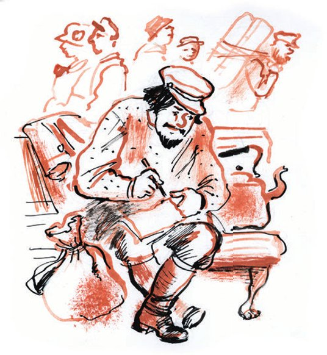
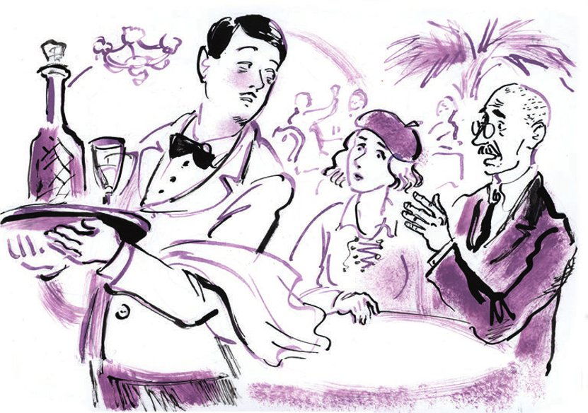

## Kapitel 20: Von Sevilla bis Granada

Moment mal, und wo ist Vater Fjodor? Wo ist der Priester von der Kirche Frol und Lawr mit den kurz <abbr title="scheren (schor, hat geschoren) — стричь">geschorenen</abbr> Haaren? Wollte er nicht in die Weinbergstraße, in das Haus Nr. 34, zum Bürger Bruns gehen? Wo ist dieser Schatzsucher mit dem Gesicht eines Engels? Wo ist der <abbr title="der Todfeind, die Todfeinde — заклятый враг">Todfeind</abbr> von Ippolit Matwejewitsch Worobjaninow, der jetzt in einem dunklen Flur am Panzerschrank <abbr title="Wache halten — дежурить, стоять на посту">Wache hält</abbr>?

Vater Fjodor ist verschwunden. Der Teufel hat ihn <abbr title="forttreiben (trieb fort, hat fortgetrieben) — унести, угнать">fortgetrieben</abbr>. Man sagt, man hat ihn auf dem Bahnhof Popasnaja gesehen, an der Donezker Bahn. Er lief über den Bahnsteig, mit einem <abbr title="der Teekessel, die Teekessel — чайник">Teekessel</abbr> voll heißem Wasser …

Vater Fjodor wurde <abbr title="gierig — жадный, алчный">gierig</abbr>. Er wollte Reichtum. Und so jagte er quer durch Russland hinter der Möbelgarnitur der Generalswitwe Popowa her. Und in dieser Garnitur ist, das muss man <abbr title="zugeben (gab zu, hat zugegeben) — признавать">zugeben</abbr>, nicht das Geringste.

Der Vater fährt durch Russland. Er schreibt nur Briefe an seine Frau.

Brief von Vater Fjodor, geschrieben auf dem Bahnhof in Charkow, an seine Frau in der Kreisstadt N:

«Meine Liebste, Katerina Alexandrowna!

Ich bin sehr <abbr title="schuldig sein — быть виноватым">schuldig</abbr> vor Dir. Ich habe Dich Arme in so einer Zeit allein <abbr title="lassen (ließ, hat gelassen) — оставлять">gelassen</abbr>.

Ich muss Dir alles erzählen. Du wirst mich verstehen und, so hoffe ich, einverstanden sein.

In die «Lebendige Kirche» bin ich natürlich nicht <abbr title="eintreten (trat ein, ist eingetreten) — вступать">eingetreten</abbr>. Das wollte ich auch nie, Gott <abbr title="bewahren vor + Dat. — упаси, уберечь от">bewahre</abbr> mich davor.

Jetzt lies aufmerksam. Bald werden wir ganz anders leben. Erinnerst Du Dich, ich habe Dir von der kleinen Kerzenfabrik erzählt? Die werden wir haben, und vielleicht noch etwas mehr. Und Du musst dann nicht mehr selbst kochen und dazu noch <abbr title="der Kostgänger, die Kostgänger — столовник, нахлебник">Kostgänger</abbr> halten. Wir ziehen nach Samara und nehmen uns ein Dienstmädchen.

Die Sache ist so – aber halte sie streng geheim, sag niemandem etwas, nicht einmal Marja Iwanowna. Ich suche einen Schatz. Erinnerst Du Dich an die verstorbene Klawdija Iwanowna Petuchowa, die Schwiegermutter von Worobjaninow? Vor ihrem Tod hat Klawdija Iwanowna mir gebeichtet: In ihrem Haus in Stargorod hat sie ihre Brillanten in einem der Salonstühle versteckt (es sind insgesamt zwölf).

Katenka, denk nicht, dass ich irgendein Dieb bin. Diese Brillanten hat sie mir <abbr title="vermachen — завещать">vermacht</abbr>. Und sie hat mir befohlen, sie vor Ippolit Matwejewitsch zu <abbr title="schützen vor + Dat. — защищать от, стеречь">schützen</abbr>, ihrem alten Peiniger.

Deshalb habe ich Dich Arme so plötzlich verlassen.

<abbr title="jemandem Vorwürfe machen — упрекать, винить кого-то">Mach mir keine Vorwürfe</abbr>.

Ich komme nach Stargorod, und stell Dir vor, dieser alte <abbr title="der Schürzenjäger, die Schürzenjäger — бабник, женолюб">Schürzenjäger</abbr> ist auch dort. Irgendwie hat er es erfahren. Wahrscheinlich hat er die Alte vor ihrem Tod <abbr title="foltern — пытать">gefoltert</abbr>. Ein <abbr title="furchtbar — ужасный">furchtbarer</abbr> Mensch! Und mit ihm reist ein <abbr title="der Verbrecher, die Verbrecher — преступник, уголовник">Verbrecher</abbr>, er hat sich einen <abbr title="der Bandit, die Banditen — бандит">Banditen</abbr> <abbr title="anheuern — нанимать">angeheuert</abbr>. Sie sind direkt über mich hergefallen und wollten mich <abbr title="jemanden um die Ecke bringen — сжить со свету, убить">um die Ecke bringen</abbr>. Aber mit mir ist nicht zu spaßen, ich habe mich nicht <abbr title="sich unterkriegen lassen — сдаваться, поддаваться">unterkriegen</abbr> lassen.

Zuerst war ich auf der falschen Spur. Ich habe nur einen Stuhl im Haus von Worobjaninow gefunden (dort ist jetzt ein <abbr title="das Wohltätigkeitsheim, die Wohltätigkeitsheime — богоугодное заведение">Wohltätigkeitsheim</abbr>). Ich trage meine Möbel in mein Zimmer in der Pension «Sorbonne». Und plötzlich stürzt sich ein Mann hinter einer Ecke mit <abbr title="das Gebrüll — рёв, рычание">Gebrüll</abbr> auf mich, wie ein <abbr title="der Löwe, die Löwen — лев">Löwe</abbr>, und packt den Stuhl. Fast wäre es zu einer <abbr title="die Schlägerei, die Schlägereien — драка">Schlägerei</abbr> gekommen. Man wollte mich <abbr title="blamieren — опозорить, осрамить">blamieren</abbr>. Dann sehe ich genauer hin: Worobjaninow. Er hat sich rasiert, stell Dir vor, und den Kopf <abbr title="kahl — лысый, голый">kahl</abbr> gemacht, dieser <abbr title="der Schwindler, die Schwindler — аферист, мошенник">Schwindler</abbr>. Er blamiert sich auf seine alten Tage.

Wir haben den Stuhl zerbrochen – nichts war darin. Erst später habe ich verstanden, dass ich auf der falschen Spur war. Aber damals war ich sehr betrübt.

Ich war gekränkt und habe diesem <abbr title="der Lüstling, die Lüstlinge — развратник">Lüstling</abbr> die ganze Wahrheit ins Gesicht gesagt.

Was für eine <abbr title="die Schande — срам, позор">Schande</abbr>, sage ich, auf Ihre alten Tage! Was für eine Barbarei, sage ich, gibt es jetzt in Russland: Ein Adelsmarschall stürzt sich gleich einem Löwen auf einen Geistlichen und <abbr title="vorwerfen (warf vor, hat vorgeworfen) — упрекать">wirft</abbr> ihm vor, dass er parteilos ist! Sie sind, sage ich, ein <abbr title="niederträchtig — низкий, подлый">niederträchtiger</abbr> Mensch, der Peiniger von Klawdija Iwanowna und ein Jäger nach fremdem Gut. Und dieses Gut gehört jetzt dem Staat, nicht ihm.

Da hat er sich geschämt und ist von mir weggegangen, wahrscheinlich in ein <abbr title="das Freudenhaus, die Freudenhäuser — публичный дом">Freudenhaus</abbr>.

Und ich bin in mein Zimmer in der «Sorbonne» gegangen und habe über den weiteren Plan nachgedacht. Und ich habe mir etwas ausgedacht, was diesem rasierten Dummkopf nie eingefallen wäre: Ich habe beschlossen, den Mann zu finden, der die <abbr title="beschlagnahmen — реквизировать, конфисковать">beschlagnahmten</abbr> Möbel verteilt hat.

Stell Dir vor, Katenka, nicht umsonst habe ich an der <abbr title="juristisch — юридический">juristischen</abbr> <abbr title="die Fakultät, die Fakultäten — факультет">Fakultät</abbr> studiert – das hat mir genützt. Ich habe diesen Mann gefunden. Schon am nächsten Tag habe ich ihn gefunden. Warfolomejitsch ist ein sehr anständiger alter Mann. Er lebt mit seiner alten Großmutter und verdient sein Brot mit schwerer Arbeit. Er hat mir alle <abbr title="das Dokument, die Dokumente — документ">Dokumente</abbr> gegeben.

Für diesen Dienst musste ich ihn allerdings <abbr title="belohnen — вознаграждать">belohnen</abbr>. Jetzt habe ich kein Geld mehr (aber davon später). Es hat sich <abbr title="sich herausstellen — оказываться">herausgestellt</abbr>: Alle zwölf Salonstühle aus dem Haus von Worobjaninow sind zum <abbr title="der Ingenieur, die Ingenieure — инженер">Ingenieur</abbr> Bruns gekommen, in die Weinbergstraße, Haus Nr. 34. Beachte: Alle Stühle sind zu einem einzigen Menschen gekommen! Das hatte ich gar nicht erwartet (ich hatte Angst, dass die Stühle an verschiedene Orte gekommen sind). Darüber habe ich mich sehr gefreut. Gerade da habe ich in der «Sorbonne» wieder diesen Schuft Worobjaninow getroffen. Ich habe ihm und seinem Freund, dem Banditen, ordentlich die <abbr title="jemandem die Meinung sagen — отчитать кого-то">Meinung gesagt</abbr>, ich habe sie nicht <abbr title="schonen — щадить, жалеть">geschont</abbr>. Ich hatte große Angst, dass sie mein Geheimnis herausfinden. Deshalb habe ich mich im Hotel versteckt, bis sie <abbr title="ausziehen (zog aus, ist ausgezogen) — съезжать, выезжать">ausgezogen</abbr> sind.

Bruns ist <abbr title="nämlich — а именно; дело в том что">nämlich</abbr> 1923 aus Stargorod nach Charkow gezogen. Man hatte ihn dorthin <abbr title="versetzen — переводить (по службе)">versetzt</abbr>. Vom Hausmeister habe ich erfahren: Er hat alle Möbel mitgenommen und <abbr title="aufpassen auf + Akk. — беречь, следить за">passt</abbr> sehr gut darauf auf. Er soll ein solider Mensch sein.

Jetzt sitze ich in Charkow auf dem Bahnhof und schreibe Dir aus folgendem Grund. Erstens liebe ich Dich sehr und denke an Dich. Und zweitens ist Bruns nicht mehr hier. Aber sei nicht traurig. Bruns arbeitet jetzt in Rostow, bei Nowoross-Zement, das habe ich erfahren. Mein Geld reicht gerade so für die Reise. In einer Stunde fahre ich mit einem Güterzug mit Personenwagen weiter. Und Du, meine Gute, geh bitte zum <abbr title="der Schwager, die Schwäger — зять, шурин">Schwager</abbr> und hol bei ihm fünfzig Rubel (er schuldet sie mir und hat versprochen, sie zurückzugeben). Schick sie nach Rostow: Hauptpostamt, <abbr title="postlagernd — до востребования">postlagernd</abbr>, an Fjodor Ioannowitsch Wostrikow. Um zu <abbr title="sparen — экономить">sparen</abbr>, schick die <abbr title="die Überweisung, die Überweisungen — перевод (денежный)">Überweisung</abbr> mit der normalen Post. Das kostet dreißig Kopeken.

Was hört man bei uns in der Stadt? Was gibt es Neues?

War die Kondratjewna bei Dir? Sag Vater Kirill, dass ich bald zurückkomme: Ich bin, sag ihm, zu meiner <abbr title="sterben (starb, ist gestorben) — умирать">sterbenden</abbr> <abbr title="die Tante, die Tanten — тётка, тётя">Tante</abbr> nach Woronesch gefahren. Spar Geld. Isst Jewstignejew noch bei uns zu Mittag? <abbr title="grüßen — кланяться, передавать привет">Grüß</abbr> ihn von mir. Sag ihm, dass ich zur Tante gefahren bin.

Wie ist das Wetter? Hier in Charkow ist schon richtig Sommer. Die Stadt ist laut – das Zentrum der Ukrainischen Republik. Nach der <abbr title="die Provinz — провинция">Provinz</abbr> kommt man sich vor, als wäre man im Ausland.

Tu Folgendes:

1) Gib meinen <abbr title="der Sommerpriesterrock, die Sommerpriesterröcke — летняя ряса">Sommerpriesterrock</abbr> in die <abbr title="die Reinigung — чистка, химчистка">Reinigung</abbr> (es ist besser, 3 Rubel für die Reinigung zu bezahlen, als Geld für einen neuen auszugeben), 2) pass auf Deine <abbr title="die Gesundheit — здоровье">Gesundheit</abbr> auf, 3) wenn Du Gulenka schreibst, erwähne nebenbei, dass ich zur Tante nach Woronesch gefahren bin.

Grüß alle von mir. Sag ihnen, dass ich bald komme.

Ich küsse Dich zärtlich, umarme und <abbr title="segnen — благословлять">segne</abbr> Dich. Dein Mann Fedja.

<abbr title="notabene — нотабене, заметь">Notabene</abbr>: Wo <abbr title="sich herumtreiben (trieb sich herum, hat sich herumgetrieben) — рыскать, шататься">treibt</abbr> sich jetzt wohl Worobjaninow herum?»

Die Liebe macht den Menschen <abbr title="dürr — сухой, тощий">dürr</abbr>. Der Stier brüllt vor Leidenschaft. Der Hahn findet keine Ruhe. Der Adelsmarschall verliert den Appetit.

Ippolit Matwejewitsch hatte Ostap und den Studenten Iwanopulo in einer Kneipe <abbr title="sitzen lassen — бросить, оставить">sitzen lassen</abbr>. Er <abbr title="sich schleichen (schlich, hat geschlichen) — пробираться, красться">schlich sich</abbr> in das rosa Häuschen und <abbr title="Posten beziehen (bezog, hat bezogen) — занять позицию">bezog Posten</abbr> am Panzerschrank. Er hörte den Lärm der Züge, die nach Kastilien fuhren, und das Plätschern der Dampfer, die ablegten.

In der Ferne <abbr title="erlöschen (erlosch, ist erloschen) — гаснуть">löschen</abbr> leise / Alpujarras' goldne Höh'n.

Sein Herz schwankte wie ein <abbr title="das Pendel, die Pendel — маятник">Pendel</abbr>. In seinen Ohren tickte es.

Hörst du die <abbr title="die Gitarrenweise — напев гитары">Gitarrenweise</abbr>? / Komm heraus, mein <abbr title="das Liebchen — милая, возлюбленная">Liebchen</abbr> schön!

Die Unruhe flog durch den Flur. Nichts konnte die Kälte des Panzerschranks schmelzen.

Von Sevilla bis Granada, / wenn die stille Nacht beginnt,

In den Federkästen stöhnten die <abbr title="das Grammofon, die Grammofone — граммофон">Grammofone</abbr>. Die Primuskocher summten wie Bienen.

hört man süße <abbr title="die Serenade, die Serenaden — серенада">Serenaden</abbr> / und wie Schwert an Schwert erklingt.

Kurz: Ippolit Matwejewitsch war <abbr title="bis über beide Ohren verliebt sein — влюбиться по уши">bis über beide Ohren</abbr> in Lisa Kalatschowa verliebt.

Viele Leute gingen durch den Flur an Ippolit Matwejewitsch vorbei. Aber sie rochen nach <abbr title="der Tabak — табак">Tabak</abbr> oder nach Wodka oder nach Apotheke oder nach <abbr title="die Kohlsuppe — щи">Kohlsuppe</abbr> vom Vortag. In der Finsternis des Flurs konnte man die Menschen nur am Geruch oder an ihren schweren Schritten unterscheiden. Lisa ging nicht vorbei. Da war Ippolit Matwejewitsch sicher. Sie rauchte nicht, sie trank keinen Wodka, und sie trug keine Stiefel mit <abbr title="der Eisenbeschlag, die Eisenbeschläge — металлическая набойка">Eisenbeschlägen</abbr>. Nach <abbr title="das Jod — йод">Jod</abbr> oder nach <abbr title="der Fischkopf, die Fischköpfe — рыбья голова, головизна">Fischköpfen</abbr> konnte sie nicht riechen. Von ihr konnte nur ein ganz zarter Duft kommen: nach <abbr title="der Reisbrei — рисовая каша">Reisbrei</abbr> oder nach <abbr title="schmackhaft — вкусно">schmackhaft</abbr> zubereitetem <abbr title="das Heu — сено">Heu</abbr>. Mit solchem Heu hatte Frau Nordman-Sewerowa so lange den berühmten Maler Ilja Repin <abbr title="füttern — кормить">gefüttert</abbr>.

Aber da hörte man leichte, unsichere Schritte. Jemand ging durch den Flur. Er stieß gegen die <abbr title="elastisch — эластичный, упругий">elastischen</abbr> Wände und murmelte süß.

— Sind Sie das, Jelisaweta Petrowna? — fragte Ippolit Matwejewitsch mit einer <abbr title="die Säuselstimme — сладкий, нежный голосок">Säuselstimme</abbr> wie ein <abbr title="der Zephir — зефир (тёплый ветерок)">Zephir</abbr>.

Eine tiefe <abbr title="die Bassstimme — бас">Bassstimme</abbr> antwortete:

— Sagen Sie bitte, wo wohnen hier die Pfefferkorns? In der Dunkelheit sieht man ja überhaupt nichts, zum Teufel.

Ippolit Matwejewitsch schwieg erschrocken. Der Pfefferkorn-Sucher wartete <abbr title="ratlos — в недоумении">ratlos</abbr> auf eine Antwort. Als keine kam, kroch er weiter.

Erst gegen neun Uhr kam Lisa. Sie gingen auf die Straße, unter den <abbr title="karamellgrün — карамельно-зелёный">karamellgrünen</abbr> Abendhimmel.

— Wo gehen wir spazieren? — fragte Lisa.

Ippolit Matwejewitsch sah ihr weißes, <abbr title="leuchtend — светящийся">leuchtendes</abbr> Gesicht an. Er hätte einfach sagen können: «Ich stehe hier, Inesilla, unter deinem Fenster.» Stattdessen begann er lang und <abbr title="langweilig — нудно, скучно">langweilig</abbr> zu erzählen: Er war lange nicht in Moskau gewesen. Paris war viel besser als die «weißsteinerne» Stadt. Moskau war, egal wie man es dreht, ein großes Dorf ohne jedes <abbr title="das System, die Systeme — система">System</abbr>.

— Ich erinnere mich an ein anderes Moskau, Jelisaweta Petrowna. Jetzt spürt man überall <abbr title="die Knauserei — скаредность, скупость">Knauserei</abbr>. Aber wir haben zu unserer Zeit nicht gespart. «Man lebt nur einmal im Leben», so heißt ein <abbr title="das Liedchen, die Liedchen — песенка">Liedchen</abbr>.

Sie gingen über den ganzen Pretschistenski-Boulevard und kamen ans Ufer, zur <abbr title="die Kathedrale, die Kathedralen — собор, храм">Kathedrale</abbr> Christi des Erlösers.

Hinter der Moskworezki-Brücke zogen sich schwarzbraune <abbr title="der Fuchsschwanz, die Fuchsschwänze — лисий хвост">Fuchsschwänze</abbr> aus Rauch hin. Die Kraftwerke von MOGES <abbr title="qualmen — дымить">qualmten</abbr> wie eine <abbr title="die Kriegsflotte, die Kriegsflotten — эскадра">Kriegsflotte</abbr>. Straßenbahnen rollten über die Brücken. Auf dem Fluss fuhren Boote. Eine Ziehharmonika erzählte etwas Trauriges.

Lisa hielt Ippolit Matwejewitsch an der Hand und erzählte ihm von all ihrem Kummer. Vom Streit mit ihrem Mann, vom schweren Leben zwischen den Nachbarn, die immer lauschten – <abbr title="ehemalig — бывший">ehemaligen</abbr> <abbr title="der Chemiker, die Chemiker — химик">Chemikern</abbr> –, und davon, wie <abbr title="eintönig — однообразный">eintönig</abbr> das vegetarische Essen war.

Ippolit Matwejewitsch hörte zu und <abbr title="überlegen — соображать, обдумывать">überlegte</abbr>. In ihm erwachten die <abbr title="der Dämon, die Dämonen — демон">Dämonen</abbr>. Er stellte sich ein wunderbares Abendessen vor. Er kam zu dem <abbr title="der Schluss, die Schlüsse — вывод, заключение">Schluss</abbr>: So ein Mädchen muss man mit etwas <abbr title="überwältigen — ошеломить, оглушить">überwältigen</abbr>.

— Gehen wir ins Theater, — schlug Ippolit Matwejewitsch vor.

— Lieber ins Kino, — sagte Lisa. — Das Kino ist billiger.

— Oh! Was hat denn das Geld damit zu tun! So eine Nacht, und plötzlich irgendein Geld.

Die Dämonen waren jetzt völlig <abbr title="außer Rand und Band — разошедшийся, неудержимый">außer Rand und Band</abbr>. Ohne zu feilschen, setzten sie das Pärchen in eine <abbr title="die Droschke, die Droschken — извозчичья пролётка">Droschke</abbr> und fuhren es ins Kino «Ars». Ippolit Matwejewitsch war großartig. Er kaufte die teuersten <abbr title="die Eintrittskarte, die Eintrittskarten — билет">Eintrittskarten</abbr>. <abbr title="allerdings — впрочем, однако">Allerdings</abbr> hielten sie es nicht bis zum Ende der <abbr title="die Vorstellung, die Vorstellungen — сеанс, представление">Vorstellung</abbr> aus. Lisa war es gewöhnt, auf den billigen Plätzen ganz vorne zu sitzen. Von der teuren vierunddreißigsten Reihe aus sah sie schlecht.

In der Tasche von Ippolit Matwejewitsch lag die Hälfte des Geldes, das die Konzessionäre mit der Stargoroder <abbr title="die Verschwörung, die Verschwörungen — заговор">Verschwörung</abbr> <abbr title="einnehmen (nahm ein, hat eingenommen) — выручать, получать">eingenommen</abbr> hatten. Für Worobjaninow, der keinen Luxus mehr gewöhnt war, war das viel Geld. Jetzt war er aufgeregt, weil eine leichte Liebe möglich schien. Er wollte Lisa mit seiner <abbr title="die Großzügigkeit — щедрость, широта размаха">Großzügigkeit</abbr> blenden. Dafür hielt er sich für <abbr title="bestens — отлично, наилучшим образом">bestens</abbr> <abbr title="vorbereiten — подготавливать">vorbereitet</abbr>. Stolz erinnerte er sich daran, wie leicht er einst das Herz der schönen Jelena Bour erobert hatte. Er war es gewöhnt, Geld leicht und <abbr title="prunkvoll — пышно, помпезно">prunkvoll</abbr> auszugeben. In Stargorod war er für seine gute Erziehung berühmt gewesen und dafür, dass er mit jeder Dame ein Gespräch führen konnte. Es kam ihm lächerlich vor, seinen ganzen alten Glanz aus der Zarenzeit für ein kleines sowjetisches Mädchen auszugeben, das noch nichts richtig gesehen und gekannt hatte.

Nachdem er sie kurz überredet hatte, fuhr Ippolit Matwejewitsch mit Lisa in die <abbr title="die Musterkantine, die Musterkantinen — образцовая столовая">Musterkantine</abbr> «Praga» der Moskauer <abbr title="die Konsumgenossenschaft, die Konsumgenossenschaften — потребительское общество">Konsumgenossenschaft</abbr>. Das war «der beste Ort in Moskau», wie Bender ihm gesagt hatte.

Die «Praga» <abbr title="beeindrucken — поражать, производить впечатление">beeindruckte</abbr> Lisa mit ihren vielen <abbr title="der Spiegel, die Spiegel — зеркало">Spiegeln</abbr>, Lampen und <abbr title="der Blumentopf, die Blumentöpfe — цветочный горшок">Blumentöpfen</abbr>. Das konnte man Lisa verzeihen: Sie war noch nie in einem großen Musterrestaurant gewesen. Aber der Spiegelsaal beeindruckte ganz unerwartet auch Ippolit Matwejewitsch. Er war nicht mehr auf dem neuesten Stand und hatte die Sitten im Restaurant vergessen. Jetzt schämte er sich wirklich für seine Baronsstiefel mit den <abbr title="eckig — квадратный, угловатый">eckigen</abbr> Spitzen, für seine alte Hose aus der Vorkriegszeit und für seine <abbr title="mondfarben — лунный (о цвете)">mondfarbene</abbr> Weste mit den silbernen Sternen.

Beide wurden verlegen und blieben stehen, vor den Augen des ganzen, ziemlich <abbr title="bunt gemischt — разношёрстный">bunt gemischten</abbr> Publikums.

— Gehen wir dorthin, in die Ecke, — schlug Worobjaninow vor, obwohl ganz nah an der Bühne noch freie Tischchen waren. Dort sägte das Orchester gerade das übliche <abbr title="das Potpourri, die Potpourris — попурри">Potpourri</abbr> aus der «Bajadere».

Lisa fühlte, dass alle sie ansahen, und war schnell einverstanden. Verlegen folgte ihr der <abbr title="der Salonlöwe, die Salonlöwen — светский лев">Salonlöwe</abbr> und <abbr title="der Frauenheld, die Frauenhelden — покоритель женщин, сердцеед">Frauenheld</abbr> Worobjaninow. Die abgewetzte Hose des Salonlöwen hing wie ein Säckchen von seinem dünnen Hintern. Der Frauenheld machte einen <abbr title="einen Buckel machen — сгорбиться">Buckel</abbr>. Um seine Verlegenheit zu überwinden, begann er seinen Kneifer zu putzen.

Niemand kam an den Tisch. Das hatte Ippolit Matwejewitsch nicht erwartet. Er hätte galant mit seiner Dame plaudern sollen. Stattdessen schwieg er, <abbr title="sich quälen — мучиться, томиться">quälte sich</abbr>, klopfte <abbr title="zaghaft — несмело, робко">zaghaft</abbr> mit dem Aschenbecher auf den Tisch und räusperte sich ohne Ende. Lisa sah sich neugierig um. Das Schweigen wurde <abbr title="unnatürlich — неестественный">unnatürlich</abbr>. Aber Ippolit Matwejewitsch brachte kein Wort heraus. Er hatte vergessen, was er in solchen Fällen immer gesagt hatte. Es <abbr title="lähmen — сковывать, парализовать">lähmte</abbr> ihn, dass niemand an den Tisch kam.

— Seien Sie so gut! — rief er den Angestellten der <abbr title="die Volksernährung — нарпит, общественное питание">Volksernährung</abbr> zu, die an ihm vorbeiflogen.

— Sofort, <abbr title="gnädiger Herr — сударь (подобострастно)">gnä' Herr</abbr>! — riefen die <abbr title="der Kellner, die Kellner — официант">Kellner</abbr> im Laufen.

Endlich wurde die <abbr title="die Speisekarte, die Speisekarten — меню, карточка">Speisekarte</abbr> gebracht. Erleichtert <abbr title="sich vertiefen in + Akk. — углубляться в">vertiefte sich</abbr> Ippolit Matwejewitsch darin.

— Na so was, — murmelte er. — <abbr title="das Kalbskotelett, die Kalbskoteletts — телячья котлета">Kalbskoteletts</abbr> – zwei fünfundzwanzig, Filet – zwei fünfundzwanzig, Wodka – fünf Rubel.

— Für fünf Rubel bekommen Sie eine große Karaffe, gnä' Herr, — sagte der Kellner und sah sich ungeduldig um.

«Was ist mit mir los?», dachte Ippolit Matwejewitsch entsetzt. «Ich mache mich <abbr title="sich lächerlich machen — становиться смешным">lächerlich</abbr>.»

— Bitte sehr, — sagte er mit <abbr title="verspätet — запоздалый">verspäteter</abbr> <abbr title="die Höflichkeit — вежливость">Höflichkeit</abbr> zu Lisa. — Möchten Sie etwas <abbr title="auswählen — выбирать">auswählen</abbr>? Was möchten Sie essen?

Lisa war es unangenehm. Sie sah, wie stolz der Kellner ihren Begleiter ansah. Sie verstand: Er machte etwas falsch.

— Ich habe gar keinen Hunger, — sagte sie mit bebender Stimme. — Oder vielleicht … Sagen Sie, Genosse, haben Sie nicht etwas Vegetarisches?

Der Kellner trat von einem Fuß auf den anderen wie ein Pferd.

— Vegetarisches führen wir nicht, gnä' Frau. Höchstens ein <abbr title="das Omelett, die Omeletts — омлет">Omelett</abbr> mit <abbr title="der Schinken — ветчина">Schinken</abbr>.

— Dann machen wir es so, — sagte Ippolit Matwejewitsch entschlossen. — Bringen Sie uns Würstchen. Sie essen doch Würstchen, Jelisaweta Petrowna?

— Ja.

— Also. Würstchen. Diese hier, für einen Rubel fünfundzwanzig. Und eine Flasche Wodka.

— Den gibt es in der Karaffe.

— Dann eine große Karaffe.

Der Angestellte der Volksernährung sah die <abbr title="wehrlos — беззащитный">wehrlose</abbr> Lisa mit <abbr title="durchsichtig — прозрачный">durchsichtigen</abbr> Augen an.

— Was möchten Sie zum Wodka essen? Frischen Kaviar? <abbr title="der Lachs, die Lachse — сёмга, лосось">Lachs</abbr>? <abbr title="das Pastetchen, die Pastetchen — расстегай, пирожок">Pastetchen</abbr>?

In Ippolit Matwejewitsch tobte immer noch der Sachbearbeiter vom Standesamt.

— Nicht nötig, — sagte er unangenehm grob. — Was kosten bei Ihnen die <abbr title="die saure Gurke, die sauren Gurken — солёный огурец">sauren Gurken</abbr>? Na gut, bringen Sie zwei.

Der Kellner lief weg, und am Tisch war es wieder still. Lisa sprach als Erste:

— Ich war noch nie hier. Es ist sehr nett hier.

— Ja-a, — sagte Ippolit Matwejewitsch <abbr title="gedehnt — протяжно">gedehnt</abbr>. Er <abbr title="ausrechnen — высчитывать">rechnete</abbr> gerade aus, was die <abbr title="die Bestellung, die Bestellungen — заказ">Bestellung</abbr> kostete.

«Macht nichts», dachte er. «Ich trinke einen Wodka, dann werde ich <abbr title="locker — раскованный">lockerer</abbr>. Sonst ist es wirklich irgendwie peinlich.»

Aber als er Wodka getrunken und eine Gurke dazu gegessen hatte, wurde er nicht lockerer, sondern noch düsterer. Lisa trank nicht. Die <abbr title="die Spannung — натянутость, напряжение">Spannung</abbr> verschwand nicht. Und dazu kam jetzt noch ein Mann an den Tisch. Er sah Lisa zärtlich an und bot ihnen Blumen an.

Ippolit Matwejewitsch tat so, als ob er den <abbr title="der Blumenverkäufer, die Blumenverkäufer — цветочник">Blumenverkäufer</abbr> mit dem Schnurrbart nicht bemerkte. Aber der ging nicht weg. Mit ihm daneben konnte man unmöglich Komplimente machen.

Für eine Weile rettete sie das Konzertprogramm. Auf die Bühne kam ein rundlicher Mann in einem <abbr title="der Cutaway, die Cutaways — визитка (сюртук)">Cutaway</abbr> und Lackschuhen.

— Na, da sehen wir uns wieder, — sagte er <abbr title="lässig — развязно">lässig</abbr> zum Publikum. — Als nächste Nummer unseres Konzzert-Pr-rogr-ramms singt die <abbr title="weltberühmt — всемирно известный">weltberühmte</abbr> <abbr title="die Interpretin, die Interpretinnen — исполнительница">Interpretin</abbr> russischer Volkslieder, gut bekannt in Marjina Roschtscha, Warwara Iwanowna Godlewskaja. Warwara Iwanowna! Bitte schön!

Ippolit Matwejewitsch trank Wodka und schwieg. Lisa trank nicht und wollte immer wieder nach Hause gehen. Deshalb musste er sich beeilen, damit er die ganze Karaffe austrinken konnte.

Nach der Sängerin, die in Marjina Roschtscha gut bekannt war, kam ein Couplet-Sänger in einer Bluse aus <abbr title="der Cord — рубчатый бархат, вельвет">Cord</abbr> auf die Bühne. Er sang:

Laufen Sie, / Sie laufen überall herum, / als ob Ihr <abbr title="der Blinddarm, die Blinddärme — аппендикс">Blinddarm</abbr> <abbr title="satt — сытый">satt</abbr> / vom vielen Laufen wird, / laufen Sie, / ta-ra-ra-ra … Da war Ippolit Matwejewitsch schon ziemlich <abbr title="beschwipst — подвыпивший, захмелевший">beschwipst</abbr>. Vor einer halben Stunde hatte er alle Gäste der Musterkantine noch für <abbr title="der Grobian, die Grobiane — грубиян, хам">Grobiane</abbr> und geizige sowjetische Banditen gehalten. Jetzt klatschte er mit ihnen zusammen im Takt in die Hände und sang mit:

Laufen Sie, / ta-ra-ra-ra.

Oft sprang er auf und ging, ohne sich zu entschuldigen, auf die Toilette. An den Nachbartischen nannte man ihn schon «Onkelchen» und lockte ihn zu einem Glas Bier. Aber er ging nicht. Er war plötzlich stolz und misstrauisch geworden. Lisa stand entschlossen vom Tisch auf:

— Ich gehe. Und Sie bleiben hier. Ich finde den Weg allein.

— Nein, wieso denn? Als <abbr title="der Adlige, die Adligen — дворянин">Adliger</abbr> kann ich das nicht <abbr title="zulassen (ließ zu, hat zugelassen) — допускать">zulassen</abbr>! Señor! Die Rechnung! Flegel! …

Ippolit Matwejewitsch sah lange auf die Rechnung und <abbr title="schaukeln — качаться">schaukelte</abbr> dabei auf seinem Stuhl.

— Neun Rubel zwanzig Kopeken? — murmelte er. — Soll ich Ihnen vielleicht noch den Schlüssel zu der Wohnung geben, wo das Geld liegt?

Am Ende wurde Ippolit Matwejewitsch nach unten gebracht. Man hielt ihn vorsichtig unter den Armen. Lisa konnte nicht weglaufen, denn die <abbr title="die Garderobenmarke, die Garderobenmarken — номерок от гардероба">Garderobenmarke</abbr> hatte der Salonlöwe.

Gleich in der ersten Gasse lehnte sich Ippolit Matwejewitsch mit der Schulter gegen Lisa und begann, nach ihr zu <abbr title="grapschen — хватать, лапать">grapschen</abbr>. Lisa <abbr title="sich wehren — отбиваться, сопротивляться">wehrte sich</abbr> schweigend.

— Hören Sie! — sagte sie. — Hören Sie! Hören Sie!

— Fahren wir in ein Hotel! — drängte Worobjaninow.

Lisa <abbr title="sich losreißen (riss los, hat losgerissen) — вырываться">riss sich los</abbr>. Ohne zu <abbr title="zielen — целиться">zielen</abbr>, schlug sie dem Frauenhelden mit ihrer kleinen Faust auf die Nase. Sofort fiel der Kneifer mit dem goldenen Bügel herunter. Er kam unter die eckige Spitze der Baronsstiefel und zerbrach knirschend.

Ein Nachtwind zieht / durchs <abbr title="das Ätherblau — эфир, небесная синь">Ätherblau</abbr>.

Lisa <abbr title="ersticken an + Dat. — захлёбываться">erstickte</abbr> fast an ihren Tränen und lief durch die Serebrjany-Gasse nach Hause.

Es rauscht und flieht / der Guadalquivir.

Der <abbr title="geblendet — ослеплённый">geblendete</abbr> Ippolit Matwejewitsch <abbr title="trotten — трусить, плестись">trottete</abbr> mit kleinen Schritten in die andere Richtung und schrie:

— Haltet den Dieb!

Dann weinte er lange. Noch weinend kaufte er einer alten Frau alle ihre Kringel ab, mitsamt dem Korb. Er ging auf den Smolensker Markt, der leer und dunkel war. Dort ging er lange hin und her und <abbr title="streuen — разбрасывать, сыпать">streute</abbr> die Kringel um sich, wie ein <abbr title="der Sämann, die Sämänner — сеятель">Sämann</abbr> die <abbr title="der Samen, die Samen — семена">Samen</abbr> streut. Dabei schrie er <abbr title="unmusikalisch — немузыкально">unmusikalisch</abbr>:

Laufen Sie, / Sie laufen überall herum, / ta-ra-ra-ra.

Dann <abbr title="sich anfreunden mit + Dat. — подружиться с">freundete sich</abbr> Ippolit Matwejewitsch mit einem flotten Droschkenkutscher an. Er schüttete ihm sein ganzes Herz aus und erzählte ihm <abbr title="wirr — сбивчиво, путано">wirr</abbr> von den Brillanten.

— Ein <abbr title="lustig — весёлый">lustiger</abbr> Herr! — rief der Kutscher.

Ippolit Matwejewitsch wurde wirklich lustig. Offenbar war seine <abbr title="die Fröhlichkeit — веселье">Fröhlichkeit</abbr> etwas <abbr title="anstößig — предосудительный, неприличный">anstößig</abbr>. Denn gegen elf Uhr morgens wachte er in einer <abbr title="die Milizwache, die Milizwachen — отделение милиции">Milizwache</abbr> auf. Von den zweihundert Rubeln, mit denen er so <abbr title="schändlich — позорно">schändlich</abbr> diese Nacht der <abbr title="die Wonne, die Wonnen — наслаждение, блаженство">Wonnen</abbr> und <abbr title="die Freude, die Freuden — радость, утеха">Freuden</abbr> begonnen hatte, waren ihm nur noch zwölf geblieben.

Er dachte, er müsste sterben. Die <abbr title="die Wirbelsäule — позвоночник">Wirbelsäule</abbr> tat ihm weh, die Leber schmerzte, und auf dem Kopf, so fühlte er, trug er einen <abbr title="der Kochtopf, die Kochtöpfe — котелок, кастрюля">Kochtopf</abbr> aus <abbr title="das Blei — свинец">Blei</abbr>. Aber das Schrecklichste war: Er erinnerte sich <abbr title="überhaupt — вообще, совсем">überhaupt</abbr> nicht, wo und wie er so viel Geld ausgegeben hatte. Auf dem Heimweg musste er zum Optiker gehen und neue <abbr title="das Glas, die Gläser — стекло, линза">Gläser</abbr> in den Rahmen von seinem Kneifer setzen lassen.

Ostap sah sich die zerschlagene Gestalt von Ippolit Matwejewitsch lange und erstaunt an, aber er sagte nichts. Er war kalt und bereit zum Kampf.

---

### Neue Wörter

- **scheren (schor, hat geschoren)** — стричь
- **der Todfeind, die Todfeinde** — заклятый враг
- **Wache halten** — дежурить, стоять на посту
- **forttreiben (trieb fort, hat fortgetrieben)** — унести, угнать
- **der Teekessel, die Teekessel** — чайник
- **gierig** — жадный, алчный
- **zugeben (gab zu, hat zugegeben)** — признавать
- **schuldig sein** — быть виноватым
- **lassen (ließ, hat gelassen)** — оставлять
- **eintreten (trat ein, ist eingetreten)** — вступать
- **bewahren vor + Dat.** — упаси, уберечь от
- **der Kostgänger, die Kostgänger** — столовник, нахлебник
- **vermachen** — завещать
- **schützen vor + Dat.** — защищать от, стеречь
- **jemandem Vorwürfe machen** — упрекать, винить кого-то
- **der Schürzenjäger, die Schürzenjäger** — бабник, женолюб
- **foltern** — пытать
- **furchtbar** — ужасный
- **der Verbrecher, die Verbrecher** — преступник, уголовник
- **der Bandit, die Banditen** — бандит
- **anheuern** — нанимать
- **jemanden um die Ecke bringen** — сжить со свету, убить
- **sich unterkriegen lassen** — сдаваться, поддаваться
- **das Wohltätigkeitsheim, die Wohltätigkeitsheime** — богоугодное заведение
- **das Gebrüll** — рёв, рычание
- **der Löwe, die Löwen** — лев
- **die Schlägerei, die Schlägereien** — драка
- **blamieren** — опозорить, осрамить
- **kahl** — лысый, голый
- **der Schwindler, die Schwindler** — аферист, мошенник
- **der Lüstling, die Lüstlinge** — развратник
- **die Schande** — срам, позор
- **vorwerfen (warf vor, hat vorgeworfen)** — упрекать
- **niederträchtig** — низкий, подлый
- **das Freudenhaus, die Freudenhäuser** — публичный дом
- **beschlagnahmen** — реквизировать, конфисковать
- **juristisch** — юридический
- **die Fakultät, die Fakultäten** — факультет
- **das Dokument, die Dokumente** — документ
- **belohnen** — вознаграждать
- **sich herausstellen** — оказываться
- **der Ingenieur, die Ingenieure** — инженер
- **jemandem die Meinung sagen** — отчитать кого-то
- **schonen** — щадить, жалеть
- **ausziehen (zog aus, ist ausgezogen)** — съезжать, выезжать
- **nämlich** — а именно; дело в том что
- **versetzen** — переводить (по службе)
- **aufpassen auf + Akk.** — беречь, следить за
- **der Schwager, die Schwäger** — зять, шурин
- **postlagernd** — до востребования
- **sparen** — экономить
- **die Überweisung, die Überweisungen** — перевод (денежный)
- **sterben (starb, ist gestorben)** — умирать
- **die Tante, die Tanten** — тётка, тётя
- **grüßen** — кланяться, передавать привет
- **die Provinz** — провинция
- **der Sommerpriesterrock, die Sommerpriesterröcke** — летняя ряса
- **die Reinigung** — чистка, химчистка
- **die Gesundheit** — здоровье
- **segnen** — благословлять
- **notabene** — нотабене, заметь
- **sich herumtreiben (trieb sich herum, hat sich herumgetrieben)** — рыскать, шататься
- **dürr** — сухой, тощий
- **sitzen lassen** — бросить, оставить
- **sich schleichen (schlich, hat geschlichen)** — пробираться, красться
- **Posten beziehen (bezog, hat bezogen)** — занять позицию
- **erlöschen (erlosch, ist erloschen)** — гаснуть
- **das Pendel, die Pendel** — маятник
- **die Gitarrenweise** — напев гитары
- **das Liebchen** — милая, возлюбленная
- **das Grammofon, die Grammofone** — граммофон
- **die Serenade, die Serenaden** — серенада
- **bis über beide Ohren verliebt sein** — влюбиться по уши
- **der Tabak** — табак
- **die Kohlsuppe** — щи
- **der Eisenbeschlag, die Eisenbeschläge** — металлическая набойка
- **das Jod** — йод
- **der Fischkopf, die Fischköpfe** — рыбья голова, головизна
- **der Reisbrei** — рисовая каша
- **schmackhaft** — вкусно
- **das Heu** — сено
- **füttern** — кормить
- **elastisch** — эластичный, упругий
- **die Säuselstimme** — сладкий, нежный голосок
- **der Zephir** — зефир (тёплый ветерок)
- **die Bassstimme** — бас
- **ratlos** — в недоумении
- **karamellgrün** — карамельно-зелёный
- **leuchtend** — светящийся
- **langweilig** — нудно, скучно
- **das System, die Systeme** — система
- **die Knauserei** — скаредность, скупость
- **das Liedchen, die Liedchen** — песенка
- **die Kathedrale, die Kathedralen** — собор, храм
- **der Fuchsschwanz, die Fuchsschwänze** — лисий хвост
- **qualmen** — дымить
- **die Kriegsflotte, die Kriegsflotten** — эскадра
- **ehemalig** — бывший
- **der Chemiker, die Chemiker** — химик
- **eintönig** — однообразный
- **überlegen** — соображать, обдумывать
- **der Dämon, die Dämonen** — демон
- **der Schluss, die Schlüsse** — вывод, заключение
- **überwältigen** — ошеломить, оглушить
- **außer Rand und Band** — разошедшийся, неудержимый
- **die Droschke, die Droschken** — извозчичья пролётка
- **die Eintrittskarte, die Eintrittskarten** — билет
- **allerdings** — впрочем, однако
- **die Vorstellung, die Vorstellungen** — сеанс, представление
- **die Verschwörung, die Verschwörungen** — заговор
- **einnehmen (nahm ein, hat eingenommen)** — выручать, получать
- **die Großzügigkeit** — щедрость, широта размаха
- **bestens** — отлично, наилучшим образом
- **vorbereiten** — подготавливать
- **prunkvoll** — пышно, помпезно
- **die Musterkantine, die Musterkantinen** — образцовая столовая
- **die Konsumgenossenschaft, die Konsumgenossenschaften** — потребительское общество
- **beeindrucken** — поражать, производить впечатление
- **der Spiegel, die Spiegel** — зеркало
- **der Blumentopf, die Blumentöpfe** — цветочный горшок
- **eckig** — квадратный, угловатый
- **mondfarben** — лунный (о цвете)
- **bunt gemischt** — разношёрстный
- **das Potpourri, die Potpourris** — попурри
- **der Salonlöwe, die Salonlöwen** — светский лев
- **der Frauenheld, die Frauenhelden** — покоритель женщин, сердцеед
- **einen Buckel machen** — сгорбиться
- **sich quälen** — мучиться, томиться
- **zaghaft** — несмело, робко
- **unnatürlich** — неестественный
- **lähmen** — сковывать, парализовать
- **die Volksernährung** — нарпит, общественное питание
- **gnädiger Herr** — сударь (подобострастно)
- **der Kellner, die Kellner** — официант
- **die Speisekarte, die Speisekarten** — меню, карточка
- **sich vertiefen in + Akk.** — углубляться в
- **das Kalbskotelett, die Kalbskoteletts** — телячья котлета
- **sich lächerlich machen** — становиться смешным
- **verspätet** — запоздалый
- **die Höflichkeit** — вежливость
- **auswählen** — выбирать
- **das Omelett, die Omeletts** — омлет
- **der Schinken** — ветчина
- **wehrlos** — беззащитный
- **durchsichtig** — прозрачный
- **der Lachs, die Lachse** — сёмга, лосось
- **das Pastetchen, die Pastetchen** — расстегай, пирожок
- **die saure Gurke, die sauren Gurken** — солёный огурец
- **gedehnt** — протяжно
- **ausrechnen** — высчитывать
- **die Bestellung, die Bestellungen** — заказ
- **locker** — раскованный
- **die Spannung** — натянутость, напряжение
- **der Blumenverkäufer, die Blumenverkäufer** — цветочник
- **der Cutaway, die Cutaways** — визитка (сюртук)
- **lässig** — развязно
- **weltberühmt** — всемирно известный
- **die Interpretin, die Interpretinnen** — исполнительница
- **der Cord** — рубчатый бархат, вельвет
- **der Blinddarm, die Blinddärme** — аппендикс
- **satt** — сытый
- **beschwipst** — подвыпивший, захмелевший
- **der Grobian, die Grobiane** — грубиян, хам
- **der Adlige, die Adligen** — дворянин
- **zulassen (ließ zu, hat zugelassen)** — допускать
- **schaukeln** — качаться
- **die Garderobenmarke, die Garderobenmarken** — номерок от гардероба
- **grapschen** — хватать, лапать
- **sich wehren** — отбиваться, сопротивляться
- **sich losreißen (riss los, hat losgerissen)** — вырываться
- **zielen** — целиться
- **das Ätherblau** — эфир, небесная синь
- **ersticken an + Dat.** — захлёбываться
- **geblendet** — ослеплённый
- **trotten** — трусить, плестись
- **streuen** — разбрасывать, сыпать
- **der Sämann, die Sämänner** — сеятель
- **der Samen, die Samen** — семена
- **unmusikalisch** — немузыкально
- **sich anfreunden mit + Dat.** — подружиться с
- **wirr** — сбивчиво, путано
- **lustig** — весёлый
- **die Fröhlichkeit** — веселье
- **anstößig** — предосудительный, неприличный
- **die Milizwache, die Milizwachen** — отделение милиции
- **schändlich** — позорно
- **die Wonne, die Wonnen** — наслаждение, блаженство
- **die Freude, die Freuden** — радость, утеха
- **die Wirbelsäule** — позвоночник
- **der Kochtopf, die Kochtöpfe** — котелок, кастрюля
- **das Blei** — свинец
- **überhaupt** — вообще, совсем
- **das Glas, die Gläser** — стекло, линза

[← Kapitel 19](kapitel-19.md) · [Inhalt](README.md) · [Kapitel 21 →](kapitel-21.md)
