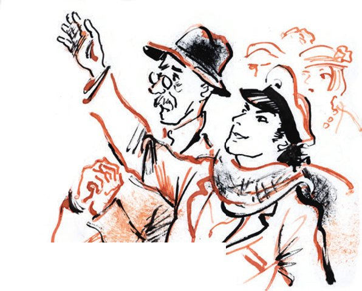

## Kapitel 21: Die Exekution

Die Auktion begann um fünf Uhr. Ab vier Uhr durften die Bürger die Sachen <abbr title="besichtigen — осматривать">besichtigen</abbr>. Die Freunde kamen schon um drei und sahen sich eine ganze Stunde lang die <abbr title="die Maschinenbauausstellung — машиностроительная выставка">Maschinenbauausstellung</abbr> an, die gleich nebenan war.

— Es sieht so aus, — sagte Ostap, — als könnten wir schon morgen, wenn wir guten Willen zeigen, diese kleine Lokomotive kaufen. Schade, dass kein Preis daransteht. Es ist doch angenehm, eine eigene Lokomotive zu haben.

Ippolit Matwejewitsch litt. Nur die Stühle konnten ihn trösten. Er ging erst von ihnen weg, als der <abbr title="der Auktionator, die Auktionatoren — аукционист">Auktionator</abbr> auf das <abbr title="das Pult, die Pulte — кафедра">Pult</abbr> stieg. Der Auktionator trug eine karierte Hose aus «Jahrhundert»-Stoff und einen Bart, der ihm bis auf die Tolstoi-Bluse aus russischem <abbr title="der Covercoat — коверкот">Covercoat</abbr> <abbr title="herabfallen (fiel herab, ist herabgefallen) — ниспадать">herabfiel</abbr>.

Die Konzessionäre setzten sich in die vierte Reihe rechts. Ippolit Matwejewitsch wurde sehr nervös. Er dachte, die Stühle würden sofort verkauft. Aber sie hatten die Nummer dreiundvierzig. Zuerst kam der übliche <abbr title="der Auktionsplunder — аукционный хлам">Auktionsplunder</abbr>: <abbr title="unvollständig — неполный, разрозненный">unvollständige</abbr> <abbr title="das Service, die Service — сервиз">Service</abbr> mit <abbr title="das Wappen, die Wappen — герб">Wappen</abbr>, eine <abbr title="die Soßenschüssel, die Soßenschüsseln — соусник">Soßenschüssel</abbr>, ein silberner <abbr title="der Glashalter, die Glashalter — подстаканник">Glashalter</abbr>, eine Landschaft von dem Maler Petunin, ein Handtäschchen aus <abbr title="die Glasperle, die Glasperlen — бисер">Glasperlen</abbr>, ein ganz neuer <abbr title="der Brenner, die Brenner — горелка">Brenner</abbr> für einen Primuskocher, eine kleine Büste von Napoleon, <abbr title="der Büstenhalter, die Büstenhalter — бюстгальтер">Büstenhalter</abbr> aus Leinen, ein Wandteppich «Jäger, der auf Wildenten schießt» und anderer Unsinn.

Man musste <abbr title="Geduld haben — терпеть, иметь терпение">Geduld haben</abbr> und warten. Das Warten war sehr schwer: Alle Stühle waren da, das Ziel war nah, man konnte es mit der Hand greifen.

«Das gäbe hier einen schönen <abbr title="der Rummel — шум, переполох">Rummel</abbr>», dachte Ostap und sah sich das Publikum an, «wenn die wüssten, was für ein <abbr title="der Leckerbissen, die Leckerbissen — лакомый кусочек">Leckerbissen</abbr> heute in diesen Stühlen verkauft wird.»

— Eine <abbr title="die Figur, die Figuren — фигура">Figur</abbr>, die die <abbr title="die Gerechtigkeit — правосудие, справедливость">Gerechtigkeit</abbr> darstellt! — verkündete der Auktionator. — Aus Bronze. In tadellosem Zustand. Fünf Rubel. Wer bietet mehr? Sechs fünfzig, rechts, hinten – sieben. Acht Rubel, in der ersten Reihe, geradeaus. Zum Zweiten, acht Rubel, geradeaus. Zum Dritten. Erste Reihe, geradeaus.

Sofort eilte ein junges Fräulein mit einer Quittung zu dem Bürger in der ersten Reihe, um das Geld zu <abbr title="kassieren — получать деньги">kassieren</abbr>.

Der <abbr title="der Hammer, die Hämmer — молоток">Hammer</abbr> des Auktionators klopfte. Es wurden Aschenbecher aus einem Palast verkauft, <abbr title="das Baccarat-Glas — хрусталь баккара">Baccarat-Glas</abbr>, eine <abbr title="die Puderdose, die Puderdosen — пудреница">Puderdose</abbr> aus Porzellan. Die Zeit <abbr title="sich hinziehen (zog sich hin, hat sich hingezogen) — тянуться">zog sich</abbr> <abbr title="qualvoll — мучительно">qualvoll</abbr> hin.

— Eine kleine Bronzebüste von Alexander dem Dritten. Kann als <abbr title="der Briefbeschwerer, die Briefbeschwerer — пресс-папье">Briefbeschwerer</abbr> dienen. Zu etwas anderem <abbr title="taugen zu + Dat. — годиться для">taugt</abbr> sie wohl nicht. Die kleine Büste von Alexander dem Dritten wird zum <abbr title="der Mindestpreis — начальная цена">Mindestpreis</abbr> angeboten.

Im Publikum lachte man.

— Kaufen Sie die, Adelsmarschall, — <abbr title="sticheln — язвить, подкалывать">stichelte</abbr> Ostap. — So etwas mögen Sie doch, glaube ich.

Ippolit Matwejewitsch sah nur auf die Stühle und schwieg.

— Keine <abbr title="der Interessent, die Interessenten — желающий, интересующийся">Interessenten</abbr>? Die Bronzebüste von Alexander dem Dritten wird <abbr title="zurückziehen (zog zurück, hat zurückgezogen) — снимать (с торгов)">zurückgezogen</abbr>. Eine Figur, die die Gerechtigkeit darstellt. Anscheinend das <abbr title="das Gegenstück, die Gegenstücke — парная вещь">Gegenstück</abbr> zu der Figur, die gerade gekauft wurde. Wassili, zeigen Sie dem Publikum die Gerechtigkeit. Fünf Rubel. Wer bietet mehr?

In der ersten Reihe, geradeaus, hörte man ein Schnaufen. Offenbar wollte der Bürger die Gerechtigkeit vollständig haben.

— Fünf Rubel für die bronzene Gerechtigkeit!

— Sechs! — sagte der Bürger deutlich.

— Sechs Rubel, geradeaus. Sieben. Neun Rubel, hinten rechts.

— Neun fünfzig, — sagte der Freund der Gerechtigkeit leise und hob die Hand.

— Neun fünfzig, geradeaus. Zum Zweiten, neun fünfzig, geradeaus. Zum Dritten, neun fünfzig.

Der Hammer fiel. Das Fräulein stürzte sich auf den Bürger aus der ersten Reihe.

Er bezahlte und schlurfte ins andere Zimmer, um seine Bronze abzuholen.

— Zehn Stühle aus einem Palast! — sagte plötzlich der Auktionator.

— Wieso aus einem Palast? — stöhnte Ippolit Matwejewitsch leise.

Ostap wurde böse:

— Gehen Sie doch zum Teufel! Hören Sie zu und zappeln Sie nicht!

— Zehn Stühle aus einem Palast. Aus Nussbaum. Aus der Zeit von Alexander dem Zweiten. In tadellosem Zustand. Aus der <abbr title="die Möbelwerkstatt, die Möbelwerkstätten — мебельная мастерская">Möbelwerkstatt</abbr> von Gambs. Wassili, stellen Sie einen Stuhl unter den Scheinwerfer.

Wassili <abbr title="zerren — тащить, дёргать">zerrte</abbr> den Stuhl so grob nach vorne, dass Ippolit Matwejewitsch hochfuhr.

— Setzen Sie sich, Sie verdammter <abbr title="der Idiot, die Idioten — идиот">Idiot</abbr>, warum habe ich Sie nur am Hals! — zischte Ostap. — Setzen Sie sich, sage ich!

Der <abbr title="der Unterkiefer, die Unterkiefer — нижняя челюсть">Unterkiefer</abbr> von Ippolit Matwejewitsch begann zu <abbr title="zucken — дёргаться">zucken</abbr>. Ostap stand <abbr title="auf der Lauer stehen — делать стойку, быть настороже">auf der Lauer</abbr> wie ein <abbr title="der Jagdhund, die Jagdhunde — охотничья собака">Jagdhund</abbr>. Seine Augen wurden hell.

— Zehn Stühle aus Nussbaum. Achtzig Rubel.

Der Saal wurde lebendig. Hier wurde etwas verkauft, was man im <abbr title="der Haushalt, die Haushalte — хозяйство">Haushalt</abbr> brauchen konnte. Eine Hand nach der anderen <abbr title="hochschnellen — взлетать, выскакивать">schnellte</abbr> hoch. Ostap blieb ruhig.

— Warum bieten Sie denn nicht mit? — fuhr Worobjaninow ihn an.

— Hau ab, — antwortete Ostap mit <abbr title="zusammenbeißen (biss zusammen, hat zusammengebissen) — стискивать (зубы)">zusammengebissenen</abbr> Zähnen.

— Hundertzwanzig Rubel, hinten. Hundertfünfunddreißig, ebenfalls hinten. Hundertvierzig.

Ostap drehte dem Pult ruhig den Rücken zu und betrachtete spöttisch seine Konkurrenten.

Die Auktion war auf ihrem Höhepunkt. Es gab keine freien Plätze mehr. Gleich hinter Ostap saß eine Dame. Nachdem sie mit ihrem Mann gesprochen hatte, <abbr title="verlocken — соблазнять, прельщать">verlockten</abbr> die Stühle auch sie («Wunderbare kleine Sessel! Herrliche Arbeit! Sanja! Und aus einem Palast!»). Sie hob die Hand.

— Hundertfünfundvierzig, in der fünften Reihe rechts. Zum Ersten.

Im Saal wurde es still. Zu teuer.

— Hundertfünfundvierzig. Zum Zweiten.

Ostap betrachtete gleichgültig den <abbr title="der Stuckfries, die Stuckfriese — лепной карниз">Stuckfries</abbr> an der Decke. Ippolit Matwejewitsch saß mit gesenktem Kopf da und zuckte zusammen.

— Hundertfünfundvierzig. Zum …

Aber bevor der schwarze, lackierte Hammer auf das Pult aus Sperrholz schlug, drehte sich Ostap um, warf die Hand nach oben und sagte nicht sehr laut:

— Zweihundert.

Alle Köpfe drehten sich zu den Konzessionären. Schirmmützen, <abbr title="die Schiebermütze, die Schiebermützen — кепка">Schiebermützen</abbr> und Hüte gerieten in <abbr title="die Bewegung, die Bewegungen — движение">Bewegung</abbr>. Der Auktionator hob sein gelangweiltes Gesicht und sah Ostap an.

— Zweihundert, zum Ersten, — sagte er. — Zweihundert, in der vierten Reihe rechts, zum Zweiten. Will niemand mehr bieten? Zweihundert Rubel, eine Palastgarnitur aus Nussbaum, zehn Stück. Zweihundert Rubel – zum Dritten, in der vierten Reihe rechts.

Die Hand mit dem Hammer hing über dem Pult.

— Mama! — sagte Ippolit Matwejewitsch laut.

Ostap war rosig und ruhig und lächelte. Der Hammer fiel mit einem himmlischen Klang.

— Verkauft, — sagte der Auktionator. — Fräulein! Vierte Reihe rechts.

— Na, Vorsitzender, war das <abbr title="eindrucksvoll — эффектный">eindrucksvoll</abbr>? — fragte Ostap. — Ich wüsste gern, was Sie ohne Ihren technischen Leiter machen würden.

Ippolit Matwejewitsch <abbr title="jauchzen — ликовать, ухать">jauchzte</abbr> glücklich. Das Fräulein kam im <abbr title="der Trab — рысь">Trab</abbr> auf sie zu.

— Haben Sie die Stühle gekauft?

— Wir! — rief Ippolit Matwejewitsch, der sich lange <abbr title="sich zurückhalten (hielt zurück, hat zurückgehalten) — сдерживаться">zurückgehalten</abbr> hatte. — Wir, wir. Wann können wir sie abholen?

— Wann Sie wollen. Sogar sofort!

Die Melodie «Laufen Sie, Sie laufen überall herum» sprang wie verrückt in Ippolit Matwejewitschs Kopf herum. Unsere Stühle, unsere, unsere, unsere! Das schrie sein ganzer Organismus. Unsere! – schrie die Leber. Unsere! – bestätigte der Blinddarm.

Er freute sich so sehr, dass er an den unerwartetsten Stellen seinen Puls spürte. Alles <abbr title="vibrieren — вибрировать">vibrierte</abbr>, schaukelte und krachte unter dem Druck dieses unerhörten Glücks. Man sah einen Zug, der sich dem Sankt Gotthard näherte. Auf der offenen Plattform des letzten Wagens stand Ippolit Matwejewitsch Worobjaninow in einer weißen Hose und rauchte eine <abbr title="die Zigarre, die Zigarren — сигара">Zigarre</abbr>. <abbr title="das Edelweiß — эдельвейс">Edelweiß</abbr> fiel leise auf seinen Kopf, der wieder mit glänzendem grauem Aluminiumhaar geschmückt war. Ippolit Matwejewitsch fuhr ins <abbr title="das Paradies — рай, Эдем">Paradies</abbr>.

— Und warum zweihundertdreißig und nicht zweihundert? — hörte Ippolit Matwejewitsch.

Das sagte Ostap. Er drehte die Quittung in den Händen.

— Dazu kommen fünfzehn Prozent <abbr title="die Provision, die Provisionen — комиссионный сбор">Provision</abbr>, — antwortete das Fräulein.

— Na, was soll man machen! Nehmen Sie!

Ostap holte seine Brieftasche heraus, zählte zweihundert Rubel ab und drehte sich zum <abbr title="der Generaldirektor, die Generaldirektoren — главный директор">Generaldirektor</abbr> des Unternehmens um.

— Her mit den dreißig Rubel, mein Teuerster, und zwar <abbr title="dalli — живо, поживее">dalli</abbr>! Sehen Sie nicht, dass die Dame wartet? Na?

Ippolit Matwejewitsch machte nicht den kleinsten <abbr title="der Versuch, die Versuche — попытка">Versuch</abbr>, das Geld herauszuholen.

— Na? Warum sehen Sie mich an wie ein Soldat eine Laus? Sind Sie vor Glück verrückt geworden?

— Ich habe kein Geld, — murmelte Ippolit Matwejewitsch endlich.

— Wer hat keins? — fragte Ostap sehr leise.

— Ich.

— Und die zweihundert Rubel?!

— Ich … m-m-m … habe sie v-verloren.

Ostap sah Worobjaninow an. Schnell <abbr title="erfassen — схватывать, оценивать">erfasste</abbr> er das zerknitterte Gesicht, die grünlichen Wangen und die <abbr title="geschwollen — опухший, раздувшийся">geschwollenen</abbr> Tränensäcke.

— Geben Sie das Geld her! — flüsterte er voller Hass. — Sie alter <abbr title="der Lump, die Lumpen — сволочь, негодяй">Lump</abbr>!

— Werden Sie nun bezahlen? — fragte das Fräulein.

— Ein Minütchen! — sagte Ostap und lächelte bezaubernd. — Eine kleine <abbr title="die Verzögerung, die Verzögerungen — задержка, заминка">Verzögerung</abbr>.

Es gab noch eine kleine Hoffnung. Man konnte versuchen, die Leute zu überreden, mit dem Geld noch zu warten.

Da kam Ippolit Matwejewitsch wieder zu sich. Er <abbr title="sprühen — брызгать">sprühte</abbr> Spucke und mischte sich ins Gespräch ein.

— Erlauben Sie! — brüllte er. — Wieso eine Provision? Von so einer <abbr title="die Gebühr, die Gebühren — сбор, пошлина">Gebühr</abbr> wissen wir nichts! Das muss man vorher sagen. Ich <abbr title="sich weigern — отказываться">weigere mich</abbr>, diese dreißig Rubel zu bezahlen.

— Gut, — sagte das Fräulein <abbr title="sanftmütig — кротко">sanftmütig</abbr>. — Ich regle das sofort.

Sie nahm die Quittung, <abbr title="sausen — нестись, мчаться">sauste</abbr> zum Auktionator und sagte ihm ein paar Worte. Der Auktionator stand sofort auf. Sein Bart funkelte im Licht der starken elektrischen Lampen.

— Nach den Regeln der Auktion, — erklärte er mit klarer Stimme, — muss eine Person, die sich weigert, die volle Summe für einen gekauften Gegenstand zu bezahlen, den Saal verlassen. Der Verkauf der Stühle wird <abbr title="annullieren — отменять, аннулировать">annulliert</abbr>.

Die verblüfften Freunde saßen <abbr title="reglos — неподвижно">reglos</abbr> da.

— Ich bi-itte Sie! — sagte der Auktionator.

Die <abbr title="die Wirkung, die Wirkungen — эффект, действие">Wirkung</abbr> war groß. Im Publikum lachte man <abbr title="boshaft — злобно, ехидно">boshaft</abbr>. Ostap stand trotzdem nicht auf. Solche Schläge hatte er lange nicht <abbr title="einstecken — получать, сносить (удары)">einstecken</abbr> müssen.

— Ich bi-itte Sie sehr-ehr!

Der Auktionator sang mit einer Stimme, die keinen <abbr title="der Widerspruch, die Widersprüche — возражение">Widerspruch</abbr> <abbr title="dulden — терпеть, допускать">duldete</abbr>.

Das Lachen im Saal wurde lauter.

Und sie gingen. Nur wenige Menschen haben einen Auktionssaal mit einem so bitteren Gefühl verlassen. Worobjaninow ging voran. Er hatte die geraden, <abbr title="knochig — костистый">knochigen</abbr> Schultern <abbr title="krümmen — сгибать">gekrümmt</abbr>. In seinem zu kurz gewordenen <abbr title="das Jackett, die Jacketts — пиджак">Jackett</abbr> und den dummen Baronsstiefeln ging er wie ein <abbr title="der Kranich, die Kraniche — журавль">Kranich</abbr>. Hinter sich fühlte er den warmen, freundschaftlichen Blick des großen Kombinators.

Die Konzessionäre blieben im Zimmer neben dem Auktionssaal stehen. Jetzt konnten sie den <abbr title="der Handel — торговля, торг">Handel</abbr> nur noch durch eine Glastür sehen. Der Weg in den Saal war ihnen schon versperrt. Ostap schwieg freundschaftlich.

— Empörende Zustände, — murmelte Ippolit Matwejewitsch <abbr title="feige — трусливо">feige</abbr>. — Eine richtige Schweinerei! Man muss sich bei der Miliz über sie beschweren.

Ostap schwieg.

— Nein, wirklich, das ist w-weiß der Teufel was! — <abbr title="sich ereifern — горячиться">ereiferte sich</abbr> Worobjaninow weiter. — Sie nehmen den Werktätigen das Dreifache ab. Bei Gott! … Zweihundertdreißig Rubel für irgendwelche gebrauchten zehn Stühle. Das ist zum Verrücktwerden …

— Ja, — sagte Ostap <abbr title="hölzern — деревянно">hölzern</abbr>.

— Nicht wahr? — fragte Worobjaninow noch einmal. — Da kann man verrückt werden! …

— Das kann man.

Ostap trat ganz nah an Worobjaninow heran. Er sah sich nach allen Seiten um. Dann gab er dem Adelsmarschall einen kurzen, starken Stoß in die Rippen, den kein fremdes Auge bemerken konnte.

— Da hast du deine Miliz! Da hast du die teuren Stühle für die Werktätigen aller Länder! Da hast du deine nächtlichen Spaziergänge mit Mädchen! Da hast du dein Alter! Und da hast du deine <abbr title="die Torheit, die Torheiten — глупость, безрассудство">Torheit</abbr>!

Während der ganzen Exekution gab Ippolit Matwejewitsch keinen Laut von sich.

Von der Seite hätte man denken können, ein respektvoller Sohn spricht mit seinem Vater. Nur schüttelte der Vater ein bisschen zu lebhaft den Kopf.

— So, und jetzt verschwinde!

Ostap drehte dem Direktor des Unternehmens den Rücken zu und sah in den Auktionssaal. Nach einer Minute sah er sich um.

Ippolit Matwejewitsch stand immer noch hinter ihm, die Hände an der <abbr title="die Hosennaht, die Hosennähte — шов брюк; руки по швам">Hosennaht</abbr>.

— Ach, Sie sind noch hier, Sie <abbr title="die Stimmungskanone, die Stimmungskanonen — душа общества">Stimmungskanone</abbr>? Weg! Na?

— Geno-osse Bender, — flehte Worobjaninow. — Geno-osse Bender!

— Geh! Geh! Und komm nicht zu Iwanopulo! Ich werfe dich hinaus!

— Geno-osse Bender!

Ostap drehte sich nicht mehr um. Im Saal war etwas passiert, das Bender so sehr interessierte, dass er die Tür einen Spalt öffnete und lauschte.

— Alles ist verloren! — murmelte er.

— Was ist verloren? — fragte Worobjaninow unterwürfig.

— Sie verkaufen die Stühle einzeln, das ist los. Möchten Sie vielleicht welche <abbr title="erwerben (erwarb, hat erworben) — приобретать">erwerben</abbr>? Bitte sehr. Ich halte Sie nicht zurück. Ich <abbr title="bezweifeln — сомневаться">bezweifle</abbr> nur, dass man Sie <abbr title="hineinlassen (ließ hinein, hat hineingelassen) — впускать">hineinlässt</abbr>. Und mit Geld sind Sie, glaube ich, auch nicht gerade <abbr title="gesegnet sein mit + Dat. — быть наделённым чем-то">gesegnet</abbr>.

Im Auktionssaal passierte inzwischen Folgendes. Der Auktionator hatte <abbr title="spüren — чувствовать">gespürt</abbr>, dass er die zweihundert Rubel nicht auf einmal aus dem Publikum <abbr title="herausschlagen (schlug heraus, hat herausgeschlagen) — выколотить, выбить">herausschlagen</abbr> konnte. Für die kleinen Leute, die noch im Saal waren, war das eine zu große Summe. Deshalb beschloss er, die zweihundert Rubel <abbr title="stückweise — по кускам, по частям">stückweise</abbr> zu bekommen. Die Stühle wurden wieder angeboten, aber jetzt in Teilen.

— Vier Stühle aus einem Palast. Aus Nussbaum. <abbr title="gepolstert — мягкий, обитый">Gepolstert</abbr>. Arbeit von Gambs. Dreißig Rubel. Wer bietet mehr?

Schnell kamen zu Ostap seine ganze <abbr title="die Entschlossenheit — решительность">Entschlossenheit</abbr> und seine <abbr title="die Kaltblütigkeit — хладнокровие">Kaltblütigkeit</abbr> zurück.

— Na, Sie <abbr title="der Liebling, die Lieblinge — любимец">Liebling</abbr> der Damen, Sie bleiben hier stehen und gehen nirgendwohin. In fünf Minuten bin ich zurück. Und Sie passen auf, wer was kauft. Kein einziger Stuhl darf uns <abbr title="entwischen — ускользнуть">entwischen</abbr>.

In Benders Kopf reifte sofort ein Plan. Es war der einzige Plan, der in dieser schweren Lage, in die sie geraten waren, möglich war.

Er lief auf die Petrowka-Straße hinaus, ging zum nächsten <abbr title="der Asphaltkessel, die Asphaltkessel — асфальтовый чан, котёл">Asphaltkessel</abbr> und begann ein geschäftliches Gespräch mit den Straßenkindern.

Wie er versprochen hatte, war er nach fünf Minuten wieder bei Ippolit Matwejewitsch. Die Straßenkinder standen bereit am Eingang der Auktion.

— Sie verkaufen, sie verkaufen, — flüsterte Ippolit Matwejewitsch. — Vier und zwei sind schon verkauft.

— Das haben Sie <abbr title="etwas hinkriegen — устроить, сделать (разг.)">prima hingekriegt</abbr>, — sagte Ostap. — Freuen Sie sich. Alles war schon in unseren Händen, verstehen Sie – in unseren Händen. Können Sie das begreifen?

Im Saal hörte man eine <abbr title="knarren — скрипеть">knarrende</abbr> Stimme, wie sie die Natur nur Auktionatoren, <abbr title="der Croupier, die Croupiers — крупье">Croupiers</abbr> und Glasern geschenkt hat:

— Fünfzig, links. Zum Dritten. Noch ein Stuhl aus einem Palast. Aus Nussbaum. Vollkommen in Ordnung … Fünfzig, geradeaus. Zum Ersten – fünfzig, geradeaus.

Drei Stühle wurden einzeln verkauft. Der Auktionator kündigte den letzten Stuhl an. Die Wut <abbr title="würgen — душить">würgte</abbr> Ostap. Er stürzte sich wieder auf Worobjaninow. Seine beleidigenden Bemerkungen waren voller Bitterkeit. Wer weiß, wie weit Ostap mit seinen <abbr title="satirisch — сатирический">satirischen</abbr> Übungen noch gegangen wäre. Aber da unterbrach ihn ein Mann, der schnell auf sie zukam. Der Mann trug einen Anzug in den braunen Farben von Lodz. Er <abbr title="fuchteln — размахивать">fuchtelte</abbr> mit seinen <abbr title="pummelig — пухлый">pummeligen</abbr> Händen, beugte sich vor, sprang hoch und sprang zurück, als ob er Tennis spielte.

— Sagen Sie mal, — fragte er Ostap hastig, — ist hier wirklich eine Auktion? Ja? Eine Auktion? Und hier werden wirklich Sachen verkauft? Großartig!

Der Unbekannte sprang zurück, und auf seinem Gesicht <abbr title="aufleuchten — озаряться">leuchteten</abbr> viele Lächeln auf.

— Hier werden also wirklich Sachen verkauft? Und man kann wirklich billig kaufen? Erste Klasse? Sehr, sehr! Ach! …

Der Unbekannte wackelte mit seinen dicken Hüften und flitzte an den <abbr title="fassungslos — ошеломлённый">fassungslosen</abbr> Konzessionären vorbei in den Saal. Er kaufte den letzten Stuhl so schnell, dass Worobjaninow nur noch ächzte. Mit der Quittung in der Hand lief der Unbekannte zum <abbr title="der Ausgabeschalter, die Ausgabeschalter — прилавок выдачи">Ausgabeschalter</abbr>.

— Sagen Sie, kann man den Stuhl sofort mitnehmen? Großartig! … Ach! … Ach! …

Der Unbekannte <abbr title="meckern — блеять">meckerte</abbr> ununterbrochen und war die ganze Zeit in Bewegung. Er lud den Stuhl auf eine Droschke und fuhr davon. Hinter ihm her lief ein Straßenkind.

Nach und nach gingen und fuhren alle neuen <abbr title="der Eigentümer, die Eigentümer — собственник, владелец">Eigentümer</abbr> der Stühle weg. Hinter ihnen her rannten Ostaps minderjährige Agenten. Auch Ostap selbst ging. Ippolit Matwejewitsch folgte ihm ängstlich. Der heutige Tag kam ihm wie ein Traum vor. Alles war schnell passiert, und ganz anders, als man es erwartet hatte.

In der Straße Siwzew Wraschek feierten Flügel, <abbr title="die Mandoline, die Mandolinen — мандолина">Mandolinen</abbr> und Ziehharmonikas den Frühling. Die Fenster waren weit offen. Blumen in kleinen <abbr title="der Tontopf, die Tontöpfe — глиняный горшочек">Tontöpfen</abbr> füllten die Fensterbretter. Ein dicker Mann mit offener, <abbr title="behaart — волосатый">behaarter</abbr> Brust stand in Hosenträgern am Fenster und sang leidenschaftlich. An der Wand entlang <abbr title="schleichen (schlich, ist geschlichen) — красться, пробираться">schlich</abbr> langsam ein <abbr title="der Kater, die Kater — кот">Kater</abbr>. In den <abbr title="die Lebensmittelbude, die Lebensmittelbuden — продуктовая палатка">Lebensmittelbuden</abbr> brannten Petroleumlampen.

Vor dem rosa Häuschen ging Kolja spazieren. Als er Ostap sah, der vorausging, grüßte er ihn höflich. Dann ging er zu Worobjaninow. Ippolit Matwejewitsch begrüßte ihn <abbr title="herzlich — сердечно">herzlich</abbr>. Kolja verlor aber keine Zeit.

— Guten Abend, — sagte er entschlossen. Er konnte sich nicht beherrschen und schlug Ippolit Matwejewitsch aufs Ohr.

Gleichzeitig sagte Kolja einen Satz, der nach Meinung von Ostap, der die Szene beobachtete, ziemlich <abbr title="abgedroschen — банальный, пошлый">abgedroschen</abbr> war.

— So wird es allen gehen, — sagte Kolja mit kindlicher Stimme, — die es wagen …

Was genau sie wagen, sagte Kolja nicht zu Ende. Er stellte sich auf die Zehenspitzen, schloss die Augen und gab Worobjaninow eine Ohrfeige.

Ippolit Matwejewitsch hob ein bisschen den Ellbogen, aber er wagte nicht einmal zu piepsen.

— Richtig, — sagte Ostap dazu. — Und jetzt in den Nacken. Zweimal. So. Da kann man nichts machen. Manchmal muss das Ei eben doch die <abbr title="übermütig — зарвавшийся, заносчивый">übermütige</abbr> <abbr title="die Henne, die Hennen — курица">Henne</abbr> <abbr title="belehren — учить, поучать">belehren</abbr> … Noch einmal … So. <abbr title="sich genieren — стесняться">Genieren</abbr> Sie sich nicht. Nur nicht mehr auf den Kopf schlagen. Das ist seine schwächste Stelle.

Hätten die Stargoroder Verschwörer den Giganten des Denkens und Vater der russischen Demokratie in diesem <abbr title="kritisch — критический">kritischen</abbr> Augenblick gesehen, dann hätte der Geheimbund «Schwert und Pflug» wohl <abbr title="aufhören — прекращать">aufgehört</abbr> zu <abbr title="existieren — существовать">existieren</abbr>.

— Na, ich glaube, das reicht, — sagte Kolja und steckte die Hand in die Tasche.

— Noch ein einziges Mal, — <abbr title="betteln — умолять, выпрашивать">bettelte</abbr> Ostap.

— Zum Teufel mit ihm! Das nächste Mal weiß er Bescheid!

Kolja ging. Ostap ging hinauf zu Iwanopulo und sah nach unten. Ippolit Matwejewitsch stand schräg gegenüber vom Haus und lehnte sich an den gusseisernen Zaun der Botschaft.

— Bürger Michelson! — rief Ostap. — Konrad Karlowitsch! Treten Sie ein! Ich erlaube es!

Als Ippolit Matwejewitsch ins Zimmer kam, war er schon wieder ein bisschen munterer.

— Eine unerhörte Unverschämtheit! — sagte er zornig. — Ich konnte mich kaum beherrschen.

— Ai-ai-ai, — sagte Ostap mitfühlend. — Was ist das nur für eine Jugend heute! Eine schreckliche Jugend! Sie <abbr title="verfolgen — преследовать">verfolgt</abbr> fremde Frauen! Sie <abbr title="verschwenden — растрачивать">verschwendet</abbr> fremdes Geld … Völlige <abbr title="die Dekadenz — упадочность, декаданс">Dekadenz</abbr>. Aber sagen Sie, wenn man einem auf den Kopf schlägt, tut das wirklich weh?

— Ich <abbr title="herausfordern — вызывать (на дуэль)">fordere</abbr> ihn zum Duell heraus!

— Wunderbar! Ich kann Ihnen einen guten Bekannten von mir empfehlen. Er kennt die <abbr title="die Duellregel, die Duellregeln — дуэльный кодекс">Duellregeln</abbr> auswendig und besitzt zwei Besen, die für einen Kampf auf Leben und Tod bestens <abbr title="geeignet — пригодный">geeignet</abbr> sind. Als <abbr title="der Sekundant, die Sekundanten — секундант">Sekundanten</abbr> können wir Iwanopulo und den rechten Nachbarn nehmen. Der ist ehemaliger <abbr title="der Ehrenbürger, die Ehrenbürger — почётный гражданин">Ehrenbürger</abbr> der Stadt Kologriw und ist bis heute stolz auf diesen <abbr title="der Titel, die Titel — титул">Titel</abbr>. Oder man macht ein Duell mit Fleischwölfen – das ist eleganter. Jede <abbr title="die Verletzung, die Verletzungen — ранение">Verletzung</abbr> ist <abbr title="garantiert — гарантированно">garantiert</abbr> tödlich. Der <abbr title="treffen (traf, hat getroffen) — попадать, поражать">getroffene</abbr> Gegner wird <abbr title="mechanisch — механически">mechanisch</abbr> zu einem <abbr title="der Hackbraten, die Hackbraten — котлета, рубленое мясо">Hackbraten</abbr> verarbeitet. Passt Ihnen das, Adelsmarschall?

In diesem Moment hörte man von der Straße einen <abbr title="der Pfiff, die Pfiffe — свист">Pfiff</abbr>, und Ostap ging hinaus, um von den Straßenkindern die Berichte seiner Agenten <abbr title="entgegennehmen (nahm entgegen, hat entgegengenommen) — принимать, получать">entgegenzunehmen</abbr>.

Die Straßenkinder hatten ihren <abbr title="der Auftrag, die Aufträge — поручение, задание">Auftrag</abbr> ausgezeichnet erfüllt. Vier Stühle waren ins Kolumbus-Theater gekommen. Ein Straßenkind erzählte ausführlich, wie die Stühle auf einer Schubkarre gefahren, wie sie <abbr title="abladen (lud ab, hat abgeladen) — выгружать">abgeladen</abbr> und durch den <abbr title="der Bühneneingang, die Bühneneingänge — артистический вход">Bühneneingang</abbr> ins Gebäude geschleppt wurden. Wo das Theater lag, wusste Ostap genau.

Zwei Stühle hatte, wie ein anderer junger <abbr title="der Spurensucher, die Spurensucher — следопыт">Spurensucher</abbr> sagte, «eine schicke Puppe» mit einer Droschke weggebracht. Der Junge war offenbar nicht besonders begabt. Die Gasse, in die man die Stühle gebracht hatte – die Warsonofjewski-Gasse –, wusste er. Er erinnerte sich sogar, dass es die Wohnung Nummer siebzehn war. Aber an die Hausnummer konnte er sich <abbr title="beim besten Willen — при всём желании">beim besten Willen</abbr> nicht erinnern.

— Ich bin sehr schnell gerannt, — sagte das Straßenkind. — Da ist sie mir aus dem Kopf <abbr title="fallen (fiel, ist gefallen) — падать; здесь: вылететь из головы">gefallen</abbr>.

— Dann bekommst du kein Geld, — erklärte der <abbr title="der Auftraggeber, die Auftraggeber — наниматель, заказчик">Auftraggeber</abbr>.

— Onke-el! … Ich zeig's dir doch.

— Gut! Bleib hier. Wir gehen zusammen hin.

Der meckernde Bürger wohnte, wie sich herausstellte, in der Sadowaja-Spasskaja-Straße. Seine genaue Adresse schrieb Ostap in seinen <abbr title="der Notizblock, die Notizblöcke — блокнот">Notizblock</abbr>.

Der achte Stuhl war ins Haus der Völker gefahren. Der Junge, der diesen Stuhl verfolgt hatte, war ein <abbr title="das Schlitzohr, die Schlitzohren — пройдоха, проныра">Schlitzohr</abbr>. Er hatte alle Hindernisse überwunden, die <abbr title="die Pförtnerloge, die Pförtnerlogen — комендатура, проходная">Pförtnerloge</abbr> und die vielen <abbr title="der Bote, die Boten — курьер, посыльный">Boten</abbr>, und war ins Haus eingedrungen. Dort hatte er sich <abbr title="sich vergewissern — убедиться">vergewissert</abbr>: Den Stuhl hatte der <abbr title="der Wirtschaftsleiter, die Wirtschaftsleiter — завхоз">Wirtschaftsleiter</abbr> der <abbr title="die Redaktion, die Redaktionen — редакция">Redaktion</abbr> der Zeitung «Die Werkbank» gekauft.

Zwei Jungen fehlten noch. Sie kamen fast gleichzeitig angerannt, <abbr title="außer Atem — запыхавшийся">außer Atem</abbr> und müde.

— Kasernengasse, an den Tschistyje Prudy.

— Nummer?

— Neun. Und Wohnung neun. Da wohnen Tataren nebenan. Im Hof. Ich habe ihm den Stuhl sogar getragen. Wir sind zu Fuß gegangen.

Der letzte <abbr title="der Kurier, die Kuriere — гонец">Kurier</abbr> brachte traurige Nachrichten. Zuerst war alles gut gewesen, aber dann war alles schlecht geworden. Der Käufer war mit dem Stuhl in den <abbr title="der Güterbahnhof, die Güterbahnhöfe — товарный двор (вокзала)">Güterbahnhof</abbr> vom Oktober-Bahnhof gegangen, und dort konnte man ihm auf keinen Fall folgen: Am Tor standen <abbr title="der Wachmann, die Wachleute — стрелок (охраны)">Wachleute</abbr> vom <abbr title="der Bahnschutz — охрана путей сообщения">Bahnschutz</abbr>.

— Er ist bestimmt weggefahren, — schloss das Straßenkind seinen Bericht.

Das beunruhigte Ostap sehr. Er belohnte die Straßenkinder <abbr title="fürstlich — по-царски">fürstlich</abbr>: einen Rubel pro Kurier. Nur der Bote aus der Warsonofjewski-Gasse, der die Hausnummer vergessen hatte, bekam nichts (er sollte am nächsten Tag früh wiederkommen). Dann ging der technische Direktor nach Hause. Auf die Fragen des <abbr title="blamiert — опозорившийся">blamierten</abbr> <abbr title="der Vorstandsvorsitzende, die Vorstandsvorsitzenden — председатель правления">Vorstandsvorsitzenden</abbr> antwortete er nicht. Er begann zu kombinieren.

— Noch ist nichts verloren. Wir haben die Adressen. Und um an die Stühle zu kommen, gibt es viele alte, <abbr title="bewährt — испытанный, проверенный">bewährte</abbr> <abbr title="die Methode, die Methoden — метод, приём">Methoden</abbr>: 1) einfache <abbr title="die Bekanntschaft, die Bekanntschaften — знакомство">Bekanntschaft</abbr>, 2) eine <abbr title="die Liebesaffäre, die Liebesaffären — любовная интрига">Liebesaffäre</abbr>, 3) Bekanntschaft mit <abbr title="der Einbruch, die Einbrüche — взлом">Einbruch</abbr>, 4) <abbr title="der Tausch — обмен">Tausch</abbr> und 5) Geld. Das Letzte ist am sichersten. Aber wir haben wenig Geld.

Ostap sah Ippolit Matwejewitsch ironisch an. Dem großen Kombinator waren seine gewohnte <abbr title="die Frische — свежесть">Frische</abbr> der Gedanken und sein <abbr title="das seelische Gleichgewicht — душевное равновесие">seelisches Gleichgewicht</abbr> zurückgekehrt. Geld konnte man natürlich <abbr title="beschaffen — доставать, раздобыть">beschaffen</abbr>. In <abbr title="die Reserve, die Reserven — запас, резерв">Reserve</abbr> waren noch: das Bild «Die Bolschewiken schreiben einen Brief an Chamberlain», das Teesieb und die volle Möglichkeit, die Karriere als <abbr title="der Heiratsschwindler, die Heiratsschwindler — брачный аферист, многоженец">Heiratsschwindler</abbr> fortzusetzen.

Nur der zehnte Stuhl machte ihm <abbr title="sich Sorgen machen — беспокоиться">Sorgen</abbr>. Eine Spur gab es natürlich, aber was für eine Spur! <abbr title="verschwommen — расплывчатый">Verschwommen</abbr> und <abbr title="neblig — туманный">neblig</abbr>.

— Na schön, — sagte Ostap laut. — Mit solchen <abbr title="die Chance, die Chancen — шанс">Chancen</abbr> kann man spielen. Ich spiele neun gegen eins. Die Sitzung geht weiter! Hören Sie? Sie! Herr Geschworener!

---

### Neue Wörter

- **besichtigen** — осматривать
- **die Maschinenbauausstellung** — машиностроительная выставка
- **der Auktionator, die Auktionatoren** — аукционист
- **das Pult, die Pulte** — кафедра
- **der Covercoat** — коверкот
- **herabfallen (fiel herab, ist herabgefallen)** — ниспадать
- **der Auktionsplunder** — аукционный хлам
- **unvollständig** — неполный, разрозненный
- **das Service, die Service** — сервиз
- **das Wappen, die Wappen** — герб
- **die Soßenschüssel, die Soßenschüsseln** — соусник
- **der Glashalter, die Glashalter** — подстаканник
- **die Glasperle, die Glasperlen** — бисер
- **der Brenner, die Brenner** — горелка
- **der Büstenhalter, die Büstenhalter** — бюстгальтер
- **Geduld haben** — терпеть, иметь терпение
- **der Rummel** — шум, переполох
- **der Leckerbissen, die Leckerbissen** — лакомый кусочек
- **die Figur, die Figuren** — фигура
- **die Gerechtigkeit** — правосудие, справедливость
- **kassieren** — получать деньги
- **der Hammer, die Hämmer** — молоток
- **das Baccarat-Glas** — хрусталь баккара
- **die Puderdose, die Puderdosen** — пудреница
- **sich hinziehen (zog sich hin, hat sich hingezogen)** — тянуться
- **qualvoll** — мучительно
- **der Briefbeschwerer, die Briefbeschwerer** — пресс-папье
- **taugen zu + Dat.** — годиться для
- **der Mindestpreis** — начальная цена
- **sticheln** — язвить, подкалывать
- **der Interessent, die Interessenten** — желающий, интересующийся
- **zurückziehen (zog zurück, hat zurückgezogen)** — снимать (с торгов)
- **das Gegenstück, die Gegenstücke** — парная вещь
- **die Möbelwerkstatt, die Möbelwerkstätten** — мебельная мастерская
- **zerren** — тащить, дёргать
- **der Idiot, die Idioten** — идиот
- **der Unterkiefer, die Unterkiefer** — нижняя челюсть
- **zucken** — дёргаться
- **auf der Lauer stehen** — делать стойку, быть настороже
- **der Jagdhund, die Jagdhunde** — охотничья собака
- **der Haushalt, die Haushalte** — хозяйство
- **hochschnellen** — взлетать, выскакивать
- **zusammenbeißen (biss zusammen, hat zusammengebissen)** — стискивать (зубы)
- **verlocken** — соблазнять, прельщать
- **der Stuckfries, die Stuckfriese** — лепной карниз
- **die Schiebermütze, die Schiebermützen** — кепка
- **die Bewegung, die Bewegungen** — движение
- **eindrucksvoll** — эффектный
- **jauchzen** — ликовать, ухать
- **der Trab** — рысь
- **sich zurückhalten (hielt zurück, hat zurückgehalten)** — сдерживаться
- **vibrieren** — вибрировать
- **die Zigarre, die Zigarren** — сигара
- **das Edelweiß** — эдельвейс
- **das Paradies** — рай, Эдем
- **die Provision, die Provisionen** — комиссионный сбор
- **der Generaldirektor, die Generaldirektoren** — главный директор
- **dalli** — живо, поживее
- **der Versuch, die Versuche** — попытка
- **erfassen** — схватывать, оценивать
- **geschwollen** — опухший, раздувшийся
- **der Lump, die Lumpen** — сволочь, негодяй
- **die Verzögerung, die Verzögerungen** — задержка, заминка
- **sprühen** — брызгать
- **die Gebühr, die Gebühren** — сбор, пошлина
- **sich weigern** — отказываться
- **sanftmütig** — кротко
- **sausen** — нестись, мчаться
- **annullieren** — отменять, аннулировать
- **reglos** — неподвижно
- **die Wirkung, die Wirkungen** — эффект, действие
- **boshaft** — злобно, ехидно
- **einstecken** — получать, сносить (удары)
- **der Widerspruch, die Widersprüche** — возражение
- **dulden** — терпеть, допускать
- **knochig** — костистый
- **krümmen** — сгибать
- **das Jackett, die Jacketts** — пиджак
- **der Kranich, die Kraniche** — журавль
- **der Handel** — торговля, торг
- **feige** — трусливо
- **sich ereifern** — горячиться
- **hölzern** — деревянно
- **die Torheit, die Torheiten** — глупость, безрассудство
- **die Hosennaht, die Hosennähte** — шов брюк; руки по швам
- **die Stimmungskanone, die Stimmungskanonen** — душа общества
- **erwerben (erwarb, hat erworben)** — приобретать
- **bezweifeln** — сомневаться
- **hineinlassen (ließ hinein, hat hineingelassen)** — впускать
- **gesegnet sein mit + Dat.** — быть наделённым чем-то
- **spüren** — чувствовать
- **herausschlagen (schlug heraus, hat herausgeschlagen)** — выколотить, выбить
- **stückweise** — по кускам, по частям
- **gepolstert** — мягкий, обитый
- **die Entschlossenheit** — решительность
- **die Kaltblütigkeit** — хладнокровие
- **der Liebling, die Lieblinge** — любимец
- **entwischen** — ускользнуть
- **der Asphaltkessel, die Asphaltkessel** — асфальтовый чан, котёл
- **etwas hinkriegen** — устроить, сделать (разг.)
- **knarren** — скрипеть
- **der Croupier, die Croupiers** — крупье
- **würgen** — душить
- **satirisch** — сатирический
- **fuchteln** — размахивать
- **pummelig** — пухлый
- **aufleuchten** — озаряться
- **fassungslos** — ошеломлённый
- **der Ausgabeschalter, die Ausgabeschalter** — прилавок выдачи
- **meckern** — блеять
- **der Eigentümer, die Eigentümer** — собственник, владелец
- **die Mandoline, die Mandolinen** — мандолина
- **der Tontopf, die Tontöpfe** — глиняный горшочек
- **behaart** — волосатый
- **schleichen (schlich, ist geschlichen)** — красться, пробираться
- **der Kater, die Kater** — кот
- **die Lebensmittelbude, die Lebensmittelbuden** — продуктовая палатка
- **herzlich** — сердечно
- **abgedroschen** — банальный, пошлый
- **übermütig** — зарвавшийся, заносчивый
- **die Henne, die Hennen** — курица
- **belehren** — учить, поучать
- **sich genieren** — стесняться
- **kritisch** — критический
- **aufhören** — прекращать
- **existieren** — существовать
- **betteln** — умолять, выпрашивать
- **verfolgen** — преследовать
- **verschwenden** — растрачивать
- **die Dekadenz** — упадочность, декаданс
- **herausfordern** — вызывать (на дуэль)
- **die Duellregel, die Duellregeln** — дуэльный кодекс
- **geeignet** — пригодный
- **der Sekundant, die Sekundanten** — секундант
- **der Ehrenbürger, die Ehrenbürger** — почётный гражданин
- **der Titel, die Titel** — титул
- **die Verletzung, die Verletzungen** — ранение
- **garantiert** — гарантированно
- **treffen (traf, hat getroffen)** — попадать, поражать
- **mechanisch** — механически
- **der Hackbraten, die Hackbraten** — котлета, рубленое мясо
- **der Pfiff, die Pfiffe** — свист
- **entgegennehmen (nahm entgegen, hat entgegengenommen)** — принимать, получать
- **der Auftrag, die Aufträge** — поручение, задание
- **abladen (lud ab, hat abgeladen)** — выгружать
- **der Bühneneingang, die Bühneneingänge** — артистический вход
- **der Spurensucher, die Spurensucher** — следопыт
- **beim besten Willen** — при всём желании
- **fallen (fiel, ist gefallen)** — падать; здесь: вылететь из головы
- **der Auftraggeber, die Auftraggeber** — наниматель, заказчик
- **der Notizblock, die Notizblöcke** — блокнот
- **das Schlitzohr, die Schlitzohren** — пройдоха, проныра
- **die Pförtnerloge, die Pförtnerlogen** — комендатура, проходная
- **der Bote, die Boten** — курьер, посыльный
- **sich vergewissern** — убедиться
- **der Wirtschaftsleiter, die Wirtschaftsleiter** — завхоз
- **die Redaktion, die Redaktionen** — редакция
- **außer Atem** — запыхавшийся
- **der Kurier, die Kuriere** — гонец
- **der Güterbahnhof, die Güterbahnhöfe** — товарный двор (вокзала)
- **der Wachmann, die Wachleute** — стрелок (охраны)
- **der Bahnschutz** — охрана путей сообщения
- **fürstlich** — по-царски
- **blamiert** — опозорившийся
- **der Vorstandsvorsitzende, die Vorstandsvorsitzenden** — председатель правления
- **bewährt** — испытанный, проверенный
- **die Methode, die Methoden** — метод, приём
- **die Bekanntschaft, die Bekanntschaften** — знакомство
- **die Liebesaffäre, die Liebesaffären** — любовная интрига
- **der Einbruch, die Einbrüche** — взлом
- **der Tausch** — обмен
- **die Frische** — свежесть
- **das seelische Gleichgewicht** — душевное равновесие
- **beschaffen** — доставать, раздобыть
- **die Reserve, die Reserven** — запас, резерв
- **der Heiratsschwindler, die Heiratsschwindler** — брачный аферист, многоженец
- **sich Sorgen machen** — беспокоиться
- **verschwommen** — расплывчатый
- **neblig** — туманный
- **die Chance, die Chancen** — шанс

[← Kapitel 20](kapitel-20.md) · [Inhalt](README.md) · [Kapitel 22 →](kapitel-22.md)
