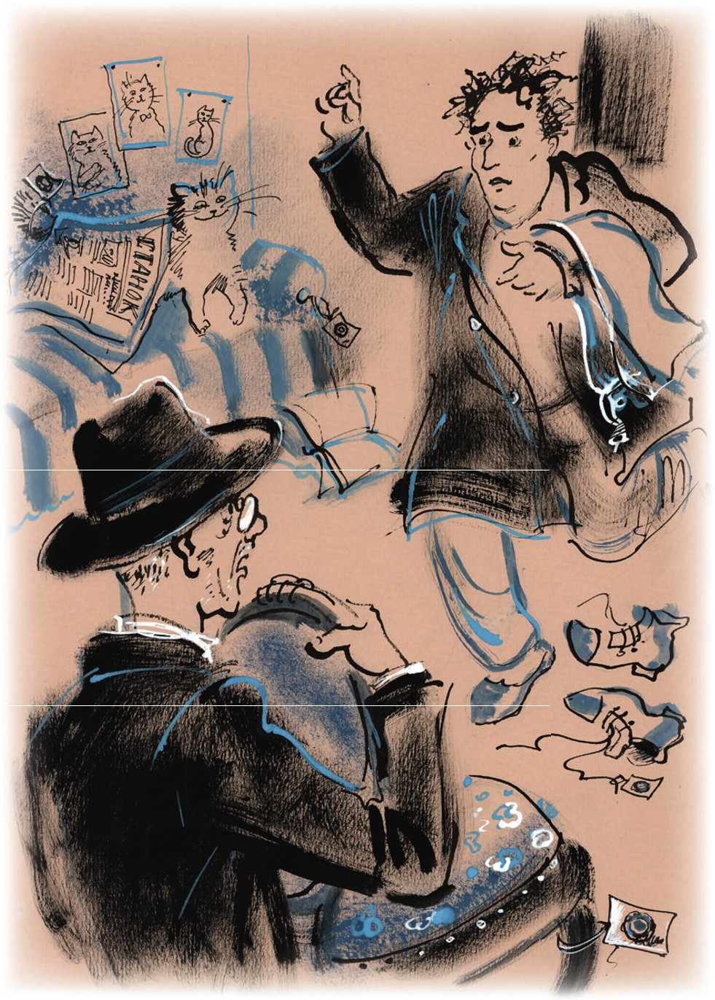
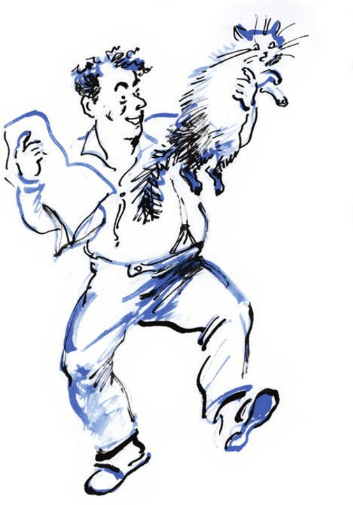
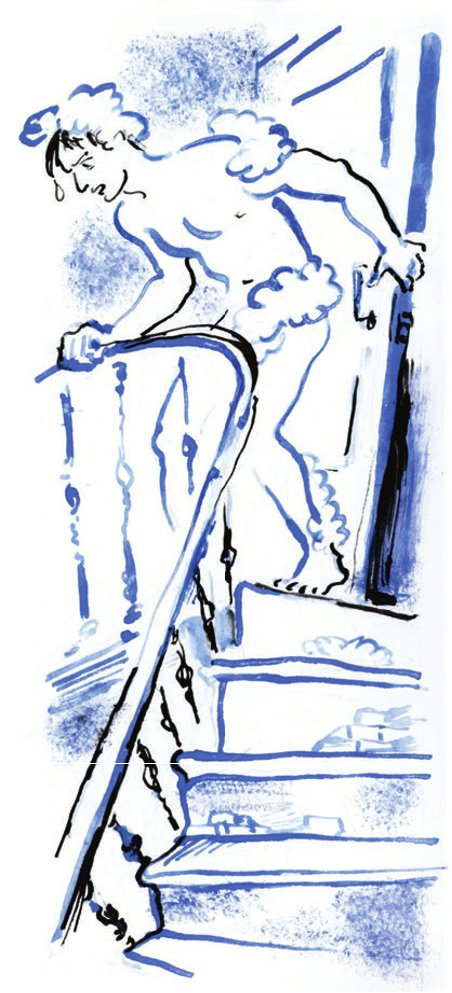

## Kapitel 23: Awessalom Wladimirowitsch Isnurenkow

Für die Konzessionäre begann eine <abbr title="arbeitsreich — напряжённый, страдный">arbeitsreiche</abbr> Zeit. Ostap behauptete, man müsse die Stühle <abbr title="schmieden — ковать">schmieden</abbr>, solange sie heiß sind. Ippolit Matwejewitsch war <abbr title="begnadigen — амнистировать, помиловать">begnadigt</abbr> worden, obwohl Ostap ihn ab und zu <abbr title="verhören — допрашивать">verhörte</abbr>:

— Warum zum Teufel habe ich mich mit Ihnen eingelassen? Wozu brauche ich Sie eigentlich? Fahren Sie doch nach Hause, zu Ihrem Standesamt. Dort warten die Toten auf Sie und die <abbr title="das Neugeborene, die Neugeborenen — новорождённый">Neugeborenen</abbr>. Quälen Sie die <abbr title="der Säugling, die Säuglinge — младенец">Säuglinge</abbr> nicht. Fahren Sie.

Aber im Herzen hatte der große Kombinator den <abbr title="verwildert — одичавший">verwilderten</abbr> Adelsmarschall <abbr title="liebgewinnen (gewann lieb, hat liebgewonnen) — привязаться к, полюбить">liebgewonnen</abbr>. «Ohne ihn ist das Leben nicht so lustig», dachte Ostap. Und er sah <abbr title="vergnügt — весело">vergnügt</abbr> auf Worobjaninow, auf dessen Kopf schon ein silberner Rasen wuchs.

Im <abbr title="der Arbeitsplan, die Arbeitspläne — план работ">Arbeitsplan</abbr> bekam Ippolit Matwejewitsch einen ordentlichen Platz für eigene <abbr title="die Initiative, die Initiativen — инициатива">Initiative</abbr>. Sobald der stille Iwanopulo weggegangen war, <abbr title="einhämmern — вдалбливать">hämmerte</abbr> Bender seinem Kompagnon die kürzesten Wege zum Schatz ein.

— Mutig handeln. Niemanden <abbr title="ausfragen — расспрашивать">ausfragen</abbr>. Mehr <abbr title="der Zynismus — цинизм">Zynismus</abbr>. Das mögen die Leute. Nichts über <abbr title="der Dritte, die Dritten — третье лицо">Dritte</abbr> machen. Die Dummen sind <abbr title="aussterben (starb aus, ist ausgestorben) — вымирать">ausgestorben</abbr>. Niemand wird für Sie Brillanten aus fremden Taschen holen. Aber auch nichts <abbr title="kriminell — уголовный">Kriminelles</abbr>. Das Strafgesetzbuch müssen wir <abbr title="ehren — чтить">ehren</abbr>.

Und trotzdem lief die Suche ohne besonderen Glanz. <abbr title="im Weg stehen (stand, hat gestanden) — мешать">Im Weg standen</abbr> das Strafgesetzbuch und eine riesige Menge <abbr title="bürgerlich — буржуазный">bürgerlicher</abbr> <abbr title="das Vorurteil, die Vorurteile — предрассудок">Vorurteile</abbr>, die die <abbr title="der Bewohner, die Bewohner — обитатель, житель">Bewohner</abbr> der Hauptstadt noch hatten. Zum Beispiel konnten sie nächtliche Besuche durch das <abbr title="das Lüftungsfenster, die Lüftungsfenster — форточка">Lüftungsfenster</abbr> nicht <abbr title="nicht ausstehen können (stand aus, hat ausgestanden) — терпеть не мочь">ausstehen</abbr>. Man musste ganz <abbr title="legal — легально">legal</abbr> arbeiten.

An dem Tag, an dem Ostap Ellotschka Schtschukina besucht hatte, gab es im Zimmer des Studenten Iwanopulo zum ersten Mal ein Möbelstück. Es war der Stuhl, den Ostap gegen das Teesieb <abbr title="eintauschen gegen + Akk. — обменять на">eingetauscht</abbr> hatte – die dritte Trophäe der <abbr title="die Expedition, die Expeditionen — экспедиция">Expedition</abbr>. Die Zeit war längst vorbei, als die Jagd nach den Brillanten in den Kompagnons starke Gefühle weckte, als sie die Stühle mit den <abbr title="die Kralle, die Krallen — коготь">Krallen</abbr> aufrissen und an ihren Sprungfedern <abbr title="nagen an + Dat. — грызть">nagten</abbr>.

— Auch wenn nichts in den Stühlen ist, — sagte Ostap, — können Sie <abbr title="davon ausgehen, dass … (ging aus, ist ausgegangen) — исходить из того, что; считать">davon ausgehen</abbr>, dass wir mindestens zehntausend verdient haben. Jeder geöffnete Stuhl <abbr title="erhöhen — увеличивать">erhöht</abbr> unsere Chancen. Was macht es schon, dass im Stuhl von dem Dämchen nichts war? Deswegen muss man ihn nicht kaputtmachen. Soll Iwanopulo ein bisschen Einrichtung haben. Für uns ist es auch angenehmer.

Am selben Tag flatterten die Konzessionäre aus dem rosa Häuschen und gingen in verschiedene Richtungen. Ippolit Matwejewitsch bekam den meckernden Unbekannten aus der Sadowaja-Spasskaja-Straße. Er bekam 25 Rubel für Ausgaben und den Befehl, keine Bierstuben zu betreten und nicht ohne Stuhl zurückzukommen. Der große Kombinator selbst übernahm Ellotschkas Mann.

Ippolit Matwejewitsch fuhr mit dem Bus Nummer 6 durch die Stadt. Er rüttelte auf einer kleinen <abbr title="die Lederbank, die Lederbänke — кожаная скамейка">Lederbank</abbr> und flog bis unter die lackierte Decke des Wagens. Dabei dachte er darüber nach, wie er den Familiennamen des meckernden Bürgers erfahren könnte, unter welchem Vorwand er zu ihm gehen sollte, was er als ersten Satz sagen und wie er zur Sache kommen sollte.

Am Roten Tor stieg er aus und fand nach der Adresse, die Ostap aufgeschrieben hatte, das richtige Haus. Dann ging er <abbr title="um den heißen Brei herumgehen — ходить вокруг да около">um den heißen Brei herum</abbr> – nämlich um das Haus. Er wagte es nicht hineinzugehen. Es war ein altes, schmutziges Moskauer Hotel, das man in eine <abbr title="die Wohngenossenschaft, die Wohngenossenschaften — жилтоварищество">Wohngenossenschaft</abbr> <abbr title="umwandeln in + Akk. — превращать в">umgewandelt</abbr> hatte. Nach der <abbr title="abgeblättert — облупленный, обшарпанный">abgeblätterten</abbr> <abbr title="die Fassade, die Fassaden — фасад">Fassade</abbr> zu urteilen, wohnten hier nur <abbr title="böswillig — злостный">böswillige</abbr> <abbr title="der Nichtzahler, die Nichtzahler — неплательщик">Nichtzahler</abbr>.

Ippolit Matwejewitsch stand lange vor dem Eingang. Er ging zur Tür und lernte eine <abbr title="handgeschrieben — рукописный">handgeschriebene</abbr> <abbr title="die Bekanntmachung, die Bekanntmachungen — объявление">Bekanntmachung</abbr> mit Drohungen gegen <abbr title="nachlässig — нерадивый">nachlässige</abbr> <abbr title="der Mieter, die Mieter — жилец">Mieter</abbr> <abbr title="auswendig — наизусть">auswendig</abbr>. Dann stieg er, ohne sich etwas ausgedacht zu haben, in den ersten Stock hinauf. Auf den Flur gingen einzelne Zimmer hinaus. Langsam, als würde er zur <abbr title="die Tafel, die Tafeln — классная доска">Tafel</abbr> gehen, um einen <abbr title="der Lehrsatz, die Lehrsätze — теорема">Lehrsatz</abbr> zu beweisen, den er nicht gelernt hatte, näherte sich Ippolit Matwejewitsch dem Zimmer Nummer 41. An der Tür hing, an einer einzigen <abbr title="die Reißzwecke, die Reißzwecken — кнопка (канцелярская)">Reißzwecke</abbr> und <abbr title="kopfüber — вверх ногами, головой вниз">kopfüber</abbr>, eine <abbr title="die Visitenkarte, die Visitenkarten — визитная карточка">Visitenkarte</abbr>. Sie hatte die Farbe eines abgetragenen, <abbr title="gestärkt — крахмальный">gestärkten</abbr> Kragens: «Awessalom Wladimirowitsch Isnurenkow».

Ippolit Matwejewitsch war völlig benommen. Er vergaß anzuklopfen, öffnete die Tür, machte drei Schritte wie ein <abbr title="der Schlafwandler, die Schlafwandler — лунатик">Schlafwandler</abbr> und stand mitten im Zimmer.

— Entschuldigen Sie, — sagte er mit <abbr title="erstickt — придушенный">erstickter</abbr> Stimme, — kann ich Genossen Isnurenkow sprechen?

Awessalom Wladimirowitsch antwortete nicht. Worobjaninow hob den Kopf und sah erst jetzt, dass niemand im Zimmer war.

Nach dem Zimmer konnte man auf keinen Fall sagen, welche <abbr title="die Neigung, die Neigungen — наклонность">Neigungen</abbr> sein Besitzer hatte. Klar war nur, dass er ledig war und keine Haushaltshilfe hatte. Auf dem Fensterbrett lag ein Papier mit <abbr title="die Wurstpelle, die Wurstpellen — колбасная шкурка">Wurstpellen</abbr>. Die Liege an der Wand war mit Zeitungen bedeckt. Auf einem kleinen Regal standen ein paar staubige Bücher. Von den Wänden sahen bunte Fotos von Katern, Kätzchen und Katzen herab. Mitten im Zimmer, neben schmutzigen, <abbr title="umfallen (fiel um, ist umgefallen) — падать, валиться">umgefallenen</abbr> Schuhen, stand ein Stuhl aus <abbr title="das Nussbaumholz — ореховое дерево">Nussbaumholz</abbr>. An allen Möbelstücken, auch an dem Stuhl aus der Stargoroder Villa, <abbr title="baumeln — болтаться">baumelten</abbr> himbeerrote <abbr title="das Siegel, die Siegel — печать">Siegel</abbr> aus <abbr title="der Siegellack — сургуч">Siegellack</abbr>. Aber Ippolit Matwejewitsch beachtete sie nicht. Er vergaß sofort das Strafgesetzbuch und Ostaps Anweisungen und sprang zum Stuhl.

In diesem Moment raschelten die Zeitungen auf der Liege. Ippolit Matwejewitsch erschrak. Die Zeitungen krochen und fielen auf den Boden. Unter ihnen kam ein ruhiges Kätzchen hervor. Es sah Ippolit Matwejewitsch gleichgültig an und begann sich zu waschen. Dabei erwischte es mit der Pfote das Ohr, die Wange und die <abbr title="das Schnurrhaar, die Schnurrhaare — ус (у кошки)">Schnurrhaare</abbr>.

— Puh! — sagte Ippolit Matwejewitsch.

Und er schleppte den Stuhl zur Tür. Die Tür ging von selbst auf. Auf der Schwelle erschien der Besitzer des Zimmers – der meckernde Unbekannte. Er trug einen Mantel, unter dem eine lila Unterhose zu sehen war. In der Hand hielt er eine Hose.

Über Awessalom Wladimirowitsch Isnurenkow konnte man sagen, dass es in der ganzen Republik keinen zweiten solchen Menschen gab. Die Republik <abbr title="schätzen — ценить">schätzte</abbr> ihn, wie er es verdiente. Er brachte ihr großen Nutzen. Und trotzdem blieb er unbekannt, obwohl er in seiner Kunst ein ebenso großer Meister war wie Schaljapin im Gesang, Gorki in der Literatur, Capablanca im Schach, Melnikow im <abbr title="der Eisschnelllauf — бег на коньках">Eisschnelllauf</abbr> und der Assyrer mit der längsten Nase und der braunsten Haut, der den besten Platz an der Ecke Twerskaja und Kamergerski-Gasse hat, im Putzen von Stiefeln mit gelber Schuhcreme.

Schaljapin sang. Gorki schrieb einen großen Roman. Capablanca bereitete sich auf das <abbr title="das Match, die Matches — матч">Match</abbr> mit Aljechin vor. Melnikow brach <abbr title="der Rekord, die Rekorde — рекорд">Rekorde</abbr>. Der Assyrer brachte die Halbschuhe der Bürger zu sonnigem Glanz. Awessalom Isnurenkow machte Witze.

Er machte nie Witze ohne Zweck, nur <abbr title="um der Pointe willen — ради красного словца">um der Pointe willen</abbr>. Er machte sie im Auftrag von <abbr title="humoristisch — юмористический">humoristischen</abbr> Zeitschriften. Auf seinen Schultern trug er die <abbr title="verantwortungsvoll — ответственный">verantwortungsvollsten</abbr> <abbr title="die Kampagne, die Kampagnen — кампания">Kampagnen</abbr>. Er lieferte den meisten satirischen Zeitschriften Moskaus Themen für Zeichnungen und <abbr title="das Feuilleton, die Feuilletons — фельетон">Feuilletons</abbr>.

Große Menschen machen zweimal im Leben einen Witz. Diese Witze <abbr title="vergrößern — увеличивать">vergrößern</abbr> ihren <abbr title="der Ruhm — слава">Ruhm</abbr> und kommen in die Geschichte. Isnurenkow produzierte mindestens sechzig <abbr title="erstklassig — первоклассный">erstklassige</abbr> Witze im Monat, die alle mit einem Lächeln <abbr title="weitererzählen — пересказывать, повторять">weitererzählten</abbr>, und trotzdem blieb er unbekannt. Wenn unter einer Zeichnung ein Witz von Isnurenkow stand, bekam der <abbr title="der Zeichner, die Zeichner — художник, рисовальщик">Zeichner</abbr> den Ruhm. Der Name des Zeichners stand über der Zeichnung. Den Namen Isnurenkow gab es nicht.

— Das ist schrecklich! — schrie er. — Man kann nicht unterschreiben. Unter was soll ich denn unterschreiben? Unter zwei Zeilen?

Und er kämpfte weiter leidenschaftlich gegen die <abbr title="der Feind der Gesellschaft — враг общества">Feinde der Gesellschaft</abbr>: schlechte <abbr title="der Genossenschaftler, die Genossenschaftler — кооператор">Genossenschaftler</abbr>, <abbr title="der Veruntreuer, die Veruntreuer — растратчик">Veruntreuer</abbr>, Chamberlain, <abbr title="der Bürokrat, die Bürokraten — бюрократ">Bürokraten</abbr>. Mit seinen Witzen traf er <abbr title="der Speichellecker, die Speichellecker — подхалим">Speichellecker</abbr>, Hausverwalter, <abbr title="der Privathändler, die Privathändler — частник">Privathändler</abbr>, <abbr title="der Abteilungsleiter, die Abteilungsleiter — зав, заведующий">Abteilungsleiter</abbr>, <abbr title="der Rowdy, die Rowdys — хулиган">Rowdys</abbr>, Bürger, die ihre Preise nicht senken wollten, und Wirtschaftsleiter, die sich vor dem <abbr title="das Sparprogramm — режим экономии">Sparprogramm</abbr> <abbr title="sich drücken vor + Dat. — отлынивать от">drückten</abbr>.

Wenn die Zeitschriften erschienen waren, wurden die Witze in der <abbr title="die Zirkusarena, die Zirkusarenen — цирковая арена">Zirkusarena</abbr> erzählt, von den Abendzeitungen ohne <abbr title="die Quellenangabe, die Quellenangaben — указание источника">Quellenangabe</abbr> <abbr title="nachdrucken — перепечатывать">nachgedruckt</abbr> und von «<abbr title="der Couplet-Autor, die Couplet-Autoren — автор-куплетист">Couplet-Autoren</abbr>» auf der Bühne dem Publikum <abbr title="präsentieren — преподносить">präsentiert</abbr>.

Isnurenkow schaffte es, sogar dort Witze zu machen, wo es scheinbar nichts Lustiges mehr zu sagen gab. Aus einer so dürren <abbr title="die Wüste, die Wüsten — пустыня">Wüste</abbr> wie den <abbr title="aufgebläht — вздутый">aufgeblähten</abbr> <abbr title="der Aufschlag, die Aufschläge — наценка, накидка">Aufschlägen</abbr> auf die <abbr title="die Selbstkosten (Pl.) — себестоимость">Selbstkosten</abbr> <abbr title="auspressen — выжимать">presste</abbr> Isnurenkow etwa hundert Meisterwerke des Humors aus. Heine hätte <abbr title="die Hände sinken lassen — опустить руки">die Hände sinken lassen</abbr>, wenn man ihn gebeten hätte, etwas Lustiges und zugleich gesellschaftlich Nützliches über die falschen <abbr title="der Tarif, die Tarife — тариф">Tarife</abbr> für <abbr title="das Frachtgut, die Frachtgüter — груз малой скорости">Frachtgut</abbr> zu sagen. Mark Twain wäre vor so einem Thema <abbr title="weglaufen (lief weg, ist weggelaufen) — убегать">weggelaufen</abbr>. Aber Isnurenkow blieb auf seinem Posten.

Er lief durch die <abbr title="der Redaktionsraum, die Redaktionsräume — редакционная комната">Redaktionsräume</abbr>, <abbr title="stoßen gegen + Akk. (stieß, hat gestoßen) — натыкаться на">stieß</abbr> gegen die Aschenbecher und meckerte. Nach zehn Minuten war das Thema <abbr title="bearbeiten — обрабатывать">bearbeitet</abbr>, die Zeichnung <abbr title="durchdenken (durchdachte, hat durchdacht) — обдумывать">durchdacht</abbr> und eine Überschrift dazu gemacht.

Jetzt sah Awessalom Wladimirowitsch in seinem Zimmer einen Mann, der einen <abbr title="versiegeln — опечатывать">versiegelten</abbr> Stuhl wegtrug. Er schwenkte seine Hose, die der <abbr title="der Schneider, die Schneider — портной">Schneider</abbr> gerade <abbr title="bügeln — гладить (утюгом)">gebügelt</abbr> hatte, hüpfte und <abbr title="kreischen — клекотать, визжать">kreischte</abbr>:

— Sind Sie verrückt geworden? Ich protestiere! Dazu haben Sie kein Recht! Es gibt doch schließlich ein Gesetz! Für Dummköpfe ist es zwar nicht geschrieben, aber vielleicht haben Sie <abbr title="vom Hörensagen — понаслышке">vom Hörensagen</abbr> gehört, dass die Möbel noch zwei Wochen stehen dürfen!.. Ich <abbr title="sich beschweren bei + Dat. — жаловаться">beschwere mich</abbr> beim Staatsanwalt!.. Ich bezahle ja schließlich!

Ippolit Matwejewitsch stand still. Isnurenkow warf den Mantel ab und zog, ohne von der Tür wegzugehen, die Hose über seine Beine, die so rundlich waren wie bei Tschitschikow. Isnurenkow war ziemlich dick, aber er hatte ein mageres Gesicht.

Worobjaninow zweifelte nicht daran, dass man ihn gleich packen und zur Miliz schleppen würde. Deshalb war er sehr erstaunt, als der Besitzer des Zimmers mit seiner Toilette fertig war und sich plötzlich <abbr title="sich beruhigen — успокаиваться">beruhigte</abbr>.

— Verstehen Sie doch, — sagte der Besitzer in <abbr title="versöhnlich — примирительный">versöhnlichem</abbr> Ton, — damit kann ich doch nicht einverstanden sein.

An Isnurenkows Stelle wäre Ippolit Matwejewitsch schließlich auch nicht damit einverstanden gewesen, dass man ihm am helllichten Tag die Stühle stiehlt.

Aber er wusste nicht, was er sagen sollte, und deshalb schwieg er.

— Ich bin nicht <abbr title="schuld sein an + Dat. — быть виноватым">schuld</abbr>. Schuld ist die <abbr title="die Musikverleihstelle — музпред (музыкальное предприятие)">Musikverleihstelle</abbr> selbst. Ja, ich gebe es zu. Ich habe acht Monate lang die Miete für das geliehene Klavier nicht bezahlt. Aber ich habe es doch nicht verkauft, obwohl ich jede Möglichkeit dazu hatte. Ich habe anständig gehandelt, und sie wie Gauner. Sie haben das Instrument weggenommen, mich auch noch <abbr title="verklagen — подавать в суд на">verklagt</abbr> und die Möbel <abbr title="pfänden — описывать (имущество)">gepfändet</abbr>. Bei mir kann man nichts pfänden. Diese Möbel sind <abbr title="das Produktionsmittel, die Produktionsmittel — орудие производства">Produktionsmittel</abbr>. Und der Stuhl ist auch ein Produktionsmittel!

Ippolit Matwejewitsch begann etwas zu begreifen.

— Lassen Sie den Stuhl los! — quiekte Awessalom Wladimirowitsch plötzlich. — Hören Sie? Sie! Bürokrat!

Ippolit Matwejewitsch ließ den Stuhl gehorsam los und stammelte:

— Entschuldigen Sie, ein Missverständnis, so ist der Dienst eben.

Da wurde Isnurenkow furchtbar fröhlich. Er rannte im Zimmer herum und sang: «Und am Morgen lächelte sie wieder an ihrem Fenster, so wie immer.» Er wusste nicht, was er mit seinen Händen machen sollte. Sie flogen nur so herum. Er begann, seine Krawatte zu binden, wurde nicht fertig und warf sie weg. Dann griff er nach einer Zeitung, las nichts darin und warf sie auf den Boden.

— Sie nehmen die Möbel also heute nicht mit?.. Gut!.. Ach! Ach!

Ippolit Matwejewitsch nutzte die günstigen Umstände und ging zur Tür.

— Warten Sie, — rief Isnurenkow plötzlich. — Haben Sie schon einmal so einen Kater gesehen? Sagen Sie, ist er nicht wirklich außerordentlich flauschig?

Das Kätzchen landete in den zitternden Händen von Ippolit Matwejewitsch.

— Erste Klasse!.. — murmelte Awessalom Wladimirowitsch. Er wusste nicht, wohin mit seiner <abbr title="überschüssig — излишний">überschüssigen</abbr> Energie. — Ach!.. Ach!..

Er stürzte zum Fenster, <abbr title="die Hände zusammenschlagen — всплеснуть руками">schlug die Hände zusammen</abbr> und begann sich oft und schnell vor zwei Mädchen zu verbeugen, die ihn aus dem Fenster des <abbr title="gegenüberliegend — противоположный">gegenüberliegenden</abbr> Hauses ansahen. Er <abbr title="trippeln — топтаться, семенить">trippelte</abbr> auf der Stelle und <abbr title="verstreuen — расточать, рассыпать">verstreute</abbr> <abbr title="schmachtend — томный">schmachtende</abbr> Achs:

— Mädchen aus der <abbr title="die Vorstadt, die Vorstädte — предместье">Vorstadt</abbr>! Die beste Frucht!.. Erste Klasse!.. Ach!.. «Und am Morgen lächelte sie wieder an ihrem Fenster, so wie immer…»

— Dann gehe ich jetzt, Bürger, — sagte der Direktor der Konzession dumm.

— Warten Sie, warten Sie! — Isnurenkow wurde plötzlich unruhig. — Einen kleinen Moment!.. Ach!.. Und das Kätzchen? Ist es nicht wirklich außerordentlich flauschig?.. Warten Sie!.. Ich komme gleich!..

Verlegen <abbr title="wühlen in + Dat. — рыться в">wühlte</abbr> er in allen Taschen, lief hinaus, kam zurück, rief «Ach!», sah aus dem Fenster, lief wieder hinaus und kam wieder zurück.

— Verzeihen Sie, Schätzchen, — sagte er zu Worobjaninow, der während all dieser <abbr title="das Manöver, die Manöver — манипуляция, манёвр">Manöver</abbr> mit den Händen an der Hosennaht stand wie ein Soldat.

Mit diesen Worten gab er dem Adelsmarschall einen halben Rubel.

— Nein, nein, sagen Sie bitte nicht nein. Jede Arbeit muss bezahlt werden.

— <abbr title="besten Dank — премного благодарен">Besten Dank</abbr>, — sagte Ippolit Matwejewitsch und wunderte sich über seine eigene <abbr title="die Gewandtheit — изворотливость, ловкость">Gewandtheit</abbr>.

— Danke, mein Lieber, danke, Schätzchen!..

Als Ippolit Matwejewitsch über den Flur ging, hörte er aus Isnurenkows Zimmer Meckern, Quieken, Singen und leidenschaftliche Schreie.

Auf der Straße dachte Worobjaninow an Ostap und zitterte vor Angst.

Ernest Pawlowitsch Schtschukin wanderte durch die leere Wohnung, die ihm ein Freund <abbr title="freundlicherweise — любезно">freundlicherweise</abbr> für den Sommer überlassen hatte. Er überlegte: Sollte er ein Bad nehmen oder nicht?

Die Dreizimmerwohnung lag direkt unter dem Dach eines neunstöckigen Hauses. Außer dem Schreibtisch und Worobjaninows Stuhl gab es dort nur einen großen <abbr title="der Standspiegel, die Standspiegel — трюмо">Standspiegel</abbr>. Die Sonne <abbr title="sich spiegeln — отражаться">spiegelte sich</abbr> darin und blendete. Der Ingenieur legte sich auf den Schreibtisch, sprang aber sofort wieder auf. Alles war <abbr title="glühend heiß — раскалённый">glühend heiß</abbr>.

— Ich gehe mich waschen, — beschloss er.

Er zog sich aus, <abbr title="abkühlen — остывать">kühlte</abbr> ein bisschen ab, sah sich im Spiegel an und ging ins <abbr title="das Badezimmer, die Badezimmer — ванная комната">Badezimmer</abbr>. Die <abbr title="die Kühle — прохлада">Kühle</abbr> umfing ihn. Er stieg in die <abbr title="die Badewanne, die Badewannen — ванна">Badewanne</abbr>, goss sich Wasser aus einem blauen <abbr title="emailliert — эмалированный">emaillierten</abbr> <abbr title="der Becher, die Becher — кружка">Becher</abbr> über den Körper und <abbr title="sich einseifen — намыливаться">seifte sich</abbr> großzügig ein. Er war ganz mit <abbr title="die Schaumflocke, die Schaumflocken — хлопья пены">Schaumflocken</abbr> bedeckt und sah aus wie der <abbr title="der Weihnachtsmann — Дед Мороз (ёлочный дед)">Weihnachtsmann</abbr>.

— Herrlich! — sagte Ernest Pawlowitsch.

Alles war herrlich. Es war kühl geworden. Seine Frau war nicht da. Vor ihm lag die volle Freiheit. Der Ingenieur setzte sich und drehte den <abbr title="der Wasserhahn, die Wasserhähne — кран">Wasserhahn</abbr> auf, um die Seife <abbr title="abspülen — смывать">abzuspülen</abbr>. Der Hahn gurgelte und sagte langsam etwas <abbr title="unverständlich — неразборчивый">Unverständliches</abbr>. Es kam kein Wasser. Ernest Pawlowitsch steckte seinen <abbr title="glitschig — скользкий">glitschigen</abbr> kleinen Finger in die <abbr title="die Öffnung, die Öffnungen — отверстие">Öffnung</abbr> des Hahns. Ein dünner Strahl lief heraus, aber mehr kam nicht.

Ernest Pawlowitsch verzog das Gesicht, stieg aus der Wanne, ein Bein nach dem anderen, und ging zum Wasserhahn in der Küche. Aber auch dort konnte er nichts <abbr title="herausmelken — выдоить">herausmelken</abbr>.

Ernest Pawlowitsch <abbr title="tappen — шлёпать">tappte</abbr> in die Zimmer und blieb vor dem Spiegel stehen. Der Schaum brannte in den Augen, der Rücken juckte, Seifenflocken fielen auf das Parkett. Er hörte genau hin, ob im Bad nicht doch Wasser lief. Dann beschloss Ernest Pawlowitsch, den Hausmeister zu rufen.

«Soll wenigstens er Wasser bringen, — beschloss der Ingenieur, rieb sich die Augen und begann langsam zu kochen. — Sonst ist das ja <abbr title="weiß der Teufel was — чёрт знает что такое">weiß der Teufel was</abbr>.»

Er sah aus dem Fenster. Ganz unten, auf dem Boden des <abbr title="der Hofschacht, die Hofschächte — дворовый колодец, шахта двора">Hofschachts</abbr>, spielten Kinder.

— Hausmeister! — schrie Ernest Pawlowitsch. — Hausmeister!

Niemand antwortete.

Da fiel Ernest Pawlowitsch ein, dass der Hausmeister im Treppenhaus wohnte, unter der Treppe. Er trat auf die kalten <abbr title="die Fliese, die Fliesen — плитка">Fliesen</abbr>, hielt die Tür mit der Hand fest und beugte sich hinunter. Auf dem <abbr title="der Treppenabsatz, die Treppenabsätze — лестничная площадка">Treppenabsatz</abbr> gab es nur eine Wohnung, deshalb hatte Ernest Pawlowitsch keine Angst, dass ihn jemand in seiner seltsamen Kleidung aus Seifenflocken sehen könnte.

— Hausmeister! — rief er nach unten.

Das Wort dröhnte und rollte mit Lärm die Stufen hinunter.

— Hu-hu! — antwortete die Treppe.

— Hausmeister! Hausmeister!

— Hum-hum! Hum-hum!

Da <abbr title="ausrutschen — поскользнуться">rutschte</abbr> der Ingenieur, der ungeduldig mit den nackten Füßen trat, aus. Um das <abbr title="das Gleichgewicht — равновесие">Gleichgewicht</abbr> zu halten, ließ er die Tür los. Die Wand zitterte. Die Tür <abbr title="zuschnappen — защёлкнуться">schnappte</abbr> mit der <abbr title="die Messingzunge — медный язычок">Messingzunge</abbr> des amerikanischen Schlosses zu und war geschlossen. Ernest Pawlowitsch hatte noch nicht verstanden, wie <abbr title="unwiderruflich — непоправимо">unwiderruflich</abbr> das alles war, und zog an der <abbr title="die Türklinke, die Türklinken — дверная ручка">Türklinke</abbr>. Die Tür gab nicht nach. Fassungslos rüttelte der Ingenieur noch ein paarmal daran und horchte mit klopfendem Herzen. Es herrschte eine <abbr title="dämmrig — сумеречный">dämmrige</abbr> Stille wie in einer Kirche. Durch die bunten Scheiben des sehr hohen Fensters kam kaum Licht.

«Schöne <abbr title="die Bescherung — история, положеньице (ирон.)">Bescherung</abbr>», dachte Ernest Pawlowitsch.

— So ein <abbr title="das Mistding, die Mistdinger — сволочь, дрянь">Mistding</abbr>! — sagte er zur Tür.

Unten begannen menschliche Stimmen wie <abbr title="der Knallfrosch, die Knallfrösche — петарда, хлопушка">Knallfrösche</abbr> zu krachen und zu explodieren. Dann <abbr title="bellen — лаять">bellte</abbr> ein <abbr title="der Schoßhund, die Schoßhunde — комнатная собачка">Schoßhund</abbr> wie ein Lautsprecher. Jemand schob einen Kinderwagen die Treppe hinauf.

Ernest Pawlowitsch ging ängstlich auf dem Treppenabsatz hin und her.

— Man kann ja verrückt werden!

Das alles kam ihm zu wild vor, um wirklich passiert zu sein. Er ging wieder zur Tür und horchte. Er hörte irgendwelche neuen <abbr title="das Geräusch, die Geräusche — звук, шум">Geräusche</abbr>. Zuerst dachte er, dass jemand in der Wohnung herumging.

«Vielleicht ist jemand durch den <abbr title="der Hintereingang, die Hintereingänge — чёрный ход">Hintereingang</abbr> gekommen?» — dachte er, obwohl er wusste, dass die Hintertür abgeschlossen war und niemand in die Wohnung kommen konnte.

Das gleichmäßige Geräusch ging weiter. Der Ingenieur hielt den Atem an. Da erkannte er, dass es plätscherndes Wasser war. Offenbar lief es aus allen Hähnen der Wohnung. Ernest Pawlowitsch hätte fast <abbr title="losheulen — зареветь">losgeheult</abbr>. Die Lage war schrecklich.

So vergingen dreißig Minuten. Der Ingenieur <abbr title="sich reiben an + Dat. (rieb, hat gerieben) — тереться о">rieb sich</abbr> an den <abbr title="die Kalkwand, die Kalkwände — известковая стена">Kalkwänden</abbr>, stöhnte und versuchte ein paarmal erfolglos, die Tür <abbr title="aufbrechen (brach auf, hat aufgebrochen) — взламывать">aufzubrechen</abbr>. Er wurde schmutzig und sah furchtbar aus.

Schtschukin beschloss, zum Hausmeister hinunterzugehen, <abbr title="koste es, was es wolle — чего бы это ни стоило">koste es, was es wolle</abbr>.

— Es gibt keinen anderen <abbr title="der Ausweg, die Auswege — выход">Ausweg</abbr>, keinen. Ich muss mich beim Hausmeister verstecken!

Er keuchte und bedeckte sich mit der Hand, so wie Männer es tun, wenn sie ins Wasser gehen. So schlich Ernest Pawlowitsch langsam am Geländer entlang. Er kam auf den Treppenabsatz zwischen dem achten und dem neunten Stock.

Seine Gestalt wurde von den bunten <abbr title="die Raute, die Rauten — ромб">Rauten</abbr> und <abbr title="das Quadrat, die Quadrate — квадрат">Quadraten</abbr> des Fensters beleuchtet. Er sah aus wie Harlekin, der ein Gespräch zwischen Kolombine und Pierrot <abbr title="belauschen — подслушивать">belauscht</abbr>. Er war schon in den nächsten Treppenteil gebogen, als plötzlich das Schloss der Wohnung unter ihm knallte. Ein junges Fräulein mit einem kleinen <abbr title="der Ballettkoffer, die Ballettkoffer — балетный чемоданчик">Ballettkoffer</abbr> kam heraus. Das Fräulein hatte noch keinen Schritt gemacht, da war Ernest Pawlowitsch schon wieder auf seinem Treppenabsatz. Von den schrecklichen Schlägen seines Herzens war er fast taub.

Erst eine halbe Stunde später hatte sich der Ingenieur <abbr title="sich erholen — оправиться">erholt</abbr> und konnte einen neuen <abbr title="der Ausfall, die Ausfälle — вылазка">Ausfall</abbr> wagen. Diesmal hatte er fest beschlossen, blitzschnell hinunterzulaufen und, ohne auf irgendetwas zu achten, bis zur ersehnten Hausmeisterwohnung zu rennen.

Genau so machte er es. Lautlos sprang das Mitglied des <abbr title="das Büro, die Büros — бюро">Büros</abbr> der Sektion der Ingenieure und Techniker über vier Stufen auf einmal und <abbr title="heulen — выть, подвывать">heulte</abbr> leise dabei. Auf dem Treppenabsatz im sechsten Stock blieb er eine Sekunde stehen. Das war sein Verderben. Von unten kam jemand herauf.

— <abbr title="unausstehlich — несносный">Unausstehlicher</abbr> <abbr title="der Bengel, die Bengel — мальчишка, сорванец">Bengel</abbr>! — hörte er eine Frauenstimme, die der Lautsprecher des Treppenhauses um ein Vielfaches lauter machte. — Wie oft habe ich es ihm gesagt.

Ernest Pawlowitsch <abbr title="gehorchen + Dat. — повиноваться, слушаться">gehorchte</abbr> nicht mehr dem <abbr title="der Verstand — разум, рассудок">Verstand</abbr>, sondern dem <abbr title="der Instinkt, die Instinkte — инстинкт">Instinkt</abbr>. Wie ein Kater, den Hunde verfolgen, flog er in den neunten Stock hinauf.

Auf seinem Treppenabsatz, der voller nasser <abbr title="die Fußspur, die Fußspuren — след ноги">Fußspuren</abbr> war, weinte er lautlos. Er <abbr title="sich die Haare raufen — рвать на себе волосы">raufte sich die Haare</abbr> und schaukelte <abbr title="krampfhaft — конвульсивно, судорожно">krampfhaft</abbr> hin und her. <abbr title="kochend — кипящий">Kochend</abbr> heiße Tränen <abbr title="sich fressen in + Akk. (fraß, hat gefressen) — врезаться, въедаться">fraßen sich</abbr> in die <abbr title="die Seifenkruste — мыльная корка">Seifenkruste</abbr> und brannten zwei <abbr title="wellig — волнистый">wellige</abbr> <abbr title="die Furche, die Furchen — борозда">Furchen</abbr> hinein.

— Herrgott! — sagte der Ingenieur. — Mein Gott! Mein Gott!

Es gab kein Leben mehr. Aber dabei hörte er ganz deutlich einen Lastwagen auf der Straße vorbeifahren. Irgendwo lebte man also!

Noch ein paarmal <abbr title="zwingen (zwang, hat gezwungen) — заставлять, принуждать">zwang</abbr> er sich, nach unten zu gehen, aber er konnte nicht – die Nerven <abbr title="versagen — сдавать, отказывать">versagten</abbr>. Er war in eine <abbr title="die Gruft, die Grüfte — склеп">Gruft</abbr> geraten.

— Hat überall Spuren gemacht, wie die Schweine! — hörte er eine alte Frauenstimme vom Treppenabsatz unter ihm.

Der Ingenieur lief zur Wand und stieß ein paarmal mit dem Kopf dagegen. Das Vernünftigste wäre natürlich gewesen, so lange zu schreien, bis jemand kommt, und sich dann diesem Menschen zu ergeben. Aber Ernest Pawlowitsch hatte völlig die Fähigkeit verloren, klar zu denken. Er atmete schwer und drehte sich auf dem Treppenabsatz im Kreis.

Es gab keinen Ausweg.

---

### Neue Wörter

- **arbeitsreich** — напряжённый, страдный
- **schmieden** — ковать
- **begnadigen** — амнистировать, помиловать
- **verhören** — допрашивать
- **das Neugeborene, die Neugeborenen** — новорождённый
- **der Säugling, die Säuglinge** — младенец
- **verwildert** — одичавший
- **liebgewinnen (gewann lieb, hat liebgewonnen)** — привязаться к, полюбить
- **vergnügt** — весело
- **der Arbeitsplan, die Arbeitspläne** — план работ
- **die Initiative, die Initiativen** — инициатива
- **einhämmern** — вдалбливать
- **ausfragen** — расспрашивать
- **der Zynismus** — цинизм
- **der Dritte, die Dritten** — третье лицо
- **aussterben (starb aus, ist ausgestorben)** — вымирать
- **kriminell** — уголовный
- **ehren** — чтить
- **im Weg stehen (stand, hat gestanden)** — мешать
- **bürgerlich** — буржуазный
- **das Vorurteil, die Vorurteile** — предрассудок
- **der Bewohner, die Bewohner** — обитатель, житель
- **das Lüftungsfenster, die Lüftungsfenster** — форточка
- **nicht ausstehen können (stand aus, hat ausgestanden)** — терпеть не мочь
- **legal** — легально
- **eintauschen gegen + Akk.** — обменять на
- **die Expedition, die Expeditionen** — экспедиция
- **die Kralle, die Krallen** — коготь
- **nagen an + Dat.** — грызть
- **davon ausgehen, dass … (ging aus, ist ausgegangen)** — исходить из того, что; считать
- **erhöhen** — увеличивать
- **die Lederbank, die Lederbänke** — кожаная скамейка
- **um den heißen Brei herumgehen** — ходить вокруг да около
- **die Wohngenossenschaft, die Wohngenossenschaften** — жилтоварищество
- **umwandeln in + Akk.** — превращать в
- **abgeblättert** — облупленный, обшарпанный
- **die Fassade, die Fassaden** — фасад
- **böswillig** — злостный
- **der Nichtzahler, die Nichtzahler** — неплательщик
- **handgeschrieben** — рукописный
- **die Bekanntmachung, die Bekanntmachungen** — объявление
- **nachlässig** — нерадивый
- **der Mieter, die Mieter** — жилец
- **auswendig** — наизусть
- **die Tafel, die Tafeln** — классная доска
- **der Lehrsatz, die Lehrsätze** — теорема
- **die Reißzwecke, die Reißzwecken** — кнопка (канцелярская)
- **kopfüber** — вверх ногами, головой вниз
- **die Visitenkarte, die Visitenkarten** — визитная карточка
- **gestärkt** — крахмальный
- **der Schlafwandler, die Schlafwandler** — лунатик
- **erstickt** — придушенный
- **die Neigung, die Neigungen** — наклонность
- **die Wurstpelle, die Wurstpellen** — колбасная шкурка
- **umfallen (fiel um, ist umgefallen)** — падать, валиться
- **das Nussbaumholz** — ореховое дерево
- **baumeln** — болтаться
- **das Siegel, die Siegel** — печать
- **der Siegellack** — сургуч
- **das Schnurrhaar, die Schnurrhaare** — ус (у кошки)
- **schätzen** — ценить
- **der Eisschnelllauf** — бег на коньках
- **das Match, die Matches** — матч
- **der Rekord, die Rekorde** — рекорд
- **um der Pointe willen** — ради красного словца
- **humoristisch** — юмористический
- **verantwortungsvoll** — ответственный
- **die Kampagne, die Kampagnen** — кампания
- **das Feuilleton, die Feuilletons** — фельетон
- **vergrößern** — увеличивать
- **der Ruhm** — слава
- **erstklassig** — первоклассный
- **weitererzählen** — пересказывать, повторять
- **der Zeichner, die Zeichner** — художник, рисовальщик
- **der Feind der Gesellschaft** — враг общества
- **der Genossenschaftler, die Genossenschaftler** — кооператор
- **der Veruntreuer, die Veruntreuer** — растратчик
- **der Bürokrat, die Bürokraten** — бюрократ
- **der Speichellecker, die Speichellecker** — подхалим
- **der Privathändler, die Privathändler** — частник
- **der Abteilungsleiter, die Abteilungsleiter** — зав, заведующий
- **der Rowdy, die Rowdys** — хулиган
- **das Sparprogramm** — режим экономии
- **sich drücken vor + Dat.** — отлынивать от
- **die Zirkusarena, die Zirkusarenen** — цирковая арена
- **die Quellenangabe, die Quellenangaben** — указание источника
- **nachdrucken** — перепечатывать
- **der Couplet-Autor, die Couplet-Autoren** — автор-куплетист
- **präsentieren** — преподносить
- **die Wüste, die Wüsten** — пустыня
- **aufgebläht** — вздутый
- **der Aufschlag, die Aufschläge** — наценка, накидка
- **die Selbstkosten (Pl.)** — себестоимость
- **auspressen** — выжимать
- **die Hände sinken lassen** — опустить руки
- **der Tarif, die Tarife** — тариф
- **das Frachtgut, die Frachtgüter** — груз малой скорости
- **weglaufen (lief weg, ist weggelaufen)** — убегать
- **der Redaktionsraum, die Redaktionsräume** — редакционная комната
- **stoßen gegen + Akk. (stieß, hat gestoßen)** — натыкаться на
- **bearbeiten** — обрабатывать
- **durchdenken (durchdachte, hat durchdacht)** — обдумывать
- **versiegeln** — опечатывать
- **der Schneider, die Schneider** — портной
- **bügeln** — гладить (утюгом)
- **kreischen** — клекотать, визжать
- **vom Hörensagen** — понаслышке
- **sich beschweren bei + Dat.** — жаловаться
- **sich beruhigen** — успокаиваться
- **versöhnlich** — примирительный
- **schuld sein an + Dat.** — быть виноватым
- **die Musikverleihstelle** — музпред (музыкальное предприятие)
- **verklagen** — подавать в суд на
- **pfänden** — описывать (имущество)
- **das Produktionsmittel, die Produktionsmittel** — орудие производства
- **überschüssig** — излишний
- **die Hände zusammenschlagen** — всплеснуть руками
- **gegenüberliegend** — противоположный
- **trippeln** — топтаться, семенить
- **verstreuen** — расточать, рассыпать
- **schmachtend** — томный
- **die Vorstadt, die Vorstädte** — предместье
- **wühlen in + Dat.** — рыться в
- **das Manöver, die Manöver** — манипуляция, манёвр
- **besten Dank** — премного благодарен
- **die Gewandtheit** — изворотливость, ловкость
- **freundlicherweise** — любезно
- **der Standspiegel, die Standspiegel** — трюмо
- **sich spiegeln** — отражаться
- **glühend heiß** — раскалённый
- **abkühlen** — остывать
- **das Badezimmer, die Badezimmer** — ванная комната
- **die Kühle** — прохлада
- **die Badewanne, die Badewannen** — ванна
- **emailliert** — эмалированный
- **der Becher, die Becher** — кружка
- **sich einseifen** — намыливаться
- **die Schaumflocke, die Schaumflocken** — хлопья пены
- **der Weihnachtsmann** — Дед Мороз (ёлочный дед)
- **der Wasserhahn, die Wasserhähne** — кран
- **abspülen** — смывать
- **unverständlich** — неразборчивый
- **glitschig** — скользкий
- **die Öffnung, die Öffnungen** — отверстие
- **herausmelken** — выдоить
- **tappen** — шлёпать
- **weiß der Teufel was** — чёрт знает что такое
- **der Hofschacht, die Hofschächte** — дворовый колодец, шахта двора
- **die Fliese, die Fliesen** — плитка
- **der Treppenabsatz, die Treppenabsätze** — лестничная площадка
- **ausrutschen** — поскользнуться
- **das Gleichgewicht** — равновесие
- **zuschnappen** — защёлкнуться
- **die Messingzunge** — медный язычок
- **unwiderruflich** — непоправимо
- **die Türklinke, die Türklinken** — дверная ручка
- **dämmrig** — сумеречный
- **die Bescherung** — история, положеньице (ирон.)
- **das Mistding, die Mistdinger** — сволочь, дрянь
- **der Knallfrosch, die Knallfrösche** — петарда, хлопушка
- **bellen** — лаять
- **der Schoßhund, die Schoßhunde** — комнатная собачка
- **das Geräusch, die Geräusche** — звук, шум
- **der Hintereingang, die Hintereingänge** — чёрный ход
- **losheulen** — зареветь
- **sich reiben an + Dat. (rieb, hat gerieben)** — тереться о
- **die Kalkwand, die Kalkwände** — известковая стена
- **aufbrechen (brach auf, hat aufgebrochen)** — взламывать
- **koste es, was es wolle** — чего бы это ни стоило
- **der Ausweg, die Auswege** — выход
- **die Raute, die Rauten** — ромб
- **das Quadrat, die Quadrate** — квадрат
- **belauschen** — подслушивать
- **der Ballettkoffer, die Ballettkoffer** — балетный чемоданчик
- **sich erholen** — оправиться
- **der Ausfall, die Ausfälle** — вылазка
- **das Büro, die Büros** — бюро
- **heulen** — выть, подвывать
- **unausstehlich** — несносный
- **der Bengel, die Bengel** — мальчишка, сорванец
- **gehorchen + Dat.** — повиноваться, слушаться
- **der Verstand** — разум, рассудок
- **der Instinkt, die Instinkte** — инстинкт
- **die Fußspur, die Fußspuren** — след ноги
- **sich die Haare raufen** — рвать на себе волосы
- **krampfhaft** — конвульсивно, судорожно
- **kochend** — кипящий
- **sich fressen in + Akk. (fraß, hat gefressen)** — врезаться, въедаться
- **die Seifenkruste** — мыльная корка
- **wellig** — волнистый
- **die Furche, die Furchen** — борозда
- **zwingen (zwang, hat gezwungen)** — заставлять, принуждать
- **versagen** — сдавать, отказывать
- **die Gruft, die Grüfte** — склеп

[← Kapitel 22](kapitel-22.md) · [Inhalt](README.md) · [Kapitel 24 →](kapitel-24.md)
