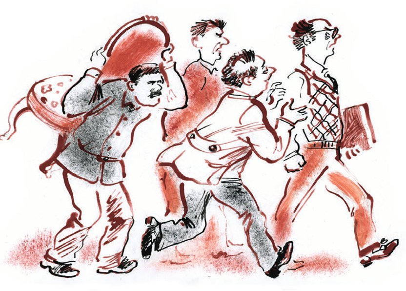

## Kapitel 24: Der Autoklub

In der Redaktion der großen <abbr title="die Tageszeitung, die Tageszeitungen — ежедневная газета">Tageszeitung</abbr> «Die Werkbank», die im ersten Stock des Hauses der Völker lag, wurde in aller <abbr title="die Eile — спешка">Eile</abbr> das Material für den <abbr title="der Satz — набор (типографский)">Satz</abbr> <abbr title="zusammenbacken (backte zusammen, hat zusammengebacken) — печь, состряпать">zusammengebacken</abbr>.

Man holte Notizen und Artikel aus dem «<abbr title="der Pferch, die Pferche — загон">Pferch</abbr>» (so nennt man Material, das schon gesetzt ist, aber nicht mehr in die letzte Nummer gepasst hat). Man zählte, wie viele <abbr title="die Zeile, die Zeilen — строка">Zeilen</abbr> sie brauchten, und dann begann der tägliche Handel um den Platz.

Auf ihren vier Seiten konnte die Zeitung insgesamt 4400 Zeilen unterbringen. Hier musste alles hinein: Telegramme, Artikel, Chronik, Briefe von <abbr title="der Arbeiterkorrespondent, die Arbeiterkorrespondenten — рабкор, рабочий корреспондент">Arbeiterkorrespondenten</abbr>, Anzeigen, ein Feuilleton in Versen und zwei in Prosa, <abbr title="die Karikatur, die Karikaturen — карикатура">Karikaturen</abbr>, Fotos, besondere <abbr title="die Rubrik, die Rubriken — рубрика, отдел">Rubriken</abbr> – Theater, Sport, Schach –, der <abbr title="der Leitartikel, die Leitartikel — передовая статья">Leitartikel</abbr> und der zweite Leitartikel, <abbr title="die Mitteilung, die Mitteilungen — извещение, сообщение">Mitteilungen</abbr> von Sowjet-, Partei- und <abbr title="die Gewerkschaftsorganisation, die Gewerkschaftsorganisationen — профессиональная организация">Gewerkschaftsorganisationen</abbr>, ein Roman <abbr title="in Fortsetzungen — с продолжением">in Fortsetzungen</abbr>, <abbr title="literarisch — художественный">literarische</abbr> <abbr title="die Skizze, die Skizzen — очерк, набросок">Skizzen</abbr> aus dem Leben der Hauptstadt, Kleinigkeiten unter dem Titel «Körnchen», <abbr title="populärwissenschaftlich — научно-популярный">populärwissenschaftliche</abbr> Artikel, Radio und <abbr title="allerlei — всякий, разный">allerlei</abbr> zufälliges Material. Alle Abteilungen zusammen brachten etwa zehntausend Zeilen. Deshalb gab es bei der <abbr title="die Verteilung — распределение">Verteilung</abbr> des Platzes meistens dramatische Szenen.

Als Erster lief der Leiter der Schachabteilung, Maestro Sudeikin, zum <abbr title="der Redaktionssekretär, die Redaktionssekretäre — секретарь редакции">Redaktionssekretär</abbr>. Er stellte eine höfliche, aber bittere Frage:

— Wie? Heute gibt es kein Schach?

— Passt nicht rein, — antwortete der Sekretär. — Das <abbr title="das Feuilleton unter dem Strich — подвал (газетный)">Feuilleton unter dem Strich</abbr> ist groß. Dreihundert Zeilen.

— Aber heute ist doch Samstag. Der Leser wartet auf die Sonntagsrubrik. Ich habe die Lösungen der Schachaufgaben, ich habe eine reizende <abbr title="die Studie, die Studien — этюд">Studie</abbr> von Neunywako, ich habe schließlich…

— Gut. Wie viel wollen Sie?

— Nicht weniger als hundertfünfzig.

— Gut. Weil Sie die Lösungen haben, geben wir Ihnen sechzig Zeilen.

Der Maestro versuchte noch, wenigstens dreißig Zeilen für die Studie von Neunywako zu <abbr title="erbetteln — вымолить, выпросить">erbetteln</abbr> (die wunderbare indische <abbr title="die Partie, die Partien — партия (игра)">Partie</abbr> Tartakower–Bogoljubow lag schon über einen Monat bei ihm), aber man <abbr title="abdrängen — оттеснять">drängte</abbr> ihn ab.

Der <abbr title="der Reporter, die Reporter — репортёр">Reporter</abbr> Persizki kam.

— Soll ich Eindrücke vom <abbr title="das Plenum, die Plenen — пленум">Plenum</abbr> bringen? — fragte er sehr leise.

— Natürlich! — schrie der Sekretär. — Das haben wir doch vorgestern besprochen.

— Das Plenum habe ich, — sagte Persizki noch leiser, — und zwei Skizzen. Aber sie geben mir keinen Platz.

— Wie, sie geben Ihnen keinen? Mit wem haben Sie gesprochen? Sind die denn alle verrückt geworden?

Der Sekretär lief los, um zu schimpfen. Hinter ihm lief Persizki, der unterwegs <abbr title="Intrigen spinnen (spann, hat gesponnen) — интриговать">Intrigen spann</abbr>, und noch weiter hinten liefen die Helden aus der <abbr title="die Anzeigenabteilung — отдел объявлений">Anzeigenabteilung</abbr>.

— Wir haben die Secarow-Flüssigkeit! — riefen sie mit traurigen Stimmen.

Hinter ihnen schlurfte der <abbr title="der Verwaltungsleiter, die Verwaltungsleiter — завхоз">Verwaltungsleiter</abbr> und schleppte einen gepolsterten Stuhl, den er für den <abbr title="der Chefredakteur, die Chefredakteure — редактор (главный)">Chefredakteur</abbr> auf einer Auktion gekauft hatte.

— Die Flüssigkeit kommt am Dienstag. Heute bringen wir unsere <abbr title="die Beilage, die Beilagen — приложение">Beilagen</abbr>!

— Viel werden Sie mit Ihren <abbr title="kostenlos — бесплатный">kostenlosen</abbr> Anzeigen nicht einnehmen. Für die Flüssigkeit haben wir das Geld schon bekommen.

— Gut, das klären wir in der <abbr title="die Nachtredaktion — ночная редакция">Nachtredaktion</abbr>. Geben Sie die Anzeige Pascha. Sie fährt gerade in die Nachtredaktion.

Der Sekretär setzte sich hin, um den Leitartikel zu lesen. Sofort riss man ihn von dieser spannenden <abbr title="die Beschäftigung, die Beschäftigungen — занятие">Beschäftigung</abbr> los. Der Zeichner kam.

— Aha, — sagte der Sekretär, — sehr gut. Es gibt ein Thema für eine Karikatur, wegen der letzten Telegramme aus Deutschland.

— Ich denke so, — sagte der Zeichner, — der «<abbr title="der Stahlhelm — «Стальной шлем» (нем. организация)">Stahlhelm</abbr>» und die allgemeine Lage Deutschlands…

— Gut. Kombinieren Sie das irgendwie und zeigen Sie es mir dann.

Der Zeichner ging in seine Abteilung. Er nahm ein Quadrat aus <abbr title="das Zeichenpapier — ватман, чертёжная бумага">Zeichenpapier</abbr> und <abbr title="skizzieren — набрасывать">skizzierte</abbr> mit dem Bleistift einen mageren Hund. Auf den Hundekopf setzte er einen deutschen Helm mit Spitze. Dann begann er mit den <abbr title="die Beschriftung, die Beschriftungen — надпись">Beschriftungen</abbr>. Auf den <abbr title="der Rumpf, die Rümpfe — туловище">Rumpf</abbr> des Tieres schrieb er in <abbr title="der Druckbuchstabe, die Druckbuchstaben — печатная буква">Druckbuchstaben</abbr> das Wort «Deutschland», auf den <abbr title="geringelt — витой, закрученный">geringelten</abbr> Schwanz «Danziger <abbr title="der Korridor, die Korridore — коридор">Korridor</abbr>», auf den Kiefer «Träume von <abbr title="die Revanche — реванш">Revanche</abbr>», auf das <abbr title="das Halsband, die Halsbänder — ошейник">Halsband</abbr> «Dawes-Plan» und auf die <abbr title="herausstrecken — высовывать">herausgestreckte</abbr> <abbr title="die Zunge, die Zungen — язык">Zunge</abbr> «Stresemann». Vor den Hund stellte der Zeichner Poincaré, der ein Stück Fleisch in der Hand hielt. Auch auf das Fleisch wollte der Zeichner etwas schreiben, aber das Stück war zu klein, und die Schrift passte nicht darauf. Ein weniger <abbr title="einfallsreich — сообразительный, находчивый">einfallsreicher</abbr> Mensch als ein Zeitungskarikaturist hätte <abbr title="den Kopf verlieren (verlor, hat verloren) — растеряться">den Kopf verloren</abbr>. Aber der Zeichner zeichnete ohne nachzudenken etwas an das Fleisch, das aussah wie ein Rezept am Hals einer <abbr title="die Arzneiflasche, die Arzneiflaschen — аптечная бутылочка">Arzneiflasche</abbr>. Darauf schrieb er mit winzigen Buchstaben: «Französische Vorschläge über <abbr title="die Sicherheitsgarantie, die Sicherheitsgarantien — гарантия безопасности">Sicherheitsgarantien</abbr>». Damit man Poincaré nicht mit irgendeinem anderen <abbr title="der Staatsmann, die Staatsmänner — государственный деятель">Staatsmann</abbr> <abbr title="verwechseln — путать, смешивать">verwechselte</abbr>, schrieb der Zeichner auf seinen Bauch: «Poincaré». Die Skizze war fertig.

Auf den Tischen der <abbr title="künstlerisch — художественный">künstlerischen</abbr> Abteilung lagen ausländische Zeitschriften, große Scheren, Gläschen mit Tusche und <abbr title="das Deckweiß — белила">Deckweiß</abbr>. Auf dem Boden lagen <abbr title="der Schnipsel, die Schnipsel — обрезок">Schnipsel</abbr> von Fotos: jemandes Schulter, jemandes Beine und kleine Stücke Landschaft. Ungefähr fünf Zeichner kratzten mit <abbr title="die Rasierklinge, die Rasierklingen — бритвенное лезвие">Rasierklingen</abbr> der Marke «Gillette» an den Fotos, um sie heller zu machen. Sie machten die Bilder schärfer, malten sie mit Tusche und Deckweiß nach und schrieben auf die <abbr title="die Rückseite, die Rückseiten — оборот, обратная сторона">Rückseite</abbr> Unterschrift und Größe: 3 3/4 Quadrate, 2 <abbr title="die Spalte, die Spalten — колонка, столбец">Spalten</abbr> und so weiter – <abbr title="die Angabe, die Angaben — указание, данные">Angaben</abbr>, die man für den <abbr title="der Zinkdruck — цинкография">Zinkdruck</abbr> braucht.

Im Zimmer des Chefredakteurs saß eine ausländische Delegation. Der <abbr title="der Dolmetscher, die Dolmetscher — переводчик (устный)">Dolmetscher</abbr> der Redaktion sah dem Ausländer, der gerade sprach, ins Gesicht und sagte zum Chefredakteur:

— Genosse Arnaud möchte wissen…

Man sprach über die <abbr title="die Struktur, die Strukturen — структура">Struktur</abbr> einer sowjetischen Zeitung. Während der Dolmetscher dem Chefredakteur erklärte, was Genosse Arnaud gern wissen würde, sahen Arnaud selbst, in <abbr title="die Radfahrerhose, die Radfahrerhosen — велосипедные брюки">Radfahrerhosen</abbr> aus <abbr title="der Samt — бархат">Samt</abbr>, und alle anderen Ausländer neugierig auf einen roten <abbr title="der Federhalter, die Federhalter — ручка (перьевая)">Federhalter</abbr> mit einer <abbr title="die Schreibfeder, die Schreibfedern — перо (писчее)">Schreibfeder</abbr> Nummer 86, der in der Ecke des Zimmers <abbr title="lehnen — стоять прислонённым">lehnte</abbr>. Die Feder <abbr title="berühren — касаться">berührte</abbr> fast die Decke, und an seiner breitesten Stelle war der Federhalter so dick wie der Körper eines durchschnittlichen Menschen. Mit diesem Federhalter hätte man schreiben können: Die Feder war ganz echt, nur größer als ein großer <abbr title="der Hecht, die Hechte — щука">Hecht</abbr>.

— Oho-ho! — lachten die Ausländer. — Kolossal!

Diese Feder hatte ein Kongress der Arbeiterkorrespondenten der Redaktion geschenkt.

Der Chefredakteur saß auf Worobjaninows Stuhl, lächelte, nickte schnell mal zum Federhalter, mal zu den Gästen und erklärte fröhlich.

Im <abbr title="das Sekretariat — секретариат">Sekretariat</abbr> ging das Geschrei weiter. Persizki hatte einen Artikel von Semaschko gebracht, und der Sekretär strich schnell die Schachrubrik aus dem Entwurf der dritten Seite. Maestro Sudeikin kämpfte schon nicht mehr für die reizende Studie von Neunywako. Er versuchte, wenigstens die Lösungen der Aufgaben zu retten. Nach einem Kampf, der <abbr title="hart — напряжённый, тяжёлый">härter</abbr> war als sein Kampf mit Capablanca beim <abbr title="das Turnier, die Turniere — турнир">Turnier</abbr> von San Sebastián, eroberte der Maestro ein Plätzchen <abbr title="auf Kosten + Gen. — за счёт">auf Kosten</abbr> von «Gericht und Alltag».

Semaschko wurde in den Satz geschickt. Der Sekretär vertiefte sich wieder in den Leitartikel. Er hatte beschlossen, ihn um jeden Preis zu Ende zu lesen, aus rein sportlichem Interesse.

Er war bis zu der Stelle gekommen: «…Doch der <abbr title="der Inhalt — содержание">Inhalt</abbr> des letzten <abbr title="der Pakt, die Pakte — пакт">Paktes</abbr> ist so, dass man, wenn der Völkerbund ihn registriert, zugeben muss, dass…» Da kam «Gericht und Alltag» zu ihm, ein haariger Mann. Der Sekretär las weiter, sah absichtlich nicht zu «Gericht und Alltag» hin und machte unnötige Notizen im Leitartikel.

«Gericht und Alltag» kam von der anderen Seite und sagte gekränkt:

— Ich verstehe das nicht.

— Na, na, — brummte der Sekretär und versuchte, Zeit zu <abbr title="gewinnen (gewann, hat gewonnen) — выигрывать">gewinnen</abbr>, — worum geht es denn?

— Es geht darum, dass es am Mittwoch kein «Gericht und Alltag» gab, am Freitag gab es kein «Gericht und Alltag», am Donnerstag hat man aus dem Pferch nur den <abbr title="der Unterhaltsfall, die Unterhaltsfälle — алиментное дело">Unterhaltsfall</abbr> gebracht, und am Samstag streicht man den Prozess, über den alle Zeitungen schon lange schreiben, und nur wir…

— Wo schreiben sie? — schrie der Sekretär. — Ich habe nichts gelesen.

— Morgen steht es überall, und wir sind wieder zu spät.

— Und als man Ihnen den Tschubarow-Fall gegeben hat, was haben Sie da geschrieben? Von Ihnen war keine Zeile zu bekommen. Ich weiß es. Sie haben über die Tschubarow-Leute für das <abbr title="das Abendblatt, die Abendblätter — вечерняя газета, вечерка">Abendblatt</abbr> geschrieben.

— Woher wissen Sie das?

— Ich weiß es. Man hat es mir erzählt.

— Dann weiß ich auch, wer es Ihnen erzählt hat. Persizki hat es Ihnen erzählt. Derselbe Persizki, der vor den Augen von ganz Moskau den Apparat der Redaktion benutzt, um Material nach Leningrad zu schicken.

— Pascha! — sagte der Sekretär leise. — Rufen Sie Persizki.

«Gericht und Alltag» saß gleichgültig auf dem Fensterbrett. Hinter ihm sah man einen Garten, in dem Vögel und <abbr title="der Gorodki-Spieler, die Gorodki-Spieler — городошник (игрок в городки)">Gorodki-Spieler</abbr> <abbr title="herumtoben — возиться, резвиться">herumtobten</abbr>.

Der <abbr title="der Streitfall, die Streitfälle — тяжба, спор">Streitfall</abbr> wurde lange <abbr title="verhandeln — разбирать (дело)">verhandelt</abbr>. Der Sekretär beendete ihn mit einem geschickten <abbr title="der Trick, die Tricks — приём, трюк">Trick</abbr>: Er warf das Schach hinaus und setzte an seine Stelle das <abbr title="rehabilitieren — реабилитировать">rehabilitierte</abbr> «Gericht und Alltag». Persizki bekam eine <abbr title="die Verwarnung, die Verwarnungen — предупреждение, выговор">Verwarnung</abbr>.

Es war die heißeste Zeit in der Redaktion – fünf Uhr.

Über den <abbr title="heißgelaufen — разогревшийся">heißgelaufenen</abbr> Schreibmaschinen stieg Rauch auf. Die <abbr title="der Mitarbeiter, die Mitarbeiter — сотрудник">Mitarbeiter</abbr> <abbr title="diktieren — диктовать">diktierten</abbr> mit Stimmen, die von der Eile ganz <abbr title="widerlich — противный">widerlich</abbr> waren. Die erste <abbr title="die Schreibkraft, die Schreibkräfte — машинистка">Schreibkraft</abbr> schrie die <abbr title="der Schurke, die Schurken — негодяй">Schurken</abbr> an, die heimlich ihre Texte <abbr title="außer der Reihe — вне очереди">außer der Reihe</abbr> dazulegten. Durch den Flur ging der <abbr title="der Redaktionsdichter — редакционный поэт">Redaktionsdichter</abbr>.

Er <abbr title="jemandem den Hof machen — ухаживать за">machte</abbr> einer Schreibkraft den Hof. Ihre bescheidenen Hüften <abbr title="entfesseln — развязывать, высвобождать">entfesselten</abbr> seine dichterischen Gefühle. Er führte sie ans Ende des Flurs und sagte am Fenster Worte der Liebe. Das Mädchen antwortete darauf:

— Ich habe heute <abbr title="die Überstunde, die Überstunden — сверхурочная работа">Überstunden</abbr> und bin sehr beschäftigt.

Das bedeutete, dass sie einen anderen liebte.

Der Dichter war allen <abbr title="im Weg sein — путаться под ногами">im Weg</abbr> und wandte sich an alle Bekannten mit einer erstaunlich eintönigen Bitte:

— Geben Sie mir acht Kopeken für die Straßenbahn.

Für diese Summe verirrte er sich in die Abteilung der Arbeiterkorrespondenten. Er drängelte sich zwischen den Tischen herum, an denen die «Leser» arbeiteten, <abbr title="betasten — трогать, ощупывать">betastete</abbr> die Stapel von Briefen und versuchte es wieder. Die Leser waren die strengsten Menschen der Redaktion. (So hatte sie die Notwendigkeit gemacht, jeden Tag hundert Briefe zu lesen, die von Händen <abbr title="kritzeln — царапать, накарябать">gekritzelt</abbr> waren, die eine Axt, einen <abbr title="der Malerpinsel, die Malerpinsel — малярная кисть">Malerpinsel</abbr> oder eine Schubkarre besser kannten als einen Stift.) Sie schwiegen.

Der Dichter war in der <abbr title="die Versandabteilung — экспедиция (отдел)">Versandabteilung</abbr> und landete schließlich im <abbr title="das Kontor, die Kontore — контора">Kontor</abbr>. Aber dort bekam er nicht nur keine acht Kopeken, sondern wurde sogar vom Komsomolzen Awdotjew angegriffen: Man schlug dem Dichter vor, in den <abbr title="der Autofahrerzirkel, die Autofahrerzirkel — кружок автомобилистов">Autofahrerzirkel</abbr> einzutreten. Die verliebte Seele des Dichters wurde von <abbr title="der Benzindampf, die Benzindämpfe — пары бензина">Benzindämpfen</abbr> <abbr title="vernebeln — заволакивать">vernebelt</abbr>. Er machte zwei Schritte zur Seite, legte den dritten Gang ein und verschwand.

Awdotjew war überhaupt nicht <abbr title="entmutigt — обескураженный">entmutigt</abbr>. Er glaubte an den <abbr title="der Triumph — торжество">Triumph</abbr> der Autoidee. Im Sekretariat kämpfte er <abbr title="im Stillen — тихой сапой">im Stillen</abbr>. Deshalb konnte der Sekretär auch den Leitartikel nicht zu Ende lesen.

— Hör mal, Alexander Iossifowitsch. Warte, es ist eine ernste Sache, — sagte Awdotjew und setzte sich auf den Schreibtisch des Sekretärs. — Wir haben einen Autoklub gegründet. Kann die Redaktion uns nicht etwa fünfhundert Rubel für acht Monate leihen?

— Darauf kannst du lange warten.

— Was? Du denkst, die Sache ist <abbr title="tot — мёртвый">tot</abbr>?

— Ich denke es nicht, ich weiß es. Wie viele Mitglieder hat euer Zirkel denn?

— Schon sehr viele.

Bis jetzt bestand der Zirkel nur aus einem Organisator, aber darüber sprach Awdotjew nicht.

— Für fünfhundert Rubel kaufen wir auf dem «Friedhof» ein Auto. Jegorow hat schon eins ausgesucht. Die Reparatur, sagt er, wird nicht mehr als fünfhundert kosten. Insgesamt tausend. Ich will zwanzig Leute sammeln, jeder gibt fünfzig. Dafür wird es großartig. Wir lernen, ein Auto zu fahren. Jegorow wird unser Chef. Und in drei Monaten – bis August – können wir alle fahren, wir haben ein Auto, und jeder fährt der Reihe nach, wohin er will.

— Und die fünfhundert Rubel für den Kauf?

— Die gibt uns die Hilfskasse, mit Zinsen. Wir zahlen sie zurück. Also, soll ich dich eintragen?

Aber der Sekretär hatte schon eine kleine <abbr title="die Glatze, die Glatzen — лысина">Glatze</abbr>, arbeitete viel, war in der Gewalt von Familie und Wohnung, lag nach dem Mittagessen gern auf dem Sofa und las vor dem Schlafen die «Prawda». Er überlegte und lehnte ab.

— Du, — sagte Awdotjew. — <abbr title="der Opa, die Opas — старик, дед">Opa</abbr>!

Awdotjew ging zu jedem Tisch und wiederholte seine <abbr title="zündend — зажигательный">zündenden</abbr> Reden. Bei den Opas – so nannte er alle Mitarbeiter, die älter als zwanzig waren – hatten seine Worte eine <abbr title="zweifelhaft — сомнительный">zweifelhafte</abbr> Wirkung. Sie <abbr title="abwehren — отбрехиваться, отмахиваться">wehrten</abbr> ihn sauer ab und sagten, sie seien schon «Freunde der Kinder» und zahlten regelmäßig zwanzig Kopeken im Jahr für den guten Zweck, den armen Kleinen zu helfen. Eigentlich wären sie ja bereit, in den neuen Klub einzutreten, aber…

— Was heißt hier «aber»? — schrie Awdotjew. — Und wenn das Auto schon heute da wäre? Ja? Wenn man Ihnen einen blauen <abbr title="der Sechszylinder, die Sechszylinder — шестицилиндровый автомобиль">Sechszylinder</abbr>-«Packard» auf den Tisch legen würde, für fünfzehn Kopeken im Jahr, und Benzin und <abbr title="der Schmierstoff, die Schmierstoffe — смазочный материал">Schmierstoffe</abbr> auf Kosten der <abbr title="die Regierung, die Regierungen — правительство">Regierung</abbr>?!

— Geh, geh! — sagten die Opas. — Gleich geht die letzte <abbr title="die Sendung, die Sendungen — посыл, отправка">Sendung</abbr> raus, du störst uns bei der Arbeit!

Die Autoidee erlosch und begann zu qualmen. Endlich fand sich ein Pionier des neuen Unternehmens. Persizki sprang polternd vom Telefon weg, hörte Awdotjew an und sagte:

— Du machst das falsch, gib mir die Liste. Wir fangen von vorn an.

Und Persizki und Awdotjew machten zusammen eine neue <abbr title="die Runde, die Runden — обход, круг">Runde</abbr>.

— Du alte Matratze, — sagte Persizki zu einem jungen Mann mit blauen Augen, — dafür musst du nicht mal Geld geben. Hast du einen Schein von der <abbr title="die Staatsanleihe, die Staatsanleihen — государственный заём">Staatsanleihe</abbr> von 1927? Über wie viel? Über fünfzig? Umso besser. Du gibst diese <abbr title="der Anleiheschein, die Anleihescheine — облигация">Anleihescheine</abbr> unserem Klub. Aus den Anleihescheinen machen wir ein Kapital. Bis August können wir alle Anleihescheine <abbr title="einlösen — реализовать, обменять на деньги">einlösen</abbr> und ein Auto kaufen. Klar?

— Und wenn mein Anleiheschein gewinnt? — wehrte sich der junge Mann.

— Und wie viel willst du gewinnen?

— Fünfzigtausend.

— Für diese fünfzigtausend werden Autos gekauft. Und wenn ich gewinne, auch. Und wenn Awdotjew gewinnt, auch. Kurz, egal wessen Anleiheschein gewinnt, das Geld geht in die Autos. Hast du's jetzt verstanden? Komischer Kauz! Mit deinem eigenen Auto fährst du über die <abbr title="die Georgische Heerstraße — Военно-Грузинская дорога">Georgische Heerstraße</abbr>! Berge! Dummkopf!.. Und hinter dir rollen in ihren eigenen Autos «Gericht und Alltag», die Chronik, die Abteilung <abbr title="der Unglücksfall, die Unglücksfälle — происшествие">Unglücksfälle</abbr> und dieses Dämchen, weißt du, das die Kinoseite macht… Na? Na? Du wirst ihr den Hof machen!..

Jeder Besitzer eines Anleihescheins glaubt <abbr title="im Grunde seines Herzens — в глубине души">im Grunde seines Herzens</abbr> nicht daran, dass er gewinnen kann. Dafür ist er sehr eifersüchtig auf die Anleihescheine seiner Nachbarn und Bekannten. Er fürchtet mehr als das Feuer, dass die anderen gewinnen und er, der ewige <abbr title="der Pechvogel, die Pechvögel — неудачник">Pechvogel</abbr>, wieder <abbr title="leer ausgehen (ging aus, ist ausgegangen) — остаться на бобах">leer ausgeht</abbr>. Deshalb trieb die Hoffnung auf den Gewinn des Kollegen die Besitzer der Anleihescheine <abbr title="unaufhaltsam — неотвратимо">unaufhaltsam</abbr> in den <abbr title="der Schoß — лоно">Schoß</abbr> des neuen Klubs. Nur eine <abbr title="die Befürchtung, die Befürchtungen — опасение">Befürchtung</abbr> störte: dass kein einziger Anleiheschein gewinnen würde. Aber das schien aus irgendeinem Grund wenig <abbr title="wahrscheinlich — вероятный">wahrscheinlich</abbr>. Außerdem verlor der Autoklub nichts: Ein Auto vom «Friedhof» war mit dem Kapital aus den Anleihescheinen garantiert.

In fünf Minuten waren zwanzig Leute zusammen. Als die Sache <abbr title="krönen — увенчивать">gekrönt</abbr> war, kam der Sekretär. Er hatte von den <abbr title="verlockend — заманчивый">verlockenden</abbr> <abbr title="die Aussicht, die Aussichten — перспектива">Aussichten</abbr> des Autoklubs gehört.

— Na, Jungs, — sagte er, — soll ich mich nicht auch eintragen?

— Trag dich ein, Opa, warum nicht, — antwortete Awdotjew. — Nur nicht bei uns. Bei uns sind leider schon alle Plätze voll, und neue Mitglieder werden bis 1929 nicht <abbr title="aufnehmen (nahm auf, hat aufgenommen) — принимать">aufgenommen</abbr>. Trag dich lieber bei den «Freunden der Kinder» ein. Billig und ruhig. Zwanzig Kopeken im Jahr, und fahren musst du nirgendwohin.

Der Sekretär zögerte, dachte daran, dass er wirklich schon ziemlich alt war, seufzte und ging, um den spannenden Leitartikel zu Ende zu lesen.

— Sagen Sie, Genosse, — hielt ihn im Flur ein schöner Mann mit einem <abbr title="tscherkessisch — черкесский">tscherkessischen</abbr> Gesicht an, — wo ist hier die Redaktion der Zeitung «Die Werkbank»?

Das war der große Kombinator.

---

### Neue Wörter

- **die Tageszeitung, die Tageszeitungen** — ежедневная газета
- **die Eile** — спешка
- **der Satz** — набор (типографский)
- **zusammenbacken (backte zusammen, hat zusammengebacken)** — печь, состряпать
- **der Pferch, die Pferche** — загон
- **die Zeile, die Zeilen** — строка
- **der Arbeiterkorrespondent, die Arbeiterkorrespondenten** — рабкор, рабочий корреспондент
- **die Karikatur, die Karikaturen** — карикатура
- **die Rubrik, die Rubriken** — рубрика, отдел
- **der Leitartikel, die Leitartikel** — передовая статья
- **die Mitteilung, die Mitteilungen** — извещение, сообщение
- **die Gewerkschaftsorganisation, die Gewerkschaftsorganisationen** — профессиональная организация
- **in Fortsetzungen** — с продолжением
- **literarisch** — художественный
- **die Skizze, die Skizzen** — очерк, набросок
- **populärwissenschaftlich** — научно-популярный
- **allerlei** — всякий, разный
- **die Verteilung** — распределение
- **der Redaktionssekretär, die Redaktionssekretäre** — секретарь редакции
- **das Feuilleton unter dem Strich** — подвал (газетный)
- **die Studie, die Studien** — этюд
- **erbetteln** — вымолить, выпросить
- **die Partie, die Partien** — партия (игра)
- **abdrängen** — оттеснять
- **der Reporter, die Reporter** — репортёр
- **das Plenum, die Plenen** — пленум
- **Intrigen spinnen (spann, hat gesponnen)** — интриговать
- **die Anzeigenabteilung** — отдел объявлений
- **der Verwaltungsleiter, die Verwaltungsleiter** — завхоз
- **der Chefredakteur, die Chefredakteure** — редактор (главный)
- **die Beilage, die Beilagen** — приложение
- **kostenlos** — бесплатный
- **die Nachtredaktion** — ночная редакция
- **die Beschäftigung, die Beschäftigungen** — занятие
- **der Stahlhelm** — «Стальной шлем» (нем. организация)
- **das Zeichenpapier** — ватман, чертёжная бумага
- **skizzieren** — набрасывать
- **die Beschriftung, die Beschriftungen** — надпись
- **der Rumpf, die Rümpfe** — туловище
- **der Druckbuchstabe, die Druckbuchstaben** — печатная буква
- **geringelt** — витой, закрученный
- **der Korridor, die Korridore** — коридор
- **die Revanche** — реванш
- **das Halsband, die Halsbänder** — ошейник
- **herausstrecken** — высовывать
- **die Zunge, die Zungen** — язык
- **einfallsreich** — сообразительный, находчивый
- **den Kopf verlieren (verlor, hat verloren)** — растеряться
- **die Arzneiflasche, die Arzneiflaschen** — аптечная бутылочка
- **die Sicherheitsgarantie, die Sicherheitsgarantien** — гарантия безопасности
- **der Staatsmann, die Staatsmänner** — государственный деятель
- **verwechseln** — путать, смешивать
- **künstlerisch** — художественный
- **das Deckweiß** — белила
- **der Schnipsel, die Schnipsel** — обрезок
- **die Rasierklinge, die Rasierklingen** — бритвенное лезвие
- **die Rückseite, die Rückseiten** — оборот, обратная сторона
- **die Spalte, die Spalten** — колонка, столбец
- **die Angabe, die Angaben** — указание, данные
- **der Zinkdruck** — цинкография
- **der Dolmetscher, die Dolmetscher** — переводчик (устный)
- **die Struktur, die Strukturen** — структура
- **die Radfahrerhose, die Radfahrerhosen** — велосипедные брюки
- **der Samt** — бархат
- **der Federhalter, die Federhalter** — ручка (перьевая)
- **die Schreibfeder, die Schreibfedern** — перо (писчее)
- **lehnen** — стоять прислонённым
- **berühren** — касаться
- **der Hecht, die Hechte** — щука
- **das Sekretariat** — секретариат
- **hart** — напряжённый, тяжёлый
- **das Turnier, die Turniere** — турнир
- **auf Kosten + Gen.** — за счёт
- **der Inhalt** — содержание
- **der Pakt, die Pakte** — пакт
- **gewinnen (gewann, hat gewonnen)** — выигрывать
- **der Unterhaltsfall, die Unterhaltsfälle** — алиментное дело
- **das Abendblatt, die Abendblätter** — вечерняя газета, вечерка
- **der Gorodki-Spieler, die Gorodki-Spieler** — городошник (игрок в городки)
- **herumtoben** — возиться, резвиться
- **der Streitfall, die Streitfälle** — тяжба, спор
- **verhandeln** — разбирать (дело)
- **der Trick, die Tricks** — приём, трюк
- **rehabilitieren** — реабилитировать
- **die Verwarnung, die Verwarnungen** — предупреждение, выговор
- **heißgelaufen** — разогревшийся
- **der Mitarbeiter, die Mitarbeiter** — сотрудник
- **diktieren** — диктовать
- **widerlich** — противный
- **die Schreibkraft, die Schreibkräfte** — машинистка
- **der Schurke, die Schurken** — негодяй
- **außer der Reihe** — вне очереди
- **der Redaktionsdichter** — редакционный поэт
- **jemandem den Hof machen** — ухаживать за
- **entfesseln** — развязывать, высвобождать
- **die Überstunde, die Überstunden** — сверхурочная работа
- **im Weg sein** — путаться под ногами
- **betasten** — трогать, ощупывать
- **kritzeln** — царапать, накарябать
- **der Malerpinsel, die Malerpinsel** — малярная кисть
- **die Versandabteilung** — экспедиция (отдел)
- **das Kontor, die Kontore** — контора
- **der Autofahrerzirkel, die Autofahrerzirkel** — кружок автомобилистов
- **der Benzindampf, die Benzindämpfe** — пары бензина
- **vernebeln** — заволакивать
- **entmutigt** — обескураженный
- **der Triumph** — торжество
- **im Stillen** — тихой сапой
- **tot** — мёртвый
- **die Glatze, die Glatzen** — лысина
- **der Opa, die Opas** — старик, дед
- **zündend** — зажигательный
- **zweifelhaft** — сомнительный
- **abwehren** — отбрехиваться, отмахиваться
- **der Sechszylinder, die Sechszylinder** — шестицилиндровый автомобиль
- **der Schmierstoff, die Schmierstoffe** — смазочный материал
- **die Regierung, die Regierungen** — правительство
- **die Sendung, die Sendungen** — посыл, отправка
- **die Runde, die Runden** — обход, круг
- **die Staatsanleihe, die Staatsanleihen** — государственный заём
- **der Anleiheschein, die Anleihescheine** — облигация
- **einlösen** — реализовать, обменять на деньги
- **die Georgische Heerstraße** — Военно-Грузинская дорога
- **der Unglücksfall, die Unglücksfälle** — происшествие
- **im Grunde seines Herzens** — в глубине души
- **der Pechvogel, die Pechvögel** — неудачник
- **leer ausgehen (ging aus, ist ausgegangen)** — остаться на бобах
- **unaufhaltsam** — неотвратимо
- **der Schoß** — лоно
- **die Befürchtung, die Befürchtungen** — опасение
- **wahrscheinlich** — вероятный
- **krönen** — увенчивать
- **verlockend** — заманчивый
- **die Aussicht, die Aussichten** — перспектива
- **aufnehmen (nahm auf, hat aufgenommen)** — принимать
- **tscherkessisch** — черкесский

[← Kapitel 23](kapitel-23.md) · [Inhalt](README.md) · [Kapitel 25 →](kapitel-25.md)
