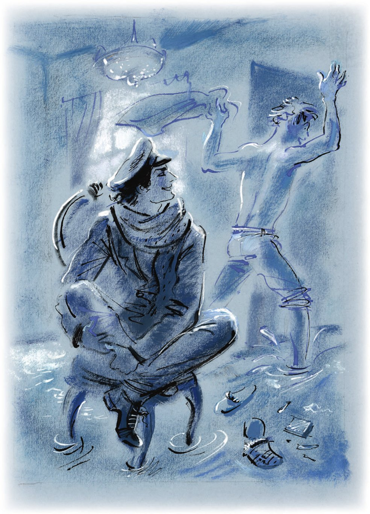

## Kapitel 25: Gespräch mit einem nackten Ingenieur

Bevor Ostap Bender in der Redaktion erschien, waren einige nicht ganz unwichtige Dinge passiert.

Am Nachmittag hatte der große Kombinator Ernest Pawlowitsch nicht <abbr title="antreffen (traf an, hat angetroffen) — застать">angetroffen</abbr>. Die Wohnung war abgeschlossen, und der Besitzer war wahrscheinlich im Dienst. Deshalb beschloss Ostap, später noch einmal vorbeizukommen, und spazierte inzwischen durch die Stadt. Er <abbr title="brennen vor + Dat. (brannte, hat gebrannt) — гореть, томиться">brannte</abbr> vor <abbr title="der Tatendrang — жажда деятельности">Tatendrang</abbr>. Er ging über Straßen, blieb auf Plätzen stehen, <abbr title="jemandem schöne Augen machen — строить глазки">machte</abbr> einem Milizionär schöne Augen, half Damen in den Bus und sah überhaupt so aus, als wäre ganz Moskau mit seinen Denkmälern, Straßenbahnen, Mosselprom-<abbr title="die Verkäuferin, die Verkäuferinnen — продавщица">Verkäuferinnen</abbr>, Kirchlein, Bahnhöfen und Litfaßsäulen zu ihm zu einem Empfang gekommen. Er ging zwischen den Gästen umher, plauderte <abbr title="nett — мило">nett</abbr> mit ihnen und fand für jeden ein herzliches Wort. So viele Besucher zu empfangen, <abbr title="ermüden — утомлять">ermüdete</abbr> den großen Kombinator etwas. Außerdem war es schon nach fünf, und er musste zum Ingenieur Schtschukin.

Aber das Schicksal wollte es so, dass Ostap, bevor er Ernest Pawlowitsch sah, ungefähr zwei Stunden aufgehalten wurde, um ein kleines <abbr title="das Protokoll, die Protokolle — протокол">Protokoll</abbr> zu unterschreiben.

Auf dem Theaterplatz geriet der große Kombinator unter ein Pferd. Ganz unerwartet rannte ein schüchternes weißes Tier gegen ihn und stieß ihn mit seiner knochigen <abbr title="die Brust, die Brüste — грудь">Brust</abbr>. Bender fiel um, ganz <abbr title="in Schweiß gebadet — обливаясь потом">in Schweiß gebadet</abbr>. Es war sehr heiß. Das weiße Pferd bat laut um Entschuldigung. Ostap stand flink auf. Sein kräftiger Körper hatte keine Verletzung bekommen. Umso mehr Gründe und Möglichkeiten gab es für einen Skandal.

Den <abbr title="gastfreundlich — гостеприимный">gastfreundlichen</abbr> und <abbr title="liebenswürdig — любезный">liebenswürdigen</abbr> Gastgeber von Moskau konnte man nicht wiedererkennen. <abbr title="breitbeinig — вразвалку">Breitbeinig</abbr> ging er zu dem verlegenen alten Kutscher und haute ihm mit der Faust auf den wattierten Rücken. Der Alte ertrug die <abbr title="die Strafe, die Strafen — наказание">Strafe</abbr> geduldig. Ein Milizionär kam angelaufen.

— Ich verlange ein Protokoll! — rief Ostap mit <abbr title="das Pathos — пафос">Pathos</abbr>.

In seiner Stimme hörte man die <abbr title="metallisch — металлический">metallischen</abbr> Töne eines Menschen, der in seinen heiligsten Gefühlen beleidigt worden ist. Ostap stand an der Wand des Maly-Theaters, genau an der Stelle, wo man später ein Denkmal für den großen russischen <abbr title="der Dramatiker, die Dramatiker — драматург">Dramatiker</abbr> Ostrowski bauen wird. Dort unterschrieb er das Protokoll und gab dem herbeigelaufenen Persizki ein kleines Interview. Persizki war sich für <abbr title="die Kleinarbeit — чёрная работа">Kleinarbeit</abbr> nicht zu schade. Er schrieb sorgfältig Familiennamen und Vornamen des Opfers in seinen Notizblock und eilte weiter.

Ostap machte sich stolz auf den Weg. Er dachte immer noch an den <abbr title="der Überfall, die Überfälle — нападение">Überfall</abbr> des weißen Pferdes und <abbr title="bedauern — сожалеть">bedauerte</abbr> <abbr title="nachträglich — запоздало">nachträglich</abbr>, dass er dem Kutscher nicht auch noch eins in den Nacken gegeben hatte. Er nahm immer zwei Stufen auf einmal und stieg bis in den siebten Stock von Schtschukins Haus. Hier fiel ihm ein schwerer <abbr title="der Tropfen, die Tropfen — капля">Tropfen</abbr> auf den Kopf. Er sah nach oben. Direkt in seine Augen stürzte vom oberen Treppenabsatz ein kleiner <abbr title="der Wasserfall, die Wasserfälle — водопад">Wasserfall</abbr> aus schmutzigem Wasser.

«Für so etwas sollte man jemandem <abbr title="jemandem eins auf die Schnauze geben — дать в морду">eins auf die Schnauze geben</abbr>», beschloss Ostap.

Er stürzte nach oben. Vor der Tür von Schtschukins Wohnung saß, mit dem Rücken zu ihm, ein nackter Mensch, ganz bedeckt mit weißen <abbr title="die Flechte, die Flechten — лишай">Flechten</abbr>. Er saß direkt auf den <abbr title="die Kachel, die Kacheln — кафельная плитка">Kacheln</abbr>, hielt sich den Kopf und schaukelte hin und her.

Um den Nackten herum stand Wasser, das durch den Spalt unter der Wohnungstür geflossen war.

— O-o-oh, — stöhnte der Nackte, — o-o-oh…

— Sagen Sie, warum gießen Sie hier Wasser aus? — fragte Ostap gereizt. — Ist das ein Ort zum Baden? Sind Sie verrückt geworden?

Der Nackte sah Ostap <abbr title="trüb — тускло, мутно">trüb</abbr> an und schluchzte.

— Hören Sie, Bürger, statt zu weinen, könnten Sie vielleicht in die <abbr title="die Badeanstalt, die Badeanstalten — баня">Badeanstalt</abbr> gehen? Sehen Sie nur, wie Sie aussehen! Wie ein <abbr title="der Picador, die Picadores — пикадор">Picador</abbr>!

— Der Schlüssel, — muhte der Ingenieur.

— Was für ein Schlüssel? — fragte Ostap.

— Zu der W-w-wohnu-u-ung.

— Wo das Geld liegt?

Der nackte Mensch hatte mit erstaunlicher <abbr title="die Geschwindigkeit — скорость">Geschwindigkeit</abbr> Schluckauf.

Nichts konnte Ostap <abbr title="jemanden aus der Fassung bringen — смутить, вывести из равновесия">aus der Fassung bringen</abbr>. Er begann zu begreifen. Und als er endlich begriffen hatte, fiel er vor Lachen fast über das Geländer. Gegen dieses Lachen zu kämpfen, wäre <abbr title="ohnehin — всё равно">ohnehin</abbr> <abbr title="zwecklos — бесполезно">zwecklos</abbr> gewesen.

— Sie können also nicht in die Wohnung? Aber das ist doch ganz einfach!

Ostap versuchte, sich nicht an dem Nackten schmutzig zu machen. Er ging zur Tür, steckte den langen gelben <abbr title="der Fingernagel, die Fingernägel — ноготь">Fingernagel</abbr> seines <abbr title="der Daumen, die Daumen — большой палец">Daumens</abbr> in den Spalt des amerikanischen Schlosses und begann vorsichtig, ihn von rechts nach links und von oben nach unten zu drehen.

Die Tür öffnete sich <abbr title="geräuschlos — бесшумно">geräuschlos</abbr>, und der Nackte lief mit einem fröhlichen <abbr title="das Geheul — вой">Geheul</abbr> in die <abbr title="überschwemmt — затопленный">überschwemmte</abbr> Wohnung.

Die Hähne rauschten. Im Esszimmer hatte das Wasser einen <abbr title="der Strudel, die Strudel — водоворот">Strudel</abbr> gebildet. Im Schlafzimmer stand es wie ein ruhiger <abbr title="der Teich, die Teiche — пруд">Teich</abbr>, auf dem leise, wie <abbr title="der Schwan, die Schwäne — лебедь">Schwäne</abbr>, die <abbr title="der Pantoffel, die Pantoffeln — ночная туфля, тапок">Pantoffeln</abbr> schwammen. Wie ein verschlafener <abbr title="der Fischschwarm, die Fischschwärme — рыбья стайка">Fischschwarm</abbr> hatten sich die <abbr title="der Zigarettenstummel, die Zigarettenstummel — окурок">Zigarettenstummel</abbr> in einer Ecke <abbr title="sich sammeln — собираться, сбиваться">gesammelt</abbr>.

Worobjaninows Stuhl stand im Esszimmer, wo die <abbr title="die Strömung, die Strömungen — течение">Strömung</abbr> am stärksten war. An allen vier Beinen hatten sich kleine weiße <abbr title="die Welle, die Wellen — волна, бурунчик">Wellen</abbr> gebildet. Der Stuhl zitterte ein bisschen und schien gleich vor seinem <abbr title="der Verfolger, die Verfolger — преследователь">Verfolger</abbr> <abbr title="davonschwimmen (schwamm davon, ist davongeschwommen) — уплыть">davonschwimmen</abbr> zu wollen. Ostap setzte sich auf ihn und zog die Beine an. Ernest Pawlowitsch war wieder zu sich gekommen. Mit den Rufen «Pardon! Pardon!» drehte er die Hähne zu, wusch sich und erschien dann vor Bender – bis zur <abbr title="die Taille, die Taillen — пояс, талия">Taille</abbr> nackt und in einer nassen Hose, die er bis zu den Knien <abbr title="hochkrempeln — закатывать">hochgekrempelt</abbr> hatte.

— Sie haben mich einfach gerettet! — rief er aufgeregt. — Entschuldigen Sie, ich kann Ihnen nicht die Hand geben, ich bin ganz nass. Wissen Sie, ich wäre fast verrückt geworden.

— Danach sah es auch aus.

— Ich war in einer schrecklichen Lage.

Und Ernest Pawlowitsch <abbr title="erleben — переживать">erlebte</abbr> das schreckliche Ereignis noch einmal, mal <abbr title="sich verfinstern — омрачаться">verfinsterte</abbr> sich sein Gesicht, mal lachte er nervös, und er erzählte dem großen Kombinator alle Einzelheiten des Unglücks, das ihn getroffen hatte.

— Ohne Sie wäre ich <abbr title="umkommen (kam um, ist umgekommen) — погибнуть">umgekommen</abbr>, — sagte der Ingenieur am Ende.

— Ja, — sagte Ostap, — so etwas ist mir auch einmal passiert. Sogar ein bisschen schlimmer.

Den Ingenieur interessierte jetzt alles, was mit solchen Geschichten zu tun hatte, so sehr, dass er sogar den Eimer hinwarf, mit dem er das Wasser <abbr title="aufsammeln — собирать">aufsammelte</abbr>, und gespannt zuhörte.

— Genau so wie bei Ihnen, — begann Bender. — Nur war es im Winter, und nicht in Moskau, sondern in Mirgorod, in einer der lustigen <abbr title="die Pause, die Pausen — промежуток, пауза">Pausen</abbr> zwischen Machno und Tjutjunnik, im Jahr neunzehn. Ich wohnte bei einer Familie. Ukrainer, ganz verzweifelte! Typische Eigentümer: ein <abbr title="einstöckig — одноэтажный">einstöckiges</abbr> Häuschen und viel <abbr title="der Krempel — барахло">Krempel</abbr>. Ich muss Ihnen sagen, was die <abbr title="die Kanalisation — канализация">Kanalisation</abbr> und anderen Bequemlichkeiten angeht, gibt es in Mirgorod nur <abbr title="die Senkgrube, die Senkgruben — выгребная яма">Senkgruben</abbr>. Na, und eines Nachts lief ich hinaus, nur in Unterwäsche, direkt in den Schnee. Vor einer <abbr title="die Erkältung, die Erkältungen — простуда">Erkältung</abbr> hatte ich keine Angst – es ist ja eine Sache von einer Minute. Ich lief hinaus und <abbr title="zuschlagen (schlug zu, hat zugeschlagen) — захлопывать">schlug</abbr> automatisch die Tür hinter mir zu. Frost – ungefähr zwanzig Grad minus. Ich klopfe – sie machen nicht auf. Stehen bleiben kann man nicht: Man <abbr title="erfrieren (erfror, ist erfroren) — замерзать">erfriert</abbr>! Ich klopfe und laufe, klopfe und laufe – sie machen nicht auf. Und das <abbr title="das Wichtigste — главное">Wichtigste</abbr>: Im ganzen Haus schläft kein einziger Teufel. Eine furchtbare Nacht. Die Hunde heulen. Irgendwo wird geschossen. Und ich laufe in meiner Sommerunterhose durch die <abbr title="die Schneewehe, die Schneewehen — сугроб">Schneewehen</abbr>. Eine ganze Stunde habe ich geklopft. Ich wäre fast <abbr title="krepieren — подохнуть">krepiert</abbr>. Und warum, glauben Sie, haben sie nicht aufgemacht? Sie haben ihr <abbr title="das Hab und Gut — имущество">Hab und Gut</abbr> versteckt und Kerenski-Rubel in das Kissen genäht. Sie dachten, es ist eine Hausdurchsuchung. Ich hätte sie danach fast alle umgebracht.

Der Ingenieur konnte das alles sehr gut <abbr title="nachfühlen — сочувствовать, понимать">nachfühlen</abbr>.

— Ja, — sagte Ostap, — dann sind Sie also der Ingenieur Schtschukin?

— Ja. Nur, bitte, erzählen Sie es niemandem. Es ist wirklich peinlich.

— Oh, aber bitte! Entre nous, tête-à-tête. Unter vier Augen, wie die Franzosen sagen. Ich komme übrigens geschäftlich zu Ihnen, Genosse Schtschukin.

— Ich stehe Ihnen außerordentlich gern zu <abbr title="zu Diensten stehen — быть к услугам">Diensten</abbr>.

— Grand merci. Eine Kleinigkeit. Ihre <abbr title="die Gattin, die Gattinnen — супруга">Gattin</abbr> hat mich gebeten, bei Ihnen vorbeizugehen und diesen Stuhl <abbr title="abholen — забирать">abzuholen</abbr>. Sie sagt, sie braucht ihn für das Paar. Und Ihnen will sie einen Sessel schicken.

— Ja, bitte! — rief Ernest Pawlowitsch. — Sehr gern! Aber warum wollen Sie sich die Mühe machen? Ich kann ihn selbst hinbringen. Noch heute.

— Nein, wozu denn! Für mich ist das eine reine Kleinigkeit. Ich wohne nicht weit, es ist nicht schwer für mich.

Der Ingenieur lief geschäftig herum und begleitete den großen Kombinator bis zur Tür. Über die Schwelle traute er sich nicht, obwohl er den Schlüssel schon <abbr title="vorsorglich — предусмотрительно">vorsorglich</abbr> in die Tasche seiner nassen Hose gesteckt hatte.

Der ehemalige Student Iwanopulo bekam noch einen Stuhl geschenkt. Der Bezug war zwar ein bisschen <abbr title="beschädigt — повреждённый">beschädigt</abbr>, aber trotzdem war es ein wunderbarer Stuhl und außerdem <abbr title="haargenau — точь-в-точь">haargenau</abbr> wie der erste.

Der Misserfolg mit diesem Stuhl, dem vierten, beunruhigte Ostap nicht. Er kannte alle Launen des Schicksals.

In das ordentliche System seiner <abbr title="die Schlussfolgerung, die Schlussfolgerungen — умозаключение, вывод">Schlussfolgerungen</abbr> <abbr title="einschneiden (schnitt ein, hat eingeschnitten) — врезаться">schnitt</abbr> sich wie ein dunkler <abbr title="der Koloss, die Kolosse — громада, колосс">Koloss</abbr> nur der Stuhl ein, der in die Tiefe des Güterbahnhofs am Oktober-Bahnhof davongeschwommen war. Die Gedanken an diesen Stuhl waren unangenehm und weckten quälende Zweifel.

Der große Kombinator war in der Lage eines <abbr title="der Roulettespieler, die Roulettespieler — игрок в рулетку">Roulettespielers</abbr>, der nur auf einzelne Zahlen <abbr title="setzen auf + Akk. — ставить на">setzt</abbr>. Er gehörte zu der Sorte Menschen, die gleich das 36-fache ihres <abbr title="der Einsatz, die Einsätze — ставка">Einsatzes</abbr> gewinnen wollen. Die Lage war sogar noch schlimmer: Die Konzessionäre spielten ein Roulette, bei dem auf elf von zwölf Zahlen die <abbr title="die Null — зеро, ноль">Null</abbr> kam. Und auch die zwölfte Zahl war aus dem Blickfeld verschwunden, war weiß der Teufel wo und <abbr title="enthalten (enthielt, hat enthalten) — содержать, хранить">enthielt</abbr> vielleicht den wunderbaren Gewinn.

Die Kette dieser traurigen Gedanken wurde von der <abbr title="die Ankunft — приход, прибытие">Ankunft</abbr> des <abbr title="der Hauptdirektor, die Hauptdirektoren — главный директор">Hauptdirektors</abbr> unterbrochen. Schon sein <abbr title="der Anblick — вид">Anblick</abbr> weckte in Ostap schlechte Gefühle.

— Oho! — sagte der <abbr title="der technische Leiter — технический руководитель">technische Leiter</abbr>. — Ich sehe, Sie machen <abbr title="der Fortschritt, die Fortschritte — успех, прогресс">Fortschritte</abbr>. Nur machen Sie keine Witze mit mir. Warum haben Sie den Stuhl vor der Tür gelassen? Um sich über mich <abbr title="sich lustig machen über + Akk. — потешаться над">lustig zu machen</abbr>?

— Genosse Bender, — murmelte der Adelsmarschall.

— Ach, warum <abbr title="mit jemandes Nerven spielen — играть на нервах">spielen</abbr> Sie mit meinen Nerven! Bringen Sie ihn schnell her, bringen Sie ihn! Sehen Sie, der neue Stuhl, auf dem ich sitze, hat den Wert Ihrer <abbr title="die Erwerbung, die Erwerbungen — приобретение">Erwerbung</abbr> um ein Vielfaches erhöht.

Ostap legte den Kopf schief und kniff die Augen zusammen.

— Quälen Sie das Kindchen nicht, — sagte er endlich mit tiefer Bassstimme. — Wo ist der Stuhl? Warum haben Sie ihn nicht gebracht?

Ippolit Matwejewitschs wirrer Bericht wurde immer wieder von <abbr title="der Zwischenruf, die Zwischenrufe — выкрик с места">Zwischenrufen</abbr>, ironischem <abbr title="der Beifall — аплодисменты">Beifall</abbr> und hinterhältigen Fragen unterbrochen. Worobjaninow beendete seinen Bericht unter dem <abbr title="einstimmig — единодушный">einstimmigen</abbr> Lachen des Publikums.

— Und meine Anweisungen? — fragte Ostap drohend. — Wie oft habe ich Ihnen gesagt, dass Stehlen Sünde ist! Schon damals in Stargorod, als Sie meine Frau, Madame Grizazujewa, <abbr title="bestehlen (bestahl, hat bestohlen) — обворовывать">bestehlen</abbr> wollten, schon damals habe ich verstanden, dass Sie einen <abbr title="kleinkriminell — мелкоуголовный">kleinkriminellen</abbr> Charakter haben. Das Höchste, wohin Sie diese <abbr title="die Fähigkeit, die Fähigkeiten — способность">Fähigkeiten</abbr> bringen können, sind sechs Monate ohne strenge Isolationshaft. Für einen Giganten des Denkens und Vater der russischen Demokratie scheint der <abbr title="der Maßstab, die Maßstäbe — масштаб">Maßstab</abbr> ja eher klein, und hier sind die <abbr title="das Ergebnis, die Ergebnisse — результат">Ergebnisse</abbr>. Der Stuhl, den Sie schon in den Händen hatten, ist Ihnen <abbr title="entgleiten (entglitt, ist entglitten) — выскользнуть">entglitten</abbr>. Und nicht nur das: Sie haben eine leichte Stelle verdorben! Versuchen Sie doch, dort ein zweites Mal hinzugehen. Dieser Awessalom Pissnurenkow reißt Ihnen den Kopf ab. Sie haben Glück, dass Ihnen ein idiotischer Zufall geholfen hat, sonst säßen Sie jetzt <abbr title="hinter Gittern sitzen — сидеть за решёткой">hinter Gittern</abbr> und würden vergeblich darauf warten, dass ich Ihnen ein <abbr title="das Päckchen, die Päckchen — передача (в тюрьму), посылка">Päckchen</abbr> bringe. Ich bringe Ihnen keine Päckchen, merken Sie sich das. Was ist mir Hekuba? Sie sind schließlich nicht meine Mutter, nicht meine Schwester und nicht meine Geliebte.

Ippolit Matwejewitsch spürte seine ganze <abbr title="die Nichtigkeit — ничтожество">Nichtigkeit</abbr> und stand mit gesenktem Kopf da.

— Also, mein Lieber, ich sehe, dass unsere gemeinsame Arbeit völlig <abbr title="sinnlos — бесцельный, бессмысленный">sinnlos</abbr> ist. Jedenfalls erscheint es mir <abbr title="absurd — абсурдный">absurd</abbr>, mit einem so <abbr title="ungebildet — малокультурный, необразованный">ungebildeten</abbr> Kompagnon wie Ihnen für vier-zig Prozent zu arbeiten. Volens nolens – ich muss neue Bedingungen stellen.

Ippolit Matwejewitsch begann zu atmen. Bis jetzt hatte er versucht, nicht zu atmen.

— Ja, mein alter Freund, Sie leiden an <abbr title="organisatorisch — организационный">organisatorischer</abbr> <abbr title="die Schwäche, die Schwächen — бессилие, слабость">Schwäche</abbr> und <abbr title="die Bleichsucht — бледная немочь">Bleichsucht</abbr>. <abbr title="entsprechend — соответственно">Entsprechend</abbr> werden Ihre <abbr title="der Anteil, die Anteile — пай, доля">Anteile</abbr> kleiner. Ehrlich, wollen Sie zwanzig Prozent?

Ippolit Matwejewitsch schüttelte entschlossen den Kopf.

— Warum wollen Sie nicht? Ist es Ihnen zu wenig?

— Z-zu wenig.

— Aber das sind doch dreißigtausend Rubel! Wie viel wollen Sie denn?

— Ich bin mit vierzig einverstanden.

— Raub am helllichten Tag! — sagte Ostap und <abbr title="nachahmen — подражать">ahmte</abbr> den Tonfall des Adelsmarschalls beim historischen Feilschen in der Hausmeisterwohnung nach.

— Sind Ihnen dreißigtausend zu wenig? Brauchen Sie noch den Schlüssel zu der Wohnung, wo das Geld liegt?!

— Sie brauchen den Schlüssel zu der Wohnung, — stammelte Ippolit Matwejewitsch.

— Nehmen Sie zwanzig, solange es nicht zu spät ist, sonst <abbr title="es sich anders überlegen — передумать">überlege</abbr> ich es mir noch anders. Nutzen Sie es aus, dass ich gute Laune habe.

Worobjaninow hatte schon lange das selbstzufriedene Aussehen verloren, mit dem er einst die Suche nach den Brillanten begonnen hatte.

Das Eis, das schon in der Hausmeisterwohnung gebrochen war, das Eis, das gedonnert hatte, das geknackt hatte und gegen den <abbr title="der Granit — гранит">Granit</abbr> der <abbr title="die Uferstraße, die Uferstraßen — набережная">Uferstraße</abbr> geschlagen war, war längst klein geworden und geschmolzen. Es gab kein Eis mehr. Es gab nur noch <abbr title="breit — широкий">breites</abbr>, <abbr title="über die Ufer treten — разливаться">über die Ufer getretenes</abbr> Wasser, das Ippolit Matwejewitsch nachlässig mit sich trug. Es warf ihn von einer Seite zur anderen, stieß ihn mal gegen einen <abbr title="der Baumstamm, die Baumstämme — бревно">Baumstamm</abbr>, mal gegen die Stühle und trug ihn mal von diesen Stühlen weg. Ippolit Matwejewitsch spürte eine unbeschreibliche Angst. Alles machte ihm Angst. Auf dem Fluss schwammen Müll, <abbr title="der Ölrest, die Ölreste — нефтяные остатки">Ölreste</abbr>, kaputte <abbr title="der Hühnerstall, die Hühnerställe — курятник">Hühnerställe</abbr>, tote Fische und irgendjemandes schrecklicher Hut. Vielleicht war es der Hut von Vater Fjodor, die <abbr title="die Entenmütze — утиный картузик">Entenmütze</abbr>, die ihm der Wind in Rostow vom Kopf gerissen hatte? Wer weiß! Das Ende des Weges war nicht zu sehen. Ans Ufer trieb es ihn nicht, und gegen die Strömung zu schwimmen, dazu hatte der ehemalige Adelsmarschall weder Kraft noch Lust. Er trieb hinaus in das offene Meer der <abbr title="das Abenteuer, die Abenteuer — приключение">Abenteuer</abbr>.

---

### Neue Wörter

- **antreffen (traf an, hat angetroffen)** — застать
- **brennen vor + Dat. (brannte, hat gebrannt)** — гореть, томиться
- **der Tatendrang** — жажда деятельности
- **jemandem schöne Augen machen** — строить глазки
- **die Verkäuferin, die Verkäuferinnen** — продавщица
- **nett** — мило
- **ermüden** — утомлять
- **das Protokoll, die Protokolle** — протокол
- **die Brust, die Brüste** — грудь
- **in Schweiß gebadet** — обливаясь потом
- **gastfreundlich** — гостеприимный
- **liebenswürdig** — любезный
- **breitbeinig** — вразвалку
- **die Strafe, die Strafen** — наказание
- **das Pathos** — пафос
- **metallisch** — металлический
- **der Dramatiker, die Dramatiker** — драматург
- **die Kleinarbeit** — чёрная работа
- **der Überfall, die Überfälle** — нападение
- **bedauern** — сожалеть
- **nachträglich** — запоздало
- **der Tropfen, die Tropfen** — капля
- **der Wasserfall, die Wasserfälle** — водопад
- **jemandem eins auf die Schnauze geben** — дать в морду
- **die Flechte, die Flechten** — лишай
- **die Kachel, die Kacheln** — кафельная плитка
- **trüb** — тускло, мутно
- **die Badeanstalt, die Badeanstalten** — баня
- **der Picador, die Picadores** — пикадор
- **die Geschwindigkeit** — скорость
- **jemanden aus der Fassung bringen** — смутить, вывести из равновесия
- **ohnehin** — всё равно
- **zwecklos** — бесполезно
- **der Fingernagel, die Fingernägel** — ноготь
- **der Daumen, die Daumen** — большой палец
- **geräuschlos** — бесшумно
- **das Geheul** — вой
- **überschwemmt** — затопленный
- **der Strudel, die Strudel** — водоворот
- **der Teich, die Teiche** — пруд
- **der Schwan, die Schwäne** — лебедь
- **der Pantoffel, die Pantoffeln** — ночная туфля, тапок
- **der Fischschwarm, die Fischschwärme** — рыбья стайка
- **der Zigarettenstummel, die Zigarettenstummel** — окурок
- **sich sammeln** — собираться, сбиваться
- **die Strömung, die Strömungen** — течение
- **die Welle, die Wellen** — волна, бурунчик
- **der Verfolger, die Verfolger** — преследователь
- **davonschwimmen (schwamm davon, ist davongeschwommen)** — уплыть
- **die Taille, die Taillen** — пояс, талия
- **hochkrempeln** — закатывать
- **erleben** — переживать
- **sich verfinstern** — омрачаться
- **umkommen (kam um, ist umgekommen)** — погибнуть
- **aufsammeln** — собирать
- **die Pause, die Pausen** — промежуток, пауза
- **einstöckig** — одноэтажный
- **der Krempel** — барахло
- **die Kanalisation** — канализация
- **die Senkgrube, die Senkgruben** — выгребная яма
- **die Erkältung, die Erkältungen** — простуда
- **zuschlagen (schlug zu, hat zugeschlagen)** — захлопывать
- **erfrieren (erfror, ist erfroren)** — замерзать
- **das Wichtigste** — главное
- **die Schneewehe, die Schneewehen** — сугроб
- **krepieren** — подохнуть
- **das Hab und Gut** — имущество
- **nachfühlen** — сочувствовать, понимать
- **zu Diensten stehen** — быть к услугам
- **die Gattin, die Gattinnen** — супруга
- **abholen** — забирать
- **vorsorglich** — предусмотрительно
- **beschädigt** — повреждённый
- **haargenau** — точь-в-точь
- **die Schlussfolgerung, die Schlussfolgerungen** — умозаключение, вывод
- **einschneiden (schnitt ein, hat eingeschnitten)** — врезаться
- **der Koloss, die Kolosse** — громада, колосс
- **der Roulettespieler, die Roulettespieler** — игрок в рулетку
- **setzen auf + Akk.** — ставить на
- **der Einsatz, die Einsätze** — ставка
- **die Null** — зеро, ноль
- **enthalten (enthielt, hat enthalten)** — содержать, хранить
- **die Ankunft** — приход, прибытие
- **der Hauptdirektor, die Hauptdirektoren** — главный директор
- **der Anblick** — вид
- **der technische Leiter** — технический руководитель
- **der Fortschritt, die Fortschritte** — успех, прогресс
- **sich lustig machen über + Akk.** — потешаться над
- **mit jemandes Nerven spielen** — играть на нервах
- **die Erwerbung, die Erwerbungen** — приобретение
- **der Zwischenruf, die Zwischenrufe** — выкрик с места
- **der Beifall** — аплодисменты
- **einstimmig** — единодушный
- **bestehlen (bestahl, hat bestohlen)** — обворовывать
- **kleinkriminell** — мелкоуголовный
- **die Fähigkeit, die Fähigkeiten** — способность
- **der Maßstab, die Maßstäbe** — масштаб
- **das Ergebnis, die Ergebnisse** — результат
- **entgleiten (entglitt, ist entglitten)** — выскользнуть
- **hinter Gittern sitzen** — сидеть за решёткой
- **das Päckchen, die Päckchen** — передача (в тюрьму), посылка
- **die Nichtigkeit** — ничтожество
- **sinnlos** — бесцельный, бессмысленный
- **absurd** — абсурдный
- **ungebildet** — малокультурный, необразованный
- **organisatorisch** — организационный
- **die Schwäche, die Schwächen** — бессилие, слабость
- **die Bleichsucht** — бледная немочь
- **entsprechend** — соответственно
- **der Anteil, die Anteile** — пай, доля
- **nachahmen** — подражать
- **es sich anders überlegen** — передумать
- **der Granit** — гранит
- **die Uferstraße, die Uferstraßen** — набережная
- **breit** — широкий
- **über die Ufer treten** — разливаться
- **der Baumstamm, die Baumstämme** — бревно
- **der Ölrest, die Ölreste** — нефтяные остатки
- **der Hühnerstall, die Hühnerställe** — курятник
- **die Entenmütze** — утиный картузик
- **das Abenteuer, die Abenteuer** — приключение

[← Kapitel 24](kapitel-24.md) · [Inhalt](README.md) · [Kapitel 26 →](kapitel-26.md)
