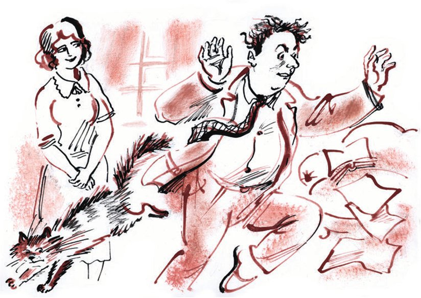
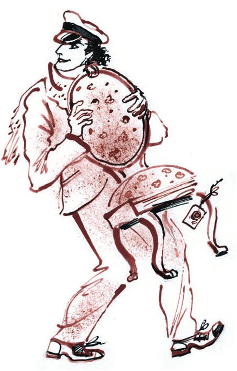

## Kapitel 26: Zwei Besuche

Awessalom Isnurenkow war in einem Zustand ewiger Unruhe, wie ein <abbr title="auswickeln — распеленать, развернуть">ausgewickeltes</abbr> <abbr title="das Wickelkind, die Wickelkinder — младенец в пелёнках, малютка">Wickelkind</abbr>. So ein Kind öffnet und schließt ohne eine Sekunde Pause seine kleinen <abbr title="das Fäustchen, die Fäustchen — кулачок">Fäustchen</abbr> aus Wachs, bewegt die <abbr title="das Beinchen, die Beinchen — ножка">Beinchen</abbr>, dreht sein Köpfchen mit <abbr title="das Häubchen, die Häubchen — чепчик">Häubchen</abbr>, das so groß ist wie ein großer Antonowka-Apfel, und bläst <abbr title="die Blase, die Blasen — пузырь">Blasen</abbr> aus dem Mund. Genauso bewegte Isnurenkow seine rundlichen Beinchen, drehte sein <abbr title="rasiert — выбритый">rasiertes</abbr> Kinn, stieß Achs aus und machte mit seinen haarigen Armen solche Bewegungen, als würde er mit <abbr title="das Gummiband, die Gummibänder — резинка">Gummibändern</abbr> <abbr title="die Gymnastik — гимнастика">Gymnastik</abbr> machen.

Er führte ein sehr hektisches Leben. Überall tauchte er auf und schlug etwas vor. Er raste wie ein erschrockenes Huhn über die Straße und redete schnell und laut, als würde er die Versicherung für ein steinernes Gebäude mit <abbr title="das Blechdach, die Blechdächer — железная крыша">Blechdach</abbr> ausrechnen. Das <abbr title="das Wesen — сущность">Wesen</abbr> seines Lebens und seiner Tätigkeit bestand darin, dass er sich <abbr title="von Natur aus — органически, от природы">von Natur aus</abbr> mit keiner Sache, keinem Gegenstand und keinem Gedanken länger als eine Minute beschäftigen konnte.

Wenn ein Witz nicht gefiel und nicht sofort Lachen <abbr title="hervorrufen (rief hervor, hat hervorgerufen) — вызывать">hervorrief</abbr>, dann <abbr title="überzeugen — убеждать">überzeugte</abbr> Isnurenkow den Redakteur nicht, wie die anderen, dass der Witz gut sei und man nur ein bisschen nachdenken müsse, um ihn ganz zu <abbr title="würdigen — оценить по достоинству">würdigen</abbr>. Er bot sofort einen neuen Witz an.

— Was schlecht ist, ist schlecht, — sagte er. — <abbr title="erledigt — кончено">Erledigt</abbr>.

In den Geschäften machte Awessalom Wladimirowitsch so ein Durcheinander, er erschien und verschwand so schnell vor den Augen der verblüfften Verkäufer und kaufte so <abbr title="stürmisch — бурно, экспансивно">stürmisch</abbr> eine <abbr title="die Schachtel, die Schachteln — коробка">Schachtel</abbr> <abbr title="die Praline, die Pralinen — шоколадная конфета">Pralinen</abbr>, dass die <abbr title="die Kassiererin, die Kassiererinnen — кассирша">Kassiererin</abbr> mindestens dreißig Rubel von ihm erwartete. Aber Isnurenkow <abbr title="tänzeln — пританцовывать">tänzelte</abbr> vor der Kasse herum, griff nach seiner Krawatte, als würde man ihn würgen, warf einen zerknitterten Dreirubelschein auf das Glasbrettchen und lief, dankbar meckernd, davon.

Wenn dieser Mensch sich auch nur für zwei Stunden hätte bremsen können, wären die unerwartetsten Dinge passiert. Vielleicht hätte Isnurenkow sich an den Tisch gesetzt und eine wunderbare <abbr title="die Erzählung, die Erzählungen — повесть, рассказ">Erzählung</abbr> geschrieben. Vielleicht aber auch einen Antrag an die Hilfskasse auf einen Kredit, den man nicht <abbr title="zurückzahlen — возвращать (долг)">zurückzahlen</abbr> muss, oder einen neuen <abbr title="der Paragraf, die Paragrafen — пункт, параграф">Paragrafen</abbr> zum Gesetz über die Nutzung von <abbr title="der Wohnraum — жилплощадь">Wohnraum</abbr>, oder das Buch «Die Kunst, sich gut zu kleiden und sich in der Gesellschaft zu benehmen».

Aber das konnte er nicht. Seine wild arbeitenden Beine trugen ihn fort, aus seinen zappelnden Händen flog der Bleistift wie ein <abbr title="der Pfeil, die Pfeile — стрела">Pfeil</abbr>, die Gedanken sprangen hin und her.

Isnurenkow rannte durch das Zimmer, und die Siegel an den Möbeln zitterten wie die Ohrringe einer tanzenden <abbr title="die Zigeunerin, die Zigeunerinnen — цыганка">Zigeunerin</abbr>. Auf dem Stuhl saß ein kicherndes Mädchen aus der Vorstadt.

— Ach, ach, — rief Awessalom Wladimirowitsch, — <abbr title="göttlich — божественно">göttlich</abbr>! «Die Zarin belebt mit Stimm' und Blicken ihr prächtiges Gelage…» Ach, ach! Erste Klasse!.. Sie sind die Königin Margot.

Die Königin aus der Vorstadt verstand von alldem nichts und lachte respektvoll.

— Na, essen Sie doch Pralinen, na, ich bitte Sie!.. Ach, ach!.. Bezaubernd!

Jede Minute küsste er der Königin die Hände, <abbr title="schwärmen von + Dat. — восторгаться">schwärmte</abbr> von ihrem bescheidenen Kleid, <abbr title="jemandem etwas in die Hand drücken — совать кому-то что-то">drückte</abbr> ihr den Kater in die Hand und fragte unterwürfig:

— Nicht wahr, er sieht aus wie ein Papagei? Ein Löwe! Ein Löwe! Ein echter Löwe! Sagen Sie, ist er nicht wirklich außerordentlich flauschig?.. Und der Schwanz! Der Schwanz! Sagen Sie, ist das wirklich ein großer Schwanz? Ach!

Dann flog der Kater in die Ecke, und Awessalom Wladimirowitsch drückte die Hände an seine pummelige, milchweiße Brust und begann, sich mit jemandem durch das Fenster zu verbeugen. Plötzlich klickte in seinem verrückten Kopf irgendein <abbr title="das Ventil, die Ventile — клапан">Ventil</abbr>, und er begann herausfordernde Witze über die körperlichen und seelischen <abbr title="die Eigenschaft, die Eigenschaften — качество, свойство">Eigenschaften</abbr> seines Gastes zu machen:

— Sagen Sie, ist diese Brosche wirklich aus Glas? Ach! Ach! Was für ein Glanz!.. Sie haben mich geblendet, Ehrenwort!.. Und sagen Sie, ist Paris wirklich eine große Stadt? Gibt es dort wirklich den Eiffelturm?.. Ach! Ach!.. Was für Hände!.. Was für eine Nase!.. Ach!..

Er umarmte das Mädchen nicht. Es <abbr title="genügen — быть достаточным">genügte</abbr> ihm, ihr Komplimente zu machen. Und er machte sie ununterbrochen. Der Strom der Komplimente wurde durch Ostaps Besuch unterbrochen.

Der große Kombinator drehte einen Zettel in den Händen und fragte streng:

— Wohnt hier Isnurenkow? Sind Sie das?

Awessalom Wladimirowitsch sah besorgt in das steinerne Gesicht des Besuchers. In seinen Augen versuchte er zu lesen, welche Forderungen man jetzt an ihn stellen würde: War es eine <abbr title="die Geldstrafe, die Geldstrafen — штраф">Geldstrafe</abbr> für die Scheibe, die er bei einem Gespräch in der Straßenbahn zerbrochen hatte, eine <abbr title="die Vorladung, die Vorladungen — повестка">Vorladung</abbr> vor das <abbr title="das Volksgericht, die Volksgerichte — народный суд, нарсуд">Volksgericht</abbr>, weil er die Miete nicht bezahlt hatte, oder ein <abbr title="das Abonnement, die Abonnements — подписка">Abonnement</abbr> für eine Zeitschrift für <abbr title="der Blinde, die Blinden — слепой">Blinde</abbr>?

— Was soll denn das, Genosse, — sagte Bender hart, — das geht doch nicht, einen staatlichen Boten <abbr title="fortjagen — прогонять">fortzujagen</abbr>.

— Was für einen Boten? — fragte Isnurenkow entsetzt.

— Das wissen Sie selbst. Ich hole jetzt die Möbel ab. Ich bitte Sie, Bürgerin, den Stuhl <abbr title="freimachen — освобождать">freizumachen</abbr>.

Die Bürgerin, über deren Kopf man gerade noch Gedichte der <abbr title="lyrisch — лирический">lyrischsten</abbr> Dichter gelesen hatte, stand auf.

— Nein! Bleiben Sie sitzen! — schrie Isnurenkow und <abbr title="decken — закрывать, прикрывать">deckte</abbr> den Stuhl mit seinem Körper. — Die haben kein Recht dazu!

— Über Rechte würde ich an Ihrer Stelle schweigen, Bürger. Man muss <abbr title="bewusst — сознательный">bewusst</abbr> sein. Machen Sie die Möbel frei! Man muss das Gesetz <abbr title="einhalten (hielt ein, hat eingehalten) — соблюдать">einhalten</abbr>!

Mit diesen Worten packte Ostap den Stuhl und schüttelte ihn in der Luft.

— Ich nehme die Möbel mit! — erklärte Bender entschlossen.

— Nein, Sie nehmen sie nicht mit!

— Und ob ich sie mitnehme, — grinste Ostap und ging mit dem Stuhl auf den Flur.

Awessalom küsste der Königin die Hand und lief mit gesenktem Kopf hinter dem strengen <abbr title="der Richter, die Richter — судья">Richter</abbr> her. Der ging schon die Treppe hinunter.

— Und ich sage Ihnen, dass Sie kein Recht dazu haben. Nach dem Gesetz dürfen die Möbel zwei Wochen stehen, und sie haben nur drei Tage gestanden! Vielleicht bezahle ich ja!

Isnurenkow <abbr title="kreisen um + Akk. — виться вокруг">kreiste</abbr> um Ostap wie eine Biene. Auf diese Weise kamen beide auf die Straße. Awessalom Wladimirowitsch lief dem Stuhl bis zur Ecke nach. Dort sah er Spatzen, die um einen <abbr title="der Misthaufen, die Misthaufen — навозная куча">Misthaufen</abbr> herumhüpften. Er sah sie mit <abbr title="verklärt — просветлённый">verklärten</abbr> Augen an, murmelte etwas, schlug die Hände zusammen, <abbr title="in Lachen ausbrechen (brach aus, ist ausgebrochen) — заливаться смехом">brach in Lachen aus</abbr> und sagte:

— Erste Klasse! Ach! Ach!.. Was für eine Wendung des Themas!..

Isnurenkow war ganz von der <abbr title="die Ausarbeitung — разработка">Ausarbeitung</abbr> des Themas <abbr title="gefesselt — увлечённый, захваченный">gefesselt</abbr>. Fröhlich drehte er um und hüpfte nach Hause. An den Stuhl dachte er erst zu Hause wieder, als er das Mädchen aus der Vorstadt mitten im Zimmer stehen sah.

Ostap brachte den Stuhl mit einer Droschke weg.

— Lernen Sie, — sagte er zu Ippolit Matwejewitsch, — der Stuhl wurde mit bloßen Händen genommen. Umsonst. Verstehen Sie?

Die Einrichtung von Iwanopulos Zimmer wurde um noch einen Stuhl größer. Nachdem man den Stuhl geöffnet hatte, wurde Ippolit Matwejewitsch traurig.

— Die Chancen werden immer größer, — sagte Ostap, — aber Geld haben wir keine Kopeke. Sagen Sie, hat Ihre verstorbene Schwiegermutter nicht gern Scherze gemacht?

— Wieso denn?

— Vielleicht gibt es gar keine Brillanten?

Ippolit Matwejewitsch <abbr title="fuchteln mit + Dat. — размахивать">fuchtelte</abbr> so mit den Armen, dass sein Jackett nach oben rutschte.

— Dann ist ja alles wunderbar. Hoffen wir, dass Iwanopulos <abbr title="der Besitz — достояние, имущество">Besitz</abbr> nur noch um einen einzigen Stuhl größer wird.

— Über Sie, Genosse Bender, hat man heute in der Zeitung geschrieben, — sagte Ippolit Matwejewitsch unterwürfig.

Ostap <abbr title="die Stirn runzeln — хмуриться">runzelte die Stirn</abbr>. Er mochte es nicht, wenn die Presse ein Geheul um seinen Namen machte.

— Was <abbr title="faseln — молоть (вздор)">faseln</abbr> Sie da? In welcher Zeitung?

Ippolit Matwejewitsch <abbr title="auffalten — разворачивать">faltete</abbr> triumphierend «Die Werkbank» auf.

— Hier. In der Rubrik «Was am Tag geschah».

Ostap beruhigte sich etwas, denn er fürchtete nur Notizen in den <abbr title="entlarvend — разоблачительный">entlarvenden</abbr> Rubriken: «Unsere <abbr title="der Nadelstich, die Nadelstiche — шпилька, укол">Nadelstiche</abbr>» und «<abbr title="der Missbraucher, die Missbraucher — злоупотребитель">Missbraucher</abbr> vor Gericht!».

Tatsächlich stand in der Rubrik «Was am Tag geschah» in winziger Schrift:

UNTER EIN PFERD GERATEN. Gestern geriet auf dem Swerdlow-Platz Bürger O. Bender unter das Pferd des Droschkenkutschers Nr. 8974.

Der Verletzte <abbr title="mit dem Schrecken davonkommen (kam davon, ist davongekommen) — отделаться лёгким испугом">kam mit dem Schrecken davon</abbr>.

— Der Kutscher ist mit dem Schrecken davongekommen, nicht ich, — bemerkte O. Bender mürrisch. — Idioten! Sie schreiben und schreiben und wissen selbst nicht, was sie schreiben. Ach! Das ist «Die Werkbank»? Sehr, sehr angenehm. Wissen Sie, Worobjaninow, dass diese Notiz vielleicht jemand geschrieben hat, der auf unserem Stuhl saß? Eine lustige Geschichte!

Der große Kombinator <abbr title="in Gedanken versinken (versank, ist versunken) — задуматься">versank in Gedanken</abbr>.

Ein Vorwand für einen Besuch in der Redaktion war gefunden.

Ostap <abbr title="sich erkundigen bei + Dat. — осведомляться, справляться у">erkundigte sich</abbr> beim Sekretär und erfuhr, dass alle Zimmer rechts und links auf der ganzen Länge des Flurs zur Redaktion gehörten. Dann setzte er ein einfältiges Gesicht auf und machte eine Runde durch die Räume der Redaktion: Er musste herausfinden, in welchem Zimmer der Stuhl stand.

Er <abbr title="hereinplatzen — влезть, ворваться">platzte</abbr> in den <abbr title="der Betriebsrat, die Betriebsräte — местком">Betriebsrat</abbr> herein, wo schon die Sitzung der jungen Autofahrer lief. Weil er sofort sah, dass dort kein Stuhl war, zog er in den nächsten Raum weiter. Im Kontor tat er so, als würde er auf einen <abbr title="der Bescheid, die Bescheide — резолюция, решение">Bescheid</abbr> warten. In der Abteilung der Arbeiterkorrespondenten fragte er, wo hier laut Anzeige <abbr title="das Altpapier — макулатура">Altpapier</abbr> verkauft werde. Im Sekretariat erkundigte er sich nach den Bedingungen für ein Abonnement, und im Zimmer der Feuilletonisten fragte er, wo man Anzeigen über verlorene Dokumente aufgibt.

Auf diese Weise kam er bis zum Zimmer des Chefredakteurs. Der saß auf dem Konzessionsstuhl und <abbr title="trompeten — трубить">trompetete</abbr> in den <abbr title="der Telefonhörer, die Telefonhörer — телефонная трубка">Telefonhörer</abbr>.

Ostap brauchte Zeit, um das <abbr title="das Gelände — местность">Gelände</abbr> genau zu studieren.

— Hier, Genosse Chefredakteur, hat man über mich eine richtige <abbr title="die Verleumdung, die Verleumdungen — клевета">Verleumdung</abbr> gedruckt, — sagte Bender.

— Was für eine Verleumdung? — fragte der Chefredakteur.

Ostap faltete sein <abbr title="das Exemplar, die Exemplare — экземпляр">Exemplar</abbr> der «Werkbank» lange auseinander. Dabei sah er sich nach der Tür um und entdeckte daran ein amerikanisches Schloss. Wenn man ein Stückchen Glas aus der Tür <abbr title="herausschneiden (schnitt heraus, hat herausgeschnitten) — вырезать">herausschnitt</abbr>, konnte man leicht die Hände <abbr title="durchstecken — просовывать">durchstecken</abbr> und das Schloss von innen öffnen.

Der Chefredakteur las die Notiz, die Ostap ihm zeigte.

— Und wo sehen Sie hier eine Verleumdung, Genosse?

— Na hier! Das hier: «Der Verletzte kam mit dem Schrecken davon.»

— Das verstehe ich nicht.

Ostap sah freundlich auf den Chefredakteur und auf den Stuhl.

— Als ob ich vor so einem Kutscher erschrecken würde! Vor der ganzen Welt hat man mich blamiert – ich brauche eine <abbr title="die Richtigstellung, die Richtigstellungen — опровержение">Richtigstellung</abbr>.

— Hören Sie, Bürger, — sagte der Chefredakteur, — niemand hat Sie blamiert, und bei solchen <abbr title="die Lappalie, die Lappalien — пустяк">Lappalien</abbr> drucken wir keine Richtigstellungen.

— Na, egal, so lasse ich die Sache nicht <abbr title="etwas auf sich beruhen lassen — оставить что-то так">auf sich beruhen</abbr>, — sagte Ostap und verließ das <abbr title="das Arbeitszimmer, die Arbeitszimmer — кабинет">Arbeitszimmer</abbr>.

Er hatte schon alles gesehen, was er brauchte.

---

### Neue Wörter

- **auswickeln** — распеленать, развернуть
- **das Wickelkind, die Wickelkinder** — младенец в пелёнках, малютка
- **das Fäustchen, die Fäustchen** — кулачок
- **das Beinchen, die Beinchen** — ножка
- **das Häubchen, die Häubchen** — чепчик
- **die Blase, die Blasen** — пузырь
- **rasiert** — выбритый
- **das Gummiband, die Gummibänder** — резинка
- **die Gymnastik** — гимнастика
- **das Blechdach, die Blechdächer** — железная крыша
- **das Wesen** — сущность
- **von Natur aus** — органически, от природы
- **hervorrufen (rief hervor, hat hervorgerufen)** — вызывать
- **überzeugen** — убеждать
- **würdigen** — оценить по достоинству
- **erledigt** — кончено
- **stürmisch** — бурно, экспансивно
- **die Schachtel, die Schachteln** — коробка
- **die Praline, die Pralinen** — шоколадная конфета
- **die Kassiererin, die Kassiererinnen** — кассирша
- **tänzeln** — пританцовывать
- **die Erzählung, die Erzählungen** — повесть, рассказ
- **zurückzahlen** — возвращать (долг)
- **der Paragraf, die Paragrafen** — пункт, параграф
- **der Wohnraum** — жилплощадь
- **der Pfeil, die Pfeile** — стрела
- **die Zigeunerin, die Zigeunerinnen** — цыганка
- **göttlich** — божественно
- **schwärmen von + Dat.** — восторгаться
- **jemandem etwas in die Hand drücken** — совать кому-то что-то
- **das Ventil, die Ventile** — клапан
- **die Eigenschaft, die Eigenschaften** — качество, свойство
- **genügen** — быть достаточным
- **die Geldstrafe, die Geldstrafen** — штраф
- **die Vorladung, die Vorladungen** — повестка
- **das Volksgericht, die Volksgerichte** — народный суд, нарсуд
- **das Abonnement, die Abonnements** — подписка
- **der Blinde, die Blinden** — слепой
- **fortjagen** — прогонять
- **freimachen** — освобождать
- **lyrisch** — лирический
- **decken** — закрывать, прикрывать
- **bewusst** — сознательный
- **einhalten (hielt ein, hat eingehalten)** — соблюдать
- **der Richter, die Richter** — судья
- **kreisen um + Akk.** — виться вокруг
- **der Misthaufen, die Misthaufen** — навозная куча
- **verklärt** — просветлённый
- **in Lachen ausbrechen (brach aus, ist ausgebrochen)** — заливаться смехом
- **die Ausarbeitung** — разработка
- **gefesselt** — увлечённый, захваченный
- **fuchteln mit + Dat.** — размахивать
- **der Besitz** — достояние, имущество
- **die Stirn runzeln** — хмуриться
- **faseln** — молоть (вздор)
- **auffalten** — разворачивать
- **entlarvend** — разоблачительный
- **der Nadelstich, die Nadelstiche** — шпилька, укол
- **der Missbraucher, die Missbraucher** — злоупотребитель
- **mit dem Schrecken davonkommen (kam davon, ist davongekommen)** — отделаться лёгким испугом
- **in Gedanken versinken (versank, ist versunken)** — задуматься
- **sich erkundigen bei + Dat.** — осведомляться, справляться у
- **hereinplatzen** — влезть, ворваться
- **der Betriebsrat, die Betriebsräte** — местком
- **der Bescheid, die Bescheide** — резолюция, решение
- **das Altpapier** — макулатура
- **trompeten** — трубить
- **der Telefonhörer, die Telefonhörer** — телефонная трубка
- **das Gelände** — местность
- **die Verleumdung, die Verleumdungen** — клевета
- **das Exemplar, die Exemplare** — экземпляр
- **herausschneiden (schnitt heraus, hat herausgeschnitten)** — вырезать
- **durchstecken** — просовывать
- **die Richtigstellung, die Richtigstellungen** — опровержение
- **die Lappalie, die Lappalien** — пустяк
- **etwas auf sich beruhen lassen** — оставить что-то так
- **das Arbeitszimmer, die Arbeitszimmer** — кабинет

[← Kapitel 25](kapitel-25.md) · [Inhalt](README.md) · [Kapitel 27 →](kapitel-27.md)
