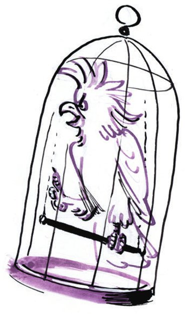
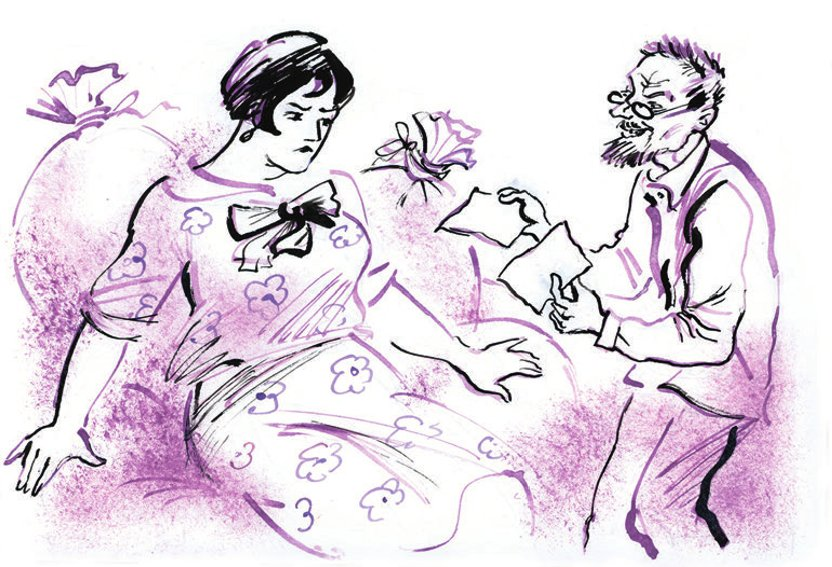

## Kapitel 27: Der wunderbare Gefängniskorb

Die Stargoroder Abteilung vom <abbr title="kurzlebig — эфемерный, недолговечный">kurzlebigen</abbr> Bund «Schwert und Pflug» stand zusammen mit den <abbr title="der flotte Bursche, die flotten Burschen — молодец, удалец">flotten Burschen</abbr> von der Firma «Schnellpack» in einer sehr langen Schlange vor dem <abbr title="das Mehllager, die Mehllager — мучной лабаз, склад">Mehllager</abbr> von «Brotprodukt». Die Passanten blieben stehen.

— Wofür steht man hier an? — fragten die Bürger.

In jeder langweiligen Schlange vor einem Laden gibt es einen Menschen, der viel redet. Und je weiter er von der Ladentür entfernt steht, desto mehr redet er. Am weitesten hinten stand Polessow.

— <abbr title="so weit ist es gekommen — дожились">So weit ist es gekommen</abbr>, — sagte der Feuerwehrhauptmann. — Bald essen wir alle nur noch <abbr title="der Ölkuchen, die Ölkuchen — жмых">Ölkuchen</abbr>. Sogar im Jahr neunzehn war es besser. Es gibt nur noch Mehl für vier Tage in der Stadt.

Die Bürger drehten misstrauisch an ihren Schnurrbärten, <abbr title="streiten (stritt, hat gestritten) — спорить">stritten</abbr> mit Polessow und <abbr title="sich berufen auf + Akk. (berief, hat berufen) — ссылаться на">beriefen sich auf</abbr> die Zeitung «Stargoroder Prawda». Sie bewiesen Polessow, so klar wie zwei mal zwei vier ist, dass es in der Stadt Mehl <abbr title="in Hülle und Fülle — сколько угодно, в изобилии">in Hülle und Fülle</abbr> gab und dass man keine <abbr title="die Panik — паника">Panik</abbr> machen sollte. Dann liefen die Bürger nach Hause, nahmen all ihr <abbr title="das Bargeld — наличные деньги">Bargeld</abbr> und stellten sich auch in die Mehlschlange.

Die flotten Burschen von «Schnellpack» kauften das ganze Mehl im Lager. Danach gingen sie zu den Lebensmitteln über und bildeten eine Tee-und-Zucker-Schlange.

In drei Tagen war Stargorod von einer <abbr title="die Versorgungskrise, die Versorgungskrisen — продовольственный кризис">Versorgungskrise</abbr> erfasst. Die Vertreter der Genossenschaften und des staatlichen Handels machten einen Vorschlag: Bis die neuen Lebensmittel <abbr title="eintreffen (traf ein, ist eingetroffen) — прибывать">eintreffen</abbr>, sollte jeder Mensch nur ein <abbr title="das Pfund, die Pfunde — фунт">Pfund</abbr> Zucker und fünf Pfund Mehl bekommen.

Schon am nächsten Tag wurde ein <abbr title="das Gegengift, die Gegengifte — противоядие">Gegengift</abbr> erfunden.

Als Erster in der Zuckerschlange stand Alchen. Hinter ihm stand seine Frau Saschchen, dann Pascha Emiljewitsch, die vier Jakowlewitschs und alle fünfzehn alten Frauen aus dem Altersheim in ihren Kleidern aus Toile-de-Nord. So <abbr title="aus etwas pumpen — выкачать">pumpten</abbr> sie ein halbes Pud Zucker aus dem Laden von Stargiko. Dann führte Alchen seine Schlange zu einer anderen Genossenschaft. Unterwegs schimpfte er auf Pascha Emiljewitsch, denn der hatte seinen Teil – ein Pfund <abbr title="der Streuzucker — сахарный песок">Streuzucker</abbr> – schon verschlungen. Pascha schüttete sich den Zucker wie einen kleinen Berg auf die Handfläche und schickte ihn in sein breites <abbr title="das Maul, die Mäuler — пасть">Maul</abbr>. Alchen hatte den ganzen Tag viel zu tun. Damit nichts verloren ging, nahm er Pascha Emiljewitsch aus der Schlange und ließ ihn die gekauften Sachen zum Markt schleppen. Dort verkaufte Alchen schüchtern den Zucker, das Mehl, den Tee und den Musselin an private Läden weiter.

Polessow stand vor allem aus Prinzip in den Schlangen. Er hatte kein Geld und konnte sowieso nichts kaufen. Er wanderte von Schlange zu Schlange, hörte den Gesprächen zu, machte bissige Bemerkungen, hob bedeutungsvoll die <abbr title="die Augenbraue, die Augenbrauen — бровь">Augenbrauen</abbr> und <abbr title="prophezeien — пророчествовать">prophezeite</abbr>. Seine <abbr title="die Andeutung, die Andeutungen — намёк, недомолвка">Andeutungen</abbr> hatten eine Folge: Bald war die ganze Stadt voller Gerüchte. Man erzählte, eine geheime Organisation sei aus Schwerte und Pflugdorf angereist.

Gouverneur Djadjew verdiente an einem einzigen Tag zehntausend Rubel. Wie viel der Vorsitzende des Börsenkomitees, Kisljarski, verdiente, wusste nicht einmal seine Frau.

Aber Kisljarski fand keine Ruhe. Er gehörte doch zu einer <abbr title="die Geheimgesellschaft, die Geheimgesellschaften — тайное общество">Geheimgesellschaft</abbr>! Die Gerüchte in der Stadt machten ihm schreckliche Angst. Er lag eine ganze Nacht <abbr title="schlaflos — бессонный">schlaflos</abbr> im Bett. Dann beschloss der Vorsitzende des Börsenkomitees: Nur ein ehrliches <abbr title="das Geständnis, die Geständnisse — признание">Geständnis</abbr> konnte seine Zeit im Gefängnis <abbr title="verkürzen — сократить">verkürzen</abbr>.

— Hör mal, Henrietta, — sagte er zu seiner Frau, — es ist Zeit, die Stoffe zu deinem Bruder zu bringen.

— Was denn, kommen sie etwa? — fragte Henrietta Kisljarskaja.

— Sie können kommen. Wenn es im Land keine Freiheit des Handels gibt, dann muss ich ja irgendwann einmal <abbr title="sitzen (saß, hat gesessen) — сидеть (в тюрьме)">sitzen</abbr>, oder?

— Soll ich also schon die Wäsche bereitlegen? Mein <abbr title="unglücklich — несчастный">unglückliches</abbr> Leben! Immer muss ich Pakete ins Gefängnis tragen. Warum wirst du nicht einfach ein sowjetischer <abbr title="der Angestellte, die Angestellten — служащий">Angestellter</abbr>? Mein Bruder ist Mitglied in der Gewerkschaft, und ihm passiert nichts! Aber du musst ja unbedingt ein roter Kaufmann sein!

Henrietta wusste nicht, dass das Schicksal ihren Mann zum Vorsitzenden des Börsenkomitees gemacht hatte. Deshalb war sie ruhig.

— Vielleicht komme ich heute nicht zum Schlafen nach Hause, — sagte Kisljarski. — Dann bringst du mir morgen ein Paket. Aber bitte keine <abbr title="die Wareniki (Pl.) — вареники">Wareniki</abbr>. Was habe ich davon, kalte Wareniki zu essen?

— Willst du vielleicht den Primuskocher mitnehmen?

— Na klar, als ob sie mir in der Zelle einen Primuskocher erlauben! Gib mir meinen Korb.

Kisljarski hatte einen speziellen Gefängniskorb. Er war <abbr title="auf Bestellung — на заказ">auf Bestellung</abbr> gemacht und konnte wirklich alles. <abbr title="aufklappen — раскрывать">Aufgeklappt</abbr> war er ein Bett, halb aufgeklappt ein kleiner Tisch. Außerdem war er ein Schrank: Er hatte kleine Regale, <abbr title="der Haken, die Haken — крючок">Haken</abbr> und Schubladen. Die Frau legte ein kaltes Abendessen und frische Wäsche in den <abbr title="der Allzweckkorb, die Allzweckkörbe — универсальная корзина">Allzweckkorb</abbr>.

— Du musst mich nicht begleiten, — sagte der erfahrene Ehemann. — Wenn Rubens wegen dem Geld kommt, sag ihm, es gibt kein Geld. Auf Wiedersehen! Rubens kann warten.

Und Kisljarski ging würdevoll auf die Straße. Den Gefängniskorb trug er am <abbr title="der Henkel, die Henkel — ручка (корзины)">Henkel</abbr>.

— Wohin gehen Sie, Bürger Kisljarski? — rief Polessow.

Er stand an einem Telegrafenmast und <abbr title="anfeuern — подбадривать">feuerte</abbr> mit lauten Rufen einen Arbeiter von der Post an. Der Arbeiter kletterte mit eisernen <abbr title="das Steigeisen, die Steigeisen — монтёрские «когти»">Steigeisen</abbr> den Mast hinauf zu den <abbr title="der Isolator, die Isolatoren — изолятор">Isolatoren</abbr>.

— Ich gehe gestehen, — antwortete Kisljarski.

— Was denn?

— Das Schwert und den Pflug.

Viktor Michailowitsch <abbr title="es verschlägt jemandem die Sprache — лишиться дара речи">verschlug es die Sprache</abbr>. Kisljarski aber streckte seinen kleinen Bauch nach vorne, der aussah wie ein Ei. Um den Bauch trug er einen breiten <abbr title="der Sommergürtel, die Sommergürtel — дачный пояс">Sommergürtel</abbr> mit einer kleinen Tasche für die Uhr. So ging er ohne Eile zur <abbr title="die Gouvernementsstaatsanwaltschaft — губпрокуратура">Gouvernementsstaatsanwaltschaft</abbr>.

Viktor Michailowitsch <abbr title="mit den Flügeln schlagen — хлопать крыльями">schlug mit den Flügeln</abbr> und flog zu Djadjew.

— Kisljarski ist ein <abbr title="der Provokateur, die Provokateure — провокатор">Provokateur</abbr>! — schrie der Feuerwehrhauptmann. — Er ist gerade losgegangen, um uns zu verraten. Man kann ihn noch sehen.

— Was? Hat er auch den Korb dabei? — fragte der Stargoroder Gouverneur entsetzt.

— Hat er.

Djadjew küsste seine Frau und rief: «Wenn Rubens kommt, gib ihm kein Geld!» Dann rannte er Hals über Kopf auf die Straße.

Viktor Michailowitsch drehte sich im Kreis und stöhnte wie ein Huhn, das gerade ein Ei gelegt hat. Dann lief er zu Wladja und Nikescha.

Inzwischen <abbr title="spazieren — прогуливаться">spazierte</abbr> Bürger Kisljarski langsam auf die Staatsanwaltschaft zu. Unterwegs traf er Rubens und sprach lange mit ihm.

— Und was ist mit dem Geld? — fragte Rubens.

— Wegen dem Geld gehen Sie zu meiner Frau.

— Und warum haben Sie einen Korb dabei? — fragte Rubens misstrauisch.

— Ich gehe ins <abbr title="das Badehaus, die Badehäuser — баня">Badehaus</abbr>.

— Na dann, viel Spaß im <abbr title="der Dampf — пар">Dampf</abbr>!

Dann ging Kisljarski in die <abbr title="die Konditorei, die Konditoreien — кондитерская">Konditorei</abbr> der Genossenschaft, die früher «Bonbons de Varsovie» geheißen hatte. Er trank <abbr title="genüsslich — с удовольствием, смакуя">genüsslich</abbr> ein Glas Kaffee und aß ein Stück <abbr title="der Blätterteig — слоёное тесто">Blätterteig</abbr>. Dann war es Zeit, <abbr title="Buße tun — каяться">Buße zu tun</abbr>. Der Vorsitzende des Börsenkomitees betrat den <abbr title="der Warteraum, die Warteräume — приёмная">Warteraum</abbr> der Staatsanwaltschaft. Dort war niemand. Kisljarski ging zu einer Tür. Auf der Tür stand: «Gouvernementsstaatsanwalt». Er klopfte höflich.

— Herein! — antwortete eine Stimme, die Kisljarski sehr gut kannte.

Kisljarski ging hinein und blieb verblüfft stehen. Sein kleiner Eierbauch fiel sofort <abbr title="zusammenfallen (fiel zusammen, ist zusammengefallen) — опасть, осесть">zusammen</abbr> und wurde runzlig wie eine <abbr title="die Dattel, die Datteln — финик">Dattel</abbr>. Das, was er sah, war eine völlige Überraschung für ihn.

Um den Schreibtisch des Staatsanwalts standen die Mitglieder der mächtigen Organisation «Schwert und Pflug». Man hörte es an ihren Gesten und ihren <abbr title="weinerlich — плаксивый">weinerlichen</abbr> Stimmen: Sie gestanden alles.

— Da ist er, — rief Djadjew, — der Anführer, der Oktobrist!

— Erstens, — sagte Kisljarski, stellte den Gefängniskorb auf den Boden und kam näher an den Tisch, — erstens bin ich kein Oktobrist. Zweitens war ich immer für die Sowjetmacht. Und drittens bin nicht ich der Anführer, sondern Genosse Tscharuschnikow, seine Adresse ist …

— Rotarmistenstraße! — schrie Djadjew.

— Nummer drei! — riefen Wladja und Nikescha im Chor.

— In den Hof und dann links, — fügte Viktor Michailowitsch hinzu. — Ich kann es Ihnen zeigen.

Zwanzig Minuten später brachte man Tscharuschnikow. Als Erstes erklärte er, dass er keinen der Anwesenden in seinem ganzen Leben je gesehen hatte. Gleich danach, ohne jede Pause, zeigte Tscharuschnikow Jelena Stanislawowna an.

Erst in der Zelle, als er die Wäsche gewechselt und sich auf seinem Gefängniskorb <abbr title="sich ausstrecken — растянуться">ausgestreckt</abbr> hatte, fühlte sich der Vorsitzende des Börsenkomitees leicht und ruhig.

Madame Grizazujewa-Bender hatte während der Krise genug Lebensmittel und Waren für ihren kleinen Laden gekauft, mindestens für vier Monate. Jetzt war sie ruhiger und wurde wieder traurig wegen ihres jungen <abbr title="der Gatte, die Gatten — супруг">Gatten</abbr>. Der <abbr title="schmachten — томиться">schmachtete</abbr> ja angeblich in den Sitzungen des Kleinen <abbr title="der Rat der Volkskommissare — Совнарком">Rates der Volkskommissare</abbr>. Ein Besuch bei der Wahrsagerin brachte ihr keine Ruhe.

Jelena Stanislawowna war beunruhigt, weil der ganze Stargoroder <abbr title="der Areopag — ареопаг (высокое собрание)">Areopag</abbr> plötzlich verschwunden war. Sie legte die Karten mit empörender <abbr title="die Nachlässigkeit — небрежность">Nachlässigkeit</abbr>. Die Karten verkündeten mal das Ende der Welt, mal eine <abbr title="die Gehaltserhöhung, die Gehaltserhöhungen — прибавка к жалованью">Gehaltserhöhung</abbr>, mal ein Treffen mit dem Ehemann in einem staatlichen Haus, und zwar <abbr title="in Anwesenheit + Gen. — в присутствии">in Anwesenheit</abbr> eines Feindes – des <abbr title="das Pik — пики (масть)">Pik</abbr>-Königs.

Und auch das Kartenlegen selbst endete irgendwie seltsam. Es kamen Agenten – lauter Pik-Könige – und brachten die <abbr title="die Hellseherin, die Hellseherinnen — прорицательница">Hellseherin</abbr> ins staatliche Haus, zum Staatsanwalt.

Die Witwe blieb allein mit dem Papagei. Verwirrt wollte sie gerade gehen, als der Papagei plötzlich mit dem <abbr title="der Schnabel, die Schnäbel — клюв">Schnabel</abbr> gegen seinen Käfig schlug und zum ersten Mal in seinem Leben mit menschlicher Stimme sprach.

— So weit ist es gekommen! — sagte er <abbr title="höhnisch — сардонически, язвительно">höhnisch</abbr>, legte einen Flügel über den Kopf und zog sich eine kleine Feder unter dem Flügel heraus.

Madame Grizazujewa-Bender lief erschrocken zur Tür.

Hinter ihr her <abbr title="strömen — литься, струиться">strömte</abbr> eine heiße, wirre Rede. Der uralte Vogel war so erschüttert vom Besuch der Agenten und davon, dass man seine <abbr title="die Herrin, die Herrinnen — хозяйка">Herrin</abbr> ins staatliche Haus gebracht hatte, dass er alle Wörter schrie, die er kannte. Den größten Platz in seinem <abbr title="das Repertoire, die Repertoires — репертуар">Repertoire</abbr> hatte Viktor Michailowitsch Polessow.

— Bei Vorhandensein von Abwesenheit, — sagte der Vogel gereizt.

Dann drehte er sich auf seiner Stange mit dem Kopf nach unten und zwinkerte der Witwe zu, die erstarrt an der Tür stand. Das hieß wohl: «Na, wie gefällt Ihnen das, kleine Witwe?»

— Du meine Güte! — stöhnte die Grizazujewa.

— In welchem Regiment haben Sie gedient? — fragte der Papagei mit der Stimme von Bender. — Krrr-rrr-rach … Europa wird uns helfen.

Als die Witwe geflohen war, zupfte der Papagei an seinem <abbr title="der Hemdkragen, die Hemdkragen — манишка, воротничок">Hemdkragen</abbr> und sagte die Worte, die die Menschen dreißig Jahre lang vergeblich aus ihm herausholen wollten:

— Lora ist doof!

Die Witwe lief durch die Straßen und jammerte laut. Und zu Hause wartete ein <abbr title="zappelig — вертлявый">zappeliger</abbr> kleiner Alter auf sie. Das war Warfolomejitsch. Er war dünner geworden, seit seine Großmutter gestorben war.

— Ich komme wegen der Anzeige, — sagte Warfolomejitsch. — Ich warte schon zwei Stunden, Fräulein.

Der schwere Huf einer <abbr title="die Vorahnung, die Vorahnungen — предчувствие">Vorahnung</abbr> schlug der Grizazujewa ins Herz.

— Ach! — sang die Witwe. — Meine arme Seele hat sich so gequält!

— Bei Ihnen ist doch der Bürger Bender weggegangen? Haben Sie die Anzeige aufgegeben?

Die Witwe fiel auf die <abbr title="der Mehlsack, die Mehlsäcke — мешок с мукой">Mehlsäcke</abbr>.

— Was haben Sie für einen <abbr title="schwach — слабый">schwachen</abbr> Organismus, — sagte Warfolomejitsch süß. — Ich würde gern zuerst die Frage der Belohnung klären …

— Ach! Nehmen Sie alles! Mir ist jetzt nichts mehr <abbr title="schade — жалко">schade</abbr>! — jammerte die <abbr title="empfindsam — чувствительный">empfindsame</abbr> Witwe.

— Also dann. Ich weiß, wo sich Ihr <abbr title="das Söhnchen — сыночек">Söhnchen</abbr> O. Bender <abbr title="sich aufhalten (hielt sich auf, hat sich aufgehalten) — находиться, пребывать">aufhält</abbr>. Wie hoch ist die Belohnung?

— Nehmen Sie alles! — wiederholte die Witwe.

— Zwanzig Rubel, — sagte Warfolomejitsch <abbr title="trocken — сухо">trocken</abbr>.

Die Witwe stand von den Säcken auf. Sie war voller Mehl. Ihre <abbr title="bestäubt — запорошенный">bestäubten</abbr> <abbr title="die Wimper, die Wimpern — ресница">Wimpern</abbr> blinzelten heftig.

— Wie viel? — fragte sie noch einmal.

— Fünfzehn Rubel, — sagte Warfolomejitsch und ging mit dem Preis nach unten.

Er <abbr title="ahnen — чуять, предчувствовать">ahnte</abbr>, dass es schwer werden würde, auch nur drei Rubel aus der unglücklichen Frau herauszuholen.

Die Witwe <abbr title="trampeln — топтать">trampelte</abbr> über die Säcke und ging auf den Alten los. Sie rief die <abbr title="die himmlischen Mächte — небесная сила">himmlischen Mächte</abbr> als Zeugen an, und mit ihrer Hilfe <abbr title="erreichen — добиться">erreichte</abbr> sie einen <abbr title="der Festpreis — твёрдая цена">festen Preis</abbr>.

— Na gut, Gott sei mit Ihnen, dann eben fünf Rubel. Aber das Geld bitte im Voraus. Das ist bei mir so eine Regel.

Warfolomejitsch nahm aus seinem kleinen Notizbuch zwei <abbr title="der Zeitungsausschnitt, die Zeitungsausschnitte — газетная вырезка">Zeitungsausschnitte</abbr>. Er ließ sie nicht aus der Hand und las vor:

— Hier, sehen Sie bitte, schön der Reihe nach. Sie haben also geschrieben: «Ich <abbr title="anflehen / flehen — умолять">flehe</abbr> … Genosse Bender ist von zu Hause weggegangen … grüner Anzug, gelbe Schuhe, blaue Weste …» Richtig, oder? Das ist also die «Stargoroder Prawda». Und hier steht, was die Zeitungen in der <abbr title="die Hauptstadt, die Hauptstädte — столица">Hauptstadt</abbr> über Ihr Söhnchen schreiben. Hier … «Unter ein Pferd geraten …» Aber regen Sie sich nicht so auf, Madamchen, hören Sie weiter … «Unter ein Pferd geraten …» Er lebt doch, er lebt! Ich sage Ihnen, er lebt. Würde ich denn für einen <abbr title="der Tote, die Toten — покойник">Toten</abbr> Geld nehmen? Also: «Unter ein Pferd geraten. Gestern geriet auf dem Swerdlow-Platz der Bürger O. Bender unter das Pferd der Droschke Nr. 8974. Der <abbr title="der Verletzte, die Verletzten — пострадавший">Verletzte</abbr> kam mit dem Schrecken davon …» So, diese kleinen Dokumente gebe ich Ihnen, und Sie geben mir das Geld im Voraus. Das ist bei mir so eine Regel.

Weinend gab die Witwe ihm das Geld. Ihr Mann, ihr lieber Mann mit den gelben Schuhen, lag auf der fernen Moskauer Erde, und ein Feuer <abbr title="Feuer speien (spie, hat gespien) — огнедышащий">speiendes</abbr> Droschkenpferd schlug mit dem Huf auf seine blaue Brust aus Wolle.

Die feine Seele von Warfolomejitsch war mit der anständigen Belohnung zufrieden. Er ging und erklärte der Witwe noch, dass man weitere Spuren ihres Mannes bestimmt in der Redaktion der Zeitung «Die Werkbank» finden würde. Dort wusste man natürlich alles auf der Welt.

*Brief von Vater Fjodor, geschrieben in Rostow, in der <abbr title="die Heißwasserstube — водогрейня, кипятильня">Heißwasserstube</abbr> «Milchstraße», an seine Frau in der Kreisstadt N*

«Meine liebe Katja! Neuer Kummer hat mich getroffen, aber davon später. Das Geld habe ich ganz rechtzeitig bekommen, dafür danke ich Dir von Herzen. Als ich in Rostow ankam, lief ich sofort zu der Adresse. „Neurosszement“ ist eine sehr große <abbr title="die Behörde, die Behörden — учреждение">Behörde</abbr>, und niemand dort kannte einen Ingenieur Bruns. Ich war schon ganz verzweifelt, aber man gab mir einen Rat. Gehen Sie, sagte man, in die <abbr title="die Personalabteilung, die Personalabteilungen — отдел кадров, личный стол">Personalabteilung</abbr>, dort soll man in den Listen nachsehen. Ich ging also in die Personalabteilung. Ich fragte. „Ja, — sagte man mir, — so einer hat bei uns gearbeitet, er hat eine verantwortungsvolle Arbeit gemacht. Aber letztes Jahr ist er von uns weggegangen. Man hat ihn nach Baku <abbr title="abwerben (warb ab, hat abgeworben) — переманить">abgeworben</abbr>, zur Firma Asneft, für die <abbr title="die Arbeitssicherheit — техника безопасности">Arbeitssicherheit</abbr>.“

Nun, meine Liebe, meine Reise ist nicht so kurz, wie wir dachten. Du schreibst, dass das Geld <abbr title="zu Ende gehen — быть на исходе">zu Ende geht</abbr>. Da kann man nichts machen, Katerina Alexandrowna. Lange müssen wir nicht mehr warten. <abbr title="sich mit Geduld wappnen — вооружиться терпением">Wappne Dich mit Geduld</abbr>, bete zu Gott und verkaufe meine <abbr title="die Uniform, die Uniformen — мундир">Studentenuniform</abbr> aus <abbr title="der Diagonalstoff — диагональ (ткань)">Diagonalstoff</abbr>. Wir werden noch ganz andere Ausgaben haben. Sei auf alles <abbr title="gefasst sein auf + Akk. — быть готовым к">gefasst</abbr>.

Die <abbr title="die Teuerung — дороговизна">Teuerung</abbr> in Rostow ist schrecklich. Für das Zimmer im Hotel habe ich 2 Rubel 25 Kopeken bezahlt. Bis Baku reicht das Geld. Von dort <abbr title="telegrafieren — телеграфировать">telegrafiere</abbr> ich, wenn ich Glück habe.

Das Wetter hier ist heiß. Den Mantel trage ich über dem Arm. Im Zimmer habe ich Angst, ihn zu lassen – sonst wird er noch <abbr title="klauen — красть, воровать">geklaut</abbr>. Die Leute hier sind <abbr title="gerissen — ушлый, бедовый">gerissen</abbr>.

Die Stadt Rostow gefällt mir nicht. In der Zahl der <abbr title="die Bevölkerung — население">Bevölkerung</abbr> und in ihrer <abbr title="geografisch — географический">geografischen</abbr> Lage ist sie viel schlechter als Charkow. Aber macht nichts, Mütterchen, so Gott will, fahren wir einmal zusammen nach Moskau. Dann wirst Du sehen – eine ganz <abbr title="westeuropäisch — западноевропейский">westeuropäische</abbr> Stadt. Und danach leben wir in Samara, bei unserer kleinen Fabrik.

Ist Worobjaninow nicht zurückgekommen? Wo mag er sich jetzt herumtreiben? Isst Jewstignejew noch bei uns zu Mittag? Wie sieht meine <abbr title="die Soutane, die Soutanen — ряса">Soutane</abbr> nach der Reinigung aus? Alle Bekannten sollen weiter glauben, dass ich am <abbr title="das Sterbebett — смертное ложе, одр">Sterbebett</abbr> meiner Tante sitze. Schreib das Gleiche auch an Guljenka.

Ja! Fast hätte ich vergessen, Dir von einem schrecklichen <abbr title="der Vorfall, die Vorfälle — случай, происшествие">Vorfall</abbr> zu erzählen, der mir heute passiert ist.

Ich stand an der Brücke, bewunderte den stillen Don und träumte von unserem künftigen <abbr title="der Wohlstand — достаток">Wohlstand</abbr>. Da kam ein Wind auf und wehte die Schirmmütze Deines Bruders, des Bäckers, in den Fluss. Weg war sie. Ich musste wieder Geld ausgeben und eine englische Mütze für 2 Rubel 30 Kopeken kaufen. Deinem Bruder, dem Bäcker, erzähl nichts davon. Überzeuge ihn, dass ich in Woronesch bin.

Schlecht ist es mit der Wäsche. Abends wasche ich sie, und wenn sie nicht trocken wird, ziehe ich sie morgens feucht an. Bei der jetzigen <abbr title="die Hitze — жара">Hitze</abbr> ist das sogar angenehm.

Ich küsse und umarme Dich.

Dein ewiger Mann Fedja»

---

### Neue Wörter

- **kurzlebig** — эфемерный, недолговечный
- **der flotte Bursche, die flotten Burschen** — молодец, удалец
- **das Mehllager, die Mehllager** — мучной лабаз, склад
- **so weit ist es gekommen** — дожились
- **der Ölkuchen, die Ölkuchen** — жмых
- **streiten (stritt, hat gestritten)** — спорить
- **sich berufen auf + Akk. (berief, hat berufen)** — ссылаться на
- **in Hülle und Fülle** — сколько угодно, в изобилии
- **die Panik** — паника
- **das Bargeld** — наличные деньги
- **die Versorgungskrise, die Versorgungskrisen** — продовольственный кризис
- **eintreffen (traf ein, ist eingetroffen)** — прибывать
- **das Pfund, die Pfunde** — фунт
- **das Gegengift, die Gegengifte** — противоядие
- **aus etwas pumpen** — выкачать
- **der Streuzucker** — сахарный песок
- **das Maul, die Mäuler** — пасть
- **die Augenbraue, die Augenbrauen** — бровь
- **prophezeien** — пророчествовать
- **die Andeutung, die Andeutungen** — намёк, недомолвка
- **die Geheimgesellschaft, die Geheimgesellschaften** — тайное общество
- **schlaflos** — бессонный
- **das Geständnis, die Geständnisse** — признание
- **verkürzen** — сократить
- **sitzen (saß, hat gesessen)** — сидеть (в тюрьме)
- **unglücklich** — несчастный
- **der Angestellte, die Angestellten** — служащий
- **die Wareniki (Pl.)** — вареники
- **auf Bestellung** — на заказ
- **aufklappen** — раскрывать
- **der Haken, die Haken** — крючок
- **der Allzweckkorb, die Allzweckkörbe** — универсальная корзина
- **der Henkel, die Henkel** — ручка (корзины)
- **anfeuern** — подбадривать
- **das Steigeisen, die Steigeisen** — монтёрские «когти»
- **der Isolator, die Isolatoren** — изолятор
- **es verschlägt jemandem die Sprache** — лишиться дара речи
- **der Sommergürtel, die Sommergürtel** — дачный пояс
- **die Gouvernementsstaatsanwaltschaft** — губпрокуратура
- **mit den Flügeln schlagen** — хлопать крыльями
- **der Provokateur, die Provokateure** — провокатор
- **spazieren** — прогуливаться
- **das Badehaus, die Badehäuser** — баня
- **der Dampf** — пар
- **die Konditorei, die Konditoreien** — кондитерская
- **genüsslich** — с удовольствием, смакуя
- **der Blätterteig** — слоёное тесто
- **Buße tun** — каяться
- **der Warteraum, die Warteräume** — приёмная
- **zusammenfallen (fiel zusammen, ist zusammengefallen)** — опасть, осесть
- **die Dattel, die Datteln** — финик
- **weinerlich** — плаксивый
- **sich ausstrecken** — растянуться
- **der Gatte, die Gatten** — супруг
- **schmachten** — томиться
- **der Rat der Volkskommissare** — Совнарком
- **der Areopag** — ареопаг (высокое собрание)
- **die Nachlässigkeit** — небрежность
- **die Gehaltserhöhung, die Gehaltserhöhungen** — прибавка к жалованью
- **in Anwesenheit + Gen.** — в присутствии
- **das Pik** — пики (масть)
- **die Hellseherin, die Hellseherinnen** — прорицательница
- **der Schnabel, die Schnäbel** — клюв
- **höhnisch** — сардонически, язвительно
- **strömen** — литься, струиться
- **die Herrin, die Herrinnen** — хозяйка
- **das Repertoire, die Repertoires** — репертуар
- **der Hemdkragen, die Hemdkragen** — манишка, воротничок
- **zappelig** — вертлявый
- **die Vorahnung, die Vorahnungen** — предчувствие
- **der Mehlsack, die Mehlsäcke** — мешок с мукой
- **schwach** — слабый
- **schade** — жалко
- **empfindsam** — чувствительный
- **das Söhnchen** — сыночек
- **sich aufhalten (hielt sich auf, hat sich aufgehalten)** — находиться, пребывать
- **trocken** — сухо
- **bestäubt** — запорошенный
- **die Wimper, die Wimpern** — ресница
- **ahnen** — чуять, предчувствовать
- **trampeln** — топтать
- **die himmlischen Mächte** — небесная сила
- **erreichen** — добиться
- **der Festpreis** — твёрдая цена
- **der Zeitungsausschnitt, die Zeitungsausschnitte** — газетная вырезка
- **anflehen / flehen** — умолять
- **die Hauptstadt, die Hauptstädte** — столица
- **der Tote, die Toten** — покойник
- **der Verletzte, die Verletzten** — пострадавший
- **Feuer speien (spie, hat gespien)** — огнедышащий
- **die Heißwasserstube** — водогрейня, кипятильня
- **die Behörde, die Behörden** — учреждение
- **die Personalabteilung, die Personalabteilungen** — отдел кадров, личный стол
- **abwerben (warb ab, hat abgeworben)** — переманить
- **die Arbeitssicherheit** — техника безопасности
- **zu Ende gehen** — быть на исходе
- **sich mit Geduld wappnen** — вооружиться терпением
- **die Uniform, die Uniformen** — мундир
- **der Diagonalstoff** — диагональ (ткань)
- **gefasst sein auf + Akk.** — быть готовым к
- **die Teuerung** — дороговизна
- **telegrafieren** — телеграфировать
- **klauen** — красть, воровать
- **gerissen** — ушлый, бедовый
- **die Bevölkerung** — население
- **geografisch** — географический
- **westeuropäisch** — западноевропейский
- **die Soutane, die Soutanen** — ряса
- **das Sterbebett** — смертное ложе, одр
- **der Vorfall, die Vorfälle** — случай, происшествие
- **der Wohlstand** — достаток
- **die Hitze** — жара

[← Kapitel 26](kapitel-26.md) · [Inhalt](README.md) · [Kapitel 28 →](kapitel-28.md)
