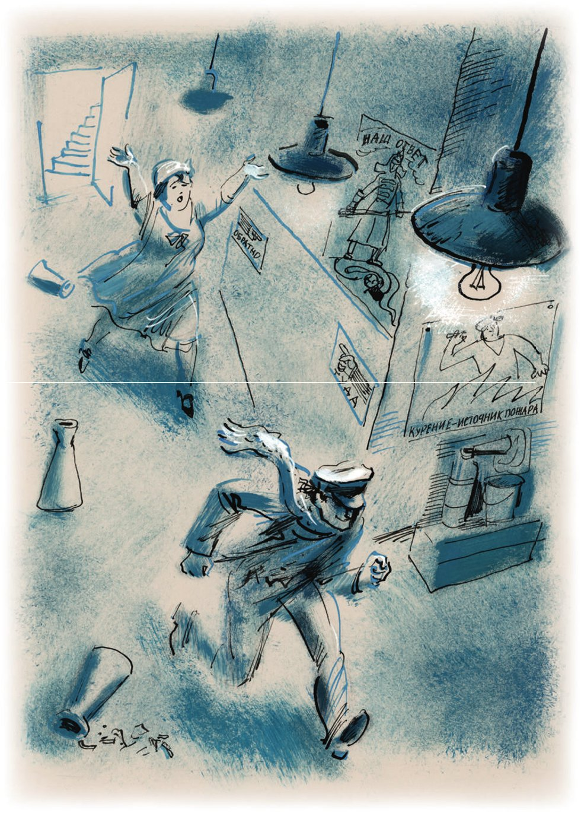

## Kapitel 28: Das Hühnchen und das pazifische Hähnchen

Der Reporter Persizki bereitete sich eifrig auf das zweihundertjährige <abbr title="das Jubiläum, die Jubiläen — юбилей">Jubiläum</abbr> des großen <abbr title="der Mathematiker, die Mathematiker — математик">Mathematikers</abbr> Isaac Newton vor.

— Newton übernehme ich. Geben Sie mir nur Platz in der Zeitung, — erklärte er.

— Aber passen Sie auf, Persizki, — warnte der Sekretär, — behandeln Sie Newton anständig.

— Keine Sorge. Alles wird in Ordnung sein.

— Damit es nicht so wird wie mit Lomonossow. In der Abendzeitung war ein Foto von Lomonossows <abbr title="die Ururenkelin, die Ururenkelinnen — праправнучка">Ururenkelin</abbr>, einer <abbr title="die Pionierin, die Pionierinnen — пионерка">Pionierin</abbr>, und bei uns …

— Damit habe ich nichts zu tun. Sie mussten ja eine so wichtige Sache dem rothaarigen Iwanow geben! Da sind Sie selbst <abbr title="schuld sein — быть виноватым">schuld</abbr>.

— Und was bringen Sie?

— Was wohl? Einen Artikel von der Hauptverwaltung für Wissenschaft: Ich habe dort ganz andere <abbr title="die Beziehung, die Beziehungen — связи">Beziehungen</abbr> als Iwanow. Die Biografie nehmen wir aus dem <abbr title="das Lexikon, die Lexika — энциклопедия">Lexikon</abbr> von Brockhaus. Aber das Porträt wird wunderbar. Alle anderen nehmen das Porträt aus demselben Brockhaus, aber ich habe etwas Originelleres. In der Buchhandlung «Internationales Buch» habe ich so einen kleinen <abbr title="der Kupferstich, die Kupferstiche — гравюра">Kupferstich</abbr> entdeckt! Ich brauche nur einen Vorschuss! Also, ich gehe Newton holen!

— Und Newton fotografieren wir nicht? — fragte der <abbr title="der Fotograf, die Fotografen — фотограф">Fotograf</abbr>. Er war erst gegen Ende des Gesprächs gekommen.

Persizki machte ein Zeichen der Warnung. Das bedeutete: «Ruhe, seht alle her, was ich jetzt mache.» Das ganze Sekretariat spitzte die Ohren.

— Was? Sie haben Newton noch immer nicht fotografiert?! — <abbr title="anfahren (fuhr an, hat angefahren) — накинуться, набрасываться (на кого-то)">fuhr</abbr> Persizki den Fotografen an.

Der Fotograf begann sicherheitshalber, sich zu <abbr title="sich verteidigen — оправдываться, защищаться">verteidigen</abbr>.

— Versuchen Sie doch mal, ihn zu erwischen, — sagte er stolz.

— Ein guter Fotograf hätte ihn erwischt! — schrie Persizki.

— Also was jetzt, soll ich ihn fotografieren oder nicht?

— Natürlich! Beeilen Sie sich! Dort sitzen bestimmt schon Leute von allen Redaktionen!

Der Fotograf nahm seinen Apparat und das klappernde <abbr title="das Stativ, die Stative — штатив">Stativ</abbr> auf die Schultern.

— Er ist gerade bei der «Staatlichen Nähmaschinenfabrik». Vergessen Sie nicht: Newton, Isaac, den Vatersnamen weiß ich nicht mehr. Für das Jubiläum. Und bitte nicht bei der Arbeit. Bei Ihnen sitzen alle immer am Tisch und lesen Papiere. Fotografieren Sie ihn <abbr title="im Gehen — на ходу">im Gehen</abbr>. Oder im Kreis der Familie.

— Wenn man mir ausländische <abbr title="die Fotoplatte, die Fotoplatten — фотопластинка">Fotoplatten</abbr> gibt, dann fotografiere ich auch im Gehen. Also, ich gehe.

— Beeilen Sie sich! Es ist schon nach fünf!

Der Fotograf ging los, um den großen Mathematiker zu seinem zweihundertjährigen Jubiläum zu fotografieren. Und die Mitarbeiter <abbr title="prusten — прыскать, заливаться (смехом)">prusteten</abbr> vor Lachen in allen Tonlagen.

<abbr title="mitten in + Dat. — в разгар">Mitten in</abbr> der Arbeit kam Stjopa von der Zeitschrift «Wissenschaft und Leben» herein. Hinter ihm schleppte sich eine dicke Bürgerin.

— Hören Sie, Persizki, — sagte Stjopa, — diese Bürgerin hier kommt in einer Sache zu Ihnen. Kommen Sie her, Bürgerin, dieser Genosse erklärt Ihnen alles.

Stjopa kicherte und lief weg.

— Nun? — fragte Persizki. — Was wollen Sie?

Madame Grizazujewa (sie war es) hob ihre schmachtenden Augen zum Reporter und steckte ihm schweigend ein Papier zu.

— Aha, — sagte Persizki, — … unter ein Pferd geraten … mit dem Schrecken davongekommen … Und was ist jetzt?

— Die Adresse, — sagte die Witwe bittend, — kann man die Adresse erfahren?

— Wessen Adresse?

— Von O. Bender.

— Woher soll ich das wissen?

— Aber der Genosse da hat gesagt, dass Sie es wissen.

— Ich weiß gar nichts. Gehen Sie zum <abbr title="das Adressbüro, die Adressbüros — адресный стол">Adressbüro</abbr>.

— Vielleicht erinnern Sie sich doch, Genosse. Mit gelben Schuhen.

— Ich habe selbst gelbe Schuhe. In Moskau laufen noch zweihunderttausend Menschen mit gelben Schuhen herum. Wollen Sie vielleicht auch ihre Adressen wissen? Bitte sehr. Ich lasse meine ganze Arbeit liegen und kümmere mich nur noch darum. In einem halben Jahr wissen Sie alles. Ich habe zu tun, Bürgerin.

Aber die Witwe hatte jetzt großen Respekt vor Persizki. Sie ging hinter ihm durch den Flur, raschelte mit ihrem gestärkten <abbr title="der Unterrock, die Unterröcke — нижняя юбка">Unterrock</abbr> und wiederholte ihre Bitten.

«Dieser Mistkerl Stjopa, — dachte Persizki. — Na warte, ich schicke ihm den <abbr title="der Erfinder, die Erfinder — изобретатель">Erfinder</abbr> des <abbr title="das Perpetuum mobile — вечный двигатель">Perpetuum mobile</abbr> auf den Hals, dann wird er schon <abbr title="herumhüpfen — попрыгать, поплясать">herumhüpfen</abbr>.»

— Was soll ich denn machen? — fragte Persizki gereizt und blieb vor der Witwe stehen. — Woher soll ich die Adresse von Bürger O. Bender wissen? Bin ich etwa das Pferd, das ihn <abbr title="umfahren (fuhr um, hat umgefahren) — наехать, сбить">umgefahren</abbr> hat? Oder der Kutscher, dem er vor meinen Augen auf den Rücken geschlagen hat?..

Die Witwe antwortete mit einem undeutlichen Grollen. Man konnte nur die Wörter «Genosse» und «ich bitte Sie sehr» verstehen.

Im Haus der Völker war die Arbeit schon zu Ende. Die <abbr title="die Kanzlei, die Kanzleien — канцелярия">Kanzlei</abbr> und die Flure waren leer. Nur irgendwo <abbr title="tippen — печатать (на машинке)">tippte</abbr> eine Schreibmaschine noch eine letzte Seite.

— Pardon, Madame, Sie sehen doch, dass ich zu tun habe!

Mit diesen Worten verschwand Persizki in der Toilette. Er blieb dort zehn Minuten und kam dann fröhlich wieder heraus. Die Grizazujewa stand geduldig an der Ecke zwischen zwei Fluren und schüttelte ihre Röcke. Als Persizki näher kam, fing sie wieder an zu reden.

Der Reporter wurde <abbr title="fuchsteufelswild — взбешённый, осатаневший">fuchsteufelswild</abbr>.

— Hören Sie mal, Tantchen, — sagte er, — na gut, ich sage Ihnen, wo Ihr O. Bender ist. Gehen Sie den Flur geradeaus, dann nach rechts und wieder geradeaus. Dort ist eine Tür. Fragen Sie nach Tscherepennikow. Der muss es wissen.

Persizki war mit seiner Erfindung sehr zufrieden. Er verschwand so schnell, dass die gestärkte kleine Witwe keine weiteren <abbr title="die Auskunft, die Auskünfte — сведения, справка">Auskünfte</abbr> mehr bekommen konnte.

Madame Grizazujewa <abbr title="glatt streichen (strich, hat gestrichen) — разгладить, расправить">strich</abbr> ihre Röcke glatt und ging den Flur entlang.

Die Flure im Haus der Völker waren so lang und so <abbr title="schmal — узкий">schmal</abbr>, dass alle Menschen darin unwillkürlich schneller gingen. An jedem Passanten konnte man sehen, wie weit er schon gegangen war. Ging er nur ein bisschen schneller als normal, dann hatte er seinen Weg gerade erst begonnen. Wer schon zwei oder drei Flure hinter sich hatte, lief in einem mittleren Trab. Und manchmal sah man einen Menschen, der <abbr title="so schnell man kann — во весь дух">so schnell er konnte</abbr> rannte: Er war schon im fünften Flur. Ein Bürger aber, der schon acht Flure hinter sich hatte, war so schnell wie ein Vogel, ein Rennpferd oder der Weltmeister im Laufen, Nurmi.

Madame Grizazujewa bog nach rechts ab und begann zu rennen. Das Parkett knarrte.

Ihr entgegen kam schnell ein dunkelhaariger Mann mit blauer Weste und himbeerroten Schuhen. Am Gesicht von Ostap sah man, dass er wegen sehr wichtiger Geschäfte der Konzession so spät ins Haus der Völker gekommen war. Ein Treffen mit seiner Geliebten gehörte offensichtlich nicht zu den Plänen des technischen Leiters. Als Bender die kleine Witwe sah, drehte er sich um und ging, ohne <abbr title="sich umsehen (sah sich um, hat sich umgesehen) — оглядываться">sich umzusehen</abbr>, an der Wand entlang zurück.

— Genosse Bender, — rief die Witwe begeistert, — wohin gehen Sie denn?

Der große Kombinator ging schneller. Die Witwe auch.

— Warten Sie, ich muss Ihnen etwas sagen, — bat sie.

Aber die Worte kamen nicht mehr bis zu Ostaps Ohren. In seinen Ohren sang und pfiff schon der Wind. Er raste durch den vierten Flur und sprang über die eisernen <abbr title="die Treppe, die Treppen — лестница">Treppen</abbr> im Inneren des Hauses. Seiner Geliebten ließ er nur ein Echo. Die Geräusche der Treppen wiederholten es ihr noch lange.

— Na, vielen Dank, — brummte Ostap, als er im fünften Stock saß. — Was für eine Zeit für ein Rendezvous! Wer hat diese glühende Dame hierhergeschickt? Es ist Zeit, die Moskauer Abteilung der Konzession aufzulösen. Sonst kommt am Ende noch ein einsamer Husar mit Motor zu mir.

Zu dieser Zeit war Madame Grizazujewa schon drei Stockwerke, tausend Türen und ein Dutzend Flure von Ostap entfernt. Sie wischte sich mit dem <abbr title="der Saum, die Säume — подол">Saum</abbr> ihres Unterrocks das heiße Gesicht ab und begann zu suchen. Zuerst wollte sie schnell ihren Mann finden und mit ihm reden. In den Fluren gingen <abbr title="trübe — тусклый">trübe</abbr> Lampen an. Alle Lampen, alle Flure und alle Türen waren gleich. Die Witwe bekam Angst. Sie wollte weg.

Sie gehorchte dem Gesetz der Flure und lief immer schneller. Nach einer halben Stunde konnte sie schon nicht mehr anhalten. Die Türen von Präsidien, Sekretariaten, Betriebsräten, <abbr title="die Organisationsabteilung, die Organisationsabteilungen — орготдел">Organisationsabteilungen</abbr> und Redaktionen flogen mit Getöse an ihrem <abbr title="massig — громоздкий, массивный">massigen</abbr> Körper vorbei. Mit ihren eisernen Röcken warf sie im Laufen die Aschenbecher um. Mit einem Lärm wie von Kochtöpfen rollten die Aschenbecher hinter ihr her. In den Ecken der Flure entstanden <abbr title="der Wirbelwind, die Wirbelwinde — вихрь">Wirbelwinde</abbr> und Strudel. Offene Lüftungsfenster schlugen. Die Zeigefinger, die mit einer <abbr title="die Schablone, die Schablonen — трафарет">Schablone</abbr> an die Wände gemalt waren, <abbr title="sich bohren in + Akk. — вонзаться">bohrten sich</abbr> in die arme <abbr title="die Wanderin, die Wanderinnen — путница">Wanderin</abbr>.

Endlich kam die Grizazujewa auf einen Treppenabsatz im Inneren des Hauses. Dort war es dunkel, aber die Witwe überwand ihre Angst, lief nach unten und zog an einer Glastür. Die Tür war abgeschlossen. Die Witwe lief zurück. Aber auch die Tür, durch die sie gerade gekommen war, hatte eine <abbr title="fürsorglich — заботливый">fürsorgliche</abbr> Hand schon geschlossen.

In Moskau schließt man gern Türen ab.

Tausende Haupteingänge sind von innen mit Brettern <abbr title="zunageln — заколотить">zugenagelt</abbr>, und Hunderttausende Bürger gehen durch den Hintereingang in ihre Wohnungen. Das Jahr achtzehn ist lange vorbei. Was ein «Überfall auf eine Wohnung» ist, weiß man kaum noch. Die <abbr title="die Hauswache, die Hauswachen — подомовая охрана">Hauswache</abbr>, die die Mieter zu ihrer Sicherheit organisiert hatten, gibt es nicht mehr. Man löst das Problem des Straßenverkehrs, man baut riesige Kraftwerke, man macht die größten wissenschaftlichen <abbr title="die Entdeckung, die Entdeckungen — открытие">Entdeckungen</abbr>. Aber es gibt keinen Menschen, der sein Leben dem Problem der geschlossenen Türen <abbr title="widmen — посвящать">widmen</abbr> würde.

Wer ist der Mensch, der endlich das <abbr title="das Rätsel, die Rätsel — загадка">Rätsel</abbr> der Kinos, Theater und <abbr title="der Zirkus, die Zirkusse — цирк">Zirkusse</abbr> löst?

Dreitausend Menschen müssen in zehn Minuten in den Zirkus kommen, und zwar durch eine einzige Tür, von der nur eine Hälfte offen ist. Die anderen zehn Türen, die extra für große <abbr title="die Menschenmenge, die Menschenmengen — толпа">Menschenmengen</abbr> gebaut wurden, sind geschlossen. Wer weiß, warum? Vielleicht wurde vor zwanzig Jahren aus dem Zirkusstall ein <abbr title="dressiert — учёный, дрессированный">dressierter</abbr> kleiner Esel gestohlen, und seitdem <abbr title="zumauern — замуровывать">mauert</abbr> die Direktion aus Angst alle bequemen Ein- und Ausgänge zu. Oder vielleicht hat sich einmal der berühmte König der Luft im <abbr title="der Durchzug — сквозняк">Durchzug</abbr> <abbr title="sich erkälten — простудиться">erkältet</abbr>, und die geschlossenen Türen sind nur ein <abbr title="der Nachhall — отголосок">Nachhall</abbr> von dem Skandal, den der König damals gemacht hat.

In Theatern und Kinos lässt man das Publikum in kleinen Gruppen hinaus, angeblich um ein <abbr title="das Gedränge — давка, затор">Gedränge</abbr> zu <abbr title="vermeiden (vermied, hat vermieden) — избегать">vermeiden</abbr>. Ein Gedränge zu vermeiden ist sehr leicht – man muss nur die vielen Ausgänge öffnen. Aber stattdessen benutzt die Verwaltung <abbr title="die Gewalt — сила, насилие">Gewalt</abbr>. Die <abbr title="der Platzanweiser, die Platzanweiser — капельдинер">Platzanweiser</abbr> nehmen sich an den Händen und bilden eine lebende <abbr title="die Absperrung, die Absperrungen — барьер, заграждение">Absperrung</abbr>. So <abbr title="belagern — держать в осаде">belagern</abbr> sie das Publikum mindestens eine halbe Stunde lang. Und die Türen, die <abbr title="heiß ersehnt — заветный">heiß ersehnten</abbr> Türen, die schon unter Zar Paul dem Ersten geschlossen wurden, sind bis heute zu.

Fünfzehntausend <abbr title="der Fußballfan, die Fußballfans — любитель футбола">Fußballfans</abbr>, aufgeregt vom <abbr title="tapfer — молодецкий, отважный">tapferen</abbr> Spiel der Moskauer Auswahl, müssen sich zur Straßenbahn durch einen Spalt drängen. Er ist so schmal, dass ein einziger leicht bewaffneter <abbr title="der Krieger, die Krieger — воин">Krieger</abbr> dort vierzigtausend <abbr title="der Barbar, die Barbaren — варвар">Barbaren</abbr> mit zwei <abbr title="der Belagerungsturm, die Belagerungstürme — осадная башня">Belagerungstürmen</abbr> aufhalten könnte.

Das Sportstadion hat kein Dach, aber es hat mehrere Tore. Offen ist nur ein kleines <abbr title="die Pforte, die Pforten — калитка">Pförtchen</abbr>. Hinaus kommt man nur, wenn man die Tore aufbricht. Nach jedem großen <abbr title="der Wettkampf, die Wettkämpfe — соревнование">Wettkampf</abbr> werden sie aufgebrochen. Aber weil man die heilige <abbr title="die Tradition, die Traditionen — традиция">Tradition</abbr> <abbr title="pflegen — соблюдать, беречь">pflegen</abbr> will, werden sie jedes Mal sorgfältig repariert und fest abgeschlossen.

Wenn man wirklich keine Tür <abbr title="aufhängen — навесить, повесить">aufhängen</abbr> kann (das passiert, wenn es nichts gibt, woran man sie aufhängen kann), dann benutzt man <abbr title="versteckt — скрытый">versteckte</abbr> Türen aller Art:

1. <abbr title="die Schranke, die Schranken — барьер, шлагбаум">Schranken</abbr>.

2. <abbr title="der Sperrbock, die Sperrböcke — рогатка (заграждение)">Sperrböcke</abbr>.

3. Umgedrehte Bänke.

4. <abbr title="das Verbotsschild, die Verbotsschilder — заградительная надпись">Verbotsschilder</abbr>.

5. Seile.

Schranken sind in den Ämtern sehr beliebt.

Mit ihnen wird der Weg zu dem Mitarbeiter versperrt, den man braucht. Der Besucher geht wie ein Tiger an der Schranke <abbr title="auf und ab — взад и вперёд">auf und ab</abbr> und versucht, mit Zeichen <abbr title="auf sich aufmerksam machen — обратить на себя внимание">auf sich aufmerksam zu machen</abbr>. Das gelingt nicht immer. Und vielleicht hat der Besucher eine nützliche Erfindung mitgebracht! Oder vielleicht will er einfach nur seine <abbr title="die Einkommensteuer — подоходный налог">Einkommensteuer</abbr> bezahlen! Aber die Schranke war im Weg – die Erfindung blieb unbekannt, und die Steuer blieb unbezahlt.

Der Sperrbock wird auf der Straße benutzt.

Man stellt ihn im Frühling auf eine laute <abbr title="die Hauptstraße, die Hauptstraßen — магистраль">Hauptstraße</abbr>, angeblich um die Reparatur des Bürgersteigs abzusperren. Und sofort ist die laute Straße leer. Die Passanten <abbr title="sickern — просачиваться">sickern</abbr> durch andere Straßen dorthin, wohin sie wollen. Jeden Tag müssen sie einen Kilometer mehr gehen, aber die <abbr title="beflügelt — легкокрылый">beflügelte</abbr> Hoffnung verlässt sie nicht. Der Sommer geht vorbei. Das Laub <abbr title="welken — вянуть">welkt</abbr>. Und der Sperrbock steht immer noch da. Die Reparatur ist nicht gemacht. Und die Straße ist leer.

Mit umgedrehten Gartenbänken versperrt man die Eingänge zu den Moskauer <abbr title="die Grünanlage, die Grünanlagen — сквер">Grünanlagen</abbr>. Denn die Bauleute haben sie mit empörender Nachlässigkeit nicht mit festen Toren ausgestattet.

Über die Verbotsschilder könnte man ein ganzes Buch schreiben, aber das gehört jetzt nicht zu den Plänen der <abbr title="der Autor, die Autoren — автор">Autoren</abbr>.

Diese Schilder gibt es in zwei Arten: direkte und <abbr title="indirekt — косвенный">indirekte</abbr>. Zu den direkten gehören: «Eintritt <abbr title="verboten — запрещено">verboten</abbr>», «Eintritt für <abbr title="der Unbefugte, die Unbefugten — посторонний">Unbefugte</abbr> verboten» und «Kein Durchgang». Solche Schilder hängt man manchmal an die Türen von Ämtern, die besonders viele Besucher haben.

Die indirekten Schilder sind am <abbr title="verderblich — губительный">verderblichsten</abbr>. Sie verbieten den Eintritt nicht, aber nur selten wagt ein <abbr title="der Mutige, die Mutigen — смельчак">Mutiger</abbr>, sein Recht trotzdem zu nutzen. Hier sind sie, diese schändlichen Schilder: «Nicht ohne <abbr title="die Anmeldung — доклад, предварительная запись">Anmeldung</abbr> eintreten», «Keine <abbr title="die Sprechstunde, die Sprechstunden — приём (посетителей)">Sprechstunde</abbr>» und «Mit deinem Besuch störst du einen beschäftigten Menschen».

Wo man keine Schranke und keinen Sperrbock aufstellen, keine Bank umdrehen und kein Verbotsschild aufhängen kann, dort <abbr title="spannen — натягивать">spannt</abbr> man Seile. Man spannt sie nach Eingebung, an den unerwartetsten Stellen. Hängt das Seil in Höhe der Brust, kommt man mit einem kleinen Schrecken und einem etwas nervösen Lachen davon. Ein Seil in Höhe des Knöchels aber kann einen Menschen zum <abbr title="der Krüppel, die Krüppel — калека">Krüppel</abbr> machen.

<abbr title="zum Teufel mit + Dat. — к чёрту">Zum Teufel</abbr> mit den Türen! Zum Teufel mit den Schlangen vor den Theatereingängen! Erlauben Sie uns, ohne Anmeldung einzutreten! Wir flehen Sie an, nehmen Sie den Sperrbock weg, den ein nachlässiger Hausverwalter vor seinen <abbr title="aufgerissen — развороченный">aufgerissenen</abbr> Bürgersteig gestellt hat! Weg mit den umgedrehten Bänken! Stellen Sie sie wieder richtig hin! In der Grünanlage sitzt man gerade nachts so schön. Die Luft ist sauber, und man hat kluge Gedanken!

Madame Grizazujewa saß auf der Treppe vor der abgeschlossenen Glastür, mitten im Haus der Völker. Sie dachte über ihr <abbr title="das Witwenschicksal — вдовья судьба">Witwenschicksal</abbr> nach, <abbr title="einnicken — задремать">nickte</abbr> ab und zu ein und wartete auf den Morgen.

Aus dem hellen Flur fiel durch die Glastür das gelbe Licht der elektrischen <abbr title="die Deckenlampe, die Deckenlampen — плафон">Deckenlampen</abbr> auf die Witwe. Ein <abbr title="aschgrau — пепельный">aschgrauer</abbr> Morgen kam durch die Fenster des <abbr title="das Treppenhaus, die Treppenhäuser — лестничная клетка">Treppenhauses</abbr>.

Es war die stille Stunde, in der der Morgen noch jung und sauber ist. In dieser Stunde hörte die Grizazujewa Schritte im Flur. Die Witwe sprang auf und <abbr title="kleben an + Dat. — прилипнуть к">klebte</abbr> am Glas. Am Ende des Flurs blitzte eine blaue Weste auf. Die himbeerroten Schuhe waren weiß von <abbr title="der Putz — штукатурка">Putz</abbr>. Der leichtsinnige Sohn eines türkischen Staatsbürgers <abbr title="abklopfen — стряхивать">klopfte</abbr> sich ein Staubkörnchen vom Jackett und kam auf die Glastür zu.

— Zieselchen! — rief die Witwe. — Zie-e-eselchen!

Sie <abbr title="hauchen — дышать (на что-то)">hauchte</abbr> mit <abbr title="unaussprechlich — невыразимый">unaussprechlicher</abbr> Zärtlichkeit gegen das Glas. Das Glas wurde trüb und bekam <abbr title="regenbogenfarbig — радужный">regenbogenfarbige</abbr> Flecken. Im Nebel und in den Regenbögen leuchteten blaue und regenbogenfarbige <abbr title="das Gespenst, die Gespenster — призрак">Gespenster</abbr>.

Ostap hörte das Kuckuck-Rufen der Witwe nicht. Er kratzte sich am Rücken und drehte besorgt den Kopf. Noch eine Sekunde, und er wäre um die Ecke verschwunden.

Mit dem Stöhnen «Genosse Bender» <abbr title="trommeln — барабанить">trommelte</abbr> die arme Gattin gegen das Glas. Der große Kombinator drehte sich um.

— Ah, — sagte er, als er sah, dass eine geschlossene Tür ihn von der Witwe trennte, — Sie sind auch hier?

— Ja, hier, hier, — wiederholte die Witwe froh.

— So umarme mich doch, meine Freude, wir haben uns so lange nicht gesehen, — lud der technische Direktor sie ein.

Die Witwe wurde hektisch. Sie hüpfte hinter der Tür wie ein <abbr title="der Zeisig, die Zeisige — чижик">Zeisig</abbr> im Käfig. Die Röcke, die in der Nacht still gewesen waren, <abbr title="rasseln — греметь">rasselten</abbr> wieder. Ostap öffnete die Arme.

— Warum kommst du denn nicht, mein Hühnchen? Dein pazifisches Hähnchen ist so müde von der Sitzung des Kleinen Rates der Volkskommissare.

Die Witwe hatte keine Fantasie.

— Zieselchen, — sagte sie zum fünften Mal. — Machen Sie mir die Tür auf, Genosse Bender.

— Leise, Mädchen! <abbr title="die Bescheidenheit — скромность">Bescheidenheit</abbr> <abbr title="zieren — украшать">ziert</abbr> die Frau. Wozu diese Sprünge?

Die Witwe litt.

— Na, warum quälen Sie sich so? — fragte Ostap. — Was stört Sie am Leben?

— Selber weggefahren, und selber fragt er!

Und die Witwe begann zu weinen.

— <abbr title="trocknen — вытирать, сушить">Trocknen</abbr> Sie Ihre Äuglein, Bürgerin. Jede Ihrer Tränen ist ein <abbr title="das Molekül, die Moleküle — молекула">Molekül</abbr> im <abbr title="der Kosmos — космос">Kosmos</abbr>.

— Und ich habe gewartet und gewartet, ich habe meinen Laden <abbr title="zumachen — закрыть">zugemacht</abbr>. Ich bin Ihnen nachgefahren, Genosse Bender …

— Na, und wie lebt es sich jetzt auf der Treppe? Zieht es nicht?

Die Witwe begann langsam zu kochen wie ein großer Samowar im Kloster.

— <abbr title="der Verräter, die Verräter — изменник">Verräter</abbr>! — sagte sie und zuckte zusammen.

Ostap hatte noch ein wenig freie Zeit. Er <abbr title="schnippen — щёлкать (пальцами)">schnippte</abbr> mit den Fingern, <abbr title="sich wiegen — покачиваться">wiegte sich</abbr> im <abbr title="der Rhythmus, die Rhythmen — ритм">Rhythmus</abbr> und sang leise:

*Ein Stückchen Teufel wohnt*
*in uns, das ist bekannt!*
*Und Frauenzauber setzt*
*die Brust sofort in Brand …*

— Dass du doch platzt! — wünschte die Witwe am Ende des Tanzes. — Das Armband hast du gestohlen, das Geschenk von meinem Mann. Und warum hast du das Stuhl mitgenommen?

— Sie werden, scheint mir, <abbr title="persönlich werden — переходить на личности">persönlich</abbr>? — bemerkte Ostap kalt.

— Gestohlen, gestohlen! — wiederholte die Witwe.

— Hören Sie mal, Mädchen, <abbr title="sich etwas hinter die Ohren schreiben — зарубить себе на носу">schreiben Sie sich hinter die Ohren</abbr>: Ostap Bender hat noch nie etwas gestohlen.

— Und wer hat das Teesieb genommen?

— Ach, das Teesieb! Aus Ihrem <abbr title="unverkäuflich — неликвидный">unverkäuflichen</abbr> <abbr title="der Bestand, die Bestände — фонд, запас">Bestand</abbr>? Und das nennen Sie Diebstahl? Dann sind unsere Ansichten über das Leben <abbr title="diametral — диаметрально">diametral</abbr> <abbr title="entgegengesetzt — противоположный">entgegengesetzt</abbr>.

— Mitgenommen hast du's, — rief die Witwe wie ein Kuckuck.

— Also, wenn ein junger, gesunder Mensch sich bei einer Oma aus der Provinz ein <abbr title="das Küchengerät, die Küchengeräte — кухонная принадлежность">Küchengerät</abbr> <abbr title="sich etwas leihen (lieh, hat geliehen) — позаимствовать">leiht</abbr>, das sie wegen ihrer schwachen Gesundheit gar nicht braucht – dann ist er also ein Dieb? So soll ich Sie verstehen?

— Dieb, Dieb!

— In diesem Fall müssen wir uns trennen. Ich bin mit der <abbr title="die Scheidung, die Scheidungen — развод">Scheidung</abbr> einverstanden.

Die Witwe warf sich gegen die Tür. Das Glas zitterte. Ostap verstand, dass es Zeit war zu gehen.

— Für Umarmungen ist keine Zeit, — sagte er. — Leb wohl, Geliebte! Wir sind <abbr title="auseinandergehen (ging auseinander, ist auseinandergegangen) — разойтись">auseinandergegangen</abbr> wie Schiffe auf dem Meer.

— Hiiilfe!!! — kreischte die Witwe.

Aber Ostap war schon am Ende des Flurs. Er stieg auf das Fensterbrett, sprang schwer auf die Erde, die vom nächtlichen Regen noch nass war, und verschwand in den glänzenden Gärten für <abbr title="die Körperkultur — физкультура">Körperkultur</abbr>.

Ein <abbr title="der Wächter, die Wächter — сторож">Wächter</abbr> wachte von den Schreien der Witwe auf und kam zu ihr. Er ließ die <abbr title="die Gefangene, die Gefangenen — узница, пленница">Gefangene</abbr> frei und <abbr title="drohen mit + Dat. — грозить">drohte</abbr> ihr mit einer Geldstrafe.

---

### Neue Wörter

- **das Jubiläum, die Jubiläen** — юбилей
- **der Mathematiker, die Mathematiker** — математик
- **die Ururenkelin, die Ururenkelinnen** — праправнучка
- **die Pionierin, die Pionierinnen** — пионерка
- **schuld sein** — быть виноватым
- **die Beziehung, die Beziehungen** — связи
- **das Lexikon, die Lexika** — энциклопедия
- **der Kupferstich, die Kupferstiche** — гравюра
- **der Fotograf, die Fotografen** — фотограф
- **anfahren (fuhr an, hat angefahren)** — накинуться, набрасываться (на кого-то)
- **sich verteidigen** — оправдываться, защищаться
- **das Stativ, die Stative** — штатив
- **im Gehen** — на ходу
- **die Fotoplatte, die Fotoplatten** — фотопластинка
- **prusten** — прыскать, заливаться (смехом)
- **mitten in + Dat.** — в разгар
- **das Adressbüro, die Adressbüros** — адресный стол
- **der Unterrock, die Unterröcke** — нижняя юбка
- **der Erfinder, die Erfinder** — изобретатель
- **das Perpetuum mobile** — вечный двигатель
- **herumhüpfen** — попрыгать, поплясать
- **umfahren (fuhr um, hat umgefahren)** — наехать, сбить
- **die Kanzlei, die Kanzleien** — канцелярия
- **tippen** — печатать (на машинке)
- **fuchsteufelswild** — взбешённый, осатаневший
- **die Auskunft, die Auskünfte** — сведения, справка
- **glatt streichen (strich, hat gestrichen)** — разгладить, расправить
- **schmal** — узкий
- **so schnell man kann** — во весь дух
- **sich umsehen (sah sich um, hat sich umgesehen)** — оглядываться
- **die Treppe, die Treppen** — лестница
- **der Saum, die Säume** — подол
- **trübe** — тусклый
- **die Organisationsabteilung, die Organisationsabteilungen** — орготдел
- **massig** — громоздкий, массивный
- **der Wirbelwind, die Wirbelwinde** — вихрь
- **die Schablone, die Schablonen** — трафарет
- **sich bohren in + Akk.** — вонзаться
- **die Wanderin, die Wanderinnen** — путница
- **fürsorglich** — заботливый
- **zunageln** — заколотить
- **die Hauswache, die Hauswachen** — подомовая охрана
- **die Entdeckung, die Entdeckungen** — открытие
- **widmen** — посвящать
- **das Rätsel, die Rätsel** — загадка
- **der Zirkus, die Zirkusse** — цирк
- **die Menschenmenge, die Menschenmengen** — толпа
- **dressiert** — учёный, дрессированный
- **zumauern** — замуровывать
- **der Durchzug** — сквозняк
- **sich erkälten** — простудиться
- **der Nachhall** — отголосок
- **das Gedränge** — давка, затор
- **vermeiden (vermied, hat vermieden)** — избегать
- **die Gewalt** — сила, насилие
- **der Platzanweiser, die Platzanweiser** — капельдинер
- **die Absperrung, die Absperrungen** — барьер, заграждение
- **belagern** — держать в осаде
- **heiß ersehnt** — заветный
- **der Fußballfan, die Fußballfans** — любитель футбола
- **tapfer** — молодецкий, отважный
- **der Krieger, die Krieger** — воин
- **der Barbar, die Barbaren** — варвар
- **der Belagerungsturm, die Belagerungstürme** — осадная башня
- **die Pforte, die Pforten** — калитка
- **der Wettkampf, die Wettkämpfe** — соревнование
- **die Tradition, die Traditionen** — традиция
- **pflegen** — соблюдать, беречь
- **aufhängen** — навесить, повесить
- **versteckt** — скрытый
- **die Schranke, die Schranken** — барьер, шлагбаум
- **der Sperrbock, die Sperrböcke** — рогатка (заграждение)
- **das Verbotsschild, die Verbotsschilder** — заградительная надпись
- **auf und ab** — взад и вперёд
- **auf sich aufmerksam machen** — обратить на себя внимание
- **die Einkommensteuer** — подоходный налог
- **die Hauptstraße, die Hauptstraßen** — магистраль
- **sickern** — просачиваться
- **beflügelt** — легкокрылый
- **welken** — вянуть
- **die Grünanlage, die Grünanlagen** — сквер
- **der Autor, die Autoren** — автор
- **indirekt** — косвенный
- **verboten** — запрещено
- **der Unbefugte, die Unbefugten** — посторонний
- **verderblich** — губительный
- **der Mutige, die Mutigen** — смельчак
- **die Anmeldung** — доклад, предварительная запись
- **die Sprechstunde, die Sprechstunden** — приём (посетителей)
- **spannen** — натягивать
- **der Krüppel, die Krüppel** — калека
- **zum Teufel mit + Dat.** — к чёрту
- **aufgerissen** — развороченный
- **das Witwenschicksal** — вдовья судьба
- **einnicken** — задремать
- **die Deckenlampe, die Deckenlampen** — плафон
- **aschgrau** — пепельный
- **das Treppenhaus, die Treppenhäuser** — лестничная клетка
- **kleben an + Dat.** — прилипнуть к
- **der Putz** — штукатурка
- **abklopfen** — стряхивать
- **hauchen** — дышать (на что-то)
- **unaussprechlich** — невыразимый
- **regenbogenfarbig** — радужный
- **das Gespenst, die Gespenster** — призрак
- **trommeln** — барабанить
- **der Zeisig, die Zeisige** — чижик
- **rasseln** — греметь
- **die Bescheidenheit** — скромность
- **zieren** — украшать
- **trocknen** — вытирать, сушить
- **das Molekül, die Moleküle** — молекула
- **der Kosmos** — космос
- **zumachen** — закрыть
- **der Verräter, die Verräter** — изменник
- **schnippen** — щёлкать (пальцами)
- **sich wiegen** — покачиваться
- **der Rhythmus, die Rhythmen** — ритм
- **persönlich werden** — переходить на личности
- **sich etwas hinter die Ohren schreiben** — зарубить себе на носу
- **unverkäuflich** — неликвидный
- **der Bestand, die Bestände** — фонд, запас
- **diametral** — диаметрально
- **entgegengesetzt** — противоположный
- **das Küchengerät, die Küchengeräte** — кухонная принадлежность
- **sich etwas leihen (lieh, hat geliehen)** — позаимствовать
- **die Scheidung, die Scheidungen** — развод
- **auseinandergehen (ging auseinander, ist auseinandergegangen)** — разойтись
- **die Körperkultur** — физкультура
- **der Wächter, die Wächter** — сторож
- **die Gefangene, die Gefangenen** — узница, пленница
- **drohen mit + Dat.** — грозить

[← Kapitel 27](kapitel-27.md) · [Inhalt](README.md) · [Kapitel 29 →](kapitel-29.md)
