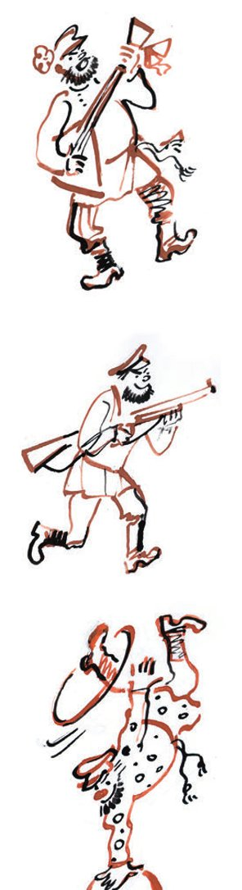
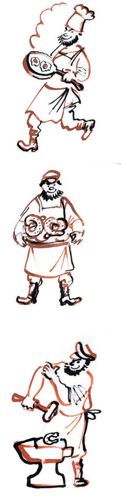

## Kapitel 29: Der Autor der «Gawriliade»

Als Madame Grizazujewa das <abbr title="ungastlich — негостеприимный">ungastliche</abbr> Lager der Kanzleien verließ, strömten schon die Angestellten der bescheidensten Ränge ins Haus der Völker: <abbr title="der Laufbursche, die Laufburschen — курьер">Laufburschen</abbr>, die Fräulein vom Posteingang und Postausgang, die <abbr title="die Telefonistin, die Telefonistinnen — телефонистка">Telefonistinnen</abbr> der Frühschicht, junge <abbr title="der Gehilfe, die Gehilfen — помощник">Gehilfen</abbr> der <abbr title="der Buchhalter, die Buchhalter — счетовод, бухгалтер">Buchhalter</abbr> und die <abbr title="der Quotenlehrling, die Quotenlehrlinge — бронеподросток (подросток, принятый по брони)">Quotenlehrlinge</abbr>.

Zwischen ihnen bewegte sich Nikifor Ljapis, ein sehr junger Mann mit einer Frisur wie ein <abbr title="das Schafsfell, die Schafsfelle — овечья шкура (баранья причёска)">Schafsfell</abbr> und einem <abbr title="unbescheiden — нескромный">unbescheidenen</abbr> Blick.

<abbr title="der Unwissende, die Unwissenden — невежда">Unwissende</abbr>, <abbr title="der Dickkopf, die Dickköpfe — упрямец">Dickköpfe</abbr> und Leute, die zum ersten Mal kamen, betraten das Haus der Völker durch den Haupteingang. Nikifor Ljapis kam durch die <abbr title="die Ambulanz, die Ambulanzen — амбулатория">Ambulanz</abbr> ins Gebäude. Im Haus der Völker war er wie zu Hause. Er kannte die kürzesten Wege zu den <abbr title="die Oase, die Oasen — оазис">Oasen</abbr>, wo im breiten <abbr title="der Schatten, die Schatten — тень, сень">Schatten</abbr> der <abbr title="die Fachzeitschrift, die Fachzeitschriften — ведомственный журнал">Fachzeitschriften</abbr> die hellen Quellen des <abbr title="das Honorar, die Honorare — гонорар">Honorars</abbr> <abbr title="sprudeln — бить ключом, бурлить">sprudeln</abbr>.

Zuerst ging Nikifor Ljapis ins Büfett. Die <abbr title="vernickelt — никелированный">vernickelte</abbr> Kasse spielte einen Matchiche und warf drei <abbr title="der Bon, die Bons — чек">Bons</abbr> aus. Nikifor öffnete ein Glas mit Papierdeckel und aß <abbr title="die Dickmilch — варенец, простокваша">gebackene Dickmilch</abbr>. Dann aß er ein <abbr title="das Sahnetörtchen, die Sahnetörtchen — кремовое пирожное">Sahnetörtchen</abbr>, das wie ein kleines <abbr title="das Blumenbeet, die Blumenbeete — клумба">Blumenbeet</abbr> aussah. Dazu trank er Tee. Danach ging Ljapis ohne Eile durch sein <abbr title="das Reich, die Reiche — владения, царство">Reich</abbr>.

Seinen ersten Besuch machte er in der Redaktion der <abbr title="die Jagdzeitschrift, die Jagdzeitschriften — охотничий журнал">Jagdzeitschrift</abbr> «Gerasim und Mumu», die <abbr title="monatlich — ежемесячный">monatlich</abbr> erschien. Genosse Napernikow war noch nicht da. So ging Nikifor Ljapis weiter zum «Hygroskopischen Boten». Das war ein <abbr title="wöchentlich — еженедельный">wöchentliches</abbr> <abbr title="das Sprachrohr, die Sprachrohre — рупор">Sprachrohr</abbr>: Durch dieses Blatt sprachen die Apotheker mit der Welt draußen.

— Guten Morgen, — sagte Nikifor. — Ich habe wunderbare Gedichte geschrieben.

— Worüber? — fragte der Chef der <abbr title="die Literaturseite, die Literaturseiten — литературная страничка">Literaturseite</abbr>. — Zu welchem Thema? Sie wissen doch, Trubezkoi, dass unsere Zeitschrift …

Um das Wesen des «Hygroskopischen Boten» genauer zu beschreiben, bewegte der Chef die Finger.

Trubezkoi-Ljapis sah auf seine Hose aus weißem Sackleinen, <abbr title="sich zurücklehnen — откинуться назад">lehnte sich zurück</abbr> und sagte mit singender Stimme:

— «<abbr title="die Ballade, die Balladen — баллада">Ballade</abbr> vom <abbr title="der Wundbrand — гангрена">Wundbrand</abbr>».

— Das ist interessant, — bemerkte die hygroskopische Person. — Es ist schon lange Zeit, die Ideen der <abbr title="die Vorbeugung — профилактика">Vorbeugung</abbr> in <abbr title="populär — популярный">populärer</abbr> Form zu verbreiten.

Ljapis begann sofort zu <abbr title="deklamieren — декламировать">deklamieren</abbr>:

*Gawrila hatte Wundbrand, ach,*
*Gawrila lag vom Wundbrand flach …*

Danach erzählte das Gedicht im gleichen <abbr title="schneidig — молодецкий, лихой">schneidigen</abbr> <abbr title="das Versmaß, die Versmaße — стихотворный размер">Versmaß</abbr> von Gawrila. Weil er so ungebildet war, ging er nicht rechtzeitig in die Apotheke. Er <abbr title="bestreichen (bestrich, hat bestrichen) — смазать">bestrich</abbr> seine kleine <abbr title="die Wunde, die Wunden — рана">Wunde</abbr> nicht mit Jod und starb.

— Sie machen Fortschritte, Trubezkoi, — lobte der Redakteur, — aber man würde sich noch mehr wünschen … Verstehen Sie?

Er bewegte die Finger, aber die schreckliche Ballade nahm er. Er versprach, am Dienstag zu bezahlen.

Bei der Zeitschrift «Alltag des <abbr title="der Morsetelegrafist, die Morsetelegrafisten — морзист, телеграфист">Morsetelegrafisten</abbr>» wurde Ljapis gastfreundlich empfangen.

— Gut, dass Sie gekommen sind, Trubezkoi. Wir brauchen gerade Gedichte. Aber nur Alltag, Alltag, Alltag. Keine <abbr title="die Lyrik — лирика">Lyrik</abbr>. Hören Sie, Trubezkoi? Etwas aus dem Leben der Post- und Telegrafenarbeiter und zugleich, Sie verstehen schon?..

— Gerade gestern habe ich über den Alltag der Post- und Telegrafenarbeiter <abbr title="nachdenken (dachte nach, hat nachgedacht) — задуматься">nachgedacht</abbr>. Und dabei ist so ein langes Gedicht <abbr title="herausfließen (floss heraus, ist herausgeflossen) — вылиться">herausgeflossen</abbr>. Es heißt: «Der letzte Brief». Hier …

*Gawrila diente bei der Post,*
*Gawrila trug die Briefe fort …*

Die Geschichte von Gawrila hatte zweiundsiebzig Zeilen. Am Ende des Gedichts wurde der Briefträger Gawrila von der Kugel eines <abbr title="der Faschist, die Faschisten — фашист">Faschisten</abbr> getroffen. Trotzdem brachte er den Brief noch zur richtigen Adresse.

— Wo spielt denn die Geschichte? — fragte man Ljapis.

Die Frage war <abbr title="berechtigt — законный, обоснованный">berechtigt</abbr>. In der UdSSR gibt es keine Faschisten, und im Ausland gibt es keine Gawrilas, die Mitglieder der Gewerkschaft der Post- und Telegrafenarbeiter sind.

— Wo ist das Problem? — sagte Ljapis. — Die Geschichte spielt natürlich bei uns, und der Faschist ist <abbr title="verkleidet — переодетый">verkleidet</abbr>.

— Wissen Sie, Trubezkoi, schreiben Sie uns lieber etwas über eine <abbr title="die Funkstation, die Funkstationen — радиостанция">Funkstation</abbr>.

— Und warum wollen Sie den Briefträger nicht?

— Der soll erst einmal liegen bleiben. Wir nehmen ihn <abbr title="unter Vorbehalt — условно">unter Vorbehalt</abbr>.

Traurig ging Nikifor Ljapis-Trubezkoi wieder zu «Gerasim und Mumu». Napernikow saß schon an seinem Stehpult. An der Wand hing ein stark vergrößertes Porträt von Turgenjew – mit Kneifer, <abbr title="der Sumpfstiefel, die Sumpfstiefel — болотный сапог">Sumpfstiefeln</abbr> und einer <abbr title="die Doppelflinte, die Doppelflinten — двустволка">Doppelflinte</abbr> <abbr title="im Anschlag — наперевес, наизготовку">im Anschlag</abbr>. Neben Napernikow stand ein Konkurrent von Ljapis – ein <abbr title="der Verseschmied, die Verseschmiede — стихоплёт, стихотворец">Verseschmied</abbr> aus der Vorstadt.

Das alte Lied von Gawrila begann wieder, aber diesmal mit einer Neigung zur Jagd. Das Werk hieß:

«Das Gebet des <abbr title="der Wilderer, die Wilderer — браконьер">Wilderers</abbr>».

*Gawrila lag im Busch beim Hasen,*
*Gawrila schoss den Hasen tot.*

— Sehr gut! — sagte der gute Napernikow. — Mit diesem Gedicht haben Sie, Trubezkoi, sogar Entich <abbr title="übertreffen (übertraf, hat übertroffen) — превзойти">übertroffen</abbr>. Nur muss man ein paar Dinge <abbr title="verbessern — исправить">verbessern</abbr>. Erstens: Werfen Sie das «Gebet» <abbr title="mit Stumpf und Stiel — с корнем">mit Stumpf und Stiel</abbr> heraus.

— Und den Hasen, — sagte der Konkurrent.

— Warum denn den Hasen? — wunderte sich Napernikow.

— Weil keine Saison ist.

— Hören Sie, Trubezkoi, ändern Sie auch den Hasen.

In seiner neuen Form hieß das Gedicht «Eine <abbr title="die Lektion, die Lektionen — урок">Lektion</abbr> für den Wilderer», und die Hasen wurden durch <abbr title="die Schnepfe, die Schnepfen — бекас">Schnepfen</abbr> <abbr title="ersetzen — заменить">ersetzt</abbr>. Dann stellte sich heraus, dass man Schnepfen im Sommer auch nicht schießen darf. In der endgültigen Form lauteten die Verse:

*Gawrila lag im Busch beim Vogel,*
*Gawrila schoss den Vogel tot …*

Und so weiter.

Nach dem Frühstück in der Kantine machte sich Ljapis wieder an die Arbeit. Die weiße Hose <abbr title="huschen — мелькать">huschte</abbr> durch die dunklen Flure. Er ging in die Redaktionen und verkaufte den Gawrila mit den vielen Gesichtern.

An die «Genossenschaftsflöte» wurde Gawrila unter dem Titel «Die <abbr title="die Äolsflöte — эолова флейта">Äolsflöte</abbr>» <abbr title="abgeben (gab ab, hat abgegeben) — сдать">abgegeben</abbr>.

*Gawrila stand an einer Theke,*
*Gawrila handelte mit Flöten …*

Die <abbr title="der Einfaltspinsel, die Einfaltspinsel — простак, простофиля">Einfaltspinsel</abbr> von der dicken Zeitschrift «Der Wald, wie er ist» kauften bei Ljapis ein kleines Poem mit dem Titel «Am <abbr title="der Waldrand, die Waldränder — опушка">Waldrand</abbr>». Es begann so:

*Gawrila ging durch krausen Wald,*
*Gawrila hackte <abbr title="der Bambus — бамбук">Bambus</abbr> bald.*

Der letzte Gawrila an diesem Tag war Bäcker. Für ihn fand sich Platz in der Redaktion von «Der Brötchenarbeiter». Das Poem hatte einen langen und traurigen Titel: «Vom Brot, von der Qualität der Produktion und von der Geliebten». Das Poem war der rätselhaften Hina Tschlek gewidmet. Der Anfang war wie immer <abbr title="episch — эпический">episch</abbr>:

*Gawrila diente als ein Bäcker,*
*Gawrila buk ein Brötchen, lecker …*

Die <abbr title="die Widmung, die Widmungen — посвящение">Widmung</abbr> wurde nach einem <abbr title="taktvoll — деликатный, тактичный">taktvollen</abbr> Kampf gestrichen.

Das Traurigste war, dass Ljapis nirgends Geld bekam. Die einen versprachen, am Dienstag zu zahlen, die anderen am Donnerstag oder Freitag, die dritten in zwei Wochen. Er musste ins Lager der Feinde gehen, um sich Geld zu <abbr title="borgen — занимать, брать в долг">borgen</abbr> – dorthin, wo man Ljapis noch nie gedruckt hatte.

Ljapis ging vom fünften in den zweiten Stock hinunter und betrat das Sekretariat der «Werkbank». Zu seinem Unglück <abbr title="stoßen auf + Akk. (stieß, ist gestoßen) — столкнуться с">stieß</abbr> er dort sofort auf das <abbr title="das Arbeitstier, die Arbeitstiere — работяга">Arbeitstier</abbr> Persizki.

— Ah! — rief Persizki. — <abbr title="der Lapsus, die Lapsus — ляпсус, промах">Lapsus</abbr>!

— Hören Sie, — sagte Nikifor Ljapis und senkte die Stimme, — geben Sie mir drei Rubel. «Gerasim und Mumu» schuldet mir einen Haufen Geld.

— Einen <abbr title="der Fünfziger — полтинник">Fünfziger</abbr> gebe ich Ihnen. Warten Sie. Ich komme gleich.

Und Persizki kam zurück und brachte zehn Mitarbeiter der «Werkbank» mit.

Es begann ein allgemeines Gespräch.

— Na, wie liefen die Geschäfte? — fragte Persizki.

— Ich habe wunderbare Gedichte geschrieben!

— Über Gawrila? Etwas vom <abbr title="das Bauernleben — крестьянская жизнь">Bauernleben</abbr>? *Gawrila pflügte früh am Morgen, Gawrila liebte seinen Pflug?*

— Was heißt hier Gawrila! Das ist doch nur <abbr title="der Pfusch — халтура">Pfusch</abbr>! — verteidigte sich Ljapis. — Ich habe über den Kaukasus geschrieben.

— Und waren Sie schon im Kaukasus?

— In zwei Wochen fahre ich hin.

— Und haben Sie keine Angst, Lapsus? Dort gibt es doch Schakale!

— Davor habe ich aber große Angst! Im Kaukasus sind sie doch nicht giftig!

Nach dieser Antwort <abbr title="aufhorchen — насторожиться">horchten alle auf</abbr>.

— Sagen Sie, Lapsus, — fragte Persizki, — wie sehen Schakale Ihrer Meinung nach aus?

— Ich weiß es doch, lassen Sie mich in Ruhe!

— Na, sagen Sie es, wenn Sie es wissen!

— Na, so … in der Form einer Schlange.

— Ja, ja, Sie haben recht, wie immer. Bei Ihnen wird ja auch der Gämsensattel zusammen mit den <abbr title="der Steigbügel, die Steigbügel — стремя">Steigbügeln</abbr> serviert.

— Das habe ich nie gesagt! — schrie Trubezkoi.

— Gesagt nicht. Geschrieben. Napernikow hat mir erzählt, dass Sie ihm solche <abbr title="das Verschen, die Verschen — стишата, стишок">Verschen</abbr> für «Gerasim und Mumu» <abbr title="jemandem etwas andrehen — всучить">andrehen</abbr> wollten, angeblich aus dem Leben der Jäger. Sagen Sie mal ehrlich, Lapsus, warum schreiben Sie über Dinge, die Sie im Leben nie gesehen haben und von denen Sie nicht die geringste <abbr title="die Ahnung — представление, понятие">Ahnung</abbr> haben? Warum ist in Ihrem Gedicht «Kanton» ein <abbr title="das Negligé, die Negligés — пеньюар">Negligé</abbr> ein Ballkleid? Warum?!

— Sie sind ein <abbr title="der Spießbürger, die Spießbürger — мещанин, обыватель">Spießbürger</abbr>, — sagte Ljapis <abbr title="angeberisch — хвастливо">angeberisch</abbr>.

— Warum zieht in Ihrem Gedicht «Das Pferderennen um den Budjonny-Preis» der <abbr title="der Jockei, die Jockeis — жокей">Jockei</abbr> den <abbr title="der Kummetriemen, die Kummetriemen — супонь (ремень хомута)">Kummetriemen</abbr> am Pferd fest und setzt sich danach auf den <abbr title="der Kutschbock, die Kutschböcke — облучок (сиденье кучера)">Kutschbock</abbr>? Haben Sie schon einmal einen Kummetriemen gesehen?

— Ja.

— Na, sagen Sie, wie sieht er aus!

— Lassen Sie mich in Ruhe. Sie sind ein <abbr title="der Psycho, die Psychos — псих">Psycho</abbr>!

— Und einen Kutschbock haben Sie gesehen? Waren Sie schon einmal bei einem Pferderennen?

— Man muss nicht überall gewesen sein! — schrie Ljapis. — Puschkin hat türkische Gedichte geschrieben und war nie in der Türkei.

— O ja, Erzurum liegt ja auch im Gouvernement Tula.

Ljapis verstand den Sarkasmus nicht. Er sprach <abbr title="hitzig — горячо, пылко">hitzig</abbr> weiter:

— Puschkin hat nach Quellen geschrieben. Er hat die Geschichte vom Pugatschow-<abbr title="der Aufstand, die Aufstände — бунт, восстание">Aufstand</abbr> gelesen und dann geschrieben. Und mir hat Entich alles über Pferderennen erzählt.

Nach dieser <abbr title="virtuos — виртуозный">virtuosen</abbr> <abbr title="die Verteidigung — защита">Verteidigung</abbr> zerrte Persizki den <abbr title="widerstreben — упираться, сопротивляться">widerstrebenden</abbr> Ljapis ins Nebenzimmer. Die Zuschauer folgten ihnen. Dort hing an der Wand ein großer Zeitungsausschnitt mit einem schwarzen <abbr title="der Trauerrand, die Trauerränder — траурная кайма">Trauerrand</abbr>.

— Haben Sie diesen Bericht in der «Kommandobrücke» geschrieben?

— Ja.

— Das ist, glaube ich, Ihr erster Versuch in <abbr title="die Prosa — проза">Prosa</abbr>? Ich gratuliere Ihnen! «Die Wellen rollten über die <abbr title="die Mole, die Molen — мол">Mole</abbr> und fielen hinunter wie ein rasender <abbr title="der Wagenheber, die Wagenheber — домкрат">Wagenheber</abbr> …» Na, da haben Sie der «Kommandobrücke» aber einen <abbr title="jemandem einen Gefallen tun — оказать услугу, удружить">Gefallen getan</abbr>! Die «Brücke» wird Sie lange nicht vergessen, Ljapis!

— Was ist los?

— Los ist, dass … Wissen Sie, was ein Wagenheber ist?

— Natürlich weiß ich das, lassen Sie mich in Ruhe …

— Wie stellen Sie sich einen Wagenheber vor? Beschreiben Sie ihn mit eigenen Worten.

— So ein … Er fällt, <abbr title="mit einem Wort — одним словом">mit einem Wort</abbr>.

— Der Wagenheber fällt. <abbr title="sich etwas merken — запомнить, заметить">Merkt euch das</abbr> alle! Der Wagenheber fällt rasend schnell! Warten Sie, Lapsus, ich bringe Ihnen gleich einen Fünfziger. Lasst ihn nicht weg!

Aber auch diesmal bekam Ljapis keinen Fünfziger. Persizki brachte aus dem <abbr title="das Auskunftsbüro, die Auskunftsbüros — справочное бюро">Auskunftsbüro</abbr> den einundzwanzigsten Band des Brockhaus, von Domitius bis Jewreinow. Zwischen Dömitz, einer Festung im <abbr title="das Großherzogtum, die Großherzogtümer — великое герцогство">Großherzogtum</abbr> Mecklenburg-Schwerin, und der Dommel, einem Fluss in Belgien und den Niederlanden, fand man das gesuchte Wort.

— Hören Sie! «Domkrat (deutsch: Daumkraft), der Wagenheber – eine der Maschinen zum Heben von großen <abbr title="die Last, die Lasten — груз, тяжесть">Lasten</abbr>. Der gewöhnliche einfache W., den man zum Heben von Kutschen usw. benutzt, besteht aus einer beweglichen <abbr title="die Zahnstange, die Zahnstangen — зубчатая рейка">Zahnstange</abbr>, in die ein <abbr title="das Zahnrad, die Zahnräder — шестерня">Zahnrad</abbr> greift, das man mit einer Kurbel dreht …» Und so weiter. Und weiter: «John Dixon stellte 1879 den <abbr title="der Obelisk, die Obelisken — обелиск">Obelisken</abbr>, der unter dem Namen „Nadel der Kleopatra“ bekannt ist, an seinen Platz – mit Hilfe von vier Arbeitern, die vier „<abbr title="hydraulisch — гидравлический">hydraulische</abbr>“ W. bedienten.» Und dieses Gerät kann Ihrer Meinung nach rasend schnell fallen? Dann haben also Brockhaus und Efron die Menschheit fünfzig Jahre lang betrogen? Warum <abbr title="pfuschen — халтурить">pfuschen</abbr> Sie, statt zu lernen? Antworten Sie!

— Ich brauche Geld.

— Aber Sie haben doch nie Geld. Sie rennen doch immer nur einem Fünfziger hinterher.

— Ich habe viele Möbel gekauft und mein Budget <abbr title="überziehen (überzog, hat überzogen) — превысить">überzogen</abbr>.

— Und haben Sie viele Möbel gekauft? Für Ihren Pfusch zahlt man Ihnen so viel, wie er wert ist – einen Groschen!

— Ein schöner Groschen! Ich habe auf einer Versteigerung so einen Stuhl gekauft …

— In der Form einer Schlange?

— Nein. Aus einem Palast. Aber mir ist ein Unglück passiert. Gestern kam ich nachts nach Hause …

— Von Hina Tschlek? — riefen alle Anwesenden wie aus einem Mund.

— Hina! … Mit Hina lebe ich schon lange nicht mehr. Ich kam von einer <abbr title="die Diskussion, die Diskussionen — диспут">Diskussion</abbr> mit Majakowski. Ich komme an. Das Fenster ist offen. Weder Chuntow noch Ibragim sind zu Hause. Ich habe sofort gespürt, dass etwas passiert ist.

— Oi-oi-oi! — sagte Persizki und bedeckte das Gesicht mit den Händen. — Ich spüre, Genossen, dass man Lapsus sein bestes Meisterwerk gestohlen hat. *Gawrila diente als Hausmeister, Gawrila nahm den Hausmeisterjob.*

— Lassen Sie mich doch <abbr title="ausreden — договорить">ausreden</abbr>! Was für ein unglaubliches <abbr title="das Rowdytum — хулиганство">Rowdytum</abbr>! Irgendwelche Schurken sind in mein Zimmer eingestiegen und haben den ganzen Bezug vom Stuhl <abbr title="aufschlitzen — распороть">aufgeschlitzt</abbr>. Kann mir vielleicht jemand einen <abbr title="der Fünfer — пятёрка">Fünfer</abbr> für die Reparatur leihen?

— Für die Reparatur <abbr title="dichten — сочинять (стихи)">dichten</abbr> Sie einen neuen Gawrila. Ich kann Ihnen sogar den Anfang sagen. Warten Sie, warten Sie … Gleich … Hier: *Gawrila kaufte einen Stuhl am Markt, Gawrila hatte einen schlechten Stuhl.* Schnell, schreiben Sie es auf. Das kann man mit Gewinn an «Die Stimme der Kommode» verkaufen … Ach, Trubezkoi, Trubezkoi! … Übrigens, Lapsus, warum heißen Sie Trubezkoi? Warum nehmen Sie nicht ein noch besseres Pseudonym? Zum Beispiel Dolgoruki! Nikifor Dolgoruki! Oder Nikifor Valois? Oder noch besser: Bürger Nikifor Sumarokow-Elston? Wenn Sie einmal eine gute <abbr title="die Futterkrippe, die Futterkrippen — кормушка">Futterkrippe</abbr> finden, gleich drei Verschen auf einmal in der «Germumu», dann haben Sie einen glänzenden Ausweg. Der eine Unsinn wird mit Sumarokow unterschrieben, das zweite Altpapier mit Elston und das dritte mit Jussupow … Ach Sie, Sie <abbr title="der Pfuscher, die Pfuscher — халтурщик">Pfuscher</abbr>! … Haltet ihn fest, Genossen! Ich erzähle ihm eine wunderbare Geschichte. Hören Sie zu, Lapsus! In Ihrem Beruf ist das nützlich.

Durch den Flur spazierten Mitarbeiter und aßen belegte Brote, die so groß waren wie Bastschuhe. Es war <abbr title="die Frühstückspause, die Frühstückspausen — перерыв на завтрак">Frühstückspause</abbr>. Die Quotenlehrlinge gingen <abbr title="paarweise — парами">paarweise</abbr> spazieren. Awdotjew lief von Zimmer zu Zimmer und sammelte die Freunde des <abbr title="das Automobil, die Automobile — автомобиль">Automobils</abbr> zu einer außerordentlichen Besprechung. Aber fast alle Freunde des Automobils saßen im Sekretariat und hörten Persizki zu. Er erzählte eine Geschichte, die er in einer Gesellschaft von Künstlern gehört hatte.

Hier ist diese Geschichte.

*Geschichte einer unglücklichen Liebe*

In Leningrad, auf der Wassiljewski-Insel, in der Zweiten <abbr title="die Linie, die Linien — линия (улица)">Linie</abbr>, lebte ein armes Mädchen mit großen blauen Augen. Sie hieß Clotilde.

Das Mädchen las gern Schiller im <abbr title="das Original, die Originale — подлинник">Original</abbr>. Sie träumte gern auf der <abbr title="die Brüstung, die Brüstungen — парапет">Brüstung</abbr> der Newa-Uferstraße und aß gern zu Mittag ein <abbr title="blutig — непрожаренный (с кровью)">blutiges</abbr> <abbr title="das Beefsteak, die Beefsteaks — бифштекс">Beefsteak</abbr>.

Aber das Mädchen war arm. Schiller gab es sehr viel, aber Fleisch gab es gar nicht. Deshalb, und auch weil die Nächte weiß waren, <abbr title="sich verlieben in + Akk. — влюбиться">verliebte sich</abbr> Clotilde. Der Mann, der sie mit seiner Schönheit bezaubert hatte, war ein <abbr title="der Bildhauer, die Bildhauer — скульптор">Bildhauer</abbr>. Seine Werkstatt lag bei Neu-Holland.

Die jungen Leute saßen auf dem Fensterbrett, sahen in den schwarzen <abbr title="der Kanal, die Kanäle — канал">Kanal</abbr> und küssten sich.

Im Kanal schwammen Sterne, vielleicht auch <abbr title="die Gondel, die Gondeln — гондола">Gondeln</abbr>. So schien es wenigstens Clotilde.

— Sieh mal, Wasja, — sagte das Mädchen, — das ist Venedig! Eine grüne <abbr title="die Morgenröte — заря">Morgenröte</abbr> leuchtet hinter dem Schloss aus schwarzem Marmor.

Wasja nahm die Hand nicht von der Schulter des Mädchens. Der grüne Himmel wurde rosa, dann gelb, aber die <abbr title="der Verliebte, die Verliebten — влюблённый">Verliebten</abbr> saßen immer noch auf dem Fensterbrett.

— Sag, Wasja, — sagte Clotilde, — ist die Kunst ewig?

— Ewig, — antwortete Wasja. — Der Mensch stirbt, das <abbr title="das Klima — климат">Klima</abbr> ändert sich, neue <abbr title="der Planet, die Planeten — планета">Planeten</abbr> erscheinen, <abbr title="die Dynastie, die Dynastien — династия">Dynastien</abbr> gehen unter, aber die Kunst ist <abbr title="unerschütterlich — непоколебимый">unerschütterlich</abbr>. Sie ist ewig.

— Ja, — sagte das Mädchen, — Michelangelo!

— Ja, — wiederholte Wasja und atmete den Duft ihrer Haare ein, — Praxiteles! …

— Canova!

— Benvenuto Cellini!

Und wieder wanderten die Sterne über den Himmel, versanken im Wasser des Kanals und leuchteten gegen Morgen blass wie <abbr title="der Schwindsüchtige, die Schwindsüchtigen — чахоточный, туберкулёзный">Schwindsüchtige</abbr>.

Die Verliebten verließen das Fensterbrett nicht. Fleisch gab es sehr wenig. Aber ihre Herzen wurden von den Namen der Genies gewärmt.

Am Tag arbeitete der Bildhauer. Er schuf Büsten. Aber seine Arbeit war ein großes Geheimnis. Wenn er arbeitete, durfte Clotilde die Werkstatt nicht betreten. Vergeblich flehte sie:

— Wasja, lass mich sehen, wie du <abbr title="erschaffen (erschuf, hat erschaffen) — творить">erschaffst</abbr>!

Aber er blieb <abbr title="unbeugsam — непреклонный">unbeugsam</abbr>. Er zeigte auf die Büste unter einem nassen Tuch und sagte:

— Es ist noch nicht Zeit, Clotilde, noch nicht Zeit. Glück, Ruhm und Geld warten auf uns im Vorzimmer. Sollen sie warten.

Die Sterne schwammen …

Einmal schenkte man dem glücklichen Mädchen eine Freikarte für das Kino. Es lief ein Film mit dem Titel «Wenn das Herz schweigen muss». Clotilde saß in der ersten Reihe, direkt vor der <abbr title="die Leinwand, die Leinwände — экран">Leinwand</abbr>. Das Mädchen war mit Schiller und <abbr title="die Liebhaberwurst — любительская колбаса">Liebhaberwurst</abbr> <abbr title="aufwachsen (wuchs auf, ist aufgewachsen) — вырасти, воспитываться">aufgewachsen</abbr>, und alles, was sie sah, <abbr title="bewegen — волновать, трогать">bewegte</abbr> sie ungewöhnlich stark.

Der Inhalt des Films war höchst <abbr title="aufregend — волнующий">aufregend</abbr>:

«Der Bildhauer Hans schuf Büsten. Der Ruhm kam mit großen Schritten zu ihm. Seine Frau war wunderschön. Aber sie stritten sich. Im <abbr title="der Zorn — гнев">Zorn</abbr> schlug die schöne Frau mit einem Hammer die Büste kaputt – das große Werk des Bildhauers Hans, an dem er drei Jahre gearbeitet hatte. Ruhm und Reichtum gingen unter dem Schlag des Hammers <abbr title="zugrunde gehen — погибнуть">zugrunde</abbr>. Der Kummer von Hans war <abbr title="hoffnungslos — безысходный">hoffnungslos</abbr>. Er <abbr title="sich erhängen — повеситься">erhängte sich</abbr>. Aber seine Frau <abbr title="bereuen — раскаиваться">bereute</abbr> es und nahm ihn rechtzeitig aus der <abbr title="die Schlinge, die Schlingen — петля">Schlinge</abbr>. Dann warf sie schnell ihre Kleider ab.

— <abbr title="formen — лепить">Forme</abbr> mich! — rief sie. — Es gibt auf der Welt keinen Körper, der schöner ist als meiner.

— Oh! — antwortete Hans. — Wie <abbr title="blind — слепой">blind</abbr> war ich!

Und voller Begeisterung schuf er eine <abbr title="die Statue, die Statuen — статуя">Statue</abbr> seiner Frau. Und es war eine solche Statue, dass die Welt vor Freude zitterte. Hans und seine schöne Frau wurden berühmt und waren glücklich bis ins Grab.»

Clotilde ging vom Kino direkt in Wasjas Werkstatt. In ihrer Seele war alles durcheinander: Schiller und Hans, Sterne und Marmor, Samt und <abbr title="die Lumpen (Pl.) — лохмотья">Lumpen</abbr>.

— Wasja! — rief sie.

Er war in der Werkstatt. Er formte seine herrliche Büste – einen Mann mit langem Schnurrbart und Tolstoi-Hemd. Er formte ihn nach einer Fotografie.

— Und unser ganzes Leben ist ein Kampf! — sang der Bildhauer und gab der Büste den letzten <abbr title="der Schliff — лоск, отделка">Schliff</abbr>.

Und in derselben Sekunde <abbr title="zerspringen (zersprang, ist zersprungen) — разлететься на куски">zersprang</abbr> die Büste mit großem Lärm in Stücke – nach einem schrecklichen Schlag mit dem Hammer.

Clotilde hatte ihr Werk getan. Sie hielt Wasja ihre Hand hin, die voller Gips war, und sagte stolz:

— Machen Sie mir die Fingernägel sauber!

Und sie ging hinaus. Seltsame Geräusche kamen an ihr Ohr. Sie verstand, was los war: Der große Bildhauer schluchzte über seinem zerbrochenen Werk.

Am nächsten Morgen kam Clotilde, um ihr Werk <abbr title="fortsetzen — продолжить">fortzusetzen</abbr>: den erschütterten Wasja aus der Schlinge zu nehmen, ihre Kleider vor ihm abzuwerfen und zu sagen:

— Forme mich! Es gibt auf der Welt keinen Körper, der schöner ist als meiner!

Sie trat ein und sah.

Wasja hing nicht in der Schlinge. Er saß auf einem hohen Hocker, mit dem Rücken zu Clotilde, und machte etwas.

Aber das Mädchen war nicht verlegen. Sie warf alle Kleider ab, bekam vor Kälte eine <abbr title="die Gänsehaut — гусиная кожа">Gänsehaut</abbr> und rief mit klappernden Zähnen:

— Forme mich, Wasja, es gibt auf der Welt keinen Körper, der schöner ist als meiner!

Wasja drehte sich um. Die Worte des Liedes erstarrten auf seinen Lippen.

Und da sah Clotilde, was er machte.

Er formte eine herrliche Büste – einen Mann mit langem Schnurrbart und Tolstoi-Hemd. Die Fotografie stand auf einem kleinen Tisch. Wasja gab der Skulptur den letzten Schliff.

— Was machst du da? — fragte Clotilde.

— Ich forme die Büste vom Leiter der <abbr title="die Schmelze — плавильня (кооплавка)">Genossenschaftsschmelze</abbr> Nr. 28.

— Aber ich habe sie doch gestern kaputt geschlagen! — stammelte Clotilde. — Warum hast du dich nicht erhängt? Du hast doch gesagt, die Kunst ist ewig. Ich habe deine ewige Kunst zerstört. Warum lebst du noch, Mensch?

— Ewig ist sie schon, die Kunst, — antwortete Wasja, — aber den Auftrag muss man doch <abbr title="abliefern — сдать">abliefern</abbr>. Was denkst du denn?

Wasja war ein ganz normaler <abbr title="mittelmäßig — средненький, посредственный">mittelmäßiger</abbr> Pfuscher.

Und Clotilde hatte zu viel Schiller gelesen.

— Also, Lapsus, erschrecken Sie die kleine Hina Tschlek nicht mit Ihrer <abbr title="die Kunstfertigkeit — мастерство">Kunstfertigkeit</abbr>. Sie ist eine zarte Frau. Sie glaubt an Ihr Talent. Sonst glaubt, scheint mir, niemand mehr daran. Aber wenn Sie noch einen Monat lang zu den «Hygroskopischen Boten» rennen, dann <abbr title="sich abwenden von + Dat. — отвернуться от">wendet sich</abbr> auch Hina von Ihnen <abbr title="sich abwenden — отвернуться">ab</abbr>. Übrigens, einen Fünfziger gebe ich Ihnen nicht. Gehen Sie, Lapsus!

---

### Neue Wörter

- **ungastlich** — негостеприимный
- **der Laufbursche, die Laufburschen** — курьер
- **die Telefonistin, die Telefonistinnen** — телефонистка
- **der Gehilfe, die Gehilfen** — помощник
- **der Buchhalter, die Buchhalter** — счетовод, бухгалтер
- **der Quotenlehrling, die Quotenlehrlinge** — бронеподросток (подросток, принятый по брони)
- **das Schafsfell, die Schafsfelle** — овечья шкура (баранья причёска)
- **unbescheiden** — нескромный
- **der Unwissende, die Unwissenden** — невежда
- **der Dickkopf, die Dickköpfe** — упрямец
- **die Ambulanz, die Ambulanzen** — амбулатория
- **die Oase, die Oasen** — оазис
- **der Schatten, die Schatten** — тень, сень
- **die Fachzeitschrift, die Fachzeitschriften** — ведомственный журнал
- **das Honorar, die Honorare** — гонорар
- **sprudeln** — бить ключом, бурлить
- **vernickelt** — никелированный
- **der Bon, die Bons** — чек
- **die Dickmilch** — варенец, простокваша
- **das Sahnetörtchen, die Sahnetörtchen** — кремовое пирожное
- **das Blumenbeet, die Blumenbeete** — клумба
- **das Reich, die Reiche** — владения, царство
- **die Jagdzeitschrift, die Jagdzeitschriften** — охотничий журнал
- **monatlich** — ежемесячный
- **wöchentlich** — еженедельный
- **das Sprachrohr, die Sprachrohre** — рупор
- **die Literaturseite, die Literaturseiten** — литературная страничка
- **sich zurücklehnen** — откинуться назад
- **die Ballade, die Balladen** — баллада
- **der Wundbrand** — гангрена
- **die Vorbeugung** — профилактика
- **populär** — популярный
- **deklamieren** — декламировать
- **schneidig** — молодецкий, лихой
- **das Versmaß, die Versmaße** — стихотворный размер
- **bestreichen (bestrich, hat bestrichen)** — смазать
- **die Wunde, die Wunden** — рана
- **der Morsetelegrafist, die Morsetelegrafisten** — морзист, телеграфист
- **die Lyrik** — лирика
- **nachdenken (dachte nach, hat nachgedacht)** — задуматься
- **herausfließen (floss heraus, ist herausgeflossen)** — вылиться
- **der Faschist, die Faschisten** — фашист
- **berechtigt** — законный, обоснованный
- **verkleidet** — переодетый
- **die Funkstation, die Funkstationen** — радиостанция
- **unter Vorbehalt** — условно
- **der Sumpfstiefel, die Sumpfstiefel** — болотный сапог
- **die Doppelflinte, die Doppelflinten** — двустволка
- **im Anschlag** — наперевес, наизготовку
- **der Verseschmied, die Verseschmiede** — стихоплёт, стихотворец
- **der Wilderer, die Wilderer** — браконьер
- **übertreffen (übertraf, hat übertroffen)** — превзойти
- **verbessern** — исправить
- **mit Stumpf und Stiel** — с корнем
- **die Lektion, die Lektionen** — урок
- **die Schnepfe, die Schnepfen** — бекас
- **ersetzen** — заменить
- **huschen** — мелькать
- **die Äolsflöte** — эолова флейта
- **abgeben (gab ab, hat abgegeben)** — сдать
- **der Einfaltspinsel, die Einfaltspinsel** — простак, простофиля
- **der Waldrand, die Waldränder** — опушка
- **der Bambus** — бамбук
- **episch** — эпический
- **die Widmung, die Widmungen** — посвящение
- **taktvoll** — деликатный, тактичный
- **borgen** — занимать, брать в долг
- **stoßen auf + Akk. (stieß, ist gestoßen)** — столкнуться с
- **das Arbeitstier, die Arbeitstiere** — работяга
- **der Lapsus, die Lapsus** — ляпсус, промах
- **der Fünfziger** — полтинник
- **das Bauernleben** — крестьянская жизнь
- **der Pfusch** — халтура
- **aufhorchen** — насторожиться
- **der Steigbügel, die Steigbügel** — стремя
- **das Verschen, die Verschen** — стишата, стишок
- **jemandem etwas andrehen** — всучить
- **die Ahnung** — представление, понятие
- **das Negligé, die Negligés** — пеньюар
- **der Spießbürger, die Spießbürger** — мещанин, обыватель
- **angeberisch** — хвастливо
- **der Jockei, die Jockeis** — жокей
- **der Kummetriemen, die Kummetriemen** — супонь (ремень хомута)
- **der Kutschbock, die Kutschböcke** — облучок (сиденье кучера)
- **der Psycho, die Psychos** — псих
- **hitzig** — горячо, пылко
- **der Aufstand, die Aufstände** — бунт, восстание
- **virtuos** — виртуозный
- **die Verteidigung** — защита
- **widerstreben** — упираться, сопротивляться
- **der Trauerrand, die Trauerränder** — траурная кайма
- **die Prosa** — проза
- **die Mole, die Molen** — мол
- **der Wagenheber, die Wagenheber** — домкрат
- **jemandem einen Gefallen tun** — оказать услугу, удружить
- **mit einem Wort** — одним словом
- **sich etwas merken** — запомнить, заметить
- **das Auskunftsbüro, die Auskunftsbüros** — справочное бюро
- **das Großherzogtum, die Großherzogtümer** — великое герцогство
- **die Last, die Lasten** — груз, тяжесть
- **die Zahnstange, die Zahnstangen** — зубчатая рейка
- **das Zahnrad, die Zahnräder** — шестерня
- **der Obelisk, die Obelisken** — обелиск
- **hydraulisch** — гидравлический
- **pfuschen** — халтурить
- **überziehen (überzog, hat überzogen)** — превысить
- **die Diskussion, die Diskussionen** — диспут
- **ausreden** — договорить
- **das Rowdytum** — хулиганство
- **aufschlitzen** — распороть
- **der Fünfer** — пятёрка
- **dichten** — сочинять (стихи)
- **die Futterkrippe, die Futterkrippen** — кормушка
- **der Pfuscher, die Pfuscher** — халтурщик
- **die Frühstückspause, die Frühstückspausen** — перерыв на завтрак
- **paarweise** — парами
- **das Automobil, die Automobile** — автомобиль
- **die Linie, die Linien** — линия (улица)
- **das Original, die Originale** — подлинник
- **die Brüstung, die Brüstungen** — парапет
- **blutig** — непрожаренный (с кровью)
- **das Beefsteak, die Beefsteaks** — бифштекс
- **sich verlieben in + Akk.** — влюбиться
- **der Bildhauer, die Bildhauer** — скульптор
- **der Kanal, die Kanäle** — канал
- **die Gondel, die Gondeln** — гондола
- **die Morgenröte** — заря
- **der Verliebte, die Verliebten** — влюблённый
- **das Klima** — климат
- **der Planet, die Planeten** — планета
- **die Dynastie, die Dynastien** — династия
- **unerschütterlich** — непоколебимый
- **der Schwindsüchtige, die Schwindsüchtigen** — чахоточный, туберкулёзный
- **erschaffen (erschuf, hat erschaffen)** — творить
- **unbeugsam** — непреклонный
- **die Leinwand, die Leinwände** — экран
- **die Liebhaberwurst** — любительская колбаса
- **aufwachsen (wuchs auf, ist aufgewachsen)** — вырасти, воспитываться
- **bewegen** — волновать, трогать
- **aufregend** — волнующий
- **der Zorn** — гнев
- **zugrunde gehen** — погибнуть
- **hoffnungslos** — безысходный
- **sich erhängen** — повеситься
- **bereuen** — раскаиваться
- **die Schlinge, die Schlingen** — петля
- **formen** — лепить
- **blind** — слепой
- **die Statue, die Statuen** — статуя
- **die Lumpen (Pl.)** — лохмотья
- **der Schliff** — лоск, отделка
- **zerspringen (zersprang, ist zersprungen)** — разлететься на куски
- **fortsetzen** — продолжить
- **die Gänsehaut** — гусиная кожа
- **die Schmelze** — плавильня (кооплавка)
- **abliefern** — сдать
- **mittelmäßig** — средненький, посредственный
- **die Kunstfertigkeit** — мастерство
- **sich abwenden von + Dat.** — отвернуться от
- **sich abwenden** — отвернуться

[← Kapitel 28](kapitel-28.md) · [Inhalt](README.md) · [Kapitel 30 →](kapitel-30.md)
