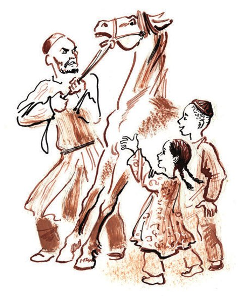

## Kapitel 30: Das mächtige Häuflein oder Die Goldsucher

Mit den Rufen «Opfer von <abbr title="der Einbrecher, die Einbrecher — громила, взломщик">Einbrechern</abbr>», «Die Räuber sind entkommen» und «Das Geheimnis im Zimmer des Redakteurs» lief Stjopa ins Zimmer.

— Persizki, — sagte er, — geh schnell zum <abbr title="der Tatort, die Tatorte — место происшествия">Tatort</abbr> und schreib etwas für «Was heute passiert ist». Ein <abbr title="sensationell — сенсационный">sensationeller</abbr> Fall für fünf Zeilen in <abbr title="der Kleindruck — петит (мелкий шрифт)">Kleindruck</abbr>!

Es stellte sich heraus: Der Redakteur war in sein Zimmer gekommen und hatte seinen riesigen Federhalter mit der Schreibfeder Nr. 86 auf dem Boden gefunden. Die Feder steckte im Fuß des Sofas. Und der neue Stuhl des Redakteurs, den man auf einer Versteigerung gekauft hatte, sah aus, als hätten <abbr title="die Krähe, die Krähen — ворона">Krähen</abbr> darauf <abbr title="herumpicken — клевать">herumgepickt</abbr>. Der ganze Bezug war zerrissen, die <abbr title="die Polsterung — набивка">Polsterung</abbr> lag auf dem Boden, und die Sprungfedern ragten heraus wie Schlangen, die gleich <abbr title="zubeißen (biss zu, hat zugebissen) — укусить">zubeißen</abbr> wollen.

— Ein kleiner Diebstahl, — sagte Persizki. — Wenn noch drei Diebstähle dazukommen, schreiben wir eine Notiz von drei Zeilen.

— Das ist es ja gerade: Es ist kein Diebstahl. Nichts wurde gestohlen. Nur der Stuhl wurde <abbr title="kaputt machen — исковеркать, испортить">kaputt gemacht</abbr>.

— Ganz wie bei Lapsus, — bemerkte Persizki. — Es sieht so aus, als hätte Lapsus nicht gelogen.

— Sehen Sie, — sagte Lapsus stolz, — geben Sie mir einen Fünfziger.

Man brachte die Abendzeitung. Persizki begann, sie <abbr title="durchblättern — просматривать, пролистывать">durchzublättern</abbr>.

Ein normaler Leser liest eine Zeitung. Ein <abbr title="der Journalist, die Journalisten — журналист">Journalist</abbr> betrachtet sie zuerst wie ein Bild.

Ihn interessiert die <abbr title="die Komposition — композиция">Komposition</abbr>.

— Ich hätte das trotzdem nicht so <abbr title="umbrechen (umbrach, hat umbrochen) — верстать">umbrochen</abbr>, — sagte Persizki. — Unser Leser ist auf den amerikanischen <abbr title="der Umbruch — вёрстка">Umbruch</abbr> nicht vorbereitet … Die Karikatur ist natürlich über Chamberlain … Ein Bericht über den Sucharew-Turm … Lapsus, Sie sollten auch mal etwas über den Sucharew-Markt <abbr title="hinschreiben (schrieb hin, hat hingeschrieben) — написать, «писануть»">hinschreiben</abbr>: ein ganz frisches Thema – es erscheinen nur vierzig Berichte im Jahr darüber … Weiter …

Mit leichter Verachtung begann Persizki die Seite mit den Unglücksfällen zu lesen. Nach seiner <abbr title="parteiisch — пристрастный">parteiischen</abbr> Meinung wurde sie <abbr title="talentlos — бездарно">talentlos</abbr> gemacht.

— Hundert Jahre altes Material! … Diesen Veruntreuer hatten wir schon … <abbr title="misslungen — неудавшийся">Misslungener</abbr> Diebstahl im Kolumbus-Theater! Ä-ä-äh, Genossen, das ist etwas Neues … Hört zu!

Und Persizki las laut vor:

*Misslungener Diebstahl im Kolumbus-Theater*

*Zwei unbekannte <abbr title="der Übeltäter, die Übeltäter — злоумышленник">Übeltäter</abbr> drangen in die <abbr title="die Requisitenkammer, die Requisitenkammern — реквизитная">Requisitenkammer</abbr> des Kolumbus-Theaters ein und trugen vier alte Stühle fort.*

*Im Hof wurden die Übeltäter vom Nachtwächter bemerkt. Der Wächter verfolgte sie, und sie flohen und ließen die Stühle zurück.*

*Bemerkenswert ist, dass die Stühle extra für die neue <abbr title="die Inszenierung, die Inszenierungen — постановка">Inszenierung</abbr> von Gogols «Die Heirat» <abbr title="anschaffen — приобрести">angeschafft</abbr> worden waren.*

— Nein, da steckt etwas dahinter. Das ist irgendeine <abbr title="die Sekte, die Sekten — секта">Sekte</abbr> von Stuhldieben.

— <abbr title="der Wahnsinnige, die Wahnsinnigen — маньяк, безумец">Wahnsinnige</abbr>!

— Na, so einfach ist das nicht. Sie handeln ziemlich vernünftig. Sie waren bei Lapsus, bei uns und im Theater.

— Ja!

— Sie suchen etwas, Genossen.

Da veränderte sich das Gesicht von Nikifor Ljapis plötzlich. Er ging leise aus dem Zimmer und lief durch den Flur. Fünf Minuten später brachte ihn eine schaukelnde Straßenbahn zum Pokrowski-Tor.

Ljapis wohnte im Haus Nr. 9 in der Kasernengasse, zusammen mit zwei jungen Männern, die weiche Hüte trugen. Ljapis trug eine <abbr title="die Kapitänsmütze, die Kapitänsmützen — капитанская фуражка">Kapitänsmütze</abbr> mit dem Wappen von Neptun, dem <abbr title="der Herrscher, die Herrscher — властитель, повелитель">Herrscher</abbr> der Gewässer. Das Zimmer von Ljapis war ein <abbr title="das Durchgangszimmer, die Durchgangszimmer — проходная комната">Durchgangszimmer</abbr>. Daneben wohnte eine große <abbr title="tatarisch — татарский">tatarische</abbr> Familie.

Als Ljapis in sein Zimmer kam, saß Chuntow auf dem Fensterbrett und blätterte in einem <abbr title="das Handbuch, die Handbücher — справочник">Theaterhandbuch</abbr>.

Das war ein Mensch, der <abbr title="im Einklang mit + Dat. — созвучный, в унисон с">im Einklang mit</abbr> der Epoche war. Er tat alles, was die Epoche verlangte.

Die Epoche verlangte Gedichte, und Chuntow schrieb sie <abbr title="massenhaft — во множестве">massenhaft</abbr>.

Die Geschmäcker änderten sich. Die <abbr title="die Anforderung, die Anforderungen — требование">Anforderungen</abbr> änderten sich. Die Epoche und die <abbr title="der Zeitgenosse, die Zeitgenossen — современник">Zeitgenossen</abbr> brauchten einen <abbr title="heldenhaft — героический">heldenhaften</abbr> Roman über den <abbr title="der Bürgerkrieg — гражданская война">Bürgerkrieg</abbr>. Und Chuntow schrieb heldenhafte Romane.

Dann brauchte man Erzählungen aus dem Alltag. Chuntow, im Einklang mit der Epoche, machte sich an Erzählungen.

Die Epoche verlangte viel, aber von Chuntow nahm sie aus irgendeinem Grund nichts.

Jetzt verlangte die Epoche ein <abbr title="das Theaterstück, die Theaterstücke — пьеса">Theaterstück</abbr>. Deshalb saß Chuntow auf dem Fensterbrett und blätterte im Theaterhandbuch. Von einem Menschen, der ein Stück schreiben will, kann man erwarten, dass er die Sitten der sozialen <abbr title="die Schicht, die Schichten — слой">Schicht</abbr> studiert, die er auf die Bühne bringen will. Man kann erwarten, dass er über die <abbr title="die Handlung, die Handlungen — сюжет">Handlung</abbr> nachdenkt, die Charaktere der Figuren in Gedanken skizziert und sich <abbr title="die Verwechslung, die Verwechslungen — путаница, квипрокво">Verwechslungen</abbr> für die Bühne ausdenkt. Aber Chuntow begann am anderen Ende – mit <abbr title="die Rechenaufgabe, die Rechenaufgaben — арифметическая выкладка">Rechenaufgaben</abbr>. Mit Hilfe der <abbr title="der Sitzplan, die Sitzpläne — план зрительного зала">Sitzpläne</abbr> rechnete er aus, wie viel jedes Theater durchschnittlich an einer Vorstellung einnahm. Sein volles, angenehmes Gesicht <abbr title="sich runzeln — морщиться">runzelte sich</abbr> vor Anstrengung, die Augenbrauen gingen nach oben und fielen wieder nach unten.

Schnell schrieb Chuntow <abbr title="die Zahlenkolonne, die Zahlenkolonnen — колонка цифр">Zahlenkolonnen</abbr> in sein Notizbuch. Er <abbr title="multiplizieren — умножать">multiplizierte</abbr> die Zahl der Plätze mit dem Durchschnittspreis für eine Karte. Dabei rechnete er alles zweimal: einmal mit <abbr title="erhöht — повышенный">erhöhten</abbr> Preisen und einmal mit normalen.

An der Spitze der Moskauer <abbr title="der Unterhaltungsbetrieb, die Unterhaltungsbetriebe — зрелищное предприятие">Unterhaltungsbetriebe</abbr> stand, nach der Zahl der Plätze und nach ihren Preisen, das Große Akademische Theater. Chuntow <abbr title="sich trennen von + Dat. — расставаться с">trennte sich</abbr> mit großem Bedauern davon. Um ins Bolschoi-Theater zu kommen, hätte er eine Oper oder ein <abbr title="das Ballett, die Ballette — балет">Ballett</abbr> schreiben müssen. Aber die Epoche verlangte in diesem <abbr title="der Zeitabschnitt, die Zeitabschnitte — отрезок времени">Zeitabschnitt</abbr> ein <abbr title="das Drama, die Dramen — драма">Drama</abbr>. Und Chuntow wählte das <abbr title="einträglich — выгодный, доходный">einträglichste</abbr> Theater: das Moskauer Akademische Künstlertheater. Katschalow und Moskwin, dachte er, unter der Leitung von Stanislawski, werden für volle Kassen sorgen. Chuntow rechnete seine Autorenprozente aus. Nach seiner Rechnung musste das Stück in einer Saison mindestens hundertmal gespielt werden. «Die Tage der Turbins» liefen ja auch so oft, dachte er. Es kam viel Honorar zusammen. Noch nie hatte das Schicksal Chuntow solche <abbr title="der Profit, die Profite — барыш, прибыль">Profite</abbr> versprochen.

Jetzt musste er nur noch das Stück schreiben. Aber das machte Chuntow am wenigsten Sorgen. «Der Zuschauer ist dumm», dachte er.

— Eine <abbr title="die Weltklasse — мировой класс">Weltklasse</abbr>-Handlung! — rief Ljapis und ging zu dem Menschen, der ohne Pause <abbr title="im Gleichklang mit + Dat. — в унисон с">im Gleichklang</abbr> mit der Epoche klang.

Chuntow brauchte eine Handlung, und er fragte lebhaft:

— Was für eine Handlung?

— Erstklassig, — antwortete Ljapis.

Der Mann der Epoche war schon bereit, Ljapis' Worte aufzuschreiben. Aber der Autor des vielgesichtigen Gawrila war von Natur aus misstrauisch und verstummte.

— Na! Sprich doch!

— Du klaust sie.

— Habe ich dir etwa oft Handlungen geklaut?

— Und die Erzählung von dem Komsomolzen, der hunderttausend Rubel gewonnen hat?

— Ja, aber die wurde ja nicht genommen.

— Was hat man von dir überhaupt jemals genommen! Ich kann ein wunderbares Poem schreiben.

— Na, <abbr title="Unsinn machen — валять дурака">hör auf mit dem Unsinn</abbr>! Erzähl!

— Und du klaust sie nicht?

— Ehrenwort.

— Die Handlung ist erstklassig. Verstehst du, die Geschichte geht so. Ein sowjetischer Erfinder hat einen <abbr title="der Todesstrahl, die Todesstrahlen — луч смерти">Todesstrahl</abbr> erfunden und die Baupläne in einem Stuhl versteckt. Und dann ist er gestorben. Seine Frau wusste von nichts und hat die Stühle verkauft. Aber die Faschisten haben davon erfahren und angefangen, die Stühle zu suchen. Und ein Komsomolze hat von den Stühlen erfahren, und der Kampf beginnt. Da kann man so viel <abbr title="draufpacken — накрутить">draufpacken</abbr> …

Chuntow lief im Zimmer hin und her und machte Bögen um den <abbr title="ausgeweidet — опустошённый, выпотрошенный">ausgeweideten</abbr> Stuhl von Worobjaninow.

— Gibst du mir diese Handlung?

— <abbr title="angenommen — положим, допустим">Angenommen</abbr>.

— Ljapis! Du hast kein Gefühl für eine Handlung! Das ist keine Handlung für ein Poem. Das ist eine Handlung für ein Theaterstück.

— Egal. Das geht dich nichts an. Die Handlung gehört mir.

— Dann schreibe ich das Stück, bevor du den Titel deines Poems geschrieben hast.

Der Streit zwischen den jungen Männern wurde <abbr title="heftig — горячий, яростный">heftig</abbr>, aber er wurde unterbrochen, weil Ibragim kam.

Das war ein <abbr title="umgänglich — лёгкий в общении">umgänglicher</abbr>, lebhafter und fröhlicher Mensch. Er war dick. Die Kragen würgten ihn. Auf seinem Gesicht, seinem Hals und seinen Händen leuchteten Sommersprossen. Seine Haare hatten die Farbe von <abbr title="das Rührei — яичница-болтунья">Rührei</abbr>. Aus seinem Mund kam dicker Rauch. Ibragim rauchte Zigarren der Marke «Figaro»: 2 Stück – 25 Kopeken. Er trug etwas aus Segeltuch, das ungefähr wie ein Cutaway aussah. Aus den Taschen ragten <abbr title="die Notenrolle, die Notenrollen — свёрток нот">Notenrollen</abbr>. Ein <abbr title="der Panamahut, die Panamahüte — панама">Panamahut</abbr> aus Stoff saß wie ein kleiner Korb auf seinem <abbr title="der Scheitel, die Scheitel — темя, макушка">Scheitel</abbr>. Ibragim war ganz voll mit schmutzigem <abbr title="der Schweiß — пот">Schweiß</abbr>.

— Wegen was ist der Streit? — fragte er mit <abbr title="schrill — пронзительный">schriller</abbr> Stimme.

Der <abbr title="der Komponist, die Komponisten — композитор">Komponist</abbr> Ibragim lebte von der <abbr title="die Gnade — милость">Gnade</abbr> seiner Schwester. Sie schickte ihm aus Warschau neue <abbr title="der Foxtrott, die Foxtrotts — фокстрот">Foxtrotts</abbr>. Ibragim schrieb sie auf <abbr title="das Notenpapier — нотная бумага">Notenpapier</abbr> ab und änderte den Titel – aus «Liebe im Ozean» machte er «<abbr title="die Ambrosia — амброзия">Ambrosia</abbr>», aus «Flirt in der U-Bahn» machte er «Nächte in Singapur». Dann gab er den Noten Texte von Chuntow und <abbr title="verscherbeln — сплавить, сбыть">verscherbelte</abbr> sie an die Musikabteilung.

— Wegen was ist der Streit? — wiederholte er.

Die beiden Rivalen <abbr title="appellieren an + Akk. — взывать к">appellierten</abbr> an Ibragims <abbr title="die Unparteilichkeit — беспристрастие">Unparteilichkeit</abbr>. Die Geschichte von den Faschisten wurde zum zweiten Mal erzählt.

— Man muss ein Poem schreiben, — wiederholte Ljapis-Trubezkoi.

— Ein Stück! — schrie Chuntow.

Aber Ibragim handelte wie ein biblischer Geschworener. Er entschied den <abbr title="der Rechtsstreit, die Rechtsstreite — тяжба">Rechtsstreit</abbr> <abbr title="im Handumdrehen — мигом">im Handumdrehen</abbr>.

— Eine Oper! — sagte Ibragim und schnaufte. — Daraus wird eine richtige Oper mit Ballett, Chören und prächtigen Partien.

Chuntow <abbr title="unterstützen — поддержать">unterstützte</abbr> ihn. Er dachte sofort an die <abbr title="die Einnahme, die Einnahmen — сбор, доход">Einnahmen</abbr> des Bolschoi-Theaters. Ljapis <abbr title="sich sträuben — упираться, противиться">sträubte sich</abbr>, aber man verlockte ihn mit Geschichten über den künftigen <abbr title="der Verdienst — заработок, выгода">Verdienst</abbr>. Chuntow schlug mit der Hand auf das Handbuch und rief Zahlen, die alle Vorstellungen von Ljapis über Reichtum <abbr title="über den Haufen werfen — опрокидывать, разрушать">über den Haufen warfen</abbr>.

Jetzt wurden die <abbr title="schöpferisch — творческий">schöpferischen</abbr> <abbr title="die Aufgabe, die Aufgaben — задача, обязанность">Aufgaben</abbr> verteilt. Das <abbr title="das Drehbuch, die Drehbücher — сценарий">Drehbuch</abbr> und die Bearbeitung in Prosa übernahm Chuntow. Die Verse bekam Ljapis. Die Musik sollte Ibragim schreiben. Sie beschlossen, gleich hier und sofort zu schreiben. Chuntow setzte sich auf den <abbr title="verstümmelt — искалеченный">verstümmelten</abbr> Stuhl und schrieb <abbr title="leserlich — разборчиво">leserlich</abbr> oben auf das Blatt: «Erster <abbr title="der Akt, die Akte — акт, действие">Akt</abbr>».

— Also, Freunde, — sagte Ibragim, — während ihr da etwas <abbr title="hinkritzeln — нацарапать">hinkritzelt</abbr>, beschreibt mir die <abbr title="die Hauptfigur, die Hauptfiguren — главное действующее лицо">Hauptfiguren</abbr>. Ich bereite ein paar <abbr title="das Leitmotiv, die Leitmotive — лейтмотив">Leitmotive</abbr> vor. Das ist <abbr title="unbedingt nötig — совершенно необходимо">unbedingt nötig</abbr>.

Die Goldsucher begannen, die Charaktere der Figuren <abbr title="ausarbeiten — разрабатывать">auszuarbeiten</abbr>. Es ergaben sich ungefähr diese Figuren:

Ugolino – <abbr title="der Großmeister, die Großmeister — гроссмейстер">Großmeister</abbr> des Faschistenordens (Bass).

Alfonsine – seine Tochter (<abbr title="der Koloratursopran — колоратурное сопрано">Koloratursopran</abbr>).

Gen. Mitin – sowjetischer Erfinder (<abbr title="der Bariton — баритон">Bariton</abbr>).

Sforza – faschistischer <abbr title="der Prinz, die Prinzen — принц">Prinz</abbr> (Tenor).

Gawrila – Komsomolze vom Dorf (verkleideter <abbr title="der Mezzosopran — меццо-сопрано">Mezzosopran</abbr>).

Nina – <abbr title="die Komsomolzin, die Komsomolzinnen — комсомолка">Komsomolzin</abbr>, Tochter eines Popen (lyrischer Sopran).

(Faschisten, <abbr title="der Schwarzbrenner, die Schwarzbrenner — самогонщик">Schwarzbrenner</abbr>, <abbr title="der Kaplan, die Kapläne — капеллан">Kaplane</abbr>, Soldaten, <abbr title="der Haushofmeister, die Haushofmeister — мажордом">Haushofmeister</abbr>, Techniker, <abbr title="der Sizilianer, die Sizilianer — сицилиец">Sizilianer</abbr>, <abbr title="der Laborant, die Laboranten — лаборант">Laboranten</abbr>, der Geist von Mitin, Pioniere u. a.)

— Ich, — sagte Ibragim, vor dem sich dankbare Aussichten öffneten, — schreibe vorerst den Chor der Kaplane und die sizilianischen Tänze. Und ihr schreibt den ersten Akt. Möglichst viele <abbr title="die Arie, die Arien — ария">Arien</abbr> und <abbr title="das Duett, die Duette — дуэт">Duette</abbr>.

— Und wie nennen wir die Oper? — fragte Ljapis.

Aber da hörte man im <abbr title="der Vorraum, die Vorräume — передняя, прихожая">Vorraum</abbr> das Klappern von Hufen auf dem <abbr title="morsch — гнилой, трухлявый">morschen</abbr> Parkett, ein leises Wiehern und einen Streit unter Nachbarn. Die Tür zum Zimmer der Goldsucher ging auf, und Bürger Scharinow, der Nachbar, führte ein dünnes, mageres Pferd mit langem <abbr title="der Schweif, die Schweife — хвост (лошади)">Schweif</abbr> und grau werdendem Maul ins Zimmer.

— Gou! — schrie Scharinow das Pferd an. — Na-o, verflucht …

Das Pferd erschrak, drehte sich um und stieß Ljapis mit dem <abbr title="das Hinterteil, die Hinterteile — круп, зад">Hinterteil</abbr>.

Die Goldsucher waren so verblüfft, dass sie sich vor Angst an die Wand drückten. Scharinow zog das Pferd in sein Zimmer. Von dort sprangen viele grünliche kleine Tatarenkinder heraus. Das Pferd <abbr title="bocken — упрямиться, артачиться">bockte</abbr> und schlug mit dem Huf aus. Ein kleines Quadrat Parkett sprang aus seinem Platz und flog drehend durch das offene Fenster.

— Fatima! — schrie Scharinow mit schrecklicher Stimme. — Schieb von hinten!

Aus dem ganzen Haus rannten die Mieter in das Zimmer der Goldsucher. Ljapis brüllte mit fremder Stimme. Ibragim pfiff ironisch die «Ambrosia». Chuntow fuchtelte mit der Liste der Figuren. Das Pferd schielte unruhig und ging nicht weiter.

— Gou! — sagte Scharinow matt. — O-o-o, T-Teufel! …

Aber jetzt kamen die Goldsucher zur Besinnung und verlangten eine Erklärung. Der Hausverwalter kam mit dem Hausmeister.

— Was machen Sie da? — fragte der Hausverwalter. — Wo hat man so etwas schon gesehen? Wie kann man ein Pferd in eine <abbr title="die Wohnung, die Wohnungen — квартира">Wohnung</abbr> bringen?

Scharinow wurde plötzlich böse.

— Was geht dich das an? Ich habe ein Pferd gekauft. Wo soll ich es hinstellen? Im Hof wird es gestohlen!

— Bringen Sie das Pferd sofort weg! — schrie der Hausverwalter <abbr title="hysterisch — истерически">hysterisch</abbr>. — Wenn Sie <abbr title="das Pferdefleisch — конина">Pferdefleisch</abbr> brauchen, kaufen Sie es in der <abbr title="muslimisch — мусульманский">muslimischen</abbr> <abbr title="die Fleischerei, die Fleischereien — мясная лавка">Fleischerei</abbr>.

— In der Fleischerei ist es teuer, — sagte Scharinow. — Gou! Du! … Verfluchtes Vieh! … Fatima! …

Das Pferd bewegte sich rückwärts und war endlich bereit, dorthin zu gehen, wohin man es führte.

— Ich erlaube Ihnen das nicht, — sagte der Hausverwalter. — Darüber wird das Gericht entscheiden.

Trotzdem führte Scharinow das Pferd in sein Zimmer. Er rief ohne Pause «Brr!» und band das Tier am <abbr title="der Fenstergriff, die Fenstergriffe — оконная ручка">Fenstergriff</abbr> fest. Eine Minute später lief Fatima mit einem großen, leichten Bündel Heu vorbei.

— Wie sollen wir denn leben, wenn nebenan ein Pferd ist? Wir schreiben eine Oper, das stört uns! — brüllte Ljapis.

— Keine Sorge, — sagte der Hausverwalter im Gehen, — arbeiten Sie nur.

Die Goldsucher hörten auf das Klappern der Hufe und setzten sich wieder an die Arbeit.

— Also, wie nennen wir die Oper? — fragte Ljapis.

— Ich <abbr title="vorschlagen (schlug vor, hat vorgeschlagen) — предлагать">schlage vor</abbr>, sie «Die eiserne Rose» zu nennen.

— Und was hat die Rose damit zu tun?

— Dann eben anders. Zum Beispiel «Das Schwert des Ugolino».

— Auch nicht <abbr title="zeitgemäß — современный">zeitgemäß</abbr>.

— Wie sollen wir sie dann nennen?

Und sie <abbr title="sich entscheiden für + Akk. (entschied, hat entschieden) — остановиться на, выбрать">entschieden sich</abbr> für einen ausgezeichneten, spannenden Titel: «Der Todesstrahl». Unter die Worte «Erster Akt» schrieb Chuntow mit fester Hand: «Früher Morgen. Die Bühne zeigt eine Moskauer Straße, einen ununterbrochenen Strom von Autos, Bussen und Straßenbahnen. An der <abbr title="die Kreuzung, die Kreuzungen — перекрёсток">Kreuzung</abbr> – Ugolino in einem <abbr title="der Bauernrock, die Bauernröcke — поддёвка">Bauernrock</abbr>. Bei ihm – Sforza.»

— Sforza im <abbr title="der Schlafanzug, die Schlafanzüge — пижама">Schlafanzug</abbr>, — <abbr title="einwerfen (warf ein, hat eingeworfen) — вставить (реплику)">warf</abbr> Ljapis ein.

— Stör nicht, du Dummkopf! Schreib lieber die Verse für das <abbr title="das Arioso — ариозо">Arioso</abbr> von Mitin. Auf der Straße geht man nicht im Schlafanzug!

Und Chuntow schrieb weiter: «Bei ihm – Sforza im Anzug eines Komsomolzen.»

Weiter kamen sie nicht. Der Hausverwalter und zwei Milizionäre begannen, das Pferd aus Scharinows Zimmer zu holen.

— Fatima! — schrie Scharinow. — Halt fest, Fatima!

Ljapis nahm ein <abbr title="das Weißbrot, die Weißbrote — батон">Weißbrot</abbr> vom Tisch und schlug damit feige auf das knochige Hinterteil des Pferdes.

— Zieh! — brüllte der Hausverwalter.

Das Pferd schlug mit dem Schweif nach rechts und nach links, als ob es sich <abbr title="sich bekreuzigen — креститься">bekreuzigte</abbr>. Die Milizionäre keuchten. Fatima und ihre kleinen Tatarenbrüder <abbr title="umklammern — обхватывать">umklammerten</abbr> die dünnen Knie des Pferdes. Bürger Scharinow schrie verzweifelt: «Gou!»

Die Goldsucher kamen den <abbr title="der Vertreter des Gesetzes — представитель закона">Vertretern des Gesetzes</abbr> zu Hilfe, und die <abbr title="malerisch — живописный">malerische</abbr> Gruppe <abbr title="purzeln — вываливаться, кувыркаться">purzelte</abbr> mit Lärm in den Vorraum.

Im leeren Zimmer roch es nach Zirkusstall. Ein plötzlicher Wind riss die Blätter der Oper vom Tisch und <abbr title="wirbeln — кружить">wirbelte</abbr> sie zusammen mit dem Stroh durch das Zimmer. Das Arioso von Genosse Mitin flog bis unter die Decke. Der Chor der Kaplane und die Anfänge des sizilianischen Tanzes tanzten auf dem Fensterbrett.

Von der Treppe hörte man Schreie und ein <abbr title="angewidert — брезгливый">angewidertes</abbr> Wiehern. Die Goldsucher, die Milizionäre und die Vertreter der Hausverwaltung nahmen ihre letzten Kräfte zusammen. Als das <abbr title="störrisch — упорный, упрямый">störrische</abbr> Tier endlich besiegt war, sammelten die <abbr title="der Mitautor, die Mitautoren — соавтор">Mitautoren</abbr> die <abbr title="verstreut — развеянный, разбросанный">verstreuten</abbr> Blätter ein und schrieben weiter, ohne etwas zu verbessern.

---

### Neue Wörter

- **der Einbrecher, die Einbrecher** — громила, взломщик
- **der Tatort, die Tatorte** — место происшествия
- **sensationell** — сенсационный
- **der Kleindruck** — петит (мелкий шрифт)
- **die Krähe, die Krähen** — ворона
- **herumpicken** — клевать
- **die Polsterung** — набивка
- **zubeißen (biss zu, hat zugebissen)** — укусить
- **kaputt machen** — исковеркать, испортить
- **durchblättern** — просматривать, пролистывать
- **der Journalist, die Journalisten** — журналист
- **die Komposition** — композиция
- **umbrechen (umbrach, hat umbrochen)** — верстать
- **der Umbruch** — вёрстка
- **hinschreiben (schrieb hin, hat hingeschrieben)** — написать, «писануть»
- **parteiisch** — пристрастный
- **talentlos** — бездарно
- **misslungen** — неудавшийся
- **der Übeltäter, die Übeltäter** — злоумышленник
- **die Requisitenkammer, die Requisitenkammern** — реквизитная
- **die Inszenierung, die Inszenierungen** — постановка
- **anschaffen** — приобрести
- **die Sekte, die Sekten** — секта
- **der Wahnsinnige, die Wahnsinnigen** — маньяк, безумец
- **die Kapitänsmütze, die Kapitänsmützen** — капитанская фуражка
- **der Herrscher, die Herrscher** — властитель, повелитель
- **das Durchgangszimmer, die Durchgangszimmer** — проходная комната
- **tatarisch** — татарский
- **das Handbuch, die Handbücher** — справочник
- **im Einklang mit + Dat.** — созвучный, в унисон с
- **massenhaft** — во множестве
- **die Anforderung, die Anforderungen** — требование
- **der Zeitgenosse, die Zeitgenossen** — современник
- **heldenhaft** — героический
- **der Bürgerkrieg** — гражданская война
- **das Theaterstück, die Theaterstücke** — пьеса
- **die Schicht, die Schichten** — слой
- **die Handlung, die Handlungen** — сюжет
- **die Verwechslung, die Verwechslungen** — путаница, квипрокво
- **die Rechenaufgabe, die Rechenaufgaben** — арифметическая выкладка
- **der Sitzplan, die Sitzpläne** — план зрительного зала
- **sich runzeln** — морщиться
- **die Zahlenkolonne, die Zahlenkolonnen** — колонка цифр
- **multiplizieren** — умножать
- **erhöht** — повышенный
- **der Unterhaltungsbetrieb, die Unterhaltungsbetriebe** — зрелищное предприятие
- **sich trennen von + Dat.** — расставаться с
- **das Ballett, die Ballette** — балет
- **der Zeitabschnitt, die Zeitabschnitte** — отрезок времени
- **das Drama, die Dramen** — драма
- **einträglich** — выгодный, доходный
- **der Profit, die Profite** — барыш, прибыль
- **die Weltklasse** — мировой класс
- **im Gleichklang mit + Dat.** — в унисон с
- **Unsinn machen** — валять дурака
- **der Todesstrahl, die Todesstrahlen** — луч смерти
- **draufpacken** — накрутить
- **ausgeweidet** — опустошённый, выпотрошенный
- **angenommen** — положим, допустим
- **heftig** — горячий, яростный
- **umgänglich** — лёгкий в общении
- **das Rührei** — яичница-болтунья
- **die Notenrolle, die Notenrollen** — свёрток нот
- **der Panamahut, die Panamahüte** — панама
- **der Scheitel, die Scheitel** — темя, макушка
- **der Schweiß** — пот
- **schrill** — пронзительный
- **der Komponist, die Komponisten** — композитор
- **die Gnade** — милость
- **der Foxtrott, die Foxtrotts** — фокстрот
- **das Notenpapier** — нотная бумага
- **die Ambrosia** — амброзия
- **verscherbeln** — сплавить, сбыть
- **appellieren an + Akk.** — взывать к
- **die Unparteilichkeit** — беспристрастие
- **der Rechtsstreit, die Rechtsstreite** — тяжба
- **im Handumdrehen** — мигом
- **unterstützen** — поддержать
- **die Einnahme, die Einnahmen** — сбор, доход
- **sich sträuben** — упираться, противиться
- **der Verdienst** — заработок, выгода
- **über den Haufen werfen** — опрокидывать, разрушать
- **schöpferisch** — творческий
- **die Aufgabe, die Aufgaben** — задача, обязанность
- **das Drehbuch, die Drehbücher** — сценарий
- **verstümmelt** — искалеченный
- **leserlich** — разборчиво
- **der Akt, die Akte** — акт, действие
- **hinkritzeln** — нацарапать
- **die Hauptfigur, die Hauptfiguren** — главное действующее лицо
- **das Leitmotiv, die Leitmotive** — лейтмотив
- **unbedingt nötig** — совершенно необходимо
- **ausarbeiten** — разрабатывать
- **der Großmeister, die Großmeister** — гроссмейстер
- **der Koloratursopran** — колоратурное сопрано
- **der Bariton** — баритон
- **der Prinz, die Prinzen** — принц
- **der Mezzosopran** — меццо-сопрано
- **die Komsomolzin, die Komsomolzinnen** — комсомолка
- **der Schwarzbrenner, die Schwarzbrenner** — самогонщик
- **der Kaplan, die Kapläne** — капеллан
- **der Haushofmeister, die Haushofmeister** — мажордом
- **der Sizilianer, die Sizilianer** — сицилиец
- **der Laborant, die Laboranten** — лаборант
- **die Arie, die Arien** — ария
- **das Duett, die Duette** — дуэт
- **der Vorraum, die Vorräume** — передняя, прихожая
- **morsch** — гнилой, трухлявый
- **der Schweif, die Schweife** — хвост (лошади)
- **das Hinterteil, die Hinterteile** — круп, зад
- **bocken** — упрямиться, артачиться
- **die Wohnung, die Wohnungen** — квартира
- **hysterisch** — истерически
- **das Pferdefleisch** — конина
- **muslimisch** — мусульманский
- **die Fleischerei, die Fleischereien** — мясная лавка
- **der Fenstergriff, die Fenstergriffe** — оконная ручка
- **vorschlagen (schlug vor, hat vorgeschlagen)** — предлагать
- **zeitgemäß** — современный
- **sich entscheiden für + Akk. (entschied, hat entschieden)** — остановиться на, выбрать
- **die Kreuzung, die Kreuzungen** — перекрёсток
- **der Bauernrock, die Bauernröcke** — поддёвка
- **der Schlafanzug, die Schlafanzüge** — пижама
- **einwerfen (warf ein, hat eingeworfen)** — вставить (реплику)
- **das Arioso** — ариозо
- **das Weißbrot, die Weißbrote** — батон
- **sich bekreuzigen** — креститься
- **umklammern** — обхватывать
- **der Vertreter des Gesetzes** — представитель закона
- **malerisch** — живописный
- **purzeln** — вываливаться, кувыркаться
- **wirbeln** — кружить
- **angewidert** — брезгливый
- **störrisch** — упорный, упрямый
- **der Mitautor, die Mitautoren** — соавтор
- **verstreut** — развеянный, разбросанный

[← Kapitel 29](kapitel-29.md) · [Inhalt](README.md) · [Kapitel 31 →](kapitel-31.md)
