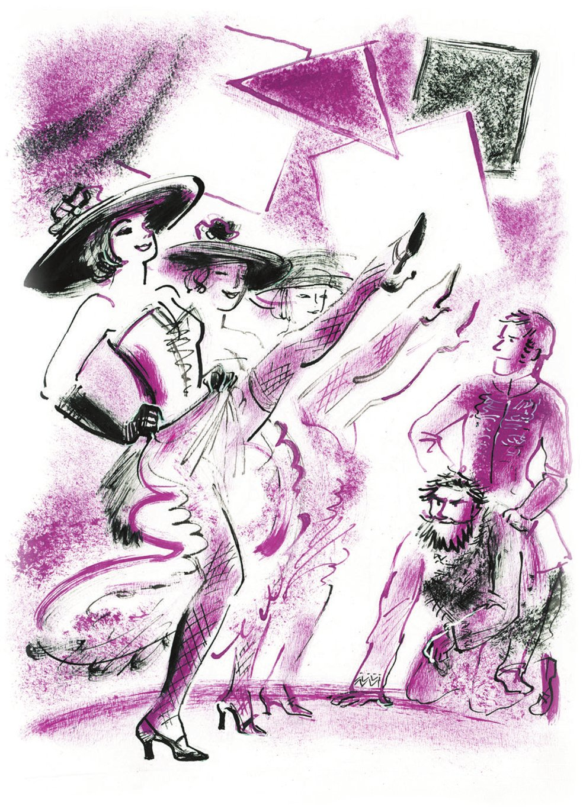
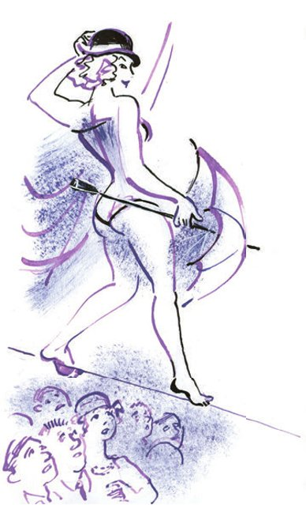

## Kapitel 31: Im Kolumbus-Theater

Ippolit Matwejewitsch wurde langsam zu einem Speichellecker. Wenn er Ostap ansah, bekamen seine Augen einen blauen <abbr title="der Schimmer — оттенок, отблеск">Schimmer</abbr> wie bei einem <abbr title="der Gendarm, die Gendarmen — жандарм">Gendarmen</abbr>.

Im Zimmer von Iwanopulo war es so heiß, dass die <abbr title="ausgetrocknet — высохший">ausgetrockneten</abbr> Stühle von Worobjaninow <abbr title="knistern — потрескивать">knisterten</abbr> wie Holz im Kamin. Der große Kombinator ruhte sich aus. Unter dem Kopf hatte er die blaue Weste.

Ippolit Matwejewitsch sah aus dem Fenster. Draußen, durch die krummen Gassen und an den winzigen Moskauer Gärten vorbei, fuhr eine Kutsche mit einem Wappen. In ihrem schwarzen <abbr title="der Lack, die Lacke — лак">Lack</abbr> spiegelten sich <abbr title="abwechselnd — попеременно">abwechselnd</abbr> die Passanten, die sich verbeugten: ein <abbr title="der Gardeoffizier, die Gardeoffiziere — кавалергард">Gardeoffizier</abbr> mit einem Kopf aus <abbr title="das Kupfer — медь">Kupfer</abbr>, Damen aus der Stadt und dicke weiße <abbr title="das Wölkchen, die Wölkchen — облачко">Wölkchen</abbr>. Die Pferde donnerten mit ihren Hufeisen über das Pflaster und zogen die Kutsche an Ippolit Matwejewitsch vorbei. Er drehte sich <abbr title="enttäuscht — разочарованно">enttäuscht</abbr> weg.

Die Kutsche trug das Wappen der Moskauer Kommunalwirtschaft. Sie war für den Müll bestimmt, und ihre Wände aus Brettern spiegelten gar nichts. Auf dem Kutschbock saß ein <abbr title="wacker — бравый">wackerer</abbr> Alter mit einem flauschigen grauen Bart. Hätte Ippolit Matwejewitsch gewusst, dass der Kutscher kein anderer war als Graf Alexej Bulanow, der berühmte Husar und <abbr title="der Einsiedler, die Einsiedler — отшельник, схимник">Einsiedler</abbr>, dann hätte er den Alten wahrscheinlich gerufen, um mit ihm über die reizenden vergangenen Zeiten zu reden. Graf Alexej Bulanow war sehr besorgt. Er <abbr title="peitschen — хлестать">peitschte</abbr> die Pferde und dachte traurig über die Bürokratie nach, die die Unterabteilung für <abbr title="die Abwasserentsorgung — ассенизация">Abwasserentsorgung</abbr> <abbr title="zerfressen (zerfraß, hat zerfressen) — разъедать">zerfraß</abbr>. Wegen dieser Bürokratie bekam der Graf schon seit einem halben Jahr nicht die Spezialschürze, die ihm nach dem <abbr title="der Tarifvertrag, die Tarifverträge — коллективный договор">Tarifvertrag</abbr> <abbr title="zustehen (stand zu, hat zugestanden) — полагаться (кому-то)">zustand</abbr>.

— Hören Sie, — sagte plötzlich der große Kombinator, — wie hat man Sie als Kind genannt?

— Wozu wollen Sie das wissen?

— Nur so! Ich weiß nicht, wie ich Sie nennen soll. Worobjaninow habe ich <abbr title="etwas satt haben — надоесть">satt</abbr>, und Ippolit Matwejewitsch ist zu sauer. Wie hat man Sie also genannt? Ipa?

— Kisa, — antwortete Ippolit Matwejewitsch und grinste.

— Kongenial. Also, Kisa, sehen Sie bitte nach, was ich da auf dem Rücken habe. Es tut zwischen den <abbr title="das Schulterblatt, die Schulterblätter — лопатка">Schulterblättern</abbr> weh.

Ostap zog sein <abbr title="das Cowboyhemd, die Cowboyhemden — рубашка «ковбой»">Cowboyhemd</abbr> über den Kopf. Vor Kisa Worobjaninow lag der breite Rücken eines <abbr title="Antinoos — Антиной (образец мужской красоты)">Antinoos</abbr> aus der Provinz – ein Rücken von bezaubernder Form, aber ein bisschen schmutzig.

— Oho, — sagte Ippolit Matwejewitsch, — da ist etwas Rotes.

Zwischen den Schulterblättern des großen Kombinators <abbr title="schillern — переливаться">schillerten</abbr> lila <abbr title="der blaue Fleck, die blauen Flecken — синяк">blaue Flecken</abbr> von seltsamer Form, bunt wie ein <abbr title="der Ölfleck, die Ölflecken — нефтяное пятно">Ölfleck</abbr>.

— Ehrenwort, eine Ziffer Acht! — rief Worobjaninow. — So einen blauen Fleck sehe ich zum ersten Mal.

— Und gibt es keine andere Ziffer? — fragte Ostap ruhig.

— Es sieht aus wie der Buchstabe R.

— Keine weiteren Fragen. Alles klar. Dieser verfluchte Federhalter! Sehen Sie, Kisa, wie ich leide, welchen Gefahren ich mich wegen Ihrer Stühle <abbr title="sich aussetzen + Dat. — подвергаться">aussetze</abbr>. Diese <abbr title="arithmetisch — арифметический">arithmetischen</abbr> Zeichen hat mir ein großer, selbst fallender Federhalter mit der Feder Nr. 86 gemacht. Ich muss Ihnen sagen: Der verfluchte Federhalter ist mir genau in dem Moment auf den Rücken gefallen, als ich meine Hände in das Innere des Redakteursstuhls gesteckt habe. Und Sie, Sie können gar nichts richtig! Warum mussten wir aus dem Theater fliehen? Wegen Ihnen! <abbr title="jemanden reitet der Teufel — чёрт дёрнул">Hat Sie der Teufel geritten</abbr>, wie ein Wachposten auf dem <abbr title="das Zinkblech — цинк, жесть">Zinkblech</abbr> zu stehen, ohne sich zu bewegen? Das haben Sie natürlich gemacht, um die Aufmerksamkeit aller <abbr title="auf sich ziehen — привлекать к себе">auf sich zu ziehen</abbr>. Und wer hat den Stuhl von Isnurenkow so <abbr title="verpfuschen — изгадить, испортить">verpfuscht</abbr>, dass ich danach für Sie <abbr title="für etwas geradestehen — отдуваться за">geradestehen</abbr> musste? Von der Versteigerung rede ich gar nicht. Was für eine Zeit für eine <abbr title="die Schürzenjagd — волокитство, «кобеляж»">Schürzenjagd</abbr>! In Ihrem Alter ist die Schürzenjagd einfach schädlich! Passen Sie auf Ihre Gesundheit auf! … Ganz anders ich! <abbr title="auf jemandes Konto gehen — на счету у кого-то">Auf mein Konto</abbr> geht der Stuhl der Witwe! Auf mein Konto gehen die zwei Stühle von Schtschukin. Den Stuhl von Isnurenkow habe am Ende auch ich gemacht! In die Redaktion und zu Ljapis bin ich gegangen! Und nur einen einzigen Stuhl haben Sie bis zum siegreichen Ende gebracht – und auch das nur mit der Hilfe unseres heiligen Feindes, des <abbr title="der Erzbischof, die Erzbischöfe — архиепископ">Erzbischofs</abbr>!

Der technische Direktor ging <abbr title="barfuß — босиком">barfuß</abbr> und lautlos durch das Zimmer und belehrte den gehorsamen Kisa.

Der Stuhl, der auf dem Güterbahnhof des Oktober-Bahnhofs verschwunden war, blieb ein dunkler Fleck auf dem glänzenden Plan der Konzession. Die vier Stühle im Kolumbus-Theater waren eine sichere <abbr title="die Beute — добыча">Beute</abbr>. Aber das Theater ging auf eine Reise über die Wolga, mit dem <abbr title="der Lotteriedampfer — тиражный пароход">Lotteriedampfer</abbr> «Skrjabin». Und heute zeigte es die Premiere der «Heirat», als letzte Vorstellung der Saison. Man musste sich entscheiden: Sollte man in Moskau bleiben und den Stuhl suchen, der in der <abbr title="die Weite, die Weiten — простор">Weite</abbr> des Kalantschowka-Platzes verschwunden war? Oder sollte man mit der Truppe auf <abbr title="die Tournee, die Tourneen — гастрольное турне">Tournee</abbr> gehen? Ostap <abbr title="neigen zu + Dat. — склоняться к">neigte</abbr> zum Zweiten.

— Oder sollen wir uns vielleicht trennen? — fragte Ostap. — Ich fahre mit dem Theater, und Sie bleiben hier und verfolgen den Stuhl auf dem Güterbahnhof.

Aber Kisa blinzelte so feige mit seinen grauen Wimpern, dass Ostap nicht weitersprach.

— Von zwei Hasen, — sagte er, — wählt man den fetteren. Wir fahren zusammen. Aber die <abbr title="die Kosten (Pl.) — расходы">Kosten</abbr> werden groß sein. Wir werden Geld brauchen. Ich habe noch sechzig Rubel. Wie viel haben Sie? Ach, das habe ich vergessen! In Ihren Jahren ist die Liebe eines jungen Mädchens so teuer! Ich beschließe: Heute gehen wir ins Theater zur Premiere der «Heirat». Vergessen Sie nicht, den Frack anzuziehen. Wenn die Stühle noch da sind und man sie nicht wegen Schulden an die Sozialversicherung verkauft hat, fahren wir gleich morgen los. Denken Sie daran, Worobjaninow, der letzte Akt der Komödie «Der Schatz meiner Schwiegermutter» beginnt. Die <abbr title="finita la commedia — финита ля комедия (комедия окончена)">finita la commedia</abbr> kommt näher, Worobjaninow! Atmen Sie nicht, mein alter Freund! <abbr title="Augen geradeaus! — равнение (вперёд)!">Augen geradeaus</abbr> – zur <abbr title="die Rampe, die Rampen — рампа">Rampe</abbr>! O meine Jugend! O der Duft der <abbr title="die Kulisse, die Kulissen — кулисы">Kulissen</abbr>! Wie viele Erinnerungen! Wie viele <abbr title="die Intrige, die Intrigen — интрига">Intrigen</abbr>! Wie viel Talent habe ich damals in der Rolle des Hamlet gezeigt! Mit einem Wort: Die Sitzung geht weiter!

Um Geld zu sparen, gingen sie zu Fuß ins Theater. Es war noch ganz hell, aber die Laternen leuchteten schon in <abbr title="zitronengelb — лимонный">zitronengelbem</abbr> Licht. Vor aller Augen starb der Frühling. Der Staub jagte ihn von den Plätzen, ein heißer Wind drängte ihn in die Gassen. Dort verhätschelten die alten Frauen die Schöne und tranken mit ihr Tee in den kleinen Höfen, an runden Tischen. Aber das Leben des Frühlings war zu Ende – man ließ ihn nicht mehr unter die Leute. Und dabei wollte er so gern zum Puschkin-Denkmal. Dort ging schon die abendliche Schürzenjagd los. Dort <abbr title="stolzieren — важно расхаживать">stolzierten</abbr> schon junge Männer wie Kater herum, mit bunten Schiebermützen, <abbr title="die Röhrenhose, die Röhrenhosen — брюки-дудочки">Röhrenhosen</abbr>, Krawatten der Sorte «Hundefreude» und Schuhen der Marke «Jimmy».

Mädchen mit lila Puder spazierten zwischen dem <abbr title="der Tempel, die Tempel — храм">Tempel</abbr> der Moskauer Konsumgenossenschaft und der Genossenschaft «Kommunarde» hin und her (zwischen dem ehemaligen Filippow und dem ehemaligen Jelissejew). Die Mädchen fluchten deutlich. Zu dieser Stunde gingen die Passanten langsamer, aber nicht nur, weil es auf der Twerskaja eng wurde. Die Moskauer Pferde waren nicht besser als die in Stargorod: Sie klopften genauso absichtlich mit den Hufen auf das <abbr title="das Holzpflaster — торцовая мостовая">Holzpflaster</abbr>. <abbr title="der Radfahrer, die Radfahrer — велосипедист">Radfahrer</abbr> flogen ohne Lärm vom Tomski-Stadion zurück, vom ersten großen Spiel zwischen zwei Städten. Ein Eisverkäufer schob seine grüne Truhe voller Maidonner und sah ängstlich zum Milizionär. Aber der Milizionär war nicht gefährlich. Er war an seine leuchtende <abbr title="die Ampel, die Ampeln — светофор, семафор">Ampel</abbr> <abbr title="fesseln — сковать">gefesselt</abbr>, mit der er den Straßenverkehr <abbr title="regeln — регулировать">regelte</abbr>.

In diesem ganzen <abbr title="das Gewühl — сутолока, толчея">Gewühl</abbr> gingen die zwei Freunde. Bei jedem Schritt gab es <abbr title="die Versuchung, die Versuchungen — соблазн">Versuchungen</abbr>. In winzigen <abbr title="die Imbissbude, die Imbissbuden — закусочная, «обжорка»">Imbissbuden</abbr> brieten vor den Augen der ganzen Straße <abbr title="der Schaschlik, die Schaschliks — шашлык">Schaschliks</abbr> nach Karser Art, nach kaukasischer Art und aus Filet. Heißer, <abbr title="beißend — едкий, пронзительный">beißender</abbr> Rauch stieg in den hellen Himmel. Aus den Kneipen, kleinen Restaurants und dem Kino «Der große Stumme» kam Musik von <abbr title="das Streichinstrument, die Streichinstrumente — струнный инструмент">Streichinstrumenten</abbr>. An der Straßenbahnhaltestelle ereiferte sich ein Lautsprecher.

Sie mussten sich beeilen. Die Freunde betraten die <abbr title="hallend — гулкий">hallende</abbr> Eingangshalle des Kolumbus-Theaters. Worobjaninow stürzte zur Kasse und las die Preise der Plätze.

— Trotzdem, — sagte er, — sehr teuer. Sechzehnte Reihe – drei Rubel.

— Wie ich sie hasse, — bemerkte Ostap, — diese Spießbürger, diese Einfaltspinsel aus der Provinz! Wohin <abbr title="drängeln — лезть, проталкиваться">drängeln</abbr> Sie sich? Sehen Sie nicht, dass das die Kasse ist?

— Na, und wohin sonst? Ohne Karte lässt man uns doch nicht hinein!

— Kisa, Sie sind ein <abbr title="der Banause, die Banausen — пошляк, обыватель">Banause</abbr>. In jedem ordentlichen Theater gibt es zwei Fensterchen. Ans Kassenfensterchen gehen nur Verliebte und reiche Erben. Alle anderen Bürger (sie sind, wie Sie sehen, die <abbr title="überwältigend — подавляющий">überwältigende</abbr> <abbr title="die Mehrheit — большинство">Mehrheit</abbr>) gehen direkt zum Fensterchen des Verwalters.

Und wirklich: Vor dem Kassenfensterchen standen etwa fünf bescheiden gekleidete Menschen. Vielleicht waren es reiche Erben oder Verliebte. Dafür herrschte am Fensterchen des Verwalters großer Betrieb. Dort stand eine bunte Schlange. Junge Männer in <abbr title="modisch — фасонный, модный">modischen</abbr> Jacketts und in Hosen von einem Schnitt, von dem ein Provinzler nur träumen kann, <abbr title="wedeln mit + Dat. — размахивать">wedelten</abbr> <abbr title="selbstsicher — уверенно">selbstsicher</abbr> mit kleinen Zetteln. Die Zettel kamen von bekannten Regisseuren, Schauspielern, Redaktionen, vom <abbr title="der Kostümbildner, die Kostümbildner — костюмер">Kostümbildner</abbr> des Theaters, vom Chef der Bezirksmiliz und von anderen Personen, die eng mit dem Theater <abbr title="verbunden sein mit + Dat. — быть связанным с">verbunden</abbr> waren, nämlich: von den Mitgliedern der <abbr title="die Vereinigung, die Vereinigungen — ассоциация">Vereinigung</abbr> der Theater- und Filmkritiker, von der Gesellschaft «Tränen armer Mütter», vom Schulrat der «Werkstatt für Zirkusexperimente» und von irgendeinem «FORTINBRAS bei UMSLOPOGAS». Etwa acht Leute hatten Zettel von Esper Eklerowitsch.

Ostap drängte sich in die Schlange, schubste die Fortinbras-Leute zur Seite und rief: «Ich brauche nur eine Auskunft, sehen Sie nicht, dass ich nicht einmal die Gummischuhe ausgezogen habe!» So kam er bis zum Fensterchen und sah hinein.

Der Verwalter arbeitete wie ein <abbr title="der Lastträger, die Lastträger — грузчик">Lastträger</abbr>. Heller Schweiß, wie aus Brillanten, lief über sein fettes Gesicht. Das Telefon störte ihn jede Minute. Es klingelte so hartnäckig wie eine Straßenbahn, die sich über den Smolensker Markt <abbr title="sich kämpfen durch + Akk. — пробиваться">kämpft</abbr>.

— Ja! — schrie er. — Ja! Ja! Halb neun!

Er knallte den <abbr title="der Hörer, die Hörer — трубка">Hörer</abbr> auf und griff sofort wieder danach.

— Ja! Kolumbus-Theater! Ach, Sie sind es, Seguidilla Markowna? Gibt es, gibt es, natürlich gibt es. Parterreloge! Und kommt der <abbr title="der Brummbär, die Brummbären — бука">Brummbär</abbr> nicht mit? Warum? <abbr title="die Grippe — грипп">Grippe</abbr>? Was Sie nicht sagen! Na gut! Ja, ja, auf Wiedersehen, Seguidilla Markowna.

— Kolumbus-Theater!!! Nein! Heute gelten keine Freikarten! Ja, aber was kann ich denn machen? Der Moskauer Sowjet hat es verboten! …

— Kolumbus-Theater!!! Wie bi-itte? Michail Grigorjewitsch? Sagen Sie Michail Grigorjewitsch, dass im Kolumbus-Theater Tag und Nacht ein Platz in der dritten Reihe am Gang auf ihn wartet.

Neben Ostap brodelte und bebte ein Mann mit vollem Gesicht. Seine Augenbrauen gingen ohne Pause nach oben und fielen wieder nach unten.

— Was geht mich das an! — sagte der Verwalter zu ihm.

Chuntow (das war der Mensch im Einklang mit der Epoche) bat kleinlaut und schnell um eine Freikarte.

— Unmöglich! — sagte der Verwalter. — Sie verstehen doch – der Moskauer Sowjet!

— Ja, — murmelte Chuntow, — aber die Moskauer Abteilung der Leningrader Gesellschaft der Dramatiker und Opernkomponisten hat es mit Pawel Fjodorowitsch <abbr title="absprechen (sprach ab, hat abgesprochen) — согласовать">abgesprochen</abbr> …

— Ich kann nicht und ich kann nicht! Der Nächste!

— Erlauben Sie, Jakow Menelajewitsch, man hat mir doch in der Moskauer Abteilung der Leningrader Gesellschaft der Dramatiker und Opernkomponisten …

— Was soll ich denn mit Ihnen machen? Nein, ich gebe Ihnen keine! Was wollen Sie, Genosse?

Chuntow spürte, dass der Verwalter schwankte, und <abbr title="plappern — лопотать, тараторить">plapperte</abbr> wieder los:

— Verstehen Sie doch, Jakow Menelajewitsch, die Moskauer Abteilung der Leningrader Gesellschaft der Dramatiker und Opernkompo…

Das ertrug der Verwalter nicht. Alles hat eine Grenze. Menelajewitsch zerbrach Bleistifte, griff nach dem Telefonhörer und fand für Chuntow einen Platz direkt neben dem Kronleuchter.

— Schnell, — rief er Ostap zu, — Ihren Zettel?

— Zwei Plätze, — sagte Ostap leise, — im Parkett.

— Für wen?

— Für mich!

— Und wer sind Sie, dass ich Ihnen Plätze geben soll?

— Ich denke trotzdem, dass Sie mich kennen.

— Ich erkenne Sie nicht.

Aber der Blick des Fremden war so rein, so klar, dass die Hand des Verwalters Ostap ganz von selbst zwei Plätze in der elften Reihe gab.

— Es kommen alle möglichen Leute, — sagte der Verwalter und zuckte mit den Schultern. — Wer weiß, wer sie sind! Vielleicht ist er vom Volkskommissariat für Bildung? Ich glaube, ich habe ihn im Volkskommissariat gesehen. Wo habe ich ihn gesehen?

Jakow Menelajewitsch gab mechanisch den glücklichen Theater- und Filmkritikern ihre Freikarten. Er war still geworden und dachte weiter nach, wo er diese reinen Augen gesehen hatte.

Als alle Freikarten verteilt waren und im <abbr title="das Foyer, die Foyers — фойе">Foyer</abbr> das Licht schwächer wurde, erinnerte sich Jakow Menelajewitsch: Diese reinen Augen, diesen selbstsicheren Blick hatte er 1922 im Taganka-Gefängnis gesehen. Damals hatte er selbst wegen einer Kleinigkeit dort gesessen.

Aus der elften Reihe, wo die Konzessionäre saßen, hörte man Lachen. Ostap gefiel die musikalische <abbr title="die Ouvertüre, die Ouvertüren — увертюра, вступление">Ouvertüre</abbr>. Die Musiker spielten sie auf Flaschen, <abbr title="der Klistierbecher, die Klistierbecher — кружка Эсмарха (клизма)">Esmarch-Klistierbechern</abbr>, <abbr title="das Saxofon, die Saxofone — саксофон">Saxofonen</abbr> und großen Militärtrommeln. Eine Flöte pfiff, und der Vorhang ging auseinander und brachte Kühle.

Worobjaninow kannte die «Heirat» nur in der klassischen <abbr title="die Interpretation, die Interpretationen — интерпретация">Interpretation</abbr>. Zu seinem <abbr title="das Erstaunen — удивление">Erstaunen</abbr> war Podkolessin nicht auf der Bühne. Ippolit Matwejewitsch suchte mit den Augen und sah <abbr title="das Rechteck, die Rechtecke — прямоугольник">Rechtecke</abbr> aus Sperrholz, die von der Decke hingen. Sie waren in den Grundfarben des <abbr title="das Spektrum, die Spektren — спектр">Sonnenspektrums</abbr> angemalt. Es gab keine Türen und keine blauen Fenster aus Musselin. Unter den bunten Rechtecken tanzten Dämchen mit großen Hüten aus schwarzem <abbr title="der Karton — картон">Karton</abbr>. Das Stöhnen der Flaschen rief Podkolessin auf die Bühne. Er ritt auf Stepan in die Menge hinein. Podkolessin trug die Uniform eines <abbr title="der Kammerherr, die Kammerherren — камергер">Kammerherrn</abbr>. Er <abbr title="verjagen — разгонять, прогонять">verjagte</abbr> die Dämchen mit Worten, die im Stück gar nicht standen, und heulte:

— Stepa-an!

Gleichzeitig sprang er zur Seite und erstarrte in einer schwierigen <abbr title="die Pose, die Posen — поза">Pose</abbr>. Die Esmarch-Klistierbecher donnerten.

— Stepa-a-an! — wiederholte Podkolessin und machte einen neuen Sprung.

Aber Stepan stand gleich daneben, trug ein <abbr title="das Leopardenfell, die Leopardenfelle — барсова шкура">Leopardenfell</abbr> und antwortete nicht. Deshalb fragte Podkolessin <abbr title="tragisch — трагически">tragisch</abbr>:

— Warum schweigst du wie der Völkerbund?

— Ich hab mich wohl vor Chamberlain <abbr title="sich verschrecken — испужаться">verschreckt</abbr>, — antwortete Stepan und kratzte sich am Fell.

Man spürte, dass Stepan Podkolessin <abbr title="verdrängen — оттеснить, вытеснить">verdrängen</abbr> und die Hauptfigur des <abbr title="modernisieren — осовременивать">modernisierten</abbr> Stücks werden würde.

— Nun, näht der Schneider den <abbr title="der Gehrock, die Gehröcke — сюртук">Gehrock</abbr>?

Ein Sprung. Ein Schlag auf die Esmarch-Klistierbecher. Stepan machte mit Mühe einen <abbr title="der Handstand, die Handstände — стойка на руках">Handstand</abbr> und antwortete in dieser Stellung:

— Er näht!

Das Orchester spielte ein Potpourri aus «Madame Butterfly». Die ganze Zeit stand Stepan auf den Händen. Sein Gesicht wurde ganz rot.

— Und, — fragte Podkolessin, — hat der Schneider nicht gefragt, wozu der Herr so ein gutes Tuch braucht?

Stepan saß inzwischen schon im Orchester und umarmte den Dirigenten. Er antwortete:

— Nein, hat er nicht gefragt. Ist er etwa ein <abbr title="der Abgeordnete, die Abgeordneten — депутат">Abgeordneter</abbr> im englischen <abbr title="das Parlament, die Parlamente — парламент">Parlament</abbr>?

— Und hat der Schneider nicht gefragt, ob der Herr heiraten will?

— Der Schneider hat gefragt, ob der Herr Unterhalt zahlen will.

Danach ging das Licht aus, und das Publikum trampelte mit den Füßen. Es trampelte so lange, bis von der Bühne die Stimme von Podkolessin kam:

— Bürger! Regen Sie sich nicht auf! Das Licht wurde absichtlich ausgemacht, das gehört zur Handlung. Das <abbr title="erfordern — требовать">erfordert</abbr> die <abbr title="die materielle Gestaltung — вещественное оформление">materielle Gestaltung</abbr>.

Das Publikum <abbr title="sich fügen — покориться">fügte sich</abbr>. Bis zum Ende des Aktes ging das Licht nicht mehr an. In völliger Dunkelheit donnerten die Trommeln. Mit Laternen marschierte eine Abteilung Soldaten in Uniformen von <abbr title="der Portier, die Portiers — швейцар">Hotelportiers</abbr> vorbei. Dann kam, wie es schien, Kotschkarjow auf einem Kamel. Das konnte man aus dem folgenden <abbr title="der Dialog, die Dialoge — диалог">Dialog</abbr> <abbr title="schließen aus + Dat. (schloss, hat geschlossen) — заключать, судить">schließen</abbr>:

— Pfui, wie hast du mich erschreckt! Und dann kommst du auch noch auf einem Kamel!

— Ach, du hast es trotz der Dunkelheit bemerkt?! Und ich wollte dir so ein süßes Ka-ramell schenken!

In der Pause lasen die Konzessionäre das <abbr title="das Programmheft, die Programmhefte — афиша, программка">Programmheft</abbr>:

*DIE HEIRAT. Text – N. W. Gogol, Verse – M. Cherchelafamow, <abbr title="die Montage — литмонтаж">literarische Montage</abbr> – I. Antiochijski, musikalische Begleitung – Ch. Iwanow.*

*Autor der Aufführung – Nik. Sestrin.*

*Materielle Gestaltung – Simbijewitsch-Sindijewitsch.*

*Licht – Platon Plaschtschuk. <abbr title="die Klanggestaltung — звуковое оформление">Klanggestaltung</abbr> – Galkin, Palkin, Malkin, Tschalkin und Salkind. Maske – Werkstatt KRULT.*

*<abbr title="die Perücke, die Perücken — парик">Perücken</abbr> – Foma Kotschura. Möbel – Holzwerkstätten des FORTINBRAS bei UMSLOPOGAS, benannt nach Belsazar. <abbr title="die Akrobatik — акробатика">Akrobatik</abbr>-Trainerin – Georgette Tiraspolskich. <abbr title="die hydraulische Presse — гидравлический пресс">Hydraulische Presse</abbr> – unter der Leitung des <abbr title="der Monteur, die Monteure — монтёр">Monteurs</abbr> Metschnikow.*

*Das Programmheft wurde gesetzt, umbrochen und gedruckt in der <abbr title="die Fabrikschule, die Fabrikschulen — школа ФЗУ (фабрично-заводского ученичества)">Fabrikschule</abbr> KRULT.*

— Gefällt es Ihnen? — fragte Ippolit Matwejewitsch schüchtern.

— Und Ihnen?

— Sehr interessant, nur dieser Stepan ist irgendwie seltsam.

— Mir hat es nicht gefallen, — sagte Ostap, — besonders nicht, dass ihre Möbel aus irgendwelchen Werkstätten von WOGOPAS sind. Haben sie unsere Stühle vielleicht auf neue Art <abbr title="umbauen — переделать">umgebaut</abbr>?

Diese Befürchtungen waren <abbr title="unbegründet — напрасный, необоснованный">unbegründet</abbr>. Gleich am Anfang des zweiten Aktes trugen Schwarze mit Zylindern alle vier Stühle auf die Bühne.

Die Szene der <abbr title="die Brautwerbung — сватовство">Brautwerbung</abbr> weckte im Saal das größte Interesse. In dem Moment, als Agafja Tichonowna an einem Draht, der quer durch den ganzen Saal gespannt war, herunterkam, machte das schreckliche Orchester von Ch. Iwanow so viel Lärm, dass Agafja Tichonowna allein davon ins Publikum hätte fallen müssen. Aber Agafja hielt sich prächtig auf der Bühne. Sie trug ein hautfarbenes <abbr title="das Trikot, die Trikots — трико">Trikot</abbr> und eine <abbr title="die Melone, die Melonen — котелок (шляпа)">Herrenmelone</abbr>. Sie balancierte mit einem grünen <abbr title="der Sonnenschirm, die Sonnenschirme — зонтик">Sonnenschirm</abbr>, auf dem stand: «Ich will Podkolessin». So <abbr title="tippeln — переступать, семенить">tippelte</abbr> sie über den Draht, und von unten konnten alle ihre schmutzigen Sohlen sehen. Vom Draht sprang sie direkt auf einen Stuhl. Gleichzeitig machten alle Schwarzen, Podkolessin, Kotschkarjow im <abbr title="das Ballettröckchen, die Ballettröckchen — балетная пачка">Ballettröckchen</abbr> und die <abbr title="die Heiratsvermittlerin, die Heiratsvermittlerinnen — сваха">Heiratsvermittlerin</abbr> in der Uniform einer <abbr title="die Straßenbahnfahrerin, die Straßenbahnfahrerinnen — вагоновожатая">Straßenbahnfahrerin</abbr> einen <abbr title="der Rückwärtssalto, die Rückwärtssaltos — обратное сальто">Rückwärtssalto</abbr>. Danach ruhten sich alle fünf Minuten lang aus. Damit das niemand sah, wurde wieder das Licht ausgemacht.

Die <abbr title="der Bräutigam, die Bräutigame — жених">Bräutigame</abbr> waren sehr lustig, besonders Jaitschniza – auf Deutsch «Rührei». An seiner Stelle trug man ein großes Rührei in einer Pfanne herein. Der Seemann trug einen Mast mit <abbr title="das Segel, die Segel — парус">Segel</abbr>.

Vergeblich schrie der Kaufmann Starikow, dass ihn die <abbr title="die Gewerbesteuer — патент (налог на торговлю)">Gewerbesteuer</abbr> und die Ausgleichssteuer <abbr title="erwürgen — душить">erwürgen</abbr>. Er gefiel Agafja Tichonowna nicht. Sie heiratete Stepan. Beide begannen, das Rührei zu <abbr title="verputzen (ugs.) — уплетать">verputzen</abbr>, das ihnen Podkolessin servierte – er war jetzt ein Lakai. Kotschkarjow und Fjokla sangen Couplets über Chamberlain und über den Unterhalt, den der britische Minister von Deutschland <abbr title="einfordern — взимать, требовать">einfordert</abbr>. Auf den Esmarch-Klistierbechern spielte man ein <abbr title="das Sterbegebet — отходная (молитва)">Sterbegebet</abbr>. Und der Vorhang klappte zu und brachte Kühle.

— Ich bin mit der Vorstellung zufrieden, — sagte Ostap. — Die Stühle sind <abbr title="unversehrt — в целости">unversehrt</abbr>. Aber wir dürfen nicht zögern. Wenn Agafja Tichonowna jeden Tag auf ihn <abbr title="plumpsen — плюхаться, «гукаться»">plumpst</abbr>, lebt er nicht mehr lange.

Die jungen Männer in den modischen Jacketts <abbr title="sich schubsen — толкаться">schubsten sich</abbr>, lachten und vertieften sich in die <abbr title="die Feinheit, die Feinheiten — тонкость">Feinheiten</abbr> der materiellen Gestaltung und der Klanggestaltung.

Auf der Treppe hörte man die herablassende Stimme von Chuntow.

— Ja. Ich schreibe eine Oper. In der Moskauer Abteilung der Leningrader Gesellschaft der Dramatiker und Opernkomponisten hat man mir gesagt …

Und das Publikum, das nach Hause ging, hörte noch lange den <abbr title="der Trommelwirbel — барабанная дробь">Trommelwirbel</abbr> des Menschen im Einklang mit der Epoche:

— Sie müssen doch zugeben, dass die Moskauer Abteilung der Leningrader Gesellschaft der Dramatiker und Opernkomponisten …

— Nun, — <abbr title="anordnen — указать, распорядиться">ordnete</abbr> Ostap an, — Sie, Kisachen, müssen jetzt <abbr title="heia machen (Kindersprache) — бай-бай, спать">heia machen</abbr>. Morgen früh müssen Sie sich nach Fahrkarten anstellen. Das Theater fährt um sieben Uhr abends mit dem <abbr title="der Eilzug, die Eilzüge — ускоренный поезд">Eilzug</abbr> nach Nischni. Also nehmen Sie zwei harte <abbr title="der Sitzplatz, die Sitzplätze — место для сидения">Sitzplätze</abbr> bis Nischni, Kursker Bahn. Macht nichts – wir sitzen eben. Es ist ja nur eine Nacht.

Am nächsten Tag saß das ganze Kolumbus-Theater im Büfett des Kursker Bahnhofs. Simbijewitsch-Sindijewitsch hatte dafür gesorgt, dass die materielle Gestaltung mit demselben Zug fuhr, und jetzt aß er an einem kleinen Tisch einen <abbr title="der Imbiss, die Imbisse — закуска">Imbiss</abbr>. Er <abbr title="tunken — макать, мочить">tunkte</abbr> seinen Schnurrbart ins Bier und fragte den Monteur besorgt:

— Und, geht die hydraulische Presse unterwegs nicht kaputt?

— Ein <abbr title="das Elend — беда, мучение">Elend</abbr> mit dieser Presse, — antwortete Metschnikow. — Sie arbeitet bei uns fünf Minuten, und wir müssen sie den ganzen Sommer <abbr title="herumschleppen — возить, таскать">herumschleppen</abbr>.

— Und mit dem «Scheinwerfer der Zeiten» aus dem Stück «Das Pulver der <abbr title="die Ideologie, die Ideologien — идеология">Ideologie</abbr>» war es leichter?

— Natürlich leichter. Der Scheinwerfer war zwar größer, aber dafür nicht so zerbrechlich.

Am Nebentisch saß Agafja Tichonowna, ein junges Mädchen mit Beinen so hart und glänzend wie Kegel. Um sie herum <abbr title="wuseln — хлопотать, суетиться">wuselte</abbr> die Klanggestaltung – Galkin, Palkin, Malkin, Tschalkin und Salkind.

— Gestern haben Sie mir nicht <abbr title="im Takt — в такт, в ногу">im Takt</abbr> gespielt, — <abbr title="sich beschweren — жаловаться">beschwerte sich</abbr> Agafja Tichonowna. — So kann ich noch <abbr title="herunterfallen (fiel herunter, ist heruntergefallen) — свалиться">herunterfallen</abbr>.

Die Klanggestaltung redete laut durcheinander:

— Was sollen wir machen! Zwei Becher sind geplatzt!

— Kann man heute etwa noch einen ausländischen Esmarch-Klistierbecher <abbr title="auftreiben (trieb auf, hat aufgetrieben) — достать, раздобыть">auftreiben</abbr>? — schrie Galkin.

— Gehen Sie mal in den Staatlichen <abbr title="der Medizinhandel — медицинская торговля (Госмедторг)">Medizinhandel</abbr>. Nicht nur Esmarch-Becher – nicht einmal ein <abbr title="das Thermometer, die Thermometer — термометр, градусник">Thermometer</abbr> kann man kaufen! — <abbr title="beipflichten + Dat. — поддержать, согласиться">pflichtete</abbr> Palkin <abbr title="beipflichten — поддержать">bei</abbr>.

— Spielen Sie etwa auch auf Thermometern? — fragte das Mädchen entsetzt.

— Auf Thermometern spielen wir nicht, — bemerkte Salkind, — aber wegen dieser verfluchten Becher wird man richtig krank – dann muss man <abbr title="Fieber messen — мерить температуру">Fieber messen</abbr>.

Der Autor der Aufführung und <abbr title="der Chefregisseur, die Chefregisseure — главный режиссёр">Chefregisseur</abbr> Nik. Sestrin spazierte mit seiner Frau auf dem Bahnsteig. Podkolessin und Kotschkarjow hatten je drei <abbr title="das Schnäpschen, die Schnäpschen — рюмка (водки)">Schnäpschen</abbr> <abbr title="kippen (ugs.) — опрокинуть (рюмку)">gekippt</abbr> und <abbr title="den Hof machen + Dat. — ухаживать за">machten</abbr> um die Wette Georgette Tiraspolskich <abbr title="den Hof machen — ухаживать">den Hof</abbr>.

Die Konzessionäre waren zwei Stunden vor der Abfahrt des Zuges gekommen. Sie machten schon ihre fünfte Runde um die Grünanlage vor dem Bahnhof.

Ippolit Matwejewitsch war <abbr title="schwindlig — кружится голова">schwindlig</abbr>. Die Jagd nach den Stühlen kam in die entscheidende Phase. Lange Schatten lagen auf dem glühend heißen Pflaster. Staub setzte sich auf die nassen, <abbr title="verschwitzt — потный">verschwitzten</abbr> Gesichter. Pferdedroschken rollten heran. Es roch nach <abbr title="das Benzin — бензин">Benzin</abbr>. <abbr title="das Mietauto, die Mietautos — наёмный автомобиль, такси">Mietautos</abbr> ließen ihre Fahrgäste aussteigen. Ihnen entgegen liefen die Jermak Timofejewitschs – die Gepäckträger –, sie trugen die Koffer weg, und ihre ovalen <abbr title="die Blechmarke, die Blechmarken — бляха">Blechmarken</abbr> glänzten in der Sonne. Die Muse der fernen Reisen packte die Menschen an der Kehle.

— Na, dann gehen wir auch, — sagte Ostap.

Ippolit Matwejewitsch drehte sich gehorsam um. Da stand er plötzlich <abbr title="Auge in Auge — лицом к лицу">Auge in Auge</abbr> mit dem Sargmacher Besentschuk.

— Besentschuk! — sagte er <abbr title="äußerst — крайне">äußerst</abbr> erstaunt. — Wie kommst du denn hierher?

Besentschuk nahm die Mütze ab und erstarrte vor Freude.

— Herr Worobjaninow! — schrie er. — Ehre dem lieben Gast!

— Na, wie geht's?

— Schlecht geht's, — antwortete der Sargmacher.

— Warum denn?

— Ich suche Kunden. Die Kunden kommen nicht.

— Nimmt dir die «Nymphe» die Kunden weg?

— Die doch nicht! Wie soll die mir die Kunden wegnehmen? Es gibt keine Fälle. Nach Ihrem <abbr title="das Schwiegermütterchen — тёщенька">Schwiegermütterchen</abbr> hat nur noch «Pierre und Konstantin» den Löffel abgegeben.

— Was du nicht sagst! Ist er wirklich gestorben?

— Den Löffel abgegeben, Ippolit Matwejewitsch. <abbr title="auf seinem Posten — на своём посту">Auf seinem Posten</abbr> hat er den Löffel abgegeben. Er hat unseren Apotheker Leopold rasiert, und dann hat er den Löffel abgegeben. Die Leute sagen, innen ist etwas gerissen. Aber ich denke, der Verstorbene hat von diesem Apotheker zu viel <abbr title="die Arznei, die Arzneien — лекарство">Arznei</abbr> eingeatmet und hat es nicht ausgehalten.

— Ai-ai-ai, — murmelte Ippolit Matwejewitsch, — ai-ai-ai! Na, dann hast du ihn also <abbr title="begraben (begrub, hat begraben) — хоронить">begraben</abbr>?

— Ich habe ihn begraben. Wer denn sonst? Gibt die «Nymphe», zum Kuckuck noch mal, etwa Quasten dazu?

— Du hast also gewonnen?

— Gewonnen. Nur haben sie mich danach verprügelt.

Fast hätten sie mir das Herz herausgeschlagen. Die Miliz hat mich befreit. Zwei Tage lag ich im Bett und hab mich mit <abbr title="der Spiritus — спирт">Spiritus</abbr> <abbr title="kurieren — лечить">kuriert</abbr>.

— Hast du dich <abbr title="sich einreiben (rieb ein, hat eingerieben) — растираться">eingerieben</abbr>?

— Wozu sollen wir uns einreiben.

— Und warum hat es dich hierher <abbr title="es verschlägt jemanden irgendwohin — занести (куда-то)">verschlagen</abbr>?

— Ich habe Ware gebracht.

— Was für Ware denn?

— Meine Ware. Ein Schaffner, den ich kenne, hat mir geholfen, sie umsonst im <abbr title="der Postwagen, die Postwagen — почтовый вагон">Postwagen</abbr> mitzunehmen. <abbr title="aus Freundschaft — по знакомству">Aus Freundschaft</abbr>.

Erst jetzt bemerkte Ippolit Matwejewitsch, dass etwas weiter von Besentschuk ein Stapel Särge auf der Erde stand. Manche hatten Quasten, manche nicht. Einen davon erkannte Ippolit Matwejewitsch sofort. Das war der große, staubige Sarg aus Eichenholz aus Besentschuks <abbr title="das Schaufenster, die Schaufenster — витрина">Schaufenster</abbr>.

— Acht Stück, — sagte Besentschuk selbstzufrieden, — einer wie der andere. Wie <abbr title="das Gürkchen, die Gürkchen — огурчик">Gürkchen</abbr>.

— Und wer braucht hier deine Ware? Hier gibt es genug eigene Meister.

— Und die Krippe?

— Was für eine Krippe?

— Die <abbr title="die Epidemie, die Epidemien — эпидемия">Epidemie</abbr>. Prusis hat mir gesagt, dass in Moskau die Krippe wütet und dass man nichts mehr hat, um die Leute zu begraben. Das ganze Material ist verbraucht. Da habe ich beschlossen, meine Geschäfte zu verbessern.

Ostap hatte das ganze Gespräch neugierig angehört. Jetzt mischte er sich ein:

— Hör mal, Väterchen, die Grippe wütet in Paris.

— In Paris?

— Na klar. Fahr nach Paris. Da <abbr title="sich eine goldene Nase verdienen — озолотиться, «подмолотить»">verdienst du dir eine goldene Nase</abbr>! Mit dem <abbr title="das Visum, die Visa — виза">Visum</abbr> gibt es zwar ein paar Schwierigkeiten, aber sei nicht traurig, Väterchen. Wenn Briand dich lieb gewinnt, wirst du nicht schlecht leben: Du wirst <abbr title="der Leib-Sargmacher — лейб-гробовщик (придворный)">Leib-Sargmacher</abbr> bei der Pariser Stadtverwaltung. Aber hier gibt es genug eigene Sargmacher.

Besentschuk sah sich wild um. Wirklich: Auf dem Platz lagen keine Leichen herum, auch wenn Prusis es versichert hatte. Die Menschen standen munter auf ihren Beinen, und manche lachten sogar.

Der Zug hatte die Konzessionäre, das Kolumbus-Theater und das übrige Publikum schon lange weggebracht. Aber Besentschuk stand immer noch verdattert über seinen Särgen.

In der Dunkelheit, die jetzt kam, brannten seine Augen mit einem gelben, <abbr title="unauslöschlich — неугасимый">unauslöschlichen</abbr> Feuer.

---

### Neue Wörter

- **der Schimmer** — оттенок, отблеск
- **der Gendarm, die Gendarmen** — жандарм
- **ausgetrocknet** — высохший
- **knistern** — потрескивать
- **der Lack, die Lacke** — лак
- **abwechselnd** — попеременно
- **der Gardeoffizier, die Gardeoffiziere** — кавалергард
- **das Kupfer** — медь
- **das Wölkchen, die Wölkchen** — облачко
- **enttäuscht** — разочарованно
- **wacker** — бравый
- **der Einsiedler, die Einsiedler** — отшельник, схимник
- **peitschen** — хлестать
- **die Abwasserentsorgung** — ассенизация
- **zerfressen (zerfraß, hat zerfressen)** — разъедать
- **der Tarifvertrag, die Tarifverträge** — коллективный договор
- **zustehen (stand zu, hat zugestanden)** — полагаться (кому-то)
- **etwas satt haben** — надоесть
- **das Schulterblatt, die Schulterblätter** — лопатка
- **das Cowboyhemd, die Cowboyhemden** — рубашка «ковбой»
- **Antinoos** — Антиной (образец мужской красоты)
- **schillern** — переливаться
- **der blaue Fleck, die blauen Flecken** — синяк
- **der Ölfleck, die Ölflecken** — нефтяное пятно
- **sich aussetzen + Dat.** — подвергаться
- **arithmetisch** — арифметический
- **jemanden reitet der Teufel** — чёрт дёрнул
- **das Zinkblech** — цинк, жесть
- **auf sich ziehen** — привлекать к себе
- **verpfuschen** — изгадить, испортить
- **für etwas geradestehen** — отдуваться за
- **die Schürzenjagd** — волокитство, «кобеляж»
- **auf jemandes Konto gehen** — на счету у кого-то
- **der Erzbischof, die Erzbischöfe** — архиепископ
- **barfuß** — босиком
- **die Beute** — добыча
- **der Lotteriedampfer** — тиражный пароход
- **die Weite, die Weiten** — простор
- **die Tournee, die Tourneen** — гастрольное турне
- **neigen zu + Dat.** — склоняться к
- **die Kosten (Pl.)** — расходы
- **finita la commedia** — финита ля комедия (комедия окончена)
- **Augen geradeaus!** — равнение (вперёд)!
- **die Rampe, die Rampen** — рампа
- **die Kulisse, die Kulissen** — кулисы
- **die Intrige, die Intrigen** — интрига
- **zitronengelb** — лимонный
- **stolzieren** — важно расхаживать
- **die Röhrenhose, die Röhrenhosen** — брюки-дудочки
- **der Tempel, die Tempel** — храм
- **das Holzpflaster** — торцовая мостовая
- **der Radfahrer, die Radfahrer** — велосипедист
- **die Ampel, die Ampeln** — светофор, семафор
- **fesseln** — сковать
- **regeln** — регулировать
- **das Gewühl** — сутолока, толчея
- **die Versuchung, die Versuchungen** — соблазн
- **die Imbissbude, die Imbissbuden** — закусочная, «обжорка»
- **der Schaschlik, die Schaschliks** — шашлык
- **beißend** — едкий, пронзительный
- **das Streichinstrument, die Streichinstrumente** — струнный инструмент
- **hallend** — гулкий
- **drängeln** — лезть, проталкиваться
- **der Banause, die Banausen** — пошляк, обыватель
- **überwältigend** — подавляющий
- **die Mehrheit** — большинство
- **modisch** — фасонный, модный
- **wedeln mit + Dat.** — размахивать
- **selbstsicher** — уверенно
- **der Kostümbildner, die Kostümbildner** — костюмер
- **verbunden sein mit + Dat.** — быть связанным с
- **die Vereinigung, die Vereinigungen** — ассоциация
- **der Lastträger, die Lastträger** — грузчик
- **sich kämpfen durch + Akk.** — пробиваться
- **der Hörer, die Hörer** — трубка
- **der Brummbär, die Brummbären** — бука
- **die Grippe** — грипп
- **absprechen (sprach ab, hat abgesprochen)** — согласовать
- **plappern** — лопотать, тараторить
- **das Foyer, die Foyers** — фойе
- **die Ouvertüre, die Ouvertüren** — увертюра, вступление
- **der Klistierbecher, die Klistierbecher** — кружка Эсмарха (клизма)
- **das Saxofon, die Saxofone** — саксофон
- **die Interpretation, die Interpretationen** — интерпретация
- **das Erstaunen** — удивление
- **das Rechteck, die Rechtecke** — прямоугольник
- **das Spektrum, die Spektren** — спектр
- **der Karton** — картон
- **der Kammerherr, die Kammerherren** — камергер
- **verjagen** — разгонять, прогонять
- **die Pose, die Posen** — поза
- **das Leopardenfell, die Leopardenfelle** — барсова шкура
- **tragisch** — трагически
- **sich verschrecken** — испужаться
- **verdrängen** — оттеснить, вытеснить
- **modernisieren** — осовременивать
- **der Gehrock, die Gehröcke** — сюртук
- **der Handstand, die Handstände** — стойка на руках
- **der Abgeordnete, die Abgeordneten** — депутат
- **das Parlament, die Parlamente** — парламент
- **erfordern** — требовать
- **die materielle Gestaltung** — вещественное оформление
- **sich fügen** — покориться
- **der Portier, die Portiers** — швейцар
- **der Dialog, die Dialoge** — диалог
- **schließen aus + Dat. (schloss, hat geschlossen)** — заключать, судить
- **das Programmheft, die Programmhefte** — афиша, программка
- **die Montage** — литмонтаж
- **die Klanggestaltung** — звуковое оформление
- **die Perücke, die Perücken** — парик
- **die Akrobatik** — акробатика
- **die hydraulische Presse** — гидравлический пресс
- **der Monteur, die Monteure** — монтёр
- **die Fabrikschule, die Fabrikschulen** — школа ФЗУ (фабрично-заводского ученичества)
- **umbauen** — переделать
- **unbegründet** — напрасный, необоснованный
- **die Brautwerbung** — сватовство
- **das Trikot, die Trikots** — трико
- **die Melone, die Melonen** — котелок (шляпа)
- **der Sonnenschirm, die Sonnenschirme** — зонтик
- **tippeln** — переступать, семенить
- **das Ballettröckchen, die Ballettröckchen** — балетная пачка
- **die Heiratsvermittlerin, die Heiratsvermittlerinnen** — сваха
- **die Straßenbahnfahrerin, die Straßenbahnfahrerinnen** — вагоновожатая
- **der Rückwärtssalto, die Rückwärtssaltos** — обратное сальто
- **der Bräutigam, die Bräutigame** — жених
- **das Segel, die Segel** — парус
- **die Gewerbesteuer** — патент (налог на торговлю)
- **erwürgen** — душить
- **verputzen (ugs.)** — уплетать
- **einfordern** — взимать, требовать
- **das Sterbegebet** — отходная (молитва)
- **unversehrt** — в целости
- **plumpsen** — плюхаться, «гукаться»
- **sich schubsen** — толкаться
- **die Feinheit, die Feinheiten** — тонкость
- **der Trommelwirbel** — барабанная дробь
- **anordnen** — указать, распорядиться
- **heia machen (Kindersprache)** — бай-бай, спать
- **der Eilzug, die Eilzüge** — ускоренный поезд
- **der Sitzplatz, die Sitzplätze** — место для сидения
- **der Imbiss, die Imbisse** — закуска
- **tunken** — макать, мочить
- **das Elend** — беда, мучение
- **herumschleppen** — возить, таскать
- **die Ideologie, die Ideologien** — идеология
- **wuseln** — хлопотать, суетиться
- **im Takt** — в такт, в ногу
- **sich beschweren** — жаловаться
- **herunterfallen (fiel herunter, ist heruntergefallen)** — свалиться
- **auftreiben (trieb auf, hat aufgetrieben)** — достать, раздобыть
- **der Medizinhandel** — медицинская торговля (Госмедторг)
- **das Thermometer, die Thermometer** — термометр, градусник
- **beipflichten + Dat.** — поддержать, согласиться
- **beipflichten** — поддержать
- **Fieber messen** — мерить температуру
- **der Chefregisseur, die Chefregisseure** — главный режиссёр
- **das Schnäpschen, die Schnäpschen** — рюмка (водки)
- **kippen (ugs.)** — опрокинуть (рюмку)
- **den Hof machen + Dat.** — ухаживать за
- **den Hof machen** — ухаживать
- **schwindlig** — кружится голова
- **verschwitzt** — потный
- **das Benzin** — бензин
- **das Mietauto, die Mietautos** — наёмный автомобиль, такси
- **die Blechmarke, die Blechmarken** — бляха
- **Auge in Auge** — лицом к лицу
- **äußerst** — крайне
- **das Schwiegermütterchen** — тёщенька
- **auf seinem Posten** — на своём посту
- **die Arznei, die Arzneien** — лекарство
- **begraben (begrub, hat begraben)** — хоронить
- **der Spiritus** — спирт
- **kurieren** — лечить
- **sich einreiben (rieb ein, hat eingerieben)** — растираться
- **es verschlägt jemanden irgendwohin** — занести (куда-то)
- **der Postwagen, die Postwagen** — почтовый вагон
- **aus Freundschaft** — по знакомству
- **das Schaufenster, die Schaufenster** — витрина
- **das Gürkchen, die Gürkchen** — огурчик
- **die Epidemie, die Epidemien** — эпидемия
- **sich eine goldene Nase verdienen** — озолотиться, «подмолотить»
- **das Visum, die Visa** — виза
- **der Leib-Sargmacher** — лейб-гробовщик (придворный)
- **unauslöschlich** — неугасимый

[← Kapitel 30](kapitel-30.md) · [Inhalt](README.md) · [Kapitel 32 →](kapitel-32.md)
