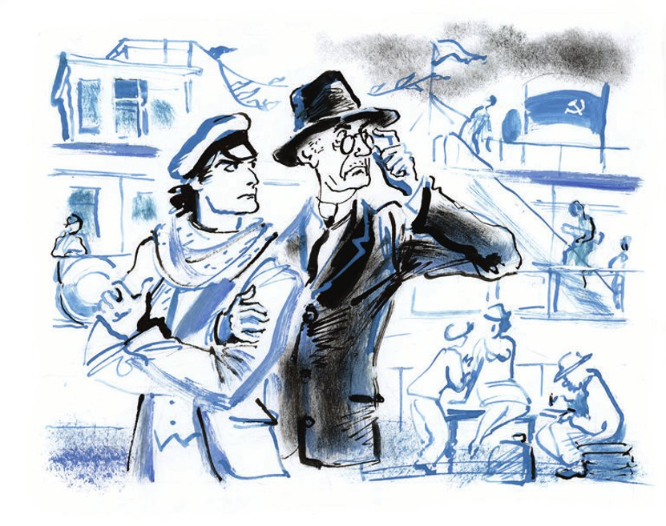

# Dritter Teil: Der Schatz von Madame Petuchowa

## Kapitel 32: Zaubernacht an der Wolga

Links von den <abbr title="die Anlegestelle, die Anlegestellen — пристань, дебаркадер">Anlegestellen</abbr> für Passagiere der Staatlichen Wolga-<abbr title="die Flussschifffahrt — речное пароходство">Flussschifffahrt</abbr>, unter der Aufschrift «An den Ringen <abbr title="festmachen — чалить, швартовать">festmachen</abbr>, das <abbr title="das Gitter, die Gitter — решётка">Gitter</abbr> schonen, die Wand nicht berühren», stand der große Kombinator mit seinem Freund und engsten Gehilfen Kisa Worobjaninow.

Über den <abbr title="die Landungsbrücke, die Landungsbrücken — пристань">Landungsbrücken</abbr> knatterten die Fahnen. Rauch, <abbr title="kraus — курчавый">kraus</abbr> wie <abbr title="der Blumenkohl — цветная капуста">Blumenkohl</abbr>, <abbr title="quellen (quoll, ist gequollen) — валить, клубиться">quoll</abbr> aus den Schornsteinen der Dampfer. Man <abbr title="beladen (belud, hat beladen) — грузить">belud</abbr> gerade den Dampfer «Anton Rubinstein», der an der Anlegestelle Nr. 2 lag. Die Lastträger schlugen ihre eisernen Haken in die <abbr title="der Baumwollballen, die Baumwollballen — тюк хлопка">Baumwollballen</abbr>. Auf dem <abbr title="der Kai, die Kais — причал, набережная">Kai</abbr> standen gusseiserne Töpfe in einem <abbr title="das Karree, die Karrees — каре">Karree</abbr> aufgestellt; da lagen nass <abbr title="salzen — солить">gesalzene</abbr> <abbr title="die Haut, die Häute — кожа, шкура">Häute</abbr>, <abbr title="die Drahtrolle, die Drahtrollen — бунт (моток) проволоки">Drahtrollen</abbr>, Kisten mit <abbr title="das Fensterglas — листовое стекло">Fensterglas</abbr>, <abbr title="das Knäuel, die Knäuel — клубок">Knäuel</abbr> von <abbr title="das Bindegarn — сноповязальный шпагат">Bindegarn</abbr>, <abbr title="der Mühlstein, die Mühlsteine — жёрнов">Mühlsteine</abbr>, zweifarbige, knochige Landmaschinen, hölzerne <abbr title="die Heugabel, die Heugabeln — вилы">Heugabeln</abbr>, mit Sackleinen <abbr title="bespannen — обтягивать">bespannte</abbr> Körbe voll junger <abbr title="die Kirsche, die Kirschen — черешня, вишня">Kirschen</abbr> und <abbr title="das Heringsfass, die Heringsfässer — сельдяная бочка">Heringsfässer</abbr>.

Die «Skrjabin» war nicht da. Das beunruhigte Ippolit Matwejewitsch sehr.

— Warum regen Sie sich auf? — fragte Ostap. — Stellen Sie sich vor, die «Skrjabin» wäre hier. Wie kämen Sie denn an Bord? Selbst wenn wir Geld für die Fahrkarten hätten, würde nichts daraus. Dieser Dampfer nimmt keine Passagiere.

Ostap hatte schon im Zug mit dem Chef der hydraulischen Presse, dem Monteur Metschnikow, <abbr title="plaudern — беседовать, болтать">geplaudert</abbr> und alles von ihm erfahren. Die «Skrjabin», vom Volkskommissariat für Finanzen <abbr title="chartern — зафрахтовать, арендовать">gechartert</abbr>, sollte von Nischni bis Zarizyn fahren, an jeder Anlegestelle halten und dort die <abbr title="die Ziehung, die Ziehungen — тираж (розыгрыш)">Ziehung</abbr> einer <abbr title="die Lotterieanleihe, die Lotterieanleihen — выигрышный заём">Lotterieanleihe</abbr> <abbr title="durchführen — проводить">durchführen</abbr>. Dafür war aus Moskau eine ganze Behörde abgereist: die Ziehungskommission, eine Kanzlei, ein <abbr title="das Blasorchester, die Blasorchester — духовой оркестр">Blasorchester</abbr>, ein <abbr title="der Kameramann, die Kameraleute — кинооператор">Kameramann</abbr>, Korrespondenten der <abbr title="zentral — центральный">zentralen</abbr> Zeitungen und das Kolumbus-Theater. Das Theater sollte unterwegs Stücke spielen, in denen die Idee der Staatsanleihen <abbr title="populär machen — популяризировать">populär gemacht wurde</abbr>. Bis Stalingrad stand das Theater auf voller <abbr title="die Verpflegung — довольствие, питание">Verpflegung</abbr> der Ziehungskommission; danach wollte es <abbr title="auf eigene Faust — на свой страх и риск">auf eigene Faust und eigenes Risiko</abbr> mit der «Heirat» eine große <abbr title="die Gastspielreise, die Gastspielreisen — гастрольная поездка">Gastspielreise</abbr> durch den Kaukasus und die Krim machen.

Die «Skrjabin» hatte <abbr title="die Verspätung, die Verspätungen — опоздание">Verspätung</abbr>. Es hieß, sie würde erst gegen Abend aus dem <abbr title="der Winterhafen, die Winterhäfen — затон">Winterhafen</abbr> kommen, wo man die letzten <abbr title="die Vorbereitung, die Vorbereitungen — приготовление">Vorbereitungen</abbr> traf. Deshalb hatte der ganze Apparat, der aus Moskau angereist war, auf dem Kai ein <abbr title="das Biwak, die Biwaks — бивак, лагерь">Biwak</abbr> aufgeschlagen und wartete auf die <abbr title="die Einschiffung — посадка (погрузка) на судно">Einschiffung</abbr>.

Zarte Geschöpfe mit Köfferchen und <abbr title="die Plaidrolle, die Plaidrollen — портплед">Plaidrollen</abbr> saßen auf den Drahtrollen, bewachten ihre Underwood-Schreibmaschinen und blickten ängstlich auf die Lastträger. Auf einem Mühlstein hatte sich ein Bürger mit violettem <abbr title="der Spitzbart, die Spitzbärte — эспаньолка">Spitzbart</abbr> <abbr title="sich niederlassen (ließ sich nieder, hat sich niedergelassen) — усесться, примоститься">niedergelassen</abbr>. Auf seinen Knien lag ein Stapel emaillierter Schilder. Auf dem obersten hätte ein Neugieriger lesen können: «Abteilung für gegenseitige <abbr title="die Verrechnung, die Verrechnungen — расчёт">Verrechnungen</abbr>». Schreibtische mit <abbr title="das Schubladenschränkchen, die Schubladenschränkchen — тумба стола">Schubladenschränkchen</abbr> und andere, bescheidenere Tische standen übereinander. Um einen versiegelten feuerfesten Schrank ging ein Wachposten auf und ab. Persizki, der Vertreter der «Werkbank», betrachtete durch ein Zeiss-<abbr title="das Fernglas, die Ferngläser — бинокль">Fernglas</abbr> mit achtfacher <abbr title="die Vergrößerung, die Vergrößerungen — увеличение">Vergrößerung</abbr> das Gelände des <abbr title="der Jahrmarkt, die Jahrmärkte — ярмарка">Jahrmarkts</abbr>.

Im Schatten der hydraulischen Presse saß Agafja Tichonowna auf einem Worobjaninow-Stuhl und <abbr title="flirten — флиртовать">flirtete</abbr> mit dem Balalaika-Virtuosen, einem <abbr title="korrekt — корректный">korrekten</abbr> jungen Mann von europäischer <abbr title="die Haltung — осанка, выправка">Haltung</abbr>. Der Virtuose fühlte sich in dieser <abbr title="verwandt — родственный">verwandten</abbr> <abbr title="die Umgebung — среда, окружение">Umgebung</abbr> prächtig. Er hatte sich <abbr title="anmutig — грациозно">anmutig</abbr> auf einen der Worobjaninow-Stühle gesetzt und kümmerte sich nicht im Geringsten darum, dass Galkin, Palkin, Malkin, Tschalkin und Salkind sich zu fünft mit nur zwei Stühlen <abbr title="sich begnügen mit + Dat. — довольствоваться">begnügen</abbr> mussten.

Um die Stühle schlichen die Konzessionäre herum wie Schakale. Ostap <abbr title="empören — возмущать">empörte</abbr> besonders der Balalaika-Virtuose.

— Was ist denn das für ein Zeisig? — flüsterte er Ippolit Matwejewitsch zu. — Jeder Dummkopf sitzt auf Ihren Stühlen. Das alles sind die Früchte Ihrer <abbr title="ordinär — пошлый">ordinären</abbr> <abbr title="die Rüderei — «кобелирование» (от Rüde — кобель)">Rüderei</abbr>.

— Was haben Sie <abbr title="etwas gegen jemanden haben — придираться, пристать">gegen mich</abbr>? — jammerte Worobjaninow. — Ich kenne nicht einmal so ein Wort: <abbr title="herumrüden — кобелировать (шутл. словечко Остапа)">herumrüden</abbr>.

— Schade. Herumrüden, das heißt, jungen Mädchen mit unsauberen <abbr title="die Absicht, die Absichten — намерение">Absichten</abbr> den Hof machen. Ihr Leugnen ist zwecklos. Lisa hat mir alles erzählt. Ganz Moskau <abbr title="sich vor Lachen kringeln — покатываться со смеху">kringelt sich vor Lachen</abbr>. Alle wissen von Ihrer Rüderei.

Der Balalaika-Virtuose lud Agafja Tichonowna zum Mittagessen auf die «Pariser Kommune» ein.

Die Klanggestaltung seufzte und trottete ins Gasthaus «Das Floß». Die Konzessionäre lebten auf.

— Vielleicht wagen wir es? — sagte Ostap plötzlich und näherte sich unwillkürlich den Stühlen. — Sie zwei, ich zwei, und dann nichts wie weg! Was? Das wäre gut, <abbr title="zum Teufel — чёрт возьми">zum Teufel</abbr>!

Er sah sich um. Fliehen müsste man über den Damm bis zur Roschdestwenskaja-Straße, die von Fuhrwerken <abbr title="verstopft — забитый">verstopft</abbr> war. Und durch die Menge der Lastträger <abbr title="sich durchschlagen (schlug sich durch, hat sich durchgeschlagen) — продраться, пробиться">sich durchzuschlagen</abbr>, wäre auch nicht leicht gewesen. Außerdem tauchten Kotschkarjow und Podkolessin ganz in der Nähe auf. Sie hätten natürlich ein fürchterliches Gebrüll <abbr title="anstimmen — поднять (крик), затянуть">angestimmt</abbr>, wenn sie einen <abbr title="der Anschlag, die Anschläge — покушение">Anschlag</abbr> auf die Möbel bemerkt hätten, die <abbr title="angeblich — якобы">angeblich</abbr> in den Holzwerkstätten des FORTINBRAS beim UMSLOPOGAS namens Belsazar <abbr title="anfertigen — изготовлять">angefertigt</abbr> worden waren.

Ostap wurde sauer.

— Wir müssen mitfahren! Aber wie? <abbr title="notfalls — в крайнем случае">Notfalls</abbr> könnte man die «Pariser Kommune» nehmen, bis Zarizyn fahren und dort auf die Truppe warten, aber das Geld, das Geld! Ach, Kisa, Kisa, <abbr title="hol dich der Teufel — чтоб вас чёрт забрал">hol Sie der Teufel</abbr>! Haben Sie Ihre <abbr title="die Plattheit, die Plattheiten — пошлость">Plattheit</abbr> schon <abbr title="einsehen (sah ein, hat eingesehen) — осознать">eingesehen</abbr>?

Gegen die Strömung wendend, kam die «Skrjabin» heran. An ihren <abbr title="die Bordwand, die Bordwände — борт">Bordwänden</abbr> trug sie <abbr title="das Sperrholzschild, die Sperrholzschilder — фанерный щит">Sperrholzschilder</abbr> mit regenbogenfarbenen Bildern <abbr title="gigantisch — гигантский">gigantischer</abbr> <abbr title="die Obligation, die Obligationen — облигация">Obligationen</abbr>. Der Dampfer brüllte auf und ahmte dabei den Schrei eines <abbr title="das Mammut, die Mammuts — мамонт">Mammuts</abbr> nach, oder vielleicht auch eines anderen Tieres, das in <abbr title="vorgeschichtlich — доисторический">vorgeschichtlichen</abbr> Zeiten die Dampfersirene ersetzt hatte.

Das <abbr title="finanziell — финансовый">finanziell-theatralische</abbr> Biwak lebte auf. Die <abbr title="der Abhang, die Abhänge — спуск, склон">Abhänge</abbr> der Stadt hinunter liefen die Angestellten der Ziehung. In einer <abbr title="die Staubwolke, die Staubwolken — облако пыли">Staubwolke</abbr> rollte der rundliche Platon Plaschtschuk auf den Dampfer zu. Galkin, Palkin, Malkin, Tschalkin und Salkind stürzten aus dem Gasthaus «Das Floß». Über dem feuerfesten Kassenschrank <abbr title="sich plagen — трудиться, мучиться">plagten sich</abbr> schon die Lastträger. Die Akrobatiklehrerin Georgette Tiraspolskich lief im <abbr title="der Turnschritt — гимнастический шаг">Turnschritt</abbr> den <abbr title="der Laufsteg, die Laufstege — сходни">Laufsteg</abbr> hinauf. Simbijewitsch-Sindijewitsch, in Sorge um die materielle <abbr title="die Gestaltung — оформление">Gestaltung</abbr>, streckte die Arme bald zu den Höhen des Kreml, bald zum Kapitän aus, der auf der Brücke stand. Der Kameramann trug seine Kamera hoch über den Köpfen der Menge und verlangte schon im Gehen eine <abbr title="die Vierbettkabine, die Vierbettkabinen — четырёхместная каюта">Vierbettkabine</abbr>, um darin ein <abbr title="das Labor, die Labors — лаборатория">Labor</abbr> einzurichten.

Im allgemeinen Gedränge drängte sich Ippolit Matwejewitsch zu den Stühlen durch und begann, <abbr title="außer sich sein — быть вне себя">außer sich</abbr>, einen Stuhl zur Seite zu schleifen.

— Lassen Sie den Stuhl los! — heulte Bender. — Sind Sie <abbr title="überschnappen — спятить">übergeschnappt</abbr>? Einen Stuhl nehmen wir mit, und die übrigen sind für uns für immer verloren. Denken Sie lieber darüber nach, wie wir auf den Dampfer kommen.

Über die Anlegestelle zogen die Musiker, <abbr title="umgürten — опоясывать">umgürtet</abbr> mit <abbr title="die Messingtrompete, die Messingtrompeten — медная труба">Messingtrompeten</abbr>. Mit Abscheu betrachteten sie die Saxophone, Flexatone, Bierflaschen und <abbr title="der Esmarch-Klistierbecher, die Esmarch-Klistierbecher — кружка Эсмарха (клизма)">Esmarch-Klistierbechern</abbr>, mit denen die Klanggestaltung bewaffnet war.

Die <abbr title="die Lostrommel, die Lostrommeln — тиражное колесо (барабан)">Lostrommeln</abbr> wurden in einem kleinen Ford-<abbr title="der Lieferwagen, die Lieferwagen — фургон">Lieferwagen</abbr> gebracht. Es war eine komplizierte <abbr title="die Konstruktion, die Konstruktionen — конструкция">Konstruktion</abbr> aus sechs sich drehenden Zylindern, die von Messing und Glas funkelte. Sie auf dem Unterdeck aufzustellen, dauerte lange.

Das <abbr title="das Getrampel — топот">Getrampel</abbr> und <abbr title="das Gezänk — перебранка">Gezänk</abbr> gingen bis spät in den Abend weiter.

Im Ziehungssaal baute man eine Bühne, <abbr title="nageln — прибивать">nagelte</abbr> Plakate und Losungen an die Wände, stellte Holzbänke für die Besucher auf und verband die elektrischen Leitungen mit den Lostrommeln. Die Schreibtische wurden auf dem <abbr title="das Heck, die Hecks — корма">Heck</abbr> untergebracht; aus der Kabine der Schreibkräfte hörte man, mit Lachen <abbr title="vermischen — перемешивать">vermischt</abbr>, das Klappern der Schreibmaschinen. Der blasse Mann mit dem violetten Spitzbart ging über das ganze Schiff und hängte an die entsprechenden Türen seine emaillierten Schilder: «Abteilung für gegenseitige Verrechnungen», «Personalabteilung», «Allgemeine Kanzlei», «Schreibbüro». An die großen Schilder <abbr title="pappen — лепить, присобачивать">pappte</abbr> der Mann mit dem Spitzbart kleinere: «Eintritt nur in dienstlichen Angelegenheiten», «Kein Empfang», «Unbefugten ist der Zutritt verboten», «Alle Auskünfte bei der <abbr title="die Registratur, die Registraturen — регистратура">Registratur</abbr>».

Der Salon der ersten Klasse wurde zu einer Ausstellung von <abbr title="die Banknote, die Banknoten — денежный знак">Banknoten</abbr> und <abbr title="der Gutschein, die Gutscheine — бона">Gutscheinen</abbr> umgebaut. Das rief bei Galkin, Palkin, Malkin, Tschalkin und Salkind einen Sturm der <abbr title="die Entrüstung — негодование">Entrüstung</abbr> hervor.

— Wo sollen wir denn zu Mittag essen? — empörten sie sich. — Und wenn es regnet?

— Ach, — sagte Nik. Sestrin zu seinem Assistenten, — ich kann nicht mehr!.. Was meinst du, Serjoscha, könnten wir nicht <abbr title="auskommen ohne + Akk. — обойтись без">ohne</abbr> die Klanggestaltung auskommen?

— Aber was denn, Nikolai Konstantinowitsch! Die Schauspieler haben sich an den Rhythmus gewöhnt.

Da erhob sich ein neues <abbr title="das Geschrei — галдёж">Geschrei</abbr>. Die Fünf hatten <abbr title="herausschnüffeln — пронюхать">herausgeschnüffelt</abbr>, dass der Autor der Inszenierung alle vier Stühle in seine Kabine geschleppt hatte.

— So, so, — sagten die Fünf ironisch, — und wir sollen auf den <abbr title="die Koje, die Kojen — койка">Kojen</abbr> sitzend <abbr title="proben — репетировать">proben</abbr>, während auf den vier Stühlen Nikolai Konstantinowitsch mit seiner Frau Gusta sitzt, die mit unserem Kollektiv überhaupt nichts zu tun hat. Vielleicht wollen wir auf der Reise auch unsere Frauen dabeihaben!

Vom Ufer blickte der große Kombinator böse auf den Ziehungsdampfer.

Ein neuer <abbr title="der Ausbruch, die Ausbrüche — взрыв, вспышка">Ausbruch</abbr> von Rufen drang an die Ohren der Konzessionäre.

— Warum haben Sie mir das nicht früher gesagt?! — schrie ein Mitglied der Kommission.

— Woher sollte ich wissen, dass er krank wird?

— Das ist doch weiß der Teufel was! Dann fahren Sie zum Rabis, zur Künstlergewerkschaft, und verlangen Sie, dass man uns dringend einen Maler <abbr title="abordnen — командировать">abordnet</abbr>.

— Wohin soll ich denn fahren? Es ist sechs Uhr. Der Rabis hat längst geschlossen. Und der Dampfer legt in einer halben Stunde ab.

— Dann malen Sie eben selbst. Wenn Sie schon die <abbr title="die Verantwortung — ответственность">Verantwortung</abbr> für die <abbr title="die Ausschmückung — украшение">Ausschmückung</abbr> des Dampfers übernommen haben, dann <abbr title="etwas ausbaden — расхлёбывать, отдуваться">baden Sie es aus</abbr>, wie Sie wollen.

Ostap rannte schon den Laufsteg hinauf und stieß Lastträger, Fräulein und einfache <abbr title="der Schaulustige, die Schaulustigen — зевака, любопытный">Schaulustige</abbr> mit den Ellbogen <abbr title="beiseite — в сторону">beiseite</abbr>. Am Eingang hielt man ihn auf:

— <abbr title="der Passierschein, die Passierscheine — пропуск">Passierschein</abbr>!

— Genosse! — brüllte Bender. — Sie! Sie! Sie Dicker! Der einen Maler braucht!

Fünf Minuten später saß der große Kombinator in der weißen Kabine des Dicken, des Wirtschaftsleiters der schwimmenden Ziehung, und verhandelte über die <abbr title="die Arbeitsbedingung, die Arbeitsbedingungen — условие работы">Arbeitsbedingungen</abbr>.

— Also, Genosse, — sagte der kleine Dicke, — wir brauchen von Ihnen Folgendes: die <abbr title="die Ausführung, die Ausführungen — исполнение">Ausführung</abbr> künstlerischer Plakate und Aufschriften und die <abbr title="die Fertigstellung — окончание, завершение">Fertigstellung</abbr> des <abbr title="das Transparent, die Transparente — транспарант">Transparents</abbr>. Unser Maler hat damit angefangen und ist krank geworden. Wir haben ihn hier im Krankenhaus gelassen. Und natürlich die allgemeine Aufsicht über den künstlerischen Teil. Können Sie das übernehmen? Ich warne Sie allerdings: Es gibt viel Arbeit.

— Ja, das kann ich übernehmen. Solche Arbeiten habe ich schon öfter ausgeführt.

— Und Sie können sofort mit uns fahren?

— Das wird etwas schwierig, aber ich werde mich bemühen.

Ein großer, schwerer Stein fiel dem Wirtschaftsleiter vom Herzen. Mit kindlicher <abbr title="die Leichtigkeit — лёгкость">Leichtigkeit</abbr> in der Seele blickte der Dicke den neuen Maler strahlend an.

— Ihre Bedingungen? — fragte Ostap frech. — Bedenken Sie, ich bin kein Beerdigungsbüro.

— Bezahlung nach <abbr title="die Stückzahl — сдельно (по количеству)">Stückzahl</abbr>. Nach den Tarifen des Rabis.

Ostap verzog das Gesicht, was ihn große Mühe kostete.

— Aber außerdem noch freie <abbr title="die Kost — питание, стол">Kost</abbr>, — fügte das Dickerchen eilig hinzu, — und eine eigene Kabine.

— Na gut, — sagte Ostap mit einem Seufzer, — ich bin einverstanden. Aber ich habe noch einen Jungen dabei, einen Assistenten.

— Wegen des Jungen weiß ich nicht. Für einen Jungen sind keine Mittel <abbr title="bewilligen — отпускать (средства), утверждать">bewilligt</abbr>. Auf eigene Kosten, bitte schön. Er kann in Ihrer Kabine wohnen.

— Nun, wie Sie meinen. Mein Junge ist flink. Er ist an <abbr title="spartanisch — спартанский">spartanische</abbr> Verhältnisse gewöhnt.

Ostap bekam einen Passierschein für sich und den flinken Jungen, steckte den Kabinenschlüssel in die Tasche und trat auf das heiße <abbr title="das Deck, die Decks — палуба">Deck</abbr>. Als er den Schlüssel berührte, empfand er keine geringe <abbr title="die Genugtuung — удовлетворение">Genugtuung</abbr>. Zum ersten Mal in seinem stürmischen Leben war es so weit: Der Schlüssel war da, die Wohnung war da. Es fehlte nur das Geld. Aber auch das lag ganz in der Nähe, in den Stühlen. Der große Kombinator spazierte, die Hände in den Taschen, an der <abbr title="die Reling — борт, поручни">Reling</abbr> entlang und bemerkte den am Ufer zurückgebliebenen Worobjaninow nicht.

Ippolit Matwejewitsch machte zuerst stumm Zeichen, dann wagte er sogar, leise zu piepsen. Aber Bender war taub. Er hatte dem Vorsitzenden der Konzession den Rücken zugekehrt und verfolgte aufmerksam, wie die hydraulische Presse in den <abbr title="der Laderaum, die Laderäume — трюм">Laderaum</abbr> hinabgelassen wurde.

Man traf die letzten Vorbereitungen zum Ablegen. Agafja Tichonowna, alias Mura, lief mit trippelnden Füßchen aus ihrer Kabine zum Heck, schaute ins Wasser, teilte ihr <abbr title="das Entzücken — восторг">Entzücken</abbr> laut mit dem Balalaika-Virtuosen und brachte mit alledem die <abbr title="ehrwürdig — почтенный">ehrwürdigen</abbr> Funktionäre des <abbr title="das Ziehungsunternehmen — тиражное предприятие">Ziehungsunternehmens</abbr> <abbr title="in Verlegenheit bringen — смущать">in Verlegenheit</abbr>.

Der Dampfer gab das zweite Signal. Von den schrecklichen Tönen <abbr title="sich verschieben (verschob sich, hat sich verschoben) — сдвигаться">verschoben sich</abbr> die Wolken. Die Sonne wurde <abbr title="purpurrot — багровый">purpurrot</abbr> und fiel hinter den Horizont. In der Oberstadt gingen Lampen und Laternen an. Vom Markt in der Potschajewski-Schlucht drang das Krächzen der <abbr title="das Grammophon, die Grammophone — граммофон">Grammophone</abbr> herüber, die vor den letzten Käufern miteinander <abbr title="wetteifern — состязаться">wetteiferten</abbr>. <abbr title="betäubt — оглушённый">Betäubt</abbr> und einsam schrie Ippolit Matwejewitsch etwas, aber man hörte ihn nicht. Das Rasseln der <abbr title="die Winde, die Winden — лебёдка">Winde</abbr> verschluckte alle anderen Geräusche.

Ostap Bender liebte Effekte. Erst vor dem dritten Signal, als Ippolit Matwejewitsch nicht mehr daran zweifelte, dass er seinem Schicksal <abbr title="preisgeben (gab preis, hat preisgegeben) — бросать на произвол">preisgegeben</abbr> war, bemerkte Ostap ihn.

— Was stehen Sie denn da <abbr title="wie bestellt und nicht abgeholt — как неприкаянный («как засватанный»)">wie bestellt und nicht abgeholt</abbr>? Ich dachte, Sie wären längst an Bord! Gleich wird der Laufsteg eingezogen! Laufen Sie schnell! Lassen Sie diesen Bürger durch! Hier ist der Passierschein.

Ippolit Matwejewitsch lief, fast weinend, auf den Dampfer.

— Das ist Ihr Junge? — fragte der Wirtschaftsleiter misstrauisch.

— Ein Junge, — sagte Ostap, — ist er etwa schlecht? Wer behauptet, das sei ein Mädchen, der werfe den ersten Stein auf mich!

Der Dicke ging mürrisch davon.

— Nun, Kisa, — bemerkte Ostap, — morgen früh müssen wir uns an die Arbeit setzen. Ich hoffe, Sie können Farben <abbr title="anrühren — разводить (краски)">anrühren</abbr>. Und dann noch Folgendes: Ich bin Maler, ich habe die WChUTEMAS, die Kunsthochschule, <abbr title="absolvieren — окончить (учебное заведение)">absolviert</abbr>, und Sie sind mein Gehilfe. Wenn Sie glauben, dass es nicht so ist, dann laufen Sie lieber schnell zurück ans Ufer.

Schwarzgrüner <abbr title="der Schaum — пена">Schaum</abbr> <abbr title="hervorbrechen (brach hervor, ist hervorgebrochen) — вырываться">brach</abbr> unter dem Heck hervor. Der Dampfer <abbr title="erbeben — дрогнуть">erbebte</abbr>, die Messingbecken schepperten, Flöten, <abbr title="das Kornett, die Kornette — корнет (инструмент)">Kornette</abbr>, <abbr title="die Posaune, die Posaunen — тромбон">Posaunen</abbr> und <abbr title="die Tuba, die Tuben — туба, бас">Tuben</abbr> <abbr title="schmettern — греметь, трубить">schmetterten</abbr> einen herrlichen Marsch, und die Stadt drehte sich, balancierte und wanderte auf das linke Ufer hinüber. Noch immer zitternd, stellte sich der Dampfer in die Strömung und lief schnell in die Dunkelheit. Hinten schaukelten die Sterne, die Lampen und die bunten Hafenzeichen. Nach einer Minute war der Dampfer so weit entfernt, dass die Lichter der Stadt wie erstarrtes <abbr title="das Raketenpulver — ракетный порох">Raketenpulver</abbr> aussahen.

Noch hörte man das <abbr title="murren — ропот">Murren</abbr> der arbeitenden Underwoods, aber die Natur und die Wolga <abbr title="sein Recht fordern — брать своё">forderten ihr Recht</abbr>. Eine süße <abbr title="die Mattigkeit — нега, истома">Mattigkeit</abbr> <abbr title="ergreifen (ergriff, hat ergriffen) — охватывать">ergriff</abbr> alle, die auf dem Dampfer «Skrjabin» fuhren. Die Mitglieder der Ziehungskommission <abbr title="schlürfen — прихлёбывать">schlürften</abbr> <abbr title="träge — томно, лениво">träge</abbr> ihren Tee. Bei der ersten Sitzung des Ortskomitees der Gewerkschaft, die auf dem <abbr title="der Bug, die Buge — нос (судна)">Bug</abbr> stattfand, herrschte Zärtlichkeit. So laut atmete der warme Abend, so sanft plätscherte das Wasser an den Bordwänden, so schnell flogen die dunklen <abbr title="der Umriss, die Umrisse — очертание">Umrisse</abbr> der Ufer an den Seiten des Dampfers vorbei, dass der Vorsitzende des Ortskomitees, ein durchaus <abbr title="seriös — положительный, солидный">seriöser</abbr> Mensch, der den Mund <abbr title="öffnen — открывать">geöffnet hatte</abbr>, um eine Rede über die Arbeitsbedingungen in ungewöhnlicher Umgebung zu halten, für alle und für sich selbst unerwartet zu singen begann:

Fuhr ein Dampfer auf der Wolga, Wolga, Mütterchen, du Strom…

Und die übrigen strengen Teilnehmer der Sitzung grollten den <abbr title="der Refrain, die Refrains — припев">Refrain</abbr>:

Der Fli-ieder blü-üht…

Eine <abbr title="die Resolution, die Resolutionen — резолюция">Resolution</abbr> zum Bericht des Vorsitzenden wurde nie <abbr title="fassen — принимать (решение)">gefasst</abbr>. Man hörte Klavierklänge. Der Leiter der musikalischen <abbr title="die Begleitung — сопровождение">Begleitung</abbr>, X. Iwanow, holte aus dem Instrument die lyrischsten Töne heraus. Der Virtuose trottete hinter Murotschka her und, da er keine eigenen Worte fand, um seine Liebe auszudrücken, murmelte er die Worte einer <abbr title="die Romanze, die Romanzen — романс">Romanze</abbr>:

— Geh nicht fort! Wie glühen deine Küsse, noch bin ich nicht <abbr title="ermatten — утомляться">ermattet</abbr> von leidenschaftlicher Zärtlichkeit. In den Schluchten sind die Wolken noch nicht erwacht, der Himmel hat sein <abbr title="perlen — жемчужный">perlenes</abbr> Sternlicht noch nicht <abbr title="löschen — гасить">gelöscht</abbr>…

Simbijewitsch-Sindijewitsch <abbr title="sich klammern an + Akk. — цепляться">klammerte sich</abbr> an das Geländer und betrachtete den himmlischen <abbr title="der Abgrund, die Abgründe — бездна">Abgrund</abbr>. Im Vergleich damit erschien ihm die materielle Gestaltung der «Heirat» als eine empörende Schweinerei. Mit Ekel betrachtete er seine Hände, die an der materiellen Gestaltung der klassischen <abbr title="die Komödie, die Komödien — комедия">Komödie</abbr> eifrig <abbr title="beteiligt sein an + Dat. — участвовать в">beteiligt</abbr> gewesen waren.

Im Augenblick der höchsten Sehnsucht schlugen Galkin, Palkin, Malkin, Tschalkin und Salkind, die sich auf dem Heck eingerichtet hatten, auf ihre Apotheken- und <abbr title="die Gerätschaften (Pl.) — принадлежности, инструменты">Biergerätschaften</abbr>. Sie probten. Die Fata Morgana <abbr title="zerstieben (zerstob, ist zerstoben) — рассеиваться">zerstob</abbr> sofort. Agafja Tichonowna gähnte und ging, ohne den Virtuosen-<abbr title="der Verehrer, die Verehrer — воздыхатель, поклонник">Verehrer</abbr> zu beachten, schlafen. In den Seelen der Mitglieder des Ortskomitees erklang wieder der Tarifvertrag, und sie machten sich an die Resolution. Simbijewitsch-Sindijewitsch kam nach reiflicher <abbr title="die Überlegung, die Überlegungen — размышление">Überlegung</abbr> zu dem Schluss, dass die Gestaltung der «Heirat» gar nicht so schlecht sei. Eine gereizte Stimme rief aus der Dunkelheit Georgette Tiraspolskich zu einer Besprechung beim Regisseur. In den Dörfern bellten Hunde. Es wurde <abbr title="frisch — свежо, прохладно">frisch</abbr>.

In der Kabine erster Klasse lag Ostap auf dem <abbr title="das Ledersofa, die Ledersofas — кожаный диван">Ledersofa</abbr>, betrachtete nachdenklich den mit grünem Segeltuch bezogenen <abbr title="der Korkgürtel, die Korkgürtel — пробковый пояс">Korkgürtel</abbr> und verhörte Ippolit Matwejewitsch:

— Können Sie zeichnen? Sehr schade. Ich kann es leider auch nicht.

Er dachte nach und fuhr fort:

— Und Buchstaben, können Sie die? Auch nicht? Gar nicht gut! Wir sind doch Maler! Na, zwei Tage lang kann man sich <abbr title="sich durchmogeln — изворачиваться, «мотать»">durchmogeln</abbr>, und dann werfen sie uns raus. In diesen zwei Tagen müssen wir alles schaffen, was wir brauchen. Die Lage hat sich etwas <abbr title="erschweren — затруднять">erschwert</abbr>. Ich habe erfahren, dass die Stühle in der Kabine des Regisseurs stehen. Aber auch das ist letzten Endes nicht schlimm. Wichtig ist, dass wir auf dem Dampfer sind. Solange man uns nicht hinausgeworfen hat, müssen alle Stühle untersucht werden. Heute ist es schon zu spät. Der Regisseur schläft in seiner Kabine.

---

### Neue Wörter

- **die Anlegestelle, die Anlegestellen** — пристань, дебаркадер
- **die Flussschifffahrt** — речное пароходство
- **festmachen** — чалить, швартовать
- **das Gitter, die Gitter** — решётка
- **die Landungsbrücke, die Landungsbrücken** — пристань
- **kraus** — курчавый
- **der Blumenkohl** — цветная капуста
- **quellen (quoll, ist gequollen)** — валить, клубиться
- **beladen (belud, hat beladen)** — грузить
- **der Baumwollballen, die Baumwollballen** — тюк хлопка
- **der Kai, die Kais** — причал, набережная
- **das Karree, die Karrees** — каре
- **salzen** — солить
- **die Haut, die Häute** — кожа, шкура
- **die Drahtrolle, die Drahtrollen** — бунт (моток) проволоки
- **das Fensterglas** — листовое стекло
- **das Knäuel, die Knäuel** — клубок
- **das Bindegarn** — сноповязальный шпагат
- **der Mühlstein, die Mühlsteine** — жёрнов
- **die Heugabel, die Heugabeln** — вилы
- **bespannen** — обтягивать
- **die Kirsche, die Kirschen** — черешня, вишня
- **das Heringsfass, die Heringsfässer** — сельдяная бочка
- **plaudern** — беседовать, болтать
- **chartern** — зафрахтовать, арендовать
- **die Ziehung, die Ziehungen** — тираж (розыгрыш)
- **die Lotterieanleihe, die Lotterieanleihen** — выигрышный заём
- **durchführen** — проводить
- **das Blasorchester, die Blasorchester** — духовой оркестр
- **der Kameramann, die Kameraleute** — кинооператор
- **zentral** — центральный
- **populär machen** — популяризировать
- **die Verpflegung** — довольствие, питание
- **auf eigene Faust** — на свой страх и риск
- **die Gastspielreise, die Gastspielreisen** — гастрольная поездка
- **die Verspätung, die Verspätungen** — опоздание
- **der Winterhafen, die Winterhäfen** — затон
- **die Vorbereitung, die Vorbereitungen** — приготовление
- **das Biwak, die Biwaks** — бивак, лагерь
- **die Einschiffung** — посадка (погрузка) на судно
- **die Plaidrolle, die Plaidrollen** — портплед
- **der Spitzbart, die Spitzbärte** — эспаньолка
- **sich niederlassen (ließ sich nieder, hat sich niedergelassen)** — усесться, примоститься
- **die Verrechnung, die Verrechnungen** — расчёт
- **das Schubladenschränkchen, die Schubladenschränkchen** — тумба стола
- **das Fernglas, die Ferngläser** — бинокль
- **die Vergrößerung, die Vergrößerungen** — увеличение
- **der Jahrmarkt, die Jahrmärkte** — ярмарка
- **flirten** — флиртовать
- **korrekt** — корректный
- **die Haltung** — осанка, выправка
- **verwandt** — родственный
- **die Umgebung** — среда, окружение
- **anmutig** — грациозно
- **sich begnügen mit + Dat.** — довольствоваться
- **empören** — возмущать
- **ordinär** — пошлый
- **die Rüderei** — «кобелирование» (от Rüde — кобель)
- **etwas gegen jemanden haben** — придираться, пристать
- **herumrüden** — кобелировать (шутл. словечко Остапа)
- **die Absicht, die Absichten** — намерение
- **sich vor Lachen kringeln** — покатываться со смеху
- **zum Teufel** — чёрт возьми
- **verstopft** — забитый
- **sich durchschlagen (schlug sich durch, hat sich durchgeschlagen)** — продраться, пробиться
- **anstimmen** — поднять (крик), затянуть
- **der Anschlag, die Anschläge** — покушение
- **angeblich** — якобы
- **anfertigen** — изготовлять
- **notfalls** — в крайнем случае
- **hol dich der Teufel** — чтоб вас чёрт забрал
- **die Plattheit, die Plattheiten** — пошлость
- **einsehen (sah ein, hat eingesehen)** — осознать
- **die Bordwand, die Bordwände** — борт
- **das Sperrholzschild, die Sperrholzschilder** — фанерный щит
- **gigantisch** — гигантский
- **die Obligation, die Obligationen** — облигация
- **das Mammut, die Mammuts** — мамонт
- **vorgeschichtlich** — доисторический
- **finanziell** — финансовый
- **der Abhang, die Abhänge** — спуск, склон
- **die Staubwolke, die Staubwolken** — облако пыли
- **sich plagen** — трудиться, мучиться
- **der Turnschritt** — гимнастический шаг
- **der Laufsteg, die Laufstege** — сходни
- **die Gestaltung** — оформление
- **die Vierbettkabine, die Vierbettkabinen** — четырёхместная каюта
- **das Labor, die Labors** — лаборатория
- **außer sich sein** — быть вне себя
- **überschnappen** — спятить
- **umgürten** — опоясывать
- **die Messingtrompete, die Messingtrompeten** — медная труба
- **der Esmarch-Klistierbecher, die Esmarch-Klistierbecher** — кружка Эсмарха (клизма)
- **die Lostrommel, die Lostrommeln** — тиражное колесо (барабан)
- **der Lieferwagen, die Lieferwagen** — фургон
- **die Konstruktion, die Konstruktionen** — конструкция
- **das Getrampel** — топот
- **das Gezänk** — перебранка
- **nageln** — прибивать
- **das Heck, die Hecks** — корма
- **vermischen** — перемешивать
- **pappen** — лепить, присобачивать
- **die Registratur, die Registraturen** — регистратура
- **die Banknote, die Banknoten** — денежный знак
- **der Gutschein, die Gutscheine** — бона
- **die Entrüstung** — негодование
- **auskommen ohne + Akk.** — обойтись без
- **das Geschrei** — галдёж
- **herausschnüffeln** — пронюхать
- **die Koje, die Kojen** — койка
- **proben** — репетировать
- **der Ausbruch, die Ausbrüche** — взрыв, вспышка
- **abordnen** — командировать
- **die Verantwortung** — ответственность
- **die Ausschmückung** — украшение
- **etwas ausbaden** — расхлёбывать, отдуваться
- **der Schaulustige, die Schaulustigen** — зевака, любопытный
- **beiseite** — в сторону
- **der Passierschein, die Passierscheine** — пропуск
- **die Arbeitsbedingung, die Arbeitsbedingungen** — условие работы
- **die Ausführung, die Ausführungen** — исполнение
- **die Fertigstellung** — окончание, завершение
- **das Transparent, die Transparente** — транспарант
- **die Leichtigkeit** — лёгкость
- **die Stückzahl** — сдельно (по количеству)
- **die Kost** — питание, стол
- **bewilligen** — отпускать (средства), утверждать
- **spartanisch** — спартанский
- **das Deck, die Decks** — палуба
- **die Genugtuung** — удовлетворение
- **die Reling** — борт, поручни
- **der Laderaum, die Laderäume** — трюм
- **das Entzücken** — восторг
- **ehrwürdig** — почтенный
- **das Ziehungsunternehmen** — тиражное предприятие
- **in Verlegenheit bringen** — смущать
- **sich verschieben (verschob sich, hat sich verschoben)** — сдвигаться
- **purpurrot** — багровый
- **das Grammophon, die Grammophone** — граммофон
- **wetteifern** — состязаться
- **betäubt** — оглушённый
- **die Winde, die Winden** — лебёдка
- **preisgeben (gab preis, hat preisgegeben)** — бросать на произвол
- **wie bestellt und nicht abgeholt** — как неприкаянный («как засватанный»)
- **anrühren** — разводить (краски)
- **absolvieren** — окончить (учебное заведение)
- **der Schaum** — пена
- **hervorbrechen (brach hervor, ist hervorgebrochen)** — вырываться
- **erbeben** — дрогнуть
- **das Kornett, die Kornette** — корнет (инструмент)
- **die Posaune, die Posaunen** — тромбон
- **die Tuba, die Tuben** — туба, бас
- **schmettern** — греметь, трубить
- **das Raketenpulver** — ракетный порох
- **murren** — ропот
- **sein Recht fordern** — брать своё
- **die Mattigkeit** — нега, истома
- **ergreifen (ergriff, hat ergriffen)** — охватывать
- **schlürfen** — прихлёбывать
- **träge** — томно, лениво
- **der Bug, die Buge** — нос (судна)
- **der Umriss, die Umrisse** — очертание
- **seriös** — положительный, солидный
- **öffnen** — открывать
- **der Refrain, die Refrains** — припев
- **die Resolution, die Resolutionen** — резолюция
- **fassen** — принимать (решение)
- **die Begleitung** — сопровождение
- **die Romanze, die Romanzen** — романс
- **ermatten** — утомляться
- **perlen** — жемчужный
- **löschen** — гасить
- **sich klammern an + Akk.** — цепляться
- **der Abgrund, die Abgründe** — бездна
- **die Komödie, die Komödien** — комедия
- **beteiligt sein an + Dat.** — участвовать в
- **die Gerätschaften (Pl.)** — принадлежности, инструменты
- **zerstieben (zerstob, ist zerstoben)** — рассеиваться
- **der Verehrer, die Verehrer** — воздыхатель, поклонник
- **die Überlegung, die Überlegungen** — размышление
- **frisch** — свежо, прохладно
- **das Ledersofa, die Ledersofas** — кожаный диван
- **der Korkgürtel, die Korkgürtel** — пробковый пояс
- **sich durchmogeln** — изворачиваться, «мотать»
- **erschweren** — затруднять

[← Kapitel 31](kapitel-31.md) · [Inhalt](README.md) · [Kapitel 33 →](kapitel-33.md)
