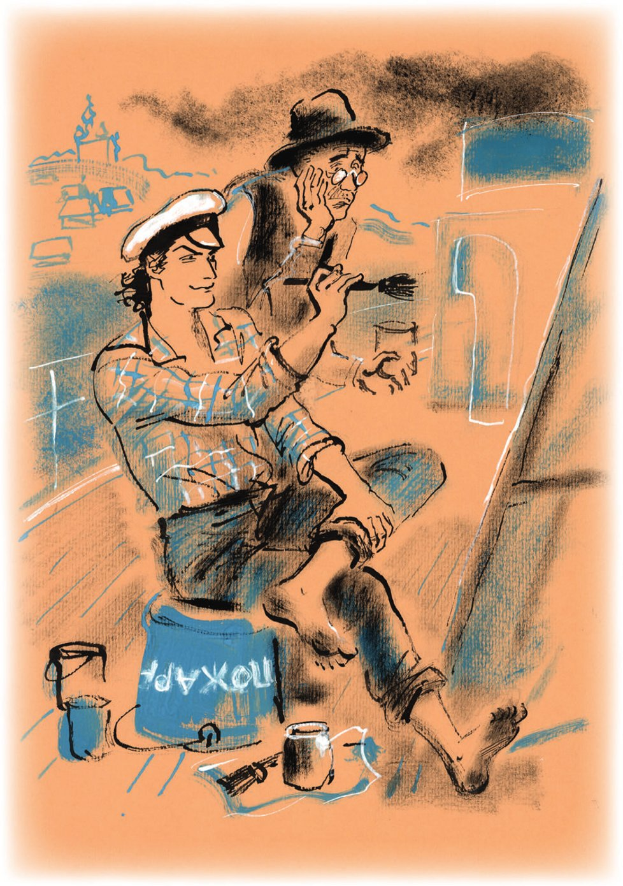
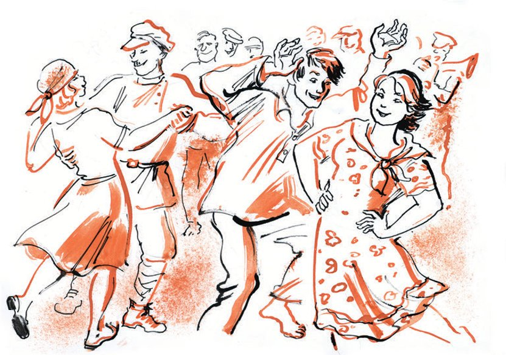

## Kapitel 33: Ein unreines Paar

Am Morgen war der Reporter Persizki als Erster an Deck. Er hatte schon <abbr title="duschen — принимать душ">geduscht</abbr> und zehn Minuten <abbr title="gymnastisch — гимнастический">gymnastischen</abbr> <abbr title="die Übung, die Übungen — упражнение">Übungen</abbr> gewidmet. Die Menschen schliefen noch, aber der Fluss lebte wie am Tag. <abbr title="das Floß, die Flöße — плот">Flöße</abbr> zogen vorbei – riesige Felder aus Baumstämmen mit Hütten darauf. Ein kleiner, böser <abbr title="der Schlepper, die Schlepper — буксир">Schlepper</abbr>, auf dessen <abbr title="der Radkasten, die Radkästen — колёсный кожух">Radkasten</abbr> sein Name im Bogen geschrieben stand – «Herrscher der Stürme» –, zog drei <abbr title="der Ölkahn, die Ölkähne — нефтяная баржа">Ölkähne</abbr> hinter sich her, die in einer Reihe <abbr title="aneinanderbinden (band aneinander, hat aneinandergebunden) — связывать между собой">aneinandergebunden</abbr> waren. Von unten eilte der schnelle <abbr title="der Postdampfer, die Postdampfer — почтовый пароход">Postdampfer</abbr> «Rotes Lettland» vorbei. Die «Skrjabin» <abbr title="überholen — обгонять">überholte</abbr> eine Karawane von <abbr title="der Bagger, die Bagger — землечерпалка">Baggern</abbr>, <abbr title="ausloten — измерять глубину">lotete</abbr> mit einer gestreiften Stange die Tiefe aus und beschrieb einen Bogen, um gegen die Strömung zu wenden.

Persizki setzte das Fernglas an die Augen und blickte auf die Anlegestelle.

— «Barmino», — las er auf dem Schild.

Auf dem Dampfer erwachte man. Ein Gewicht an einer Schnur flog auf den Kai. An dieser Leine zogen die Leute von der Anlegestelle das dicke Ende des <abbr title="das Haltetau, die Haltetaue — причальный канат">Haltetaus</abbr> zu sich herüber. Die <abbr title="die Schraube, die Schrauben — винт (судна)">Schrauben</abbr> drehten sich rückwärts. Der halbe Fluss war mit <abbr title="wogen — колыхаться, волноваться">wogendem</abbr> Schaum <abbr title="übergießen (übergoss, hat übergossen) — обливать">übergossen</abbr>. Die «Skrjabin» zitterte von den harten Schlägen der Schraube und legte mit der ganzen Seite an der Anlegestelle an. Es war noch früh. Deshalb beschloss man, die Ziehung um zehn Uhr zu beginnen.

Der Dienst auf der «Skrjabin» begann, genau wie an Land, pünktlich um neun. Niemand hatte seine Gewohnheiten geändert. Wer an Land zu spät zum Dienst gekommen war, kam auch hier zu spät, obwohl er in der Behörde selbst schlief. An die neue <abbr title="die Lebensweise — уклад, образ жизни">Lebensweise</abbr> gewöhnte sich das <abbr title="das Reisepersonal — походный штат">Reisepersonal</abbr> des Finanzkommissariats ziemlich schnell.

Die Boten fegten die Kabinen mit derselben <abbr title="die Gleichgültigkeit — равнодушие">Gleichgültigkeit</abbr>, mit der sie in Moskau die Kanzleien gefegt hatten. Die <abbr title="die Putzfrau, die Putzfrauen — уборщица">Putzfrauen</abbr> trugen Tee aus und liefen mit Papieren von der Registratur zur Personalabteilung, ohne sich im Geringsten darüber zu wundern, dass die Personalabteilung auf dem Heck und die Registratur auf dem Bug untergebracht war. Aus der Kabine der gegenseitigen Verrechnungen kam ein <abbr title="kastagnettenartig — кастаньетный">kastagnettenartiges</abbr> Geräusch von <abbr title="das Rechenbrett, die Rechenbretter — счёты">Rechenbrettern</abbr> und das Knirschen einer <abbr title="die Rechenmaschine, die Rechenmaschinen — арифмометр">Rechenmaschine</abbr>. Vor dem <abbr title="das Steuerhaus, die Steuerhäuser — рубка">Steuerhaus</abbr> des Kapitäns wurde jemand <abbr title="herunterputzen — распекать">heruntergeputzt</abbr>.

Der große Kombinator verbrannte sich die nackten <abbr title="die Fußsohle, die Fußsohlen — ступня, подошва">Fußsohlen</abbr> auf dem Oberdeck. Er ging um einen langen, schmalen Streifen <abbr title="das Fahnentuch — кумач">Fahnentuch</abbr> herum und <abbr title="pinseln — малевать">pinselte</abbr> darauf eine Losung, deren Text er jede Minute auf einem Zettel <abbr title="nachprüfen — сверяться, проверять">nachprüfte</abbr>: «Alle zur Ziehung! Jeder <abbr title="der Werktätige, die Werktätigen — трудящийся">Werktätige</abbr> muss eine Obligation der Staatsanleihe in der Tasche haben.»

Der große Kombinator gab sich große Mühe, aber der Mangel an <abbr title="die Begabung, die Begabungen — способность, дарование">Begabung</abbr> machte sich trotzdem <abbr title="sich bemerkbar machen — сказываться, давать о себе знать">bemerkbar</abbr>. Die Schrift rutschte nach unten, und das Stück Fahnentuch schien hoffnungslos verdorben. Da drehte Ostap mit Hilfe des Jungen Kisa die Bahn auf die Rückseite und begann von Neuem zu pinseln. Jetzt war er vorsichtiger. Bevor er die Buchstaben <abbr title="hinklatschen — наляпывать">hinklatschte</abbr>, <abbr title="abschlagen (schlug ab, hat abgeschlagen) — отбивать (линию)">schlug</abbr> er mit einer mit Kreide <abbr title="einreiben (rieb ein, hat eingerieben) — натирать">eingeriebenen</abbr> Schnur zwei <abbr title="parallel — параллельный">parallele</abbr> Linien ab, und dann machte er sich, leise auf den <abbr title="unschuldig — неповинный, невинный">unschuldigen</abbr> Worobjaninow schimpfend, an die Darstellung der Worte.

Ippolit Matwejewitsch erfüllte gewissenhaft die Pflichten des Jungen. Er lief nach unten, um heißes Wasser zu holen, schmolz den <abbr title="der Leim — клей">Leim</abbr>, schüttete niesend Farbe in den Eimer und blickte dem <abbr title="anspruchsvoll — взыскательный, требовательный">anspruchsvollen</abbr> Künstler unterwürfig in die Augen. Die fertige und getrocknete Losung trugen die Konzessionäre nach unten und befestigten sie an der Bordwand.

Der kleine Dicke, der Ostap angeheuert hatte, lief ans Ufer und betrachtete von dort die Arbeit des neuen Malers. Die Buchstaben der Losung waren unterschiedlich dick und etwas nach den Seiten geneigt. Es gab aber keinen Ausweg – man musste sich auch damit begnügen.

Das Blasorchester ging an Land und blies feurige Märsche. Auf die Klänge der Musik liefen aus ganz Barmino die Kinder zusammen, und hinter ihnen kamen aus den <abbr title="der Apfelgarten, die Apfelgärten — яблоневый сад">Apfelgärten</abbr> die Bauern und die Bäuerinnen. Das Orchester dröhnte so lange, bis die Mitglieder der Ziehungskommission an Land gingen. Eine Kundgebung begann. Von der <abbr title="die Vortreppe, die Vortreppen — крыльцо">Vortreppe</abbr> der Teestube Korobkow <abbr title="sich ergießen (ergoss sich, hat sich ergossen) — литься, изливаться">ergossen sich</abbr> die ersten Klänge eines Vortrags über die internationale Lage.

Die Kolumbus-Leute <abbr title="gaffen — глазеть">gafften</abbr> vom Dampfer auf die Versammlung. Von dort sah man die weißen Kopftücher der Frauen, die vorsichtig etwas abseits von der Vortreppe standen, die reglose Menge der Bauern, die dem Redner zuhörten, und den Redner selbst, der ab und zu mit den Armen fuchtelte. Dann spielte die Musik. Das Orchester drehte sich um und bewegte sich, ohne aufzuhören zu spielen, zum Laufsteg. Die Menge strömte hinterher.

— Einen Moment! — rief der kleine Dicke von Bord. — Gleich, Genossen, werden wir die Ziehung der Lotterieanleihe durchführen. Deshalb bitten wir alle auf den Dampfer. Nach der Ziehung findet ein Konzert statt. Also – wir bitten Sie, nach der Ziehung nicht auseinanderzugehen, sondern sich am Ufer zu versammeln und von dort zuzuschauen. Die Schauspieler werden auf dem Deck spielen!

Alle liefen, einander schubsend, auf den Dampfer und stiegen in den kühlen Ziehungssaal hinab. Die Ziehungskommission und die in sie aufgenommenen Vertreter des Dorfes Barmino nahmen auf der Bühne Platz. Die Mitglieder der Kommission taten das mit der <abbr title="die Würde — достоинство">Würde</abbr>, die sie sich durch die Gewohnheit an derartige Zeremonien erworben hatten. Die Vertreter des Dorfes aber (es waren zwei), in Bastschuhen und blau gestreiften Hemden, gingen ernst, mit einem Gesicht, als gingen sie zum <abbr title="dreschen (drosch, hat gedroschen) — молотить">Dreschen</abbr>, auf den Tisch zu und setzten sich an den Rand.

Nachdem man die Siegel an den Lostrommeln geprüft hatte, wurde aus dem Publikum ein Kind <abbr title="anfordern — затребовать">angefordert</abbr>.

— Und jetzt, Genossen, wird das Kind vor aller Augen aus diesen sechs Zylindern je ein Los ziehen. Auf jedem steht eine Ziffer. Alle sechs Ziffern zusammen ergeben die Nummer der Obligation, die gewonnen hat. Wer Obligationen hat, soll aufpassen. Wer keine hat, kann sie gleich hier auf dem Dampfer erwerben.

Die Trommeln drehten sich, blinzelten mit ihren gläsernen Fensterchen und blieben stehen. Ein barfüßiger Junge steckte zaghaft die Hand <abbr title="nacheinander — поочерёдно">nacheinander</abbr> in jeden Zylinder, holte die <abbr title="das Röllchen, die Röllchen — трубочка">Röllchen</abbr>, die wie <abbr title="die Papirossa, die Papirossy — папироса">Papirossy</abbr> aussahen, heraus und gab sie den Mitgliedern der Kommission.

Der Ziehungsapparat warf <abbr title="methodisch — методически">methodisch</abbr> <abbr title="die Zahlenkombination, die Zahlenkombinationen — комбинация цифр">Zahlenkombinationen</abbr> aus. Die Trommeln drehten sich, die Nummern wurden verkündet, die Leute aus Barmino schauten und hörten zu.

Ostap kam für eine Minute herein, vergewisserte sich, dass alle Bewohner des Dampfers im Ziehungssaal saßen, und lief wieder an Deck.

— Worobjaninow, — flüsterte er, — eine dringende Aufgabe für Sie im künstlerischen Bereich. Stellen Sie sich an den Ausgang des Korridors der ersten Klasse und bleiben Sie dort stehen. Wenn jemand kommt, singen Sie laut.

Der Alte war verdutzt.

— Was soll ich denn singen?

— Jedenfalls nicht «Gott, schütze den Zaren!». Etwas Leidenschaftliches: «Das Äpfelchen» oder «La donna è mobile». Aber ich warne Sie: Wenn Sie mit Ihrer Arie nicht rechtzeitig <abbr title="einsetzen — вступать (о музыке)">einsetzen</abbr>! Das hier ist nicht das <abbr title="das Experimentaltheater — Экспериментальный театр">Experimentaltheater</abbr>! Ich reiße Ihnen den Kopf ab.

Der große Kombinator klatschte mit den nackten Fersen in den Korridor, der mit <abbr title="kirschrot — вишнёвый">kirschroten</abbr> <abbr title="das Paneel, die Paneele — панель">Paneelen</abbr> verkleidet war. Für eine Sekunde <abbr title="spiegeln — отражать">spiegelte</abbr> der große Spiegel am Ende des Korridors seine Gestalt. Er las das Schild an der Tür: «Nik. Sestrin. Regisseur des Kolumbus-Theaters». Der Spiegel wurde leer. Dann erschien der große Kombinator wieder darin. In der Hand hielt er einen Stuhl mit gebogenen Beinen. Er sauste durch den Korridor, trat auf das Deck und trug den Stuhl, nachdem er einen Blick mit Ippolit Matwejewitsch <abbr title="einen Blick wechseln — переглянуться">gewechselt</abbr> hatte, nach oben zum Steuerhaus des <abbr title="der Steuermann, die Steuerleute — рулевой">Steuermanns</abbr>. Im gläsernen Steuerhaus war niemand. Ostap trug den Stuhl zum Heck und sagte belehrend:

— Der Stuhl bleibt bis zur Nacht hier stehen. Ich habe alles durchdacht. Hierher kommt fast niemand außer uns. Decken wir den Stuhl mit Plakaten zu, und wenn es dunkel ist, machen wir uns in Ruhe mit seinem Inhalt <abbr title="sich bekannt machen mit + Dat. — ознакомиться с">bekannt</abbr>.

Eine Minute später war der Stuhl, mit Sperrholzplatten und Fahnentuch <abbr title="überhäufen — заваливать">überhäuft</abbr>, nicht mehr zu sehen.

Ippolit Matwejewitsch packte wieder das <abbr title="das Goldfieber — золотая лихорадка">Goldfieber</abbr>.

— Und warum tragen wir ihn nicht in unsere Kabine? — fragte er ungeduldig. — Wir würden ihn gleich <abbr title="aufschneiden (schnitt auf, hat aufgeschnitten) — вскрывать, вспарывать">aufschneiden</abbr>. Und wenn wir die Brillanten fänden, dann sofort ans Ufer…

— Und wenn wir sie nicht fänden? Was dann? Wohin damit? Oder sollten wir ihn vielleicht zum Bürger Sestrin zurückbringen und höflich sagen: «Entschuldigen Sie, wir haben Ihnen ein Stühlchen geklaut, aber leider nichts darin gefunden, also bekommen Sie es in etwas beschädigtem Zustand zurück!» Würden Sie das so machen?

Der große Kombinator hatte recht, wie immer. Ippolit Matwejewitsch <abbr title="sich erholen von + Dat. — оправиться от">erholte sich</abbr> von seiner Verlegenheit erst in dem Augenblick, als vom Deck die Klänge der Ouvertüre herüberkamen, gespielt auf Esmarch-Klistierbechern und Bierflaschen-<abbr title="die Batterie, die Batterien — батарея">Batterien</abbr>.

Die Ziehungsgeschäfte waren für diesen Tag beendet. Die Zuschauer <abbr title="sich verteilen — располагаться, распределяться">verteilten sich</abbr> auf den Hängen des Ufers und gaben, über alle <abbr title="die Erwartung, die Erwartungen — ожидание">Erwartung</abbr> hinaus, dem Apotheken-und-Neger-<abbr title="das Ensemble, die Ensembles — ансамбль">Ensemble</abbr> laut ihren Beifall. Galkin, Palkin, Malkin, Tschalkin und Salkind blickten stolz umher, als wollten sie sagen: «Na seht ihr! Und ihr habt behauptet, die breiten Massen würden es nicht verstehen. Die Kunst, die kommt immer an!»

Dann spielten die Kolumbus-Leute auf der <abbr title="improvisiert — импровизированный">improvisierten</abbr> Bühne ein leichtes <abbr title="das Vaudeville, die Vaudevilles — водевиль">Vaudeville</abbr> mit Gesang und Tanz, dessen Inhalt sich darauf <abbr title="sich beschränken auf + Akk. — сводиться к">beschränkte</abbr>, wie Wawila fünfzigtausend Rubel gewann und was daraus wurde. Die Schauspieler, die die <abbr title="die Fessel, die Fesseln — путы, оковы">Fesseln</abbr> des Nik-Sestrin'schen <abbr title="der Konstruktivismus — конструктивизм">Konstruktivismus</abbr> <abbr title="abwerfen (warf ab, hat abgeworfen) — сбрасывать">abgeworfen</abbr> hatten, spielten fröhlich, tanzten <abbr title="schwungvoll — энергично">schwungvoll</abbr> und sangen mit hübschen Stimmen. Das Ufer war vollauf zufrieden.

Als zweite <abbr title="die Nummer, die Nummern — номер (программы)">Nummer</abbr> trat der Balalaika-Virtuose auf. Das Ufer bedeckte sich mit Lächeln.

«Baryna, Baryna, — <abbr title="fiedeln — наяривать, пиликать">fiedelte</abbr> der Virtuose, — gnädige Frau Baryna».

Die Balalaika geriet in Bewegung. Sie flog hinter den Rücken des Künstlers, und hinter dem Rücken hervor hörte man: «Trägt der Herr ein Kettchen, hat der Herr wohl keine Uhr.» Sie flog in die Luft und gab während ihres kurzen Fluges eine Menge der schwierigsten <abbr title="die Variation, die Variationen — вариация">Variationen</abbr> von sich.

Dann war Georgette Tiraspolskich an der Reihe. Sie führte eine kleine Herde Mädchen in <abbr title="der Sarafan, die Sarafane — сарафан">Sarafanen</abbr> heraus. Das Konzert endete mit russischen Tänzen.

Während die «Skrjabin» sich auf die Weiterfahrt vorbereitete, während der Kapitän durch das Sprachrohr mit dem <abbr title="der Maschinenraum, die Maschinenräume — машинное отделение">Maschinenraum</abbr> sprach und die <abbr title="die Feuerung, die Feuerungen — топка">Feuerungen</abbr> des Dampfers <abbr title="lodern — пылать">loderten</abbr> und das Wasser erhitzten, ging das Blasorchester wieder an Land und begann zur allgemeinen Freude Tanzmusik zu spielen. Es bildeten sich malerische Gruppen voller Bewegung. Die untergehende Sonne schickte ein weiches <abbr title="aprikosenfarben — абрикосовый">aprikosenfarbenes</abbr> Licht. Es war die ideale Stunde für Filmaufnahmen. Und tatsächlich kam der Kameramann Polkan gähnend aus seiner Kabine. Worobjaninow, der sich an die Rolle des allgemeinen Laufjungen schon gewöhnt hatte, trug Polkan vorsichtig die Kamera hinterher. Polkan trat an die Reling und starrte auf das Ufer. Dort tanzte man auf dem Gras eine <abbr title="die Soldatenpolka — солдатская полька">Soldatenpolka</abbr>. Die Burschen stampften mit ihren nackten Füßen mit solcher Kraft, als wollten sie unseren Planeten <abbr title="spalten — расколоть">spalten</abbr>. Die Mädchen schwebten. Auf den <abbr title="die Terrasse, die Terrassen — терраса">Terrassen</abbr> und <abbr title="die Auffahrt, die Auffahrten — съезд, подъезд">Auffahrten</abbr> des Ufers hatten sich die Zuschauer niedergelassen. Ein französischer Kameramann aus der Gruppe «Avantgarde» hätte hier Arbeit für drei Tage und Nächte gefunden. Aber Polkan streifte das Ufer nur mit seinen Rattenäuglein, drehte sich sofort weg, lief im Passgang zum Vorsitzenden der Kommission, stellte ihn vor eine weiße Wand, drückte ihm ein Buch in die Hand, bat ihn, sich nicht zu rühren, und drehte lange und gleichmäßig die Kurbel der Kamera. Dann führte er den verlegenen Vorsitzenden zum Heck und filmte ihn vor dem Hintergrund des Sonnenuntergangs.

Nach Abschluss der Aufnahmen zog sich Polkan würdevoll in seine Kabine zurück und schloss sich ein.

Wieder brüllte die Sirene, und wieder lief die Sonne vor Schreck davon. Die zweite Nacht brach an. Der Dampfer war zur Abfahrt bereit.

Ostap dachte mit <abbr title="das Bangen — страх, тревога">Bangen</abbr> an den nächsten Morgen. Er sollte aus einem Bogen Pappe die Figur eines Sämanns ausschneiden, der Obligationen <abbr title="ausstreuen — разбрасывать, рассеивать">ausstreut</abbr>. Diese künstlerische <abbr title="die Prüfung, die Prüfungen — испытание">Prüfung</abbr> ging über die Kräfte des großen Kombinators. Wenn Ostap mit den Buchstaben noch irgendwie <abbr title="zurechtkommen (kam zurecht, ist zurechtgekommen) — справляться">zurechtkam</abbr>, so blieben für die künstlerische Darstellung des Sämanns keinerlei Reserven mehr.

— Also denken Sie daran, — <abbr title="mahnen — предостерегать, напоминать">mahnte</abbr> der Dicke, — ab Wasjuki beginnen wir mit den Abendziehungen, und ohne Transparent geht das auf keinen Fall.

— Bitte, machen Sie sich keine Sorgen, — erklärte Ostap, der weniger auf den morgigen Morgen als auf den heutigen Abend hoffte, — das Transparent wird da sein.

Nach dem Abendessen, über dessen Qualität sich nicht einmal solche Feinschmecker wie Galkin, Palkin, Malkin, Tschalkin und Salkind beklagen konnten, und nach solchen Gesprächen auf dem Heck:

— Und wie ist das mit den Überstunden?

— Sie wissen genau, dass wir ohne <abbr title="die Genehmigung, die Genehmigungen — разрешение">Genehmigung</abbr> der Arbeitsinspektion keine Überstunden zulassen können.

— Verzeihen Sie, lieber Genosse, unsere Arbeit verläuft unter den Bedingungen einer <abbr title="die Stoßkampagne, die Stoßkampagnen — ударная кампания">Stoßkampagne</abbr>…

— Und warum haben Sie sich die Genehmigung nicht in Moskau besorgt?

— Moskau wird es nachträglich genehmigen.

— Dann sollen sie auch nachträglich arbeiten.

— In diesem Fall <abbr title="haften für + Akk. — отвечать за">hafte</abbr> ich nicht für die Arbeit der Kommission.

Nach all diesen und anderen Gesprächen brach eine sternklare, <abbr title="windig — ветреный">windige</abbr> Nacht an. Die Bewohner der Ziehungs-<abbr title="die Arche, die Archen — ковчег">Arche</abbr> schliefen ein.

Die Löwen von der Ziehungskommission schliefen. Es schliefen die <abbr title="das Lamm, die Lämmer — ягнёнок">Lämmer</abbr> aus der Personalabteilung, die <abbr title="der Ziegenbock, die Ziegenböcke — козёл">Ziegenböcke</abbr> aus der <abbr title="die Buchhaltung — бухгалтерия">Buchhaltung</abbr>, die Kaninchen aus der Abteilung für gegenseitige Verrechnungen, die Hyänen und Schakale der Klanggestaltung und die Täubchen aus dem Schreibbüro.

Nur ein einziges <abbr title="unrein — нечистый">unreines</abbr> Paar schlief nicht. Der große Kombinator kam in der ersten Stunde nach Mitternacht aus seiner Kabine. Ihm folgte der lautlose Schatten des treuen Kisa.

— <abbr title="eins von beiden — одно из двух">Eins von beiden</abbr>, — sagte Ostap, — entweder – oder.

Sie stiegen auf das Oberdeck und näherten sich <abbr title="unhörbar — неслышно">unhörbar</abbr> dem Stuhl, der mit Sperrholzplatten zugedeckt war. Ostap räumte die <abbr title="die Abdeckung, die Abdeckungen — прикрытие, покрытие">Abdeckung</abbr> vorsichtig weg, stellte den Stuhl auf die Beine, <abbr title="die Zähne zusammenbeißen — сжать челюсти">biss die Zähne zusammen</abbr>, schlitzte mit der Flachzange den Bezug auf und fuhr mit der Hand unter den Sitz.

Der Wind lief über das Oberdeck. Am Himmel bewegten sich leicht die Sterne. Unter den Füßen, tief unten, plätscherte das schwarze Wasser. Die Ufer waren nicht zu sehen. Ippolit Matwejewitsch zitterte am ganzen Leib.

— <abbr title="da ist was — есть!">Da ist was</abbr>! — sagte Ostap mit erstickter Stimme.

Brief von Vater Fjodor, geschrieben in Baku in den möblierten Zimmern «Kostenwert» an seine Frau in der Kreisstadt N

«Meine liebe und <abbr title="unschätzbar — бесценный">unschätzbare</abbr> Katja!

Mit jeder Stunde kommen wir unserem Glück näher. Ich schreibe Dir aus den möblierten Zimmern „Kostenwert“, nachdem ich in allen Angelegenheiten unterwegs war. Die Stadt Baku ist sehr groß. Hier, sagt man, wird Petroleum <abbr title="fördern — добывать">gefördert</abbr>, aber dorthin muss man mit dem elektrischen Zug fahren, und ich habe kein Geld. Die malerische Stadt wird vom Kaspischen Meer <abbr title="umspülen — омывать">umspült</abbr>. Es ist wirklich sehr groß in seinen <abbr title="das Ausmaß, die Ausmaße — размер">Ausmaßen</abbr>. Die Hitze hier ist schrecklich. Auf dem einen Arm trage ich den Mantel, auf dem anderen das Jackett – und trotzdem ist es heiß. Die Arme <abbr title="schwitzen — потеть, преть">schwitzen</abbr>. Immer wieder <abbr title="sich etwas gönnen — позволить себе, побаловаться">gönne ich mir</abbr> ein Teechen. Und Geld habe ich fast keines. Aber das macht nichts, mein Täubchen Katerina Alexandrowna, bald werden wir Geld in Hülle und Fülle haben. Wir werden überall hinreisen und uns dann ordentlich in Samara niederlassen, bei unserer kleinen Fabrik, und <abbr title="der Fruchtlikör, die Fruchtliköre — наливка">Fruchtlikör</abbr> trinken. Doch nun zur Sache.

Nach ihrer <abbr title="geographisch — географический">geographischen</abbr> Lage und der Zahl ihrer Bevölkerung übertrifft die Stadt Baku die Stadt Rostow <abbr title="beträchtlich — значительно">beträchtlich</abbr>. Sie steht jedoch der Stadt Charkow im Verkehr nach. <abbr title="der Fremdstämmige, die Fremdstämmigen — инородец">Fremdstämmige</abbr> gibt es hier eine Menge. Und besonders viele Armenierchen und Perser. Hier, mein Mütterchen, ist es nicht weit bis zur Türckei. Ich war auch auf dem <abbr title="der Basar, die Basare — базар">Basar</abbr>. Und ich habe viele türckische Sachen und <abbr title="der Schal, die Schals — шаль">Schals</abbr> gesehen. Ich wollte Dir als Geschenk einen <abbr title="muselmanisch — мусульманский">muselmanischen</abbr> <abbr title="der Schleier, die Schleier — покрывало, чадра">Schleier</abbr> kaufen, nur hatte ich kein Geld. Und ich dachte mir, wenn wir reich werden (und bis dahin muss man nur noch Tage zählen), dann kann man auch den muselmanischen Schleier kaufen.

Ach, Mütterchen, ich habe vergessen, Dir von zwei schrecklichen Vorfällen zu schreiben, die mir in der Stadt Baku <abbr title="zustoßen (stieß zu, ist zugestoßen) — случаться (с кем-то)">zugestoßen</abbr> sind: 1) ich habe das Jackett Deines Bruders, des Bäckers, ins Kaspische Meer fallen lassen und 2) auf dem Basar hat mich ein <abbr title="einhöckrig — одногорбый">einhöckriges</abbr> Kamel <abbr title="anspucken — плюнуть в">angespuckt</abbr>. Diese beiden <abbr title="das Vorkommnis, die Vorkommnisse — происшествие">Vorkommnisse</abbr> haben mich äußerst <abbr title="verwundern — удивлять">verwundert</abbr>. Warum lassen die Behörden einen solchen <abbr title="der Unfug — бесчинство, безобразие">Unfug</abbr> gegenüber durchreisenden Passagieren zu, zumal ich das Kamel nicht angerührt, sondern ihm sogar etwas Angenehmes getan habe – ich habe es mit einem <abbr title="das Reisigstöckchen, die Reisigstöckchen — хворостинка">Reisigstöckchen</abbr> in der <abbr title="die Nüster, die Nüstern — ноздря">Nüster</abbr> gekitzelt! Und das Jackett hat die ganze Gesellschaft gemeinsam herauszufischen versucht, kaum haben wir es herausbekommen, und da war es auf einmal ganz voll Petroleum. Ich weiß schon gar nicht, was ich Deinem Bruder, dem Bäcker, sagen soll. Du, Täubchen, halte vorerst den Mund. Kommt Jewstignejew noch zum Mittagessen, und wenn nicht, warum nicht?

Ich habe den Brief noch einmal gelesen und gesehen, dass ich Dir von der Sache selbst nichts erzählt habe. Ingenieur Bruns arbeitet tatsächlich bei Asneft. Nur ist er jetzt nicht in der Stadt Baku. Er ist in den Urlaub in die Stadt Batum gefahren. Seine Familie hat in Batum ihren ständigen <abbr title="der Wohnsitz, die Wohnsitze — местожительство">Wohnsitz</abbr>. Ich habe hier mit Leuten gesprochen, und sie sagen, dass Bruns tatsächlich seine ganze <abbr title="die Möblierung — меблировка">Möblierung</abbr> in Batum hat. Er wohnt dort in einer Datscha am Grünen Kap – das ist so ein <abbr title="der Sommerfrischeort, die Sommerfrischeorte — дачное место">Sommerfrischeort</abbr> (teuer, sagt man). Die Reise von hier nach Batum kostet 15 Rubel und ein paar Kopeken. Schicke zwanzig hierher per <abbr title="der Telegraf — телеграф">Telegraf</abbr>, und aus Batum telegrafiere ich Dir alles. Verbreite in der Stadt Gerüchte, dass ich immer noch in Woronesch am Sterbebett des Tantchens bin. Dein <abbr title="ewiglich — вечно, навеки">ewiglich</abbr> Ehemann Fedja.

<abbr title="das Postskriptum — постскриптум">Postskriptum</abbr>: Als ich den Brief zum <abbr title="der Briefkasten, die Briefkästen — почтовый ящик">Briefkasten</abbr> brachte, wurde mir in den Zimmern „Kostenwert“ der Mantel Deines Bruders, des Bäckers, gestohlen. Ich bin so betrübt! Gut, dass jetzt Sommer ist! Sage Deinem Bruder nichts.»

---

### Neue Wörter

- **duschen** — принимать душ
- **gymnastisch** — гимнастический
- **die Übung, die Übungen** — упражнение
- **das Floß, die Flöße** — плот
- **der Schlepper, die Schlepper** — буксир
- **der Radkasten, die Radkästen** — колёсный кожух
- **der Ölkahn, die Ölkähne** — нефтяная баржа
- **aneinanderbinden (band aneinander, hat aneinandergebunden)** — связывать между собой
- **der Postdampfer, die Postdampfer** — почтовый пароход
- **überholen** — обгонять
- **der Bagger, die Bagger** — землечерпалка
- **ausloten** — измерять глубину
- **das Haltetau, die Haltetaue** — причальный канат
- **die Schraube, die Schrauben** — винт (судна)
- **wogen** — колыхаться, волноваться
- **übergießen (übergoss, hat übergossen)** — обливать
- **die Lebensweise** — уклад, образ жизни
- **das Reisepersonal** — походный штат
- **die Gleichgültigkeit** — равнодушие
- **die Putzfrau, die Putzfrauen** — уборщица
- **kastagnettenartig** — кастаньетный
- **das Rechenbrett, die Rechenbretter** — счёты
- **die Rechenmaschine, die Rechenmaschinen** — арифмометр
- **das Steuerhaus, die Steuerhäuser** — рубка
- **herunterputzen** — распекать
- **die Fußsohle, die Fußsohlen** — ступня, подошва
- **das Fahnentuch** — кумач
- **pinseln** — малевать
- **nachprüfen** — сверяться, проверять
- **der Werktätige, die Werktätigen** — трудящийся
- **die Begabung, die Begabungen** — способность, дарование
- **sich bemerkbar machen** — сказываться, давать о себе знать
- **hinklatschen** — наляпывать
- **abschlagen (schlug ab, hat abgeschlagen)** — отбивать (линию)
- **einreiben (rieb ein, hat eingerieben)** — натирать
- **parallel** — параллельный
- **unschuldig** — неповинный, невинный
- **der Leim** — клей
- **anspruchsvoll** — взыскательный, требовательный
- **der Apfelgarten, die Apfelgärten** — яблоневый сад
- **die Vortreppe, die Vortreppen** — крыльцо
- **sich ergießen (ergoss sich, hat sich ergossen)** — литься, изливаться
- **gaffen** — глазеть
- **die Würde** — достоинство
- **dreschen (drosch, hat gedroschen)** — молотить
- **anfordern** — затребовать
- **nacheinander** — поочерёдно
- **das Röllchen, die Röllchen** — трубочка
- **die Papirossa, die Papirossy** — папироса
- **methodisch** — методически
- **die Zahlenkombination, die Zahlenkombinationen** — комбинация цифр
- **einsetzen** — вступать (о музыке)
- **das Experimentaltheater** — Экспериментальный театр
- **kirschrot** — вишнёвый
- **das Paneel, die Paneele** — панель
- **spiegeln** — отражать
- **einen Blick wechseln** — переглянуться
- **der Steuermann, die Steuerleute** — рулевой
- **sich bekannt machen mit + Dat.** — ознакомиться с
- **überhäufen** — заваливать
- **das Goldfieber** — золотая лихорадка
- **aufschneiden (schnitt auf, hat aufgeschnitten)** — вскрывать, вспарывать
- **sich erholen von + Dat.** — оправиться от
- **die Batterie, die Batterien** — батарея
- **sich verteilen** — располагаться, распределяться
- **die Erwartung, die Erwartungen** — ожидание
- **das Ensemble, die Ensembles** — ансамбль
- **improvisiert** — импровизированный
- **das Vaudeville, die Vaudevilles** — водевиль
- **sich beschränken auf + Akk.** — сводиться к
- **die Fessel, die Fesseln** — путы, оковы
- **der Konstruktivismus** — конструктивизм
- **abwerfen (warf ab, hat abgeworfen)** — сбрасывать
- **schwungvoll** — энергично
- **die Nummer, die Nummern** — номер (программы)
- **fiedeln** — наяривать, пиликать
- **die Variation, die Variationen** — вариация
- **der Sarafan, die Sarafane** — сарафан
- **der Maschinenraum, die Maschinenräume** — машинное отделение
- **die Feuerung, die Feuerungen** — топка
- **lodern** — пылать
- **aprikosenfarben** — абрикосовый
- **die Soldatenpolka** — солдатская полька
- **spalten** — расколоть
- **die Terrasse, die Terrassen** — терраса
- **die Auffahrt, die Auffahrten** — съезд, подъезд
- **das Bangen** — страх, тревога
- **ausstreuen** — разбрасывать, рассеивать
- **die Prüfung, die Prüfungen** — испытание
- **zurechtkommen (kam zurecht, ist zurechtgekommen)** — справляться
- **mahnen** — предостерегать, напоминать
- **die Genehmigung, die Genehmigungen** — разрешение
- **die Stoßkampagne, die Stoßkampagnen** — ударная кампания
- **haften für + Akk.** — отвечать за
- **windig** — ветреный
- **die Arche, die Archen** — ковчег
- **das Lamm, die Lämmer** — ягнёнок
- **der Ziegenbock, die Ziegenböcke** — козёл
- **die Buchhaltung** — бухгалтерия
- **unrein** — нечистый
- **eins von beiden** — одно из двух
- **unhörbar** — неслышно
- **die Abdeckung, die Abdeckungen** — прикрытие, покрытие
- **die Zähne zusammenbeißen** — сжать челюсти
- **da ist was** — есть!
- **unschätzbar** — бесценный
- **fördern** — добывать
- **umspülen** — омывать
- **das Ausmaß, die Ausmaße** — размер
- **schwitzen** — потеть, преть
- **sich etwas gönnen** — позволить себе, побаловаться
- **der Fruchtlikör, die Fruchtliköre** — наливка
- **geographisch** — географический
- **beträchtlich** — значительно
- **der Fremdstämmige, die Fremdstämmigen** — инородец
- **der Basar, die Basare** — базар
- **der Schal, die Schals** — шаль
- **muselmanisch** — мусульманский
- **der Schleier, die Schleier** — покрывало, чадра
- **zustoßen (stieß zu, ist zugestoßen)** — случаться (с кем-то)
- **einhöckrig** — одногорбый
- **anspucken** — плюнуть в
- **das Vorkommnis, die Vorkommnisse** — происшествие
- **verwundern** — удивлять
- **der Unfug** — бесчинство, безобразие
- **das Reisigstöckchen, die Reisigstöckchen** — хворостинка
- **die Nüster, die Nüstern** — ноздря
- **der Wohnsitz, die Wohnsitze** — местожительство
- **die Möblierung** — меблировка
- **der Sommerfrischeort, die Sommerfrischeorte** — дачное место
- **der Telegraf** — телеграф
- **ewiglich** — вечно, навеки
- **das Postskriptum** — постскриптум
- **der Briefkasten, die Briefkästen** — почтовый ящик

[← Kapitel 32](kapitel-32.md) · [Inhalt](README.md) · [Kapitel 34 →](kapitel-34.md)
