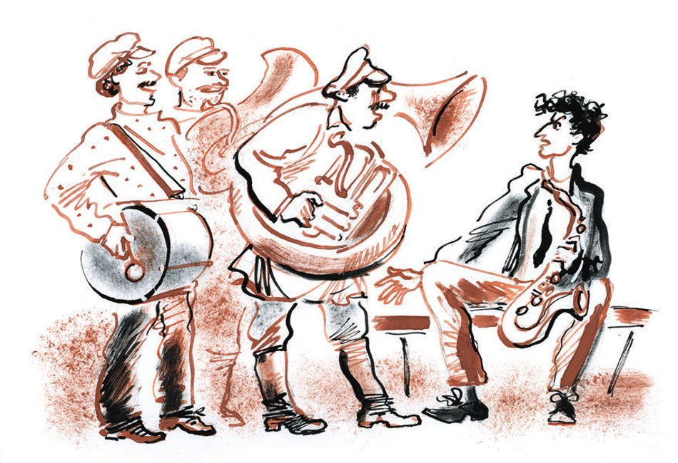

## Kapitel 34: Die Vertreibung aus dem Paradies

Während die einen Helden dieses Romans <abbr title="überzeugt sein von + Dat. — быть убеждённым в">überzeugt</abbr> waren, dass die Zeit nicht drängt, und die anderen <abbr title="meinen — полагать, считать">meinten</abbr>, dass die Zeit nicht wartet, ging die Zeit ihren gewohnten Gang. Auf den staubigen Moskauer Mai folgte ein staubiger Juni. In der Kreisstadt N stand das Auto Staatl. Nr. 1, das in einem <abbr title="das Schlagloch, die Schlaglöcher — ухаб, выбоина">Schlagloch</abbr> beschädigt worden war, schon seit zwei Wochen an der Ecke des Staropanskaja-Platzes und der «Genosse-Gubernski-Straße» und hüllte die Umgebung von Zeit zu Zeit in verzweifelten Rauch ein. Aus dem Stargoroder <abbr title="das Untersuchungsgefängnis, die Untersuchungsgefängnisse — допр (дом предварительного заключения)">Untersuchungsgefängnis</abbr> kamen einzeln die verlegenen Teilnehmer der Verschwörung des Bundes «Schwert und Pflug» heraus – man hatte ihnen eine schriftliche <abbr title="die Verpflichtung, die Verpflichtungen — обязательство, подписка">Verpflichtung</abbr> abgenommen, den Ort nicht zu verlassen. Die Witwe Grizazujewa (die glühende Frau, der Traum des Dichters) war zu ihrem <abbr title="das Kolonialwarengeschäft, die Kolonialwarengeschäfte — бакалейная торговля">Kolonialwarengeschäft</abbr> zurückgekehrt und hatte fünfzehn Rubel Strafe zahlen müssen, weil sie die <abbr title="die Preisliste, die Preislisten — прейскурант">Preisliste</abbr> für Seife, Pfeffer, <abbr title="das Waschblau — синька">Waschblau</abbr> und andere Kurzwaren nicht an einer gut sichtbaren Stelle <abbr title="aushängen — вывешивать">ausgehängt</abbr> hatte – eine <abbr title="die Vergesslichkeit — забывчивость">Vergesslichkeit</abbr>, die einer Frau mit großem Herzen <abbr title="verzeihlich — простительный">verzeihlich</abbr> ist!

— Da ist was! — wiederholte Ostap mit <abbr title="brüchig — срывающийся, ломкий">brüchiger</abbr> Stimme. — Halten Sie!

Ippolit Matwejewitsch nahm in seine bebenden Hände ein flaches Holzkästchen. Ostap wühlte im Dunkeln weiter im Stuhl. Ein kleines <abbr title="das Leuchtfeuer, die Leuchtfeuer — маяк, огонь маяка">Leuchtfeuer</abbr> am Ufer blitzte auf. Auf das Wasser legte sich eine goldene Säule und schwamm hinter dem Dampfer her.

— Was zum Teufel! — sagte Ostap. — Mehr ist nicht da!

— D-d-das kann nicht sein, — stammelte Ippolit Matwejewitsch.

— Na, schauen Sie auch nach!

Worobjaninow fiel, ohne zu atmen, auf die Knie und steckte den Arm bis zum Ellbogen unter den Sitz. Zwischen den Fingern spürte er den <abbr title="der Fuß, die Füße — основание">Fuß</abbr> einer Sprungfeder. Etwas anderes Hartes gab es nicht. Von dem Stuhl kam ein trockener, widerlicher Geruch von <abbr title="aufwirbeln — поднимать (пыль), тревожить">aufgewirbeltem</abbr> Staub.

— Nichts? — fragte Ostap.

— Nein.

Da hob Ostap den Stuhl hoch und warf ihn weit über Bord. Man hörte ein schweres <abbr title="platschen — плеск, шлёпать">Platschen</abbr>. Vor der nächtlichen <abbr title="die Feuchtigkeit — сырость">Feuchtigkeit</abbr> <abbr title="frösteln — зябнуть, ёжиться">fröstelnd</abbr>, kehrten die Konzessionäre voller Zweifel in ihre Kabine zurück.

— So, — sagte Bender. — Etwas haben wir jedenfalls gefunden.

Ippolit Matwejewitsch zog das Kästchen aus der Tasche. Worobjaninow sah es benommen an.

— Geben Sie her, geben Sie her! Was <abbr title="glotzen — пялиться, таращиться">glotzen</abbr> Sie so!

Man öffnete das Kästchen. Auf dem Boden lag ein <abbr title="grünspanig — позеленевший (от окиси)">grünspanig</abbr> gewordenes Messingschildchen mit der Aufschrift:

Meister Gambs beginnt mit diesem <abbr title="der Armlehnstuhl, die Armlehnstühle — полукресло">Armlehnstuhl</abbr> eine neue Partie Möbel.

1865.

Sankt Petersburg.

Diese Aufschrift las Ostap laut vor.

— Und wo sind die Brillanten? — fragte Ippolit Matwejewitsch.

— Sie sind erstaunlich <abbr title="scharfsinnig — догадливый, проницательный">scharfsinnig</abbr>, lieber <abbr title="der Hockerjäger, die Hockerjäger — охотник за табуретками">Hockerjäger</abbr>! Brillanten gibt es, wie Sie sehen, keine.

Worobjaninow bot einen jämmerlichen Anblick. Sein etwas <abbr title="nachwachsen (wuchs nach, ist nachgewachsen) — отрастать">nachgewachsener</abbr> Schnurrbart bewegte sich, die Gläser des Kneifers waren beschlagen. Es sah aus, als schlage er sich vor <abbr title="die Verzweiflung — отчаяние">Verzweiflung</abbr> mit den Ohren auf die Wangen.

Die kalte, <abbr title="besonnen — рассудительный">besonnene</abbr> Stimme des großen Kombinators übte ihre übliche magische Wirkung aus. Worobjaninow legte die Hände an die abgewetzten Hosennähte und verstummte.

— Schweig, Kummer, schweig, Kisa! Eines Tages werden wir über den <abbr title="blöd — дурацкий">blöden</abbr> achten Stuhl lachen, in dem sich ein dummes Schildchen fand. Halten Sie durch. Da sind noch drei Stühle – neunundneunzig Chancen von hundert!

Über Nacht sprang auf der Wange des äußerst <abbr title="bekümmert — огорчённый">bekümmerten</abbr> Ippolit Matwejewitsch ein <abbr title="vulkanisch — вулканический">vulkanischer</abbr> Pickel auf. Alle Leiden, alle Misserfolge, alle Qualen der Jagd nach den Brillanten – all das schien in den Pickel gegangen zu sein, der nun in <abbr title="das Perlmutt — перламутр">Perlmutt</abbr>, Abendkirschrot und Waschblau schillerte.

— Machen Sie das absichtlich? — fragte Ostap.

Ippolit Matwejewitsch seufzte krampfhaft und ging, groß und ein wenig <abbr title="gekrümmt — согнутый">gekrümmt</abbr> wie eine <abbr title="die Angelrute, die Angelruten — удочка">Angelrute</abbr>, die Farben holen. Die Herstellung des Transparents begann. Die Konzessionäre arbeiteten auf dem Oberdeck.

Und es begann der dritte Tag der Reise.

Er begann mit einem kurzen <abbr title="das Gefecht, die Gefechte — стычка, бой">Gefecht</abbr> zwischen dem Blasorchester und der Klanggestaltung um einen <abbr title="der Probenplatz, die Probenplätze — место для репетиций">Probenplatz</abbr>.

Nach dem Frühstück marschierten zum Heck, gleichzeitig von zwei Seiten, die kräftigen Kerle mit den Messingtrompeten und die mageren Ritter der Esmarch-Klistierbecher. Als Erster schaffte es Galkin, sich auf die Bank am Heck zu setzen. Als Zweiter kam die <abbr title="die Klarinette, die Klarinetten — кларнет">Klarinette</abbr> des Blasorchesters angelaufen.

— Der Platz ist besetzt, — sagte Galkin finster.

— Von wem besetzt? — fragte die Klarinette unheilvoll.

— Von mir, Galkin.

— Und von wem noch?

— Von Palkin, Malkin, Tschalkin und Salkind.

— Und einen Jolkin habt ihr nicht? Das ist unser Platz.

Von beiden Seiten rückte <abbr title="die Verstärkung, die Verstärkungen — подкрепление">Verstärkung</abbr> heran. Dreimal von einem messingnen Drachen Gorynytsch <abbr title="umschlingen (umschlang, hat umschlungen) — обвивать, опоясывать">umschlungen</abbr>, stand da das Heraklesophon – die mächtigste Maschine des Orchesters. Ein <abbr title="das Waldhorn, die Waldhörner — валторна">Waldhorn</abbr>, das wie ein Ohr aussah, schwankte. Die Posaunen standen in voller <abbr title="die Kampfbereitschaft — боевая готовность">Kampfbereitschaft</abbr>. Die Sonne spiegelte sich tausendfach in den Rüstungen.

Dunkel und kläglich sah die Klanggestaltung aus. Da <abbr title="blinken — мигать, поблёскивать">blinkte</abbr> Flaschenglas, matt schimmerten die <abbr title="der Klistierbeutel, die Klistierbeutel — клистирная кружка">Klistierbeutel</abbr>, und das Saxophon – eine empörende <abbr title="die Parodie, die Parodien — пародия">Parodie</abbr> auf ein Blasinstrument, ein <abbr title="der Samenextrakt — семенная вытяжка">Samenextrakt</abbr> aus einer echten Trompete – war jämmerlich und glich einer <abbr title="die Stummelpfeife, die Stummelpfeifen — носогрейка (трубка)">Stummelpfeife</abbr>.

— Das <abbr title="das Klistierbataillon — клистирный батальон">Klistierbataillon</abbr>, — sagte die <abbr title="streitlustig — задиристый">streitlustige</abbr> Klarinette, — <abbr title="beanspruchen — претендовать на">beansprucht</abbr> einen Platz.

— Sie, — sagte Salkind, der nach dem beleidigendsten Ausdruck suchte, — Sie sind <abbr title="der Konservative, die Konservativen — консерватор">Konservative</abbr> der Musik!

— Stören Sie uns nicht beim Proben!

— Sie stören doch uns.

— Euch soll man stören! Auf euren <abbr title="der Nachttopf, die Nachttöpfe — ночной горшок, «посудина»">Nachttöpfen</abbr> – je weniger man probt, desto schöner klingt es.

— Und auf euren Samowaren – ob ihr probt oder nicht, es kommt <abbr title="kein Teufel — ни черта">kein Teufel</abbr> dabei heraus.

Ohne sich zu <abbr title="sich einigen — договариваться, приходить к соглашению">einigen</abbr>, blieben beide Seiten an Ort und Stelle und spielten stur jede das Ihre. Flussabwärts flogen Töne, wie sie nur eine Straßenbahn <abbr title="hervorbringen (brachte hervor, hat hervorgebracht) — издавать, производить">hervorbringen</abbr> könnte, die langsam über Glas kriecht. Die Bläser spielten den Marsch des Kexholmer <abbr title="das Leibgarderegiment, die Leibgarderegimenter — лейб-гвардии полк">Leibgarderegiments</abbr>, die Klanggestaltung dagegen den Negertanz «Die Antilope an den Quellen des Sambesi». Der Skandal wurde durch das persönliche <abbr title="eingreifen (griff ein, hat eingegriffen) — вмешиваться">Eingreifen</abbr> des Vorsitzenden der Ziehungskommission beendet.

Gegen elf Uhr abends war das große Werk vollendet. Rückwärts gehend, schleppten Ostap und Worobjaninow das Transparent zur Kapitänsbrücke. Vor ihnen lief, die Hände zu den Sternen erhoben, der kleine Dicke, der Wirtschaftsleiter. Mit vereinten Kräften wurde das Transparent an das Geländer gebunden. Es ragte über dem Passagierdeck wie eine Leinwand. In einer halben Stunde legte der <abbr title="der Elektriker, die Elektriker — электротехник">Elektriker</abbr> Leitungen an die Rückseite des Transparents und brachte darin drei Glühbirnen an. Man musste nur noch den <abbr title="der Schalter, die Schalter — выключатель">Schalter</abbr> drehen.

Vorne, rechts vom Bug, schimmerten schon die Lichter der Stadt Wasjuki.

Zur <abbr title="die Feier, die Feiern — торжество">Feier</abbr> der Beleuchtung des Transparents rief der Wirtschaftsleiter die ganze Bevölkerung des Dampfers zusammen. Ippolit Matwejewitsch und der große Kombinator blickten von oben auf die Versammelten herab; sie standen zu beiden Seiten der noch dunklen <abbr title="die Gesetzestafel, die Gesetzestafeln — скрижаль">Gesetzestafel</abbr>.

Jedes Ereignis auf dem Dampfer nahm sich die schwimmende Behörde sehr zu Herzen. Schreibkräfte, Boten, verantwortliche Mitarbeiter, Kolumbus-Leute und die Schiffsbesatzung drängten sich mit <abbr title="zurücklegen — запрокидывать">zurückgelegten</abbr> Köpfen auf dem Passagierdeck.

— Los! — kommandierte der kleine Dicke.

Das Transparent leuchtete auf.

Ostap blickte nach unten auf die Menge. Rosa Licht legte sich auf die Gesichter. Die Zuschauer lachten. Dann trat Stille ein. Und eine strenge Stimme von unten sagte:

— Wo ist der Wirtschaftsleiter?

Die Stimme war so verantwortlich, dass der Wirtschaftsleiter, ohne die Stufen zu zählen, <abbr title="hinunterstürzen — броситься вниз">hinunterstürzte</abbr>.

— Sehen Sie sich das an, — sagte die Stimme, — bewundern Sie Ihre Arbeit!

— Gleich <abbr title="schmeißen (schmiss, hat geschmissen) — швырять, выгонять">schmeißen</abbr> sie uns raus! — flüsterte Ostap Ippolit Matwejewitsch zu.

Und tatsächlich flog der kleine Dicke wie ein <abbr title="der Habicht, die Habichte — ястреб">Habicht</abbr> auf das Oberdeck.

— Na, wie ist das Transparentchen? — fragte Ostap <abbr title="dreist — нахально">dreist</abbr>. — Kommt es an?

— Packen Sie Ihre Sachen! — schrie der Wirtschaftsleiter.

— Wozu diese Eile?

— Pa-cken-Sie-Ih-re-Sa-chen! Raus! Sie kommen vor Gericht! Unser Chef versteht keinen Spaß!

— Jagen Sie ihn weg! — drang die verantwortliche Stimme von unten herauf.

— Nein, im Ernst, gefällt Ihnen das Transparent nicht? Ist es wirklich ein so <abbr title="mäßig — неважный, посредственный">mäßiges</abbr> Transparent?

Das Spiel fortzusetzen hatte keinen Sinn. Die «Skrjabin» hatte schon in Wasjuki angelegt, und vom Dampfer aus konnte man die verblüfften Gesichter der Wasjuki-Bewohner sehen, die sich auf der Anlegestelle drängten.

Geld wurde <abbr title="kategorisch — категорически">kategorisch</abbr> <abbr title="verweigern — отказывать">verweigert</abbr>. Für das Packen gab man fünf Minuten.

— <abbr title="der Hundsfott, die Hundsfötter — сукин сын («сучья лапа»)">Hundsfott</abbr>, — sagte Simbijewitsch-Sindijewitsch, als die Kompagnons auf die Anlegestelle hinuntergingen. — Hätte man die Gestaltung des Transparents doch mir anvertraut. Ich hätte es so gemacht, dass kein Meyerhold mit mir <abbr title="mithalten (hielt mit, hat mitgehalten) — угнаться, держаться наравне">mithalten</abbr> könnte.

Auf der Anlegestelle blieben die Konzessionäre stehen und blickten hinauf. Am schwarzen Himmel prangte das Transparent.

— Hm ja, — sagte Ostap, — das Transparentchen ist ziemlich wild. Eine <abbr title="miserabel — мизерный, жалкий">miserable</abbr> Ausführung.

Eine Zeichnung, gemacht mit dem Schwanz eines störrischen <abbr title="das Maultier, die Maultiere — мул">Maultiers</abbr>, hätte im Vergleich mit Ostaps Transparent wie ein <abbr title="das Museumsstück, die Museumsstücke — музейная ценность">Museumsstück</abbr> gewirkt. Statt eines Sämanns, der Obligationen ausstreut, hatte Ostaps <abbr title="unartig — шкодливый, озорной">unartige</abbr> Hand eine Art <abbr title="der Stumpf, die Stümpfe — обрубок">Stumpf</abbr> mit einem <abbr title="der Zuckerhut, die Zuckerhüte — сахарная голова">Zuckerhutkopf</abbr> und dünnen <abbr title="die Peitsche, die Peitschen — плеть">Peitschen</abbr> statt Armen dargestellt.

Hinter den Konzessionären <abbr title="erstrahlen — сиять, пылать">erstrahlte</abbr> der Dampfer im Licht und dröhnte von Musik, und vor ihnen, auf dem hohen Ufer, lag die Finsternis der Kreisstadt-Mitternacht, Hundegebell und eine ferne Ziehharmonika.

— Ich <abbr title="zusammenfassen — резюмировать, подводить итог">fasse</abbr> die Lage zusammen, — sagte Ostap <abbr title="lebensfroh — жизнерадостно">lebensfroh</abbr>. — Passiva: kein Groschen Geld, drei Stühle fahren flussabwärts davon, keine Bleibe für die Nacht und nicht ein einziges Abzeichen der Kinderhilfskommission. Aktiva: ein <abbr title="der Reiseführer, die Reiseführer — путеводитель">Reiseführer</abbr> für die Wolga, Ausgabe 1926 (ich musste ihn mir bei Monsieur Simbijewitsch aus der Kabine <abbr title="ausleihen (lieh aus, hat ausgeliehen) — одолжить, позаимствовать">ausleihen</abbr>). Eine <abbr title="ausgeglichen — сбалансированный, бездефицитный">ausgeglichene</abbr> <abbr title="die Bilanz, die Bilanzen — баланс">Bilanz</abbr> zu ziehen, ist sehr schwer. Übernachten müssen wir auf der Anlegestelle.

Die Konzessionäre richteten sich auf den Bänken der Anlegestelle ein. Im Licht einer elenden <abbr title="die Petroleumlaterne, die Petroleumlaternen — керосиновый фонарь">Petroleumlaterne</abbr> las Ostap aus dem Reiseführer vor:

«Am rechten hohen Ufer liegt die Stadt Wasjuki. Von hier werden Holz, <abbr title="das Harz — смола">Harz</abbr>, <abbr title="der Bast — лыко">Bast</abbr> und <abbr title="die Bastmatte, die Bastmatten — рогожа">Bastmatten</abbr> verschickt, und hierher werden Massenbedarfsartikel für die Gegend gebracht, die 50 Kilometer von der Eisenbahn entfernt liegt. Die Stadt hat 8000 Einwohner, eine staatliche <abbr title="die Kartonagenfabrik, die Kartonagenfabriken — картонная фабрика">Kartonagenfabrik</abbr> mit 320 Arbeitern, eine kleine <abbr title="die Eisengießerei, die Eisengießereien — чугунолитейный завод">Eisengießerei</abbr>, eine <abbr title="die Brauerei, die Brauereien — пивоваренный завод">Brauerei</abbr> und eine <abbr title="die Gerberei, die Gerbereien — кожевенный завод">Gerberei</abbr>. An Lehranstalten gibt es außer den allgemeinbildenden Schulen ein <abbr title="das Forsttechnikum — лесной техникум">Forsttechnikum</abbr>.»

— Die Lage ist viel ernster, als ich <abbr title="annehmen (nahm an, hat angenommen) — предполагать">angenommen</abbr> hatte, — sagte Ostap. — Aus den Wasjuki-Leuten Geld herauszuschlagen, scheint mir vorerst eine <abbr title="unlösbar — неразрешимый">unlösbare</abbr> Aufgabe. Und wir brauchen mindestens dreißig Rubel. Erstens müssen wir essen, und zweitens müssen wir die <abbr title="die Wanne, die Wannen — лохань, ванна">Ziehungswanne</abbr> überholen und die Kolumbus-Leute an Land treffen, in Stalingrad.

Ippolit Matwejewitsch rollte sich zusammen wie ein alter, magerer Kater nach einem Kampf mit einem jungen Rivalen – einem hitzigen Herrn der Dächer, Dachböden und <abbr title="die Dachluke, die Dachluken — слуховое окно">Dachluken</abbr>.

Ostap ging an den Bänken auf und ab, überlegte und kombinierte. Gegen ein Uhr nachts war ein großartiger Plan fertig. Bender legte sich neben seinen Kompagnon und schlief ein.

---

### Neue Wörter

- **überzeugt sein von + Dat.** — быть убеждённым в
- **meinen** — полагать, считать
- **das Schlagloch, die Schlaglöcher** — ухаб, выбоина
- **das Untersuchungsgefängnis, die Untersuchungsgefängnisse** — допр (дом предварительного заключения)
- **die Verpflichtung, die Verpflichtungen** — обязательство, подписка
- **das Kolonialwarengeschäft, die Kolonialwarengeschäfte** — бакалейная торговля
- **die Preisliste, die Preislisten** — прейскурант
- **das Waschblau** — синька
- **aushängen** — вывешивать
- **die Vergesslichkeit** — забывчивость
- **verzeihlich** — простительный
- **brüchig** — срывающийся, ломкий
- **das Leuchtfeuer, die Leuchtfeuer** — маяк, огонь маяка
- **der Fuß, die Füße** — основание
- **aufwirbeln** — поднимать (пыль), тревожить
- **platschen** — плеск, шлёпать
- **die Feuchtigkeit** — сырость
- **frösteln** — зябнуть, ёжиться
- **glotzen** — пялиться, таращиться
- **grünspanig** — позеленевший (от окиси)
- **der Armlehnstuhl, die Armlehnstühle** — полукресло
- **scharfsinnig** — догадливый, проницательный
- **der Hockerjäger, die Hockerjäger** — охотник за табуретками
- **nachwachsen (wuchs nach, ist nachgewachsen)** — отрастать
- **die Verzweiflung** — отчаяние
- **besonnen** — рассудительный
- **blöd** — дурацкий
- **bekümmert** — огорчённый
- **vulkanisch** — вулканический
- **das Perlmutt** — перламутр
- **gekrümmt** — согнутый
- **die Angelrute, die Angelruten** — удочка
- **das Gefecht, die Gefechte** — стычка, бой
- **der Probenplatz, die Probenplätze** — место для репетиций
- **die Klarinette, die Klarinetten** — кларнет
- **die Verstärkung, die Verstärkungen** — подкрепление
- **umschlingen (umschlang, hat umschlungen)** — обвивать, опоясывать
- **das Waldhorn, die Waldhörner** — валторна
- **die Kampfbereitschaft** — боевая готовность
- **blinken** — мигать, поблёскивать
- **der Klistierbeutel, die Klistierbeutel** — клистирная кружка
- **die Parodie, die Parodien** — пародия
- **der Samenextrakt** — семенная вытяжка
- **die Stummelpfeife, die Stummelpfeifen** — носогрейка (трубка)
- **das Klistierbataillon** — клистирный батальон
- **streitlustig** — задиристый
- **beanspruchen** — претендовать на
- **der Konservative, die Konservativen** — консерватор
- **der Nachttopf, die Nachttöpfe** — ночной горшок, «посудина»
- **kein Teufel** — ни черта
- **sich einigen** — договариваться, приходить к соглашению
- **hervorbringen (brachte hervor, hat hervorgebracht)** — издавать, производить
- **das Leibgarderegiment, die Leibgarderegimenter** — лейб-гвардии полк
- **eingreifen (griff ein, hat eingegriffen)** — вмешиваться
- **der Elektriker, die Elektriker** — электротехник
- **der Schalter, die Schalter** — выключатель
- **die Feier, die Feiern** — торжество
- **die Gesetzestafel, die Gesetzestafeln** — скрижаль
- **zurücklegen** — запрокидывать
- **hinunterstürzen** — броситься вниз
- **schmeißen (schmiss, hat geschmissen)** — швырять, выгонять
- **der Habicht, die Habichte** — ястреб
- **dreist** — нахально
- **mäßig** — неважный, посредственный
- **kategorisch** — категорически
- **verweigern** — отказывать
- **der Hundsfott, die Hundsfötter** — сукин сын («сучья лапа»)
- **mithalten (hielt mit, hat mitgehalten)** — угнаться, держаться наравне
- **miserabel** — мизерный, жалкий
- **das Maultier, die Maultiere** — мул
- **das Museumsstück, die Museumsstücke** — музейная ценность
- **unartig** — шкодливый, озорной
- **der Stumpf, die Stümpfe** — обрубок
- **der Zuckerhut, die Zuckerhüte** — сахарная голова
- **die Peitsche, die Peitschen** — плеть
- **erstrahlen** — сиять, пылать
- **zusammenfassen** — резюмировать, подводить итог
- **lebensfroh** — жизнерадостно
- **der Reiseführer, die Reiseführer** — путеводитель
- **ausleihen (lieh aus, hat ausgeliehen)** — одолжить, позаимствовать
- **ausgeglichen** — сбалансированный, бездефицитный
- **die Bilanz, die Bilanzen** — баланс
- **die Petroleumlaterne, die Petroleumlaternen** — керосиновый фонарь
- **das Harz** — смола
- **der Bast** — лыко
- **die Bastmatte, die Bastmatten** — рогожа
- **die Kartonagenfabrik, die Kartonagenfabriken** — картонная фабрика
- **die Eisengießerei, die Eisengießereien** — чугунолитейный завод
- **die Brauerei, die Brauereien** — пивоваренный завод
- **die Gerberei, die Gerbereien** — кожевенный завод
- **das Forsttechnikum** — лесной техникум
- **annehmen (nahm an, hat angenommen)** — предполагать
- **unlösbar** — неразрешимый
- **die Wanne, die Wannen** — лохань, ванна
- **die Dachluke, die Dachluken** — слуховое окно

[← Kapitel 33](kapitel-33.md) · [Inhalt](README.md) · [Kapitel 35 →](kapitel-35.md)
