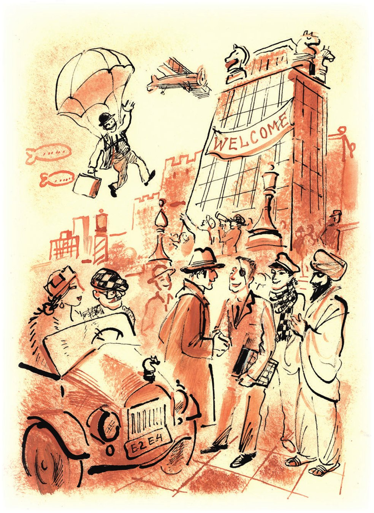
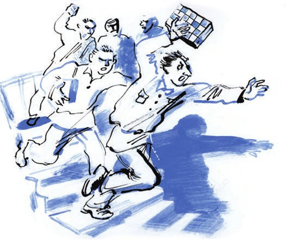
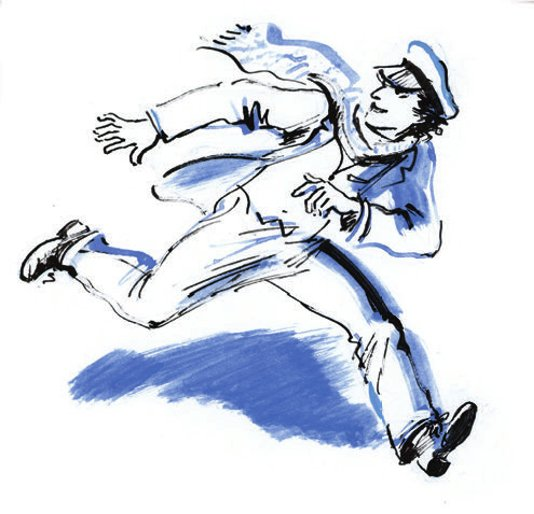

## Kapitel 35: Der Interplanetare Schachkongress

Seit dem Morgen ging durch Wasjuki ein großer, magerer Alter mit goldenem Kneifer und in kurzen, sehr schmutzigen, mit Farbe beschmierten Stiefeln. Er klebte handgeschriebene Anschläge an die Wände:

22. Juni 1927

In den Räumen des Klubs «Der Kartonagenarbeiter» findet ein Vortrag zum Thema «Eine fruchtbare <abbr title="die Eröffnungsidee, die Eröffnungsideen — дебютная идея">Eröffnungsidee</abbr>» und eine <abbr title="die Simultanvorstellung, die Simultanvorstellungen — сеанс одновременной игры">Simultanvorstellung</abbr> im Schach an 160 Brettern des Großmeisters (Obermeister) O. Bender statt.

Alle bringen ihre eigenen Bretter mit.

Gebühr für die Teilnahme – 50 Kop.

Eintritt – 20 Kop.

Beginn pünktlich um 6 Uhr abends.

<abbr title="der Geschäftsführer, die Geschäftsführer — администратор">Geschäftsführer</abbr> K. Michelson.

Der Großmeister selbst verlor ebenfalls keine Zeit. Nachdem er den Klub für drei Rubel <abbr title="mieten — арендовать">gemietet</abbr> hatte, <abbr title="sich begeben (begab sich, hat sich begeben) — отправиться, направиться">begab er sich</abbr> zur Schachsektion, die aus irgendeinem Grund im Korridor der Verwaltung für <abbr title="die Pferdezucht — коннозаводство">Pferdezucht</abbr> untergebracht war.

In der Schachsektion saß ein <abbr title="einäugig — одноглазый">einäugiger</abbr> Mann und las einen Roman von Spielhagen in der Pantelejew-Ausgabe.

— Großmeister O. Bender! — verkündete Ostap und setzte sich auf den Tisch. — Ich veranstalte bei Ihnen eine Simultanvorstellung.

Das einzige Auge des Wasjuki-Schachspielers öffnete sich bis an die Grenzen, die die Natur erlaubt.

— Sofort, Genosse Großmeister, im <abbr title="im Nu — в один миг">Nu</abbr>! — rief der Einäugige. — Nehmen Sie bitte Platz. Ich bin gleich zurück.

Und der Einäugige lief davon. Ostap betrachtete die Räume der Schachsektion. An den Wänden hingen Fotografien von Rennpferden, und auf dem Tisch lag ein <abbr title="verstaubt — запылённый">verstaubtes</abbr> Geschäftsbuch mit der Überschrift: «<abbr title="die Errungenschaft, die Errungenschaften — достижение">Errungenschaften</abbr> der Wasjukier Schachsektion im Jahre 1925».

Der Einäugige kam mit einem Dutzend Bürger verschiedenen Alters zurück. Alle traten der Reihe nach heran, um sich <abbr title="sich bekannt machen — знакомиться">bekannt zu machen</abbr>, nannten ihre Namen und drückten dem Großmeister ehrfürchtig die Hand.

— Auf der <abbr title="die Durchreise — проезд">Durchreise</abbr> nach Kasan, — sagte Ostap <abbr title="abgehackt — отрывисто">abgehackt</abbr>, — ja, ja, die Vorstellung ist heute Abend, kommen Sie. Aber jetzt, entschuldigen Sie, bin ich nicht <abbr title="in Form sein — быть в форме">in Form</abbr>: Ich bin <abbr title="erschöpft — измученный, усталый">erschöpft</abbr> nach dem Karlsbader Turnier.

Die Wasjuki-Schachspieler lauschten Ostap mit <abbr title="kindlich — сыновний, детский">kindlicher</abbr> Liebe. Ostap <abbr title="in Fahrt kommen — разойтись, «понесло»">kam in Fahrt</abbr>. Er spürte einen <abbr title="der Zustrom — прилив">Zustrom</abbr> neuer Kräfte und Schachideen.

— Sie werden es nicht glauben, — sagte er, — wie weit das Schachdenken <abbr title="fortschreiten (schritt fort, ist fortgeschritten) — продвигаться вперёд">fortgeschritten</abbr> ist. Wissen Sie, Lasker ist bei ganz ordinären Dingen angelangt, mit ihm kann man nicht mehr spielen. Er <abbr title="einräuchern — обкуривать">räuchert</abbr> seine Gegner mit Zigarren ein. Und er raucht absichtlich billige, damit der Rauch <abbr title="eklig — противный, мерзкий">ekliger</abbr> ist. Die Schachwelt ist in Unruhe.

Der Großmeister ging zu lokalen Themen über.

— Warum gibt es in der Provinz kein <abbr title="das Gedankenspiel — игра мысли">Gedankenspiel</abbr>? Zum Beispiel Ihre Schachsektion hier. So heißt sie auch: Schachsektion. Langweilig, Mädels! Warum nennen Sie sie nicht wirklich einmal irgendwie schön, so richtig schachmäßig? Das würde die <abbr title="die Gewerkschaftsmasse — союзная (профсоюзная) масса">Gewerkschaftsmasse</abbr> in die Sektion ziehen. Sie könnten Ihre Sektion zum Beispiel so nennen: «Schachklub der vier <abbr title="das Ross, die Rösser — конь (также шахматный)">Rösser</abbr>», oder «Rotes <abbr title="das Endspiel, die Endspiele — эндшпиль">Endspiel</abbr>», oder «<abbr title="der Qualitätsverlust — потеря качества (шахм.)">Qualitätsverlust</abbr> bei <abbr title="der Tempogewinn — выигрыш темпа (шахм.)">Tempogewinn</abbr>». Das wäre gut! Klangvoll!

Die Idee hatte Erfolg.

— Wirklich, — sagten die Wasjukier, — warum sollten wir unsere Sektion nicht in «Klub der vier Rösser» <abbr title="umbenennen (benannte um, hat umbenannt) — переименовывать">umbenennen</abbr>?

Da das Präsidium der Schachsektion gleich zur Stelle war, organisierte Ostap unter seinem <abbr title="der Ehrenvorsitz — почётное председательство">Ehrenvorsitz</abbr> eine Sitzung von einer Minute, auf der die Sektion einstimmig in «Schachklub der vier Rösser» umbenannt wurde. Der Großmeister fertigte, die Lektionen der «Skrjabin» nutzend, <abbr title="eigenhändig — собственноручно">eigenhändig</abbr> und künstlerisch auf einem Bogen Pappe ein Schild mit vier Rössern und der entsprechenden Aufschrift an.

Diese wichtige Maßnahme <abbr title="verheißen (verhieß, hat verheißen) — сулить, обещать">verhieß</abbr> eine <abbr title="die Blüte, die Blüten — расцвет">Blüte</abbr> des Schachdenkens in Wasjuki.

— Schach! — sagte Ostap. — Wissen Sie, was Schach ist? Es bringt nicht nur die Kultur voran, sondern auch die Wirtschaft! Wissen Sie, dass Ihr «Schachklub der vier Rösser», wenn man die Sache richtig anpackt, die Stadt Wasjuki völlig <abbr title="verwandeln — преображать">verwandeln</abbr> kann?

Ostap hatte seit gestern noch nichts gegessen. Deshalb war seine <abbr title="die Beredsamkeit — красноречие">Beredsamkeit</abbr> außergewöhnlich.

— Ja! — rief er. — Schach macht ein Land reich! Wenn Sie meinem Projekt zustimmen, dann werden Sie aus der Stadt zur Anlegestelle über <abbr title="die Marmortreppe, die Marmortreppen — мраморная лестница">Marmortreppen</abbr> hinuntersteigen! Wasjuki wird das Zentrum von zehn Gouvernements! Was haben Sie früher von der Stadt Semmering gehört? Nichts! Und jetzt ist dieses <abbr title="das Städtchen, die Städtchen — городишко">Städtchen</abbr> reich und berühmt, nur weil dort ein internationales Turnier organisiert wurde. Deshalb sage ich: In Wasjuki muss man ein internationales Schachturnier <abbr title="veranstalten — устраивать">veranstalten</abbr>.

— Wie bitte? — riefen alle.

— Eine ganz <abbr title="realistisch — реальный">realistische</abbr> Sache, — antwortete der Großmeister, — meine persönlichen <abbr title="die Verbindung, die Verbindungen — связь">Verbindungen</abbr> und Ihre <abbr title="die Eigeninitiative — самодеятельность">Eigeninitiative</abbr> – das ist alles, was notwendig und <abbr title="hinreichend — достаточный">hinreichend</abbr> ist, um das Internationale Wasjukier Turnier zu organisieren. Denken Sie nur, wie schön das klingen wird: «Internationales Wasjukier Turnier 1927». Die Ankunft von José Raúl Capablanca, Emanuel Lasker, Aljechin, Nimzowitsch, Réti, Rubinstein, Maróczy, Tarrasch, Vidmar und Doktor Grigorjew ist <abbr title="sichern — обеспечивать">gesichert</abbr>. Außerdem ist auch meine <abbr title="die Teilnahme — участие">Teilnahme</abbr> gesichert!

— Aber das Geld, — stöhnten die Wasjukier. — Denen muss man doch allen Geld zahlen! Viele tausend Geld! Wo sollen wir das hernehmen?

— Alles ist vom mächtigen <abbr title="der Orkan, die Orkane — ураган">Orkan</abbr> <abbr title="einkalkulieren — учитывать">einkalkuliert</abbr>, — sagte O. Bender, — das Geld bringen die Einnahmen.

— Wer soll denn bei uns so wahnsinnige Summen bezahlen? Die Wasjukier…

— Was heißt hier Wasjukier! Die Wasjukier werden kein Geld zahlen. Sie werden es be-kom-men! Das ist doch alles außerordentlich einfach. Zu einem Turnier mit der Teilnahme solcher allergrößten Weltmeister werden doch Schachliebhaber aus der ganzen Welt <abbr title="anreisen — съезжаться, приезжать">anreisen</abbr>. Hunderttausende Menschen, reich <abbr title="versorgt — обеспеченный">versorgte</abbr> Menschen, werden nach Wasjuki <abbr title="streben — стремиться">streben</abbr>. Erstens: Der <abbr title="der Flussverkehr — речной транспорт">Flussverkehr</abbr> wird eine solche Menge an Passagieren nicht <abbr title="bewältigen — справиться, осилить">bewältigen</abbr> können. Folglich wird das Volkskommissariat für Verkehrswege die Eisenbahn-<abbr title="die Magistrale, die Magistralen — магистраль">Magistrale</abbr> Moskau–Wasjuki bauen. Das ist eins. Zwei – das sind Hotels und <abbr title="der Wolkenkratzer, die Wolkenkratzer — небоскрёб">Wolkenkratzer</abbr> zur <abbr title="die Unterbringung — размещение">Unterbringung</abbr> der Gäste. Drei – die Hebung der Landwirtschaft in einem <abbr title="der Umkreis — радиус, окружность">Umkreis</abbr> von tausend Kilometern: Die Gäste müssen <abbr title="versorgen — снабжать">versorgt</abbr> werden – Gemüse, Obst, Kaviar, Schokoladenbonbons. Der Palast, in dem das Turnier stattfinden wird – vier. Fünf – der Bau von <abbr title="die Garage, die Garagen — гараж">Garagen</abbr> für die Autos der Gäste. Um die sensationellen Ergebnisse des Turniers der ganzen Welt zu <abbr title="übermitteln — передавать">übermitteln</abbr>, wird man eine <abbr title="superstark — сверхмощный">superstarke</abbr> Funkstation bauen müssen. Das ist sechstens. Nun zur Eisenbahn-Magistrale Moskau–Wasjuki. Zweifellos wird diese keine solche <abbr title="die Durchlassfähigkeit — пропускная способность">Durchlassfähigkeit</abbr> haben, dass sie alle Interessenten nach Wasjuki befördern könnte. Daraus ergibt sich der Flughafen «Groß-Wasjuki» – regelmäßiger <abbr title="der Abflug, die Abflüge — отправление (самолёта)">Abflug</abbr> von Postflugzeugen und <abbr title="das Luftschiff, die Luftschiffe — дирижабль">Luftschiffen</abbr> in alle Enden der Welt, einschließlich Los Angeles und Melbourne.

<abbr title="blendend — ослепительный">Blendende</abbr> Aussichten taten sich vor den Wasjukier Schachliebhabern auf. Die Grenzen des Zimmers weiteten sich. Die morschen Wände des Pferdezucht-<abbr title="das Nest, die Nester — гнездо">Nests</abbr> stürzten ein, und an ihrer Stelle stieg ein gläserner, dreiunddreißigstöckiger Palast des Schachdenkens in den blauen Himmel. In jedem seiner Säle, in jedem Zimmer und sogar in den Aufzügen, die wie <abbr title="das Geschoss, die Geschosse — пуля, снаряд">Geschosse</abbr> vorbeischossen, saßen nachdenkliche Menschen und spielten Schach auf Brettern mit <abbr title="die Einlegearbeit, die Einlegearbeiten — инкрустация">Einlegearbeiten</abbr> aus Malachit.

Die Marmortreppen <abbr title="abfallen (fiel ab, ist abgefallen) — ниспадать, спускаться">fielen</abbr> tatsächlich zur blauen Wolga ab. Auf dem Fluss lagen <abbr title="der Ozeandampfer, die Ozeandampfer — океанский пароход">Ozeandampfer</abbr>. Mit den <abbr title="die Standseilbahn, die Standseilbahnen — фуникулёр">Standseilbahnen</abbr> fuhren pausbäckige Ausländer in die Stadt hinauf, Schach-Ladys, australische Verehrer der Indischen Verteidigung, Inder in weißen Turbanen, <abbr title="der Anhänger, die Anhänger — приверженец">Anhänger</abbr> der Spanischen Partie, Deutsche, Franzosen, Neuseeländer, Bewohner des Amazonasbeckens und – voller <abbr title="der Neid — зависть">Neid</abbr> auf die Wasjukier – Moskauer, Leningrader, Kiewer, Sibirier und Odessiten.

Autos fuhren wie am <abbr title="das Fließband, die Fließbänder — конвейер">Fließband</abbr> zwischen marmornen Hotels. Doch da – alles blieb stehen. Aus dem vornehmen Hotel «Zum <abbr title="der Freibauer, die Freibauern — проходная пешка">Freibauern</abbr>» trat der Weltmeister José Raúl Capablanca y Graupera. Damen umringten ihn.

Ein Milizionär in einer speziellen Schachuniform (karierte Reithosen und <abbr title="der Läufer, die Läufer — слон (шахм.)">Läufer</abbr> auf den <abbr title="der Kragenspiegel, die Kragenspiegel — петлица">Kragenspiegeln</abbr>) salutierte höflich. Mit Würde trat der einäugige Vorsitzende des Wasjukier «Klubs der vier Rösser» an den Meister heran. Das Gespräch der beiden <abbr title="die Leuchte, die Leuchten — светило">Leuchten</abbr>, das auf Englisch geführt wurde, wurde durch die Ankunft von Doktor Grigorjew und dem künftigen Weltmeister Aljechin per Flugzeug unterbrochen. Begrüßungsrufe erschütterten die Stadt. José Raúl Capablanca y Graupera verzog das Gesicht. Auf einen <abbr title="der Wink, die Winke — мановение, знак">Wink</abbr> des Einäugigen wurde eine Marmortreppe an das Flugzeug <abbr title="heranfahren (fuhr heran, hat herangefahren) — подавать, подвозить">herangefahren</abbr>. Doktor Grigorjew lief sie hinunter, schwenkte zum Gruß seinen neuen Hut und <abbr title="kommentieren — комментировать">kommentierte</abbr> im Gehen einen möglichen Fehler Capablancas in seinem bevorstehenden Wettkampf mit Aljechin.

Plötzlich <abbr title="erblicken — увидеть, усмотреть">erblickte</abbr> man am Horizont einen schwarzen Punkt. Er kam schnell näher und wuchs und verwandelte sich in einen großen <abbr title="smaragdgrün — изумрудный">smaragdgrünen</abbr> <abbr title="der Fallschirm, die Fallschirme — парашют">Fallschirm</abbr>. Wie ein großer <abbr title="der Rettich, die Rettiche — редька">Rettich</abbr> hing am Fallschirmring ein Mann mit einem Köfferchen.

— Das ist er! — rief der Einäugige. — <abbr title="hurra — ура">Hurra</abbr>! Hurra! Hurra! Ich erkenne den großen Schach-<abbr title="der Philosoph, die Philosophen — философ">Philosophen</abbr>, Doktor Lasker. Nur er allein in der ganzen Welt trägt solche grünen Söckchen.

José Raúl Capablanca y Graupera verzog wieder das Gesicht.

Man schob Lasker flink eine Marmortreppe hin, und der <abbr title="rüstig — бодрый">rüstige</abbr> Exweltmeister, der sich ein <abbr title="das Stäubchen, die Stäubchen — пылинка">Stäubchen</abbr> vom linken Ärmel blies, das sich während des Fluges über Schlesien darauf gesetzt hatte, fiel dem Einäugigen in die Arme. Der Einäugige nahm Lasker um die Taille, führte ihn zum Weltmeister und sagte:

— Versöhnen Sie sich! Ich bitte Sie im Namen der breiten Wasjukier Massen! Versöhnen Sie sich!

José Raúl seufzte laut und sagte, während er die Hand des alten <abbr title="der Veteran, die Veteranen — ветеран">Veteranen</abbr> schüttelte:

— Ich habe mich immer vor Ihrer Idee <abbr title="sich verneigen vor + Dat. — преклоняться перед">verneigt</abbr>, den Läufer in der Spanischen Partie von b nach c zu <abbr title="überführen — переводить">überführen</abbr>.

— Hurra! — rief der Einäugige. — Einfach und <abbr title="überzeugend — убедительно">überzeugend</abbr>, im Stil eines Weltmeisters!

Und die ganze unvorstellbare Menge nahm es auf:

— Hurra! Vivat! Banzai! Einfach und überzeugend, im Stil eines Weltmeisters!!!

Die Begeisterung erreichte ihren Höhepunkt. Als der Einäugige die Maestros Duz-Chotimirski und Perekatow erblickte, die in einem eiförmigen orangefarbenen Luftschiff über die Stadt schwebten, hob er die Hand. Zweieinhalb Millionen Menschen sangen in einem einzigen begeisterten <abbr title="der Aufschwung — порыв, подъём">Aufschwung</abbr>:

Wie wunderbar ist das Gesetz des Schachs und wie <abbr title="unumstößlich — непреложный">unumstößlich</abbr>:

Wer auch nur winzigen Vorteil errang An Raum, an Masse, Zeit und Drang der Kraft – Nur dem allein ist der gerade Weg zum Sieg möglich.

Expresszüge rollten an die zwölf Wasjukier Bahnhöfe heran und setzten immer neue Scharen von Schachliebhabern ab.

Ein <abbr title="der Eilbote, die Eilboten — скороход, гонец">Eilbote</abbr> lief auf den Einäugigen zu.

— <abbr title="der Aufruhr — смятение, переполох">Aufruhr</abbr> auf der superstarken Funkstation. Ihre Hilfe wird benötigt.

Auf der Funkstation empfingen die Ingenieure den Einäugigen mit Rufen:

— <abbr title="das Notsignal, die Notsignale — сигнал бедствия">Notsignale</abbr>! Notsignale!

Der Einäugige <abbr title="überstülpen — нахлобучить">stülpte</abbr> sich die <abbr title="der Kopfhörer, die Kopfhörer — наушники">Kopfhörer</abbr> über und horchte.

— Uau, uau, uau! — drangen verzweifelte Schreie durch den <abbr title="der Äther — эфир">Äther</abbr>. — SOS! Rettet unsere Seelen!

— Wer bist du, der um Rettung fleht? — rief der Einäugige streng in den Äther.

— Ich bin ein junger Mexikaner! — <abbr title="melden — сообщать">meldeten</abbr> die Luftwellen. — Rettet meine Seele!

— Was haben Sie mit dem «Schachklub der vier Rösser» zu tun?

— Eine <abbr title="untertänig — нижайший, покорнейший">untertänigste</abbr> Bitte!

— Und worum geht es?

— Ich bin der junge Mexikaner Torre! Ich bin gerade aus dem <abbr title="das Irrenhaus, die Irrenhäuser — сумасшедший дом">Irrenhaus</abbr> entlassen worden. Lassen Sie mich zum Turnier! Lassen Sie mich!

— Ach! Ich habe so wenig Zeit! — antwortete der Einäugige.

— SOS! SO! SOS! — kreischte der Äther.

— Na gut! Kommen Sie halt <abbr title="angeflogen kommen — прилететь">angeflogen</abbr>!

— Ich habe kein Ge-e-eld! — tönte es von den Ufern des Golfs von Mexiko.

— Ach, diese jungen Schachspieler, — seufzte der Einäugige. — Schickt ihm eine Motorluft-<abbr title="die Draisine, die Draisinen — дрезина">Draisine</abbr>! Er soll kommen!

Schon loderte der Himmel von leuchtender <abbr title="die Reklame, die Reklamen — реклама">Reklame</abbr>, als man ein weißes Pferd durch die Straßen der Stadt führte. Es war das einzige Pferd, das die <abbr title="die Mechanisierung — механизация">Mechanisierung</abbr> des Wasjukier Verkehrs überlebt hatte. Durch einen besonderen <abbr title="der Beschluss, die Beschlüsse — постановление">Beschluss</abbr> war es zum «Ross» umbenannt worden, obwohl es sein Leben lang als Stute <abbr title="gelten (galt, hat gegolten) — считаться">gegolten</abbr> hatte. Die Verehrer des Schachs begrüßten es und schwenkten <abbr title="der Palmzweig, die Palmzweige — пальмовая ветвь">Palmzweige</abbr> und Schachbretter.

— Seien Sie unbesorgt, — sagte Ostap, — mein Projekt garantiert Ihrer Stadt eine unerhörte Blüte der <abbr title="die Produktivkraft, die Produktivkräfte — производительная сила">Produktivkräfte</abbr>. Denken Sie nur, was sein wird, wenn das Turnier zu Ende ist und alle Gäste abgereist sind. Die Moskauer, von der <abbr title="die Wohnungsnot — жилищный кризис">Wohnungsnot</abbr> <abbr title="bedrängen — теснить, стеснять">bedrängt</abbr>, werden sich auf Ihre herrliche Stadt stürzen. Die Hauptstadt zieht automatisch nach Wasjuki um. Die Regierung kommt hierher. Wasjuki wird in Neu-Moskau umbenannt, Moskau in Alt-Wasjuki. Die Leningrader und die Charkower <abbr title="mit den Zähnen knirschen — скрежетать зубами">knirschen mit den Zähnen</abbr>, können aber nichts machen. Neu-Moskau wird das eleganteste Zentrum Europas und bald der ganzen Welt.

— Der ganzen Welt!!! — stöhnten die betäubten Wasjukier.

— Ja! Und später des ganzen <abbr title="das Weltall — вселенная">Weltalls</abbr>. Das Schachdenken, das eine Kreisstadt in die Hauptstadt des Erdballs verwandelt hat, wird sich in eine <abbr title="angewandt — прикладной">angewandte</abbr> Wissenschaft verwandeln und Methoden des <abbr title="interplanetar — междупланетный">interplanetaren</abbr> Verkehrs erfinden. Aus Wasjuki werden Signale zum Mars, zum Jupiter und zum Neptun fliegen. Der Verkehr mit der Venus wird so leicht werden wie die Fahrt von Rybinsk nach Jaroslawl. Und dann, wer weiß, vielleicht findet in etwa acht Jahren in Wasjuki der erste Interplanetare Schachkongress in der Geschichte des <abbr title="das Universum — мироздание">Universums</abbr> statt!

Ostap wischte sich die edle Stirn. Er hatte einen solchen Hunger, dass er bereitwillig ein gebratenes Schachross gegessen hätte.

— Ja-a, — <abbr title="hervorpressen (presste hervor, hat hervorgepresst) — выдавить из себя">presste</abbr> der Einäugige hervor und ließ einen <abbr title="irr — безумный">irren</abbr> Blick durch den staubigen Raum schweifen, — aber wie soll man die Maßnahme praktisch <abbr title="verwirklichen — проводить в жизнь, осуществлять">verwirklichen</abbr>, sozusagen eine Basis schaffen?

Die Anwesenden blickten gespannt auf den Großmeister.

— Ich wiederhole, praktisch hängt die Sache nur von Ihrer Eigeninitiative ab. Die ganze Organisation, ich wiederhole, übernehme ich. Keinerlei materielle <abbr title="die Aufwendung, die Aufwendungen — затрата">Aufwendungen</abbr>, wenn man von den Ausgaben für Telegramme absieht.

Der Einäugige stieß seine <abbr title="der Mitstreiter, die Mitstreiter — соратник">Mitstreiter</abbr> an.

— Nun? — fragte er. — Was sagt ihr?

— Machen wir! Machen wir! — <abbr title="lärmen — шуметь, гомонить">lärmten</abbr> die Wasjukier.

— Wie viel Geld braucht man denn für die… äh… Telegramme?

— Eine lächerliche Summe, — sagte Ostap, — hundert Rubel.

— Wir haben in der Kasse nur einundzwanzig Rubel sechzehn Kopeken. Das reicht, wie wir verstehen, natürlich bei Weitem nicht…

Aber der Großmeister erwies sich als <abbr title="entgegenkommend — покладистый, сговорчивый">entgegenkommender</abbr> Organisator.

— Na gut, — sagte er, — geben Sie Ihre zwanzig Rubel her.

— Reicht das? — fragte der Einäugige.

— Für die ersten Telegramme reicht es. Und dann setzt ein Zustrom von Spenden ein, und man weiß nicht mehr, wohin mit dem Geld!

Der Großmeister steckte das Geld in sein grünes <abbr title="das Feldjackett, die Feldjacketts — походный пиджак">Feldjackett</abbr>, erinnerte die Versammelten an seinen Vortrag und die Simultanvorstellung an 160 Brettern, verabschiedete sich liebenswürdig bis zum Abend und ging in den Klub «Der Kartonagenarbeiter» zu einem Treffen mit Ippolit Matwejewitsch.

— Ich <abbr title="verhungern — умирать с голоду, голодать">verhungere</abbr>, — sagte Worobjaninow mit knarrender Stimme.

Er saß schon am Kassenfensterchen, hatte aber noch keine einzige Kopeke eingenommen und konnte nicht einmal ein Pfund Brot kaufen. Vor ihm lag ein grünes <abbr title="das Drahtkörbchen, die Drahtkörbchen — проволочная корзиночка">Drahtkörbchen</abbr> für die Einnahmen. In solche Körbchen legt man in Häusern <abbr title="mittleren Standes — средней руки">mittleren Standes</abbr> Messer und Gabeln.

— Hören Sie, Worobjaninow, — rief Ostap, — stellen Sie für anderthalb Stunden die Kassengeschäfte ein! Wir gehen in der Volksküche zu Mittag essen. Unterwegs <abbr title="schildern — описывать, обрисовать">schildere</abbr> ich Ihnen die Situation. Übrigens müssen Sie sich rasieren und sich <abbr title="säubern — чистить">säubern</abbr>. Sie sehen geradezu wie ein <abbr title="der Landstreicher, die Landstreicher — босяк, бродяга">Landstreicher</abbr> aus. Ein Großmeister darf keine so verdächtigen Bekannten haben.

— Ich habe keine einzige Karte verkauft, — meldete Ippolit Matwejewitsch.

— Macht nichts. Gegen Abend laufen sie zusammen. Die Stadt hat mir schon zwanzig Rubel für die Organisation eines internationalen Schachturniers gespendet.

— Wozu brauchen wir dann die Simultanvorstellung? — flüsterte der Geschäftsführer. — Man kann uns doch verprügeln. Mit zwanzig Rubeln können wir sofort einen Dampfer nehmen – gerade ist die «Karl Liebknecht» von oben gekommen –, ruhig nach Stalingrad fahren und dort auf die Ankunft des Theaters warten. <abbr title="es gelingt — авось удастся">Vielleicht gelingt es ja</abbr> dort, die Stühle aufzuschneiden. Dann sind wir reiche Leute, und alles gehört uns.

— Mit leerem Magen darf man nicht so dumme Dinge sagen. Das wirkt sich <abbr title="negativ — отрицательно">negativ</abbr> auf das Gehirn aus. Für zwanzig Rubel kommen wir vielleicht bis Stalingrad. Und wovon sollen wir essen? Vitamine, lieber Genosse Adelsmarschall, bekommt niemand umsonst. Dafür kann man den temperamentvollen Wasjukiern für Vortrag und Vorstellung so an die dreißig Rubel <abbr title="abknöpfen — содрать, сорвать (деньги)">abknöpfen</abbr>.

— Die verprügeln uns! — sagte Worobjaninow bitter.

— Natürlich gibt es ein <abbr title="das Risiko, die Risiken — риск">Risiko</abbr>. Die können einem die <abbr title="jemandem die Visage polieren — набить морду">Visage polieren</abbr>. Übrigens habe ich da einen kleinen Gedanken, der jedenfalls Sie in Sicherheit bringt. Aber davon später. Vorerst gehen wir die örtlichen Speisen kosten.

Gegen sechs Uhr abends betrat der satte, rasierte und nach <abbr title="das Kölnischwasser — одеколон">Kölnischwasser</abbr> duftende Großmeister die Kasse des Klubs «Der Kartonagenarbeiter». Der satte und rasierte Worobjaninow verkaufte flott Karten.

— Na, wie steht's? — fragte der Großmeister leise.

— Eintrittskarten dreißig und Teilnehmerkarten zwanzig, — antwortete der Geschäftsführer.

— Sechzehn Rubel. Schwach, schwach!

— Aber Bender, sehen Sie doch, was für eine Schlange da steht! Die verprügeln uns <abbr title="unweigerlich — неминуемо">unweigerlich</abbr>!

— Denken Sie nicht daran. Wenn sie prügeln, dann werden Sie weinen, aber jetzt trödeln Sie nicht! Lernen Sie zu verkaufen!

Nach einer Stunde waren fünfunddreißig Rubel in der Kasse. Das Publikum wurde im Saal unruhig.

— Schließen Sie das Fensterchen! Geben Sie das Geld her! — sagte Ostap. — Und jetzt Folgendes. Hier haben Sie fünf Rubel, gehen Sie zur Anlegestelle, mieten Sie für etwa zwei Stunden ein Boot und warten Sie auf mich am Ufer, etwas unterhalb des <abbr title="der Speicher, die Speicher — амбар, склад">Speichers</abbr>. Wir machen zusammen eine Abendspazierfahrt. Machen Sie sich um mich keine Sorgen. Ich bin heute in Form.

Der Großmeister betrat den Saal. Er fühlte sich munter und wusste <abbr title="felsenfest — твёрдо">felsenfest</abbr>, dass der erste Zug e2–e4 ihm keinerlei <abbr title="die Komplikation, die Komplikationen — осложнение">Komplikationen</abbr> <abbr title="androhen — грозить">androhte</abbr>. Die übrigen Züge <abbr title="sich abzeichnen — вырисовываться">zeichneten sich</abbr> zwar in völligem Nebel ab, aber das <abbr title="beirren — смущать, сбивать с толку">beirrte</abbr> den großen Kombinator nicht im Geringsten. Er hatte einen völlig unerwarteten Ausweg vorbereitet, um sogar die <abbr title="aussichtslos — безнадёжный">aussichtsloseste</abbr> Partie zu retten.

Der Großmeister wurde mit <abbr title="das Händeklatschen — рукоплескания">Händeklatschen</abbr> empfangen. Der kleine Klubsaal war mit bunten Papierfähnchen <abbr title="behängen — увешивать">behängt</abbr>. Vor einer Woche hatte hier ein Abend der «Gesellschaft zur Rettung <abbr title="der Ertrinkende, die Ertrinkenden — утопающий">Ertrinkender</abbr>» stattgefunden, wovon auch die Losung an der Wand <abbr title="zeugen von + Dat. — свидетельствовать о">zeugte</abbr>: «Die Rettung der Ertrinkenden ist Sache der Ertrinkenden selbst».

Ostap verbeugte sich, streckte die Hände nach vorn, als wollte er den nicht verdienten Applaus abwehren, und stieg auf die Bühne.

— Genossen! — sagte er mit herrlicher Stimme. — Genossen und Brüder im Schach, der Gegenstand meines heutigen Vortrags ist das, worüber ich vor einer Woche in Nischni Nowgorod gesprochen habe, und zwar, wie ich gestehen muss, nicht ohne Erfolg. Der Gegenstand meines Vortrags ist die fruchtbare Eröffnungsidee. Was ist, Genossen, eine Eröffnung, und was ist, Genossen, eine Idee? Die Eröffnung, Genossen, ist «Quasi una fantasia». Und was bedeutet, Genossen, eine Idee? Eine Idee, Genossen, ist ein menschlicher Gedanke, der in eine logische Schachform <abbr title="kleiden — облекать, одевать">gekleidet</abbr> ist. Sogar mit <abbr title="verschwindend — ничтожно">verschwindend</abbr> geringen Kräften kann man das ganze Brett <abbr title="beherrschen — овладеть, господствовать">beherrschen</abbr>. Alles hängt von jedem <abbr title="das Individuum, die Individuen — индивидуум">Individuum</abbr> im Einzelnen ab. Zum Beispiel der kleine Blonde dort in der dritten Reihe. Nehmen wir an, er spielt gut…

Der Blonde in der dritten Reihe <abbr title="erröten — краснеть, зардеться">errötete</abbr>.

— Und der <abbr title="der Brünette, die Brünetten — брюнет">Brünette</abbr> dort, nehmen wir an, schlechter.

Alle drehten sich um und betrachteten auch den Brünetten.

— Was sehen wir also, Genossen? Wir sehen, dass der Blonde gut spielt und der Brünette schlecht. Und keine Vorträge werden dieses <abbr title="das Kräfteverhältnis — соотношение сил">Kräfteverhältnis</abbr> ändern, wenn nicht jedes Individuum im Einzelnen ständig im Dam… das heißt, ich wollte sagen, im Schach <abbr title="trainieren — тренироваться">trainiert</abbr>… Und jetzt, Genossen, erzähle ich Ihnen einige lehrreiche Geschichten aus der Praxis unserer verehrten <abbr title="der Hypermoderne, die Hypermodernen — гипермодернист">Hypermodernen</abbr> Capablanca, Lasker und Doktor Grigorjew.

Ostap erzählte dem Publikum einige <abbr title="uralt — древний, ветхозаветный">uralte</abbr> <abbr title="die Anekdote, die Anekdoten — анекдот">Anekdoten</abbr>, die er noch als Kind aus dem «Blauen Journal» <abbr title="schöpfen — черпать">geschöpft</abbr> hatte, und beendete damit das <abbr title="das Zwischenspiel, die Zwischenspiele — интермедия">Zwischenspiel</abbr>.

Alle waren über die Kürze des Vortrags leicht verwundert. Und der Einäugige <abbr title="nicht lassen von + Dat. (ließ, hat gelassen) — не сводить (глаз) с">ließ</abbr> sein einziges Auge nicht von den Schuhen des Großmeisters.

Die beginnende Simultanvorstellung hielt jedoch den wachsenden <abbr title="der Verdacht — подозрение">Verdacht</abbr> des einäugigen Schachspielers auf. Zusammen mit allen anderen stellte er die Tische in <abbr title="die U-Form — буквой П («покоем»)">U-Form</abbr> auf. Insgesamt setzten sich dreißig Liebhaber zum Spiel gegen den Großmeister. Viele von ihnen waren völlig fassungslos und blickten jede Minute in Schachlehrbücher, um sich die komplizierten Varianten ins Gedächtnis zu rufen, mit deren Hilfe sie hofften, wenigstens nach dem zweiundzwanzigsten Zug vor dem Großmeister aufgeben zu können.

Ostap ließ seinen Blick über die Reihen der «Schwarzen» gleiten, die ihn von allen Seiten umringten, über die geschlossene Tür, und machte sich <abbr title="unerschrocken — бесстрашно">unerschrocken</abbr> an die Arbeit. Er trat zu dem Einäugigen, der am ersten Brett saß, und zog den <abbr title="der Königsbauer, die Königsbauern — королевская пешка">Königsbauern</abbr> vom Feld e2 auf das Feld e4.

Der Einäugige griff sich sofort mit beiden Händen an die Ohren und begann <abbr title="angestrengt — напряжённо">angestrengt</abbr> nachzudenken. Durch die Reihen der Liebhaber raschelte es:

— Der Großmeister hat e2–e4 gespielt.

Ostap <abbr title="verwöhnen — баловать">verwöhnte</abbr> seine Gegner nicht mit einer <abbr title="die Vielfalt — разнообразие">Vielfalt</abbr> an Eröffnungen. Auf den übrigen neunundzwanzig Brettern führte er dieselbe Operation durch: Er schob den Königsbauern von e2 auf e4. Einer nach dem anderen rauften sich die Liebhaber die Haare und versanken in <abbr title="fieberhaft — лихорадочный">fieberhaftes</abbr> Nachdenken. Die Nichtspielenden folgten dem Großmeister mit den Blicken. Der einzige <abbr title="der Amateurfotograf, die Amateurfotografen — фотолюбитель">Amateurfotograf</abbr> der Stadt war schon auf einen Stuhl <abbr title="klettern — взгромоздиться, лезть">geklettert</abbr> und wollte das <abbr title="das Magnesium — магний">Magnesium</abbr> anzünden, aber Ostap fuchtelte wütend mit den Armen, unterbrach seinen Rundgang an den Brettern und rief laut:

— <abbr title="wegschaffen — убрать">Schafft</abbr> den Fotografen weg! Er stört mein Schachdenken!

«Wozu soll ich in diesem erbärmlichen Nest ein Foto von mir hinterlassen. Ich habe nicht gern mit der Miliz zu tun», entschied er bei sich.

Das empörte Zischen der Liebhaber zwang den Fotografen, seinen Versuch aufzugeben. Die Empörung war so groß, dass man den Fotografen sogar aus dem Raum <abbr title="hinauswerfen (warf hinaus, hat hinausgeworfen) — выгнать, «выпереть»">hinauswarf</abbr>.

Beim dritten Zug stellte sich heraus, dass der Großmeister achtzehn Spanische Partien spielte. In den übrigen zwölf wandte Schwarz die zwar <abbr title="veraltet — устаревший">veraltete</abbr>, aber ziemlich zuverlässige Philidor-Verteidigung an. Hätte Ostap erfahren, dass er so <abbr title="knifflig — мудрёный">knifflige</abbr> Partien spielte und auf eine so bewährte Verteidigung stieß, wäre er äußerst verwundert gewesen. <abbr title="die Sache ist die — дело в том">Die Sache ist die</abbr>: Der große Kombinator spielte zum zweiten Mal in seinem Leben Schach.

Zuerst gerieten die Liebhaber, und der Einäugige als Erster unter ihnen, in Entsetzen. Die <abbr title="die Tücke, die Tücken — коварство">Tücke</abbr> des Großmeisters war nicht zu bezweifeln. Mit ungewöhnlicher Leichtigkeit, und zweifellos innerlich über die rückständigen Liebhaber der Stadt Wasjuki <abbr title="spötteln — ехидничать, насмехаться">spöttelnd</abbr>, <abbr title="opfern — жертвовать">opferte</abbr> der Großmeister Bauern, schwere und leichte Figuren nach rechts und nach links. Dem im Vortrag <abbr title="schmähen — хаять, поносить">geschmähten</abbr> Brünetten opferte er sogar die <abbr title="die Dame, die Damen — ферзь">Dame</abbr>. Der Brünette geriet in Entsetzen und wollte sofort aufgeben, zwang sich aber nur mit einer furchtbaren <abbr title="die Willensanstrengung — усилие воли">Willensanstrengung</abbr>, weiterzuspielen.

Ein <abbr title="ein Blitz aus heiterem Himmel — гром среди ясного неба">Blitz aus heiterem Himmel</abbr> schlug nach fünf Minuten ein.

— Matt! — stammelte der zu Tode erschrockene Brünette. — Sie sind matt, Genosse Großmeister.

Ostap <abbr title="analysieren — анализировать">analysierte</abbr> die Stellung, nannte die «Dame» <abbr title="schmählich — позорно">schmählich</abbr> «Königin» und gratulierte dem Brünetten <abbr title="hochtrabend — высокопарно">hochtrabend</abbr> zum Sieg. Ein <abbr title="raunen — гул, шёпот">Raunen</abbr> lief durch die Reihen der Liebhaber.

«Zeit, <abbr title="die Fliege machen — смыться, «рвать когти»">die Fliege zu machen</abbr>», dachte Ostap, während er ruhig zwischen den Tischen umherging und nachlässig die Figuren umstellte.

— Sie haben das Ross falsch gestellt, Genosse Großmeister, — <abbr title="katzbuckeln — лебезить, угодничать">katzbuckelte</abbr> der Einäugige. — Das Ross zieht nicht so.

— Pardon, pardon, Verzeihung, — antwortete der Großmeister, — nach dem Vortrag bin ich etwas müde.

Im Laufe der nächsten zehn Minuten verlor der Großmeister noch zehn Partien.

Verwunderte Rufe ertönten in den Räumen des Klubs «Der Kartonagenarbeiter». Ein Konflikt bahnte sich an. Ostap verlor fünfzehn Partien hintereinander und bald darauf noch drei. Es blieb nur der Einäugige übrig. Am Anfang der Partie hatte er vor Angst eine Menge Fehler gemacht und führte das Spiel jetzt nur mühsam zu einem siegreichen Ende. Ostap stahl, ohne dass die Umstehenden es bemerkten, einen schwarzen <abbr title="der Turm, die Türme — ладья (шахм.)">Turm</abbr> vom Brett und steckte ihn in die Tasche.

Die Menge <abbr title="sich schließen (schloss sich, hat sich geschlossen) — смыкаться">schloss sich</abbr> eng um die Spielenden.

— Gerade eben stand auf diesem Feld mein Turm! — rief der Einäugige, nachdem er sich umgesehen hatte. — Und jetzt ist er weg!

— Wenn er weg ist, dann war er auch nicht da! — sagte Ostap ziemlich grob.

— Wie, nicht da? Ich erinnere mich genau!

— Natürlich war er nicht da!

— Wo ist er denn hin? Haben Sie ihn geschlagen?

— Geschlagen.

— Wann? Bei welchem Zug?

— Was <abbr title="jemandem etwas vom Pferd erzählen — морочить голову">erzählen Sie mir da vom Pferd</abbr> mit Ihrem Turm? Wenn Sie aufgeben, dann sagen Sie es!

— Erlauben Sie, Genossen, ich habe alle Züge <abbr title="notieren — записывать">notiert</abbr>!

— Die Kanzlei schreibt mit, — sagte Ostap.

— Das ist unerhört! — brüllte der Einäugige. — Geben Sie mir meinen Turm zurück!

— Geben Sie auf, geben Sie auf, was ist das für ein <abbr title="das Katz-und-Maus-Spiel — игра в кошки-мышки">Katz-und-Maus-Spiel</abbr>!

— Geben Sie den Turm zurück!

Bei diesen Worten begriff der Großmeister, dass <abbr title="zaudern — медлить, колебаться">Zaudern</abbr> dem Tod gleichkam, griff eine Handvoll Figuren und <abbr title="schleudern — швырять">schleuderte</abbr> sie dem einäugigen Gegner an den Kopf.

— Genossen! — kreischte der Einäugige. — Seht alle her! Man schlägt einen Liebhaber!

Die Schachspieler der Stadt Wasjuki waren verdutzt.

Ohne kostbare Zeit zu verlieren, schleuderte Ostap ein Schachbrett gegen die Lampe und lief, in der eingetretenen Dunkelheit auf irgendwelche Kiefer und Stirnen schlagend, auf die Straße hinaus. Die Wasjukier Liebhaber stürzten, übereinander fallend, hinter ihm her.

Es war ein mondheller Abend. Ostap jagte über die silberne Straße, leicht wie ein Engel, und <abbr title="sich abstoßen (stieß sich ab, hat sich abgestoßen) — отталкиваться">stieß sich</abbr> von der <abbr title="sündig — грешный">sündigen</abbr> Erde ab. <abbr title="angesichts + Gen. — ввиду">Angesichts</abbr> der <abbr title="scheitern — не состояться, провалиться">gescheiterten</abbr> Verwandlung Wasjukis in das Zentrum des Universums musste er nicht zwischen Palästen laufen, sondern zwischen kleinen <abbr title="das Blockhaus, die Blockhäuser — бревенчатый дом">Blockhäusern</abbr> mit Fensterläden außen. Hinter ihm stürmten die Schachliebhaber her.

— Haltet den Großmeister! — brüllte der Einäugige.

— <abbr title="das Gaunerpack — жульё">Gaunerpack</abbr>! — stimmten die übrigen ein.

— <abbr title="der Patzer, die Patzer — пижон, слабый шахматист">Patzer</abbr>! — knurrte der Großmeister zurück und <abbr title="beschleunigen — увеличивать скорость">beschleunigte</abbr> sein Tempo.

— <abbr title="zu Hilfe! — караул!">Zu Hilfe</abbr>! — schrien die gekränkten Schachspieler.

Ostap sprang die Treppe hinunter, die zur Anlegestelle führte. Er musste vierhundert Stufen laufen. Auf dem sechsten Absatz warteten schon zwei Liebhaber auf ihn, die auf einem <abbr title="der Umweg, die Umwege — обходной путь">Umweg</abbr> direkt über den <abbr title="der Hang, die Hänge — склон">Hang</abbr> hierher gelangt waren. Ostap blickte sich um.

Von oben rollte wie eine <abbr title="die Hundemeute, die Hundemeuten — собачья стая">Hundemeute</abbr> eine dichte Gruppe <abbr title="wutentbrannt — разъярённый">wutentbrannter</abbr> Verehrer der Philidor-Verteidigung herab. Einen <abbr title="der Rückzug — отступление">Rückzug</abbr> gab es nicht. Deshalb lief Ostap nach vorn.

— Euch werd ich's zeigen, ihr Mistkerle! — donnerte er die tapferen <abbr title="der Kundschafter, die Kundschafter — разведчик">Kundschafter</abbr> an und stürzte sich vom fünften Absatz hinab.

Die erschrockenen <abbr title="der Späher, die Späher — разведчик, пластун">Späher</abbr> ächzten auf, kippten über das Geländer und rollten irgendwohin in die Dunkelheit der <abbr title="der Hügel, die Hügel — бугор, холм">Hügel</abbr> und Hänge. Der Weg war frei.

— Haltet den Großmeister! — rollte es von oben herab.

Die Verfolger liefen und polterten über die Holztreppe wie fallende <abbr title="die Kegelkugel, die Kegelkugeln — кегельный шар">Kegelkugeln</abbr>.

Am Ufer angekommen, bog Ostap nach rechts ab und suchte mit den Augen das Boot mit dem ihm treu ergebenen Geschäftsführer.

Ippolit Matwejewitsch saß <abbr title="idyllisch — идиллически">idyllisch</abbr> im Bötchen. Ostap plumpste auf die Bank und begann wütend vom Ufer <abbr title="wegrudern — отгребать">wegzurudern</abbr>. Nach einer Minute flogen Steine in das Boot. Einer davon traf Ippolit Matwejewitsch. Etwas oberhalb des vulkanischen Pickels wuchs ihm eine dunkle <abbr title="die Beule, die Beulen — шишка, желвак">Beule</abbr>. Ippolit Matwejewitsch zog den Kopf zwischen die Schultern und jammerte.

— So eine <abbr title="die Schlafmütze, die Schlafmützen — растяпа («шляпа»)">Schlafmütze</abbr>! Mir hätte man fast den Kopf abgerissen, und mir geht's gut: munter und fröhlich. Und wenn man noch fünfzig Rubel <abbr title="der Reingewinn — чистая прибыль">Reingewinn</abbr> <abbr title="berücksichtigen — принимать во внимание">berücksichtigt</abbr>, dann ist das für eine einzige Beule auf Ihrem Kopf ein recht anständiges Honorar.

Unterdessen hatten die Verfolger, die erst jetzt begriffen, dass der Plan zur Verwandlung von Wasjuki in Neu-Moskau gescheitert war und dass der Großmeister fünfzig <abbr title="sauer verdient — кровный">sauer verdiente</abbr> Wasjukier Rubel aus der Stadt <abbr title="entführen — увозить, похищать">entführte</abbr>, ein großes Boot bestiegen und waren mit Geschrei in die Mitte des Flusses hinausgerudert. In das Boot hatten sich etwa dreißig Leute <abbr title="sich zwängen — набиваться, втискиваться">gezwängt</abbr>. Jeder wollte persönlich an der <abbr title="die Abrechnung — расправа">Abrechnung</abbr> mit dem Großmeister teilnehmen. Die Expedition kommandierte der Einäugige. Sein einziges Auge funkelte in der Nacht wie ein Leuchtturm.

— Haltet den Großmeister! — grölte man in der überladenen <abbr title="die Barke, die Barken — барка, баржа">Barke</abbr>.

— Los, Kisa! — sagte Ostap. — Wenn die uns einholen, kann ich für die <abbr title="die Unversehrtheit — целость, сохранность">Unversehrtheit</abbr> Ihres Kneifers nicht garantieren.

Beide Boote fuhren flussabwärts. Der <abbr title="der Abstand, die Abstände — расстояние">Abstand</abbr> zwischen ihnen wurde immer kleiner. Ostap war am Ende seiner Kräfte.

— Ihr entkommt uns nicht, ihr Mistkerle! — schrie man aus der Barke.

Ostap antwortete nicht: Er hatte keine Zeit. Die <abbr title="das Ruder, die Ruder — весло">Ruder</abbr> rissen sich aus dem Wasser. Das Wasser flog in Strömen unter den rasenden Rudern hervor und spritzte ins Boot.

— <abbr title="weiter so — давай, валяй">Weiter so</abbr>, — flüsterte Ostap sich selbst zu.

Ippolit Matwejewitsch quälte sich. Die Barke <abbr title="triumphieren — торжествовать">triumphierte</abbr>. Ihr hoher Rumpf umfuhr schon links das Bötchen der Konzessionäre, um den Großmeister ans Ufer zu drängen. Den Konzessionären stand ein klägliches Los bevor. Die Freude auf der Barke war so groß, dass alle Schachspieler auf die rechte Seite hinübergingen, um, sobald sie auf gleicher Höhe mit dem Bötchen wären, mit überlegenen Kräften über den Schurken von Großmeister herzufallen.

— Passen Sie auf Ihren Kneifer auf, Kisa! — rief Ostap verzweifelt und warf die Ruder hin. — Gleich geht's los!

— Meine Herren! — rief plötzlich Ippolit Matwejewitsch mit einer Hahnenstimme. — Wollen Sie uns etwa wirklich schlagen?

— Und wie! — donnerten die Wasjukier Liebhaber und machten sich bereit, ins Boot zu springen.

Doch in diesem Augenblick geschah ein für die ehrlichen Schachspieler der ganzen Welt äußerst <abbr title="kränkend — обидный">kränkender</abbr> <abbr title="der Zwischenfall, die Zwischenfälle — происшествие, инцидент">Zwischenfall</abbr>. Die Barke <abbr title="sich neigen — крениться">neigte sich</abbr> unerwartet und schöpfte mit der rechten Seite Wasser.

— Vorsicht! — piepste der einäugige Kapitän.

Aber es war schon zu spät. Zu viele Liebhaber hatten sich auf der rechten Seite des Wasjukier <abbr title="der Dreadnought, die Dreadnoughts — дредноут">Dreadnoughts</abbr> versammelt. Mit dem <abbr title="verlagern — смещать, переносить">verlagerten</abbr> <abbr title="der Schwerpunkt, die Schwerpunkte — центр тяжести">Schwerpunkt</abbr> zögerte die Barke nicht lange und <abbr title="kentern — опрокидываться (о судне)">kenterte</abbr> in voller <abbr title="die Übereinstimmung — соответствие">Übereinstimmung</abbr> mit den Gesetzen der Physik.

Ein allgemeiner Schrei störte die Ruhe des Flusses.

— Uau! — stöhnten die Schachspieler gedehnt.

Ganze dreißig Liebhaber fanden sich im Wasser wieder. Sie kamen schnell an die <abbr title="die Oberfläche — поверхность">Oberfläche</abbr> und klammerten sich einer nach dem anderen an die <abbr title="umkippen — опрокидываться, переворачиваться">umgekippte</abbr> Barke. Als Letzter legte der Einäugige an.

— Ihr Patzer! — rief Ostap <abbr title="entzückt — в восторге">entzückt</abbr>. — Warum schlagt ihr euren Großmeister denn nicht? Ihr wolltet mich doch, wenn ich mich nicht irre, schlagen?

Ostap zog um die <abbr title="der Schiffbrüchige, die Schiffbrüchigen — потерпевший кораблекрушение">Schiffbrüchigen</abbr> einen Kreis.

— Ihr versteht doch, Wasjukier Individuen, dass ich euch einzeln <abbr title="ertränken — топить">ertränken</abbr> könnte, aber ich schenke euch das Leben. Lebt, Bürger! Nur, um des Schöpfers willen, spielt kein Schach! Ihr könnt es doch einfach nicht! Ach, ihr Patzer, ihr Patzer… Fahren wir weiter, Ippolit Matwejewitsch. Lebt wohl, einäugige Liebhaber! Ich fürchte, Wasjuki wird nicht das Zentrum des Universums werden. Ich glaube nicht, dass die Meister des Schachs zu solchen Dummköpfen wie euch kämen, selbst wenn ich sie darum bäte. Lebt wohl, Liebhaber starker Schachgefühle! Es lebe der Klub der vier <abbr title="der Gaul, die Gäule — кляча, лошадь">Gäule</abbr>!

---

### Neue Wörter

- **die Eröffnungsidee, die Eröffnungsideen** — дебютная идея
- **die Simultanvorstellung, die Simultanvorstellungen** — сеанс одновременной игры
- **der Geschäftsführer, die Geschäftsführer** — администратор
- **mieten** — арендовать
- **sich begeben (begab sich, hat sich begeben)** — отправиться, направиться
- **die Pferdezucht** — коннозаводство
- **einäugig** — одноглазый
- **im Nu** — в один миг
- **verstaubt** — запылённый
- **die Errungenschaft, die Errungenschaften** — достижение
- **sich bekannt machen** — знакомиться
- **die Durchreise** — проезд
- **abgehackt** — отрывисто
- **in Form sein** — быть в форме
- **erschöpft** — измученный, усталый
- **kindlich** — сыновний, детский
- **in Fahrt kommen** — разойтись, «понесло»
- **der Zustrom** — прилив
- **fortschreiten (schritt fort, ist fortgeschritten)** — продвигаться вперёд
- **einräuchern** — обкуривать
- **eklig** — противный, мерзкий
- **das Gedankenspiel** — игра мысли
- **die Gewerkschaftsmasse** — союзная (профсоюзная) масса
- **das Ross, die Rösser** — конь (также шахматный)
- **das Endspiel, die Endspiele** — эндшпиль
- **der Qualitätsverlust** — потеря качества (шахм.)
- **der Tempogewinn** — выигрыш темпа (шахм.)
- **umbenennen (benannte um, hat umbenannt)** — переименовывать
- **der Ehrenvorsitz** — почётное председательство
- **eigenhändig** — собственноручно
- **verheißen (verhieß, hat verheißen)** — сулить, обещать
- **die Blüte, die Blüten** — расцвет
- **verwandeln** — преображать
- **die Beredsamkeit** — красноречие
- **die Marmortreppe, die Marmortreppen** — мраморная лестница
- **das Städtchen, die Städtchen** — городишко
- **veranstalten** — устраивать
- **realistisch** — реальный
- **die Verbindung, die Verbindungen** — связь
- **die Eigeninitiative** — самодеятельность
- **hinreichend** — достаточный
- **sichern** — обеспечивать
- **die Teilnahme** — участие
- **der Orkan, die Orkane** — ураган
- **einkalkulieren** — учитывать
- **anreisen** — съезжаться, приезжать
- **versorgt** — обеспеченный
- **streben** — стремиться
- **der Flussverkehr** — речной транспорт
- **bewältigen** — справиться, осилить
- **die Magistrale, die Magistralen** — магистраль
- **der Wolkenkratzer, die Wolkenkratzer** — небоскрёб
- **die Unterbringung** — размещение
- **der Umkreis** — радиус, окружность
- **versorgen** — снабжать
- **die Garage, die Garagen** — гараж
- **übermitteln** — передавать
- **superstark** — сверхмощный
- **die Durchlassfähigkeit** — пропускная способность
- **der Abflug, die Abflüge** — отправление (самолёта)
- **das Luftschiff, die Luftschiffe** — дирижабль
- **blendend** — ослепительный
- **das Nest, die Nester** — гнездо
- **das Geschoss, die Geschosse** — пуля, снаряд
- **die Einlegearbeit, die Einlegearbeiten** — инкрустация
- **abfallen (fiel ab, ist abgefallen)** — ниспадать, спускаться
- **der Ozeandampfer, die Ozeandampfer** — океанский пароход
- **die Standseilbahn, die Standseilbahnen** — фуникулёр
- **der Anhänger, die Anhänger** — приверженец
- **der Neid** — зависть
- **das Fließband, die Fließbänder** — конвейер
- **der Freibauer, die Freibauern** — проходная пешка
- **der Läufer, die Läufer** — слон (шахм.)
- **der Kragenspiegel, die Kragenspiegel** — петлица
- **die Leuchte, die Leuchten** — светило
- **der Wink, die Winke** — мановение, знак
- **heranfahren (fuhr heran, hat herangefahren)** — подавать, подвозить
- **kommentieren** — комментировать
- **erblicken** — увидеть, усмотреть
- **smaragdgrün** — изумрудный
- **der Fallschirm, die Fallschirme** — парашют
- **der Rettich, die Rettiche** — редька
- **hurra** — ура
- **der Philosoph, die Philosophen** — философ
- **rüstig** — бодрый
- **das Stäubchen, die Stäubchen** — пылинка
- **der Veteran, die Veteranen** — ветеран
- **sich verneigen vor + Dat.** — преклоняться перед
- **überführen** — переводить
- **überzeugend** — убедительно
- **der Aufschwung** — порыв, подъём
- **unumstößlich** — непреложный
- **der Eilbote, die Eilboten** — скороход, гонец
- **der Aufruhr** — смятение, переполох
- **das Notsignal, die Notsignale** — сигнал бедствия
- **überstülpen** — нахлобучить
- **der Kopfhörer, die Kopfhörer** — наушники
- **der Äther** — эфир
- **melden** — сообщать
- **untertänig** — нижайший, покорнейший
- **das Irrenhaus, die Irrenhäuser** — сумасшедший дом
- **angeflogen kommen** — прилететь
- **die Draisine, die Draisinen** — дрезина
- **die Reklame, die Reklamen** — реклама
- **die Mechanisierung** — механизация
- **der Beschluss, die Beschlüsse** — постановление
- **gelten (galt, hat gegolten)** — считаться
- **der Palmzweig, die Palmzweige** — пальмовая ветвь
- **die Produktivkraft, die Produktivkräfte** — производительная сила
- **die Wohnungsnot** — жилищный кризис
- **bedrängen** — теснить, стеснять
- **mit den Zähnen knirschen** — скрежетать зубами
- **das Weltall** — вселенная
- **angewandt** — прикладной
- **interplanetar** — междупланетный
- **das Universum** — мироздание
- **hervorpressen (presste hervor, hat hervorgepresst)** — выдавить из себя
- **irr** — безумный
- **verwirklichen** — проводить в жизнь, осуществлять
- **die Aufwendung, die Aufwendungen** — затрата
- **der Mitstreiter, die Mitstreiter** — соратник
- **lärmen** — шуметь, гомонить
- **entgegenkommend** — покладистый, сговорчивый
- **das Feldjackett, die Feldjacketts** — походный пиджак
- **verhungern** — умирать с голоду, голодать
- **das Drahtkörbchen, die Drahtkörbchen** — проволочная корзиночка
- **mittleren Standes** — средней руки
- **schildern** — описывать, обрисовать
- **säubern** — чистить
- **der Landstreicher, die Landstreicher** — босяк, бродяга
- **es gelingt** — авось удастся
- **negativ** — отрицательно
- **abknöpfen** — содрать, сорвать (деньги)
- **das Risiko, die Risiken** — риск
- **jemandem die Visage polieren** — набить морду
- **das Kölnischwasser** — одеколон
- **unweigerlich** — неминуемо
- **der Speicher, die Speicher** — амбар, склад
- **felsenfest** — твёрдо
- **die Komplikation, die Komplikationen** — осложнение
- **androhen** — грозить
- **sich abzeichnen** — вырисовываться
- **beirren** — смущать, сбивать с толку
- **aussichtslos** — безнадёжный
- **das Händeklatschen** — рукоплескания
- **behängen** — увешивать
- **der Ertrinkende, die Ertrinkenden** — утопающий
- **zeugen von + Dat.** — свидетельствовать о
- **kleiden** — облекать, одевать
- **verschwindend** — ничтожно
- **beherrschen** — овладеть, господствовать
- **das Individuum, die Individuen** — индивидуум
- **erröten** — краснеть, зардеться
- **der Brünette, die Brünetten** — брюнет
- **das Kräfteverhältnis** — соотношение сил
- **trainieren** — тренироваться
- **der Hypermoderne, die Hypermodernen** — гипермодернист
- **uralt** — древний, ветхозаветный
- **die Anekdote, die Anekdoten** — анекдот
- **schöpfen** — черпать
- **das Zwischenspiel, die Zwischenspiele** — интермедия
- **nicht lassen von + Dat. (ließ, hat gelassen)** — не сводить (глаз) с
- **der Verdacht** — подозрение
- **die U-Form** — буквой П («покоем»)
- **unerschrocken** — бесстрашно
- **der Königsbauer, die Königsbauern** — королевская пешка
- **angestrengt** — напряжённо
- **verwöhnen** — баловать
- **die Vielfalt** — разнообразие
- **fieberhaft** — лихорадочный
- **der Amateurfotograf, die Amateurfotografen** — фотолюбитель
- **klettern** — взгромоздиться, лезть
- **das Magnesium** — магний
- **wegschaffen** — убрать
- **hinauswerfen (warf hinaus, hat hinausgeworfen)** — выгнать, «выпереть»
- **veraltet** — устаревший
- **knifflig** — мудрёный
- **die Sache ist die** — дело в том
- **die Tücke, die Tücken** — коварство
- **spötteln** — ехидничать, насмехаться
- **opfern** — жертвовать
- **schmähen** — хаять, поносить
- **die Dame, die Damen** — ферзь
- **die Willensanstrengung** — усилие воли
- **ein Blitz aus heiterem Himmel** — гром среди ясного неба
- **analysieren** — анализировать
- **schmählich** — позорно
- **hochtrabend** — высокопарно
- **raunen** — гул, шёпот
- **die Fliege machen** — смыться, «рвать когти»
- **katzbuckeln** — лебезить, угодничать
- **der Turm, die Türme** — ладья (шахм.)
- **sich schließen (schloss sich, hat sich geschlossen)** — смыкаться
- **jemandem etwas vom Pferd erzählen** — морочить голову
- **notieren** — записывать
- **das Katz-und-Maus-Spiel** — игра в кошки-мышки
- **zaudern** — медлить, колебаться
- **schleudern** — швырять
- **sich abstoßen (stieß sich ab, hat sich abgestoßen)** — отталкиваться
- **sündig** — грешный
- **angesichts + Gen.** — ввиду
- **scheitern** — не состояться, провалиться
- **das Blockhaus, die Blockhäuser** — бревенчатый дом
- **das Gaunerpack** — жульё
- **der Patzer, die Patzer** — пижон, слабый шахматист
- **beschleunigen** — увеличивать скорость
- **zu Hilfe!** — караул!
- **der Umweg, die Umwege** — обходной путь
- **der Hang, die Hänge** — склон
- **die Hundemeute, die Hundemeuten** — собачья стая
- **wutentbrannt** — разъярённый
- **der Rückzug** — отступление
- **der Kundschafter, die Kundschafter** — разведчик
- **der Späher, die Späher** — разведчик, пластун
- **der Hügel, die Hügel** — бугор, холм
- **die Kegelkugel, die Kegelkugeln** — кегельный шар
- **idyllisch** — идиллически
- **wegrudern** — отгребать
- **die Beule, die Beulen** — шишка, желвак
- **die Schlafmütze, die Schlafmützen** — растяпа («шляпа»)
- **der Reingewinn** — чистая прибыль
- **berücksichtigen** — принимать во внимание
- **sauer verdient** — кровный
- **entführen** — увозить, похищать
- **sich zwängen** — набиваться, втискиваться
- **die Abrechnung** — расправа
- **die Barke, die Barken** — барка, баржа
- **die Unversehrtheit** — целость, сохранность
- **der Abstand, die Abstände** — расстояние
- **das Ruder, die Ruder** — весло
- **weiter so** — давай, валяй
- **triumphieren** — торжествовать
- **kränkend** — обидный
- **der Zwischenfall, die Zwischenfälle** — происшествие, инцидент
- **sich neigen** — крениться
- **der Dreadnought, die Dreadnoughts** — дредноут
- **verlagern** — смещать, переносить
- **der Schwerpunkt, die Schwerpunkte** — центр тяжести
- **kentern** — опрокидываться (о судне)
- **die Übereinstimmung** — соответствие
- **die Oberfläche** — поверхность
- **umkippen** — опрокидываться, переворачиваться
- **entzückt** — в восторге
- **der Schiffbrüchige, die Schiffbrüchigen** — потерпевший кораблекрушение
- **ertränken** — топить
- **der Gaul, die Gäule** — кляча, лошадь

[← Kapitel 34](kapitel-34.md) · [Inhalt](README.md) · [Kapitel 36 →](kapitel-36.md)
