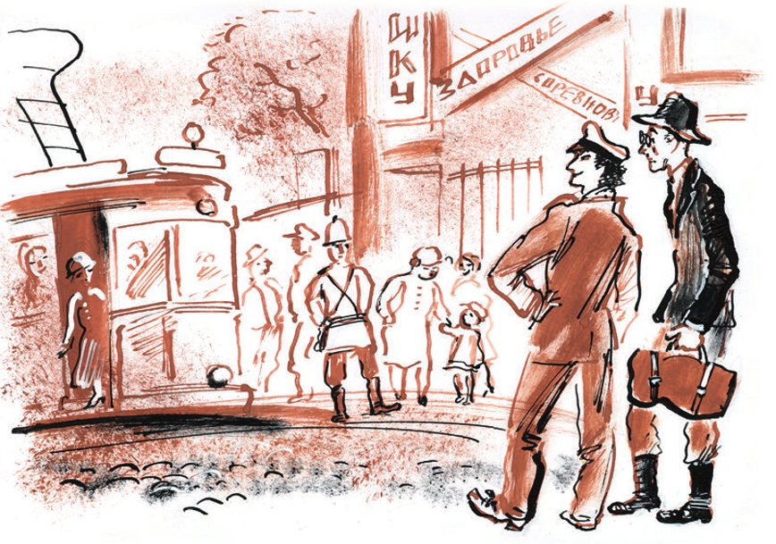
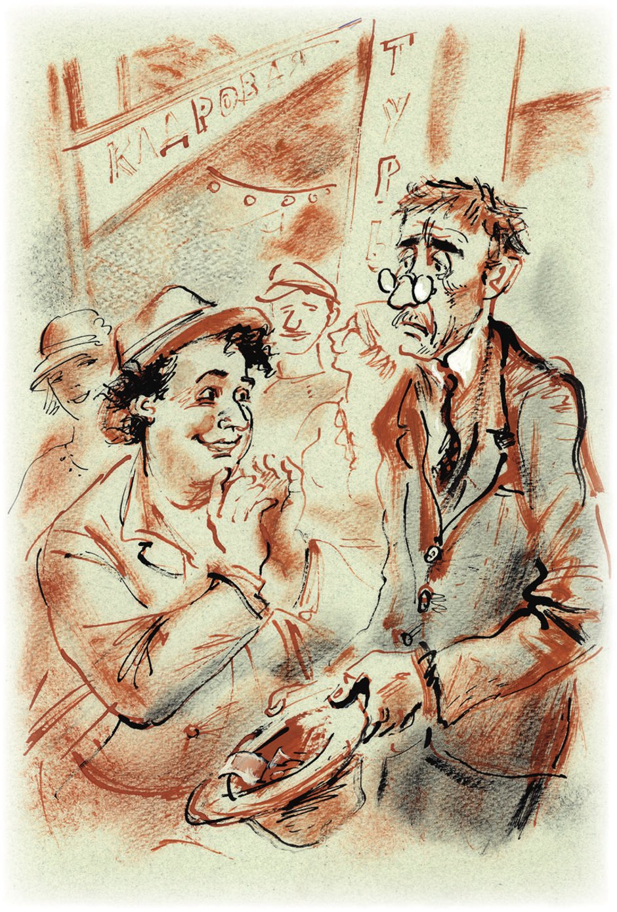

## Kapitel 37: Blick auf die Malachitpfütze

Es war ein Sonntagabend. Alles war sauber und gewaschen. Sogar der Maschuk, mit <abbr title="das Gebüsch, die Gebüsche — кустарник">Gebüsch</abbr> und kleinen <abbr title="der Hain, die Haine — роща">Hainen</abbr> <abbr title="bewachsen — поросший">bewachsen</abbr>, schien sorgfältig gekämmt zu sein und <abbr title="verströmen — источать">verströmte</abbr> den Duft eines Berg-Haarwassers.

Weiße Hosen der verschiedensten Art huschten über den Bahnsteig, der wie ein Spielzeug aussah: Hosen aus Sackleinen, aus <abbr title="das Moleskin — чёртова кожа (ткань)">Moleskin</abbr>, aus <abbr title="die Kolomanka — коломянка (льняная ткань)">Kolomanka</abbr>, aus Segeltuch und aus zartem <abbr title="der Flanell — фланель">Flanell</abbr>. Man ging hier in <abbr title="die Sandale, die Sandalen — сандалия">Sandalen</abbr> und in offenen «Apachenhemden». Die Konzessionäre in ihren schweren, schmutzigen Stiefeln, schweren, staubigen Hosen, heißen Westen und glühend heißen Jacketts fühlten sich hier fremd. Unter all den fröhlichen <abbr title="das Kattunkleid, die Kattunkleider — ситцевое платье">Kattunkleidchen</abbr>, mit denen die Mädchen im <abbr title="der Kurort, die Kurorte — курорт">Kurort</abbr> <abbr title="prahlen mit + Dat. — щеголять, хвастаться">prahlten</abbr>, war die Uniform der <abbr title="die Bahnhofsvorsteherin, die Bahnhofsvorsteherinnen — начальница станции">Bahnhofsvorsteherin</abbr> die hellste und eleganteste. Zum Erstaunen aller <abbr title="der Ankömmling, die Ankömmlinge — приезжий">Ankömmlinge</abbr> war der Bahnhofsvorsteher eine Frau. Rote Locken quollen unter ihrer roten <abbr title="die Dienstmütze, die Dienstmützen — форменная фуражка">Dienstmütze</abbr> hervor, die am <abbr title="der Mützenrand, die Mützenränder — околыш">Mützenrand</abbr> zwei silberne <abbr title="die Tresse, die Tressen — галун">Tressen</abbr> trug. Sie trug eine weiße <abbr title="die Uniformjacke, die Uniformjacken — форменный китель">Uniformjacke</abbr> und einen weißen Rock.

Nachdem sie sich an der Vorsteherin <abbr title="sich satt sehen an + Dat. (sah, hat gesehen) — налюбоваться">sattgesehen</abbr>, das frisch <abbr title="ankleben — наклеивать">angeklebte</abbr> Plakat über das <abbr title="das Gastspiel, die Gastspiele — гастроли">Gastspiel</abbr> des Kolumbus-Theaters in Pjatigorsk gelesen und zwei Gläser Narsan zu fünf Kopeken getrunken hatten, drangen die Reisenden mit der Straßenbahn der Linie «Bahnhof – Blumengarten» in die Stadt vor. Für den Eintritt in den «Blumengarten» nahm man zehn Kopeken.

Im «Blumengarten» gab es viel Musik, viele fröhliche Menschen und sehr wenige Blumen. Ein Sinfonieorchester spielte in einer weißen <abbr title="die Konzertmuschel, die Konzertmuscheln — раковина для оркестра">Konzertmuschel</abbr> den «Tanz der <abbr title="die Mücke, die Mücken — комар">Mücken</abbr>». In der Lermontow-<abbr title="die Galerie, die Galerien — галерея">Galerie</abbr> wurde Narsan verkauft. Mit Narsan handelte man in Kiosken und auf der Straße.

Niemand kümmerte sich um die zwei schmutzigen Brillantensucher.

— Ach, Kisa, — sagte Ostap, — wir sind Fremde auf diesem Fest des Lebens.

Die erste Nacht im Kurort verbrachten die Konzessionäre an der Narsan-Quelle.

Erst hier, in Pjatigorsk, als das Kolumbus-Theater zum dritten Mal vor den verblüfften <abbr title="der Bürger, die Bürger — горожанин">Bürgern</abbr> seine «Heirat» spielte, begriffen die Kompagnons, wie schwierig die Jagd nach dem Schatz war. Ins Theater einzudringen, wie sie es früher vorgehabt hatten, war unmöglich. Hinter den Kulissen übernachteten Galkin, Palkin, Malkin, Tschalkin und Salkind, deren <abbr title="die Essensmarke, die Essensmarken — талон на питание, марка">Essensmarken</abbr>-<abbr title="die Diät, die Diäten — диета">Diät</abbr> es ihnen nicht erlaubte, im Hotel zu wohnen. So vergingen die Tage, und die Freunde waren am Ende ihrer Kräfte: Sie schliefen an der Stelle, wo Lermontow sein Duell gehabt hatte, und <abbr title="sich ernähren — кормиться">ernährten sich</abbr> davon, dass sie das Gepäck von Touristen aus dem <abbr title="der Mittelstand — середняки, средний слой">Mittelstand</abbr> trugen.

Am sechsten Tag gelang es Ostap, mit dem Monteur Metschnikow Bekanntschaft zu schließen, der für die hydraulische Presse zuständig war. Zu diesem Zeitpunkt war Metschnikow, der aus Geldmangel seinen Kater jeden Tag mit Narsan aus der Quelle kurierte, in einem <abbr title="entsetzlich — ужасный">entsetzlichen</abbr> Zustand und verkaufte, wie Ostap beobachtet hatte, auf dem Markt allerlei Gegenstände aus dem <abbr title="der Theaterfundus — театральный реквизит">Theaterfundus</abbr>. Die endgültige <abbr title="die Vereinbarung, die Vereinbarungen — договорённость">Vereinbarung</abbr> wurde bei einem morgendlichen <abbr title="das Trinkgelage, die Trinkgelage — возлияние, попойка">Trinkgelage</abbr> an der Quelle <abbr title="erzielen — достигать">erzielt</abbr>. Der Monteur Metschnikow nannte Ostap «Schätzchen» und war einverstanden.

— Geht, — sagte er, — das geht immer, Schätzchen. Mit dem größten Vergnügen, Schätzchen.

Ostap begriff sofort, dass der Monteur ein großer <abbr title="der Fuchs, die Füchse — хитрец, дока">Fuchs</abbr> war.

Die <abbr title="die Vertragspartei, die Vertragsparteien — договаривающаяся сторона">Vertragsparteien</abbr> sahen einander in die Augen, <abbr title="sich umarmen — обниматься">umarmten sich</abbr>, klopften sich auf den Rücken und lachten höflich.

— Also, — sagte Ostap, — für die ganze Sache einen <abbr title="der Zehner, die Zehner — десятка">Zehner</abbr>!

— Schätzchen! — wunderte sich der Monteur. — Sie machen mich <abbr title="böse — злой">böse</abbr>. Ich bin ein vom Narsan <abbr title="zermürbt — измученный">zermürbter</abbr> Mensch.

— Wie viel wollen Sie denn?

— Legen Sie einen Fünfziger hin. Es ist ja <abbr title="das Staatseigentum — казённое имущество">Staatseigentum</abbr>. Ich bin ein zermürbter Mensch.

— Gut. Nehmen Sie zwanzig! Einverstanden? Na, ich sehe es Ihren Augen an, dass Sie einverstanden sind.

— Das <abbr title="das Einverständnis — согласие">Einverständnis</abbr> ist ein Produkt bei völligem <abbr title="das Nichtwiderstreben — непротивление">Nichtwiderstreben</abbr> der Parteien.

— Der Hund <abbr title="sich ausdrücken — излагать, выражаться">drückt sich</abbr> gut aus, — flüsterte Ostap Ippolit Matwejewitsch ins Ohr. — Lernen Sie davon.

— Wann bringen Sie denn die Stühle?

— Stühle gegen Geld.

— Das geht, — sagte Ostap, ohne nachzudenken.

— Das Geld im Voraus, — erklärte der Monteur. — Morgens das Geld, abends die Stühle, oder abends das Geld und am nächsten Morgen die Stühle.

— Und vielleicht heute die Stühle und morgen das Geld? — <abbr title="nachbohren — допытываться">bohrte</abbr> Ostap nach.

— Ich bin doch, Schätzchen, ein zermürbter Mensch. Solche Bedingungen nimmt meine Seele nicht an!

— Aber ich, — sagte Ostap, — bekomme das Geld doch erst morgen <abbr title="telegrafisch — по телеграфу">telegrafisch</abbr>.

— Dann reden wir auch morgen, — schloss der störrische Monteur. — Und bis dahin, Schätzchen, bleiben Sie schön hier an der Quelle, und ich gehe: Ich habe mit der Presse viel Arbeit. Simbijewitsch packt mich an der <abbr title="die Gurgel, die Gurgeln — глотка">Gurgel</abbr>. Die Kräfte reichen nicht. Und kann man etwa von Narsan allein leben?

Und Metschnikow, prächtig von der Sonne beleuchtet, entfernte sich.

Ostap sah Ippolit Matwejewitsch streng an.

— Die Zeit, — sagte er, — die wir haben, ist Geld, das wir nicht haben. Kisa, wir müssen <abbr title="Karriere machen — делать карьеру">Karriere machen</abbr>. Hundertfünfzigtausend Rubel null null Kopeken liegen vor uns. Man braucht nur zwanzig Rubel, damit der Schatz uns gehört. Da darf man kein Mittel <abbr title="verschmähen — брезговать, пренебрегать">verschmähen</abbr>. <abbr title="aut Caesar aut nihil — или Цезарь, или ничто (пан или пропал)">Aut Caesar aut nihil</abbr> – entweder Cäsar oder nichts. Ich wähle den Cäsar, obwohl er eindeutig ein Römer ist.

Ostap ging nachdenklich einmal um Ippolit Matwejewitsch herum.

— Ziehen Sie das Jackett aus, Adelsmarschall, ein bisschen flott, — sagte er plötzlich.

Ostap nahm dem <abbr title="verwundert — удивлённый">verwunderten</abbr> Ippolit Matwejewitsch das Jackett aus der Hand, warf es auf die Erde und begann, mit seinen staubigen Halbschuhen darauf <abbr title="herumtrampeln auf + Dat. — топтать">herumzutrampeln</abbr>.

— Was machen Sie da? — jammerte Worobjaninow. — Dieses Jackett trage ich schon seit fünfzehn Jahren, und es ist immer noch wie neu!

— Regen Sie sich nicht auf! Bald wird es nicht mehr wie neu sein! Geben Sie den Hut her! Jetzt <abbr title="bestreuen — посыпать">bestreuen</abbr> Sie die Hose mit Staub und <abbr title="besprengen — окропить, оросить">besprengen</abbr> Sie sie mit Narsan. Schnell!

Nach ein paar Minuten war Ippolit Matwejewitsch so schmutzig, dass es einen <abbr title="ekeln (es ekelt mich) — быть противным">ekelte</abbr>.

— Jetzt sind Sie reif und haben die volle Möglichkeit, durch ehrliche Arbeit Geld zu verdienen.

— Was soll ich denn tun? — fragte Worobjaninow weinerlich.

— Französisch können Sie, hoffe ich?

— Sehr schlecht. <abbr title="im Rahmen + Gen. — в пределах">Im Rahmen</abbr> des <abbr title="der Gymnasialkurs, die Gymnasialkurse — гимназический курс">Gymnasialkurses</abbr>.

— Hm … Dann müssen wir eben in diesem Rahmen <abbr title="wirtschaften — орудовать, хозяйничать">wirtschaften</abbr>. Können Sie auf Französisch folgenden Satz sagen: «Meine Herren, ich habe sechs Tage nichts gegessen»?

— Monsieur, — begann Ippolit Matwejewitsch stockend, — Monsieur, hm, hm … je ne, oder wie, je ne mange pas … sechs, wie heißt das: un, deux, trois, quatre, cinq … six … six … jours. Also: je ne mange pas six jours.

— Was haben Sie für eine <abbr title="die Aussprache — произношение">Aussprache</abbr>, Kisa! Übrigens, was kann man von einem Bettler schon verlangen! Natürlich spricht ein Bettler im europäischen Russland schlechter Französisch als Millerand. Na, Kisulja, und wie weit reichen Ihre Deutschkenntnisse?

— Wozu brauche ich das alles? — rief Ippolit Matwejewitsch.

— Dazu, — sagte Ostap <abbr title="gewichtig — веско">gewichtig</abbr>, — dass Sie jetzt zum «Blumengarten» gehen, sich in den Schatten stellen und auf Französisch, Deutsch und Russisch um ein <abbr title="das Almosen, die Almosen — подаяние, милостыня">Almosen</abbr> bitten werden, wobei Sie <abbr title="betonen — подчёркивать, упирать на">betonen</abbr>, dass Sie ein ehemaliges Mitglied der <abbr title="die Reichsduma — Государственная дума">Reichsduma</abbr> von der <abbr title="die Fraktion, die Fraktionen — фракция">Fraktion</abbr> der Kadetten sind. Der ganze <abbr title="der Reinertrag, die Reinerträge — чистый сбор, чистая выручка">Reinertrag</abbr> geht an den Monteur Metschnikow. Verstanden?

Ippolit Matwejewitsch <abbr title="sich verwandeln — преображаться">verwandelte sich</abbr>. Seine Brust <abbr title="sich wölben — выгибаться">wölbte sich</abbr> wie die Schlossbrücke in Leningrad, seine Augen sprühten Feuer, und aus seinen <abbr title="das Nasenloch, die Nasenlöcher — ноздря">Nasenlöchern</abbr> quoll, wie es Ostap schien, dichter Rauch. Der Schnurrbart begann sich langsam zu heben.

— Ei, ei, ei, — sagte der große Kombinator, ohne im Geringsten zu erschrecken. — Seht ihn euch an. Kein Mensch, sondern ein <abbr title="bucklig — горбатый">buckliges</abbr> Pferdchen aus dem Märchen!

— Niemals, — begann Ippolit Matwejewitsch plötzlich wie ein <abbr title="der Bauchredner, die Bauchredner — чревовещатель">Bauchredner</abbr> zu sprechen, — niemals hat Worobjaninow die Hand ausgestreckt.

— Dann strecken Sie bald alle viere von sich, Sie alter Trottel! — schrie Ostap. — Sie haben nie die Hand ausgestreckt?

— Nie.

— Wie gefällt Ihnen dieses <abbr title="das Gigolotum — альфонсизм">Gigolotum</abbr>? Drei Monate lebt er auf meine Kosten. Drei Monate füttere ich ihn, gebe ihm zu trinken und <abbr title="erziehen (erzog, hat erzogen) — воспитывать">erziehe</abbr> ihn, und jetzt stellt sich dieser <abbr title="der Gigolo, die Gigolos — альфонс">Gigolo</abbr> in die dritte <abbr title="die Ballettposition, die Ballettpositionen — балетная позиция">Ballettposition</abbr> und erklärt, dass er … Na! Genug, Genosse! Eins von beiden: Entweder Sie gehen sofort zum «Blumengarten» und bringen bis zum Abend zehn Rubel, oder ich schließe Sie automatisch aus dem Kreis der <abbr title="der Anteilseigner, die Anteilseigner — пайщик">Anteilseigner</abbr>-Konzessionäre aus. Ich zähle bis fünf. Ja oder nein? Eins …

— Ja, — murmelte der Adelsmarschall.

— In diesem Fall wiederholen Sie die <abbr title="die Beschwörungsformel, die Beschwörungsformeln — заклинание">Beschwörungsformel</abbr>.

— Monsieur, je ne mange pas six jours. Geben Sie mir bitte etwas Kopek auf dem Stück Brot. Geben Sie etwas einem ehemaligen Abgeordneten der Reichsduma.

— Noch einmal. Kläglicher!

Ippolit Matwejewitsch wiederholte.

— Na schön. Das Talent zum Betteln ist Ihnen <abbr title="jemandem in die Wiege gelegt sein — быть заложенным с детства">in die Wiege gelegt</abbr>. Gehen Sie. Treffpunkt um Mitternacht an der Quelle. Das ist, <abbr title="wohlgemerkt — имейте в виду">wohlgemerkt</abbr>, nicht wegen der Romantik, sondern einfach so – abends geben die Leute mehr.

— Und Sie, — fragte Ippolit Matwejewitsch, — wohin gehen Sie?

— Machen Sie sich um mich keine Sorgen. Ich handle, wie immer, an der schwierigsten Stelle.

Die Freunde gingen auseinander.

Ostap lief in einen kleinen <abbr title="der Schreibwarenladen, die Schreibwarenläden — писчебумажная лавка">Schreibwarenladen</abbr>, kaufte dort für sein letztes <abbr title="das Zehnkopekenstück, die Zehnkopekenstücke — гривенник">Zehnkopekenstück</abbr> ein <abbr title="das Quittungsheft, die Quittungshefte — квитанционная книжка">Quittungsheft</abbr> und saß etwa eine Stunde lang auf einem steinernen <abbr title="der Prellstein, die Prellsteine — каменная тумба">Prellstein</abbr>, wobei er die Quittungen <abbr title="durchnummerieren — перенумеровывать">durchnummerierte</abbr> und jede einzelne unterschrieb.

— Vor allem: <abbr title="die Ordnung — порядок, система">Ordnung</abbr>, — murmelte er. — Jede öffentliche Kopeke muss <abbr title="verbuchen — учитывать (в книгах)">verbucht</abbr> werden.

Der große Kombinator marschierte mit dem Schritt eines <abbr title="der Schütze, die Schützen — стрелок">Schützen</abbr> die Bergstraße entlang, die um den Maschuk herum zu der Stelle führt, wo Lermontow sich mit Martynow <abbr title="sich duellieren — драться на дуэли">duelliert</abbr> hatte, vorbei an <abbr title="das Sanatorium, die Sanatorien — санаторий">Sanatorien</abbr> und <abbr title="das Erholungsheim, die Erholungsheime — дом отдыха">Erholungsheimen</abbr>. Überholt von Autobussen und <abbr title="der Zweispänner, die Zweispänner — пароконный экипаж">Zweispännern</abbr>, kam Ostap zum «Proval», dem <abbr title="der Erdfall, die Erdfälle — провал (карстовый)">Erdfall</abbr>.

Eine kleine, in den Felsen gehauene Galerie führte in einen <abbr title="kegelförmig — конусообразный">kegelförmigen</abbr> Schlund. Die Galerie endete mit einem kleinen Balkon; stand man darauf, so konnte man auf dem Grund des Proval eine kleine Pfütze einer <abbr title="malachitgrün — малахитовый">malachitgrünen</abbr>, <abbr title="übelriechend — зловонный">übelriechenden</abbr> Flüssigkeit sehen. Dieser Proval gilt als Sehenswürdigkeit von Pjatigorsk, und deshalb besuchen ihn am Tag nicht wenige <abbr title="die Ausflugsgruppe, die Ausflugsgruppen — экскурсия (группа)">Ausflugsgruppen</abbr> und einzelne Touristen.

Ostap stellte sofort fest, dass der Proval für einen Menschen ohne Vorurteile eine einträgliche <abbr title="die Einnahmequelle, die Einnahmequellen — доходная статья">Einnahmequelle</abbr> sein konnte.

— Eine erstaunliche Sache, — überlegte Ostap, — dass die Stadt bis heute nicht darauf gekommen ist, zehn Kopeken für den Eintritt in den Proval zu nehmen. Das ist, scheint es, der einzige Ort, wo die Pjatigorsker Touristen ohne Geld hineinlassen. Ich werde diesen schändlichen Fleck auf dem Ruf der Stadt <abbr title="tilgen — уничтожать, стирать">tilgen</abbr>, ich werde dieses ärgerliche <abbr title="das Versäumnis, die Versäumnisse — упущение">Versäumnis</abbr> <abbr title="beheben (behob, hat behoben) — исправлять, устранять">beheben</abbr>.

Und Ostap handelte so, wie es ihm sein Verstand, sein gesunder Instinkt und die entstandene Lage <abbr title="eingeben (gab ein, hat eingegeben) — подсказывать, внушать">eingaben</abbr>.

Er stellte sich an den Eingang zum Proval und rief von Zeit zu Zeit, während er das Quittungsheft in den Händen <abbr title="knittern — мять, трепать">knitterte</abbr>:

— Kaufen Sie Eintrittskarten, Bürger! Zehn Kopeken! Kinder und Rotarmisten frei! Studenten fünf Kopeken! Nichtmitglieder der Gewerkschaft dreißig Kopeken!

Ostap ging auf Nummer sicher. Die Pjatigorsker gingen nicht in den Proval, und einem sowjetischen Touristen zehn Kopeken für den Eintritt «irgendwohin» abzuknöpfen, machte nicht die geringste Mühe. Gegen fünf Uhr waren schon etwa sechs Rubel <abbr title="zusammenkommen (kam zusammen, ist zusammengekommen) — набираться">zusammengekommen</abbr>. Geholfen hatten die Nichtmitglieder der Gewerkschaft, von denen es in Pjatigorsk eine Menge gab. Alle gaben vertrauensvoll ihre zehn Kopeken her, und ein <abbr title="rotwangig — румяный">rotwangiger</abbr> Tourist sagte, als er Ostap sah, triumphierend zu seiner Frau:

— Siehst du, Tanjuscha, was habe ich dir gestern gesagt? Und du hast gesagt, dass man für den Eintritt in den Proval nicht bezahlen muss. Das kann doch nicht sein. Stimmt's, Genosse?

— Vollkommen richtig, — bestätigte Ostap. — Es kann nicht sein, dass man für den Eintritt nichts nimmt. Gewerkschaftsmitglieder zehn Kopeken. Kinder und Rotarmisten frei. Studenten fünf Kopeken und Nichtmitglieder der Gewerkschaft dreißig Kopeken.

Gegen Abend kam auf zwei <abbr title="der Pritschenwagen, die Pritschenwagen — линейка (повозка)">Pritschenwagen</abbr> eine Ausflugsgruppe von Milizionären aus Charkow zum Proval. Ostap bekam Angst und wollte sich schon als harmloser Tourist ausgeben, aber die Milizionäre drängten sich so schüchtern um den großen Kombinator, dass ihm kein Weg zum Rückzug blieb. Deshalb rief Ostap mit ziemlich fester Stimme:

— Gewerkschaftsmitglieder zehn Kopeken, aber da Vertreter der Miliz den Studenten und Kindern <abbr title="gleichstellen — приравнивать">gleichgestellt</abbr> werden können, nehmen wir von ihnen je fünf Kopeken.

Die Milizionäre zahlten und <abbr title="sich erkundigen nach + Dat. — осведомляться">erkundigten sich</abbr> taktvoll, zu welchem Zweck die Fünfer <abbr title="erheben (erhob, hat erhoben) — взимать">erhoben</abbr> würden.

— Zum Zweck der <abbr title="die Generalüberholung, die Generalüberholungen — капитальный ремонт">Generalüberholung</abbr> des Proval, — antwortete Ostap frech, — damit er nicht zu sehr <abbr title="verfallen (verfiel, ist verfallen) — приходить в упадок, проваливаться">verfällt</abbr>.

Während der große Kombinator geschickt mit dem Blick auf die Malachitpfütze handelte, stand Ippolit Matwejewitsch gekrümmt und <abbr title="in Scham versinken (versank, ist versunken) — погрязать в стыде">in Scham versunken</abbr> unter einer Akazie, sah die <abbr title="der Spaziergänger, die Spaziergänger — гуляющий">Spaziergänger</abbr> nicht an und kaute auf den drei Sätzen herum, die man ihm <abbr title="aushändigen — вручать">ausgehändigt</abbr> hatte:

— Monsieur, je ne mange pas … Geben Sie mir bitte … Geben Sie etwas einem Abgeordneten der Reichsduma …

Man gab nicht gerade wenig, aber irgendwie ohne Freude. Doch indem er das Wort «mange» mit reiner Pariser Aussprache <abbr title="ausspielen — обыгрывать, играть на">ausspielte</abbr> und die Seelen mit der elenden Lage eines ehemaligen Dumamitglieds <abbr title="rühren — трогать, волновать">rührte</abbr>, gelang es ihm, etwa drei Rubel in <abbr title="die Kupfermünze, die Kupfermünzen — медяк">Kupfermünzen</abbr> zusammenzuraffen.

Unter den Füßen der Spaziergänger knirschte der <abbr title="der Kies — гравий">Kies</abbr>. Das Orchester spielte mit kleinen Pausen Strauß, Brahms und Grieg. Die helle Menge rollte plappernd am alten Adelsmarschall vorbei und kehrte wieder zurück. Lermontows Schatten schwebte unsichtbar über den Bürgern, die auf der <abbr title="die Veranda, die Veranden — веранда">Veranda</abbr> des Büfetts <abbr title="der Joghurt — мацони (кислое молоко)">Joghurt</abbr> <abbr title="genießen (genoss, hat genossen) — вкушать, наслаждаться">genossen</abbr>. Es roch nach Kölnischwasser und Narsan-<abbr title="das Gas, die Gase — газ">Gasen</abbr>.

— Geben Sie etwas einem ehemaligen Mitglied der Reichsduma, — murmelte der Adelsmarschall.

— Sagen Sie, waren Sie wirklich Mitglied der Reichsduma? — ertönte es über dem Ohr von Ippolit Matwejewitsch. — Und Sie sind wirklich zu den Sitzungen gegangen? Ah! Ah! Erste Klasse!

Ippolit Matwejewitsch hob das Gesicht und erstarrte. Vor ihm hüpfte wie ein kleiner Spatz der dicke Awessalom Wladimirowitsch Isnurenkow. Er hatte seinen bräunlichen Anzug aus Lodz gegen ein weißes Jackett und graue <abbr title="die Pantalons (Pl.) — панталоны, брюки">Pantalons</abbr> mit einem verspielten <abbr title="das Glitzern — искорка, блеск">Glitzern</abbr> getauscht. Er war ungewöhnlich lebhaft und sprang manchmal eine gute Spanne hoch über den Boden. Ippolit Matwejewitsch erkannte Isnurenkow nicht und <abbr title="überschütten mit + Dat. — засыпать (вопросами)">überschüttete</abbr> ihn weiter mit Fragen:

— Sagen Sie, haben Sie Rodsjanko wirklich gesehen? War Purischkewitsch wirklich kahl? Ah! Ah! Was für ein Thema! Erste Klasse!

Während er sich weiter drehte, steckte Isnurenkow dem verdatterten Adelsmarschall drei Rubel zu und lief davon. Aber noch lange blitzten seine dicken <abbr title="der Oberschenkel, die Oberschenkel — ляжка, бедро">Oberschenkel</abbr> im Blumengarten auf, und fast von den Bäumen <abbr title="rieseln — сыпаться">rieselte</abbr> es:

— Ah! Ah! «Sing nicht, du Schöne, mir die Lieder des traurigen Georgiens vor!» Ah! Ah! «Sie erinnern mich an ein anderes Leben und an ein fernes Ufer!..» Ah! Ah! Doch am Morgen lächelte sie wieder! Erste Klasse!..

Ippolit Matwejewitsch blieb stehen, die Augen auf die Erde gerichtet. Und vergeblich stand er so da. Er sah vieles nicht.

In der wunderbaren Dunkelheit der Nacht von Pjatigorsk spazierte durch die <abbr title="die Allee, die Alleen — аллея">Alleen</abbr> des Parks Ellotschka Schtschukina und zog den gehorsamen Ernest Pawlowitsch hinter sich her, der sich mit ihr <abbr title="sich versöhnen mit + Dat. — помириться">versöhnt</abbr> hatte. Die Reise nach Kislowodsk, an die «Sauren Wasser», war der letzte <abbr title="der Akkord, die Akkorde — аккорд">Akkord</abbr> im schweren Kampf mit der Tochter Vanderbilts. Die stolze Amerikanerin war vor Kurzem zum <abbr title="der Zeitvertreib — развлечение">Zeitvertreib</abbr> auf ihrer eigenen Jacht zu den Sandwichinseln aufgebrochen.

— Ho-ho! — ertönte es in der nächtlichen Stille. — Famos, Ernesti! Pr-r-rima!

Im Büfett, das von Lampen beleuchtet war, saß der blaue Dieb Alchen mit seiner Gattin Saschchen. Ihre Wangen waren wie früher mit halben Backenbärten im Stil von Zar Nikolaus geschmückt. Alchen aß <abbr title="verschämt — застенчиво">verschämt</abbr> Schaschlik nach Kars-Art und trank dazu kachetischen Wein Nr. 2, und Saschchen streichelte ihre Backenbärte und wartete auf den bestellten Stör.

Nach der <abbr title="die Liquidierung — ликвидация">Liquidierung</abbr> des zweiten Hauses der Sozialfürsorge (alles war verkauft worden, sogar die Kochmütze aus Leinen und die Losung: «Wenn du die Speisen sorgfältig kaust, hilfst du der Gesellschaft») hatte Alchen beschlossen, sich zu erholen und sich ein wenig zu amüsieren. Das Schicksal selbst <abbr title="beschützen — хранить, оберегать">beschützte</abbr> diesen satten Gauner. Er hatte an diesem Tag zum Proval fahren wollen, hatte es aber nicht geschafft. Das rettete ihn. Ostap hätte aus dem schüchternen Verwalter auf keinen Fall weniger als dreißig Rubel herausgemolken.

Ippolit Matwejewitsch schleppte sich erst zur Quelle, als die Musiker ihre <abbr title="das Notenpult, die Notenpulte — пюпитр">Notenpulte</abbr> zusammenklappten, das festliche Publikum <abbr title="sich zerstreuen — расходиться">sich zerstreute</abbr> und nur noch verliebte Pärchen in den <abbr title="kümmerlich — тощий, жалкий">kümmerlichen</abbr> Alleen des «Blumengartens» heftig atmeten.

— Wie viel haben Sie gesammelt? — fragte Ostap, als die <abbr title="gebeugt — согбенный">gebeugte</abbr> Gestalt des Adelsmarschalls an der Quelle auftauchte.

— Sieben Rubel neunundzwanzig Kopeken. Drei Rubel in einem Schein. Der Rest Kupfer und ein bisschen Silber.

— Für das erste Gastspiel herrlich! Das Gehalt eines leitenden Funktionärs! Sie rühren mich, Kisa! Aber welcher Dummkopf hat Ihnen drei Rubel gegeben, das möchte ich wissen? Haben Sie vielleicht <abbr title="das Wechselgeld — сдача">Wechselgeld</abbr> herausgegeben?

— Isnurenkow hat sie gegeben.

— Das kann nicht sein! Awessalom? Sieh mal an, das <abbr title="das Kügelchen, die Kügelchen — шарик">Kügelchen</abbr>! Wohin es gerollt ist! Haben Sie mit ihm gesprochen? Ah, er hat Sie nicht erkannt!..

— Er hat mich über die Reichsduma ausgefragt! Er hat gelacht!

— Sehen Sie, Adelsmarschall, ein Bettler zu sein ist gar nicht so schlecht, besonders bei mäßiger Bildung und schwacher <abbr title="die Stimmschulung — постановка голоса">Stimmschulung</abbr>! Und Sie haben sich noch <abbr title="sich zieren — ломаться, кобениться">geziert</abbr> und den <abbr title="der Lordsiegelbewahrer — лорд-хранитель печати">Lordsiegelbewahrer</abbr> gespielt! Na, Kisotschka, auch ich habe die Zeit nicht umsonst verbracht. Fünfzehn Rubel, auf die Kopeke genau. <abbr title="insgesamt — итого">Insgesamt</abbr> – es reicht!

Am nächsten Morgen bekam der Monteur das Geld, und am Abend schleppte er zwei Stühle an. Den dritten Stuhl, sagte er, könne man unmöglich nehmen. Auf ihm spielte die <abbr title="die Tontechnik — звуковое оформление">Tontechnik</abbr> Karten.

Zur größeren Sicherheit kletterten die Freunde fast bis auf den <abbr title="der Gipfel, die Gipfel — вершина">Gipfel</abbr> des Maschuk.

Unten leuchtete Pjatigorsk mit festen, <abbr title="unbeweglich — неподвижный">unbeweglichen</abbr> Lichtern. Unterhalb von Pjatigorsk <abbr title="kennzeichnen — обозначать">kennzeichneten</abbr> kümmerliche Lichtlein die <abbr title="die Kosakensiedlung, die Kosakensiedlungen — станица">Kosakensiedlung</abbr> Gorjatschewodskaja. Am Horizont schaute Kislowodsk in zwei parallelen <abbr title="gestrichelt — пунктирный">gestrichelten</abbr> Linien hinter einem Berg hervor.

Ostap blickte in den <abbr title="der Sternenhimmel — звёздное небо">Sternenhimmel</abbr> und zog die schon bekannte Flachzange aus der Tasche.

---

### Neue Wörter

- **das Gebüsch, die Gebüsche** — кустарник
- **der Hain, die Haine** — роща
- **bewachsen** — поросший
- **verströmen** — источать
- **das Moleskin** — чёртова кожа (ткань)
- **die Kolomanka** — коломянка (льняная ткань)
- **der Flanell** — фланель
- **die Sandale, die Sandalen** — сандалия
- **das Kattunkleid, die Kattunkleider** — ситцевое платье
- **der Kurort, die Kurorte** — курорт
- **prahlen mit + Dat.** — щеголять, хвастаться
- **die Bahnhofsvorsteherin, die Bahnhofsvorsteherinnen** — начальница станции
- **der Ankömmling, die Ankömmlinge** — приезжий
- **die Dienstmütze, die Dienstmützen** — форменная фуражка
- **der Mützenrand, die Mützenränder** — околыш
- **die Tresse, die Tressen** — галун
- **die Uniformjacke, die Uniformjacken** — форменный китель
- **sich satt sehen an + Dat. (sah, hat gesehen)** — налюбоваться
- **ankleben** — наклеивать
- **das Gastspiel, die Gastspiele** — гастроли
- **die Konzertmuschel, die Konzertmuscheln** — раковина для оркестра
- **die Mücke, die Mücken** — комар
- **die Galerie, die Galerien** — галерея
- **der Bürger, die Bürger** — горожанин
- **die Essensmarke, die Essensmarken** — талон на питание, марка
- **die Diät, die Diäten** — диета
- **sich ernähren** — кормиться
- **der Mittelstand** — середняки, средний слой
- **entsetzlich** — ужасный
- **der Theaterfundus** — театральный реквизит
- **die Vereinbarung, die Vereinbarungen** — договорённость
- **das Trinkgelage, die Trinkgelage** — возлияние, попойка
- **erzielen** — достигать
- **der Fuchs, die Füchse** — хитрец, дока
- **die Vertragspartei, die Vertragsparteien** — договаривающаяся сторона
- **sich umarmen** — обниматься
- **der Zehner, die Zehner** — десятка
- **böse** — злой
- **zermürbt** — измученный
- **das Staatseigentum** — казённое имущество
- **das Einverständnis** — согласие
- **das Nichtwiderstreben** — непротивление
- **sich ausdrücken** — излагать, выражаться
- **nachbohren** — допытываться
- **telegrafisch** — по телеграфу
- **die Gurgel, die Gurgeln** — глотка
- **Karriere machen** — делать карьеру
- **verschmähen** — брезговать, пренебрегать
- **aut Caesar aut nihil** — или Цезарь, или ничто (пан или пропал)
- **verwundert** — удивлённый
- **herumtrampeln auf + Dat.** — топтать
- **bestreuen** — посыпать
- **besprengen** — окропить, оросить
- **ekeln (es ekelt mich)** — быть противным
- **im Rahmen + Gen.** — в пределах
- **der Gymnasialkurs, die Gymnasialkurse** — гимназический курс
- **wirtschaften** — орудовать, хозяйничать
- **die Aussprache** — произношение
- **gewichtig** — веско
- **das Almosen, die Almosen** — подаяние, милостыня
- **betonen** — подчёркивать, упирать на
- **die Reichsduma** — Государственная дума
- **die Fraktion, die Fraktionen** — фракция
- **der Reinertrag, die Reinerträge** — чистый сбор, чистая выручка
- **sich verwandeln** — преображаться
- **sich wölben** — выгибаться
- **das Nasenloch, die Nasenlöcher** — ноздря
- **bucklig** — горбатый
- **der Bauchredner, die Bauchredner** — чревовещатель
- **das Gigolotum** — альфонсизм
- **erziehen (erzog, hat erzogen)** — воспитывать
- **der Gigolo, die Gigolos** — альфонс
- **die Ballettposition, die Ballettpositionen** — балетная позиция
- **der Anteilseigner, die Anteilseigner** — пайщик
- **die Beschwörungsformel, die Beschwörungsformeln** — заклинание
- **jemandem in die Wiege gelegt sein** — быть заложенным с детства
- **wohlgemerkt** — имейте в виду
- **der Schreibwarenladen, die Schreibwarenläden** — писчебумажная лавка
- **das Zehnkopekenstück, die Zehnkopekenstücke** — гривенник
- **das Quittungsheft, die Quittungshefte** — квитанционная книжка
- **der Prellstein, die Prellsteine** — каменная тумба
- **durchnummerieren** — перенумеровывать
- **die Ordnung** — порядок, система
- **verbuchen** — учитывать (в книгах)
- **der Schütze, die Schützen** — стрелок
- **sich duellieren** — драться на дуэли
- **das Sanatorium, die Sanatorien** — санаторий
- **das Erholungsheim, die Erholungsheime** — дом отдыха
- **der Zweispänner, die Zweispänner** — пароконный экипаж
- **der Erdfall, die Erdfälle** — провал (карстовый)
- **kegelförmig** — конусообразный
- **malachitgrün** — малахитовый
- **übelriechend** — зловонный
- **die Ausflugsgruppe, die Ausflugsgruppen** — экскурсия (группа)
- **die Einnahmequelle, die Einnahmequellen** — доходная статья
- **tilgen** — уничтожать, стирать
- **das Versäumnis, die Versäumnisse** — упущение
- **beheben (behob, hat behoben)** — исправлять, устранять
- **eingeben (gab ein, hat eingegeben)** — подсказывать, внушать
- **knittern** — мять, трепать
- **zusammenkommen (kam zusammen, ist zusammengekommen)** — набираться
- **rotwangig** — румяный
- **der Pritschenwagen, die Pritschenwagen** — линейка (повозка)
- **gleichstellen** — приравнивать
- **sich erkundigen nach + Dat.** — осведомляться
- **erheben (erhob, hat erhoben)** — взимать
- **die Generalüberholung, die Generalüberholungen** — капитальный ремонт
- **verfallen (verfiel, ist verfallen)** — приходить в упадок, проваливаться
- **in Scham versinken (versank, ist versunken)** — погрязать в стыде
- **der Spaziergänger, die Spaziergänger** — гуляющий
- **aushändigen** — вручать
- **ausspielen** — обыгрывать, играть на
- **rühren** — трогать, волновать
- **die Kupfermünze, die Kupfermünzen** — медяк
- **der Kies** — гравий
- **die Veranda, die Veranden** — веранда
- **der Joghurt** — мацони (кислое молоко)
- **genießen (genoss, hat genossen)** — вкушать, наслаждаться
- **das Gas, die Gase** — газ
- **die Pantalons (Pl.)** — панталоны, брюки
- **das Glitzern** — искорка, блеск
- **überschütten mit + Dat.** — засыпать (вопросами)
- **der Oberschenkel, die Oberschenkel** — ляжка, бедро
- **rieseln** — сыпаться
- **die Allee, die Alleen** — аллея
- **sich versöhnen mit + Dat.** — помириться
- **der Akkord, die Akkorde** — аккорд
- **der Zeitvertreib** — развлечение
- **verschämt** — застенчиво
- **die Liquidierung** — ликвидация
- **beschützen** — хранить, оберегать
- **das Notenpult, die Notenpulte** — пюпитр
- **sich zerstreuen** — расходиться
- **kümmerlich** — тощий, жалкий
- **gebeugt** — согбенный
- **das Wechselgeld** — сдача
- **das Kügelchen, die Kügelchen** — шарик
- **die Stimmschulung** — постановка голоса
- **sich zieren** — ломаться, кобениться
- **der Lordsiegelbewahrer** — лорд-хранитель печати
- **insgesamt** — итого
- **die Tontechnik** — звуковое оформление
- **der Gipfel, die Gipfel** — вершина
- **unbeweglich** — неподвижный
- **kennzeichnen** — обозначать
- **die Kosakensiedlung, die Kosakensiedlungen** — станица
- **gestrichelt** — пунктирный
- **der Sternenhimmel** — звёздное небо

[← Kapitel 36](kapitel-36.md) · [Inhalt](README.md) · [Kapitel 38 →](kapitel-38.md)
