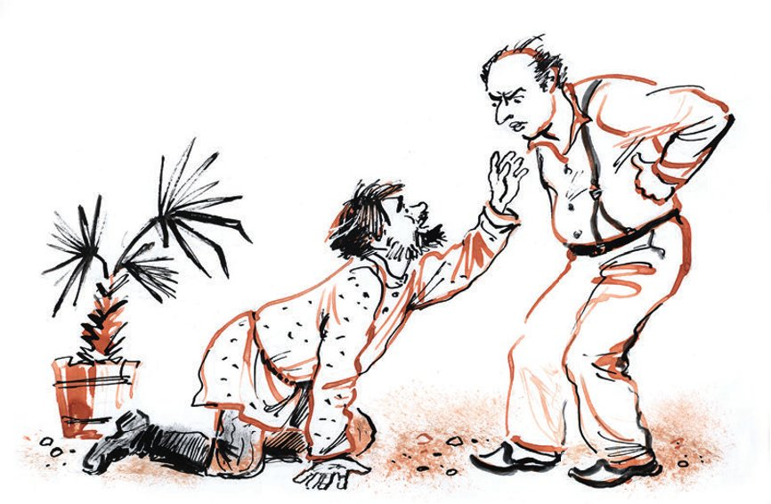
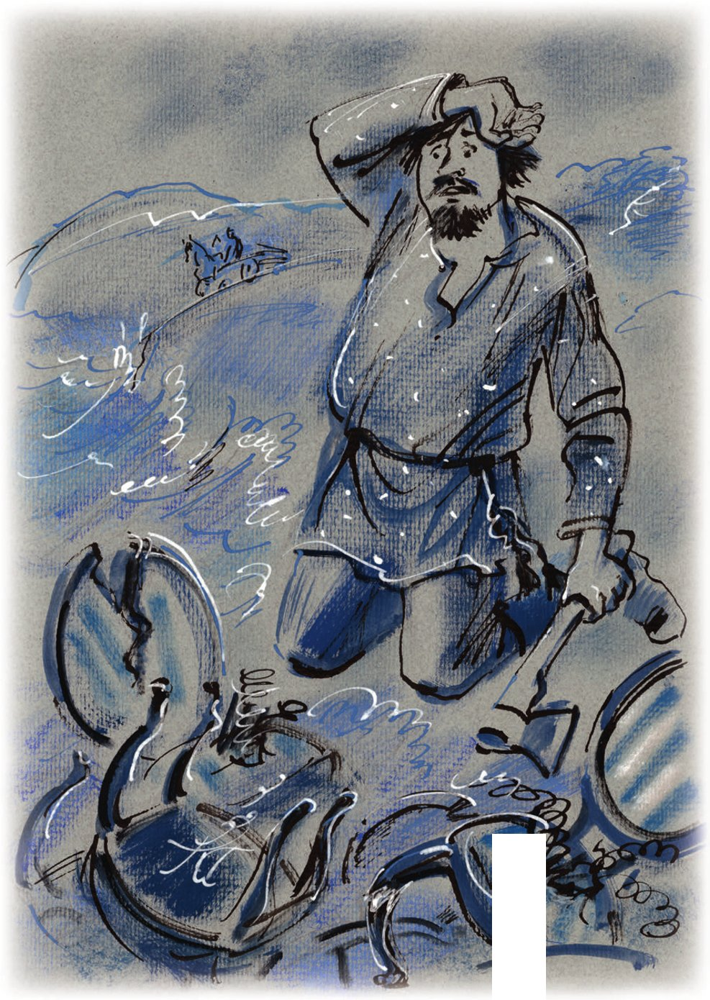

## Kapitel 38: Das Grüne Kap

Ingenieur Bruns saß auf der steinernen Veranda seiner Datscha am Grünen <abbr title="das Kap, die Kaps — мыс">Kap</abbr> unter einer großen Palme, deren gestärkte Blätter scharfe und schmale Schatten auf den rasierten Hinterkopf des Ingenieurs warfen, auf sein weißes Hemd und auf den Gambs-Stuhl aus der Garnitur der Generalswitwe Popowa, auf dem der Ingenieur schmachtete, während er auf das Mittagessen wartete.

Bruns <abbr title="spitzen — вытягивать трубочкой">spitzte</abbr> seine dicken, <abbr title="prall — наливной, пухлый">prallen</abbr> Lippen und rief gedehnt mit der Stimme eines verspielten <abbr title="der Knirps, die Knirpse — карапуз">Knirpses</abbr>:

— Mu-u-ussik!

Die Datscha schwieg.

Die <abbr title="tropisch — тропический">tropische</abbr> Pflanzenwelt <abbr title="sich schmiegen an + Akk. — ластиться, прижиматься">schmiegte sich</abbr> an den Ingenieur. <abbr title="der Kaktus, die Kakteen — кактус">Kakteen</abbr> streckten ihm ihre <abbr title="stachelig — колючий">stacheligen</abbr> <abbr title="der Fäustling, die Fäustlinge — рукавица">Fäustlinge</abbr> entgegen. <abbr title="der Drachenbaum, die Drachenbäume — драцена">Drachenbäume</abbr> raschelten mit ihren Blättern. <abbr title="die Bananenstaude, die Bananenstauden — банан (растение)">Bananenstauden</abbr> und <abbr title="die Sagopalme, die Sagopalmen — саговая пальма">Sagopalmen</abbr> <abbr title="verscheuchen — отгонять">verscheuchten</abbr> die Fliegen von der Glatze des Ingenieurs. Rosen, die sich um die Veranda <abbr title="sich ranken — обвиваться, виться">rankten</abbr>, fielen ihm zu Füßen.

Aber alles war vergeblich. Bruns wollte zu Mittag essen. Er blickte gereizt auf die <abbr title="perlmuttfarben — перламутровый">perlmuttfarbene</abbr> <abbr title="die Bucht, die Buchten — бухта, залив">Bucht</abbr>, auf das ferne kleine Kap von Batum und rief <abbr title="in singendem Ton — певуче">in singendem Ton</abbr>:

— Mu-u-ussik! Mu-u-u-ussik!

In der feuchten <abbr title="subtropisch — субтропический">subtropischen</abbr> Luft <abbr title="verhallen — замирать, затихать (о звуке)">verhallte</abbr> der Laut schnell. Eine Antwort kam nicht. Bruns stellte sich eine große braune <abbr title="die Gans, die Gänse — гусь">Gans</abbr> mit zischender, fetter Haut vor, und da er sich nicht mehr beherrschen konnte, brüllte er:

— Mussik!!! Ist das Gänschen gar?!

— Andrej Michailowitsch! — schrie eine Frauenstimme aus dem Zimmer. — <abbr title="jemandem auf die Nerven gehen — морочить голову, действовать на нервы">Geh mir nicht auf die Nerven</abbr>!

Der Ingenieur, der die Lippen schon wieder <abbr title="gewohnheitsmäßig — по привычке">gewohnheitsmäßig</abbr> gespitzt hatte, antwortete sofort:

— Mussik! Du hast kein Mitleid mit deinem kleinen Männchen!

— Hau ab, du Vielfraß! — antwortete man aus dem Zimmer.

Aber der Ingenieur <abbr title="nachgeben (gab nach, hat nachgegeben) — уступать, покоряться">gab nicht nach</abbr>. Er wollte gerade seine Rufe nach dem Gänschen fortsetzen, die er schon seit zwei Stunden ohne Erfolg <abbr title="ausstoßen (stieß aus, hat ausgestoßen) — издавать (крик)">ausstieß</abbr>, als ein unerwartetes Rascheln ihn zwang, sich umzudrehen.

Aus dem schwarzgrünen <abbr title="das Bambusdickicht, die Bambusdickichte — бамбуковые заросли">Bambusdickicht</abbr> trat ein Mann in einem zerrissenen blauen <abbr title="das Russenhemd, die Russenhemden — косоворотка">Russenhemd</abbr>, das mit einer abgewetzten gedrehten <abbr title="die Kordel, die Kordeln — шнурок">Kordel</abbr> mit dicken Quasten <abbr title="gürten — опоясывать">gegürtet</abbr> war, und in abgetragenen, gestreiften Hosen. Auf dem gutmütigen Gesicht des Fremden sträubte sich ein <abbr title="zottelig — лохматый">zotteliges</abbr> <abbr title="das Bärtchen, die Bärtchen — бородка">Bärtchen</abbr>. In den Händen hielt er ein Jackett.

Der Mann näherte sich und fragte mit angenehmer Stimme:

— Wo finde ich hier den Ingenieur Bruns?

— Ich bin der Ingenieur Bruns, — sagte der <abbr title="der Beschwörer, die Beschwörer — заклинатель">Beschwörer</abbr> des Gänschens mit einem unerwarteten Bass. — Womit kann ich dienen?

Der Mann fiel schweigend auf die Knie. Es war Vater Fjodor.

— Sind Sie verrückt geworden? — rief der Ingenieur und sprang auf. — Stehen Sie bitte auf!

— Ich stehe nicht auf, — antwortete Vater Fjodor, folgte dem Ingenieur mit dem Kopf und sah ihn mit klaren Augen an.

— Stehen Sie auf!

— Ich stehe nicht auf!

Und Vater Fjodor begann vorsichtig, damit es nicht wehtat, mit dem Kopf auf den Kies zu klopfen.

— Mussik! Komm her! — schrie der erschrockene Ingenieur. — Schau, was hier passiert. Stehen Sie auf, ich bitte Sie! Ich flehe Sie an!

— Ich stehe nicht auf, — wiederholte Vater Fjodor.

Auf die Veranda lief Mussik, die sich in den <abbr title="der Tonfall, die Tonfälle — интонация">Tonfällen</abbr> ihres Mannes fein auskannte.

Als Vater Fjodor die Dame erblickte, kroch er, ohne sich von den Knien zu erheben, flink näher zu ihr, verbeugte sich bis zu ihren Füßen und <abbr title="haspeln — тараторить, частить">haspelte</abbr>:

— Auf Sie, Mütterchen, auf Sie, meine Liebe, auf Sie <abbr title="setzen — возлагать">setze</abbr> ich meine Hoffnung!

Da wurde Ingenieur Bruns rot, packte den <abbr title="der Bittsteller, die Bittsteller — проситель">Bittsteller</abbr> unter den <abbr title="die Achsel, die Achseln — подмышка">Achseln</abbr> und hob ihn mit Anstrengung hoch, um ihn auf die Füße zu stellen, aber Vater Fjodor war schlau und zog die Beine an. Der empörte Bruns schleppte den seltsamen Gast in eine Ecke und setzte ihn mit Gewalt in einen kleinen Sessel (einen Gambs-Sessel, keineswegs aus Worobjaninows Villa, sondern aus dem Salon der Generalswitwe Popowa).

— Ich wage es nicht, — murmelte Vater Fjodor und legte das Jackett des Bäckers, das ein wenig nach Petroleum roch, auf seine Knie, — ich <abbr title="sich erdreisten — осмеливаться, сметь">erdreiste mich</abbr> nicht, in Gegenwart so <abbr title="hochgestellt — высокопоставленный">hochgestellter</abbr> <abbr title="die Persönlichkeit, die Persönlichkeiten — особа, личность">Persönlichkeiten</abbr> zu sitzen.

Und Vater Fjodor versuchte, wieder auf die Knie zu fallen.

Mit einem traurigen Schrei hielt der Ingenieur Vater Fjodor an den Schultern fest.

— Mussik, — sagte er schwer atmend, — sprich du mit diesem Bürger. Hier liegt irgendein Missverständnis vor.

Mussik schlug sofort einen sachlichen Ton an.

— In meinem Haus, — sagte sie drohend, — knien Sie bitte vor niemandem nieder!

— Meine Liebe! — sagte Vater Fjodor gerührt. — Mütterchen!

— Ich bin nicht Ihr Mütterchen. Was <abbr title="wünschen — желать">wünschen</abbr> Sie?

Der Pope stammelte etwas Unverständliches, aber offenbar <abbr title="rührend — трогательный, умилительный">Rührendes</abbr>. Erst nach langem Fragen gelang es zu verstehen, dass er als besondere Gnade darum bat, ihm eine Garnitur von zwölf Stühlen zu verkaufen, auf deren einem er im Augenblick saß.

Vor Staunen ließ der Ingenieur die Schultern von Vater Fjodor los, der sofort auf die Knie plumpste und wie eine <abbr title="die Schildkröte, die Schildkröten — черепаха">Schildkröte</abbr> hinter dem Ingenieur her zu jagen begann.

— Warum, — schrie der Ingenieur und wich den langen Armen von Vater Fjodor aus, — warum soll ich meine Stühle verkaufen? Sie können noch so oft auf die Knie plumpsen, ich verstehe gar nichts!

— Es sind doch meine Stühle, — stöhnte Vater Fjodor.

— Wie, Ihre? Woher Ihre? Sind Sie übergeschnappt? Mussik! Jetzt ist mir alles klar! Das ist ein <abbr title="eindeutig — явный">eindeutiger</abbr> <abbr title="der Irre, die Irren — псих">Irrer</abbr>!

— Meine, — wiederholte Vater Fjodor <abbr title="demütig — униженно, смиренно">demütig</abbr>.

— Was, Ihrer Meinung nach habe ich sie Ihnen gestohlen? — <abbr title="aufbrausen — вскипеть">brauste</abbr> der Ingenieur auf. — Gestohlen? Hörst du, Mussik? Das ist irgendeine Erpressung!

— <abbr title="Gott bewahre! — ни боже мой, упаси бог">Gott bewahre</abbr>, — flüsterte Vater Fjodor.

— Wenn ich sie Ihnen gestohlen habe, dann verklagen Sie mich und veranstalten Sie in meinem Haus kein <abbr title="das Pandämonium — пандемониум, ад кромешный">Pandämonium</abbr>! Hörst du, Mussik! Wie weit die Frechheit geht! Man lässt einen nicht einmal wie ein Mensch zu Mittag essen!

Nein, Vater Fjodor wollte «seine» Stühle nicht vor Gericht <abbr title="einklagen — требовать через суд">einklagen</abbr>. <abbr title="keineswegs — отнюдь, ни в коем случае">Keineswegs</abbr>. Er wusste, dass Ingenieur Bruns ihm die Stühle nicht gestohlen hatte. O nein! Das war ihm nicht einmal in den Sinn gekommen. Aber diese Stühle hätten vor der Revolution trotz allem ihm, Vater Fjodor, gehört, und sie seien seiner Frau, die jetzt in Woronesch im Sterben liege, <abbr title="unendlich — бесконечно">unendlich</abbr> teuer. Nur um ihren Willen zu erfüllen, keineswegs aus eigener <abbr title="die Dreistigkeit — дерзость">Dreistigkeit</abbr>, habe er sich <abbr title="sich erlauben — позволять себе">erlaubt</abbr>, den <abbr title="der Standort, die Standorte — местонахождение">Standort</abbr> der Stühle <abbr title="ausfindig machen — разыскать, выяснить">ausfindig zu machen</abbr> und bei Bürger Bruns zu erscheinen. Vater Fjodor bitte nicht um Almosen. O nein! Er sei <abbr title="wohlhabend — обеспеченный, состоятельный">wohlhabend</abbr> genug (eine kleine Kerzenfabrik in Samara), um die letzten Minuten seiner Frau mit dem Kauf alter Stühle zu <abbr title="versüßen — услаждать, подслащивать">versüßen</abbr>. Er sei bereit, nicht zu <abbr title="knausern — скупиться">knausern</abbr> und für die ganze Garnitur an die zwanzig Rubel zu zahlen.

— Was? — schrie der Ingenieur und wurde purpurrot. — Zwanzig Rubel? Für eine wunderbare Salongarnitur? Mussik! Hörst du? Er ist doch ein Irrer! Bei Gott, ein Irrer!

— Ich bin kein Irrer. Sondern einzig nach dem Willen meines <abbr title="das Weib, die Weiber — жена (устар.)">Weibes</abbr>, das mich <abbr title="senden (sandte, hat gesandt) — посылать">gesandt</abbr> hat …

— Oh, zum Teufel, — sagte der Ingenieur, — jetzt fängt er wieder an zu kriechen. Mussik! Er kriecht schon wieder!

— Nennen Sie doch einen Preis, — ächzte Vater Fjodor und schlug <abbr title="umsichtig — осмотрительно">umsichtig</abbr> mit dem Kopf gegen den <abbr title="der Stamm, die Stämme — ствол">Stamm</abbr> einer <abbr title="die Araukarie, die Araukarien — араукария">Araukarie</abbr>.

— Machen Sie den Baum nicht kaputt, Sie <abbr title="der Kauz, die Käuze — чудак">komischer Kauz</abbr>! Mussik, mir scheint, er ist doch kein Irrer. Wie man sieht, ist der Mensch einfach von der Krankheit seiner Frau verstört. Soll ich ihm die Stühle vielleicht verkaufen, was? Dann <abbr title="jemanden in Ruhe lassen — отвязаться, оставить в покое">lässt er uns in Ruhe</abbr>, was? Sonst schlägt er sich noch die Stirn ein!

— Und worauf sollen wir sitzen? — fragte Mussik.

— Wir kaufen andere.

— Für zwanzig Rubel etwa?

— Für zwanzig verkaufe ich sie, sagen wir, nicht. Sagen wir, ich verkaufe sie auch nicht für zweihundert … Aber für zweihundertfünfzig verkaufe ich sie.

Die Antwort war ein <abbr title="fürchterlich — страшный">fürchterlicher</abbr> Schlag mit dem Kopf gegen einen Drachenbaum.

— Na, Mussik, jetzt reicht es mir aber.

Der Ingenieur trat entschlossen auf Vater Fjodor zu und begann ein <abbr title="das Ultimatum, die Ultimaten — ультиматум">Ultimatum</abbr> zu diktieren:

— Erstens: Treten Sie mindestens drei Schritte von der Palme zurück; zweitens: Stehen Sie sofort auf. Drittens: Die Möbel verkaufe ich für zweihundertfünfzig Rubel, nicht weniger.

— Nicht um des Gewinnes willen, — <abbr title="singen (sang, hat gesungen) — петь">sang</abbr> Vater Fjodor, — sondern allein um den Willen meiner kranken Frau zu erfüllen.

— Na, mein Lieber, meine Frau ist auch krank. Nicht wahr, Mussik, mit deiner Lunge ist etwas nicht in Ordnung? Aber <abbr title="deswegen — на этом основании, поэтому">deswegen</abbr> verlange ich doch nicht, dass Sie … na … mir zum Beispiel Ihr Jackett für dreißig Kopeken verkaufen.

— Nehmen Sie es umsonst, — rief Vater Fjodor.

Der Ingenieur <abbr title="abwinken — отмахнуться">winkte</abbr> gereizt ab und sagte kalt:

— Lassen Sie Ihre Scherze. Auf keine Diskussionen lasse ich mich mehr ein. Die Stühle sind von mir auf zweihundertfünfzig Rubel geschätzt worden, und ich lasse keine Kopeke <abbr title="nachlassen (ließ nach, hat nachgelassen) — уступать (в цене)">nach</abbr>.

— Fünfzig, — bot Vater Fjodor an.

— Mussik! — sagte der Ingenieur. — Ruf Bagration. Er soll den Bürger hinausbegleiten!

— Nicht um des Gewinnes willen …

— Bagration!

Vater Fjodor floh voller Angst, und der Ingenieur ging ins Esszimmer und machte sich über das Gänschen her. Der <abbr title="der Lieblingsvogel — любимая птица">Lieblingsvogel</abbr> hatte auf Bruns eine <abbr title="wohltuend — благотворный">wohltuende</abbr> Wirkung. Er begann sich zu beruhigen.

In dem Moment, als der Ingenieur den Knochen mit <abbr title="das Zigarettenpapier — папиросная бумага">Zigarettenpapier</abbr> umwickelt hatte und die <abbr title="die Gänsekeule, die Gänsekeulen — ножка (птицы)">Gänsekeule</abbr> an seinen rosa Mund führte, erschien im Fenster das <abbr title="flehend — умоляющий">flehende</abbr> Gesicht von Vater Fjodor.

— Nicht um des Gewinnes willen, — sagte eine sanfte Stimme, — fünfundfünfzig Rubel.

Der Ingenieur knurrte, ohne sich umzusehen. Vater Fjodor verschwand.

Den ganzen Tag danach tauchte die Gestalt von Vater Fjodor an allen Ecken der Datscha auf. Mal lief sie aus dem Schatten der <abbr title="die Sicheltanne, die Sicheltannen — криптомерия">Sicheltannen</abbr>, mal erschien sie im <abbr title="der Mandarinenhain, die Mandarinenhaine — мандариновая роща">Mandarinenhain</abbr>, mal flog sie über den <abbr title="der Hinterhof, die Hinterhöfe — задний двор">Hinterhof</abbr> und eilte zitternd zum Botanischen Garten davon.

Der Ingenieur rief den ganzen Tag nach Mussik und klagte über den Irren und über <abbr title="der Kopfschmerz, die Kopfschmerzen — головная боль">Kopfschmerzen</abbr>. In der hereinbrechenden Dunkelheit <abbr title="ertönen — раздаваться">ertönte</abbr> von Zeit zu Zeit die Stimme von Vater Fjodor:

— Hundertachtunddreißig! — rief er irgendwo vom Himmel herab.

Und eine Minute später kam seine Stimme von der Datscha Dumbassows her.

— Hunderteinundvierzig, — bot Vater Fjodor an, — nicht um des Gewinnes willen, Herr Bruns, sondern allein …

Endlich hielt es der Ingenieur nicht mehr aus, trat in die Mitte der Veranda und begann, in die Dunkelheit <abbr title="spähen — вглядываться">spähend</abbr>, <abbr title="gemessen — размеренно">gemessen</abbr> zu rufen:

— Zum Teufel mit Ihnen! Zweihundert Rubel! Nur lassen Sie mich in Ruhe.

Man hörte das Rascheln des <abbr title="aufschrecken — потревожить, вспугнуть">aufgeschreckten</abbr> Bambus, ein leises Stöhnen und sich entfernende Schritte. Dann wurde alles still.

In der Bucht zappelten die Sterne. <abbr title="das Glühwürmchen, die Glühwürmchen — светлячок">Glühwürmchen</abbr> holten Vater Fjodor ein, kreisten um seinen Kopf und übergossen sein Gesicht mit grünlichem, medizinischem Licht.

— Was für komische Vögel es heutzutage gibt, — murmelte der Ingenieur und ging ins Haus.

Unterdessen flog Vater Fjodor im letzten Autobus am Meeresufer entlang nach Batum. Ganz nah an seiner Seite lief mit dem Geräusch eines <abbr title="umblättern — перелистывать">umgeblätterten</abbr> Buches eine leichte <abbr title="die Brandung — прибой">Brandung</abbr> heran; der Wind schlug ihm ins Gesicht, und der <abbr title="die Hupe, die Hupen — автомобильный гудок, сирена">Hupe</abbr> des Autos antwortete das <abbr title="das Miauen — мяуканье">Miauen</abbr> der Schakale.

Am selben Abend schickte Vater Fjodor in die Kreisstadt N an seine Frau Katerina Alexandrowna folgendes Telegramm: «Ware gefunden schick zweihundertdreißig telegrafisch verkauf was du willst Fedja».

Zwei Tage lang trieb sich er begeistert bei der Datscha von Bruns herum, grüßte Mussik von Weitem mit Verbeugungen und ließ sogar von Zeit zu Zeit die tropischen Weiten von seinen Rufen <abbr title="widerhallen — оглашаться, отдаваться эхом">widerhallen</abbr>:

— Nicht um des Gewinnes willen, sondern allein nach dem Willen meiner Gattin, die mich gesandt hat!

Am dritten Tag kam das Geld mit einem verzweifelten Telegramm: «Alles verkauft ohne eine Kopeke geblieben küsse und warte Jewstignejew isst immer noch zu Mittag Katja».

Vater Fjodor zählte das Geld nach, bekreuzigte sich <abbr title="inbrünstig — истово">inbrünstig</abbr>, mietete einen <abbr title="der Planwagen, die Planwagen — фургон">Planwagen</abbr> und fuhr zum Grünen Kap.

Das Wetter war trüb. Von der türkischen Grenze trieb der Wind Wolken heran. Der Tschoroch dampfte. Der blaue Streifen am Himmel wurde immer schmaler. Der Sturm erreichte <abbr title="die Stärke, die Stärken — сила (в баллах)">Stärke</abbr> sechs. Es war verboten zu baden und mit Booten aufs Meer hinauszufahren. Getöse und Donner standen über Batum. Der Sturm rüttelte an den Ufern.

Als er die Datscha des Ingenieurs Bruns erreicht hatte, befahl Vater Fjodor dem adscharischen Kutscher mit der Kapuze, zu warten, und ging die Möbel holen.

— Geld bringe ich, — sagte Vater Fjodor, — Sie könnten ein <abbr title="ein bisschen — малость, немного">bisschen</abbr> nachlassen.

— Mussik, — stöhnte der Ingenieur, — ich kann nicht mehr!

— Aber nein, ich bringe das Geld, — beeilte sich Vater Fjodor, — zweihundert Rubel, wie Sie gesagt haben.

— Mussik! Nimm ihm das Geld ab! Gib ihm die Stühle! Und er soll das alles möglichst schnell machen. Ich habe <abbr title="die Migräne — мигрень">Migräne</abbr>.

Das Ziel seines ganzen Lebens war erreicht. Die kleine Kerzenfabrik in Samara fiel ihm von selbst in die Hände. Die Brillanten rieselten ihm in die Taschen wie Sonnenblumenkerne.

Die zwölf Stühle wurden einer nach dem anderen in den Planwagen geladen. Sie sahen denen von Worobjaninow sehr ähnlich, nur mit dem Unterschied, dass ihr Bezug nicht aus geblümtem Kattun, sondern aus <abbr title="der Rips — репс">Rips</abbr> war, blau mit rosa Streifchen.

Ungeduld ergriff Vater Fjodor. Unter seinem <abbr title="der Rockschoß, die Rockschöße — пола (одежды)">Rockschoß</abbr> steckte hinter der gedrehten Kordel ein kleines Beil. Vater Fjodor setzte sich neben den Kutscher und fuhr, sich jede Minute nach den Stühlen umsehend, in Richtung Batum. Muntere Pferde brachten Vater Fjodor und seine Schätze hinunter auf die <abbr title="die Landstraße, die Landstraßen — шоссе">Landstraße</abbr>, vorbei an dem kleinen Restaurant «Finale», durch dessen Bambustische und <abbr title="die Laube, die Lauben — беседка">Lauben</abbr> der Wind fegte, vorbei an dem Tunnel, der die letzten <abbr title="der Kesselwagen, die Kesselwagen — цистерна">Kesselwagen</abbr> des Erdölzugs verschluckte, vorbei an dem Fotografen, der an diesem düsteren Tag ohne seine gewohnte <abbr title="die Kundschaft — клиентура">Kundschaft</abbr> war, vorbei an dem Schild «Botanischer Garten Batum», und zogen ihn dann nicht allzu schnell direkt über der Linie der Brandung entlang. Dort, wo die Straße die <abbr title="der Wellenbrecher, die Wellenbrecher — волнолом, массив">Wellenbrecher</abbr> berührte, wurde Vater Fjodor mit salzigen <abbr title="der Spritzer, die Spritzer — брызги">Spritzern</abbr> <abbr title="übersprühen — обдавать брызгами">übersprüht</abbr>. Von den Wellenbrechern vom Ufer <abbr title="zurückwerfen (warf zurück, hat zurückgeworfen) — отбрасывать">zurückgeworfen</abbr>, verwandelten sich die Wellen in <abbr title="der Geysir, die Geysire — гейзер">Geysire</abbr>, stiegen zum Himmel auf und fielen langsam wieder herab.

Die Stöße und <abbr title="die Explosion, die Explosionen — взрыв">Explosionen</abbr> der Brandung <abbr title="erhitzen — накалять">erhitzten</abbr> den <abbr title="aufgewühlt — смятенный, взволнованный">aufgewühlten</abbr> Geist von Vater Fjodor. Die Pferde kämpften gegen den Wind und näherten sich langsam Machindschauri. So weit das Auge reichte, pfiffen und <abbr title="sich blähen — пучиться, вздуваться">blähten sich</abbr> trübe grüne Wasser. Bis nach Batum hin flatterte der weiße Schaum der Brandung, wie der Saum eines Unterrocks, der unter dem Kleid einer <abbr title="schlampig — неряшливый">schlampigen</abbr> kleinen Dame hervorschaut.

— Halt! — schrie Vater Fjodor plötzlich den Kutscher an. — Halt, <abbr title="der Muselman, die Muselmanen — мусульманин (устар.)">Muselman</abbr>!

Und zitternd und stolpernd begann er die Stühle auf den <abbr title="menschenleer — пустынный">menschenleeren</abbr> Strand abzuladen. Der gleichgültige Adschare bekam seinen Fünfer, peitschte auf die Pferde ein und fuhr davon. Vater Fjodor aber vergewisserte sich, dass niemand in der Nähe war, zerrte die Stühle den Abhang hinunter auf ein kleines, noch trockenes Stück Strand und zog das Beil hervor.

Eine Minute lang war er <abbr title="im Zweifel sein — находиться в сомнении">im Zweifel</abbr> und wusste nicht, mit welchem Stuhl er anfangen sollte. Dann ging er wie ein Schlafwandler zum dritten Stuhl und schlug <abbr title="bestialisch — зверски">bestialisch</abbr> mit dem Beil auf die Lehne. Der Stuhl kippte um, ohne Schaden zu nehmen.

— Aha! — schrie Vater Fjodor. — Dir w-werd ich's zeigen!

Und er stürzte sich auf den Stuhl wie auf ein lebendiges Geschöpf. Im Nu war der Stuhl zu <abbr title="das Kleinholz — щепки; изрубить в капусту">Kleinholz</abbr> <abbr title="hacken — рубить">gehackt</abbr>. Vater Fjodor hörte die Schläge des Beils auf Holz, Rips und Sprungfedern nicht. Im gewaltigen Brüllen des Sturms erstickten alle anderen Geräusche wie in Filz.

— Aha! Aha! Aha! — sagte Vater Fjodor immer wieder und hieb <abbr title="mit voller Wucht — сплеча, со всего размаха">mit voller Wucht</abbr> zu.

Ein Stuhl nach dem anderen fiel aus. Die Wut von Vater Fjodor wuchs immer mehr. Auch der Sturm wuchs. Manche Wellen reichten bis an Vater Fjodors Füße.

Von Batum bis Sinop herrschte ein großer Lärm. Das Meer tobte und ließ seine <abbr title="die Raserei — бешенство">Raserei</abbr> an jedem kleinen Schiff aus. Der Dampfer «Lenin», aus seinen zwei Schornsteinen qualmend und schwer aufs Heck sinkend, näherte sich Noworossijsk. Der Sturm kreiste im Schwarzen Meer und warf tausend Tonnen schwere Wogen an die Ufer von Trapezunt, Jalta, Odessa und Constanța. Hinter der Stille des Bosporus und der Dardanellen donnerte das Mittelmeer. Hinter der Straße von Gibraltar schlug der Atlantische Ozean gegen Europa. Zorniges Wasser umgürtete den Erdball.

Und am Strand von Batum stand Vater Fjodor, <abbr title="triefen — обливаться (потом)">triefend</abbr> von Schweiß, und hackte den letzten Stuhl <abbr title="entzwei — пополам, вдребезги">entzwei</abbr>. Eine Minute später war alles vorbei. Verzweiflung ergriff Vater Fjodor. Er warf einen fassungslosen Blick auf den Berg aus Beinen, Lehnen und Sprungfedern, den er <abbr title="auftürmen — наворотить, нагромождать">aufgetürmt</abbr> hatte, und wich zurück. Das Wasser packte ihn an den Füßen. Er riss sich los, und <abbr title="durchnässt — промокший">durchnässt</abbr> stürzte er auf die Landstraße. Eine große Welle krachte auf die Stelle, an der Vater Fjodor eben noch gestanden hatte, und riss, als sie zurückrollte, die ganze verstümmelte Garnitur der Generalswitwe Popowa mit sich. Vater Fjodor sah das schon nicht mehr. Er schleppte sich gebückt die Landstraße entlang und presste die nasse Faust an die Brust.

Er kam nach Batum, wie blind, ohne etwas um sich herum zu sehen. Seine Lage war die entsetzlichste. Fünftausend Kilometer von zu Hause entfernt, mit zwanzig Rubel in der Tasche, war es <abbr title="schlechterdings — положительно, совершенно">schlechterdings</abbr> unmöglich, in seine Heimatstadt zu kommen.

Vater Fjodor ging am türkischen Basar vorbei, wo man ihm mit <abbr title="vollendet — совершенный, идеальный">vollendetem</abbr> Flüstern riet, Puder von Coty, <abbr title="der Seidenstrumpf, die Seidenstrümpfe — шёлковый чулок">Seidenstrümpfe</abbr> und <abbr title="unverzollt — необандероленный, без акцизной бандероли">unverzollten</abbr> Tabak aus Suchum zu kaufen, schleppte sich zum Bahnhof und <abbr title="sich verlieren (verlor, hat verloren) — затеряться">verlor sich</abbr> in der Menge der Gepäckträger.

---

### Neue Wörter

- **das Kap, die Kaps** — мыс
- **spitzen** — вытягивать трубочкой
- **prall** — наливной, пухлый
- **der Knirps, die Knirpse** — карапуз
- **tropisch** — тропический
- **sich schmiegen an + Akk.** — ластиться, прижиматься
- **der Kaktus, die Kakteen** — кактус
- **stachelig** — колючий
- **der Fäustling, die Fäustlinge** — рукавица
- **der Drachenbaum, die Drachenbäume** — драцена
- **die Bananenstaude, die Bananenstauden** — банан (растение)
- **die Sagopalme, die Sagopalmen** — саговая пальма
- **verscheuchen** — отгонять
- **sich ranken** — обвиваться, виться
- **perlmuttfarben** — перламутровый
- **die Bucht, die Buchten** — бухта, залив
- **in singendem Ton** — певуче
- **subtropisch** — субтропический
- **verhallen** — замирать, затихать (о звуке)
- **die Gans, die Gänse** — гусь
- **jemandem auf die Nerven gehen** — морочить голову, действовать на нервы
- **gewohnheitsmäßig** — по привычке
- **nachgeben (gab nach, hat nachgegeben)** — уступать, покоряться
- **ausstoßen (stieß aus, hat ausgestoßen)** — издавать (крик)
- **das Bambusdickicht, die Bambusdickichte** — бамбуковые заросли
- **das Russenhemd, die Russenhemden** — косоворотка
- **die Kordel, die Kordeln** — шнурок
- **gürten** — опоясывать
- **zottelig** — лохматый
- **das Bärtchen, die Bärtchen** — бородка
- **der Beschwörer, die Beschwörer** — заклинатель
- **der Tonfall, die Tonfälle** — интонация
- **haspeln** — тараторить, частить
- **setzen** — возлагать
- **der Bittsteller, die Bittsteller** — проситель
- **die Achsel, die Achseln** — подмышка
- **sich erdreisten** — осмеливаться, сметь
- **hochgestellt** — высокопоставленный
- **die Persönlichkeit, die Persönlichkeiten** — особа, личность
- **wünschen** — желать
- **rührend** — трогательный, умилительный
- **die Schildkröte, die Schildkröten** — черепаха
- **eindeutig** — явный
- **der Irre, die Irren** — псих
- **demütig** — униженно, смиренно
- **aufbrausen** — вскипеть
- **Gott bewahre!** — ни боже мой, упаси бог
- **das Pandämonium** — пандемониум, ад кромешный
- **einklagen** — требовать через суд
- **keineswegs** — отнюдь, ни в коем случае
- **unendlich** — бесконечно
- **die Dreistigkeit** — дерзость
- **sich erlauben** — позволять себе
- **der Standort, die Standorte** — местонахождение
- **ausfindig machen** — разыскать, выяснить
- **wohlhabend** — обеспеченный, состоятельный
- **versüßen** — услаждать, подслащивать
- **knausern** — скупиться
- **das Weib, die Weiber** — жена (устар.)
- **senden (sandte, hat gesandt)** — посылать
- **umsichtig** — осмотрительно
- **der Stamm, die Stämme** — ствол
- **die Araukarie, die Araukarien** — араукария
- **der Kauz, die Käuze** — чудак
- **jemanden in Ruhe lassen** — отвязаться, оставить в покое
- **fürchterlich** — страшный
- **das Ultimatum, die Ultimaten** — ультиматум
- **singen (sang, hat gesungen)** — петь
- **deswegen** — на этом основании, поэтому
- **abwinken** — отмахнуться
- **nachlassen (ließ nach, hat nachgelassen)** — уступать (в цене)
- **der Lieblingsvogel** — любимая птица
- **wohltuend** — благотворный
- **das Zigarettenpapier** — папиросная бумага
- **die Gänsekeule, die Gänsekeulen** — ножка (птицы)
- **flehend** — умоляющий
- **die Sicheltanne, die Sicheltannen** — криптомерия
- **der Mandarinenhain, die Mandarinenhaine** — мандариновая роща
- **der Hinterhof, die Hinterhöfe** — задний двор
- **der Kopfschmerz, die Kopfschmerzen** — головная боль
- **ertönen** — раздаваться
- **spähen** — вглядываться
- **gemessen** — размеренно
- **aufschrecken** — потревожить, вспугнуть
- **das Glühwürmchen, die Glühwürmchen** — светлячок
- **umblättern** — перелистывать
- **die Brandung** — прибой
- **die Hupe, die Hupen** — автомобильный гудок, сирена
- **das Miauen** — мяуканье
- **widerhallen** — оглашаться, отдаваться эхом
- **inbrünstig** — истово
- **der Planwagen, die Planwagen** — фургон
- **die Stärke, die Stärken** — сила (в баллах)
- **ein bisschen** — малость, немного
- **die Migräne** — мигрень
- **der Rips** — репс
- **der Rockschoß, die Rockschöße** — пола (одежды)
- **die Landstraße, die Landstraßen** — шоссе
- **die Laube, die Lauben** — беседка
- **der Kesselwagen, die Kesselwagen** — цистерна
- **die Kundschaft** — клиентура
- **der Wellenbrecher, die Wellenbrecher** — волнолом, массив
- **der Spritzer, die Spritzer** — брызги
- **übersprühen** — обдавать брызгами
- **zurückwerfen (warf zurück, hat zurückgeworfen)** — отбрасывать
- **der Geysir, die Geysire** — гейзер
- **die Explosion, die Explosionen** — взрыв
- **erhitzen** — накалять
- **aufgewühlt** — смятенный, взволнованный
- **sich blähen** — пучиться, вздуваться
- **schlampig** — неряшливый
- **der Muselman, die Muselmanen** — мусульманин (устар.)
- **menschenleer** — пустынный
- **im Zweifel sein** — находиться в сомнении
- **bestialisch** — зверски
- **das Kleinholz** — щепки; изрубить в капусту
- **hacken** — рубить
- **mit voller Wucht** — сплеча, со всего размаха
- **die Raserei** — бешенство
- **triefen** — обливаться (потом)
- **entzwei** — пополам, вдребезги
- **auftürmen** — наворотить, нагромождать
- **durchnässt** — промокший
- **schlechterdings** — положительно, совершенно
- **vollendet** — совершенный, идеальный
- **der Seidenstrumpf, die Seidenstrümpfe** — шёлковый чулок
- **unverzollt** — необандероленный, без акцизной бандероли
- **sich verlieren (verlor, hat verloren)** — затеряться

[← Kapitel 37](kapitel-37.md) · [Inhalt](README.md) · [Kapitel 39 →](kapitel-39.md)
