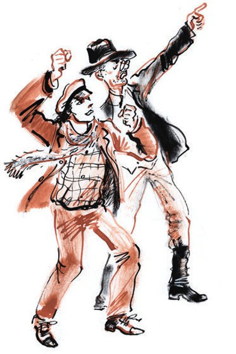
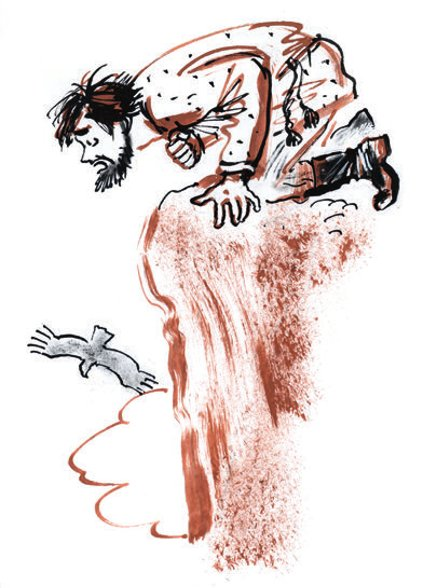

## Kapitel 39: Unter den Wolken

Drei Tage nach dem <abbr title="das Geschäft, die Geschäfte — сделка">Geschäft</abbr> der Konzessionäre mit dem Monteur Metschnikow reiste das Kolumbus-Theater mit der Eisenbahn über Machatschkala und Baku ab. Alle diese drei Tage hatten die Konzessionäre, die mit dem Inhalt der zwei auf dem Maschuk aufgeschnittenen Stühle nicht zufrieden waren, von Metschnikow den dritten, den letzten der Kolumbus-Stühle erwartet. Aber der vom Narsan zermürbte Monteur hatte alle zwanzig Rubel für den Kauf von einfachem <abbr title="der Wodka — водка">Wodka</abbr> <abbr title="verwenden — употреблять, тратить">verwendet</abbr> und war in einen solchen Zustand geraten, dass man ihn in der Requisitenkammer eingesperrt hielt.

— Da haben wir unsere «Sauren Wasser»! — erklärte Ostap, als er von der Abreise des Theaters erfuhr. — So ein Hundsfott, dieser Monteur! Da soll man noch einmal mit <abbr title="der Theaterwerktätige, die Theaterwerktätigen — театральный работник (теаработник)">Theaterwerktätigen</abbr> Geschäfte machen!

Ostap wurde viel hektischer als vorher. Die Chancen, die Schätze zu finden, waren <abbr title="unermesslich — безмерно">unermesslich</abbr> gestiegen.

— In Tiflis, — sagte Ostap, — dürfen wir nicht <abbr title="faulenzen — лениться, бездельничать">faulenzen</abbr>. Wir brauchen Geld für die Fahrt nach Wladikawkas. Von dort fahren wir mit dem Auto über die Georgische <abbr title="die Heerstraße, die Heerstraßen — военная дорога">Heerstraße</abbr> nach Tiflis. Bezaubernde <abbr title="der Ausblick, die Ausblicke — вид">Ausblicke</abbr>! Atemberaubende Landschaft! Wunderbare Bergluft! Und als <abbr title="das Finale, die Finale — финал">Finale</abbr> des Ganzen – hundertfünfzigtausend Rubel null null Kopeken. Es lohnt sich, die Sitzung fortzusetzen.

Aber aus Mineralnyje Wody abzureisen war gar nicht so leicht. Worobjaninow erwies sich als ein <abbr title="unbegabt — бездарный">unbegabter</abbr> Schwarzfahrer, und da seine Versuche, in den Zug zu steigen, erfolglos blieben, musste er beim «Blumengarten» als ehemaliger Kurator eines Schulbezirks auftreten. Das hatte nur sehr <abbr title="gering — малый, незначительный">geringen</abbr> Erfolg. Zwei Rubel für zwölf Stunden schwerer und <abbr title="erniedrigend — унизительный">erniedrigender</abbr> Arbeit. Eine Summe, die jedoch für die Fahrt nach Wladikawkas <abbr title="ausreichen — хватать, быть достаточным">ausreichte</abbr>.

In Beslan wurde Ostap, der ohne Fahrkarte fuhr, aus dem Zug geworfen, und der große Kombinator lief dreist drei Werst hinter dem Zug her und drohte dem völlig unschuldigen Ippolit Matwejewitsch mit der Faust. Danach gelang es Ostap, auf das <abbr title="das Trittbrett, die Trittbretter — подножка, ступенька">Trittbrett</abbr> des Zuges zu springen, der sich langsam zum Kaukasus-Kamm hinaufzog. Von dieser <abbr title="die Position, die Positionen — позиция">Position</abbr> aus blickte Ostap neugierig auf das Panorama der kaukasischen <abbr title="die Gebirgskette, die Gebirgsketten — горная цепь">Gebirgskette</abbr>, das sich vor ihm ausbreitete.

Es war vier Uhr morgens. Die <abbr title="der Berggipfel, die Berggipfel — горная вершина">Berggipfel</abbr> erstrahlten im dunkelrosa Sonnenlicht. Die Berge gefielen Ostap nicht.

— Zu viel Schick, — sagte er. — Wilde Schönheit. Die Fantasie eines Idioten. Ein <abbr title="nutzlos — никчёмный">nutzloses</abbr> Ding.

Am Bahnhof von Wladikawkas wartete auf die Ankommenden ein großer offener Autobus der Transkaukasischen Autohandelsgesellschaft, und freundliche Leute sagten:

— Wer über die Georgische Heerstraße fahren will, den bringen wir kostenlos in die Stadt.

— Wohin gehen Sie denn, Kisa? — sagte Ostap. — Wir müssen in den Autobus. Sollen sie uns kostenlos fahren.

Als der Autobus ihn zum Kontor der Gesellschaft gebracht hatte, beeilte sich Ostap jedoch nicht, sich für einen Platz im Wagen <abbr title="sich eintragen (trug ein, hat eingetragen) — записываться">einzutragen</abbr>. Er unterhielt sich lebhaft mit Ippolit Matwejewitsch, bewunderte den von einer Wolke umgürteten Tafelberg, fand, dass der Berg wirklich einem Tisch ähnlich sah, und entfernte sich schnell.

In Wladikawkas musste man ein paar Tage <abbr title="festsitzen (saß fest, hat festgesessen) — застрять, просидеть">festsitzen</abbr>. Aber alle Versuche, Geld für die Fahrt über die Georgische Heerstraße aufzutreiben, brachten entweder gar keine Früchte oder nur so viel, wie man für die Verpflegung eines Tages brauchte. Der Versuch, von den Bürgern zehn Kopeken zu kassieren, <abbr title="misslingen (misslang, ist misslungen) — не удаваться">misslang</abbr>. Der Kaukasus-Kamm war so hoch und so gut sichtbar, dass man für seine <abbr title="die Besichtigung, die Besichtigungen — осмотр, показ">Besichtigung</abbr> unmöglich Geld nehmen konnte. Man sah ihn fast von überall. Andere Schönheiten aber gab es in Wladikawkas nicht. Was den Terek betraf, so floss er am «Trek» vorbei, einem Park, für dessen Eintritt die Stadt ohne Ostaps Hilfe Geld nahm. Das Almosensammeln von Ippolit Matwejewitsch brachte in zwei Tagen dreizehn Kopeken.

— Genug, — sagte Ostap. — Es gibt nur einen Ausweg: zu Fuß nach Tiflis gehen. In fünf Tagen schaffen wir zweihundert Werst. Macht nichts, <abbr title="das Väterchen — папаша">Väterchen</abbr>, bezaubernde Bergansichten, frische Luft!.. Wir brauchen Geld für Brot und Liebhaberwurst. Sie können Ihrem Wortschatz ein paar italienische Sätze hinzufügen, wie Sie wollen, aber bis zum Abend müssen Sie mindestens zwei Rubel zusammenbetteln! Heute gibt es kein Mittagessen, lieber Genosse. <abbr title="leider — увы">Leider</abbr>! Schlechte Chancen …

<abbr title="in aller Frühe — спозаранку">In aller Frühe</abbr> gingen die Konzessionäre über die kleine Brücke über den Terek, umgingen die Kasernen und <abbr title="eintauchen in + Akk. — углубляться, погружаться">tauchten</abbr> in das grüne Tal <abbr title="eintauchen — углубляться">ein</abbr>, durch das die Georgische Heerstraße führte.

— Wir haben Glück, Kisa, — sagte Ostap. — In der Nacht hat es geregnet, und wir müssen keinen Staub schlucken. Atmen Sie die reine Luft ein, Adelsmarschall. Singen Sie. Erinnern Sie sich an kaukasische Gedichte. Benehmen Sie sich, wie es sich gehört!..

Aber Ippolit Matwejewitsch sang nicht und erinnerte sich an keine Gedichte. Die Straße ging bergauf. Die Nächte unter freiem Himmel machten sich mit <abbr title="das Seitenstechen — колотьё в боку">Seitenstechen</abbr> und schweren Beinen bemerkbar, und die Liebhaberwurst mit ständigem, quälendem <abbr title="das Sodbrennen — изжога">Sodbrennen</abbr>. Er ging zur Seite geneigt, hielt in der Hand ein Fünfpfundbrot, das in eine Zeitung aus Wladikawkas eingewickelt war, und zog das linke Bein ein wenig <abbr title="nachziehen (zog nach, hat nachgezogen) — волочить (ногу)">nach</abbr>.

Wieder gehen! Diesmal nach Tiflis, diesmal auf der schönsten Straße der Welt. Ippolit Matwejewitsch war das egal. Er sah nicht nach links und rechts wie Ostap. Er bemerkte <abbr title="entschieden — решительно, совершенно">entschieden</abbr> nicht den Terek, der schon auf dem Grund des Tals zu grollen begann. Und nur die eisigen Gipfel, die in der Sonne funkelten, erinnerten ihn <abbr title="dunkel — смутно">dunkel</abbr> an etwas: an das Funkeln von Brillanten oder an die besten <abbr title="der Brokatsarg, die Brokatsärge — глазетовый гроб">Brokatsärge</abbr> von Meister Besentschuk.

Bis zur ersten <abbr title="die Poststation, die Poststationen — почтовая станция">Poststation</abbr> Balta gingen die Wanderer im <abbr title="der Einflussbereich — сфера влияния">Einflussbereich</abbr> des Tafelbergs. Seine massige, <abbr title="elefantenhaft — слоновий">elefantenhafte</abbr> Gestalt mit <abbr title="die Schneeader, die Schneeadern — снежная прожилка">Schneeadern</abbr> folgte ihnen an die zehn Werst. Zuerst überholte sie ein <abbr title="der Personenwagen, die Personenwagen — легковой автомобиль">Personenwagen</abbr> der Gesellschaft, eine halbe Stunde später ein Autobus, der nicht weniger als vierzig Touristen und nicht mehr als hundertzwanzig Koffer fuhr.

— Grüßen Sie den Kasbek! — rief Ostap dem Wagen nach. — Küssen Sie ihn auf den linken <abbr title="der Gletscher, die Gletscher — ледник">Gletscher</abbr>!

Nach den Autos roch es in den Bergen noch lange nach <abbr title="das Benzinabgas, die Benzinabgase — бензинный перегар">Benzinabgasen</abbr> und heißem <abbr title="der Gummi — резина">Gummi</abbr>.

Laut klirrend überholten die Wanderer die zweirädrigen <abbr title="der Karren, die Karren — арба, телега">Karren</abbr> der Bergbewohner. Hinter einer <abbr title="die Kurve, die Kurven — поворот">Kurve</abbr> kam ihnen eine <abbr title="die Kalesche, die Kaleschen — фаэтон, коляска">Kalesche</abbr> entgegen.

In Balta <abbr title="zuteilen — выдавать, распределять">teilte</abbr> Ostap Ippolit Matwejewitsch einen Werschok Wurst, gut vier Zentimeter, zu und aß selbst etwa zwei Werschok.

— Ich bin der <abbr title="der Ernährer, die Ernährer — кормилец">Ernährer</abbr> der Familie, — sagte er, — mir steht <abbr title="verstärkt — усиленный">verstärkte</abbr> Ernährung zu.

Nach Balta führte die Straße in eine Schlucht und lief auf einem schmalen <abbr title="der Sims, die Simse — карниз, выступ">Sims</abbr> weiter, der in dunkle, senkrechte Felsen gehauen war. Die <abbr title="die Spirale, die Spiralen — спираль">Spirale</abbr> der Straße wand sich nach oben, und am Abend fanden sich die Konzessionäre an der Station Lars wieder, tausend Meter <abbr title="über dem Meeresspiegel — над уровнем моря">über dem Meeresspiegel</abbr>.

Sie übernachteten umsonst in einem armen <abbr title="das Wirtshaus, die Wirtshäuser — духан, трактир">Wirtshaus</abbr> und bekamen sogar jeder ein Glas Milch, nachdem sie den Wirt und seine Gäste mit <abbr title="der Kartentrick, die Kartentricks — карточный фокус">Kartentricks</abbr> bezaubert hatten.

Der Morgen war so herrlich, dass sogar Ippolit Matwejewitsch, von der Bergluft <abbr title="erfrischen — освежать">erfrischt</abbr>, munterer <abbr title="ausschreiten (schritt aus, ist ausgeschritten) — шагать">ausschritt</abbr> als am Vortag.

Gleich hinter der Station Lars erhob sich die gewaltige Wand des <abbr title="der Seitenkamm, die Seitenkämme — боковой хребет">Seitenkamms</abbr>. Das Tal des Terek <abbr title="sich verengen — сужаться">verengte sich</abbr> hier zu schmalen <abbr title="der Engpass, die Engpässe — теснина">Engpässen</abbr>. Die Landschaft wurde immer finsterer und die <abbr title="die Inschrift, die Inschriften — надпись">Inschriften</abbr> auf den Felsen immer <abbr title="zahlreich — многочисленный">zahlreicher</abbr>. An der Stelle, wo die Felsen den Lauf des Terek so <abbr title="zusammenpressen — сдавливать">zusammenpressten</abbr>, dass die Brücke nur zehn <abbr title="der Klafter, die Klafter — сажень">Klafter</abbr> <abbr title="überspannen — перекрывать, охватывать (пролётом)">überspannt</abbr>, sahen die Konzessionäre so viele Inschriften an den felsigen Wänden der Schlucht, dass Ostap die <abbr title="die Erhabenheit — величественность">Erhabenheit</abbr> der Darjal-Schlucht vergaß und schrie, wobei er versuchte, das Donnern und Stöhnen des Terek zu übertönen:

— Große Menschen! Beachten Sie das, Adelsmarschall. Sehen Sie? Etwas höher als die Wolke und etwas tiefer als der <abbr title="der Adler, die Adler — орёл">Adler</abbr>! Die Inschrift: «Kolja und Mika, Juli 1914». Ein <abbr title="unvergesslich — незабываемый">unvergesslicher</abbr> Anblick! Beachten Sie die künstlerische Ausführung! Jeder Buchstabe einen Meter groß und mit Ölfarbe gemalt! Wo seid ihr jetzt, Kolja und Mika?

Auch Ippolit Matwejewitsch wurde nachdenklich.

Wo seid ihr, Kolja und Mika? Und was macht ihr jetzt, Kolja und Mika? Ihr seid wohl <abbr title="fett werden — разжиреть">fett geworden</abbr>, alt geworden? Wahrscheinlich kommt ihr jetzt nicht einmal mehr bis in den vierten Stock hinauf, geschweige denn bis unter die Wolken, um dort eure Namen hinzumalen?

Wo arbeiten Sie denn, Kolja? Es arbeitet sich schlecht, sagen Sie? Sie denken an die goldene Kindheit zurück? Was ist denn daran golden? Dieses Beschmieren von Schluchten halten Sie für eine goldene Kindheit? Kolja, Sie sind schrecklich! Und Ihre Frau Mika ist eine widerliche Frau, obwohl sie weniger <abbr title="die Schuld — вина">Schuld</abbr> hat als Sie. Als Sie Ihren Namen hinmalten, am Felsen hängend, stand Mika unten auf der Straße und sah Sie mit verliebten Augen an. Damals schien es ihr, Sie seien ein zweiter Petschorin, der Held aus Lermontows Roman. Jetzt weiß sie, wer Sie sind. Sie sind einfach ein Dummkopf! Ja, ja, so seid ihr alle, ihr <abbr title="der Kraxler, die Kraxler — ползун, лазальщик">Kraxler</abbr> auf den Schönheiten der Natur herum! Petschorin, Petschorin, und dann, sieh mal an, könnt ihr vor lauter Dummheit nicht einmal eine Abrechnung <abbr title="ausgleichen (glich aus, hat ausgeglichen) — сбалансировать">ausgleichen</abbr>!

— Kisa, — fuhr Ostap fort, — lassen Sie uns auch <abbr title="sich verewigen — увековечиваться">verewigen</abbr>. Wir <abbr title="ausstechen (stach aus, hat ausgestochen) — превзойти, затмить">stechen</abbr> Mika aus. Ich habe übrigens auch Kreide dabei! Bei Gott, ich klettere jetzt hinauf und schreibe: «Kisa und Ossja waren hier».

Und Ostap legte, ohne lange nachzudenken, die Vorräte an Liebhaberwurst auf die Brüstung, die die Straße von dem brodelnden Abgrund des Terek trennte, und begann auf den Felsen zu steigen.

Ippolit Matwejewitsch verfolgte zuerst den <abbr title="der Aufstieg, die Aufstiege — подъём">Aufstieg</abbr> des großen Kombinators, aber dann wurde er zerstreut, drehte sich um und begann die <abbr title="die Grundmauer, die Grundmauern — фундамент">Grundmauern</abbr> der Burg der Königin Tamara zu betrachten, die sich auf einem Felsen erhalten hatten, der einem <abbr title="der Pferdezahn, die Pferdezähne — лошадиный зуб">Pferdezahn</abbr> ähnlich sah.

Zu dieser Zeit, zwei Werst von den Konzessionären entfernt, kam von Tiflis her Vater Fjodor in die Darjal-Schlucht. Er ging mit gleichmäßigem Soldatenschritt, blickte mit festen <abbr title="diamanten — алмазный">diamantenen</abbr> Augen vor sich hin und stützte sich auf einen hohen <abbr title="der Krückstock, die Krückstöcke — клюка">Krückstock</abbr> mit gebogenem Ende.

Mit seinem letzten Geld war Vater Fjodor bis Tiflis gefahren und wanderte jetzt zu Fuß in die Heimat, wobei er von <abbr title="die milde Gabe, die milden Gaben — доброхотные даяния">milden Gaben</abbr> lebte. Beim Übergang über den Kreuzpass (2345 Meter über dem Meeresspiegel) hatte ihn ein Adler gebissen. Vater Fjodor hatte mit dem Krückstock nach dem frechen Vogel <abbr title="ausholen — замахиваться">ausgeholt</abbr> und war weitergegangen.

Er ging, in den Wolken verheddert, und murmelte:

— Nicht um des Gewinnes willen, sondern allein nach dem Willen meines Weibes, das mich gesandt hat!

Denselben Satz wiederholte er, als er in die Darjal-Schlucht kam.

Die <abbr title="die Entfernung, die Entfernungen — расстояние">Entfernung</abbr> zwischen den Feinden wurde kleiner. Als er um einen scharfen <abbr title="der Felsvorsprung, die Felsvorsprünge — выступ скалы">Felsvorsprung</abbr> bog, <abbr title="prallen auf + Akk. — налететь, наткнуться">prallte</abbr> Vater Fjodor auf einen alten Mann mit goldenem Kneifer.

Vor den Augen von Vater Fjodor zersprang die Schlucht. Der Terek verstummte mit seinem tausendjährigen Geschrei. Vater Fjodor erkannte Worobjaninow. Nach dem schrecklichen Misserfolg in Batum, nachdem alle Hoffnungen <abbr title="zusammenbrechen (brach zusammen, ist zusammengebrochen) — рушиться">zusammengebrochen</abbr> waren, wirkte diese neue Möglichkeit, zu Reichtum zu kommen, auf Vater Fjodor auf ganz ungewöhnliche Weise.

Er packte Ippolit Matwejewitsch an seinem mageren Adamsapfel und schrie, die Finger zusammendrückend, mit heiserer Stimme:

— Wo hast du den Schatz deiner von dir <abbr title="meucheln — убивать (коварно); убиенный">gemeuchelten</abbr> Schwiegermutter hingetan?

Ippolit Matwejewitsch, der nichts dergleichen erwartet hatte, schwieg, und die Augen <abbr title="hervorquellen (quoll hervor, ist hervorgequollen) — выкатываться (о глазах)">quollen</abbr> ihm so weit hervor, dass sie fast die Gläser des Kneifers berührten.

— Sprich! — befahl Vater Fjodor. — Bereue, <abbr title="der Sünder, die Sünder — грешник">Sünder</abbr>!

Worobjaninow fühlte, wie ihm der Atem ausging.

Da sah Vater Fjodor, der schon den Sieg <abbr title="feiern — праздновать, торжествовать">feierte</abbr>, Bender über den Felsen springen. Der technische Direktor kam herunter und schrie aus vollem Hals:

An finstren Felsen sich zerschellend, / So kocht und schäumt der Wogen Schwall!..

Ein großer <abbr title="der Schrecken — испуг, ужас">Schrecken</abbr> traf das Herz von Vater Fjodor. Mechanisch hielt er den Adelsmarschall weiter an der Kehle fest, aber seine Knie begannen zu <abbr title="schlottern — трястись, дрожать">schlottern</abbr>.

— Ah, wer ist denn das?! — rief Ostap <abbr title="freundschaftlich — дружелюбно">freundschaftlich</abbr>. — Die Konkurrenzorganisation!

Vater Fjodor zögerte nicht. Einem <abbr title="segensreich — благодетельный">segensreichen</abbr> Instinkt gehorchend, packte er die Konzessionswurst und das Brot und rannte davon.

— Schlagen Sie ihn, Genosse Bender! — schrie Ippolit Matwejewitsch vom Boden aus, wieder <abbr title="zu Atem kommen — отдышаться">zu Atem gekommen</abbr>.

— Fangt ihn! Haltet ihn!

Ostap pfiff und <abbr title="johlen — улюлюкать">johlte</abbr> wie bei einer <abbr title="die Hetzjagd, die Hetzjagden — травля, охота с гончими">Hetzjagd</abbr>.

— Hussa-a-a! — schrie er und nahm die <abbr title="die Verfolgung, die Verfolgungen — погоня, преследование">Verfolgung</abbr> auf. — Die Schlacht bei den Pyramiden, oder Bender auf der Jagd! Wohin laufen Sie denn, Kunde? Ich kann Ihnen einen gut <abbr title="ausweiden — потрошить">ausgeweideten</abbr> Stuhl anbieten!

Vater Fjodor hielt die Qual der Verfolgung nicht aus und kletterte auf einen völlig senkrechten Felsen. Nach oben trieb ihn sein Herz, das ihm bis zum Hals schlug, und ein besonderes, nur <abbr title="der Feigling, die Feiglinge — трус">Feiglingen</abbr> bekanntes Jucken in den Fersen. Die Füße lösten sich von selbst vom Granit und trugen ihren <abbr title="der Gebieter, die Gebieter — повелитель">Gebieter</abbr> nach oben.

— U-u-u! — schrie Ostap von unten. — Haltet ihn!

— Er hat unsere Vorräte gestohlen! — heulte Ippolit Matwejewitsch und lief zu Ostap.

— Halt! — donnerte Ostap. — Halt, sage ich dir!

Aber das gab dem schon erschöpften Vater Fjodor nur neue Kräfte. Er <abbr title="schnellen — взвиваться, рвануть">schnellte</abbr> hoch und war mit ein paar Sprüngen zehn Klafter höher als die höchste Inschrift.

— Gib die Wurst her! — rief Ostap. — Gib die Wurst her, du Dummkopf! Ich verzeihe dir alles!

Vater Fjodor hörte schon nichts mehr.

Er fand sich auf einer ebenen Plattform wieder, die bis dahin noch kein Mensch hatte <abbr title="erklimmen (erklomm, hat erklommen) — взбираться">erklimmen</abbr> können. Eine <abbr title="trostlos — тоскливый, безотрадный">trostlose</abbr> Angst bemächtigte sich Vater Fjodors. Er begriff, dass er auf keinen Fall wieder hinunterkommen würde. Der Felsen fiel <abbr title="lotrecht — перпендикулярно, отвесно">lotrecht</abbr> zur Straße ab, und an einen <abbr title="der Abstieg, die Abstiege — спуск">Abstieg</abbr> war gar nicht zu denken. Er sah hinunter. Dort tobte Ostap, und auf dem Grund der Schlucht blinkte der goldene Kneifer des Adelsmarschalls.

— Ich gebe die Wurst zurück! — schrie Vater Fjodor. — Holt mich herunter!

Als Antwort donnerte der Terek, und aus der Burg der Tamara <abbr title="dringen (drang, ist gedrungen) — доноситься">drangen</abbr> leidenschaftliche Schreie. Dort wohnten <abbr title="die Eule, die Eulen — сова">Eulen</abbr>.

— Holt mich herunte-e-er! — schrie Vater Fjodor kläglich.

Er sah alle Manöver der Konzessionäre. Sie liefen unter dem Felsen hin und her und fluchten, nach ihren Gesten zu urteilen, <abbr title="abscheulich — мерзко">abscheulich</abbr>.

Nach einer Stunde sah Vater Fjodor, der sich auf den Bauch gelegt hatte und den Kopf nach unten hängen ließ, dass Bender und Worobjaninow in Richtung Kreuzpass davongingen.

Eine schnelle Nacht brach herein. In <abbr title="stockfinster — кромешный">stockfinsterer</abbr> Dunkelheit und im höllischen Getöse zitterte und weinte Vater Fjodor direkt unter einer Wolke. Er brauchte keine <abbr title="irdisch — земной">irdischen</abbr> Schätze mehr. Er wollte nur eines: hinunter, auf die Erde.

In der Nacht brüllte er so, dass er manchmal den Terek übertönte, und am Morgen <abbr title="sich stärken — подкрепляться">stärkte sich</abbr> er mit Liebhaberwurst und Brot und lachte <abbr title="teuflisch — сатанински">teuflisch</abbr> über die Autos, die unten vorbeifuhren. Den Rest des Tages verbrachte er mit der <abbr title="die Betrachtung, die Betrachtungen — созерцание">Betrachtung</abbr> der Berge und des <abbr title="das Himmelsgestirn, die Himmelsgestirne — небесное светило">Himmelsgestirns</abbr> – der Sonne. Und in der nächsten Nacht sah er die Königin Tamara. Die Königin kam aus ihrer Burg zu ihm geflogen und sagte <abbr title="kokett — кокетливо">kokett</abbr>:

— Wir werden Nachbarn sein.

— Mütterchen! — sagte Vater Fjodor voller Gefühl. — Nicht um des Gewinnes willen …

— Ich weiß, ich weiß, — bemerkte die Königin, — sondern allein nach dem Willen deines Weibes, das dich gesandt hat.

— Woher wissen Sie das denn? — wunderte sich Vater Fjodor.

— Ich weiß es eben. Kommen Sie doch mal vorbei, Nachbar. Wir spielen Sechsundsechzig! Na?

Sie lachte und flog davon und ließ Knallfrösche in den Nachthimmel steigen.

Am dritten Tag begann Vater Fjodor den Vögeln zu <abbr title="predigen — проповедовать">predigen</abbr>. Aus irgendeinem Grund wollte er sie zum <abbr title="das Luthertum — лютеранство">Luthertum</abbr> <abbr title="bekehren — обращать (в веру), склонять">bekehren</abbr>.

— Vögel, — sagte er zu ihnen mit klangvoller Stimme, — bereut eure Sünden öffentlich!

Am vierten Tag zeigte man ihn schon von unten den Ausflüglern.

— Rechts die Burg der Tamara, — sagten die erfahrenen <abbr title="der Fremdenführer, die Fremdenführer — экскурсовод, проводник">Fremdenführer</abbr>, — und links steht ein lebendiger Mensch, und wovon er lebt und wie er dort hinaufgekommen ist, weiß auch niemand.

— So ein wildes Volk! — wunderten sich die Ausflügler. — Kinder der Berge!

Die Wolken zogen. Über Vater Fjodor kreisten Adler. Der <abbr title="kühn — смелый">kühnste</abbr> von ihnen stahl den Rest der Liebhaberwurst und warf mit einem <abbr title="der Flügelschlag, die Flügelschläge — взмах крыла">Flügelschlag</abbr> anderthalb Pfund Brot in den schäumenden Terek.

Vater Fjodor drohte dem Adler mit dem Finger und flüsterte strahlend lächelnd:

Gottes Vöglein kennt nicht Sorgen, / kennt die Mühe nicht, die Last, / baut sich nicht für Übermorgen / mühsam ein Nest zur ewigen Rast.

Der Adler <abbr title="schielen nach + Dat. — коситься">schielte</abbr> nach Vater Fjodor, schrie «Kikeriki» und flog davon.

— Ach, Adlerchen, Adlerchen, du bist ein großes <abbr title="das Biest, die Biester — стерва, тварь">Biest</abbr>!

Nach zehn Tagen kam aus Wladikawkas die Feuerwehr mit dem <abbr title="gehörig — надлежащий">gehörigen</abbr> <abbr title="der Wagenpark — обоз">Wagenpark</abbr> und Gerät und holte Vater Fjodor herunter.

Als man ihn herunterholte, klatschte er in die Hände und sang mit einer Stimme, der jede <abbr title="die Annehmlichkeit, die Annehmlichkeiten — приятность">Annehmlichkeit</abbr> fehlte:

Und du wirst Herr-r-rscherin der We-e-e-e-lt, / Gefä-ä-ährtin mir für e-e-e-ewig!

Und der strenge Kaukasus wiederholte <abbr title="vielfach — многократно">vielfach</abbr> die Worte von M. J. Lermontow und die Musik von A. Rubinstein.

— Nicht um des Gewinnes willen, — sagte Vater Fjodor zum Brandmeister, — sondern allein …

Den <abbr title="lachen — хохотать">lachenden</abbr> Priester brachte man auf dem Feuerwehrwagen in eine <abbr title="die psychiatrische Heilanstalt — психиатрическая лечебница">psychiatrische Heilanstalt</abbr>.

---

### Neue Wörter

- **das Geschäft, die Geschäfte** — сделка
- **der Wodka** — водка
- **verwenden** — употреблять, тратить
- **der Theaterwerktätige, die Theaterwerktätigen** — театральный работник (теаработник)
- **unermesslich** — безмерно
- **faulenzen** — лениться, бездельничать
- **die Heerstraße, die Heerstraßen** — военная дорога
- **der Ausblick, die Ausblicke** — вид
- **das Finale, die Finale** — финал
- **unbegabt** — бездарный
- **gering** — малый, незначительный
- **erniedrigend** — унизительный
- **ausreichen** — хватать, быть достаточным
- **das Trittbrett, die Trittbretter** — подножка, ступенька
- **die Position, die Positionen** — позиция
- **die Gebirgskette, die Gebirgsketten** — горная цепь
- **der Berggipfel, die Berggipfel** — горная вершина
- **nutzlos** — никчёмный
- **sich eintragen (trug ein, hat eingetragen)** — записываться
- **festsitzen (saß fest, hat festgesessen)** — застрять, просидеть
- **misslingen (misslang, ist misslungen)** — не удаваться
- **die Besichtigung, die Besichtigungen** — осмотр, показ
- **das Väterchen** — папаша
- **leider** — увы
- **in aller Frühe** — спозаранку
- **eintauchen in + Akk.** — углубляться, погружаться
- **eintauchen** — углубляться
- **das Seitenstechen** — колотьё в боку
- **das Sodbrennen** — изжога
- **nachziehen (zog nach, hat nachgezogen)** — волочить (ногу)
- **entschieden** — решительно, совершенно
- **dunkel** — смутно
- **der Brokatsarg, die Brokatsärge** — глазетовый гроб
- **die Poststation, die Poststationen** — почтовая станция
- **der Einflussbereich** — сфера влияния
- **elefantenhaft** — слоновий
- **die Schneeader, die Schneeadern** — снежная прожилка
- **der Personenwagen, die Personenwagen** — легковой автомобиль
- **der Gletscher, die Gletscher** — ледник
- **das Benzinabgas, die Benzinabgase** — бензинный перегар
- **der Gummi** — резина
- **der Karren, die Karren** — арба, телега
- **die Kurve, die Kurven** — поворот
- **die Kalesche, die Kaleschen** — фаэтон, коляска
- **zuteilen** — выдавать, распределять
- **der Ernährer, die Ernährer** — кормилец
- **verstärkt** — усиленный
- **der Sims, die Simse** — карниз, выступ
- **die Spirale, die Spiralen** — спираль
- **über dem Meeresspiegel** — над уровнем моря
- **das Wirtshaus, die Wirtshäuser** — духан, трактир
- **der Kartentrick, die Kartentricks** — карточный фокус
- **erfrischen** — освежать
- **ausschreiten (schritt aus, ist ausgeschritten)** — шагать
- **der Seitenkamm, die Seitenkämme** — боковой хребет
- **sich verengen** — сужаться
- **der Engpass, die Engpässe** — теснина
- **die Inschrift, die Inschriften** — надпись
- **zahlreich** — многочисленный
- **zusammenpressen** — сдавливать
- **der Klafter, die Klafter** — сажень
- **überspannen** — перекрывать, охватывать (пролётом)
- **die Erhabenheit** — величественность
- **der Adler, die Adler** — орёл
- **unvergesslich** — незабываемый
- **fett werden** — разжиреть
- **die Schuld** — вина
- **der Kraxler, die Kraxler** — ползун, лазальщик
- **ausgleichen (glich aus, hat ausgeglichen)** — сбалансировать
- **sich verewigen** — увековечиваться
- **ausstechen (stach aus, hat ausgestochen)** — превзойти, затмить
- **der Aufstieg, die Aufstiege** — подъём
- **die Grundmauer, die Grundmauern** — фундамент
- **der Pferdezahn, die Pferdezähne** — лошадиный зуб
- **diamanten** — алмазный
- **der Krückstock, die Krückstöcke** — клюка
- **die milde Gabe, die milden Gaben** — доброхотные даяния
- **ausholen** — замахиваться
- **die Entfernung, die Entfernungen** — расстояние
- **der Felsvorsprung, die Felsvorsprünge** — выступ скалы
- **prallen auf + Akk.** — налететь, наткнуться
- **zusammenbrechen (brach zusammen, ist zusammengebrochen)** — рушиться
- **meucheln** — убивать (коварно); убиенный
- **hervorquellen (quoll hervor, ist hervorgequollen)** — выкатываться (о глазах)
- **der Sünder, die Sünder** — грешник
- **feiern** — праздновать, торжествовать
- **der Schrecken** — испуг, ужас
- **schlottern** — трястись, дрожать
- **freundschaftlich** — дружелюбно
- **segensreich** — благодетельный
- **zu Atem kommen** — отдышаться
- **johlen** — улюлюкать
- **die Hetzjagd, die Hetzjagden** — травля, охота с гончими
- **die Verfolgung, die Verfolgungen** — погоня, преследование
- **ausweiden** — потрошить
- **der Feigling, die Feiglinge** — трус
- **der Gebieter, die Gebieter** — повелитель
- **schnellen** — взвиваться, рвануть
- **erklimmen (erklomm, hat erklommen)** — взбираться
- **trostlos** — тоскливый, безотрадный
- **lotrecht** — перпендикулярно, отвесно
- **der Abstieg, die Abstiege** — спуск
- **dringen (drang, ist gedrungen)** — доноситься
- **die Eule, die Eulen** — сова
- **abscheulich** — мерзко
- **stockfinster** — кромешный
- **irdisch** — земной
- **sich stärken** — подкрепляться
- **teuflisch** — сатанински
- **die Betrachtung, die Betrachtungen** — созерцание
- **das Himmelsgestirn, die Himmelsgestirne** — небесное светило
- **kokett** — кокетливо
- **predigen** — проповедовать
- **das Luthertum** — лютеранство
- **bekehren** — обращать (в веру), склонять
- **der Fremdenführer, die Fremdenführer** — экскурсовод, проводник
- **kühn** — смелый
- **der Flügelschlag, die Flügelschläge** — взмах крыла
- **schielen nach + Dat.** — коситься
- **das Biest, die Biester** — стерва, тварь
- **gehörig** — надлежащий
- **der Wagenpark** — обоз
- **die Annehmlichkeit, die Annehmlichkeiten** — приятность
- **vielfach** — многократно
- **lachen** — хохотать
- **die psychiatrische Heilanstalt** — психиатрическая лечебница

[← Kapitel 38](kapitel-38.md) · [Inhalt](README.md) · [Kapitel 40 →](kapitel-40.md)
