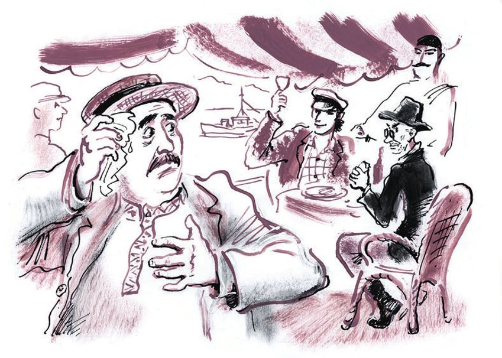
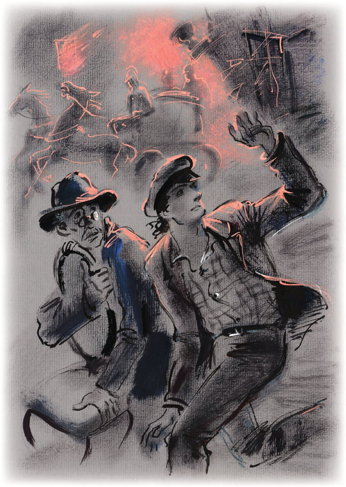

## Kapitel 40: Das Erdbeben

— Was meinen Sie, Adelsmarschall, — fragte Ostap, als die Konzessionäre sich dem Dorf Sioni näherten, — womit kann man in dieser kümmerlichen Gegend, die zwei Werst über dem Meeresspiegel liegt, Geld verdienen?

Ippolit Matwejewitsch schwieg. Die einzige Beschäftigung, mit der er sich seinen <abbr title="der Lebensunterhalt — средства к существованию">Lebensunterhalt</abbr> hätte <abbr title="verschaffen — снискать, добывать">verschaffen</abbr> können, war das Betteln, aber hier, auf den Spiralen und Simsen der Berge, gab es niemanden, den man hätte bitten können.

Allerdings gab es auch hier eine Bettelei, aber eine ganz besondere, eine <abbr title="alpin — альпийский">alpine</abbr>: Zu jedem Autobus oder Personenwagen, der am Dorf vorbeifuhr, liefen Kinder und führten vor dem <abbr title="fahrend — движущийся">fahrenden</abbr> Publikum ein paar Schritte der Naurskaja-<abbr title="die Lesginka — лезгинка (танец)">Lesginka</abbr> auf; danach liefen die Kinder hinter dem Wagen her und schrien:

— Gib Gelt! Gelt gib!

Die Fahrgäste warfen Fünfkopekenstücke hinaus und <abbr title="entschweben — возноситься">entschwebten</abbr> zum Kreuzpass.

— Eine heilige Sache, — sagte Ostap. — <abbr title="der Kapitalaufwand — капитальные затраты">Kapitalaufwand</abbr> ist nicht erforderlich, die <abbr title="die Einkünfte (Pl.) — доходы">Einkünfte</abbr> sind bescheiden, aber in unserer Lage wertvoll.

Gegen zwei Uhr am zweiten Tag der Reise führte Ippolit Matwejewitsch unter der Aufsicht des großen Kombinators vor den vorbeifliegenden Fahrgästen seinen ersten Tanz auf. Dieser Tanz ähnelte einer <abbr title="die Mazurka, die Mazurkas — мазурка">Mazurka</abbr>, aber die Fahrgäste, die von den wilden Schönheiten des Kaukasus schon <abbr title="übersättigt — пресыщенный">übersättigt</abbr> waren, hielten ihn für eine Lesginka und belohnten ihn mit drei Fünfkopekenstücken. Vor dem nächsten Wagen, der sich als ein Autobus von Tiflis nach Wladikawkas herausstellte, tanzte und hüpfte der technische Direktor selbst.

— Gib Geld! Geld gib! — schrie er böse.

Die lachenden Fahrgäste belohnten seine Sprünge großzügig. Ostap sammelte im Straßenstaub dreißig Kopeken auf. Aber da überschütteten die Kinder von Sioni die Konkurrenten mit einem <abbr title="der Steinhagel — каменный град">Steinhagel</abbr>. Um sich vor dem <abbr title="der Beschuss — обстрел">Beschuss</abbr> zu retten, gingen die Wanderer mit schnellen Schritten in das nächste <abbr title="das Bergdorf, die Bergdörfer — аул">Bergdorf</abbr>, wo sie das verdiente Geld für Käse und <abbr title="das Fladenbrot, die Fladenbrote — чурек, лепёшка">Fladenbrot</abbr> ausgaben.

Mit solchen Beschäftigungen verbrachten die Konzessionäre ihre Tage. Sie übernachteten in den Hütten der Bergbewohner. Am vierten Tag stiegen sie die <abbr title="die Serpentine, die Serpentinen — серпантин, зигзаги дороги">Serpentinen</abbr> der Landstraße ins Kaischaur-Tal hinab. Hier schien eine heiße Sonne, und die Knochen der Kompagnons, die auf dem Kreuzpass ordentlich <abbr title="durchfrieren (fror durch, ist durchgefroren) — промёрзнуть">durchgefroren</abbr> waren, wärmten sich schnell wieder auf.

Die Felsen des Darjal, die Finsternis und die Kälte des Passes <abbr title="weichen + Dat. (wich, ist gewichen) — уступать место">wichen</abbr> dem Grün und der <abbr title="die Behaglichkeit — уют, домовитость">Behaglichkeit</abbr> eines sehr tiefen Tales. Die Wanderer gingen oberhalb der Aragwa, stiegen ins Tal hinab, das von Menschen <abbr title="bewohnt — населённый">bewohnt</abbr> war und reich an <abbr title="das Vieh — скот">Vieh</abbr> und Nahrung. Hier konnte man sich etwas erbetteln, etwas verdienen oder einfach stehlen. Das war Transkaukasien.

Die <abbr title="aufgeheitert — повеселевший">aufgeheiterten</abbr> Konzessionäre gingen schneller.

In Passanauri, einem heißen, reichen Dorf mit zwei Hotels und mehreren Wirtshäusern, erbettelten sich die Freunde ein Fladenbrot und legten sich gegenüber dem Hotel «France» ins Gebüsch; das Hotel hatte einen Garten und zwei kleine <abbr title="der Bär, die Bären — медведь">Bären</abbr> an einer Kette. Sie genossen die Wärme, das schmackhafte Brot und die <abbr title="wohlverdient — заслуженный">wohlverdiente</abbr> Ruhe.

Doch bald wurde die Ruhe vom Kreischen der Autohupen, vom Rauschen neuer Reifen auf der <abbr title="die Schotterstraße, die Schotterstraßen — кремнистое шоссе">Schotterstraße</abbr> und von fröhlichen Ausrufen gestört. Die Freunde schauten hinaus. Zum «France» rollten hintereinander drei neue Autos des gleichen Typs. Die Autos hielten geräuschlos an. Aus dem ersten Wagen sprang Persizki. Nach ihm stieg «Gericht und Alltag» aus und strich sich das verstaubte Haar glatt. Dann quollen aus allen Wagen die Mitglieder des Autoklubs der Zeitung «Die Werkbank».

— <abbr title="die Rast — привал">Rast</abbr>! — schrie Persizki. — Wirt! Fünfzehn Schaschliks!

Im «France» bewegten sich verschlafene Gestalten, und man hörte die Schreie eines Hammels, den man an den Beinen in die Küche zerrte.

— Erkennen Sie diesen jungen Mann nicht? — fragte Ostap. — Das ist der Reporter von der «Skrjabin», einer der <abbr title="der Kritiker, die Kritiker — критик">Kritiker</abbr> unseres Transparents. Mit welchem Schick sie aber angekommen sind! Was hat das zu bedeuten?

Ostap näherte sich den Schaschlikessern und begrüßte Persizki mit einer höchst eleganten Verbeugung.

— Bonjour! — sagte der Reporter. — Wo habe ich Sie schon gesehen, lieber Genosse? A-a-a! Ich erinnere mich. Der Maler von der «Skrjabin»! Nicht wahr?

Ostap drückte die Hand ans Herz und verbeugte sich höflich.

— Erlauben Sie, erlauben Sie, — fuhr Persizki fort, der das <abbr title="zäh — цепкий">zähe</abbr> <abbr title="das Gedächtnis — память">Gedächtnis</abbr> eines Reporters hatte. — Sind nicht Sie das gewesen, den in Moskau auf dem Swerdlow-Platz ein <abbr title="das Droschkenpferd, die Droschkenpferde — извозчичья лошадь">Droschkenpferd</abbr> <abbr title="umrennen (rannte um, hat umgerannt) — сбить с ног">umgerannt</abbr> hat?

— Aber gewiss, aber gewiss! Und nach Ihrem treffenden Ausdruck bin ich angeblich mit einem leichten Schrecken davongekommen.

— Und Sie <abbr title="wirken — орудовать, действовать">wirken</abbr> hier, was, in künstlerischer Hinsicht?

— Nein, ich bin zu <abbr title="der Ausflugszweck, die Ausflugszwecke — экскурсионная цель">Ausflugszwecken</abbr> hier.

— Zu Fuß?

— Zu Fuß. <abbr title="der Fachmann, die Fachleute — специалист">Fachleute</abbr> behaupten, dass eine Reise über die Georgische Heerstraße mit dem Auto einfach eine Dummheit ist.

— Nicht immer eine Dummheit, mein Lieber, nicht immer! Wir zum Beispiel fahren gar nicht so dumm. Die Wägelchen, wie Sie sehen, gehören uns, ich betone – uns, sie sind kollektiv. Direkte Verbindung Moskau–Tiflis. Benzin verbraucht man für einen Groschen. Bequemlichkeit und Schnelligkeit der <abbr title="die Fortbewegung — передвижение">Fortbewegung</abbr>. Weiche <abbr title="die Federung — рессоры, подвеска">Federung</abbr>. Europa.

— Woher haben Sie das alles? — fragte Ostap neidisch. — Hunderttausend gewonnen?

— Hundert nicht, aber fünfzig haben wir gewonnen.

— Beim Neunerspiel?

— Mit einer <abbr title="die Anleihe, die Anleihen — облигация займа">Anleihe</abbr>, die dem Autoklub gehörte.

— So, — sagte Ostap, — und von diesem Geld haben Sie die Autos gekauft?

— Wie Sie sehen!

— Soso. Brauchen Sie vielleicht einen <abbr title="der Obmann, die Obmänner — старшой, старший">Obmann</abbr>? Ich kenne einen jungen Mann. <abbr title="der Abstinenzler, die Abstinenzler — непьющий">Abstinenzler</abbr>.

— Was für einen Obmann?

— Na, so einen … <abbr title="die Gesamtleitung — общее руководство">Gesamtleitung</abbr>, geschäftliche Ratschläge, <abbr title="der Anschauungsunterricht — наглядное обучение">Anschauungsunterricht</abbr> nach der Komplexmethode … Hm?

— Ich verstehe Sie. Nein, brauchen wir nicht.

— Brauchen Sie nicht?

— Nein. Leider. Und einen Maler brauchen wir auch nicht.

— In diesem Fall geben Sie mir zehn Rubel.

— Awdotjin, — sagte Persizki, — sei so gut und zahl diesem Bürger auf meine Rechnung drei Rubel aus. Eine Quittung ist nicht nötig. Diese Person ist nicht <abbr title="rechenschaftspflichtig — подотчётный">rechenschaftspflichtig</abbr>.

— Das ist äußerst wenig, — bemerkte Ostap, — aber ich nehme es an. Ich verstehe die ganze Schwierigkeit Ihrer Lage. Natürlich, wenn Sie hunderttausend gewonnen hätten, dann hätten Sie mir wahrscheinlich einen ganzen Fünfer geliehen. Aber Sie haben ja <abbr title="lediglich — всего лишь">lediglich</abbr> fünfzigtausend Rubel null null Kopeken gewonnen. Auf jeden Fall – danke!

Bender nahm höflich den Hut ab. Persizki nahm höflich den Hut ab. Bender verbeugte sich <abbr title="überaus — чрезвычайно">überaus</abbr> liebenswürdig. Persizki antwortete mit einer höchst liebenswürdigen Verbeugung. Bender winkte zum Gruß mit der Hand. Persizki, am <abbr title="das Lenkrad, die Lenkräder — руль">Lenkrad</abbr> sitzend, winkte mit dem Händchen. Aber Persizki fuhr in einem wunderbaren Auto in strahlende Fernen davon, in der Gesellschaft fröhlicher Freunde, und der große Kombinator blieb auf der staubigen Straße mit einem Dummkopf von Kompagnon zurück.

— Haben Sie diesen Glanz gesehen? — fragte Ostap Ippolit Matwejewitsch.

— Transkaukasische Autohandelsgesellschaft oder die private Gesellschaft «Motor»? — erkundigte sich Worobjaninow sachlich, der in den paar Tagen der Reise alle Arten von <abbr title="das Kraftfahrzeug, die Kraftfahrzeuge — автотранспорт">Kraftfahrzeugen</abbr> auf der Straße bestens kennengelernt hatte. — Ich wollte schon zu ihnen hingehen und tanzen.

— Sie werden bald völlig <abbr title="verblöden — отупеть">verblöden</abbr>, mein armer Freund. Was heißt hier Autohandelsgesellschaft? Diese Leute, hören Sie, Kisa, haben fünfzigtausend Rubel ge-won-nen! Sie sehen selbst, Kisulja, wie fröhlich sie sind und wie viel mechanischen Krempel sie sich gekauft haben! Wenn wir unser Geld bekommen, werden wir es viel vernünftiger ausgeben. Nicht wahr?

Und die Freunde verließen Passanauri und träumten davon, was sie kaufen würden, wenn sie reich wären. Ippolit Matwejewitsch stellte sich lebhaft den Kauf neuer Socken und die Abreise ins Ausland vor. Die Träume Ostaps waren <abbr title="umfassend — обширный">umfassender</abbr>. Seine Pläne waren <abbr title="grandios — грандиозный">grandios</abbr>: Entweder wollte er den Blauen Nil mit einem <abbr title="der Staudamm, die Staudämme — плотина">Staudamm</abbr> absperren oder in Riga eine <abbr title="die Spielbank, die Spielbanken — игорный дом">Spielbank</abbr> mit Filialen in allen <abbr title="der Randstaat, die Randstaaten — лимитроф (пограничное государство)">Randstaaten</abbr> eröffnen.

Am dritten Tag, vor dem Mittagessen, nachdem sie an langweiligen und staubigen Orten vorbeigekommen waren – Ananuri, Duscheti und Ziklani –, erreichten die Wanderer Mzcheta, die alte Hauptstadt Georgiens. Hier bog die Kura nach Tiflis ab.

Am Abend kamen die Wanderer am SAGES vorbei, dem Wasserkraftwerk von Semo-Awtschala. Glas, Wasser und Elektrizität funkelten in verschiedenen Lichtern. All das spiegelte sich und zitterte in der schnell fließenden Kura.

Hier schlossen die Konzessionäre Freundschaft mit einem Bauern, der sie auf seinem Karren um elf Uhr abends nach Tiflis brachte, genau zu der Stunde, wenn die abendliche Frische die Bewohner der georgischen Hauptstadt, erschöpft nach dem <abbr title="schwül — душный">schwülen</abbr> Tag, auf die Straße lockt.

— Kein schlechtes Städtchen, — sagte Ostap, als er auf den Schota-Rustaweli-<abbr title="der Prospekt, die Prospekte — проспект">Prospekt</abbr> kam. — Wissen Sie, Kisa …

Plötzlich stürzte Ostap, ohne den Satz zu beenden, einem Bürger nach, holte ihn nach etwa zehn Schritten ein und begann sich lebhaft mit ihm zu unterhalten. Dann kam er schnell zurück und stieß Ippolit Matwejewitsch mit dem Finger in die Seite.

— Wissen Sie, wer das ist? — flüsterte er schnell. — Das ist die Odessaer <abbr title="die Kringelgenossenschaft — бубличная артель">Kringelgenossenschaft</abbr> «Moskauer Kringel», Bürger Kisljarski. Gehen wir zu ihm. Jetzt sind Sie wieder, so <abbr title="paradox — парадоксально">paradox</abbr> es klingt, der Gigant des Denkens und Vater der russischen Demokratie. Vergessen Sie nicht, die Backen <abbr title="aufblasen (blies auf, hat aufgeblasen) — надувать">aufzublasen</abbr> und mit dem Schnurrbart zu wackeln. Ach, zum Teufel! Was für ein <abbr title="der Zufall, die Zufälle — случай">Zufall</abbr>! <abbr title="die Fortuna — фортуна">Fortuna</abbr>! Wenn ich ihn jetzt nicht um fünfhundert Rubel <abbr title="erleichtern um + Akk. — облегчить (кошелёк), «вскрыть»">erleichtere</abbr>, dann spucken Sie mir in die Augen! Los! Los!

<abbr title="tatsächlich — действительно">Tatsächlich</abbr> stand in einiger Entfernung von den Konzessionären Kisljarski, milchblau vor Angst, in einem <abbr title="der Rohseidenanzug, die Rohseidenanzüge — чесучовый костюм">Rohseidenanzug</abbr> und mit <abbr title="der Strohhut, die Strohhüte — канотье, соломенная шляпа">Strohhut</abbr>.

— Sie kennen sich, glaube ich, — sagte Ostap flüsternd. — Hier ist eine dem Kaiser <abbr title="nahestehend — приближённый">nahestehende</abbr> Person, der Gigant des Denkens und Vater der russischen Demokratie. Achten Sie nicht auf seinen Anzug. Das ist zur Tarnung. Fahren Sie uns sofort irgendwohin. Wir müssen reden.

Kisljarski, der in den Kaukasus gekommen war, um sich von den Stargoroder <abbr title="die Erschütterung, die Erschütterungen — потрясение">Erschütterungen</abbr> zu erholen, war völlig niedergeschlagen. Er murmelte irgendeinen Unsinn über die <abbr title="die Flaute, die Flauten — застой">Flaute</abbr> im Kringel- und Bublikgeschäft, setzte die schrecklichen Bekannten in eine Kutsche mit <abbr title="versilbert — посеребрённый">versilberten</abbr> <abbr title="die Speiche, die Speichen — спица (колеса)">Speichen</abbr> und Trittbrett und fuhr sie zum Davidsberg. Auf den Gipfel dieses Restaurantberges fuhren sie mit der <abbr title="die Seilbahn, die Seilbahnen — канатная дорога, фуникулёр">Seilbahn</abbr>. Tiflis mit seinen tausend Lichtern kroch langsam in die <abbr title="die Unterwelt — преисподняя">Unterwelt</abbr> hinab. Die Verschwörer stiegen direkt zu den Sternen hinauf.

Die Restauranttische standen auf dem Gras. Dumpf dröhnte ein kaukasisches Orchester, und ein kleines Mädchen tanzte unter den glücklichen Blicken der Eltern <abbr title="aus eigenem Antrieb — по собственному почину">aus eigenem Antrieb</abbr> zwischen den Tischen eine Lesginka.

— Bestellen Sie etwas! — <abbr title="einschärfen — втолковывать, внушать">schärfte</abbr> Bender ihm ein.

Auf Befehl des erfahrenen Kisljarski wurden Wein, <abbr title="das Kraut, die Kräuter — зелень">Kräuter</abbr> und salziger georgischer Käse serviert.

— Und etwas zu essen, — sagte Ostap. — Wenn Sie wüssten, lieber Herr Kisljarski, was Ippolit Matwejewitsch und ich <abbr title="durchmachen — переносить, переживать">durchmachen</abbr> mussten, Sie würden über unseren <abbr title="der Mut — мужество">Mut</abbr> staunen.

«Schon wieder! — dachte Kisljarski verzweifelt. — Schon wieder fangen meine Qualen an. Und warum bin ich nicht auf die Krim gefahren? Ich wollte doch eindeutig auf die Krim fahren! Und Henriette hat es mir auch geraten!»

Aber er bestellte <abbr title="widerspruchslos — безропотно">widerspruchslos</abbr> zwei Schaschliks und wandte Ostap sein <abbr title="dienstbeflissen — услужливый">dienstbeflissenes</abbr> Gesicht zu.

— Also, — sagte Ostap, sah sich um und senkte die Stimme, — in zwei Worten. Man <abbr title="beschatten — следить за">beschattet</abbr> uns schon seit zwei Monaten, und wahrscheinlich wird morgen in der konspirativen Wohnung ein Hinterhalt auf uns warten. Wir werden uns <abbr title="sich freischießen (schoss frei, hat freigeschossen) — отстреливаться">freischießen</abbr> müssen.

Kisljarskis Wangen wurden silbern.

— Wir freuen uns, — fuhr Ostap fort, — in dieser <abbr title="beunruhigend — тревожный">beunruhigenden</abbr> Lage einen treuen Kämpfer für das Vaterland zu treffen.

— Hm … ja! — presste Ippolit Matwejewitsch stolz hervor und erinnerte sich daran, mit welchem hungrigen <abbr title="der Eifer — пыл, рвение">Eifer</abbr> er unweit von Sioni die Lesginka getanzt hatte.

— Ja, — flüsterte Ostap. — Wir hoffen, mit Ihrer Hilfe den Feind zu schlagen. Ich gebe Ihnen eine Parabellum.

— Nicht nötig, — sagte Kisljarski fest.

In der nächsten Minute stellte sich heraus, dass der Vorsitzende des Börsenkomitees keine Möglichkeit hatte, an der morgigen <abbr title="die Schlacht, die Schlachten — битва">Schlacht</abbr> teilzunehmen. Er bedaure es sehr, aber er könne nicht. Er kenne sich im <abbr title="das Kriegswesen — военное дело">Kriegswesen</abbr> nicht aus. Gerade deshalb habe man ihn ja zum Vorsitzenden des Börsenkomitees gewählt. Er sei <abbr title="völlig verzweifelt sein — быть в полном отчаянии">völlig verzweifelt</abbr>, aber zur Rettung des Lebens des Vaters der russischen Demokratie (er selbst sei ein alter Oktobrist) sei er bereit, <abbr title="nach Kräften — посильно, по возможности">nach Kräften</abbr> finanzielle Hilfe zu leisten.

— Sie sind ein treuer Freund des Vaterlands! — sagte Ostap feierlich und spülte den duftenden Schaschlik mit süßlichem Kipiani-Wein hinunter. — Fünfhundert Rubel können den Giganten des Denkens retten.

— Sagen Sie, — fragte Kisljarski kläglich, — und zweihundert Rubel können den Giganten des Denkens nicht retten?

Ostap hielt es nicht aus und trat Ippolit Matwejewitsch unter dem Tisch begeistert mit dem Fuß.

— Ich denke, — sagte Ippolit Matwejewitsch, — hier wird nicht gefeilscht!

Sofort bekam er einen Tritt gegen den Oberschenkel, was bedeutete: «Bravo, Kisa, bravo, das nenne ich <abbr title="die Schule — школа, выучка">Schule</abbr>!»

Kisljarski hörte zum ersten Mal in seinem Leben die Stimme des Giganten des Denkens. Dieser Umstand verblüffte ihn so, dass er Ostap sofort fünfhundert Rubel übergab. Dann beglich er die Rechnung, ließ die Freunde am Tisch zurück und entfernte sich wegen Kopfschmerzen. Eine halbe Stunde später schickte er seiner Frau nach Stargorod ein Telegramm: «Fahre deinem Rat gemäß Krim für alle Fälle halte Körbchen bereit».

Die langen <abbr title="die Entbehrung, die Entbehrungen — лишение">Entbehrungen</abbr>, die Ostap Bender erlitten hatte, verlangten eine sofortige <abbr title="die Entschädigung, die Entschädigungen — компенсация">Entschädigung</abbr>. Deshalb betrank sich der große Kombinator noch am selben Abend auf dem Restaurantberg bis zur <abbr title="die Bewusstlosigkeit — бесчувствие, «до столбняка»">Bewusstlosigkeit</abbr> und wäre auf dem Weg ins Hotel beinahe aus dem Wagen der Seilbahn gefallen. Am nächsten Tag verwirklichte er seinen alten Traum. Er kaufte einen herrlichen grauen, <abbr title="apfelgeschimmelt — в яблоках (о масти, узоре)">apfelgeschimmelten</abbr> Anzug. In diesem Anzug war es heiß, aber er lief trotzdem darin herum und schwitzte. Für Worobjaninow kaufte man im <abbr title="das Konfektionsgeschäft, die Konfektionsgeschäfte — магазин готового платья">Konfektionsgeschäft</abbr> der Tiflisser Genossenschaft einen weißen <abbr title="der Pikee — пике (ткань)">Pikee</abbr>-Anzug und eine Kapitänsmütze mit dem goldenen Abzeichen eines unbekannten <abbr title="der Jachtklub, die Jachtklubs — яхт-клуб">Jachtklubs</abbr>. In diesem <abbr title="der Aufzug — наряд, облачение">Aufzug</abbr> sah Ippolit Matwejewitsch aus wie ein <abbr title="der Amateur, die Amateure — любитель">Amateur</abbr>-Admiral der Handelsflotte. Seine Haltung wurde gerade. Sein Gang wurde fest.

— Ah! — sagte Bender. — Erste Klasse! Wenn ich eine Frau wäre, würde ich einem so <abbr title="männlich — мужественный">männlichen</abbr> schönen Mann wie Ihnen acht Prozent Rabatt auf den normalen Preis geben. Ah! Ah! In diesem Aufzug können wir in der Gesellschaft <abbr title="verkehren — вращаться (в обществе)">verkehren</abbr>! Können Sie verkehren, Kisa?

— Genosse Bender, — sagte Worobjaninow immer wieder, — was ist denn mit dem Stuhl? Wir müssen herausfinden, was mit dem Theater ist.

— Ho-ho! — <abbr title="entgegnen — возражать">entgegnete</abbr> Ostap und tanzte mit einem Stuhl durch das große <abbr title="maurisch — мавританский">maurische</abbr> Zimmer des Hotels «Orient». — Erklären Sie mir nicht das Leben! Ich bin jetzt böse. Ich habe Geld. Aber ich bin großmütig. Ich gebe Ihnen zwanzig Rubel und drei Tage zur <abbr title="die Plünderung — разграбление">Plünderung</abbr> der Stadt! Ich bin wie Suworow!.. <abbr title="plündern — грабить">Plündern</abbr> Sie die Stadt, Kisa! Seien Sie fröhlich!

Und Ostap wiegte die Hüften und sang in schnellem Tempo:

Oh Abendglocken, Abendklang, / wie viel Gedanken weckt dein Sang!

Die Freunde <abbr title="saufen (soff, hat gesoffen) — пьянствовать">soffen</abbr> eine ganze Woche lang ohne <abbr title="die Unterbrechung, die Unterbrechungen — перерыв">Unterbrechung</abbr>. Worobjaninows Admiralsanzug bedeckte sich mit bunten Weinflecken wie mit Äpfeln, und auf Ostaps Anzug zerflossen sie zu einem einzigen großen <abbr title="regenbogenfarben — радужный">regenbogenfarbenen</abbr> Apfel.

— Guten Tag! — sagte am achten Morgen Ostap, dem es im Kater eingefallen war, die «Morgenröte des Ostens» zu lesen. — Hören Sie, Sie <abbr title="der Saufbold, die Saufbolde — пьянчуга">Saufbold</abbr>, was kluge Menschen in den Zeitungen schreiben! Hören Sie zu!

Theaterchronik. Gestern, am 3. September, ist das Moskauer Kolumbus-Theater nach Abschluss seines Gastspiels in Tiflis zu einem Gastspiel nach Jalta abgereist. Das Theater <abbr title="beabsichtigen — предполагать, намереваться">beabsichtigt</abbr>, bis zum Beginn der Wintersaison in Moskau auf der Krim zu bleiben.

— Aha! Ich habe es Ihnen gesagt! — sagte Worobjaninow.

— Was haben Sie mir gesagt? — <abbr title="fauchen — огрызаться, шипеть">fauchte</abbr> Ostap.

Doch er war verlegen. Dieses <abbr title="das Versehen, die Versehen — оплошность">Versehen</abbr> war ihm sehr unangenehm. Statt den <abbr title="der Lehrgang, die Lehrgänge — курс">Lehrgang</abbr> der Schatzjagd in Tiflis abzuschließen, musste man jetzt noch auf die Halbinsel Krim <abbr title="übersetzen — переправляться">übersetzen</abbr>. Ostap machte sich sofort an die Arbeit. Es wurden Fahrkarten nach Batum gekauft und Plätze in der zweiten Klasse des Dampfers «Pestel» bestellt, der am 7. September um 23 Uhr Moskauer Zeit von Batum nach Odessa <abbr title="auslaufen (lief aus, ist ausgelaufen) — отходить (о судне)">auslief</abbr>.

In der Nacht vom zehnten auf den elften September, als die «Pestel» wegen des Sturms Anapa nicht <abbr title="anlaufen (lief an, hat angelaufen) — заходить (в порт)">anlief</abbr>, aufs offene Meer <abbr title="abdrehen — поворачивать">abdrehte</abbr> und direkt Kurs auf Jalta nahm, hatte Ippolit Matwejewitsch einen Traum.

Er träumte, er stehe im Admiralsanzug auf dem Balkon seines Hauses in Stargorod und wisse, dass die Menge unten etwas von ihm erwarte. Ein großer <abbr title="der Kran, die Kräne — подъёмный кран">Kran</abbr> ließ ihm ein Schwein mit schwarzen Äpfeln vor die Füße herab. Der Hausmeister Tichon kam in einem <abbr title="der Straßenanzug, die Straßenanzüge — пиджачный костюм">Straßenanzug</abbr>, packte das Schwein an den Hinterbeinen und sagte:

— Ach, zum Kuckuck noch mal! Hat die «Nymphe» etwa gute Farbe?

In den Händen von Ippolit Matwejewitsch fand sich ein <abbr title="der Dolch, die Dolche — кинжал">Dolch</abbr>. Damit stach er dem Schwein in die Seite, und aus der großen, breiten Wunde fielen Brillanten heraus und sprangen über den Zement. Sie sprangen und klapperten immer lauter. Und am Ende wurde ihr Klappern unerträglich und schrecklich.

Ippolit Matwejewitsch erwachte vom Schlag einer Welle gegen das <abbr title="das Bullauge, die Bullaugen — иллюминатор">Bullauge</abbr>.

In Jalta kamen sie bei <abbr title="die Windstille — штиль">Windstille</abbr> an, an einem <abbr title="erschöpfend — изнуряющий">erschöpfend</abbr> sonnigen Morgen. Der Adelsmarschall, der sich von der <abbr title="die Seekrankheit — морская болезнь">Seekrankheit</abbr> erholt hatte, prangte am Bug neben der Glocke, die mit <abbr title="gegossen — литой">gegossener</abbr> slawischer <abbr title="die Zierschrift — вязь">Zierschrift</abbr> geschmückt war. Das fröhliche Jalta hatte am Ufer entlang seine winzigen Läden und schwimmenden Restaurants aufgereiht. Am Kai standen kleine Kutschen mit <abbr title="der Samtsitz, die Samtsitze — бархатное сиденье">Samtsitzen</abbr> unter <abbr title="ausgezackt — вырезной, зубчатый">ausgezackten</abbr> Leinendächern, Autos und Autobusse der «Krimkurso» und der Genossenschaft «Krimchauffeur». <abbr title="ziegelrot — кирпичный (цвет)">Ziegelrote</abbr> Mädchen drehten ihre aufgespannten Sonnenschirme und winkten mit Tüchern.

Die Freunde gingen als Erste auf die glühend heiße <abbr title="die Uferpromenade, die Uferpromenaden — набережная">Uferpromenade</abbr>. Beim Anblick der Konzessionäre tauchte aus der Menge der <abbr title="der Abholende, die Abholenden — встречающий">Abholenden</abbr> und Schaulustigen ein Bürger in einem Rohseidenanzug auf und ging schnell zum Ausgang des Hafengeländes. Aber es war schon zu spät. Der <abbr title="der Jägerblick — охотничий взгляд">Jägerblick</abbr> des großen Kombinators hatte den Rohseidenbürger schnell erkannt.

— Warten Sie, Worobjaninow! — rief Ostap.

Und er stürzte so schnell vorwärts, dass er den Rohseidenmann zehn Schritte vor dem Ausgang einholte. Ostap kam sofort mit hundert Rubeln zurück.

— Mehr gibt er nicht. Übrigens habe ich nicht darauf <abbr title="bestehen auf + Dat. (bestand, hat bestanden) — настаивать">bestanden</abbr>, sonst hätte er nichts, um nach Hause zurückzufahren.

Und tatsächlich <abbr title="türmen — удирать, сбежать">türmte</abbr> Kisljarski noch in derselben Stunde mit dem Auto nach Sewastopol und von dort in der dritten Klasse nach Hause, nach Stargorod.

Den ganzen Tag verbrachten die Konzessionäre im Hotel, sie saßen nackt auf dem Boden und liefen jede Minute ins Bad unter die <abbr title="die Dusche, die Duschen — душ">Dusche</abbr>. Aber das Wasser kam warm heraus wie schlechter Tee. Vor der Hitze gab es keine Rettung. Es schien, als würde Jalta gleich schmelzen und ins Meer <abbr title="abfließen (floss ab, ist abgeflossen) — стекать">abfließen</abbr>.

Gegen acht Uhr abends <abbr title="zwängen — напяливать, втискивать">zwängten</abbr> die Kompagnons, alle Stühle der Welt <abbr title="verfluchen — проклинать">verfluchend</abbr>, ihre heißen Halbschuhe an die Füße und gingen ins Theater.

Man spielte die «Heirat». Der von der Hitze zermürbte Stepan, der auf den Händen stand, wäre beinahe umgefallen. Agafja Tichonowna lief über das <abbr title="das Drahtseil, die Drahtseile — проволока, канат">Drahtseil</abbr> und hielt mit <abbr title="schweißnass — взмокший">schweißnassen</abbr> Händen einen Schirm mit der Aufschrift: «Ich will Podkolessin». In diesem Augenblick wollte sie, wie den ganzen Tag schon, nur eines: kaltes Wasser mit Eis. Auch das Publikum hatte Durst. Deshalb, und vielleicht auch weil der Anblick Stepans, der heißes Rührei verschlang, Ekel <abbr title="erregen — вызывать">erregte</abbr>, gefiel die <abbr title="die Aufführung, die Aufführungen — спектакль">Aufführung</abbr> nicht.

Die Konzessionäre waren zufrieden, denn ihr Stuhl war, zusammen mit drei neuen, prunkvollen <abbr title="das Rokoko — рококо">Rokoko</abbr>-Sesseln, an seinem Platz.

Die Freunde versteckten sich in einer der <abbr title="die Loge, die Logen — ложа">Logen</abbr> und warteten geduldig das Ende der maßlos <abbr title="in die Länge ziehen — затягивать">in die Länge gezogenen</abbr> Aufführung ab. Das Publikum ging endlich auseinander, und die Schauspieler liefen hinaus, um sich abzukühlen. Im Theater blieb niemand außer den Mitgliedern und Anteilseignern des Konzessionsunternehmens. Alles, was lebte, lief auf die Straße hinaus, unter den endlich <abbr title="niederprasseln — хлынуть (о дожде)">niederprasselnden</abbr> frischen Regen.

— Mir nach, Kisa, — kommandierte Ostap. — <abbr title="im Fall der Fälle — в случае чего">Im Fall der Fälle</abbr> sind wir Provinzler, die den Ausgang aus dem Theater nicht gefunden haben.

Sie schlichen auf die Bühne, <abbr title="anreißen (riss an, hat angerissen) — чиркать">rissen</abbr> Streichhölzer an, stießen trotzdem gegen die hydraulische Presse und untersuchten die ganze Bühne. Der große Kombinator lief die Treppe hinauf in die Requisitenkammer.

— Kommen Sie her! — rief er.

Worobjaninow fuchtelte mit den Armen und raste nach oben.

— Sehen Sie? — sagte Ostap und zündete ein Streichholz an. Aus dem Dunkel traten die Ecke eines Gambs-Stuhls und ein <abbr title="der Ausschnitt, die Ausschnitte — сектор, часть">Ausschnitt</abbr> des Schirms mit der Aufschrift: «Ich will …» hervor.

— Da! Da ist unsere Zukunft, unsere Gegenwart und unsere Vergangenheit. Zünden Sie die Streichhölzer an, Kisa. Ich mache ihn auf.

Und Ostap griff in die Tasche nach seinem <abbr title="das Werkzeug, die Werkzeuge — инструмент">Werkzeug</abbr>.

— Nun denn, — sagte er und streckte die Hand nach dem Stuhl aus, — noch ein Streichholz, Adelsmarschall.

Ein Streichholz flammte auf, und – seltsame Sache – der Stuhl sprang von selbst zur Seite und versank plötzlich vor den Augen der verblüfften Konzessionäre im Boden.

— Mama! — schrie Ippolit Matwejewitsch und flog gegen die Wand, obwohl er nicht die geringste Lust dazu hatte.

Klirrend sprangen die Scheiben heraus, und der Schirm mit der Aufschrift «Ich will Podkolessin», von einem Wirbelwind gepackt, flog aus dem Fenster aufs Meer hinaus. Ostap lag auf dem Boden, leicht <abbr title="einklemmen — придавливать, зажимать">eingeklemmt</abbr> von <abbr title="die Sperrholzplatte, die Sperrholzplatten — фанерный щит">Sperrholzplatten</abbr>.

Es war zwölf Uhr vierzehn. Das war der erste <abbr title="der Erdstoß, die Erdstöße — подземный толчок">Erdstoß</abbr> des großen Krim-Erdbebens von 1927.

Der Stoß der Stärke neun, der der ganzen Halbinsel <abbr title="unzählig — неисчислимый">unzählige</abbr> Katastrophen zufügte, riss den Konzessionären den Schatz aus den Händen.

— Genosse Bender! Was ist das? — schrie Ippolit Matwejewitsch entsetzt.

Ostap war außer sich: Ein Erdbeben hatte sich ihm in den Weg gestellt. Das war der einzige solche Fall in seiner reichen <abbr title="die Praxis — практика">Praxis</abbr>.

— Was ist das? — kreischte Worobjaninow.

Von der Straße drangen Schreie, Klirren und Getrampel herein.

— Das ist, dass wir sofort auf die Straße abhauen müssen, bevor uns eine Wand <abbr title="verschütten — заваливать, засыпать">verschüttet</abbr>. Schnell! Schnell! Geben Sie mir die Hand, Sie Schlafmütze.

Und sie stürzten zum Ausgang. Zu ihrer Überraschung lag an der Tür, die von der Bühne in eine Gasse führte, ein unversehrter Gambs-Stuhl auf dem Rücken. Ippolit Matwejewitsch stieß einen hundeartigen <abbr title="der Jaulton — визг, скулёж">Jaulton</abbr> aus und klammerte sich mit einem <abbr title="der Todesgriff — мёртвая хватка">Todesgriff</abbr> an ihn.

— Geben Sie mir die Flachzange! — schrie er Ostap zu.

— Sie elender Idiot! — stöhnte Ostap. — Gleich stürzt die Decke ein, und er dreht hier durch! Schnell an die Luft!

— Die Flachzange! — brüllte der <abbr title="wahnsinnig werden — обезуметь">wahnsinnig gewordene</abbr> Ippolit Matwejewitsch.

— Zum Teufel mit Ihnen! Gehen Sie hier mit Ihrem Stuhl zugrunde! Mir ist mein Leben teuer – als <abbr title="das Andenken, die Andenken — память, сувенир">Andenken</abbr>!

Mit diesen Worten stürzte Ostap zur Tür, Ippolit Matwejewitsch bellte, packte den Stuhl und lief hinter Ostap her. Kaum waren sie in der Mitte der Gasse, als die Erde unter ihren Füßen <abbr title="übelkeiterregend — тошнотворно">übelkeiterregend</abbr> schwankte; vom Dach des Theaters stürzten <abbr title="der Dachziegel, die Dachziegel — черепица">Dachziegel</abbr>, und an der Stelle, die die Konzessionäre eben verlassen hatten, lagen schon die <abbr title="der Überrest, die Überreste — останки">Überreste</abbr> der hydraulischen Presse.

— So, jetzt geben Sie mir den Stuhl, — sagte Bender <abbr title="kaltblütig — хладнокровно">kaltblütig</abbr>. — Sie haben es, wie ich sehe, schon satt, ihn zu halten.

— Ich gebe ihn nicht! — quiekte Ippolit Matwejewitsch.

— Was ist denn das? Meuterei an Bord? Geben Sie den Stuhl her! Hören Sie?

— Das ist mein Stuhl! — krächzte Worobjaninow und übertönte das Stöhnen, Weinen und Krachen, das von überall herkam.

— In diesem Fall bekommen Sie Ihr Honorar, Sie alte Galosche!

Und Ostap schlug Worobjaninow mit seiner kupfernen Handfläche in den Nacken.

Im selben Augenblick raste ein Feuerwehrzug mit Fackeln durch die Gasse, und in ihrem flackernden Licht sah Ippolit Matwejewitsch auf Benders Gesicht einen so furchtbaren Ausdruck, dass er sich sofort fügte und den Stuhl hergab.

— So, jetzt ist es gut, — sagte Ostap und holte Atem, — die Meuterei ist <abbr title="niederschlagen (schlug nieder, hat niedergeschlagen) — подавлять">niedergeschlagen</abbr>. Und jetzt nehmen Sie den Stuhl und tragen Sie ihn hinter mir her. Sie haften für die Unversehrtheit der Sache. Selbst wenn ein Stoß der Stärke fünfzig kommt, muss der Stuhl erhalten bleiben! Verstanden?

— Verstanden.

Die ganze Nacht irrten die Konzessionäre zusammen mit den <abbr title="panisch — панический">panischen</abbr> Menschenmengen umher, wagten es, wie alle, nicht, in die verlassenen Häuser zu gehen, und warteten auf neue Stöße.

Bei <abbr title="der Tagesanbruch — рассвет">Tagesanbruch</abbr>, als die Angst ein wenig nachließ, wählte Ostap ein Plätzchen, in dessen Nähe es weder Wände gab, die einstürzen konnten, noch Menschen, die stören konnten, und <abbr title="schreiten zu + Dat. (schritt, ist geschritten) — приступать к">schritt</abbr> zur Öffnung des Stuhls.

Die Ergebnisse der Öffnung verblüfften beide Konzessionäre. Im Stuhl war nichts. Ippolit Matwejewitsch, der all die Erschütterungen der Nacht und des Morgens nicht <abbr title="verkraften — выдерживать, справляться">verkraftet</abbr> hatte, lachte ein <abbr title="das Rattenlachen — крысиный смешок">Rattenlachen</abbr>. Unmittelbar darauf folgte der dritte Stoß, die Erde öffnete sich und verschlang den Gambs-Stuhl, den der erste Stoß des Erdbebens <abbr title="verschonen — щадить">verschont</abbr> und die Menschen <abbr title="zerwühlen — разворошить">zerwühlt</abbr> hatten; seine Blümchen lächelten der Sonne zu, die im Wolkenstaub aufgegangen war.

Ippolit Matwejewitsch ging auf alle viere, wandte sein zerknittertes Gesicht der trüben, <abbr title="purpurn — багровый">purpurnen</abbr> <abbr title="die Sonnenscheibe — солнечный диск">Sonnenscheibe</abbr> zu und heulte. Als der große Kombinator ihn hörte, fiel er in <abbr title="die Ohnmacht — обморок">Ohnmacht</abbr>. Als er wieder zu sich kam, sah er neben sich Worobjaninows Kinn, das von lila <abbr title="die Bartstoppel, die Bartstoppeln — щетина">Bartstoppeln</abbr> <abbr title="überwuchert — заросший">überwuchert</abbr> war. Ippolit Matwejewitsch war <abbr title="bewusstlos — без сознания">bewusstlos</abbr>.

— Schließlich, — sagte Ostap mit der Stimme eines <abbr title="genesen (genas, ist genesen) — выздоравливать">genesenden</abbr> <abbr title="der Typhuskranke, die Typhuskranken — тифозный больной">Typhuskranken</abbr>, — haben wir jetzt hundert Chancen von hundert. Der letzte Stuhl (beim Wort «Stuhl» kam Ippolit Matwejewitsch zu sich) ist im Güterbahnhof des Oktoberbahnhofs verschwunden, aber keineswegs im Boden versunken. Was ist schon dabei? Die Sitzung geht weiter!

Irgendwo fielen polternd Ziegelsteine herunter. Lang gezogen heulte die <abbr title="die Sirene, die Sirenen — сирена">Sirene</abbr> eines Dampfers.

---

### Neue Wörter

- **der Lebensunterhalt** — средства к существованию
- **verschaffen** — снискать, добывать
- **alpin** — альпийский
- **fahrend** — движущийся
- **die Lesginka** — лезгинка (танец)
- **entschweben** — возноситься
- **der Kapitalaufwand** — капитальные затраты
- **die Einkünfte (Pl.)** — доходы
- **die Mazurka, die Mazurkas** — мазурка
- **übersättigt** — пресыщенный
- **der Steinhagel** — каменный град
- **der Beschuss** — обстрел
- **das Bergdorf, die Bergdörfer** — аул
- **das Fladenbrot, die Fladenbrote** — чурек, лепёшка
- **die Serpentine, die Serpentinen** — серпантин, зигзаги дороги
- **durchfrieren (fror durch, ist durchgefroren)** — промёрзнуть
- **weichen + Dat. (wich, ist gewichen)** — уступать место
- **die Behaglichkeit** — уют, домовитость
- **bewohnt** — населённый
- **das Vieh** — скот
- **aufgeheitert** — повеселевший
- **der Bär, die Bären** — медведь
- **wohlverdient** — заслуженный
- **die Schotterstraße, die Schotterstraßen** — кремнистое шоссе
- **die Rast** — привал
- **der Kritiker, die Kritiker** — критик
- **zäh** — цепкий
- **das Gedächtnis** — память
- **das Droschkenpferd, die Droschkenpferde** — извозчичья лошадь
- **umrennen (rannte um, hat umgerannt)** — сбить с ног
- **wirken** — орудовать, действовать
- **der Ausflugszweck, die Ausflugszwecke** — экскурсионная цель
- **der Fachmann, die Fachleute** — специалист
- **die Fortbewegung** — передвижение
- **die Federung** — рессоры, подвеска
- **die Anleihe, die Anleihen** — облигация займа
- **der Obmann, die Obmänner** — старшой, старший
- **der Abstinenzler, die Abstinenzler** — непьющий
- **die Gesamtleitung** — общее руководство
- **der Anschauungsunterricht** — наглядное обучение
- **rechenschaftspflichtig** — подотчётный
- **lediglich** — всего лишь
- **überaus** — чрезвычайно
- **das Lenkrad, die Lenkräder** — руль
- **das Kraftfahrzeug, die Kraftfahrzeuge** — автотранспорт
- **verblöden** — отупеть
- **umfassend** — обширный
- **grandios** — грандиозный
- **der Staudamm, die Staudämme** — плотина
- **die Spielbank, die Spielbanken** — игорный дом
- **der Randstaat, die Randstaaten** — лимитроф (пограничное государство)
- **schwül** — душный
- **der Prospekt, die Prospekte** — проспект
- **die Kringelgenossenschaft** — бубличная артель
- **paradox** — парадоксально
- **aufblasen (blies auf, hat aufgeblasen)** — надувать
- **der Zufall, die Zufälle** — случай
- **die Fortuna** — фортуна
- **erleichtern um + Akk.** — облегчить (кошелёк), «вскрыть»
- **tatsächlich** — действительно
- **der Rohseidenanzug, die Rohseidenanzüge** — чесучовый костюм
- **der Strohhut, die Strohhüte** — канотье, соломенная шляпа
- **nahestehend** — приближённый
- **die Erschütterung, die Erschütterungen** — потрясение
- **die Flaute, die Flauten** — застой
- **versilbert** — посеребрённый
- **die Speiche, die Speichen** — спица (колеса)
- **die Seilbahn, die Seilbahnen** — канатная дорога, фуникулёр
- **die Unterwelt** — преисподняя
- **aus eigenem Antrieb** — по собственному почину
- **einschärfen** — втолковывать, внушать
- **das Kraut, die Kräuter** — зелень
- **durchmachen** — переносить, переживать
- **der Mut** — мужество
- **widerspruchslos** — безропотно
- **dienstbeflissen** — услужливый
- **beschatten** — следить за
- **sich freischießen (schoss frei, hat freigeschossen)** — отстреливаться
- **beunruhigend** — тревожный
- **der Eifer** — пыл, рвение
- **die Schlacht, die Schlachten** — битва
- **das Kriegswesen** — военное дело
- **völlig verzweifelt sein** — быть в полном отчаянии
- **nach Kräften** — посильно, по возможности
- **die Schule** — школа, выучка
- **die Entbehrung, die Entbehrungen** — лишение
- **die Entschädigung, die Entschädigungen** — компенсация
- **die Bewusstlosigkeit** — бесчувствие, «до столбняка»
- **apfelgeschimmelt** — в яблоках (о масти, узоре)
- **das Konfektionsgeschäft, die Konfektionsgeschäfte** — магазин готового платья
- **der Pikee** — пике (ткань)
- **der Jachtklub, die Jachtklubs** — яхт-клуб
- **der Aufzug** — наряд, облачение
- **der Amateur, die Amateure** — любитель
- **männlich** — мужественный
- **verkehren** — вращаться (в обществе)
- **entgegnen** — возражать
- **maurisch** — мавританский
- **die Plünderung** — разграбление
- **plündern** — грабить
- **saufen (soff, hat gesoffen)** — пьянствовать
- **die Unterbrechung, die Unterbrechungen** — перерыв
- **regenbogenfarben** — радужный
- **der Saufbold, die Saufbolde** — пьянчуга
- **beabsichtigen** — предполагать, намереваться
- **fauchen** — огрызаться, шипеть
- **das Versehen, die Versehen** — оплошность
- **der Lehrgang, die Lehrgänge** — курс
- **übersetzen** — переправляться
- **auslaufen (lief aus, ist ausgelaufen)** — отходить (о судне)
- **anlaufen (lief an, hat angelaufen)** — заходить (в порт)
- **abdrehen** — поворачивать
- **der Kran, die Kräne** — подъёмный кран
- **der Straßenanzug, die Straßenanzüge** — пиджачный костюм
- **der Dolch, die Dolche** — кинжал
- **das Bullauge, die Bullaugen** — иллюминатор
- **die Windstille** — штиль
- **erschöpfend** — изнуряющий
- **die Seekrankheit** — морская болезнь
- **gegossen** — литой
- **die Zierschrift** — вязь
- **der Samtsitz, die Samtsitze** — бархатное сиденье
- **ausgezackt** — вырезной, зубчатый
- **ziegelrot** — кирпичный (цвет)
- **die Uferpromenade, die Uferpromenaden** — набережная
- **der Abholende, die Abholenden** — встречающий
- **der Jägerblick** — охотничий взгляд
- **bestehen auf + Dat. (bestand, hat bestanden)** — настаивать
- **türmen** — удирать, сбежать
- **die Dusche, die Duschen** — душ
- **abfließen (floss ab, ist abgeflossen)** — стекать
- **zwängen** — напяливать, втискивать
- **verfluchen** — проклинать
- **das Drahtseil, die Drahtseile** — проволока, канат
- **schweißnass** — взмокший
- **erregen** — вызывать
- **die Aufführung, die Aufführungen** — спектакль
- **das Rokoko** — рококо
- **die Loge, die Logen** — ложа
- **in die Länge ziehen** — затягивать
- **niederprasseln** — хлынуть (о дожде)
- **im Fall der Fälle** — в случае чего
- **anreißen (riss an, hat angerissen)** — чиркать
- **der Ausschnitt, die Ausschnitte** — сектор, часть
- **das Werkzeug, die Werkzeuge** — инструмент
- **einklemmen** — придавливать, зажимать
- **die Sperrholzplatte, die Sperrholzplatten** — фанерный щит
- **der Erdstoß, die Erdstöße** — подземный толчок
- **unzählig** — неисчислимый
- **die Praxis** — практика
- **verschütten** — заваливать, засыпать
- **der Jaulton** — визг, скулёж
- **der Todesgriff** — мёртвая хватка
- **wahnsinnig werden** — обезуметь
- **das Andenken, die Andenken** — память, сувенир
- **übelkeiterregend** — тошнотворно
- **der Dachziegel, die Dachziegel** — черепица
- **der Überrest, die Überreste** — останки
- **kaltblütig** — хладнокровно
- **niederschlagen (schlug nieder, hat niedergeschlagen)** — подавлять
- **panisch** — панический
- **der Tagesanbruch** — рассвет
- **schreiten zu + Dat. (schritt, ist geschritten)** — приступать к
- **verkraften** — выдерживать, справляться
- **das Rattenlachen** — крысиный смешок
- **verschonen** — щадить
- **zerwühlen** — разворошить
- **purpurn** — багровый
- **die Sonnenscheibe** — солнечный диск
- **die Ohnmacht** — обморок
- **die Bartstoppel, die Bartstoppeln** — щетина
- **überwuchert** — заросший
- **bewusstlos** — без сознания
- **genesen (genas, ist genesen)** — выздоравливать
- **der Typhuskranke, die Typhuskranken** — тифозный больной
- **die Sirene, die Sirenen** — сирена

[← Kapitel 39](kapitel-39.md) · [Inhalt](README.md) · [Kapitel 41 →](kapitel-41.md)
