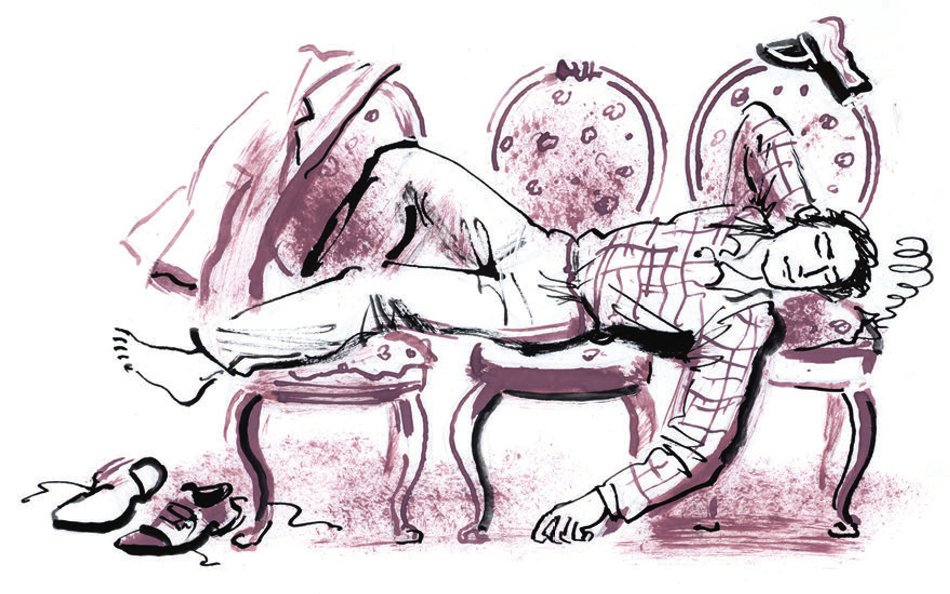
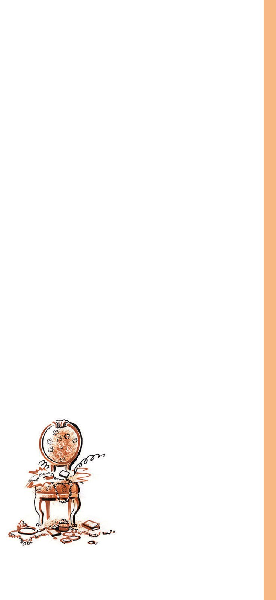

## Kapitel 41: Der Schatz

An einem regnerischen Tag Ende Oktober <abbr title="werkeln — хлопотать, возиться">werkelte</abbr> Ippolit Matwejewitsch ohne Jackett, in seiner Mondweste, die mit kleinen silbernen Sternen <abbr title="übersät — усыпанный">übersät</abbr> war, im Zimmer von Iwanopulo. Ippolit Matwejewitsch arbeitete auf dem Fensterbrett, weil es im Zimmer immer noch keinen Tisch gab. Der große Kombinator hatte einen großen künstlerischen Auftrag bekommen: die Herstellung von <abbr title="das Adressschild, die Adressschilder — адресная табличка">Adressschildern</abbr> für Wohnungsgenossenschaften. Die Ausführung der Schilder mit der Schablone hatte Ostap Worobjaninow <abbr title="übertragen + Dat. (übertrug, hat übertragen) — возлагать, поручать">übertragen</abbr>, während er selbst fast einen ganzen Monat lang, seit ihrer Ankunft in Moskau, in der Gegend des Oktoberbahnhofs kreiste und mit <abbr title="unbegreiflich — непостижимый">unbegreiflicher</abbr> Leidenschaft nach den Spuren des letzten Stuhls suchte, der zweifellos die Brillanten von Madame Petuchowa in sich <abbr title="bergen (barg, hat geborgen) — таить, скрывать">barg</abbr>.

Mit <abbr title="runzeln — морщить">gerunzelter</abbr> Stirn <abbr title="schablonieren — наносить по трафарету">schablonierte</abbr> Ippolit Matwejewitsch die eisernen <abbr title="das Täfelchen, die Täfelchen — дощечка, табличка">Täfelchen</abbr>. In dem halben Jahr des <abbr title="das Brillantenrennen — бриллиантовая скачка">Brillantenrennens</abbr> hatte er seine Gewohnheiten verloren.

Nachts sah Ippolit Matwejewitsch Gebirgsketten vor sich, mit wilden Transparenten geschmückt, vor seinen Augen flog Isnurenkow herum, mit seinen braunen Oberschenkeln wackelnd, Boote kenterten, Menschen <abbr title="ertrinken (ertrank, ist ertrunken) — тонуть">ertranken</abbr>, ein Ziegelstein fiel vom Himmel, und die aufgerissene Erde blies ihm <abbr title="der Schwefelrauch — серный дым">Schwefelrauch</abbr> in die Augen.

Ostap, der täglich mit Ippolit Matwejewitsch zusammen war, bemerkte an ihm keine Veränderung. Dabei hatte sich Ippolit Matwejewitsch außerordentlich verändert. Auch sein Gang war nicht mehr derselbe, sein Blick war wild geworden, und sein nachgewachsener Schnurrbart stand nicht mehr parallel zur <abbr title="die Erdoberfläche — земная поверхность">Erdoberfläche</abbr>, sondern fast senkrecht, wie bei einem älteren Kater.

Auch innerlich hatte sich Ippolit Matwejewitsch verändert. In seinem Charakter waren Züge von Entschlossenheit und <abbr title="die Grausamkeit — жестокость">Grausamkeit</abbr> aufgetaucht, die ihm früher fremd gewesen waren. Drei <abbr title="die Episode, die Episoden — эпизод">Episoden</abbr> hatten diese neuen Gefühle nach und nach in ihm großgezogen: die wunderbare Rettung vor den schweren Fäusten der Schachfreunde von Wasjuki; das erste <abbr title="das Debüt, die Debüts — дебют">Debüt</abbr> im Fach des Bettelns vor dem «Blumengarten» in Pjatigorsk und schließlich das Erdbeben, nach dem Ippolit Matwejewitsch ein wenig verrückt geworden war und gegen seinen Kompagnon einen heimlichen Hass <abbr title="hegen — питать, таить">hegte</abbr>.

In der letzten Zeit war Ippolit Matwejewitsch von heftigstem <abbr title="das Misstrauen — подозрительность, недоверие">Misstrauen</abbr> <abbr title="besessen von + Dat. — одержимый">besessen</abbr>. Er fürchtete, Ostap werde den Stuhl allein öffnen, die Schätze nehmen und davonfahren und ihn seinem Schicksal überlassen. Seinen Verdacht <abbr title="aussprechen (sprach aus, hat ausgesprochen) — высказывать">auszusprechen</abbr> wagte er nicht, da er Ostaps schwere Hand und seinen unbeugsamen Charakter kannte. Täglich saß Ippolit Matwejewitsch am Fenster, kratzte mit einem alten, <abbr title="schartig — зазубренный">schartigen</abbr> Rasiermesser die getrockneten Buchstaben <abbr title="nachkratzen — подчищать">nach</abbr> und <abbr title="sich grämen — томиться, горевать">grämte sich</abbr>. Jeden Tag fürchtete er, Ostap werde nicht mehr kommen, und er, der ehemalige Adelsmarschall, werde unter einem nassen Moskauer Zaun den <abbr title="der Hungertod — голодная смерть">Hungertod</abbr> sterben.

Aber Ostap kam jeden Abend, obwohl er keine frohen Nachrichten brachte. Seine Energie und seine Fröhlichkeit waren unerschöpflich. Die Hoffnung verließ ihn keine Minute.

Im Korridor hörte man Schritte trampeln, jemand <abbr title="prallen gegen + Akk. — грохнуться, удариться">prallte</abbr> gegen den feuerfesten Schrank, und die <abbr title="die Sperrholztür, die Sperrholztüren — фанерная дверь">Sperrholztür</abbr> flog mit der Leichtigkeit einer vom Wind umgeblätterten Seite auf. Auf der Schwelle stand der große Kombinator. Er war völlig mit Wasser übergossen, seine Wangen glühten wie Äpfelchen. Er atmete schwer.

— Ippolit Matwejewitsch! — schrie er. — Hören Sie, Ippolit Matwejewitsch!

Worobjaninow wunderte sich. Noch nie hatte ihn der technische Direktor mit Vor- und Vatersnamen angeredet. Und plötzlich begriff er …

— Gefunden? — hauchte er.

— Das ist es ja eben, gefunden. Ach, Kisa, der Teufel soll Sie holen!

— Schreien Sie nicht, man hört alles.

— Richtig, richtig, man kann uns hören, — flüsterte Ostap schnell. — Gefunden, Kisa, gefunden, und wenn Sie wollen, kann ich ihn Ihnen sofort <abbr title="vorführen — продемонстрировать, показать">vorführen</abbr>. Er steht im Klub der Eisenbahner, im neuen Klub … Gestern war die Eröffnung … Wie ich ihn gefunden habe? Eine Kleinigkeit? Eine ungewöhnlich schwierige Sache! Eine geniale <abbr title="die Kombination, die Kombinationen — комбинация">Kombination</abbr>, glänzend bis zum Ende durchgeführt! Ein <abbr title="antik — античный">antikes</abbr> Abenteuer!.. Mit einem Wort, erste Klasse!

Ohne zu warten, bis Ippolit Matwejewitsch sein Jackett <abbr title="überstreifen — напялить, натянуть">übergestreift</abbr> hatte, lief Ostap in den Korridor hinaus. Worobjaninow holte ihn auf der Treppe ein. Beide liefen, aufgeregt sich gegenseitig mit Fragen <abbr title="bombardieren — забрасывать, бомбардировать">bombardierend</abbr>, durch die nassen Straßen zum Kalantschowka-Platz. Sie kamen nicht einmal auf den Gedanken, dass man mit der Straßenbahn fahren konnte.

— Sie sind angezogen wie ein <abbr title="der Schuster, die Schuster — сапожник">Schuster</abbr>! — plauderte Ostap fröhlich. — Wer läuft denn so herum, Kisa? Sie brauchen gestärkte Wäsche, Seidensöckchen und natürlich einen Zylinder. In Ihrem Gesicht liegt etwas Vornehmes! Sagen Sie, waren Sie wirklich Adelsmarschall?

Ostap zeigte dem Adelsmarschall den Stuhl, der im Zimmer des <abbr title="der Schachzirkel, die Schachzirkel — шахматный кружок">Schachzirkels</abbr> stand und ganz gewöhnlich «gambsmäßig» aussah, obwohl er unermessliche <abbr title="die Kostbarkeit, die Kostbarkeiten — ценность, драгоценность">Kostbarkeiten</abbr> in sich barg, und zerrte Worobjaninow dann in den Korridor. Hier war keine Menschenseele. Ostap trat an ein Fenster, das noch nicht für den Winter <abbr title="abdichten — замазывать, уплотнять">abgedichtet</abbr> war, und zog die <abbr title="der Riegel, die Riegel — задвижка, шпингалет">Riegel</abbr> beider Rahmen aus ihren <abbr title="die Halterung, die Halterungen — гнездо, крепление">Halterungen</abbr>.

— Durch dieses Fensterchen, — sagte er, — kommen wir leicht und sanft zu jeder beliebigen Stunde der heutigen Nacht in den Klub. Merken Sie sich, Kisa: das dritte Fenster vom Haupteingang.

Die Freunde schlenderten noch lange als Vertreter der Kreisabteilung für Volksbildung durch den Klub und konnten sich an den wunderbaren Sälen und Zimmern nicht <abbr title="sich sattsehen an + Dat. — насмотреться, надивиться">sattsehen</abbr>.

— Hätte ich in Wasjuki auf so einem Stuhl gespielt, — sagte Ostap, als er auf einem solchen Stuhl saß, — hätte ich keine einzige Partie verloren. Der <abbr title="der Enthusiasmus — энтузиазм">Enthusiasmus</abbr> hätte es nicht zugelassen. Aber gehen wir, Alterchen, ich habe fünfundzwanzig Rubel <abbr title="der Notgroschen — заначка, «подкожные»">Notgroschen</abbr>. Wir müssen Bier trinken und uns vor dem nächtlichen Besuch ausruhen. <abbr title="schockieren — шокировать">Schockiert</abbr> Sie Bier nicht, Adelsmarschall? Macht nichts. Morgen werden Sie Champagner in <abbr title="unbegrenzt — неограниченный">unbegrenzter</abbr> Menge <abbr title="schlabbern — лакать">schlabbern</abbr>.

Auf dem Weg von der Bierstube zum Siwzew Wraschek war Bender furchtbar <abbr title="ausgelassen — весёлый, разгулявшийся">ausgelassen</abbr> und <abbr title="necken — задирать, дразнить">neckte</abbr> die Passanten. Er umarmte den leicht <abbr title="angeheitert — захмелевший, подвыпивший">angeheiterten</abbr> Ippolit Matwejewitsch an den Schultern und sagte zärtlich:

— Sie sind ein außerordentlich sympathischer Alter, Kisa, aber mehr als zehn Prozent gebe ich Ihnen nicht. Bei Gott, ich gebe sie Ihnen nicht. Na, wozu brauchen Sie, wozu brauchen Sie so viel Geld?

— Wieso wozu? Wieso wozu? — ereiferte sich Ippolit Matwejewitsch.

Ostap lachte <abbr title="aufrichtig — чистосердечно">aufrichtig</abbr> und schmiegte seine Wange an den nassen Ärmel seines Konzessionsfreundes.

— Na, was werden Sie denn kaufen, Kisa? Na, was? Sie haben ja überhaupt keine Fantasie. Bei Gott, fünfzehntausend reichen Ihnen <abbr title="reichlich — за глаза, с лихвой">reichlich</abbr> … Sie sterben ja bald, Sie sind ja schon alt. Sie brauchen ja überhaupt kein Geld … Wissen Sie, Kisa, ich glaube, ich gebe Ihnen gar nichts. Das ist <abbr title="die Verwöhnung — баловство">Verwöhnung</abbr>. Ich nehme Sie, Kisulja, lieber als Sekretär zu mir. Hm? Vierzig Rubel im Monat. Kost bei mir. Vier freie Tage … Hm? <abbr title="die Arbeitskleidung — спецодежда">Arbeitskleidung</abbr>, Trinkgelder, Sozialversicherung … Hm? Passt Ihnen dieses Angebot?

Ippolit Matwejewitsch riss seine Hand los und ging schnell voraus. Diese Scherze brachten ihn zur Raserei.

Ostap holte Worobjaninow am Eingang des rosa <abbr title="das Häuschen, die Häuschen — домик, особнячок">Häuschens</abbr> ein.

— Sind Sie mir wirklich böse? — fragte Ostap. — Ich habe doch nur Spaß gemacht. Ihre drei Prozent bekommen Sie. Bei Gott, drei Prozent reichen Ihnen, Kisa.

Ippolit Matwejewitsch betrat mürrisch das Zimmer.

— Na? Kisa, — <abbr title="herumalbern — резвиться, дурачиться">alberte</abbr> Ostap herum, — nehmen Sie die drei Prozent an! Bei Gott, nehmen Sie an! Ein anderer würde annehmen. Ein Zimmer müssen Sie sich nicht kaufen, zum Glück ist Iwanopulo für ein ganzes Jahr nach Twer gefahren. Oder kommen Sie doch zu mir als <abbr title="der Kammerdiener, die Kammerdiener — камердинер">Kammerdiener</abbr> … Ein warmes <abbr title="das Plätzchen, die Plätzchen — местечко">Plätzchen</abbr>.

Als Ostap sah, dass Ippolit Matwejewitsch durch nichts <abbr title="aufmuntern — растормошить, развеселить">aufzumuntern</abbr> war, gähnte er genüsslich, streckte sich bis zur Decke, füllte seinen breiten <abbr title="der Brustkorb, die Brustkörbe — грудная клетка">Brustkorb</abbr> mit Luft und sagte:

— Na, mein Freund, halten Sie die Taschen bereit. In den Klub gehen wir vor der <abbr title="die Morgendämmerung — рассвет">Morgendämmerung</abbr>. Das ist die beste Zeit. Die Wächter schlafen und haben süße Träume, wofür man sie oft ohne <abbr title="die Abfindung, die Abfindungen — выходное пособие">Abfindung</abbr> entlässt. Bis dahin, mein Bester, rate ich Ihnen, sich auszuruhen.

Ostap legte sich auf drei Stühle, die in verschiedenen Teilen Moskaus zusammengetragen worden waren, und sagte im Einschlafen:

— Oder als Kammerdiener!.. Ein anständiges Gehalt … Kost … Trinkgelder … Na, na, war nur ein Scherz … Die Sitzung geht weiter! Das Eis ist gebrochen, meine Herren Geschworenen!

Das waren die letzten Worte des großen Kombinators. Er schlief einen sorglosen Schlaf, tief, <abbr title="erfrischend — освежающий">erfrischend</abbr> und nicht von Träumen <abbr title="beschweren — отягощать">beschwert</abbr>.

Ippolit Matwejewitsch ging auf die Straße hinaus. Er war voller Verzweiflung und <abbr title="die Bosheit — злоба">Bosheit</abbr>. Der Mond sprang über die <abbr title="der Wolkenhügel, die Wolkenhügel — облачная кочка">Wolkenhügel</abbr>. Die nassen Gitter der Villen glänzten fettig. Die <abbr title="die Gaslaterne, die Gaslaternen — газовый фонарь">Gaslaternen</abbr>, umgeben von kleinen <abbr title="der Kranz, die Kränze — венок">Kränzen</abbr> aus <abbr title="der Sprühregen — водяная пыль, морось">Sprühregen</abbr>, leuchteten unruhig. Aus der Bierstube «Adler» wurde ein <abbr title="der Betrunkene, die Betrunkenen — пьяный">Betrunkener</abbr> hinausgestoßen. Der Betrunkene grölte. Ippolit Matwejewitsch verzog das Gesicht und ging festen Schrittes zurück. Er hatte nur einen Wunsch: alles so schnell wie möglich zu beenden.

Er betrat das Zimmer, sah den schlafenden Ostap streng an, <abbr title="putzen — протирать, чистить">putzte</abbr> seinen Kneifer und nahm das Rasiermesser vom Fensterbrett. An seinen <abbr title="die Scharte, die Scharten — зазубрина">Scharten</abbr> waren getrocknete <abbr title="das Schüppchen, die Schüppchen — чешуйка">Schüppchen</abbr> von Ölfarbe zu sehen. Er steckte das Rasiermesser in die Tasche, ging noch einmal an Ostap vorbei, ohne ihn anzusehen, aber er hörte seinen Atem, und fand sich im Korridor wieder. Hier war es still und schläfrig. Offenbar hatten sich schon alle schlafen gelegt. In der völligen Dunkelheit des Korridors lächelte Ippolit Matwejewitsch plötzlich auf höchst boshafte Weise und spürte, wie sich auf seiner Stirn die Haut bewegte. Um diese neue <abbr title="die Empfindung, die Empfindungen — ощущение">Empfindung</abbr> zu <abbr title="überprüfen — проверять">überprüfen</abbr>, lächelte er noch einmal. Ihm fiel plötzlich ein, dass auf dem Gymnasium der Schüler Pychtejew-Kakujew mit den Ohren wackeln konnte.

Ippolit Matwejewitsch ging bis zur Treppe und lauschte aufmerksam. Auf der Treppe war niemand. Von der Straße her hörte man das Klappern der Hufe eines Droschkenpferdes, absichtlich laut und deutlich, als würde jemand auf einem Rechenbrett zählen. Der Adelsmarschall kehrte mit <abbr title="der Katzenschritt, die Katzenschritte — кошачий шаг">Katzenschritten</abbr> ins Zimmer zurück, nahm aus Ostaps Jackett, das über einem Stuhl hing, zwanzig Rubel und die Flachzange, setzte sich die schmutzige Admiralsmütze auf und lauschte wieder.

Ostap schlief leise, ohne zu schnaufen. Sein <abbr title="der Nasen-Rachen-Raum — носоглотка">Nasen-Rachen-Raum</abbr> und seine Lunge arbeiteten tadellos und atmeten die Luft <abbr title="ordnungsgemäß — исправно">ordnungsgemäß</abbr> ein und aus. Sein kräftiger Arm hing bis auf den Boden herab. Ippolit Matwejewitsch spürte die Sekundenschläge des Pulses an den Schläfen, schob <abbr title="ohne Eile — неторопливо">ohne Eile</abbr> den rechten Ärmel über den Ellbogen hoch, <abbr title="umwickeln — обматывать">umwickelte</abbr> den <abbr title="entblößt — обнажённый">entblößten</abbr> Arm mit einem <abbr title="das Waffelhandtuch, die Waffelhandtücher — вафельное полотенце">Waffelhandtuch</abbr>, trat zur Tür zurück, nahm das Rasiermesser aus der Tasche, <abbr title="abmessen (maß ab, hat abgemessen) — примериваться, измерять">maß</abbr> mit den Augen die Abstände im Zimmer ab und drehte den <abbr title="der Lichtschalter, die Lichtschalter — выключатель">Lichtschalter</abbr>. Das Licht ging aus, aber das Zimmer war leicht erhellt vom bläulichen <abbr title="das Aquariumlicht — аквариумный свет">Aquariumlicht</abbr> der Straßenlaterne.

— Umso besser, — flüsterte Ippolit Matwejewitsch.

Er näherte sich dem Kopfende, hielt die Hand mit dem Rasiermesser weit von sich weg und stieß mit aller Kraft die ganze Klinge auf einmal schräg in Ostaps Kehle, riss das Rasiermesser sofort wieder heraus und sprang zur Wand zurück. Der große Kombinator gab einen Laut von sich, wie ihn ein <abbr title="das Spülbecken, die Spülbecken — кухонная раковина">Spülbecken</abbr> macht, das die letzten Reste Wasser einsaugt. Es gelang Ippolit Matwejewitsch, sich nicht mit Blut <abbr title="sich schmutzig machen — запачкаться">schmutzig zu machen</abbr>. Er wischte mit dem Jackett an der steinernen Wand entlang, schlich zur blauen Tür und sah noch einmal für eine Sekunde zu Ostap hin. Sein Körper <abbr title="sich aufbäumen — выгибаться, вздыматься">bäumte sich</abbr> zweimal auf und fiel gegen die Lehnen der Stühle. Das Straßenlicht schwamm über die schwarze <abbr title="die Lache, die Lachen — лужа">Lache</abbr>, die sich auf dem Boden gebildet hatte.

«Was ist das für eine Lache? — dachte Ippolit Matwejewitsch. — Ja, ja, Blut … Genosse Bender ist <abbr title="verscheiden (verschied, ist verschieden) — скончаться">verschieden</abbr>.»

Worobjaninow wickelte das leicht <abbr title="beschmiert — измазанный">beschmierte</abbr> Handtuch ab, warf es weg, legte dann vorsichtig das Rasiermesser auf den Boden und entfernte sich, wobei er leise die Tür <abbr title="zuziehen (zog zu, hat zugezogen) — прикрывать (дверь)">zuzog</abbr>.

Als er auf der Straße war, runzelte Ippolit Matwejewitsch die Stirn und ging, «Die Brillanten gehören alle mir, und nicht nur sechs Prozent» murmelnd, zum Kalantschowka-Platz.

Am dritten Fenster vom Haupteingang des Eisenbahnerklubs blieb Ippolit Matwejewitsch stehen. Die <abbr title="das Spiegelfenster, die Spiegelfenster — зеркальное окно">Spiegelfenster</abbr> des neuen Gebäudes schimmerten <abbr title="perlgrau — жемчужно-серый">perlgrau</abbr> im Licht des <abbr title="heraufziehen (zog herauf, ist heraufgezogen) — подступать, надвигаться">heraufziehenden</abbr> Morgens. In der feuchten Luft klangen die dumpfen Stimmen der <abbr title="die Rangierlokomotive, die Rangierlokomotiven — маневровый паровоз">Rangierlokomotiven</abbr>. Ippolit Matwejewitsch kletterte geschickt auf den Sims, stieß den Rahmen auf und sprang lautlos in den Korridor.

Er fand sich in den grauen Sälen des Klubs vor der Morgendämmerung leicht zurecht, drang in das <abbr title="das Schachkabinett, die Schachkabinette — шахматный кабинет">Schachkabinett</abbr> ein, streifte mit dem Kopf das an der Wand hängende Porträt von Emanuel Lasker und trat an den Stuhl. Er beeilte sich nicht. Er hatte es nicht eilig. Niemand verfolgte ihn. Großmeister O. Bender schlief den ewigen Schlaf in der rosa Villa am Siwzew Wraschek.

Ippolit Matwejewitsch setzte sich auf den Boden, umklammerte den Stuhl mit seinen <abbr title="sehnig — жилистый">sehnigen</abbr> Beinen und begann mit der Kaltblütigkeit eines Zahnarztes die <abbr title="der Messingnagel, die Messingnägel — медный гвоздь">Messingnägel</abbr> aus dem Stuhl zu ziehen, ohne einen einzigen auszulassen. Beim zweiundsechzigsten Nagel war seine Arbeit beendet. Der englische Kattun und das Sackleinen lagen lose auf der Polsterung des Stuhls. Man musste sie nur hochheben, um die <abbr title="das Etui, die Etuis — футляр">Etuis</abbr>, Etuichen und <abbr title="das Kästchen, die Kästchen — ящичек, шкатулка">Kästchen</abbr> zu sehen, die mit Edelsteinen gefüllt waren.

«Sofort in ein Auto, — dachte Ippolit Matwejewitsch, der in der Schule des großen Kombinators Lebensweisheit gelernt hatte, — zum Bahnhof. Und an die polnische Grenze. Für irgendein Steinchen bringt man mich auf die andere Seite, und dort …»

Und da er so schnell wie möglich sehen wollte, was «dort» sein würde, riss Ippolit Matwejewitsch den Kattun und das Sackleinen vom Stuhl. Vor seinen Augen lagen Sprungfedern, wunderbare englische Sprungfedern, und Füllung, eine prächtige Füllung von <abbr title="die Vorkriegsqualität — довоенное качество">Vorkriegsqualität</abbr>, wie man sie heute nirgends mehr findet. Aber sonst war nichts in dem Stuhl. Ippolit Matwejewitsch wühlte mechanisch mit den Fingern in der Polsterung und saß eine ganze halbe Stunde lang da, ohne den Stuhl aus seinen <abbr title="klammernd — цепкий">klammernden</abbr> Beinen zu lassen, und wiederholte <abbr title="stumpfsinnig — тупо">stumpfsinnig</abbr>:

— Warum ist denn hier nichts? Das kann nicht sein! Das kann nicht sein!

Es war schon fast hell, als Worobjaninow alles so liegen ließ, wie es war, im Schachkabinett, die Flachzange und die Mütze mit dem goldenen Abzeichen des nicht existierenden Jachtklubs dort vergaß und, von niemandem bemerkt, schwer und müde durch das Fenster auf die Straße kletterte.

— Das kann nicht sein, — wiederholte er, als er einen Häuserblock weit gegangen war. — Das kann nicht sein.

Und er kehrte zum Klub zurück und begann an seinen großen Fenstern auf und ab zu gehen und bewegte die Lippen:

— Das kann nicht sein! Das kann nicht sein! Das kann nicht sein!

Ab und zu schrie er auf, griff sich an den Kopf, der vom Morgennebel nass war. Wenn er sich an alle Ereignisse der Nacht erinnerte, schüttelte er seine grauen Zotteln. Die Brillantenaufregung hatte sich als zu starkes Mittel erwiesen: In fünf Minuten war er <abbr title="altersschwach — одряхлевший">altersschwach</abbr> geworden.

— Die laufen hier rum, alle möglichen laufen hier rum, — hörte Worobjaninow über seinem Ohr.

Er sah einen Wächter in Arbeitskleidung aus <abbr title="die Zeltplane — брезент">Zeltplane</abbr> und in kalten Stiefeln. Der Wächter war sehr alt und offenbar gutmütig.

— Die laufen und laufen, — sagte der Alte <abbr title="gesprächig — общительно, разговорчиво">gesprächig</abbr>, der die nächtliche <abbr title="die Einsamkeit — одиночество">Einsamkeit</abbr> satthatte, — und Sie, Genosse, interessieren sich auch dafür. Und recht so. Unser Klub ist, kann man sagen, außergewöhnlich.

Ippolit Matwejewitsch sah den rotwangigen Alten leidend an.

— Ja, — sagte der Alte, — außergewöhnlich ist dieser Klub. So einen gibt's nirgends mehr.

— Und was ist denn so außergewöhnlich an ihm? — fragte Ippolit Matwejewitsch und sammelte seine Gedanken.

Der Alte sah Worobjaninow freudig an. Offenbar gefiel ihm die Geschichte vom außergewöhnlichen Klub selbst, und er erzählte sie gern immer wieder.

— Also, — begann der Alte, — ich bin hier schon das zehnte Jahr Wächter, und so einen Fall hat's noch nicht gegeben. Hör zu, Soldatchen. Also, hier war <abbr title="seit eh und je — издавна, всегда">seit eh und je</abbr> ein Klub, man weiß ja, was für einer, vom ersten Abschnitt des <abbr title="der Zugförderungsdienst — служба тяги">Zugförderungsdienstes</abbr>. Den hab ich auch bewacht. Ein <abbr title="nichtsnutzig — негодный, никудышный">nichtsnutziger</abbr> Klub war das … Man hat <abbr title="heizen — топить (печь)">geheizt</abbr> und geheizt und konnte nichts machen. Und Genosse Krasilnikow kommt zu mir: Wohin, sagt er, geht dir denn das Brennholz? Ess ich das etwa, das Holz? Hat sich Genosse Krasilnikow mit dem Klub <abbr title="sich abplagen mit + Dat. — биться, мучиться">abgeplagt</abbr> – da Feuchtigkeit, hier Kälte, der Blaskapelle fehlt ein Raum, und Theater spielen – eine einzige Qual: Die Herren Schauspieler haben <abbr title="frieren (fror, hat gefroren) — мёрзнуть">gefroren</abbr>. Fünf Jahre lang hat man um einen Kredit für einen neuen Klub gebeten, aber ich weiß nicht, was da rauskam. Die Bahngewerkschaftsleitung hat den Kredit nicht bewilligt. Erst im Frühling hat Genosse Krasilnikow einen Stuhl für die Bühne gekauft, einen guten Stuhl, einen weichen …

Ippolit Matwejewitsch lehnte sich mit dem ganzen Körper an den Wächter und hörte zu. Er war halb <abbr title="ohnmächtig — в обмороке">ohnmächtig</abbr>. Und der Alte erzählte, vergnügt lachend, wie er einmal auf diesen Stuhl geklettert sei, um eine <abbr title="die Glühbirne, die Glühbirnen — электрическая лампочка">Glühbirne</abbr> <abbr title="herausschrauben — вывинчивать">herauszuschrauben</abbr>, und dabei heruntergerutscht sei.

— Von dem Stuhl bin ich <abbr title="abrutschen (ist abgerutscht) — соскользнуть">abgerutscht</abbr>, der <abbr title="der Überzug, die Überzüge — обшивка">Überzug</abbr> ist dabei gerissen. Und ich schau – unter dem Überzug fallen Glasstückchen raus und weiße Perlen an einem Fädchen.

— Perlen, — sagte Ippolit Matwejewitsch.

— Perlen, — quiekte der Alte entzückt, — und ich schau weiter, Soldatchen, und da sind allerlei Schächtelchen. Diese Schächtelchen hab ich nicht mal angerührt. Bin gleich zu Genosse Krasilnikow gegangen und hab's gemeldet. Und so hab ich's auch nachher der Kommission gemeldet. Hab die Schächtelchen nicht angerührt und nicht angerührt. Und gut hab ich das gemacht, Soldatchen, denn da hat man <abbr title="das Juwel, die Juwelen — драгоценность">Juwelen</abbr> gefunden, von der <abbr title="die Bourgeoisie — буржуазия">Bourgeoisie</abbr> versteckt …

— Wo sind die Juwelen? — schrie der Adelsmarschall.

— Wo, wo, — <abbr title="nachäffen — передразнивать">äffte</abbr> der Alte ihn nach, — da muss man <abbr title="der Grips — соображение, смекалка">Grips</abbr> haben, Soldatchen. Da sind sie!

— Wo? Wo?

— Na, da sind sie doch! — schrie der rotwangige Wächter und freute sich über die Wirkung. — Da sind sie! <abbr title="sich die Brille putzen — протереть очки">Putz dir die Brille</abbr>! Den Klub hat man dafür gebaut, Soldatchen! Siehst du? Da ist er, der Klub! <abbr title="die Dampfheizung — паровое отопление">Dampfheizung</abbr>, <abbr title="das Damespiel, die Damespiele — шашки">Damespiel</abbr> mit Uhren, Büfett, Theater, in Galoschen wird man nicht reingelassen!..

Ippolit Matwejewitsch <abbr title="zu Eis erstarren — оледенеть">erstarrte zu Eis</abbr> und ließ, ohne sich von der Stelle zu rühren, die Augen über die <abbr title="das Gesims, die Gesimse — карниз (здания)">Gesimse</abbr> wandern.

Da also war er, der Schatz von Madame Petuchowa! Da war er! Alles hier! Alle hundertfünfzigtausend Rubel null null Kopeken, wie der ermordete Ostap-Suleiman-Berta-Maria Bender gern zu sagen pflegte.

Die Brillanten hatten sich in durchgehende <abbr title="das Fassadenfenster, die Fassadenfenster — фасадное стекло">Fassadenfenster</abbr> und <abbr title="die Stahlbetondecke, die Stahlbetondecken — железобетонное перекрытие">Stahlbetondecken</abbr> verwandelt, die kühlen <abbr title="die Turnhalle, die Turnhallen — гимнастический зал">Turnhallen</abbr> waren aus Perlen gemacht. Das <abbr title="das Diamantdiadem, die Diamantdiademe — алмазная диадема">Diamantdiadem</abbr> hatte sich in einen <abbr title="der Theatersaal, die Theatersäle — театральный зал">Theatersaal</abbr> mit <abbr title="die Drehbühne, die Drehbühnen — вращающаяся сцена">Drehbühne</abbr> verwandelt, die <abbr title="der Rubinanhänger, die Rubinanhänger — рубиновая подвеска">Rubinanhänger</abbr> waren zu ganzen Kronleuchtern <abbr title="heranwachsen (wuchs heran, ist herangewachsen) — разрастаться">herangewachsen</abbr>, die goldenen <abbr title="das Schlangenarmband, die Schlangenarmbänder — браслет в виде змейки">Schlangenarmbänder</abbr> mit Smaragden waren zu einer schönen Bibliothek geworden, und die <abbr title="die Halsbandschließe, die Halsbandschließen — фермуар (застёжка ожерелья)">Halsbandschließe</abbr> hatte sich in eine <abbr title="die Kinderkrippe, die Kinderkrippen — детские ясли">Kinderkrippe</abbr>, eine <abbr title="die Segelflugwerkstatt, die Segelflugwerkstätten — планерная мастерская">Segelflugwerkstatt</abbr>, ein Schachkabinett und ein <abbr title="das Billardzimmer, die Billardzimmer — бильярдная">Billardzimmer</abbr> verwandelt.

Der Schatz war geblieben, er war erhalten und hatte sich sogar vermehrt. Man konnte ihn mit den Händen berühren, aber man konnte ihn nicht forttragen. Er war in den Dienst anderer Menschen übergegangen.

Ippolit Matwejewitsch berührte mit den Händen die <abbr title="die Granitverkleidung — гранитная облицовка">Granitverkleidung</abbr>. Die Kälte des Steins drang ihm bis ins Herz.

Und er schrie.

Sein Schrei, rasend, leidenschaftlich und wild – der Schrei einer <abbr title="durchschießen (durchschoss, hat durchschossen) — простреливать навылет">durchschossenen</abbr> <abbr title="die Wölfin, die Wölfinnen — волчица">Wölfin</abbr> –, flog bis in die Mitte des Platzes, <abbr title="schießen (schoss, ist geschossen) — метнуться">schoss</abbr> unter die Brücke und begann, von überall <abbr title="zurückstoßen (stieß zurück, hat zurückgestoßen) — отталкивать">zurückgestoßen</abbr> von den Geräuschen der erwachenden Großstadt, <abbr title="schwächer werden — глохнуть, слабеть">schwächer zu werden</abbr>, und nach einer Minute war er <abbr title="ersterben (erstarb, ist erstorben) — зачахнуть, замирать">erstorben</abbr>.

Ein herrlicher Herbstmorgen rollte von den nassen Dächern auf die Straßen Moskaus herab. Die Stadt machte sich auf ihren alltäglichen <abbr title="der Feldzug, die Feldzüge — поход">Feldzug</abbr>.

1927

---

### Neue Wörter

- **werkeln** — хлопотать, возиться
- **übersät** — усыпанный
- **das Adressschild, die Adressschilder** — адресная табличка
- **übertragen + Dat. (übertrug, hat übertragen)** — возлагать, поручать
- **unbegreiflich** — непостижимый
- **bergen (barg, hat geborgen)** — таить, скрывать
- **runzeln** — морщить
- **schablonieren** — наносить по трафарету
- **das Täfelchen, die Täfelchen** — дощечка, табличка
- **das Brillantenrennen** — бриллиантовая скачка
- **ertrinken (ertrank, ist ertrunken)** — тонуть
- **der Schwefelrauch** — серный дым
- **die Erdoberfläche** — земная поверхность
- **die Grausamkeit** — жестокость
- **die Episode, die Episoden** — эпизод
- **das Debüt, die Debüts** — дебют
- **hegen** — питать, таить
- **das Misstrauen** — подозрительность, недоверие
- **besessen von + Dat.** — одержимый
- **aussprechen (sprach aus, hat ausgesprochen)** — высказывать
- **schartig** — зазубренный
- **nachkratzen** — подчищать
- **sich grämen** — томиться, горевать
- **der Hungertod** — голодная смерть
- **prallen gegen + Akk.** — грохнуться, удариться
- **die Sperrholztür, die Sperrholztüren** — фанерная дверь
- **vorführen** — продемонстрировать, показать
- **die Kombination, die Kombinationen** — комбинация
- **antik** — античный
- **überstreifen** — напялить, натянуть
- **bombardieren** — забрасывать, бомбардировать
- **der Schuster, die Schuster** — сапожник
- **der Schachzirkel, die Schachzirkel** — шахматный кружок
- **die Kostbarkeit, die Kostbarkeiten** — ценность, драгоценность
- **abdichten** — замазывать, уплотнять
- **der Riegel, die Riegel** — задвижка, шпингалет
- **die Halterung, die Halterungen** — гнездо, крепление
- **sich sattsehen an + Dat.** — насмотреться, надивиться
- **der Enthusiasmus** — энтузиазм
- **der Notgroschen** — заначка, «подкожные»
- **schockieren** — шокировать
- **unbegrenzt** — неограниченный
- **schlabbern** — лакать
- **ausgelassen** — весёлый, разгулявшийся
- **necken** — задирать, дразнить
- **angeheitert** — захмелевший, подвыпивший
- **aufrichtig** — чистосердечно
- **reichlich** — за глаза, с лихвой
- **die Verwöhnung** — баловство
- **die Arbeitskleidung** — спецодежда
- **das Häuschen, die Häuschen** — домик, особнячок
- **herumalbern** — резвиться, дурачиться
- **der Kammerdiener, die Kammerdiener** — камердинер
- **das Plätzchen, die Plätzchen** — местечко
- **aufmuntern** — растормошить, развеселить
- **der Brustkorb, die Brustkörbe** — грудная клетка
- **die Morgendämmerung** — рассвет
- **die Abfindung, die Abfindungen** — выходное пособие
- **erfrischend** — освежающий
- **beschweren** — отягощать
- **die Bosheit** — злоба
- **der Wolkenhügel, die Wolkenhügel** — облачная кочка
- **die Gaslaterne, die Gaslaternen** — газовый фонарь
- **der Kranz, die Kränze** — венок
- **der Sprühregen** — водяная пыль, морось
- **der Betrunkene, die Betrunkenen** — пьяный
- **putzen** — протирать, чистить
- **die Scharte, die Scharten** — зазубрина
- **das Schüppchen, die Schüppchen** — чешуйка
- **die Empfindung, die Empfindungen** — ощущение
- **überprüfen** — проверять
- **der Katzenschritt, die Katzenschritte** — кошачий шаг
- **der Nasen-Rachen-Raum** — носоглотка
- **ordnungsgemäß** — исправно
- **ohne Eile** — неторопливо
- **umwickeln** — обматывать
- **entblößt** — обнажённый
- **das Waffelhandtuch, die Waffelhandtücher** — вафельное полотенце
- **abmessen (maß ab, hat abgemessen)** — примериваться, измерять
- **der Lichtschalter, die Lichtschalter** — выключатель
- **das Aquariumlicht** — аквариумный свет
- **das Spülbecken, die Spülbecken** — кухонная раковина
- **sich schmutzig machen** — запачкаться
- **sich aufbäumen** — выгибаться, вздыматься
- **die Lache, die Lachen** — лужа
- **verscheiden (verschied, ist verschieden)** — скончаться
- **beschmiert** — измазанный
- **zuziehen (zog zu, hat zugezogen)** — прикрывать (дверь)
- **das Spiegelfenster, die Spiegelfenster** — зеркальное окно
- **perlgrau** — жемчужно-серый
- **heraufziehen (zog herauf, ist heraufgezogen)** — подступать, надвигаться
- **die Rangierlokomotive, die Rangierlokomotiven** — маневровый паровоз
- **das Schachkabinett, die Schachkabinette** — шахматный кабинет
- **sehnig** — жилистый
- **der Messingnagel, die Messingnägel** — медный гвоздь
- **das Etui, die Etuis** — футляр
- **das Kästchen, die Kästchen** — ящичек, шкатулка
- **die Vorkriegsqualität** — довоенное качество
- **klammernd** — цепкий
- **stumpfsinnig** — тупо
- **altersschwach** — одряхлевший
- **die Zeltplane** — брезент
- **gesprächig** — общительно, разговорчиво
- **die Einsamkeit** — одиночество
- **seit eh und je** — издавна, всегда
- **der Zugförderungsdienst** — служба тяги
- **nichtsnutzig** — негодный, никудышный
- **heizen** — топить (печь)
- **sich abplagen mit + Dat.** — биться, мучиться
- **frieren (fror, hat gefroren)** — мёрзнуть
- **ohnmächtig** — в обмороке
- **die Glühbirne, die Glühbirnen** — электрическая лампочка
- **herausschrauben** — вывинчивать
- **abrutschen (ist abgerutscht)** — соскользнуть
- **der Überzug, die Überzüge** — обшивка
- **das Juwel, die Juwelen** — драгоценность
- **die Bourgeoisie** — буржуазия
- **nachäffen** — передразнивать
- **der Grips** — соображение, смекалка
- **sich die Brille putzen** — протереть очки
- **die Dampfheizung** — паровое отопление
- **das Damespiel, die Damespiele** — шашки
- **zu Eis erstarren** — оледенеть
- **das Gesims, die Gesimse** — карниз (здания)
- **das Fassadenfenster, die Fassadenfenster** — фасадное стекло
- **die Stahlbetondecke, die Stahlbetondecken** — железобетонное перекрытие
- **die Turnhalle, die Turnhallen** — гимнастический зал
- **das Diamantdiadem, die Diamantdiademe** — алмазная диадема
- **der Theatersaal, die Theatersäle** — театральный зал
- **die Drehbühne, die Drehbühnen** — вращающаяся сцена
- **der Rubinanhänger, die Rubinanhänger** — рубиновая подвеска
- **heranwachsen (wuchs heran, ist herangewachsen)** — разрастаться
- **das Schlangenarmband, die Schlangenarmbänder** — браслет в виде змейки
- **die Halsbandschließe, die Halsbandschließen** — фермуар (застёжка ожерелья)
- **die Kinderkrippe, die Kinderkrippen** — детские ясли
- **die Segelflugwerkstatt, die Segelflugwerkstätten** — планерная мастерская
- **das Billardzimmer, die Billardzimmer** — бильярдная
- **die Granitverkleidung** — гранитная облицовка
- **durchschießen (durchschoss, hat durchschossen)** — простреливать навылет
- **die Wölfin, die Wölfinnen** — волчица
- **schießen (schoss, ist geschossen)** — метнуться
- **zurückstoßen (stieß zurück, hat zurückgestoßen)** — отталкивать
- **schwächer werden** — глохнуть, слабеть
- **ersterben (erstarb, ist erstorben)** — зачахнуть, замирать
- **der Feldzug, die Feldzüge** — поход

[← Kapitel 40](kapitel-40.md) · [Inhalt](README.md)
